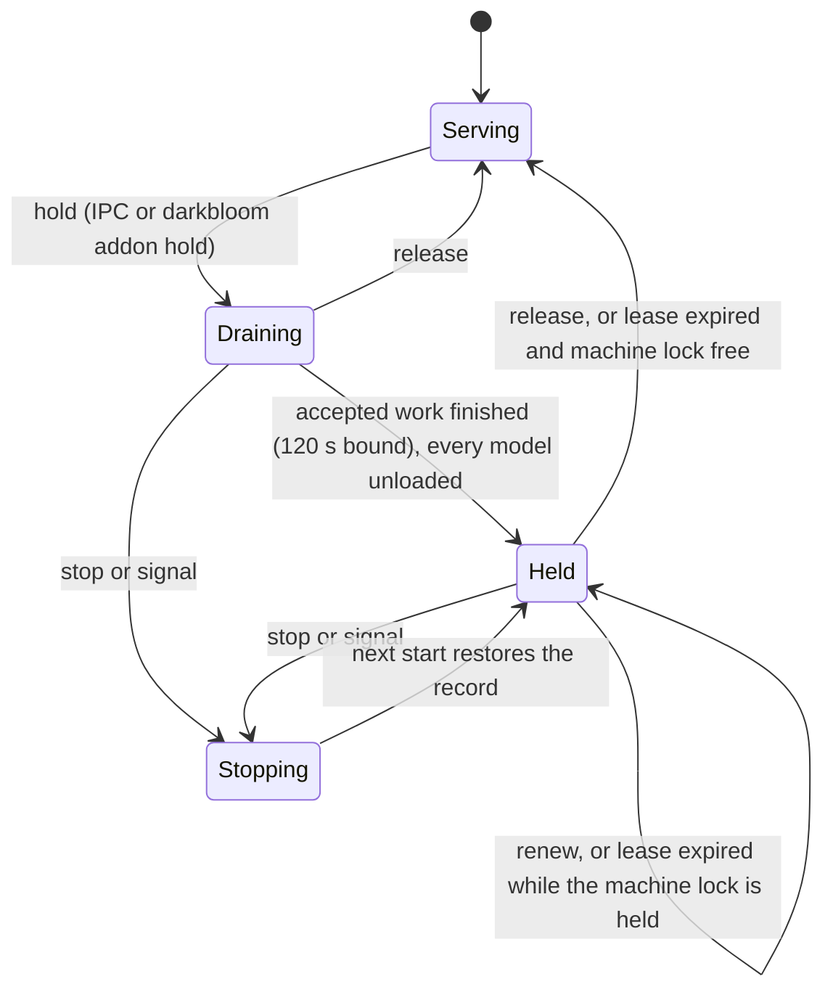

# Add-on hold

> Last updated: 2026-10-27

How a local add-on, such as the Darkbloom Sandbox VM host, takes a Mac away
from inference without disconnecting the provider, and how the provider
returns. This explanation is for provider and add-on developers; the exact
socket contract is in the [add-on hold IPC reference](../reference/addon-hold-ipc.md).

## Context

An add-on that runs VMs needs the Mac's unified memory. Disconnecting the
provider would cost a fresh registration, authorization and warm-up on return.
A hold instead keeps the coordinator connection and the App Attest worker,
leaves routing through the existing draining status, unloads every model, and
reopens admission on the same connection when released. Leases and the
add-on's machine lock make a crashed add-on recoverable without loading models
beside VMs that still run.

## Mechanism

1. A hold request closes admission with drain owner `addonHold`
   (`ProviderDrain.begin` in `provider-swift/Sources/ProviderCore/Service/ProviderDrain.swift`),
   publishes `ProviderBusy` and sends an event heartbeat with
   `status: draining` and the [busy fields](../reference/protocol-messages.md#add-on-hold-busy-fields).
2. Accepted inference keeps running up to `addonHoldDrainTimeoutDefault =
   .seconds(120)`; what remains is then cancelled. Load transitions get
   `addonHoldSettleTimeout = .seconds(60)` before every model unloads through
   `unloadModel`, retained KV segments and the MLX buffer cache are released,
   and the hold becomes `held`.
3. Release ends the last hold, reopens admission, rebuilds capacity from a
   fresh memory sample, sends an `idle` or `serving` heartbeat and replays a
   `desired_models` snapshot deferred during the hold. Models then load on
   demand.

## Invariants

1. Update, reconnect and model-switch drains cannot replace or reopen a hold;
   only a stop preempts it, and a hold never preempts a switch or stop
   (`ProviderDrain.begin`, `ProviderDrain.resumeAddonHold`).
2. The hold never sends `provider_drain`. A background update or App Attest
   stall restart whose drain the hold took over stops before its barrier
   (`waitForSafeDisconnect` in `provider-swift/Sources/ProviderCore/ProviderLoop+PlannedDisconnect.swift`).
3. A planned reconnect proceeds beneath a hold and keeps it: the fresh
   `register` carries the busy fields from `ProviderState.busy`, and
   `finishPlannedReconnect` re-announces the draining status. A reconnect still
   pending at release keeps admission closed until its registration
   (`resumeAfterAddonHold`).
4. A hold does not stop the App Attest worker and does not block its recovery
   after an update (`ProviderDrain.refusingForServiceChange`).
5. Auto-update, Autopilot operations, model revisions, MTP upgrades, coordinator
   `load_model`, `prefetch_model` and the startup preload are refused or
   deferred while held. Autopilot reports `addon_hold` instead of `draining`
   (`ProviderLoop+AutopilotBusy.swift`).
6. The hold's unload keeps `loaded-models.json`, like a shutdown, so the next
   start's preload plan is unchanged (`unloadModel`).
7. An expired lease ends a hold only while no add-on holds the machine lock
   (`enforceAddonHoldLeases`, `AddonMachineLock.observe` in
   `provider-swift/Sources/ProviderCore/Addon/AddonHoldPaths.swift`).
8. Active holds persist in the owner-only runtime directory; a restarted or
   updated provider closes admission before the local endpoint or startup
   preload can load a model while a lease is valid or the lock is held
   (`restoreAddonHolds`, `startAddonHoldService` called from `run()` in
   `provider-swift/Sources/ProviderCore/ProviderLoop+Serve.swift`).
9. Only code satisfying the add-on requirement, signed with the hardened
   runtime and running as the same user, may hold; the requested add-on
   identifier must equal the verified signer (`AddonPeerPolicy` in
   `provider-swift/Sources/ProviderCore/Addon/AddonPeerPolicy.swift`,
   `handleAddonIPC`).

## Failure modes

| Failure | Behavior |
|---|---|
| Add-on crashes | The kernel releases its lock; the lease expires within 30–600 s and the provider returns |
| Add-on crashes while VMs keep the lock | The hold stays after the lease until the lock is free or the operator runs `darkbloom addon release --force` |
| Accepted work outlives 120 s | It is cancelled with the typed draining terminal; models unload |
| A model retirement faults | That model stays resident and is logged; the hold still becomes `held` |
| Provider restarts or updates while held | It comes back held without loading models; a record whose lease expired with no lock is discarded |
| Unreadable hold record | Ignored with a warning; the provider starts unheld and the add-on's next `renew` gets `not_found` |
| Model switch running | `hold` answers `unavailable`; the add-on retries |
| Socket path in use by another live provider | The service does not start; operator control still works through the mailbox |
| Older coordinator | Ignores the busy fields and still excludes the provider on `status: draining` |

## Code map

| Concern | File / symbol |
|---|---|
| Hold transitions, leases, persistence, restore | `provider-swift/Sources/ProviderCore/Addon/ProviderLoop+AddonHold.swift` (`holdForAddon`, `settleAddonHold`, `endAddonHold`, `enforceAddonHoldLeases`, `restoreAddonHolds`) |
| Hold record and active-hold book | `provider-swift/Sources/ProviderCore/Addon/AddonHold.swift` (`AddonHold`, `AddonHoldBook`) |
| Persisted record | `provider-swift/Sources/ProviderCore/Addon/AddonHoldStore.swift` (`AddonHoldStore`) |
| Socket contract and server | `provider-swift/Sources/ProviderCore/Addon/AddonIPC.swift` (`AddonIPC`), `provider-swift/Sources/ProviderCore/Addon/AddonIPCServer.swift` (`AddonIPCServer`) |
| Peer verification | `provider-swift/Sources/ProviderCore/Addon/AddonPeerPolicy.swift` (`AddonPeerPolicy`) |
| Operator control | `provider-swift/Sources/ProviderCore/Addon/AddonHoldControl.swift`, `provider-swift/Sources/darkbloom/AddonCommand.swift` (`Addon`) |
| Local transition log | `provider-swift/Sources/ProviderCore/Addon/AddonHoldTelemetry.swift` (`AddonHoldTelemetry`) |
| Wire fields | `provider-swift/Sources/ProviderCore/Protocol/ProviderBusy.swift` (`ProviderBusy`) |

## Related

- [Add-on hold IPC reference](../reference/addon-hold-ipc.md)
- [Protocol busy fields](../reference/protocol-messages.md#add-on-hold-busy-fields)
- [`darkbloom addon`](../provider/cli-reference.md#darkbloom-addon)
- [Provider Autopilot](model-autopilot.md)
