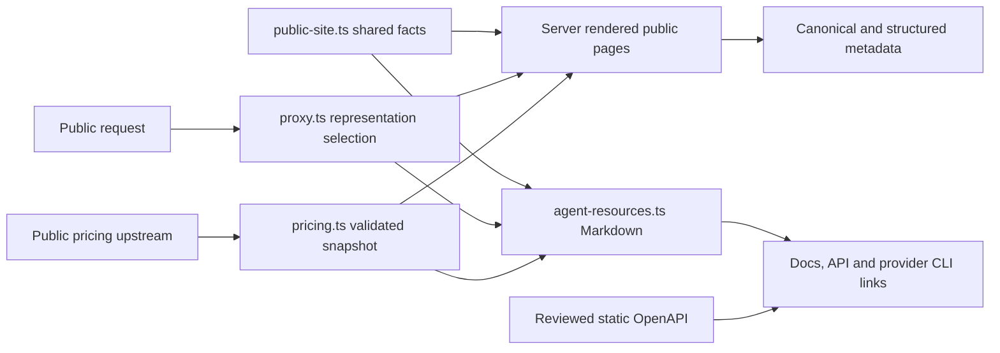

# Landing discovery and public representations

> Last updated: 2026-10-24

The `landing/` Next.js application serves the Darkbloom marketing website, public product guidance and a reviewed API description. It directs consumers to the platform-owned API and console, and providers to the existing provider software.

## Context

People and agents need the same public facts through browser HTML, Markdown and discovery metadata. The landing site owns these representations; it does not implement coordinator authentication, billing or inference. The [encryption architecture](../security/encryption.md) owns the privacy model. The [API contract provenance](../../../landing/API-CONTRACT.md) identifies the exact platform revision behind the public schema.

## Mechanism

`src/content/public-site.ts` owns canonical identity, product roles and official links. `src/content/agent-resources.ts` owns the Markdown index, authentication guidance and explanatory page representations. `src/proxy.ts` chooses representations from `Accept` preferences and explicit Markdown URLs, and advertises discovery links.

Developer and contact guidance has no HTML page or human navigation entry.
The agent index and Markdown documents link to `/developers.md` and
`/contact.md`. Requests to `/developers` and `/contact` still negotiate Markdown;
ordinary browser requests receive HTTP 404. The XML sitemap contains only
HTML pages. Human-facing API links point to the official documentation.

`src/content/pricing.ts` fetches public prices server-side, validates the upstream response and supplies both pricing representations. A failed or malformed response produces an explicit unavailable state. It never substitutes a made-up zero price. The pricing page identifies its retrieval time and billing units.

## Invariants

1. Canonical metadata uses the configured public identity, not the request host (`public-site.ts`, `siteOrigin`; `app/layout.tsx`, `metadata`).
2. Explicit Markdown requests receive Markdown. Browser requests receive HTML for existing pages and HTTP 404 for the retired developer and contact pages. Responses preserve `Accept` and framework tokens in `Vary` (`proxy.ts`; the pinned Next patch documented in the [landing README](../../../landing/README.md)).
3. Missing Markdown pages retain HTTP 404. API routes, framework assets and well-known paths are excluded from page negotiation (`proxy.ts`).
4. The public schema describes existing platform operations, not local landing API handlers (`public/openapi.json`; [contract provenance](../../../landing/API-CONTRACT.md)).
5. Pricing reads public data without forwarding visitor credentials (`content/pricing.ts`). Automated tests use a loopback fixture (`tests/public-pages.test.mjs`).
6. Sitemap dates describe known content changes; they are not refreshed on every request (`app/sitemap.ts`, `sitemap`).

## Failure modes

Unavailable pricing remains readable with a link to the authoritative source. Broken links yield recoverable errors rather than a successful homepage rewrite. Authentication and paid inference remain platform concerns. Optional MCP, OAuth, A2A and payment manifests are not advertised without an implemented service.

Next.js 16.2.6 overwrites custom `Vary` tokens in page response templates. The version-pinned patch preserves existing tokens; the explicit build command applies it before compilation, including after installs that disable lifecycle scripts. A dependency upgrade must retain the HTTP regression and remove the patch only once the upstream fix is present.

## Code map

| Concern | Owner |
|---|---|
| Product identity and canonical links | `landing/src/content/public-site.ts` |
| Markdown and discovery response selection | `landing/src/proxy.ts`, `landing/src/content/agent-resources.ts` |
| Current public pricing | `landing/src/content/pricing.ts` |
| Public HTML | `landing/src/app/page.tsx`, `landing/src/app/pricing/page.tsx` |
| Metadata and crawling | `landing/src/app/layout.tsx`, `landing/src/app/sitemap.ts`, `landing/src/app/robots.ts` |
| API schema and maintenance | `landing/public/openapi.json`, `landing/API-CONTRACT.md` |
| Isolated HTTP verification | `landing/tests/helpers/site-server.mjs`, `landing/tests/` |

## Related

- [Landing development and hosting](../../../landing/README.md)
- [Build guide](../../developer/build.md)
- [Test guide](../../developer/test.md)
- [Agent-readiness audit disposition](../../reports/2026-10-12-agent-readiness.md)
