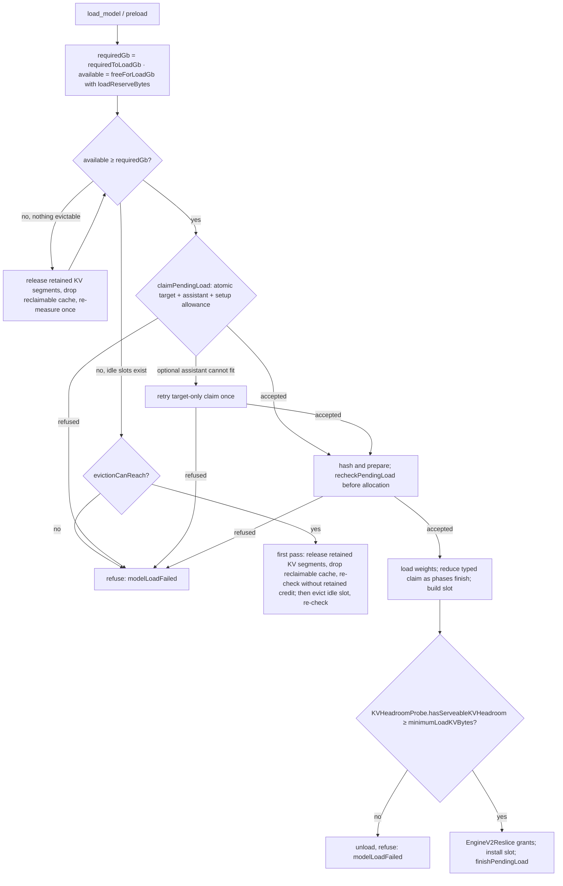

# Hardware support and the provider memory model

> Last updated: 2026-10-23

What hardware the provider runs on and how it decides, in bytes, whether a
model may load and how much KV cache each resident model may use. Read this to
understand why a box refuses a load that "should fit"; for the operator view
(RAM tiers → catalog models) see
[`../provider/hardware-requirements.md`](../provider/hardware-requirements.md).

## Context

The unregistered Super builder requires a live pending LOAD lease and preserves
the ordinary fixed-workspace concurrency floor. Synthetic bridge tests must
provide a grant above the minimum KV floor plus recurrent workspace; a small
checkpoint does not waive that policy. Sources:
`provider-swift/Sources/ProviderCore/Inference/Engine/Factory/NemotronSuperLocalBridgeBuilder.swift`,
`provider-swift/Sources/ProviderCore/Inference/Engine/Bridge/EngineV2Bridge+MemoryConcurrency.swift`.

The managed [Nemotron Super slot](inference.md#managed-nemotron-super-slot)
claims, before allocation, the pinned checkpoint's resident installation and
head payloads (73,217,162,760 and 1,769,654,296 bytes), the owner's serving
room and only the part of its load transient beyond that room
(`NemotronSuperLoadClaim`). The serving room is the 8.5 GiB owner-wide prefill
lane, any prefix bank and `NemotronSuperServingPolicy.admissionKVBytes` of KV
headroom: 15.7 GiB for eight speculative requests at the served 262,144-token
context (576 MiB of fixed bytes per request, the speculating owner's 9.87 GB of
round work once, and 2 GiB; 11.2 GiB at 65,536 tokens). The transient is the larger of the installation's
staging with its 2 GiB backend allowance (8,903,163,904 bytes) and the head's
construction allowance (7,078,617,184 bytes), never both, because each phase
returns its freed buffers from MLX's cache before the next phase or serving
uses that room; for the default configuration the room is larger, so the
transient adds nothing. Super's LOAD claims keep no OS reserve beyond 3 GiB of
admission slack and its measured 2 GiB activation floor (below), in place of
the provider's 10% load reserve, unless the operator raised `memory_reserve_gb`
above its 4 GiB default (`NemotronSuperLoadFit.systemReserveBytes`). Available
memory (what macOS reports) a 128 GB Mac needs: about 104 GiB for the default
owner (eight requests and a prefix bank, about 99 GiB claimed); with less the
load drops the bank (eight requests, 99.0 GiB), then serves four (95.3), two
(90.8) or one (89.3) concurrent request, then one with 1,024-token prompt
chunks (85.6 GiB, `NemotronSuperLoadFit.minimumAvailableBytes`), so a 128 GB
Mac running other work loads a narrower owner instead of refusing. Super's
pre-accept, eviction and startup preload decide on the claim's own ledger room
(`ProviderLoop.nemotronSuperLoadRequirements`, `loadClaimRemainingBytes`), not
on `freeForLoadGb`: they admit from 85.6 GiB available and evict idle models
toward the widest configuration that evicting them can reach. The discovery
footprint (`estimated_memory_gb`) is the narrowest configuration's
requirement, 83.6 GiB on every Mac; cold capacity quotes and the coordinator's
cold-load routing, which compare it and the 3 GiB load headroom with
`free_for_load_gb` (net of the 10% load reserve), admit only from about 99.4
GiB available on 128 GB until the platform adopts a Super-specific rule. The
footprint holds no media, and an image request is
charged its whole reservation (`NemotronSuperServingPolicy.mediaChargeBytes`,
4.67 GiB for one image: the ingress quote of a 40 MiB body, a 64 Mi-pixel
decode workspace, the encoded body copies, a 13,312-patch image's tokens and
its tower and projector bound; a video's largest, `videoMediaChargeBytes`, is
4.54 GiB). On 128 GB the default owner's claim and activation reserve leave
13.9 GiB of the cap, so a 16-image request (25.6 GiB of media) does not fit
beside it. A resident slot's media
probe is quoted against the ledger room its reservation is admitted by.
At 65,536 tokens the round work would be 4.7 GiB. A dedicated 128 GiB Mac was emulated on the 256 GB
machine at the earlier 65,536-token context (cap, OS-available memory and MLX
limits of the smaller Mac, before the speculating admission split); prompts
beyond about 64K tokens on 128 GB are unmeasured. Eight default requests (two 58K-token prompts,
five short ones and an image) all completed, with a process footprint peak of
91.4 GB against a 123.7 GB cap, and unload and reload passed. Only a 256 GB M3
Ultra is measured on hardware: while the LOAD charge was held MLX active peaked
at 76.7 GB and the process footprint at 79.3 GB, MLX active was 75.0 GB after
load, and at the 65,536-token context claims of 129.6 to 130.7 GB (36 to 37 GiB
of KV headroom, under the earlier claim that also counted the installed
weights until the owner was built) were admitted at some times and refused at
others. The registration gates the model to attested M5 providers with at least
128 GB (M5 Max 128 GB, M5 Ultra) through
`required_provider_capabilities: ["apple_m5"]` and `min_ram_gb` 128; a physical
128 GB measurement is still pending. It is in the
[registry reference](../reference/model-registry-format.md#nemotron-super).
Sources: `provider-swift/Sources/ProviderCore/Inference/Engine/Factory/NemotronSuperServingPolicy.swift`,
`provider-swift/Sources/ProviderCore/NemotronSuper/ProviderLoop+NemotronSuper.swift`,
`scripts/nemotron-qualification/validation-2026-10-15.json`.

The provider is Apple-Silicon-only: the SwiftPM platform floor is declared by
the packages described in
[`components/mlx-swift.md#what-providercore-links`](components/mlx-swift.md#what-providercore-links),
[coordinator/api/install.sh](https://github.com/Layr-Labs/darkbloom-platform/blob/48a198c71a2d30feec5597bacf1101120f7f955d/coordinator/api/install.sh) refuses anything but Darwin on `arm64`, and
`darkbloom start` requires Metal
(`provider-swift/Sources/ProviderCore/Inference/Engine/GPUEnforcement.swift`,
`requireMetal`) and a minimum amount of RAM
(`provider-swift/Sources/darkbloom/Start/StartCommand+Preflight.swift`,
`hardware.memoryGb`). There is no hard runtime macOS-version check:
`BootSecuritySnapshot.recommendedMacOSMajorVersion` only turns
`darkbloom doctor` yellow below that major version
(`provider-swift/Sources/ProviderCore/Security/BootSecurity.swift`). The three
values are in [Constants](#constants). Chip
identity is parsed from the brand string into `ChipFamily` ∈ {`M1`, `M2`,
`M3`, `M4`, `M5`, `M6`, `Unknown`} and `ChipTier` ∈ {`Base`, `Pro`, `Max`, `Ultra`,
`Unknown`} (`provider-swift/Sources/ProviderCore/Hardware/HardwareDetector.swift`,
`parseChipIdentity`; `provider-swift/Sources/ProviderCore/Protocol/Enums.swift`).

Weights, KV cache and activations share unified memory, so the provider owns one
byte-level invariant: `Σ resident weights + KV + activations ≤ hardCapBytes`
(`provider-swift/Sources/ProviderCore/Inference/Memory/UnifiedMemoryCap.swift`).

Local HTTP Responses also retain host-side JSON. The continuation-history LRU
limits its saved histories, while the SDK response-object store has an
independent lifetime and no matching eviction. In-flight request copies are
outside that history cap. Treat these as application memory when assessing
process usage; the history limit is not a native KV grant or a total process
bound. [Responses continuation and retention](../provider/direct-mode.md#responses-continuation-and-retention)
owns the limits and their source mappings.

## Mechanism

### Constants

| Symbol | Value | Code |
|---|---|---|
| `recommendedMacOSMajorVersion` | `26` — `darkbloom doctor` warning threshold only, never a gate | `provider-swift/Sources/ProviderCore/Security/BootSecurity.swift` (`BootSecuritySnapshot`) |
| RAM floor at start | `hardware.memoryGb < 8` refuses `darkbloom start` (8 GB) | `provider-swift/Sources/darkbloom/Start/StartCommand+Preflight.swift` |
| `defaultCapFraction` | `0.90` | `UnifiedMemoryCap.swift` |
| `minimumReserveBytes` | `2 * 1024 * 1024 * 1024` (2 GiB OS floor) | `UnifiedMemoryCap.swift` |
| `defaultActivationReserveBytes` | `11 * 1024 * 1024 * 1024 / 2` = 5.5 GiB (since v0.8.0; basis gemma-4 qat-4bit B=8: 5.05 GiB eager / 5.34 compiled + slack) | `UnifiedMemoryCap.swift` |
| `measuredActivationFloorsBytes` | `["gpt-oss-20b": 7 * 1024 * 1024 * 1024 / 2]` = 3.5 GiB, `["nvidia-nemotron-3.5-super": 2 * 1024 * 1024 * 1024]` = 2 GiB (its requests, prefill lane and media charges hold its activations; the floor is the measured uncharged residue plus slack); exact catalog-id match only; per-model floors since v0.8.16. The gpt-oss-20b floor is max(2.56 GiB eager, 3.20 GiB compiled) B=8 peak over resident plus slack, from the 2026-07-10 M4 Max sweep (`libs/mlx-swift-lm/benchmarks/reports/gptoss-20b-mxfp4q8-paged-gate-2026-07-09.md`, added in SDK commit `d72ce578`). That SDK revision still clamped the expert SwiGLU with float32 `MLXArray(limit)` bounds (introduced in `51ea0c4b`, removed in `f2eb29b8`, SDK #326), so the sweep ran with float32 activations after layer 0. No sweep has re-measured the floor with bf16 activations | `UnifiedMemoryCap.swift` |
| `minimumLoadKVBytes` | `1 * 1024 * 1024 * 1024` (1 GiB) | `UnifiedMemoryCap.swift` |
| `memoryOverheadFactor` | `1.2` fallback loading allowance; eligible native Qwen4 uses the header-derived copy bound below | `provider-swift/Sources/ProviderCore/Models/ModelScanner+Discovery.swift` |
| `memory_reserve_gb` | operator config reserve (`memoryReserveGB`); default in [`../provider/cli-reference.md#providertoml-keys-read-by-the-cli`](../provider/cli-reference.md#providertoml-keys-read-by-the-cli) | `provider-swift/Sources/ProviderCore/Config/ProviderConfig.swift` |
| `MLXMemoryGuard.defaultReserveGB` / `defaultCacheLimitGB` | `6` / `8` (soft MLX limits; `cacheFraction = 0.75`, `minimumLimitBytes` 2 GiB) | `provider-swift/Sources/ProviderCore/Inference/Memory/MLXMemoryGuard.swift` |

`DARKBLOOM_MEM_CAP_FRACTION` overrides the cap fraction and
`DARKBLOOM_ACTIVATION_RESERVE_GB` raises (never lowers) the activation reserve;
`DARKBLOOM_MLX_MEMORY_RESERVE_GB` and `DARKBLOOM_MLX_CACHE_LIMIT_GB` feed
`MLXMemoryGuard`. Parsing rules and defaults:
[`../reference/configuration.md`](../reference/configuration.md).

### Cap and reserves (`UnifiedMemoryCap`)

```text
hardCapBytes(physical, fraction)
    = min( fraction × physical,
           physical > minimumReserveBytes ? physical − minimumReserveBytes : 0 )

activationFloorBytes(forModelIDs ids)
    = ids.isEmpty ? defaultActivationReserveBytes
                  : max over id of (measuredActivationFloorsBytes[id] ?? defaultActivationReserveBytes)

resolvedCapFraction
    = explicit (clamped to [0, 1])
    → DARKBLOOM_MEM_CAP_FRACTION if finite and > 0 (clamped to [0, 1])   -- ≤ 0 / non-finite ⇒ unset
    → defaultCapFraction

resolvedActivationReserveBytes(modelIDs)
    = explicit
    → floor = activationFloorBytes(modelIDs) (defaultActivationReserveBytes when nil)
      DARKBLOOM_ACTIVATION_RESERVE_GB if finite and > 0: max(gb × 2^30, floor)   -- raise-only
      else floor

loadHeadroomBytes = activations + minimumLoadKVBytes

kvBudgetBytes(physical, Σweights, activations, ramPrefix, configReserve)
    effectiveCap = min(hardCapBytes, physical − configReserve)
    claimed      = Σweights + activations + ramPrefix                       (saturating)
    = effectiveCap > claimed ? effectiveCap − claimed : 0

liveKVHeadroomBytes(physical, mlxUsed, systemAvailable, activations, configReserve)
    effectiveCap = min(hardCapBytes, physical − configReserve)
    realFree     = min(effectiveCap − mlxUsed (clamped ≥ 0), systemAvailable)
    = realFree > activations ? realFree − activations : 0

loadReserveBytes(configReserve) = max(configReserve, physical − hardCapBytes)

loadIsServeable(measuredLiveKVHeadroomBytes) = measuredLiveKVHeadroomBytes ≥ minimumLoadKVBytes
```

`ramPrefix` is always 0 in production — there is no RAM prefix-cache carve
([`prefix-cache.md`](prefix-cache.md)).

Fused causal prompt attention changes the prefill transient, not these
constants. An eligible full-attention prompt chunk takes one `.causal` SDPA
call instead of 128-query blocks. The fused kernel materializes no scores, so
the route drops the per-block score tensors of MLX's composed path (head_dim
256), the per-block BOOL masks on paged storage and the output concat; it adds
no allocation
([eligibility](inference.md#scheduler-and-loop-configuration); `usesFusedCausalPrefill` in
`libs/mlx-swift-lm/Libraries/MLXLMCommon/ContinuousBatchingV2/AttentionV1.swift`).
On M5 Ultra, Qwen3.5-9B peak MLX memory at 32,768 prompt tokens fell from
13.86 GB to 12.03 GB because its head_dim 256 layers take the fused kernel.
`defaultActivationReserveBytes`, `measuredActivationFloorsBytes`,
`minimumLoadKVBytes` and the KV slot grants are intentionally unchanged:

- The default reserve is sized from gemma-4, whose layers keep the blocked
  path. The gpt-oss-20b floor comes from the 2026-07-10 sweep, which ran the
  blocked path; the fused route only removes allocations from that path, so
  the floor stays an upper bound. The Nemotron Super floor is the residue its
  request and prefill-lane charges do not hold, not a prompt-attention
  transient. No floor has been re-measured on the fused route, and a lower
  floor needs a new measurement.
- `DARKBLOOM_TTFT_FUSED_CAUSAL_PREFILL=0` restores the blocked path that the
  2026-07-10 sweep ran.
- K/V layout and dtype do not change, so KV bytes per token, slot grants and
  advertised capacity do not change. A lower live transient shows up only
  through `liveKVHeadroomBytes`, which reads real MLX `active + cache`.

### Load gate (`ModelLoadAdmission`)

GLM sparse KV sizing uses the native asymmetric FP32 payload: each storage
layer charges `(headDim + valueHeadDim) * kvHeads * 4` bytes per token, not the
generic symmetric FP16 estimate. KDA remains a separate fixed request charge
including the engine's three-generation reservation; it is neither a weight nor
a marginal KV token charge
(`provider-swift/Sources/ProviderCore/Inference/Models/GLM5Next/GLM5NextLoadFunnel.swift`,
`GLM5NextLoadFunnel.kvBytesPerToken`).

GLM-5.3-Flash loads only on Apple M5 Max or M5 Ultra with at least 256 GiB
(`GLM5NextHardwareRequirement`, runtime capability `glm5_next_v1`). Its
[native integration](../design/glm53-flash-native.md) prices the raw source
bytes plus native construction/tokenizer transients
(`provider-swift/Sources/ProviderCore/Inference/Models/GLM5Next/GLM5NextLoadAdmission.swift`,
`GLM5NextLoadQuotation`). Activation reserve and minimum KV headroom remain
unchanged. The activated expert count is not a resident-weight estimate.
Standing GLM wired residency is optional only when disabled or unsupported
before ticket creation (macOS 15 or later with Metal 3 support). A backend
start/end fault is unproven application or restoration, not unsupported
hardware: the provider retains the actual owner and policy entry and refuses
GLM publication or clean retirement until restart. Pending operations are joined
before settlement; no timeout or cancellation is restoration proof
(`GLM5NextWiredResidency`, `GLM5NextNativeOperationOwner`).

GLM's KV grant fills the cap, so at full KV its GPU use is the whole cap, about
247 GB on a 256 GB M5 Ultra. The macOS default GPU wired-memory limit there is
smaller, and Metal command buffers past it fail with "Insufficient Memory".
The provider neither lowers the cap nor changes admission for this; `doctor`,
`start` and failure logs give the operator the
[sysctl values](../provider/hardware-requirements.md) instead
(`provider-swift/Sources/ProviderCore/Diagnostics/GLM5NextWiredLimit.swift`,
`GLM5NextWiredLimit`).

`GLM5NextConstructionOwner` retains actual partial-load roots before evaluation.
`GLM5NextArtifactLoadRoots` retires individual expert sources only after the
packed bank's checked evaluation, then retains completed modules instead of a
parallel weight dictionary. A failed cleanup fence retains these roots, the
pending permit, writer ownership and activity; it is not permission to clear
the allocator cache or regrow survivor grants. The owner and native reader live
in `provider-swift/Sources/ProviderCore/Inference/Models/GLM5Next/GLM5NextConstructionOwner.swift`
and `libs/mlx-swift-lm/Libraries/MLXLLM/Models/GLM5NextArtifactLoader.swift`.

The raw same-directory [discovery quotation](../reference/model-registry-format.md#raw-glm-discovery-quotation)
now carries that complete allowance into scanner-based memory consumers.
`ModelScanner.glm5NextLoadEstimate` refuses malformed profiles instead of
falling back to the generic disk × 1.2, and prices only the tokenizer shipped in
the snapshot. It remains a metadata
bound, not native validation, a hardware qualification or permission to bypass
the actual managed-load reservation and post-load guards.

```text
defaultLoadHeadroomGb = loadHeadroomBytes() / 2^30
    -- defaultActivationReserveBytes + minimumLoadKVBytes by default;
    -- measuredActivationFloorsBytes["gpt-oss-20b"] + minimumLoadKVBytes for a gpt-oss-20b-only serving set

systemAvailable (SystemMemory.availableBytes, default `reclaimable` policy; pages × page size)
    = max(free_count + inactive_count,
          (free_count − speculative_count) + external_page_count + purgeable_count)
    -- never below free + inactive; the second measure counts page cache (speculative
    -- read-ahead once) and volatile purgeable pages, never anonymous or compressor
    -- pages; `free-only` = free_count

freeForLoadGb(total, systemAvailable, gpuActive, gpuCache, reserve, outstanding)
    mlxUsed   = gpuActive + gpuCache
    realFree  = min(total − mlxUsed, systemAvailable)
    committed = reserve + outstanding
    = max(0, realFree − committed) / 2^30                    -- no multiplicative discount

maxLoadableWeightGb(total, systemAvailable, mlxUsed, reserve, headroomGb, outstanding)
    reclaimable = min(total, systemAvailable + mlxUsed)
    usable      = reclaimable − (reserve + outstanding)
    = max(0, usable / 2^30 − max(0, headroomGb))

requiredToLoadGb(weightsGb, headroomGb) = max(0, weightsGb) + max(0, headroomGb)
evictionCanReach(available, reclaimable, required) = available + reclaimable ≥ required
fitsAtAllocation(availableNetOfLedger, ownReservation, required) = availableNetOfLedger + ownReservation / 2^30 ≥ required
canLoad(...) = requiredToLoadGb ≤ freeForLoadGb
```

`weightsGb` is the scanner's loading estimate, not bare steady residency.
Ordinary models retain `sizeBytes / 2^30 × memoryOverheadFactor`. Eligible native
Qwen4 with SSD PLE offload uses all non-offloaded weight bytes plus
`Qwen4ExpLoadFootprint.estimate`'s bound: the larger of one complete shard or
the largest target gate/up copy plus complete vision/assistant copies and
page-rounding allowance, then 1 GiB for loader metadata/small objects. Complete
index/header coverage, bounded headers and native non-FP16 layouts are required;
unknown layouts retain ordinary padding. Every load still adds
`activationReserve + minimumLoadKVBytes` and passes the same real-OS clamp and
atomic pending-load permit.
Native declarations are revalidated after hashing/hooks and before allocation;
changed geometry or an obsolete smaller allowance fails closed and requires a
rescan rather than loading against stale accounting. The worked
example in the source comment
(`provider-swift/Sources/ProviderCore/Inference/Memory/ModelLoadAdmission.swift`)
shows gpt-oss-20b's requirement falling by exactly `defaultActivationReserveBytes
− measuredActivationFloorsBytes["gpt-oss-20b"]` once its measured floor
applies. There is no `× 3.0` headroom rule anywhere in the load path.

After an owned Qwen4 retirement, the provider and standalone loader can recheck
insufficient real headroom every 25 ms for at most two seconds from retirement
(`NativeMemoryRetirementWindow`). A load that already fits proceeds immediately;
cancellation interrupts the wait. Zero MLX/Metal allocation counters do not
prove macOS has reclaimed physical pages. This window grants no memory credit,
does not extend on each retry and does not bypass the final atomic load permit.
An unresolved shortage still fails normally.



(`provider-swift/Sources/ProviderCore/ProviderLoop+ModelLoading.swift`; the
standalone server runs the same sequence in
`provider-swift/Sources/ProviderCore/Server/StandaloneServer.swift`.)

Coordinator requests reach the pre-accept check (`fastAdmissionReject`) in
work-FIFO order. An accepted request whose model is not resident releases the
FIFO while it waits for its load (`releaseWorkFIFO` in
`provider-swift/Sources/ProviderCore/ProviderLoop+WorkFIFO.swift`), so later
requests can reach the check while that load runs. The check sees a load's
memory only once the load holds its pending-load claim, so a request for another
model that is not resident first waits for released loads of other models
(`awaitReleasedLoads`). A request for the model being loaded that the check
rejects, because the load's claim already holds the memory the check sized for
a second copy, waits for that load and is checked again. Requests for resident
models overtake; one for an idle resident model can keep a slot the released
load would have evicted, and that load then fails this gate after acceptance.
The gate, pending-load claims and eviction still decide every load. Native MiMo
keeps the serial FIFO, and `DARKBLOOM_TTFT_COLD_LOAD_RELEASE=0` restores it for
every model.

The prompt token store (`PromptPieceTokenStore` in
`provider-swift/Sources/ProviderCore/Inference/Prompting/PromptTokenCache.swift`)
is ordinary process heap with no claim or reserve in this gate: at most
`DARKBLOOM_TTFT_PROMPT_CACHE_MB` (default `32 << 20` bytes) per loaded
tokenizer, plus one piece. Like other process heap, it reaches the gate only
through the measured free memory.

### After the load

- `KVHeadroomProbe.measuredLiveKVHeadroomBytes` (after trimming the cold-load
  buffer cache) must satisfy `loadIsServeable` (≥ `minimumLoadKVBytes`) or the model is
  unloaded and the load rejected
  (`provider-swift/Sources/ProviderCore/Inference/Memory/KVHeadroomProbe.swift`).
- `EngineV2KVSizing` and `EngineV2Reslice` assign the admitted
  [KV slot grants](#kv-slot-grants). A paged build must also expose a backend
  ceiling at least `minimumLoadKVBytes`; empty segmented storage can satisfy
  this without allocating pages (`KVHeadroomProbe.postBuildServeable`).
- Before publication, `EngineV2SlotFactory.makeProductionBundle` checks that an
  ordinary fixed-workspace bridge has nonzero serving width. A refused newcomer
  is shut down before its slot escapes; native publication remains owned by its
  existing transaction. This does not replace the measured headroom checks.
- For contiguous slots, the bridge reserves `prompt + maxTokens` bytes in
  `GlobalKVCacheBudget` before submit ([`inference.md`](inference.md)).
- Reservation age is diagnostic only. `GlobalKVCacheBudget.recordCommitRejection`
  logs sustained rejection and keeps every owner's charge until the caller
  releases it after its resources retire. The asynchronous allocator-cache
  reclaimer remains separate; it cannot refund live request or load ownership.
  Its proactive sweep (buffer cache ≥ 2 GiB) flushes only after 5 s of
  whole-Mac idleness or when the cache crowds out admission headroom
  (`KVPoolReclaimer.proactiveWindow`). The idle flush rechecks idleness and
  clears inside `WholeMacServiceBudget.performIfIdle`: a request admitted
  first cancels the clear without spending the reclaim rate limit, and one
  arriving during it is admitted afterwards. Every shortfall reclaim or
  pressure sweep also asks paged pools to drop retained free KV segments,
  even when it does not flush. Refused charges that bypass request
  reservations (paged engine growth, native MiMo media work) signal that
  reclaim while either the idle sweep or segment retention is on
  (`GlobalKVCacheBudget.directChargeRefusalSignal`). Their shortfall is
  exactly what usage must fall by for the refused charge to fit, including
  commitment debt and usage already inside the reserve; MiMo's extra OS
  reserve narrows only the system side, not the cap
  (`provider-swift/Sources/ProviderCore/Inference/Memory/ProcessMemoryLedger.swift`,
  `ProcessMemoryLedger.capacityShortfall`). Retained segments
  (`CBv2RetainedKVSegments.retainedBytes`) are allocator-active memory that
  only a release request returns, at each engine's next step. The load gates
  (`ProviderLoop.evictUntilAvailable`,
  `ProviderLoop.evictUntilNemotronSuperFits`,
  `StandaloneServer.ensureMemoryHeadroomForLoad`) release them and drop the
  buffer cache once (`releaseReclaimableMemoryForLoad`, which waits up to
  250 ms) before they evict or refuse, and `StartupPreloader` does the same
  before it skips a candidate (`reclaimBeforeSkip`). Eviction feasibility
  counts them only to decide whether that release could make room (when not
  even they and every idle model could, the gate refuses without releasing);
  after it, only the memory sample shows what returned, and segments still
  parked (a step that outlasted the wait, or segments parked since) are no
  eviction credit (`ProviderLoop.reclaimableMemoryBytes`). Pre-accept
  (`ProviderLoop.fastAdmissionReject`,
  `ProviderLoop.nemotronSuperLoadIsCertainToFail`) releases and resamples
  the same way when nothing is idle or only they could close the gap. The
  post-load headroom guard above re-measures after its cache flush without
  releasing them: that backing was already counted as used when the gate
  admitted the load.
- `MLXMemoryGuard.recommendedLimits`: `limit = max(minimumLimitBytes, physical −
  reserve)`, `cacheLimit = min(max(minimumLimitBytes / 2, min(limit × 0.75,
  cacheCap)), limit)` — soft MLX guidelines only; the cap above is what
  refuses work.

### MiMo prompt recount

For exact `mimo_v2`, `ProviderLoop.promptTokenFloor` restores captured original
tool schemas before the shared native tokenization path. The floor therefore
counts the schema rendered by serving rather than the model-blind normalized
schema (`provider-swift/Sources/ProviderCore/ProviderLoop+InboundDecode.swift`).
This changes prompt-count correctness, not the load allowance, activation
reserve, KV byte rate or ownership gates below. See the
[native MiMo prompt contract](inference.md#native-mimo-v26-candidate).

### KV slot grants

The fleet KV budget is the effective unified-memory cap minus all resident
`SlotSizingSnapshot.weightsBytes`, the resolved serving-set activation reserve,
and any explicit RAM prefix allowance. `weightsBytes` sums loaded target
parameter bytes and retained assistant weights; the scanner's disk-size padding
belongs to load admission, not this runtime grant. Default SSD streaming has no
resident prefix-bank carve (`UnifiedMemoryCap.kvBudgetBytes`,
`provider-swift/Sources/ProviderCore/Inference/Memory/SlotSizingSnapshot.swift`).

One model slot receives the full fleet KV budget. With multiple slots,
`EngineV2KVSizing.resliceGrants` divides it in proportion to each model's fp16
owning-full-attention marginal byte rate times context, capped by
`resliceContextCap = 131_072`. If any rate is unknown, all slots receive an equal split. Those fairness
weights do not choose KV precision: native admission separately accounts for the
observed per-layer dtype, window rings, recurrent state and configured MTP state
(`provider-swift/Sources/ProviderCore/Inference/Memory/EngineV2Reslice.swift`).

Loads and serving-set reserve raises must preserve each resident bridge's total
`minimumServiceableGrantBytes`
(`provider-swift/Sources/ProviderCore/Inference/Engine/Bridge/EngineV2Bridge+MemoryConcurrency.swift`).
For ordinary fixed-workspace engines this includes one request's fixed and
auxiliary allocation overhead, minimum KV, the actual watermark and live fixed
external reserve. `EngineV2Factory.ProductionBuild.admissionWatermarkFraction`
comes from the same immutable `AdmissionV2.Config` passed to the engine, not a
guessed ratio between current raw and admissible capacity. The native MiMo floor
retains its validated admission policy; stateless engines keep the base floor.
Unknown or saturated policy evidence and a fixed pool that cannot meet the floor
fail closed. `resliceMeetsServiceabilityFloor` rejects the unattainable `Int.max`
sentinel rather than accepting it as a usable grant.

A private hybrid-cache carve is added once to the engine floor. The bridge
retains the total requested grant for exact rollback instead of feeding an
already-carved engine grant back through the carve. Physically retained cache
bytes can still exceed a reduced logical target and remain accounted
(`EngineV2Bridge.resliceAdmissionBytesClaim`, `slotKVBytesClaim`,
`provider-swift/Sources/ProviderCore/Inference/Engine/Bridge/EngineV2Bridge+PrefixCache.swift`).

The production paged factory passes that admitted grant to empty segmented
storage. `makeSegmentedPagedBackend` retains the native dtype/owner map,
scheduler chunk geometry and context. Its `segmentSizeBytes = 64 << 20` is an
allocation target, not a slot-capacity ceiling. Native checks still bound each
Metal buffer, kernel page indices and arithmetic. The former provider eager-pool
limits do not cap this path
(`provider-swift/Sources/ProviderCore/Inference/Engine/Factory/EngineV2Factory+SegmentedBackend.swift`;
`libs/mlx-swift-lm/Libraries/MLXLMCommon/ContinuousBatchingV2/Paged/PagedKVPool.swift`).

A co-resident load shrinks existing grants before building the newcomer. Live
pages, request promises and staging owners remain charged until their real
retirement; shrink does not free them. Existing physical capacity can be reused,
but a slot already above its grant cannot increase its native charge. Unload or
rollback restores the surviving slots' shares, and segmented storage can grow
under the new grant without rebuilding the engine. New backing is reserved
through [process ownership](#process-ownership) before allocation. The bridge
forwards a resize when native `capacity.pagedStorage` is present; only explicit
fixed-reference native fixtures retain a construction-capacity clamp and
`pagedPoolResizeShortfall()`
(`provider-swift/Sources/ProviderCore/Inference/Engine/Bridge/EngineV2Bridge+Resizing.swift`;
`libs/mlx-swift-lm/Libraries/MLXLMCommon/ContinuousBatchingV2/EngineV2.swift`,
`updateKVBytesCapacity`).

| Native capacity field | Meaning |
|---|---|
| `kvBytesCapacity` | Runtime admission ceiling, including target and auxiliary request state |
| `kvBytesBackendCapacity` | Mutable backend grant for segmented/contiguous storage; physical capacity only for a fixed-reference pool |
| `pagedStorage.committedBytes` | Allocator-backed segmented residency, which can temporarily exceed a shrunk grant |
| `pagedStorage.overGrantBytes` | Committed backing above the current grant; ownership still has to retire |

These fields are defined by
`libs/mlx-swift-lm/Libraries/MLXLMCommon/ContinuousBatchingV2/CBv2Contracts.swift`
(`CBv2CapacitySnapshot`) and `Paged/PagedKVGrant.swift`
(`PagedKVStorageSnapshot`). A logical grant does not waive the post-load
serviceability floor or later shared OS/activation headroom checks.

### Process ownership

`GlobalKVCacheBudget` keeps policy, request/load correlation and diagnostics.
`ProcessMemoryLedger` serializes byte admission; typed pending-load handles
prevent delayed cleanup from releasing a newer load with the same string ID.
A load retains its setup allowance through final slot installation. Completed
weight phases reduce their promise because the coherent allocator reading now
includes those weights; process-wide before/after differences never create
materialization credit.

For each native engine connected through `EngineProcessMemoryOwner`, Admission
publishes `C = max(P, N) + A + X`: native segment commitments, active target KV
promises, auxiliary state and temporary stages. New promises are accepted before
allocation or native metadata changes. Only evaluated backing with an explicit
owner earns materialized coverage `M`, with `0 ≤ M ≤ C`. The process projects
`U + Σ(C − M)`, where `U` is one coherent active-plus-cache reading, under the
existing cap, OS-availability and activation-reserve policy. It never subtracts
one engine's pages from another engine's promise.

A paged segment's shared backing carries one coverage handle through checkpoint
rebasing. Withdrawal precedes buffer/alias retirement and charge reduction;
retained raw aliases remain charged through `U`. Closing blocks new growth while
allowing already reserved allocations and mandatory cleanup. No destructor or
age threshold returns live byte promises. Allocator initialization runs before
the ledger lock and before a native Admission can call the provider adapter.

The production factory binds an empty segmented paged pool to this owner before
constructing EngineV2. Its bridge skips duplicate per-request reservations;
contiguous slots retain their existing provider reservation path. Recurrent and
MTP auxiliary state stays charged without materialization credit. Current load
and provider headroom readers use the same shared ledger.
An admitted MTP context is bound to one request generation. Both ordinary
release and native reservation detachment retire that context immediately;
reusing the request ID cannot revive it. Target retirement and outstanding
assistant allocation leases then release their separate portions of the
original prepaid charge, in either order
(`libs/mlx-swift-lm/Libraries/MLXLMCommon/ContinuousBatchingV2/AdmissionV2.swift`,
`detachReservation`, and
`libs/mlx-swift-lm/Libraries/MLXLMCommon/ContinuousBatchingV2/MTP/AdmittedMTPBinding.swift`).
Native segmented allocation reserves an allocator-owned upper bound for each
new backing before construction, including rounding and permitted cached-buffer
reuse. After evaluating and draining the captured allocation stream, the fresh
full-buffer owner records actual allocator bytes. Growth and staged adoption
settle their provisional charge downward to that footprint while preserving the
full request promise and rollback identity. Logical page counts, offsets and
usable slack remain separate from allocator padding. Metadata read through a
view never creates another materialization credit.

The bound covers one buffer. Complete checkpoint capture/import separately
prices zero-fill intermediates, retained recurrent backing, MTP state and
metadata. A provider-staged import builds each destination, paged segment and
recent row from a zeroed host buffer of that array's size, one at a time; the
buffer is resident outside the MLX allocator while it is copied, so the import
plan charges the largest one as stage scratch
(`libs/mlx-swift-lm/Libraries/MLXLMCommon/ContinuousBatchingV2/Prefix/CheckpointHostZeros.swift`
(`MLXArray.cbv2HostZeros`),
`libs/mlx-swift-lm/Libraries/MLXLMCommon/ContinuousBatchingV2/Prefix/CompleteCheckpointImportPlan.swift`
(`CBv2CompleteCheckpointImportPlan.scratchBytes`)). Shared SSD reads and writes claim bounded host buffers before I/O or
encoding; native destinations remain under Admission. Host buffers drain before
their permit returns. Native owners retain completion and retirement barriers;
allocator-active aliases remain visible in U after their coverage retires. Physical
backing is measured once per owned buffer, while logical page geometry remains distinct
from allocator padding. Exact-model capacity and latency remain separate from
[allocator foundation tests](../reports/2026-09-05-allocator-footprint.md).
Implementation: `libs/mlx-swift/Source/MLX/AllocationFootprint.swift`
(`allocationFootprintUpperBound`, `evaluatedBufferInfo`) and
`libs/mlx-swift-lm/Libraries/MLXLMCommon/ContinuousBatchingV2/Paged/PagedKVSegments.swift`
(`PagedKVSegmentLayout.allocationBytes`, `PagedKVSegmentBacking`).
Implementation: `provider-swift/Sources/ProviderCore/Inference/Memory/ProcessMemoryLedger.swift`
(`replaceCharge`, `recordMaterialization`, `withdrawCoverage`),
`GlobalKVCacheBudget+PendingLoads.swift` (`claimPendingLoad`, `recheckPendingLoad`),
`EngineProcessMemoryOwner.swift`, and
`libs/mlx-swift-lm/Libraries/MLXLMCommon/ContinuousBatchingV2/AdmissionV2.swift`.

### Calibration ownership and foreground admission

Automatic startup calibration uses the loaded engine's existing KV and service
budgets. It does not lower activation or OS reserves, raise concurrency limits,
or create a separate memory allowance. Only one calibration session runs on the
Mac at a time. After an uncancelled session retires, the next eligible resident
engine can start without waiting for a capacity tick.
Ordinary and native MiMo loads offer their new engine first when that owner is
available. The completed construction activity ends before that handoff, but
the load-transition gate remains closed until the scheduling attempt returns.
Slot identity, shutdown and native-owner checks precede waking parked load
requests. Once completed publication reaches this handoff, cancelling its
caller does not fail the already resident slot.

A customer request takes a foreground lease, cancels any current calibration,
and waits for its actual retirement before admission. A consumer terminal event
alone does not release the probe's ownership: the bridge waits for the event
pump and service reservation to retire. Shutdown follows the same ownership
boundary. Retirement releases request ownership; it is not a claim that the
allocator has returned every cached physical byte to the OS. Original request
deadlines and memory admission remain authoritative during this wait.

The one-token startup health check is excluded from throughput learning, while
its work accounting remains intact. Bounded calibration samples populate the
existing capacity measurements and never increment served-request or output
token totals. The detailed probe plan and retry/posture gates are documented in
[model startup calibration](inference.md#model-startup-calibration). These are
provider-local changes; capacity wire fields and the external platform's memory
contract are unchanged.
Calibration observations are staged per cell and published only after all
requests retire and the completion posture check passes. A cancelled or
non-nominal cell discards those observations and remains retryable; valid
earlier measurements and independently published serving evidence survive.
The excluded shape warmup that precedes the startup cells uses the same
session, idle gate and foreground lease, within the same KV and service
budgets; only its startup-preload pass skips the posture check, because it
measures nothing. Its probes and cells publish no observations or work totals.
While any such session runs, the periodic proactive MLX pool sweep waits:
its flush is device work that cancels the session, so a warmup cell longer
than the tick could never finish. A sweep signalled just before a session
started checks again when it runs. On-pressure reclaims still run.

### Serving width by chip

Without a reviewed profile the automatic engine width is the legacy default 4
on every chip except M5 Pro, Max and Ultra, where models on the native `auto`
paged allowlist start at the legacy ceiling 8
(`ServingPerformanceProfiles.automaticConcurrency`; chip identity comes from
`machdep.cpu.brand_string`, not full detection). The width changes no KV grant,
load quotation or activation reserve (already sized for B=8); it only raises how
many admitted requests a slot may run at once, still bounded by fixed-workspace
memory concurrency and the coordinator's per-model quality cap. Under Low Power
Mode or a non-nominal thermal state the bridge serves and reports the configured
width (`EngineV2Bridge.hasPostureGatedWidth`). Explicit `engine_v2_max_concurrent`
values, including a literal `4` from older configs, are kept.

The [prompt geometry](inference.md#prompt-geometry) likewise changes no KV
grant, windowed-ring size, load quotation or activation floor: the paged pool
is sized from the largest schedulable chunk, `max(prefillChunkSize,
soloPrefillStripeTokens)`, which Gemma 4's 2,048-token plain chunk leaves at
its previous value, and Gemma 4 media keeps its 512-token chunk. It does let a
Gemma mixed step carry up to 4,096 prompt tokens beside decode rows. That
working set rides the unchanged activation reserve: the
[2026-10-21 measurements](../reports/2026-10-21-mixed-step-prefill-geometry.md)
put its KV-subtracted peak at eight concurrent 32k-token prompts at 3.73 GiB,
inside the 5.5 GiB default. GPT-OSS and dense Qwen keep 512 / 2,048 by default
because the same geometry lifted their peaks at that load further above their
floors, GPT-OSS from 3.50 to 3.62 GiB against 3.5 and Qwen3.5-9B from 5.73 to
6.03 GiB against 5.5. The live KV gate grants KV up to the cap minus the
reserve (`UnifiedMemoryCap.liveKVHeadroomBytes`), so a peak above the reserve
lands beyond the cap; even the previous geometry reaches both floors at that
load, so they need a long-context re-measurement coordinated with platform
admission. MoE Qwen's peak rose 2.1 GiB (`EngineV2Factory.usesWidePrefillChunk`,
`provider-swift/Sources/ProviderCore/Inference/Engine/Factory/EngineV2Factory+Configuration.swift`).

### Deadline admission rates

First-token deadline admission is a time check, not a memory grant. Its
estimator corrections ([deadlines](inference.md#deadlines),
`DARKBLOOM_TTFT_ADMISSION_FIXES`) change no KV grant, load quotation,
activation floor, serving width or memory concurrency; a request they admit
still passes slot and process byte admission. Their inputs are measured on the
serving Mac, so the same request can project differently on other hardware:

- Decode is charged per batch step from the step shape the engine measured. On
  an MTP engine the charged depth follows the chip's automatic verification
  envelope
  (`provider-swift/Sources/ProviderCore/Inference/MTP/MTPAutomaticVerificationPolicy.swift`,
  `MTPAutomaticVerificationPolicy.maxRectangularTokens`;
  [chip families](../provider/hardware-requirements.md#chip-families)): a
  smaller envelope reaches the one-token-per-row charge at fewer decode rows,
  as the live planner does.
- An ordinary engine's isolated-prefill anchor is its own startup calibration
  cell, measured idle at nominal posture. Expired evidence returns to the
  anchor only while the whole Mac is idle at nominal posture
  (`provider-swift/Sources/ProviderCore/Inference/Engine/Bridge/EngineV2Bridge.swift`,
  `EngineV2Bridge.calibrationPosturePermitsWork`: no Low Power Mode, nominal
  thermal state). While another resident model or device activity holds the
  Mac, or under Low Power Mode or a non-nominal thermal state, the anchor only
  floors the aggregate rate
  (`provider-swift/Sources/ProviderCore/Inference/Performance/Deadline/AdmissionRateEstimators.swift`,
  `IsolatedPrefillAdmissionRate.anchorFloorFraction`). Native engines keep
  their recovery probe instead.

The anchor and floor shape admission only. The published isolated rate,
capacity wire fields and the external platform's memory contract are unchanged.

### Cross-repository agreement

Provider full-load quotations, measured activation floors and reported capacity must remain compatible with [platform admission](https://github.com/Layr-Labs/darkbloom-platform/blob/48a198c71a2d30feec5597bacf1101120f7f955d/coordinator/internal/registry/memorypolicy/structural.go). Review both repositories when changing these contracts; do not copy the backend implementation here or replace measured floors with shape-based estimates.

### GDN prompt kernels by GPU

Gated DeltaNet prompt windows of the Qwen model types named in
[inference](inference.md#context) take a four-row kernel only on a GPU where it
reproduces the stock `gated_delta_step` bit for bit, so on every chip outputs
and recurrent checkpoints keep the stock kernel's bits. No chip list decides
this: in each process, the first eligible window of each kernel instantiation
runs the candidates and the stock kernel on a fixed 32-position window on that
GPU and keeps the first exact candidate, or else the stock kernel
(`libs/mlx-swift-lm/Libraries/MLXLLM/Models/GatedDelta.swift`,
`GatedDeltaPrefill.probe`). The probe does not compare speed; where a kept
kernel is slower, `DARKBLOOM_TTFT_GDN_BLOCKED`
([configuration](../reference/configuration.md#engine-and-scheduler)) restores
the stock kernel.

| GPU | Speed qualification |
|---|---|
| M5 Ultra (80-core) | Per-layer recurrence 1.45-1.70x faster (bf16 inputs, fp32 state, 512 and 4,096 positions); the probe keeps `packed` at the Qwen3.5-9B, Qwen3.8-27B and Qwen3.5-35B-A3B head geometries |
| M3 Ultra | Qwen3.5-9B cold prefill takes 1.1-1.3% less time at 2,048, 8,192 and 32,768 prompt tokens (`darkbloom benchmark --scheduler-prefill`, probe against the stock kernel, A/B/A on one binary) |
| Every other GPU | Unmeasured: bit-exact through the probe, speed unknown. `GatedDeltaPrefillTests` prints per-layer timings with `DARKBLOOM_GDN_PREFILL_BENCH=1` |

The selected kernel has the stock kernel's inputs, outputs and fp32 state, so
steady-state memory is unchanged. The probe allocates transiently, once per
kernel instantiation and process: a 32-position window and up to four fp32
recurrent states, at most about 16 MiB at Qwen3.8-27B's 48 value heads of 128.
Capacity compatibility: no full-load quotation, measured activation floor, KV
grant or reported capacity field changes, so
[platform admission](#cross-repository-agreement) needs no change.

## Invariants

1. New KV charges must fit the current unified cap, OS availability and activation
   reserve. Existing owners survive later pressure until retirement; debt blocks
   new growth — `UnifiedMemoryCap.liveKVHeadroomBytes`, `ProcessMemoryLedger.replaceCharge`.
2. The cap never leaves the OS less than `minimumReserveBytes` — `hardCapBytes`
   takes `min(fraction × physical, physical − minimumReserveBytes)`.
3. The activation reserve is raise-only from the environment —
   `resolvedActivationReserveBytes` returns `max(env, floor)`.
4. A measured per-model floor applies only to an exact catalog id, and a mixed
   serving set takes the `max` over its models — `activationFloorBytes`.
5. A load passes only if `weights × memoryOverheadFactor + activations +
   minimumLoadKVBytes ≤ freeForLoadGb` and, after loading, measured live KV
   headroom is ≥ `minimumLoadKVBytes` — `canLoad`, `loadIsServeable`,
   `KVHeadroomProbe.hasServeableKVHeadroom`. The managed Nemotron Super load
   replaces the first term with its own claim's ledger room, which keeps no
   load reserve — `ProviderLoop.evictUntilNemotronSuperFits`,
   `nemotronSuperLoadIsCertainToFail`.
6. Load-time re-slicing refuses a newcomer if any resulting engine share falls
   below `minimumServiceableGrantBytes`; shrink preserves existing ownership —
   `EngineV2KVSizing.resliceMeetsServiceabilityFloor`, `AdmissionV2.updateBytesCapacity`.
7. `freeForLoadGb` applies no multiplicative discount; the only padding is the
   scanner's `memoryOverheadFactor` on weights — `ModelLoadAdmission.swift`,
   `ModelScanner+Discovery.swift`.

## Failure modes

| Symptom | Cause | Where |
|---|---|---|
| `darkbloom start` exits: "At least … GB is needed to serve any model" | `hardware.memoryGb` below the RAM floor in [Constants](#constants) | `StartCommand+Preflight.swift` |
| Start refused: Metal unavailable | `GPUEnforcement.requireMetal()` threw | `GPUEnforcement.swift` |
| Load refused: "… need N GB to serve — unloaded" | Post-load `hasServeableKVHeadroom` false (live KV headroom below `minimumLoadKVBytes`) | `ProviderLoop+ModelLoading.swift`, `KVHeadroomProbe.swift` |
| Load refused with `no_kv_headroom` | Slot KV sizing overflowed or no serviceable grant during construction | `EngineV2Config.swift` (`EngineV2RefusalReason.noKVHeadroom`), `EngineV2SlotFactory.swift` |
| Catalog says the tier fits, provider refuses | Static cap arithmetic passes but `freeForLoadGb` (real free minus `loadReserveBytes` and in-flight reservations) is below `requiredToLoadGb` | `ModelLoadAdmission.swift`, `ProviderLoop+ModelLoading.swift` |
| Nemotron Super refused: "Insufficient memory (… GB of LOAD room, need … GB) …" | The claim's ledger room cannot hold its narrowest configuration, even after evicting every idle model | `provider-swift/Sources/ProviderCore/NemotronSuper/ProviderLoop+NemotronSuperAdmission.swift` |
| New request cannot fit | Its complete request promise exceeds the slot grant, or live ownership/OS pressure leaves no process headroom | `AdmissionV2.swift`, `ProcessMemoryLedger.swift` |
| Raising `DARKBLOOM_ACTIVATION_RESERVE_GB` shrinks KV, lowering it does nothing | Raise-only semantics | `UnifiedMemoryCap.swift` (`resolvedActivationReserveBytes`) |
| `darkbloom doctor` warns about macOS | Below `recommendedMacOSMajorVersion` ([Constants](#constants)); warning only | `BootSecurity.swift` |

## Code map

| Concern | File / symbol |
|---|---|
| Cap, reserves, floors | `provider-swift/Sources/ProviderCore/Inference/Memory/UnifiedMemoryCap.swift` |
| Load gate | `provider-swift/Sources/ProviderCore/Inference/Memory/ModelLoadAdmission.swift`; Nemotron Super: `provider-swift/Sources/ProviderCore/NemotronSuper/ProviderLoop+NemotronSuperAdmission.swift` |
| Post-load probe | `provider-swift/Sources/ProviderCore/Inference/Memory/KVHeadroomProbe.swift` |
| Slot KV sizing and re-slice | `provider-swift/Sources/ProviderCore/Inference/Memory/EngineV2KVSizing.swift`, `provider-swift/Sources/ProviderCore/Inference/Memory/EngineV2Reslice.swift` |
| Process-wide KV ledger | `provider-swift/Sources/ProviderCore/Inference/Memory/GlobalKVCacheBudget.swift` |
| Calibration ownership and foreground lease | `provider-swift/Sources/ProviderCore/Inference/Performance/IdleCalibrationCoordinator.swift` (`startIfIdle`, `beginForeground`); `provider-swift/Sources/ProviderCore/Inference/Engine/Bridge/EngineV2Bridge+ModelCalibrationRequests.swift` (`runModelCalibrationRequest`); `provider-swift/Sources/ProviderCore/Inference/Engine/Bridge/EngineV2Bridge+Events.swift` (`runPump`) |
| Deadline admission rate inputs | `provider-swift/Sources/ProviderCore/Inference/Performance/Deadline/AdmissionRateEstimators.swift` (`DeadlineAdmissionFixes`, `IsolatedPrefillAdmissionRate`); `provider-swift/Sources/ProviderCore/Inference/Engine/Bridge/EngineV2Bridge+Admission.swift` (`targetFirstTokenDeadlineAdmission`) |
| MLX soft limits | `provider-swift/Sources/ProviderCore/Inference/Memory/MLXMemoryGuard.swift` |
| Padded weight estimate, quantization | `provider-swift/Sources/ProviderCore/Models/ModelScanner+Discovery.swift` |
| Platform and hardware gates | `provider-swift/Package.swift`, `provider-swift/Sources/darkbloom/Start/StartCommand+Preflight.swift`, `provider-swift/Sources/ProviderCore/Inference/Engine/GPUEnforcement.swift`, `provider-swift/Sources/ProviderCore/Hardware/HardwareDetector.swift`, `provider-swift/Sources/ProviderCore/Security/BootSecurity.swift` |
| Coordinator mirror | [coordinator/registry/servability.go](https://github.com/Layr-Labs/darkbloom-platform/blob/48a198c71a2d30feec5597bacf1101120f7f955d/coordinator/registry/servability.go), [coordinator/registry/scheduler.go](https://github.com/Layr-Labs/darkbloom-platform/blob/48a198c71a2d30feec5597bacf1101120f7f955d/coordinator/registry/scheduler.go) |
| Measurements behind the floors | `docs/reports/2026-08-30-activation-floor-measurements.md` |

### Flint memory admission

The native Flint adapter uses the existing attention-only geometry and memory
admission path. Its sliding/full map comes from the loaded configuration, so
full-layer KV growth and bounded sliding windows retain distinct accounting.
Neither the official INT4 package size nor one short-generation peak establishes
a supported RAM tier or full-context concurrency. No Flint-specific activation
floor, OS reserve reduction or hardware cap is introduced.
The [prefill output optimization](inference.md#native-flint) retains all trunk
work and KV writes, so it does not reduce the admitted context or KV allowance.

The native protocol constraint also runs for tool-less requests. Its cached
vocabulary projection and per-request framing/mask caches add host work and
memory. `FlintNativeVocabulary` retains at most four cached vocabulary entries
with weak tokenizer ownership. `FlintNativeProtocolConstraint.maximumStates`
is `8192`; its state-mask and broad-mask caches each retain at most four entries.
`FlintNativeProtocolBoundary.maxKeyBytes` is `1024`, `maxJSONDepth` is `128`,
and retained raw-string key metadata is limited to 65,536 UTF-8 bytes per
constraint. These bounds do not replace weight, activation or KV admission.
State-pool exhaustion produces a constraint failure rather than unconstrained
generation; key/depth bounds restrict continuations or reject declarations.

Vocabulary projection is cached, and ordinary opaque text reuses canonical
framing states. The existing `CBv2TokenConstraintSampler.mask` still scans broad
allowed-token sets. Constrained requests also disable ordinary decode chaining
and are ineligible for MTP. An unconstrained diagnostic run therefore does not
measure the production serving path, even when it uses the same checkpoint.
No throughput improvement or higher concurrency follows from these changes.
Sources: `provider-swift/Sources/ProviderCore/Inference/FlintNativeVocabulary.swift`
(`FlintNativeVocabulary`),
`provider-swift/Sources/ProviderCore/Inference/FlintNativeProtocolConstraint.swift`
(`FlintNativeProtocolConstraint`),
`provider-swift/Sources/ProviderCore/Inference/FlintNativeProtocolBoundary.swift`
(`FlintNativeProtocolBoundary`),
`libs/mlx-swift-lm/Libraries/MLXLMCommon/ContinuousBatchingV2/TokenConstraintSamplerV2.swift`
(`CBv2TokenConstraintSampler.mask`),
`libs/mlx-swift-lm/Libraries/MLXLMCommon/ContinuousBatchingV2/EngineLoopV2.swift`, and
`libs/mlx-swift-lm/Libraries/MLXLMCommon/ContinuousBatchingV2/MTP/EngineLoopV2+MTPPlanning.swift`
(`mtpBasicEligible`).

See [Flint validation scope](../provider/hardware-requirements.md#flint-validation-scope)
and `provider-swift/Sources/ProviderCore/Inference/Engine/Factory/EngineV2Factory+ModelAdapter.swift`
(`EngineV2Factory.ProductionModelAdapter`).

## Related

- [`../provider/hardware-requirements.md`](../provider/hardware-requirements.md) — RAM tiers and catalog models, for operators
- [`inference.md`](inference.md) — per-request KV reservation
- [`prefix-cache.md`](prefix-cache.md) — KV layouts and the SSD tier's RAM staging
- [routing.md](https://github.com/Layr-Labs/darkbloom-platform/blob/48a198c71a2d30feec5597bacf1101120f7f955d/docs/architecture/routing.md) — coordinator servability predictor
- [`components/mlx-swift.md`](components/mlx-swift.md) — the pinned MLX stack and the SwiftPM platform floor
- [`../design/activation-reserve-overhaul-plan.md`](../design/activation-reserve-overhaul-plan.md) — the plan that introduced per-model floors
