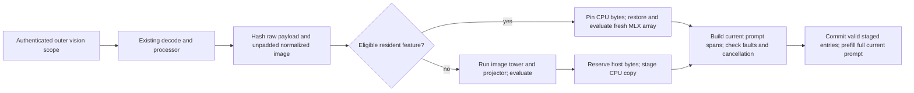

# Gemma image feature caching

> Last updated: 2026-10-29

The provider can retain evaluated Gemma still-image encoder results in bounded RAM.
This opt-in path skips the vision tower and projector on a hit; decode, resize,
prompt construction and full prompt prefill still run. Native parity and
performance qualification are required before default activation.

## Context

Repeated images can accompany different text or appear in a different order.
`EngineV2VisionPrefill` keeps the current processor and span construction while
`GemmaVisionFeatureCache` reuses individual image features. Only the pinned
`MLXVLM.Gemma4` / `Gemma4Processor` adapter is eligible. Other families, unified
Gemma wrappers, diffusion models and video-frame features remain uncached.

## Mechanism

The loaded bridge owns `VisionFeatureCache`. `ModelContainer.perform` excludes
other model preparations across awaits. `VisionFeaturePreparationOwner` registers
up to 128 cache-eligible preparation tasks and propagates caller cancellation.
Disabled, unscoped and unsupported paths acquire no cache transaction; owner
saturation falls back to ordinary cold preparation. A transaction publishes only after the whole
submission passes span, evaluation and cancellation checks. A cancelled producer
may be recomputed by a later request.

The key binds the dedicated authenticated scope, bridge lifetime, model instance,
processor/configuration metadata, adapter revision and current MLX device, raw
payload SHA-256, and exact unpadded normalized tensor bytes, dtype, shape and THW.
Hashes are internal RAM identities. Prompt text and image ordinal are excluded;
current prompt tokens and placeholder spans are always rebuilt. A change to a
bound model/processor/device identity clears eligibility and runs cold. Provider
serving keeps loaded weights and processor configuration immutable; in-place SDK
training or mutation is outside this adapter's contract.

`GemmaVisionProcessorIdentity` accepts either `processor_config.json` or
`preprocessor_config.json`, matching the pinned factory's supported layouts.
Both files contribute when present, together with `config.json`; each read is
bounded to 64 KiB. Missing both processor files, unreadable metadata or an
oversized file disables reuse. This supports the processor-only layout of the
Gemma QAT artifact without inferring identity from a model name.

`MediaIngest` hashes decoded payload bytes while it already owns them. The adapter
currently reads bounded metadata files on each eligible preparation and copies
normalized pixels for hashing. These costs remain in preparation time and must
be measured against saved encoder work. A preprocessing cache or load-time
fingerprint optimization requires separate evidence.

## Invariants

1. Missing scope, absent shared budget, disabled policy, unsupported adapters or
   denied optional allocations run cold. Scope comes only from coordinator outer
   metadata, never from the request body or `cache_scope`. Local endpoints without
   an authenticated vision scope remain cold (`ProviderLoop.handleInferenceRequest`,
   `MultiModelBatchSchedulerEngine`, `GemmaVisionFeatureCache`).
2. A snapshot contains only evaluated, independently copied CPU tensor bytes.
   No live MLX array, lazy graph, raster, raw media or prompt is retained. Restore
   runs under model serialization and evaluates a fresh MLX allocation before
   releasing the reader (`gemmaImageFeatures`, `VisionFeatureCache.Tensor`).
3. Pending copies, scratch, pinned retired entries and published entries consume
   the process, slot and scope limits in [configuration](../reference/configuration.md#image-feature-cache).
   Reservations precede copying and hydration; failure bypasses caching. Host
   bytes use the same `ProcessMemoryLedger` owned by `GlobalKVCacheBudget`, with
   zero MLX materialization credit (`VisionFeatureCacheBudget`).
   Scope-quota denial can evict only that scope's own entries. If its allowance
   remains pinned or pending elsewhere, admission fails cold without evicting
   another scope. Slot/process/ledger pressure can reclaim local LRU entries;
   an impossible allocation or non-capacity ledger refusal triggers no eviction.
4. LRU eviction and TTL expiry remove lookup eligibility first. Borrowed readers
   keep the payload and charge alive. Destruction drops Data before releasing its
   charge. Shutdown synchronously closes the preparation owner and cache before
   cancelling pumps and shutting down the engine, then joins preparation tasks
   and reader leases. Native reporting first verifies engine identity and SDK
   quiescence; unfinished host consumers return `pendingConsumers` while retaining
   ownership. Timeouts never refund bytes (`closeAndDrain`, `shutdownNativeConstruction`).
5. Model LOAD and request pressure trim optional entries. Monotonic absolute TTL
   is swept periodically, including while idle. Pinned bytes remain charged until
   their final reader retires (`GlobalKVCacheBudget.commit`, `claimPendingLoad`,
   `VisionFeatureCache.sweep`).
6. Feature hits change no token usage, prefix evidence, cached-token billing,
   admission floor, SLA or output cap. The complete current prompt is prefilled
   into request-owned KV. Only bounded image-work counters are added to the
   [terminal profile](../reference/telemetry-schema.md#image-feature-work-in-terminal-profiles).

## Failure modes

Allocation refusal preserves ordinary cold inference admission. A copy error,
MLX fault, cancellation or invalid geometry prevents partial publication.
Deterministic input errors and cancellation abandon only the current transaction;
existing entries in all scopes remain eligible. A recorded MLX fault invalidates
the cache generation. Cache
retirement accounting failures conservatively retain their ledger charge rather
than refund unproven ownership. Shutdown ordering and native fault retirement
must be qualified with actual model work; CPU cache tests cannot establish GPU
completion or deadlock freedom.

The current implementation is an opt-in qualification candidate. Native checks
must exercise preparation drain versus pump cancellation, disabled and unsupported
slots, and quota fairness under real memory pressure. Neither implementation nor a
passing CPU suite establishes a production latency benefit.

## Code map

| Concern | Source and symbol |
|---|---|
| CPU ownership, limits, leases | `provider-swift/Sources/ProviderCore/Inference/Vision/VisionFeatureCache.swift` — `VisionFeatureCache`, `VisionFeatureCacheBudget` |
| Preparation cancellation and completion | `provider-swift/Sources/ProviderCore/Inference/Vision/VisionFeaturePreparationOwner.swift` — `perform`, `close`, `drain` |
| Processor metadata layouts and bounded identity | `provider-swift/Sources/ProviderCore/Inference/Vision/GemmaVisionProcessorIdentity.swift` — `fingerprint` |
| Gemma hashing, tower bypass, snapshot/restore | `provider-swift/Sources/ProviderCore/Inference/Vision/GemmaVisionFeatureCache.swift` — `gemmaImageFeatures` |
| Raw identity at existing decode | `provider-swift/Sources/ProviderCore/Inference/Vision/MediaIngest.swift` — `buildUserInput` |
| Current prompt/span construction | `provider-swift/Sources/ProviderCore/Inference/Vision/EngineV2VisionPrefill.swift` — `prepare`, `buildGemmaSubmission` |
| Shared host accounting | `provider-swift/Sources/ProviderCore/Inference/Memory/GlobalKVCacheBudget.swift` — `visionFeatureCacheBudget` |
| Bridge shutdown | `provider-swift/Sources/ProviderCore/Inference/Engine/Bridge/EngineV2Bridge+Lifecycle.swift` — `shutdown` |

## Related

- [Inference architecture](inference.md)
- [Prefix-cache semantics](prefix-cache.md)
- [CPU and native verification](../developer/test.md#image-feature-cache-verification)
