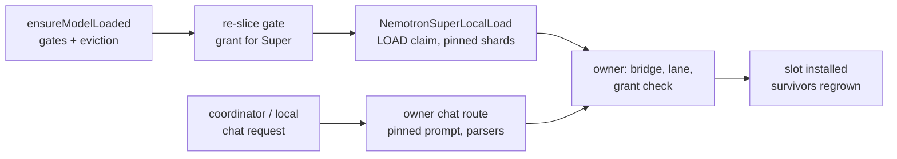
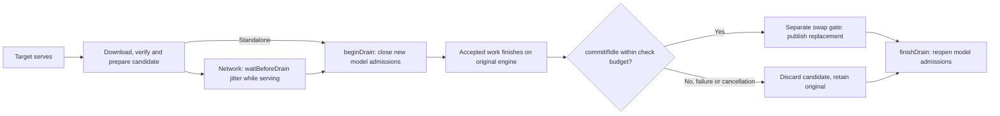
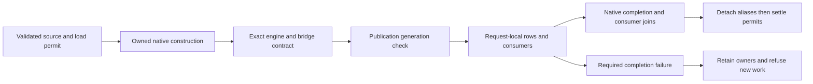

# Provider inference engine

> Last updated: 2026-10-23

How a chat-completion request is served inside the `darkbloom` provider
process: one in-process engine (`mlx-swift-lm`
ContinuousBatchingV2, "CBv2"), one `EngineV2Bridge` per resident model, no
legacy engine and no subprocess. For the memory model see
[`hardware-support.md`](hardware-support.md); for KV/prefix caching see
[`prefix-cache.md`](prefix-cache.md).
The [native block adapter](native-block-inference.md) reuses this bridge boundary
for committed diffusion output and explicit native-container slot ownership.

Native DiffusionGemma also retains image/video assets on tool-result turns.
`EngineV2VisionPrefill.prepareDiffusionUserInput` validates tool history and
orders typed results by their actual call IDs before media decoding, using
`Gemma4TurnStructure.orderTypedToolResults`. `MediaIngest.buildUserInput` keeps
decoded assets and symbolic template parts aligned in that order. System and
assistant media remain unsupported; legacy model ingestion is unchanged. Sources:
`provider-swift/Sources/ProviderCore/Inference/Vision/EngineV2DiffusionVisionPrefill.swift`,
`provider-swift/Sources/ProviderCore/Inference/Prompting/Gemma4TurnStructure.swift`,
`provider-swift/Sources/ProviderCore/Inference/Vision/MediaIngest.swift`.

## Context

The unregistered `NemotronSuperLocalBridgeBuilder` assembles an installed Super
language tower through the native CBv2 factory after rechecking a pending LOAD
lease. `NemotronSuperLocalBinding` owns acquisition through engine retirement and
drains its own requests; the owner mints one `localTextBinding` and drains it in
`closeAfterDrain` before the image binding and bridge. It accepts pretokenized text only; media, tools, schemas
and client prompt-cache keys are rejected, and text prefix reuse runs only when the owner has a
checkpoint bank (below). The builder uses serial segmented paged KV (Super has
no contiguous storage), bounded calibrated prefill, and no MTP unless the
explicit opt-in below installs text speculation. The provider installs this owner only through the
[managed Super slot](#managed-nemotron-super-slot). `NemotronSuperLocalLoad` owns
the one-shot load transaction, checks the pinned config, reserves the
conservative SDK quote and preserves charges on native completion faults. `NemotronSuperPromptContract` renders the
pinned template with reference `apply_chat_template` semantics: request-order tool
schemas and tool-call arguments, Python `str`/`strip`/`json.dumps` filters, and the
processor's ``, one `<image>` per feature, `</img>` expansion. It rejects
conflicting reasoning controls; `NemotronSuperRequestPlan` resolves those controls,
the shared tool-choice policy and the response-format instruction once per
request. A generated golden corpus pins rendered text and token IDs.
`NemotronSuperVisionSubmission` preserves causal attention and absent position
state when translating admitted SDK features. `NemotronSuperLocalOutput` applies the
reference `ultra_v3` reasoning split in `NemotronSuperReasoningChannel`, streams
reasoning and plain content, and withholds tool calls and JSON content until the
shared tool and response-format validators pass; output stays bounded. The
unregistered `runValidatedText` binding connects rendered tool/schema prompts
to withheld output validation after native retirement. It rejects truncation and
missing/error terminals. Causal vision submission is exercised by a synthetic
fixture through the real bridge, including RADIO/projector preparation, generation
and retirement; public media dispatch remains unwired. SDK fixtures compare
full-position and narrowed image logits, split prefill inside an image span and
exercise recurrent rollback with request isolation. These checks do not establish
full-checkpoint quality or speculative MTP support. Synthetic loopback HTTP tests exercise authentication, model listing, SSE, malformed input and restart through the actual Hummingbird server and native bridge; their weights and tokenizer are fixtures. The local builder wraps the
composite in `NemotronSuperRecurrentAdapter`, a serial causal adapter with explicit
scalar-cache-offset positioning. It rejects explicit position tensors, packed rows
and mismatched state/cache counts; the generic Nemotron type is not widened. Sources:
`provider-swift/Sources/ProviderCore/Inference/Vision/NemotronSuperVisionSubmission.swift`,
`provider-swift/Sources/ProviderCore/Inference/Streaming/NemotronSuperLocalOutput.swift`,
`provider-swift/Sources/ProviderCore/Inference/Streaming/NemotronSuperReasoningChannel.swift`,
`provider-swift/Sources/ProviderCore/Inference/Prompting/NemotronSuperRequestPlan.swift`.
Sources:
`provider-swift/Sources/ProviderCore/Inference/Engine/Factory/NemotronSuperLocalLoad.swift`,
`provider-swift/Sources/ProviderCore/Inference/Prompting/NemotronSuperPromptContract.swift`,
`provider-swift/Sources/ProviderCore/Inference/Engine/Factory/NemotronSuperLocalBridgeBuilder.swift`,
`provider-swift/Sources/ProviderCore/Inference/Engine/Bridge/NemotronSuperLocalBinding.swift`.

The dedicated `NemotronSuperLocalImageBinding` is minted by that exact load
owner, holds its own media reservations (its prompt's KV pages are charged
like text's, by the engine's process-memory owner), and cancels/drains
through terminal retirement. Synthetic tests exercise image cancellation, reuse
and close. It does not manufacture a shared native lease; the managed slot's
chat route is its only production caller. The CPU `NemotronSuperImageDecode` sniffs PNG or JPEG content and
reproduces the reference loader's RGB8 conversion: PNG of every colour type and
bit depth is decoded in-process and matches Pillow exactly, while JPEG samples
come from ImageIO within test-enforced bounds. Container limits are checked
before any raster buffer exists, and the SDK resize is bitwise equal to CPU
PyTorch on the golden fixtures; see the
[image format reference](../reference/nemotron-super-image-formats.md).
Its quote alone is not admission. The exact-owner `runEncoded` boundary charges
ingress before JSON/base64/header inspection and media before decode. The media
charge adds the SDK's shape-derived tower and projector working-memory bound for
the largest image, which preparation evaluates one at a time; the global
activation reserve is unchanged. It only accepts `data:image/png;base64,` and
`data:image/jpeg;base64,` URIs, whose content selects the format, and uses the
owned tokenizer. Native input arrays are constructed in a separate retained,
fenced epoch before tower preparation. Synthetic RGB tests cover generation,
cancellation, busy rejection and release after task completion; loopback HTTP
tests serve PNG and JPEG variants through the tiny synthetic owner. Actual
tokenizer parity, RADIO peak workspace and full-checkpoint image qualification
remain required.

The same binding serves one inline video as the only media of a request
(`data:video/mp4;base64,` or `data:video/quicktime;base64,`; one media request
at a time, like images). Under the ingress reservation `NemotronSuperVideoDecode.inspect`
runs the shared `MediaIngest.decodeVideo` checks (label, decoded bytes,
container, duration, coded frame size up to
`NemotronSuperServingPolicy.maximumVideoFramePixels` pixels in any shape),
admits only an H.264 or HEVC track (`NemotronSuperVideoDecode.admittedCodecs`),
then reads the compressed samples of the one video track as vLLM's OpenCV
loader reads FFmpeg's metadata: the sample count (at most
`NemotronSuperVideoDecode.maximumSourceFrames`, 36,000: ten minutes at 60 fps),
and the rate as that count over the summed sample durations; as in FFmpeg, the
last sample may have zero duration (no other may). The SDK's
`NemotronSuperVideoPreprocessing` samples 2 frames per second (at most 256,
`np.linspace` truncation), formats each tubelet's label and fixes one frame
grid of about 1,024 patches; grids above
`NemotronSuperServingPolicy.maximumVideoGridPatches` are refused. Every frame
up to the last sampled one is decoded, so a plan whose decoded frames hold
more than `NemotronSuperVideoDecode.maximumDecodedPixels` pixels (ten minutes
of 30 fps 1080p) is refused as well.
`NemotronSuperPromptContract.videoPrompt` renders the video in the template's
single media slot (the template renders a lone video exactly as a lone image,
but as plain `<video>` text) and tokenizes each label alone, later ones behind
their `\n`, as vLLM's `get_video_repl`; every tubelet then contributes its label,
``, one `<image>` per kept feature and `</img>`. EVS fixes the kept count,
`max(N, int(T * N * (1 - q)))` (`NemotronSuperVideoFeatures.retainedRows`), so
the prompt is admitted at its final length before any frame decodes. The whole
charge (`NemotronSuperLocalImageBinding.videoChargeBytes`: two encoded copies,
the decoder working set at the coded frame size, one batch of four tubelets'
frames and tower activation, its five-tubelet EVS scoring window at
`NemotronSuperServingPolicy.videoScoringBytesPerRow`, and three Float32 copies
of every projected row) is then reserved; its maximum,
`NemotronSuperServingPolicy.videoMediaChargeBytes`, stays below one largest
image's charge. As for images, a body over
`NemotronSuperServingPolicy.maximumEncodedBodyBytes` (8 MiB) returns the
invalid-media 400, as does a video prompt over the context, and a charge the
shared budget cannot hold returns the media-memory 503. The owner lock covers
only the admission check while the video prompt is decoded and rendered.
`NemotronSuperVideoDecode.Frames` decodes the movie in order as the batch needs
frames: AVFoundation decodes every frame up to the last sampled one to BGRA,
each decoded frame must have the inspected size and row bytes within the
charge (`NemotronSuperVideoDecode.validateDecodedFrame`), and only the sampled
ones are copied to RGB8 (presentation order, the track's rotation applied) and
normalized with the image resize; an odd last frame repeats. Every read, and
the reader's one cancellation, runs in order on the reader's own serial queue
while the pulling thread waits for the sample, so the reader is never
cancelled during a read. Waiting on the decoder is bounded by
`NemotronSuperVideoDecode.decodeAllowance` (5 s, then 2 ms a frame and 4 ns a
coded pixel, at most 120 s): when it is spent the wait ends and the video is
refused. Cancelling the request, as the binding's `drain` does, ends the wait
at once. Either way the reader is cancelled once the read in progress
returns, and that read's sample is dropped.
`NemotronSuperVideoFeatures.prepare` runs
`videoFeatures(normalizedFrames:)` over batches of `tubeletBatch` tubelets in
the installation's native setup, checking every evaluation with
`throwIfMLXFaulted`, and keeps only projected rows. When
`DARKBLOOM_NEMOTRON_SUPER_VIDEO_PRUNING` (default `0.5`, `0` keeps every row; a
malformed value fails the load before its LOAD claim) prunes anything, each
batch is scored with `NemotronSuperEVS.dissimilarity` behind the previous
batch's last tubelet, since a token scores only against the same position of
the previous tubelet; the host scores then select the kept rows, the same rows
EVS selects over the whole video. Each tubelet's kept rows are substituted
at its `<image>` run as a causal span with `mediaKind` `video`. A tubelet whose
rows were all pruned keeps its label and wrappers and has no span. Invalid,
oversized or undecodable videos map to the invalid-media 400. AVFoundation's
BGRA conversion differs from FFmpeg's at chroma edges, so frames are close to,
not equal to, the reference loader's.

SDK installation now holds resident plus bounded staging reservations across
sequential exclusive construction epochs. Completed fences release temporary
roots, while failed completion retains resident objects and charges. Header-derived
projection/expert-bank/image staging bounds and explicit backend allowance must
still be checked against full-model measured peak memory. Bundling the upstream
MTP tensors does not qualify execution.
The optional `NemotronSuperLocalImageHTTP` hook reuses the authenticated local
application and standard JSON/SSE framing and defaults to absent. It serves text
through the owner's `localTextBinding` and images through its image binding, admits
the owner's configured number of requests before it decodes the body or renders
the prompt, and refuses another with `queueFull` (429) before any response
starts. A response starts at the first generated chunk the output parser accepts,
even one it withholds, so a held answer's failed validation ends the stream with
an error. `NemotronSuperLocalLoad.localImageHTTP(templateBytes:)` builds
it over the transaction's own owner. Only the qualification runner installs it as
a hook; the managed slot serves the same route through `engine(body:hasMedia:cacheScope:)`.
`DARKBLOOM_NEMOTRON_SUPER_MAX_CONCURRENT` (default `1`) sets how many requests
the owner serves: `1` to `64` plain, `1` to `8` with rectangular speculation, one
with serial speculation. Above one the plain builder serves
`NemotronSuperRecurrentAdapter(_:maximumDecodeRows:decodeProducts:)` with
`.rowExact`, so concurrent requests decode in one `[B, 1]` step bit-identical to
their one-token decode. The hook admits that many requests and refuses the next
with 429.
`NemotronSuperLocalPrefill` fixes prompt scheduling: chunks of
`DARKBLOOM_NEMOTRON_SUPER_PREFILL_CHUNK` tokens (default 2,048, at most the
calibrated prefill limit), at most one prompt chunk per step beside every decode
or verify row, a step budget that holds a whole chunk plus those rows, and
optional decode-only steps between chunks
(`DARKBLOOM_NEMOTRON_SUPER_DECODE_STEPS_BETWEEN_CHUNKS`). A request's chunks are
therefore the same whether or not it is served alone. Because one chunk runs per
step, the prefill activation is one owner-wide lane in the shared budget,
reserved before the first request and released only after native retirement:
`NemotronHModel.prefillActivationBoundBytes(tokens:)` (the SDK's whole-chunk bound
measured on the full checkpoint) for the pinned checkpoint, the ModelOpt
workspace quote for synthetic fixtures. A lane that does not fit fails the load;
the pinned checkpoint's LOAD claim already holds it (below).
Each request's fixed bytes count, beyond the engine's recurrent generations
and any speculation charge, `requestWorkspaceBytes`: one
`NemotronSuperDecodeCharge` decode row, which the owner reserves for every
configured request (below). The builder refuses a KV grant that
cannot hold every configured request's fixed bytes plus the minimum KV with
`UnserviceableGrant`, which names the grant, the smallest serviceable grant and
the fixed bytes per request.
`NemotronSuperLocalPrefixCache` gives either owner exact text prefix reuse when
`DARKBLOOM_PREFIX_CACHE_MEMORY=1`. For the pinned checkpoint
`NemotronSuperServingPolicy.defaultPrefixBankBytes` sizes the SDK's resident
recurrent checkpoint bank from the KV grant and the machine:
`serving = grant - admissionKVBytes(requests, speculates) - lane bound(chunk) - one image's media charge`,
`load = memory cap - activation reserve - LOAD bytes (installation, any head) - admissionKVBytes - lane bound`,
`bank = min(16 GiB, grant / 4, serving / 2, load / 2)` rounded down to 256 MiB,
and no bank below 1 GiB. The lane and media charges come from the same ledger
the grant describes, so half of what is left beside them stays free; the single
LOAD claim holds the installation, any head, the lane, the bank and the
requests' KV, so half of what the machine's cap leaves beside it stays free.
`grant / 4` is the engine's own bank ceiling when a re-slice shrinks the grant.
A lone slot (grant = fleet KV budget) gets 16 GiB for either owner on 192, 256
and 512 GiB; on 192 GiB the speculating owner's whole claim (110.0 GiB) and
activation reserve leave 60.8 GiB of the cap for other memory, on 128 GiB
(a 5.25 GiB bank) 13.9 GiB. `DARKBLOOM_CBV2_HYBRID_PREFIX_BYTES` overrides it, other checkpoints
keep `PrefixCachePolicy.hybridConfig`'s `min(1 GiB, grant / 8)`, and the bank
holds up to one entry per 256 MiB (at least 32). The managed slot's
`loadPlan` sizes the same bank from the same grant, requests and keys, turns
the switch on only when it is non-zero and adds it to the LOAD claim's KV
headroom. The backend carves the bank from the KV
grant before the grant check, and its whole budget is reserved in the shared
budget from before the first request until native retirement, like the lane; a
bank that does not fit fails the load and a retained native fault keeps it
charged. The adapter is built with `exactPrefixCheckpoints`, so checkpoints sit
only at multiples of the prefill chunk, where a restore continues a cold prefill
bit for bit; prompts shorter than one chunk restore nothing. Text requests are
then submitted with prefix caching on, partitioned by the request's cache scope
(the hook's single local scope, or the managed slot's authenticated tenant
scope). An image request with a cache scope is bound to an identity of its
evaluated features and spans (`EngineV2VisionPrefill.PreparedSubmission.hybridPrefixIdentity`),
hashed while its media charge still covers the copy, and reuses only within
that identity: the same images at the same positions in a later turn. Without
a scope it stays cold and never publishes. On the speculating owner
the target is built with `exactPrefixCheckpoints` too and each checkpoint also
holds the assistant's queued prompt history, so a restored request drafts from
the same history as a cold one.
`UnserviceableGrant.minimumGrantBytes` and the slot's re-slice floor include
the bank, so a larger bank also keeps a co-resident load from shrinking the
grant below it. A re-slice does not give the bank up: the engine only lowers
the bank's own limit to a quarter of the new grant and keeps entries pinned by
in-flight restores and captures, and the shared ledger holds the bank's whole
reservation until native retirement, so a floor without the bank would hand a
newcomer memory the bank still holds. Sources:
`provider-swift/Sources/ProviderCore/Inference/Engine/Factory/NemotronSuperLocalPrefixCache.swift`,
`provider-swift/Sources/ProviderCore/Inference/Engine/Factory/NemotronSuperLocalAdmission.swift`.

Super serves paged attention KV only: `NemotronSuperLocalKVBackend` always
selects the segmented native paged backend (the adapter declares
`supportsPagedKV` and `requiresNativePagedKV`; the pool takes the eight
attention layers' observed BF16 types). `DARKBLOOM_NEMOTRON_SUPER_KV_BACKEND`
unset or `paged` serves it; `contiguous` fails the load as no longer supported
(`contiguousUnsupported`) and any other value as malformed (`invalidBackend`).
The load transaction refuses either, and `DARKBLOOM_CBV2_PAGED_KV` disabling
paged KV (`pagedDisabled`; the fleet kill switch would otherwise degrade the
paged selection to contiguous), before its LOAD claim and installation. A paged
construction failure fails the load, and the builder retires a built bridge
whose storage is not paged and fails the load instead of serving it
(`storageNotPaged`). The
engine's process-memory owner charges pages and recurrent rows to the shared
budget as they materialize and the bridge reserves no request bytes, so the
owner reserves `requestWorkspaceBytes` for every configured request (the
decode rows) from before the first request until native retirement, like the
lane. The text prefix bank (`CBv2HybridPrefixCacheConfig.permitsPagedStorage`)
is carved from the paged grant, a donor's prompt KV is gathered into the
bank's own buffers on the engine queue before its pages return to the pool,
and an adopter writes that prefix into fresh pages with a `.direct` plan. A
paged backend with step-owned attention, a native binding or a page-sharing
index builds no bank, and the builder then fails the load
(`NemotronSuperLocalPrefixCache.Failure.unavailable`). Within paged storage,
batched rows, captured speculation windows and rollback stay exact; the gated
`NemotronSuperPagedLiveTests` hold paged logits to a contiguous reference arm,
which reduces differently, within a stated tolerance.
`NemotronSuperLocalMTP` installs text speculation only when
`DARKBLOOM_NEMOTRON_SUPER_MTP` is exactly `1` (the hook's default is off; the
managed slot's policy sets it). The load transaction
adds the embedded head's header-derived payload and loader construction allowance
to its single LOAD claim, loads the head in its own fenced construction epoch, and
the builder serves the SDK `NemotronSuperMTPAssistant`: greedy, up to the
configured requests per round, fixed depth (`DARKBLOOM_NEMOTRON_SUPER_MTP_DEPTH`,
`1` to `3`), a depth by the requests decoding in the step (a comma list; SDK
`CBv2MTPConfig.fixedDraftTokensByDecodeRows`) or `auto` (the engine's marginal
policy picks each step's depth). Verification
(`DARKBLOOM_NEMOTRON_SUPER_MTP_VERIFICATION`) defaults to `rectangular`:
`NemotronSuperMTPCaptureTarget` verifies the seed and drafts in one captured
target window, bit-identical per position to plain decode, and the engine commits
the Mamba state after the last accepted token and trims attention KV. `serial`
serves `NemotronSuperMTPTextTarget` with one ordinary target step per draft. The
shared production factory recognizes both targets like `NemotronSuperRecurrentAdapter`
(layer kinds, caches and the calibrated prefill bound).
The engine admits the assistant's bounded per-request charge (FP8 history, backlog,
every draft step's dense FP8 output head, the rectangular verify window and an
unmeasured 256 MiB backend scratch allowance) plus captured recurrent states before
allocation and holds them until retirement. On an owner with speculation each
image request runs target-only (SDK `CBv2RecurrentMTPRequestScopedMediaFallback`):
no draft, carry or assistant state, while text keeps speculating. Synthetic fixtures show
token-exact greedy output against the ordinary owner in both modes, forced
rejection rollback and cancellation; serial verification cannot beat plain
decode. On the full checkpoint (`scripts/nemotron-qualification/bench_serving.py`,
16 natural prompts, greedy, every output byte-identical to the plain owner's)
71–91% of drafts were accepted; aggregate tok/s against the plain owner was
57.0 / 32.5 at one client (depth 3), 65.0 / 50.7 at two and 78.4 / 67.2 at four
(depth 2) and 86.9 / 82.8 at eight (depth 1), hence the managed default
`3,2,2,2,1`. Sources:
`provider-swift/Sources/ProviderCore/Inference/Engine/Factory/NemotronSuperLocalMTP.swift`.

### Managed Nemotron Super slot

The distribution is one manifest and one model installation: all 88 shards
include the embedded MTP head, alongside the tokenizer, processor and template
assets. There is no separate MTP download or manual assistant binding. The
Super manifest scanner also retains root `LICENSE.txt` and
`UPSTREAM_README.md` notices in the download and integrity aggregate; adding
these notices requires a new immutable artifact revision. Other model families'
integrity inventories are unchanged. Managed `auto` enables text speculation;
image and video requests automatically use the target-only path on that same owner.

The provider serves exactly one Super artifact, `NemotronSuperServingPolicy.modelID`
(`nvidia-nemotron-3.5-super`): the complete pinned NVIDIA NVFP4 checkpoint, embedded
MTP head included, discovered as described in the
[model registry](model-registry.md#nemotron-super-discovery). It has no
`ModelContainer`: its slot holds `ProviderModelContainer.nemotronSuper`, a
`NemotronSuperSlotOwner` over the load transaction and its chat route. Generic
factories (`ModelContainerLoading`, `EngineV2SlotFactory`), warm liveness
rebuilds, the MTP upgrade and the standalone server refuse it.



`ensureModelLoaded` runs its ordinary selection and Super's own eviction and
load gate (below), then hands the load to `ProviderLoop.loadNemotronSuperSlot`.
Under the re-slice gate, held until installation, `resliceShrinkingForNewcomer`
shrinks survivors and returns Super's grant; `NemotronSuperSlotLoader.pinnedCheckpoint`
opens every shard against its pin (`NemotronSuperCheckpoint`) and runs the
transaction. Its LOAD claim holds the installation's and (with speculation) the
head's resident payloads, and
`NemotronSuperServingPolicy.admissionKVBytes` of KV headroom: every configured
request's measured fixed bytes, rounded up (576 MiB with speculation, 512 MiB
plain, at any context), 2 GiB and any prefix bank, which the grant holds and
which never exceed it (`grantKVBytes`), and a speculating owner's round work
once (`speculativeOwnerBoundBytes`, below), which is reserved beside the grant
whatever its size. The grant itself must still hold every configured
request's fixed bytes and the minimum KV: a smaller co-resident grant serves
fewer requests, and one that cannot serve a single request fails the load
at publication (below). For the pinned checkpoint the same claim also holds
the prefill lane at its measured bound (`NemotronSuperLocalBridgeBuilder.pinnedOwnerShares`),
so one admission before any allocation covers everything the loaded owner keeps
and a load that cannot hold it is refused before a shard is read into memory.
A refused claim first returns MLX's cached buffers (once per load) and asks
again for the same configuration; a refusal alone only schedules the
reclaimer's flush. Before refusing, the transaction tries narrower
configurations in order
(`NemotronSuperLoadFit`): the same policy without the prefix bank, then half
the concurrent requests at a time down to one, then that request with
1,024-token prompt chunks (a 4.75 GiB lane instead of 8.5 GiB), each with
every measured bound (installation, head, the lane of its chunk, per-request
bytes, the round at the whole context). It builds the first one the gate
admits with `NemotronSuperLoadFit.admissionSlackBytes` (3 GiB) to spare
beside the claim: while the claim is held the process grows up to 2.6 GB past
the installation's quote, and a configuration admitted with 1.9 GB to spare
lost its admission after its weights were installed. If memory still drops
by more than the slack while the weights install (other applications
swapping), the owner build's memory refusal (`loadAdmissionLost`, or a refused
lane, decode rows, round or bank) does not retire the load: the transaction
keeps the installed weights and head, finishes that claim (its attempt is
marked `lostAfterInstallation`) and asks the gate for each next narrower
configuration's owner shares, KV floor and slack
(`NemotronSuperLoadFit.Claim.installedAskedWeightBytes`), failing with the
builder's last refusal when none fits. Super's claims keep no
OS reserve beyond that slack and the activation reserve
(`NemotronSuperLoadFit.systemReserveBytes`, in place of the provider's 10%
load reserve) unless the operator raised `memory_reserve_gb` above its 4 GiB
default, which then stays free whole. So the narrowest configuration loads
with `NemotronSuperLoadFit.minimumAvailableBytes` (85.6 GiB) available: its
80.6 GiB claim, the slack and the 2 GiB activation reserve. The default (eight
requests and a bank, about 99 GiB) needs about 104 GiB. Every attempt is
recorded (`fitAttempts`; the provider logs an owner narrower than planned,
the qualification runner's `load.fit` event lists each claim beside the
gate's terms).
Pre-accept (`fastAdmissionReject`), eviction and startup preload decide on
the same terms (`ProviderLoop+NemotronSuperAdmission`): the room the claim
would be admitted with (`GlobalKVCacheBudget.HeadroomSnapshot.loadClaimRemainingBytes`,
the ledger's own admission with Super's system reserve) against what each
configuration requires (`NemotronSuperLoadFit.Claim.requiredBytes`; for the
pinned checkpoint `pinnedRequirements`, the plan sized for a lone slot
first). On memory, pre-accept refuses only when evicting every idle model
cannot make room for the narrowest configuration. Eviction removes idle
models, least recently used first, until the room holds the widest
configuration such eviction can reach, so an idle model yields to the
planned owner rather than to a narrower one, and refuses without evicting
when not even the narrowest is reachable. A victim that takes work while its
unload suspends declines it, and eviction plans again from the models still
idle; the third decline refuses the load. Like the ordinary gate, eviction
first releases retained free KV segments and drops MLX's buffer cache once
(`releaseReclaimableMemoryForLoad`), before its first eviction or a refusal
with nothing idle, and counts those segments as reachable only until then:
segments still parked after the release never justify an eviction.
Pre-accept performs the same release and judges the room it leaves when
nothing is idle or only those segments could close the gap.
Startup preload, which never evicts, admits Super by the same room and
orders it by its planned requirement. The discovery footprint
(`estimated_memory_gb`) is the narrowest configuration's requirement itself,
89,750,767,136 bytes (83.6 GiB) on every Mac. Cold capacity quotes and the
coordinator's cold-load routing compare it and the load headroom with free
memory less the provider's load reserve (`free_for_load_gb`), so they stay
stricter than the provider's 85.6 GiB minimum (about 99.4 GiB available on
128 GB) until the platform adopts a Super-specific rule.
The bridge reports the width it was built with, so capacity quotes route no
more concurrent work to it. A resident slot's image or video probe is quoted
against the ledger room its media reservation is admitted by
(`process_memory.remaining_bytes`), not the load gate's room.
The load's transient (`NemotronSuperLoadClaim`) is the larger of the
installation's staging with its 2 GiB backend allowance and the head's
construction allowance, and the claim adds only the part beyond that serving
room: the transaction returns each phase's freed buffers from MLX's cache
(synchronize, `clearCache`) before the head loads and before the builder
reserves the lane and bank, under the same rule as the shared budget's
reclaimer. When a retained or closing native owner forbids reclamation the
claim holds both transients beside the room, and a load whose reclamation turns
unsafe after installation fails.
Once the installation and head are resident (MLX usage), their share of the claim
is handed over to that live view, as the ordinary managed load does
(`reducePendingLoad`), and the builder hands the lane, round and bank shares to
their own reservations right before taking them, so no byte is counted twice.
The grant itself stays the engine's admission ceiling, re-sliced like every slot's; the
builder still refuses a grant that cannot serve every configured request with
`UnserviceableGrant`. After the post-build headroom guard the bridge is
registered and the slot installed. The lane, the decode rows and the
round sit in the shared budget beside the grant (only the bank is carved from
it), so the re-slice (`fleetKVBudgetBytes`) and the heartbeat clamp count them
as resident, like weights (`NemotronSuperSlotOwner.reservedBesideGrantBytes`):
the newcomer's re-slice counts the planned lane and round, and publication
re-slices every grant with the actual reservations, so Super's engine ceiling
and advertised token budget stay within what the ledger holds beside them.
The builder checked its configured requests against the grant with the
planned lane and round, so beside other models the published grant alone
can be too small for one request (`superGrantRefusal`); publication then
logs the refusal, unpublishes the slot, retires the owner and restores every
survivor's grant instead of keeping a loaded slot that serves nothing.

`NemotronSuperServingPolicy.loadPlan` sets the runtime policy: `mtp_mode` `auto`
or `on` installs rectangular speculation at depth `3,2,2,2,1` by decoding
requests (`off` or `DARKBLOOM_CBV2_MTP=0`
serves the plain owner); eight requests unless `engine_v2_max_concurrent` or its
per-model entry is explicit, which then bounds it (at most eight with
speculation). The depth, verification, prefill chunk and decode-step keys above
keep an operator's value. The plain owner turns exact text prefix reuse on when
the grant holds every request's fixed bytes beside the bank, unless the
operator set `DARKBLOOM_PREFIX_CACHE_MEMORY` or a cache kill switch.

On NAX GPUs (M5 and later) prompt processing runs the routed NVFP4 experts
on dedicated NAX kernels behind one fused expert route
(`ModelOptNVFP4NAXExperts`) instead of the simdgroup grouped GEMM, and the
dense FP8 and NVFP4 projections decode their weights inside the NAX GEMM
(`ModelOptNAXDenseLinear`): the expert summation order differs from the
grouped GEMM, the teacher-forced accuracy does not
(`libs/mlx-swift-lm/docs/nemotron-super.md`).
Speculative rounds submit the verify window to the GPU every 12 blocks
(`DARKBLOOM_NEMOTRON_SUPER_MTP_WINDOW_SUBMIT`, `0` builds it whole) and run it
and the MTP head on Super's fused decode kernels row by row
(`DARKBLOOM_NEMOTRON_SUPER_MTP_FUSION=0` restores the op chains); neither
changes a token.

The slot serves and advertises its whole verified context, 262,144 tokens,
prompt plus output (`NemotronSuperServingPolicy.contextTokens`, equal to
`maximumContextTokens`, the most the builder and the image binding accept); the
qualification runner's `--max-context` can select less. The checkpoint's attention has no positional
encoding and its eight attention layers keep 8 KiB of BF16 KV per token,
which the engine's admission ledger reserves for each request by its own
length. Recurrent state, the decode row and the
prefill lane do not grow with the context: on the full checkpoint each
2,048-token chunk peaked 7.7 to 8.7 GB above the state held before it through
131,056 tokens, with finite logits throughout; the larger figures are first
chunks, which also allocate the whole prompt's KV slots (charged to the
request). The chunk's own transient, peak minus what it retains, measured
7.50 to 7.67 GB at every chunk of a 32,768-token prompt on contiguous and paged
KV, inside the 8.5 GiB lane (`NemotronHModel.prefillActivationBoundBytes`). The speculating
owner's assistant keeps state that grows with each request: its FP8 history
and decoded mirror, allocated once for the request's prompt plus `max_tokens`
and written in place. The SDK declares it as a per-token buffer
(`CBv2MTPSequenceScaledAllocationProviding`): EngineV2 prices it for each
request's reserved tokens through its auxiliary ledger, 1,536 bytes per token
beside the 8,192 of KV, with the projection's rounding slack in its fixed
bytes. The fixed per-request bytes are
533,401,365 whatever the configured context (measured; 2,450,016,143 while the
round work was charged to every request, 4.43 GB at 65,536 while the window
was charged up front); the plain owner's stay 516,253,712. Work of one round
exists once per owner, whatever the number of requests, and the builder
reserves it once as `mtp_round` before the first request: the draft steps the
depth table allows at its widest round, one prompt-history chunk, the backend
scratch, the verify window, the captured windows' recurrent generations and
the whole-history copies MLX may hold at once when a write cannot donate its
buffer (each speculating row once per draft step plus once, every other
request once, each at the configured sequence bound). For the default table,
eight requests and 65,536 tokens that is 4,935,449,637 bytes (measured);
`speculativeOwnerBoundBytes` estimates it for the LOAD claim from the engine's
own counts for the depth table in effect (5.03 GB here; less when the table
drafts less at a width) and the builder refuses the build when the exact
reservation does not fit. At the served 262,144 tokens only the history
copies grow (16 for the default table and eight requests, 1,536 bytes per
token each), to 9,865,003,008 bytes (estimate; the engine reserved 9,767,287,845
on the full checkpoint). With the round reserved once, eight speculating requests need a 6.7 GB
minimum grant with a 1 GiB bank (22.8 GB before), and the full checkpoint's
decode-window peak above idle at 131,041 prompt tokens fell from 3.80 to
2.36 GB. Long prompts are slow and recall degrades with length: a
130,058-token prompt takes 5.4 minutes to its first token, and whole-document
recall degrades beyond about 32K tokens. The slot still serves the whole
window; whether a long prompt's prefill time suits a request is the
coordinator's routing decision, not a provider cap. On the default owner (paged KV,
prefix bank, MTP) a 258,036-token needle through the managed local endpoint
returned its passphrase exactly in 888.8 s (2026-10-21, M3 Ultra).

Coordinator requests on the slot (`ProviderLoop+InferenceHandler`) and unified
local-endpoint chat completions (`NemotronSuperLocalEndpointEngine`) run on the
owner's chat route, not the generic engine: the pinned prompt contract, reasoning
channel, tool and structured-output validation, cancellation and usage are the
hook's. Coordinator text prefix reuse is partitioned by the authenticated cache
scope and off without one; the slot emits no cache receipts, cached-token usage
or prefix-cache capability. A cancelled stream bills delivered output and the
reference prompt length. Inline JPEG and PNG images (`data:` URIs, within the
[image format reference](../reference/nemotron-super-image-formats.md) limits)
run on the owner's image binding. On the default speculating owner every image
request is target-only for its whole lifetime: the engine prefills and decodes
it on the target with no draft, carry or assistant state, while text requests
keep speculating in the same steps. The image's media reservation (decode,
normalization, features and the largest image's tower and projector bound) is
taken from the shared budget before decoding and held until the request
retires; one that does not fit is refused with 503 before anything is
allocated. A body over 8 MiB, visual tokens beyond the context or a prompt
that overflows it is the request's own fault: 400, never a retryable 503.
One image request runs at a time per owner, beside text requests; a
second concurrent one gets 429 before any response starts. The Super model
quantizes activations with deployment (SATFINITE) overflow semantics: an image
embedding beyond a layer's text-calibrated activation scale saturates as on
TensorRT-LLM and vLLM, where ModelOpt's eager cast rule would turn it into NaN
(see `libs/mlx-swift-lm/docs/nemotron-super.md`). Non-finite tower or projector
features still fail the request; that check, like every image evaluation, runs
under `MLX.withError`. The owner's lock covers only each image step's admission
check, so text admission never waits on image preparation.
The generic local engine refuses Super; only chat completions serve it.

`retireNemotronSuperSlot` unregisters the bridge, drains and closes the owner
(bindings, bridge, prefill lane, any bank, installation), then regrows
survivors. A wedged slot is retired, never rebuilt: no wedged row ever drains,
so `retireWedgedNemotronSuperSlot` takes it out of serving at once and, off the
capacity tick, shuts the bridge down before the same drain and close, within
`nemotronSuperWedgeRetirementBound` (twice `CBv2EngineLoopConfig.shutdownTimeout`);
the model reloads only after `engineV2RecoveryCooldown`. An owner whose native
work did not retire, or whose wedged retirement outlives that bound, keeps its
weights, reservations and bank in the fleet KV budget
(`nemotronSuperRetainedWeightBytes`; a load that faults keeps its installation's
size and the lane, round and bank its plan reserves) and refuses later Super
loads until restart, except that a wedged retirement completing after its
bound releases its charge and reopens the memory retirement window.
`ensureModelLoaded` asks both refusals (`refuseNemotronSuperReload`) before it
evicts anything for Super, and pre-accept refuses Super requests on them
(`nemotronSuperRefusesRequest`), also while the wedged slot, still resident,
retires. Sources:
`provider-swift/Sources/ProviderCore/NemotronSuper/ProviderLoop+NemotronSuper.swift`,
`provider-swift/Sources/ProviderCore/NemotronSuper/ProviderLoop+NemotronSuperAdmission.swift`,
`provider-swift/Sources/ProviderCore/Inference/Engine/Factory/NemotronSuperLoadFit.swift`,
`provider-swift/Sources/ProviderCore/Inference/Engine/Factory/NemotronSuperServingPolicy.swift`,
`provider-swift/Sources/ProviderCore/Inference/Engine/Factory/NemotronSuperSlotOwner.swift`,
`provider-swift/Sources/ProviderCore/Inference/Engine/Factory/NemotronSuperCheckpoint.swift`,
`provider-swift/Sources/ProviderCore/Server/NemotronSuperLocalEndpointEngine.swift`.

The `prism_hadamard_qwen35` adapter reuses the native dense Qwen text backbone
and retains its vision wrapper. The SDK validates signed-Hadamard metadata and
packed weights before returning the model. Packed scales and embeddings are
FP16, but the published FP32 normalizers promote native KV and recurrent
convolution state to FP32; checkpoint declarations preserve that actual dtype.
Packed recurrent prefill retains a compact convolution carry rather than an
alias of the complete chunk allocation; the SDK copies those state bits without
changing the recurrence or other model families.
`EngineV2SupportedModels.bonsai2ModelID` selects paged KV automatically for
the 27B artifact, which has no MTP assistant tensors. The 9B candidate's
separate local sidecar requires the explicit validation and opt-in described
below; it does not extend the 27B qualification cohort.

Native Qwen3.5 vision blocks honor explicit checkpoint activation declarations.
For the three supported nested vision types, tanh and exact GELU are selected
from `hidden_act`; absent or unknown declarations preserve the existing fast
approximation. The SDK's `Qwen3VLConfiguration.VisionConfiguration`
(`visionMLPApproximationForConstruction`) owns this choice in
`libs/mlx-swift-lm/Libraries/MLXVLM/Models/Qwen3VL.swift`.
See `libs/mlx-swift-lm/docs/bonsai2.md` for the exact activation mapping,
checkpoint contract and qualification scope. This implementation does not
activate a catalog entry.

Gated DeltaNet prompt windows of `qwen3_5`, `qwen3_5_moe` and
`prism_hadamard_qwen35` models with at least `minT = 16` unmasked positions run
a four-row recurrence kernel
(`libs/mlx-swift-lm/Libraries/MLXLLM/Models/GatedDelta.swift`, `GatedDeltaPrefill`).
In each process, the first such window of each kernel instantiation (input
dtype and head geometry) tries the `packed` and then the `rows` kernel on a
fixed probe window and keeps the first that reproduces `gated_delta_step` bit
for bit on the GPU, or else the stock kernel.
Decode, MTP verification, masked updates and shorter windows always run the
stock kernel; because a selected kernel matches it bit for bit, mixing kernels
across chunks cannot change the recurrent state that
[checkpoint capture](prefix-cache.md#streamed-complete-checkpoints) relies on.
`qwen4_exp` and `qwen4_exp_text` keep their blocked-seq path.
`DARKBLOOM_TTFT_GDN_BLOCKED`
([configuration](../reference/configuration.md#engine-and-scheduler)) keeps the
stock kernel or forces `packed` or `rows` for A/B measurement.

Every advertised model is served through CBv2; a `model_type` without a CBv2
adapter is dropped from the advertised set at scan time and never loads
(`provider-swift/Sources/ProviderCore/Inference/Engine/EngineV2SupportedModels.swift`,
`isSupported`). The path is HTTP/WebSocket → `ProviderLoop` /
`StandaloneServer` → `MultiModelBatchSchedulerEngine` → `EngineV2Bridge` →
`EngineV2` → Metal.

| Component | Role | Code |
|---|---|---|
| `ProviderLoop` / `StandaloneServer` | Coordinator WebSocket and local HTTP ingress; model load/unload; heartbeat | `provider-swift/Sources/ProviderCore/ProviderLoop.swift`, `provider-swift/Sources/ProviderCore/Server/StandaloneServer.swift` |
| `MultiModelBatchSchedulerEngine` | Implements the upstream `MLXServerEngine` contract: OpenAI translation, chat-template render, tool-parser and tool-choice resolution, model acquire, dispatch by `request.model` | `provider-swift/Sources/ProviderCore/Inference/Engine/Scheduler/MultiModelBatchSchedulerEngine.swift` |
| `EngineV2Bridge` (one per model) | Provider↔CBv2 boundary: request-id normalisation, `CBv2Request` translation, resident/SSD selection, cache evidence, shared-KV reservation, deadline projection, `engine.submit`, event pump, telemetry | `provider-swift/Sources/ProviderCore/Inference/Engine/Bridge/EngineV2Bridge.swift` with `+Submission`, `+Admission`, `+Lifecycle`, `+Resizing`, `+Identity`, `+Events`, `+Accounting`, `+Translation`, `+Profile`, `+Liveness`, `+MTP`, `+PrefixCache`, and `+PrefixCacheTelemetry`; `EngineV2RequestUsageSignal` owns per-request terminal and cache outcome reconciliation |
| `EngineV2SlotFactory` | Builds one slot: model prep, MTP assistant, KV-backend selection and vetoes, paged preflight, resident and SSD prefix-cache construction gates (a refused SSD store's typed reason reaches the bridge for local `/metrics` only); refuses an ordinary fixed-workspace bridge with zero serving width before publication | `provider-swift/Sources/ProviderCore/Inference/Engine/Factory/EngineV2SlotFactory.swift` and `EngineV2SlotFactory+AttentionPrefixCache.swift` |
| `EngineV2Factory` (production) | `prepareProductionBackend`, `productionSchedulerConfig`, engine assembly | `provider-swift/Sources/ProviderCore/Inference/Engine/Factory/EngineV2Factory+Production.swift` with `+Configuration`, `+BackendPreparation`, and `+ModelAdapter` |
| `EngineV2Runtime` | Process-wide registry of bridges; capacity summary for heartbeats; cancellation fan-out | `provider-swift/Sources/ProviderCore/Inference/Engine/EngineV2Runtime.swift` |
| CBv2 engine loop | Admission, KV allocation, chunked prefill, batched decode, detokenisation, leases | `libs/mlx-swift-lm/Libraries/MLXLMCommon/ContinuousBatchingV2/EngineLoopV2.swift`, `SchedulerV2.swift` |
| promptsidecar boundary | Coordinator-side Rust process that computes the same `prompt_contract_id` and block chain ([prefix-cache.md#block-hashing](prefix-cache.md#block-hashing)) the provider derives with `PromptContractIdentity.compute(modelDirectory:)`; the provider never calls it | [coordinator/promptsidecar/](https://github.com/Layr-Labs/darkbloom-platform/tree/48a198c71a2d30feec5597bacf1101120f7f955d/coordinator/promptsidecar/), `provider-swift/Sources/ProviderCoreFoundation/PromptContractIdentity.swift` — see [prompt-contract-sidecar.md](https://github.com/Layr-Labs/darkbloom-platform/blob/48a198c71a2d30feec5597bacf1101120f7f955d/docs/architecture/prompt-contract-sidecar.md) |

Slot construction carries the engine's immutable admission watermark into the
bridge so future load and reserve-raise checks can preserve a serviceable total
grant. These [workspace-aware floors](hardware-support.md#kv-slot-grants) do not
lower the activation reserve or replace actual per-request byte admission.

### GLM5Next implementation boundary

`glm5_next` is in the production supported set only as the exact catalog build
`glm-5.3-flash` (`EngineV2SupportedModels`, `GLM5NextCoordinatorServing`). The native SDK has an
unregistered `GLM5NextTextModel`, trained `GLM5NextMTP`, vision tower and
`GLM5NextModel` wrapper. `GLM5NextArtifactLoader` validates the pinned file
inventory and reads bounded tensor ranges instead of materializing a second
whole-model dictionary. Provider integration uses a model-bound
`GLM5NextNativeOperationOwner` for protected MTP bridge admission; it does not
borrow a MiMo transaction or bypass its checks. Shutdown consumes the actual
native engine/contract receipt before releasing the root or growing survivor
grants. Missing ownership or unproven completion refuses work and retains the
affected owners. Standing wired residency checks platform support before
creating a ticket. Once a backend start or end has been attempted, a fault
retains the ticket, policy registration and actual native owner until process
restart. Factory publication requires a settled successful start; shutdown joins
pending ticket work and requires successful end before releasing the owner's
model/resources. The bridge also retains its engine, nonzero KV claim and activity
guards until that settlement succeeds; a failed end keeps the unpublished
retirement charge instead of reporting zero capacity. A native quiescence receipt alone cannot settle a failed
residency operation (`GLM5NextWiredResidency`, `GLM5NextNativeOperationOwner`).
Synthetic tests do not establish full-model output parity or
full-artifact qualification. Source lives under
`libs/mlx-swift-lm/Libraries/MLXLLM/Models/` and
`libs/mlx-swift-lm/Libraries/MLXVLM/Models/`. See the
[in-progress integration contract](../design/glm53-flash-native.md) for the
required paged, complete-prefix and trained-MTP gates.

An explicit [local qualification selection](../reference/configuration.md#local-glm-qualification)
can admit the exact pinned local artifact into standalone discovery without
changing coordinator advertisement. The local selection cannot bypass managed
loading, native ownership, memory admission or backend requirements.

Coordinator-connected mode serves only catalog model `glm-5.3-flash`, delivered
through the ordinary model-revision download, through the same managed load
(`ProviderLoop.coordinatorGLM5NextPlan`, `GLM5NextCoordinatorServing.resolvePlan`).
Before any reservation it requires Apple M5 Max or M5 Ultra with at least
256 GiB (`GLM5NextHardwareRequirement`; the provider reports `glm5_next_v1`
only then), the embedded `apple_m5`, `mlx_nax` and `glm5_next_v1` requirement
(`ModelRuntimeRequirements`), the native step-scratch price
(`GLM5NextStepScratch`), and an identity chain: the cached catalog entry pins
version and aggregate, the revision receipt must match it and hash to that
aggregate, and the admitted load hashes every file against the same manifest.
An R2-only revision names its native identity by catalog id and the first 40 hex digits of its aggregate. The
reviewed shipped template remains mandatory. The enforced context is 262,144
tokens (`GLM5NextCoordinatorServing.maximumContextLength`); a smaller catalog
`max_context_length` lowers it and a larger one refuses the load. A revision
swap borrows the activation's writer lease
(`GLM5NextArtifactOwnership.borrowingCallerLease`). GLM MTP is on under the default `mtp_mode = "auto"`;
local startup skips GLM only when `mtp_mode = "off"` or the `DARKBLOOM_CBV2_MTP`
kill switch disables MTP (`GLM5NextLocalServing`).
A GLM slot is published only when its bundle and engine report
MTP active and the bridge carries the native operation owner; disabled MTP, the
kill switch, the assistant re-slice floor, post-build headroom fallback and
wedge recovery never rebuild GLM target-only, because target-only GLM has no
checked completion receipt. `prepareProductionBackend` also refuses a
target-only GLM engine for serving construction; only benchmarks build one.

Every GLM load fixes `GLM5NextExecutionPolicy.serving` on the target and its
embedded MTP layer (`GLM5NextManagedLoad.executionPolicy`); the reference
per-token KDA and selection graphs exceed MLX's Metal resource limit at real
prompt lengths. Routed-expert prefill on Neural-Accelerator GPUs runs the NAX
expert kernel for affine 4-bit and NVFP4 banks (`RoutedExperts.fusedDecodeNAXPrefill`;
other GPUs keep MLX's sorted gather), and prefill chunks past position 2,048 run the
native sparse-attention prefill kernel (`SparsePrefill.nativeKernel`). The policy is part of the encrypted checkpoint storage identity
(`storage.executionPolicy`, `CompleteCheckpointStorageIdentity`). The native
engine prices one worst-case step at setup and stays inactive when it exceeds
the post-load envelope (about 56.8 GB of admission on a 256 GiB host, shared
with KV). Decode and MTP verification rows (at most 8 sparse queries) read one
selection row per query, retained until the step fence (about 46 MB per query
across 11 DSA layers). A longer row whose selection rows would read at least
its history instead reads its whole latent plane once per layer through
the page table and runs the contiguous arithmetic over it
(`GLM5NextPagedPayload.latentHistory`, `GLM5NextPagedModelBinding.readsLatentHistory`),
so its retained reads are bounded by the history, not the chunk. The GLM
scheduler installs 2,048-token prefill chunks and steps, bounded by the context,
and disables solo stripes (`EngineV2Factory.glm5NextMaximumStepTokens`,
`glm5NextServingScheduler`). The price splits into setup bytes for the step
geometry and a rate per context token of each request, which covers the
request's index metadata reads, pooled index planes, latent reads and page
tables in both its step and the chained decode successor
(`GLM5NextStepScratch`, `PagedKVBackend.glm5NextStepScratch`). The setup check
charges that rate for the most history the step's rows can hold: every row at
the context limit, or the pool's whole token capacity when smaller
(`GLM5NextPagedModelBinding.validateStepEnvelope`), or the all-rows-at-context
price when that is smaller. Reads, writes and tables the step owner retains
count for every DSA layer; a layer's temporaries (scores, pooled index planes,
selections, gather blocks) count once, twice for overlap with a neighbour
(`GLM5NextStepBytes`). With FP32 sparse KV that price stays at least 1.5
times every peak measured on the real artifact (1 to 4 rows, 512- and
2,048-token steps, 32K to 261K context, MTP verification; smallest 1.57x). For 2,048-token
steps at a 262,144-token context the setup is about 5.6, 7.4 and 11.0 GB for
1, 2 and 4 rows, and the rate about 55 KB per context token
(`GLM5NextStepPriceTests`). A refused activation names the native reason (for example
`capacityExhausted(needed:available:)`) and the step geometry in the load error
(`EngineV2Factory.glm5NextActivationRefusal`).

Automatic KV selection resolves paged for every GLM target; an explicit
contiguous selection, the paged kill switch or the crash-loop guard refuses the
GLM load rather than degrading (`EngineV2Factory.prepareProductionBackend`).
GLM request memory is per reserved token (prompt + max output) plus fixed
request charges. Target KV is 33,836 bytes per token: each of the 11 DSA layers
stores one FP32 row of the 512-wide latent (no rotary part) plus 128 index-key,
128 pool-gate and one validity column; a full 262,144-token request stores
8,869,904,384 bytes. The 34 KDA layers carry fixed recurrent state
(155,975,680 bytes per generation, three live generations). The embedded MTP
layer stores 3,074 bytes of history per token; its serving plan charges
33,900 bytes per reserved token across its resident, working and host copies
plus a fixed part (`GLM5NextMTPExecution.memoryPlan`,
`EngineV2.resolvedAuxiliaryBytesPerToken`). Native step scratch splits into a
setup envelope and a price per context token (`PagedKVBackend.glm5NextStepScratch`).
The bridge prices and reports `kv_bytes_per_token` = target KV + step scratch
+ MTP per token (`EngineV2SlotFactory`, `EngineV2MTPAdmissionCharges`) beside the
engine's fixed request bytes; that rate drives `active_token_budget_max`, the
oversized-request refusal and the publication check. It is not a second
reservation, so step scratch is never charged twice: a paged GLM bridge makes no
shared-budget claim of its own (`EngineV2Bridge.submitTokenized` reserves only
for contiguous slots). One ledger, the engine's `AdmissionV2` bound to the GLM
process-memory owner, charges each request's target KV, MTP state and fixed
bytes at admission, and charges each step's scratch as a transient reservation
when the step is built (`PagedKVBackend` step work, `AdmissionV2.reserveTransient`).
Admission does not yet pre-reserve the per-token scratch, so a full ledger
refuses the step rather than the request; that native change is deferred. Coordinator publication requires the slot pool to
hold one full-bound request (`GLM5NextCoordinatorServing.fullContextRefusal`).
The bridge refuses a request whose reservation exceeds the whole pool
(`request_exceeds_slot_capacity`) or would not fit beside held requests
(`slot_capacity_committed`) instead of queueing it: `EngineV2Bridge.submitTokenized`
throws `MultiModelBatchSchedulerEngineError.tokenBudgetExhausted`
(`EngineV2Bridge.glm5NextSlotRefusal`) before any stream exists. Local HTTP
answers 503 with the fixed capacity message before response headers
(`CORSResponder`), and the coordinator receives a pre-stream `inference_error`
503 with `failure_code` `capacity` and `error_reason` `token_budget_exhausted`.
The engine's activation check prices step scratch for every row at the full
context against the same capacity, so the protected scheduler's running-row
cap is the largest value that check admits
(`EngineV2Factory.glm5NextActivatableRows`, `glm5NextActivationAdmits`). With
2048-token steps at 262,144 context the calibrated price is 55,057 bytes per
context token plus 5.59, 7.40 and 11.02 GB of setup for one, two and four rows,
so a 56.8 GB grant runs two or three rows; four need about 72.4 GB, because pool
tokens and the admissible ceiling derive from the same capacity. Publication
also charges one step's setup and the admission watermark
(`GLM5NextCoordinatorServing.fullContextRefusal`).

Request concurrency follows `engine_v2_max_concurrent` (default 4, at most 8
without a reviewed profile); GLM adds no width-1 pin, and native step pricing
and per-request admission bound what runs together. The protected profile is
rectangular MTP verification: each round drafts up to three proposals with the
trained MTP layer (proposals after the first reuse step 0's sparse selection) and
verifies them in one captured target forward over the window, whose KDA layers
stage every position's recurrent state so any accepted prefix commits without a
repair forward. An adaptive controller picks the depth (0 to 3) from measured
cost and acceptance; sampled requests speculate through exact target-prefix
acceptance. The window runs the batched multi-token kernels, so greedy output is
not token-identical to target-only decode (near-ties can flip). The speculative
batch is 1, and the profile composes with the complete-prefix store
(`glm5_next_native_paged_full_state_rectangular_mtp_v1`).
`DARKBLOOM_GLM_RECTANGULAR_VERIFY=0` (also `false`, `no`, `off`) selects the
serial-target single-proposal profile
(`GLM5NextProtectedModel.resolvedMTPConfiguration`). Prefill interleave keeps the global
one-partial-prefill default. The bridge advertises the enforced
context, so an over-length request is refused with 400 before native admission,
and an omitted `max_tokens` defaults to the smaller of the model's default output budget (4,096 for this artifact) and half the bound (`GLM5NextCoordinatorServing.boundedSizing`). Omitted sampling fields
use the artifact's `generation_config.json` (`EngineV2SamplingDefaults`).

GLM images use ordinary causal token positions: the text tower has no
positional encoding, so a submission carries causal spans and no position
state (`EngineV2VisionPrefill.prepareGLM5NextMedia`, `buildGLM5NextSubmission`).
The original request is normalized by the GLM prompt policy exactly as text is,
with symbolic image and video parts, and the processor expands each `<|image|>`
to its feature count (16 to 8000 per image). A video's single MP4 or QuickTime
track is read frame by frame in presentation order. As in the reference loader,
frame i is timed at i / the track's average frame rate (`nominalFrameRate`), so a
variable-frame-rate track is indexed, not refused. Only its 2 FPS official
sample is converted to RGB8 and kept, within the processor's decoded-frame cap
(`maximumDecodedBytes`, 512 MiB; `GLM5NextProcessor.decodeAsset`); each
pair of sampled frames becomes one image-token span between
`<|begin_of_image|>` and `<|end_of_image|>`, followed by its timestamp text
(`GLM5NextProcessor.expandPrompt`). Every placement is validated before tower
work; the tower then runs one image or frame pair at a time with MLX fused attention on the
GPU (`GLM5NextVisionAttentionKernel.automatic`; query-tiled elsewhere), so no
frame-square score tensor is allocated, and every evaluation checks the scoped
MLX fault box. The reservation below still prices the tiled working set. The scheduler's `VisionMemoryGate` reservation adds the
processor's prepared-pixel cap, the tower working set of a full 32,000-patch
frame, every image at its token cap, every video at its token ceiling and,
because videos decode one at a time, one decoded-frame cap when any video is
present (`GLM5NextVisionBudget.mediaReservation`,
`GLM5NextVisionBudget.videoTokenCeiling`). All media in one request share the
processor's prepared-pixel cap of 28,532 visual tokens.
Processor refusals are deterministic 400s; tower and MLX faults keep the
retriable refusal. Media requests are excluded from prefix lookup and capture
(`CBv2Request.permitsHybridCheckpoint`), so no KV is reused across images or videos, and
they decode without MTP speculation. A GLM slot serves media only when its
engine accepts prepared causal media (`EngineV2Bridge.servesGLM5NextMedia`); the
embedded-MTP native engine issues that permission, so media rows prefill and
decode target-only next to speculating text rows.

An unproven retirement, including one during a post-build unwind, retains the
bridge, newcomer, artifact ownership, pending-load lease, loading marker and
device activity. It never refunds the lease, clears the cache or regrows
survivors for that load. Retained GLM faults quarantine GLM work and grant
growth, but do not quarantine MiMo or other families. Their unpublished weight
and KV bytes are charged into every fleet KV budget, so other families' new and
regrown grants cannot reuse that memory. Allocator-cache trimming only frees
unowned cached allocations and is not native-retirement proof. Local `/metrics`
reports the retained-fault state, retained owner-object count and charged bytes
(`GLM5NextLoadFaultState`). `GLM5NextNativeOperationOwner.beginClosing`
refuses a second close attempt, so a retained close is never re-driven.

Before weight allocation, `GLM5NextTokenizerPreflight.validate` renders through
the selected local tokenizer using the provider's actual GLM defaults,
reasoning controls and tool/history normalization. The generic template check
also remains mandatory; neither check repairs or substitutes a template.
These boundaries are implemented in
`provider-swift/Sources/ProviderCore/Inference/Models/GLM5Next/` and
`provider-swift/Sources/ProviderCore/Inference/Engine/Bridge/EngineV2Bridge+NativeLifecycle.swift`.

Raw same-directory GLM discovery uses a
[complete header-derived LOAD quotation](../reference/model-registry-format.md#raw-glm-discovery-quotation),
including full expert-bank, vision, MTP and tokenizer accounting plus a
measured residual above raw source bytes instead of disk × 1.2. This does not
enable the native serving path. The local selection refuses a separate
tokenizer, which this raw quote does not cover, and the provider has no
tokenizer-composition load path; the resolved source
must pass the scanner recheck and the managed native loader's independent
validation before allocation.

The low-level `glm5` tool parser uses the official XML framing with
schema-disambiguated string/JSON arguments. `GLM5ToolStream` withholds the tool
suffix until EOS so quoted XML delimiters and a later malformed call cannot
commit a partial call batch. Its retained suffix is capped at 1 MiB; rejection
returns the original text through the existing parser-failure path. Ambiguous
string unions and unsupported indirect schemas are not inferred. This parser
does not implement constrained decoding or advertise function calling.
The request-local [GLM prompt contract](../reference/protocol-messages.md#glm-native-prompt-contract)
also preserves original schema values only after a trusted loaded-model check.
It renders reasoning that OpenRouter returns on earlier assistant turns
(`reasoning` or `reasoning_details` text) as the template's `reasoning_content`
(`GLM5NextPromptPolicy.RawControls.returnedReasoning`), and serves `strict`
tools by validating each `auto` call against its schema before exposure
(`ToolConstraintValidation.validate`), not by constraining decoding.
GLM's native engine refuses sampler token constraints, so a JSON
`response_format` is likewise prompt-steered and validated, not constrained:
the service's instruction message renders through the template, reasoning
streams on a separate typed channel, and the answer is withheld until
generation ends, then decoded and checked (`json_schema` against the shared
fail-closed subset) before it is exposed; invalid output is a 422 with no
content (`GLM5NextResponseFormat`, `GLM5NextResponseFormatOutput`). Forced
`tool_choice` (required or a named function) is structured post-validation, as
on Qwen 3.5/3.8 and Nemotron: the forcing instruction renders, the native GLM
parser withholds the call until end of stream, and `ToolConstraintValidation`
must accept it before it is exposed (`ToolChoiceEnforcementPolicy.forcedStrategy`).
The provider advertises it for the managed GLM identities. Neither mode
installs a constraint, so these rows stay MTP-eligible.
`GLM5NextPromptPolicy.templateSHA256` recognizes only the template shipped in
`EigenLabs/GLM-5.3-Flash-MLX-NVFP4-mtp` (and its `glm-5.3-flash` publication), and every GLM LOAD refuses any other
template (`GLM5NextLocalQualification.requireShippedTemplate`). The pinned Swift-Jinja renders it
unpatched. It is the official template with numeric attribute access written as
`[0]` subscripts; the official hash remains the golden rendering authority and
fails the load-time render check. See the [build boundary](../developer/build.md).

## Mechanism

### Prompt-completion measurements and qualified profiles

`CBv2Request.onPrefillCompleted` reports the numeric usage snapshot immediately
after actual prompt work finishes. `EngineV2Bridge+Measurements.swift`
(`consumePrefillReceipt`) consumes it once, including when generation later
cancels. Rates use actual computed suffix work and engine phase timing; zero
work, invalid cache attribution and vision-prefill samples do not train text
prefill rates. Cross-model activity is tracked across the shared runtime, not
inferred from one engine's occupancy. Engine decode rate ends at the last
confirmed token, excluding terminal delivery delays; delivered and end-to-end
rates remain separate.

Completed observations can reach the bridge out of engine-time order.
`EnginePerformanceMeasurements.Rate` keeps age and expiry anchored to the newest
observation in each aggregate, current-posture or workload-bucket series.
Rate averaging and sample counts still follow receipt consumption order;
an older receipt cannot move freshness backward or create a false evidence gap
for the next observation. A heartbeat snapshot alone never renews evidence.

Owner-bound native MiMo submissions retain target-decoder prefill observations
in the separate `native_media_prefill` workload phase. Its timer starts at the
first target prefill launch, after image/video/audio preparation, and ends at
confirmed prompt computation. The buckets retain computed-suffix size, full
context size, cache state and same/other-model overlap. They do not train text
rates. Cold, unpacked, non-preempted samples with exclusive whole-Mac ownership
and one continuously observed nominal AC/Automatic posture can inform the
native target predictor described in [first-content routing](https://github.com/Layr-Labs/darkbloom-platform/blob/48a198c71a2d30feec5597bacf1101120f7f955d/docs/architecture/first-content-routing.md#native-media-target-observations).
These online observations are not a release-certified prediction envelope.
Generic vision submissions remain excluded. The native owner and opaque media seal are checked before a
submission can produce a completed receipt
(`EngineV2Bridge+MiMoMedia.swift`, `nativeMediaMeasurementEligible`).

Consuming a valid prompt receipt requests an aggregate capacity rebuild
independently of generation completion. New measurement epochs, sample counts and cumulative work
counters are event-heartbeat material; advancing sample age alone is not.
`CapacityHeartbeatMateriality` and `CapacityHeartbeatThrottle` in
`provider-swift/Sources/ProviderCore/CapacityEventHeartbeats.swift` retain the
existing two-per-second cap and trailing-edge coalescing, so a busy provider
publishes the newest evidence without sending one heartbeat per token.

`provider-swift/Sources/ProviderCore/Inference/Performance/ServingPerformanceProfile.swift`
matches reviewed data to verified model weights, provider/runtime revision,
resolved KV backend, GPU/RAM bin and the entire configured context limit.
Unknown profiles retain the legacy policy, except that models on the native
`auto` paged allowlist start at the legacy ceiling of 8 instead of 4 on M5 Pro,
Max and Ultra (`ServingPerformanceProfiles.automaticConcurrency`; chip identity comes from one
sysctl, not full hardware detection). That width, like a profile
width, returns to the configured width under Low Power Mode or thermal pressure
(`EngineV2Bridge.hasPostureGatedWidth`). The concurrency/chunk catalogs remain empty;
the [qualification procedure](../developer/serving-performance-qualification.md)
is required before any width above 8 or model-specific chunk policy activates.
Qualified engines share one whole-Mac service allowance and retain physical KV,
architecture and explicit operator caps. A reservation is released only after
engine retirement, not when a caller merely requests cancellation. Atomic
deadline admission passes its retirement acknowledgement to the event pump;
an early terminal returns to the caller while the service and KV reservations
remain owned until that acknowledgement completes.

For queued native requests, `CBv2NativeBlockEngine.pump` makes one cancellation
decision for both `finishWaiting` and queue removal, so a concurrent cancellation
cannot remove a request without retiring its reservation. Completion remains
exactly once (`libs/mlx-swift-lm/Libraries/MLXLMCommon/ContinuousBatchingV2/NativeBlockEngine.swift`).

The optional `CBv2SchedulerConfig.mixedStepPrefillTokenCap` is per engine and
feeds the same scheduler plan used by execution and first-token projection.
An absent qualified cap preserves the existing environment/default behavior.
The prefill-only stripe, one partial prefill, recurrent checkpoints and
one-image-at-a-time vision execution keep their existing geometry.

### Model startup calibration

The startup health check exercises a one-token request through the serving
adapter with local-only `EngineMeasurementPurpose.startupWarmup`. Its first-use
timing never trains prefill, decode, workload-bucket or delivered-rate estimates.
Work accounting, resource ownership and the health-check result are unchanged;
overlapping customer requests remain independently measurable.

Completed startup preloads and the pre-registration path schedule calibration
without waiting for the first capacity tick. Ordinary model loads also schedule
it after construction releases its device-work receipt. Capacity ticks retry
when loading, foreground work or device posture initially prevents calibration.
An uncancelled calibration retirement schedules the next eligible resident
slot immediately; the process-wide owner still permits only one session at a
time. That successor scheduling runs after the session's retirement, outside
the task a preempting customer request waits for; a preempted session schedules
no successor. Ordinary and native MiMo load
completion share a handoff that releases the finished construction activity and
offers the newly loaded slot first,
while keeping the load-transition gate closed. It rechecks cancellation and
native ownership before releasing the gate and waking parked requests. Existing
foreground or calibration ownership can still defer calibration.
`refreshModelCalibration` asks the loaded bridge's `startModelCalibrationIfNeeded`
to measure its actual serving configuration. Ordinary `EngineV2` autoregressive engines, including dense and
MoE Qwens, and standalone `CBv2NativeBlockEngine` slots run an excluded
128-token warmup followed by two uncached solo probes
of at most 512 prompt tokens and 32 output tokens. Completed calibration seeds
prefill/decode evidence without requiring a customer job and runs once per loaded
engine. Failure backs off for 120 seconds; interruption backs off for 30 seconds.
An unfinished bootstrap retries when that backoff expires even if its completed
probes left fresh partial rates. Fresh serving samples from an early request do
not suppress an unfinished first bootstrap either. Only completed native MiMo
maintenance waits for rate staleness. A replaced engine starts a new measurement epoch.

Before those probes, ordinary `EngineV2` slots run an excluded shape warmup
once per loaded engine (`ModelCalibrationPolicy.shapeWarmup`). MLX compiles
each kernel specialization from source on first use in a process, and macOS
caches the compiled libraries per app, keyed by source and GPU compiler. With a
cold cache (a new install, or the first start after macOS or the MLX kernel
sources change), the first long customer prompt paid those compiles; with the
warmup it matched later requests (measurements in the
[startup shape warmup report](../reports/2026-10-21-startup-shape-warmup-first-request.md)).
A warm cache leaves no measurable first-request penalty, so the
warmup first runs a greedy 128-token probe twice. Only a first run that
exceeds its repeat by more than the repeat itself and 750 ms proceeds to the
shape cells; otherwise they are skipped. One solo prompt covers stripe-wide
chunks, keys past MLX's 4,096-key looped-softmax limit and an unaligned tail.
One cell at the served width covers plain chunks beside decoding rows and decode
or MTP verify at that width. Both use the artifact's default sampling. A cell
counts only when every row reaches its requested length: a row the sampler
stops early can retire before later rows join, so the cell reruns with another
prompt, and its third try is accepted so an artifact that always stops early
cannot keep the warmup due
(`provider-swift/Sources/ProviderCore/Inference/Performance/ModelCalibrationPolicy.swift`,
`shapeWarmupCellTries`). No probe
or cell trains a rate or counter. They share a 20-second wall budget that
includes prompt rendering. A timeout or refusal completes the attempt; only
preemption leaves it due, and the retry resumes after the probes and cells
already finished. Each finished pass records the served width it covered
(`ModelCalibrationState.shapeWarmupWidth`). If the probe judged the cache cold
(or the mode is `always`) and serving concurrency later grows past that width
(posture returns to nominal, or the KV grant grows), the warmup is due again and
the next idle session runs only the wider width's cell
(`provider-swift/Sources/ProviderCore/Inference/Engine/Bridge/EngineV2Bridge+ShapeWarmup.swift`,
`shapeWarmupDue`); a narrower width never lowers the record. The probe judges
the whole cache from its one short shape, so a cache that holds it but not the
long-prompt or served-width kernels (a process stopped between the probe and the
cells, an earlier attempt the budget cut short, or a cache that only saw short
prompts) skips the cells, and the first such request compiles them as before.

The startup preload warms each loaded model after any passing self-test, before
registration (or before a standalone listener opens), so routed traffic cannot
preempt it; a local-endpoint request still can. Posture does not gate this pass
because it measures nothing, and the registration gate's timeout still bounds
the preload. Later engines (lazy loads, MTP replacement engines) run it in the
idle calibration session after a 0.5-second pause that lets a triggering request
preempt first. Slots with a reviewed deadline profile run it alone under the same
idle gate, and standalone servers retry deferred engines from their 5-second
sweep tick. Each attempt logs its outcome, duration and probe times.
`DARKBLOOM_TTFT_SHAPE_WARMUP=0` restores the plain probes and `always` skips the
shader-cache probe; the launchd job forwards it.

Transaction-owned native MiMo slots retain the wider bootstrap and periodic
maintenance in `ModelCalibrationPolicy`: short and up-to-4,096-token text cells,
affordable concurrency sweeps and solo refresh after 90 seconds. The existing
15-second group deadline, context/KV limits and affordability checks bound work.
All calibration requires an idle Mac in nominal thermal state outside Low Power
Mode. Slots with a reviewed deadline profile never calibrate, because bounded
probes must not enter deadline-qualified rates; those profiles keep their own
applicability and posture checks.

`IdleCalibrationCoordinator.beginForeground` cancels the probe when a customer
request on any model arrives. Ordinary engines use `EngineV2.submitWithRetirement`
to retain shared service and KV reservations until the actual submitted stream
generation retires, including after an early watchdog terminal or cancelled
waiter. The customer's original first-content deadline continues through this
wait. Unsupported custom adapters remain ineligible until they expose a trusted
retirement boundary. Unload and shutdown stop calibration without retaining
retired weights.

Only completed, uncached, isolated receipts seed solo rates. Batched measurements
populate workload buckets without replacing solo admission rates. Calibration
produces no served-request/output-token counters; its actual in-flight work stays
visible until retirement. Prefill receipts retain their calibration identity
after cell cleanup, so delayed callback consumption cannot turn a cancelled
probe into serving counters or rate evidence. Fresh evidence is published through existing capacity
heartbeats. Memory floors, concurrency ceilings and deadline enforcement remain
unchanged. Scheduling is asynchronous: registration and customer service do not
wait for the full calibration plan to finish. Once completed slot publication
reaches this handoff, cancelling its load caller does not turn the resident slot into a failed
load; shutdown and slot-owner validity checks still apply. See the calibration entries in the
[code map](#code-map) for the enforcing paths and symbols.

Each cell stages its numeric prefill/decode observations until all its requests
have retired. Posture is checked before the cell and again before publication.
A failed, cancelled or non-nominal cell discards its own staged observations
and leaves the bootstrap retryable, including for the final cell. Earlier valid
cells and independent serving observations remain intact. Serving observations
still publish immediately, through the same rate/EWMA application helper.

### One request through the engine

The provider rejects `input_audio` parts for unknown or unsupported architectures
in every message role with HTTP 400 before model acquisition, prompt rendering
or media decoding. Local and encrypted ingress consult provider-owned resident
or advertised model metadata, never a request-name heuristic or a cold tokenizer
load. Exact `mimo_v2` metadata may select ordinary native acquisition; the acquired
architecture and the bridge's actual issued audio profile must still validate.
Generic vision preparation and text-only tokenization reject audio unconditionally;
native MiMo uses its separately owned preparation path and exact media accounting.
`MediaIngest.rejectUnsupportedAudio` in
`provider-swift/Sources/ProviderCore/Inference/Vision/MediaIngest.swift` is shared
by scheduler ingress, prompt-contract tokenization and media preparation. SDK
parsing of the wire part alone does not authorize an audio decoder or model load.

```mermaid
sequenceDiagram
    participant C as Coordinator / local client
    participant S as MultiModelBatchSchedulerEngine
    participant B as EngineV2Bridge
    participant K as SSDPrefixCache + GlobalKVCacheBudget
    participant E as EngineV2 (CBv2)
    C->>S: OpenAI ChatCompletionRequest
    S->>S: render chat template, resolve tool parser / tool-choice, build CBv2TokenConstraint
    S->>B: submitTokenized(tokens, request)
    B->>B: normalise request id; FirstContentDeadline.check(); samplingParams
    B->>E: probe resident prefix [text-only]
    B->>K: stage useful SSD prefix if longer; reserve prompt+maxTokens [contiguous slots]
    B->>E: submit(CBv2Request, firstTokenDeadlineAdmission?)
    E->>E: admit → adopt reusable state → prefill chunks → decode steps
    E-->>B: publish complete recurrent / historical checkpoints [successful donor]
    E-->>B: token events … terminal CBv2Usage(CBv2RequestTiming)
    B-->>S: detokenised GenerationEvent stream
    S-->>C: SSE chunks / final response
```

The chat template is rendered on every request. When caching is enabled for
the request, `LocalTokenizerBridge` encodes the rendered prompt through
`PromptTokenCache` (`provider-swift/Sources/ProviderCore/Inference/Prompting/PromptTokenCache.swift`):
it cuts the text where an added token begins, under the conditions in which the
swift-transformers encoder already encodes those pieces independently, and
reuses the token IDs of pieces seen before in the same prefix-cache scope. New
long prompts encode their pieces on up to four cores. The cache renders Gemma 4
and GPT-OSS templates through `ChatTemplateLoopRewrites`, linear-time forms of
their per-message history scans that render the same text, so render time no
longer grows with the square of the history length. The IDs equal the unchanged
`applyChatTemplate` path's: tokenizers or templates outside
those conditions, or failing a load-time comparison, keep that path, and
sampled background comparisons against the served template disable reuse on a
mismatch, or when the served template rejects a prompt the cache rendered. Reuse
never crosses a cache scope; `DARKBLOOM_TTFT_PROMPT_CACHE=0` restores the
unchanged path
([configuration](../reference/configuration.md#prompt-preparation-and-admission)).

Bridge-side order (`EngineV2Bridge.submitTokenized`): request-id
normalisation (`maxRequestIdLength = 256`; duplicates rejected) → first
deadline check → translation (`maxTokens = request.max_tokens ??
defaultMaxTokens`, 4096) → resident probe / useful SSD stage → shared-KV reservation (contiguous slots
only; segmented paged admission and backing use the shared native process owner) → final deadline
check → engine request-id mint → `engine.submit`. The terminal `CBv2Usage`
carries `CBv2RequestTiming`, copied verbatim onto the wire and folded into
`EngineProfile` (`EngineV2Bridge+Profile.swift`).

The SSD stage runs before `engine.submit`, off the engine queue, while the
engine may be evaluating another request's prefill chunk under MLX-Swift's
process-wide `evalLock`. A provider-staged complete-checkpoint import therefore
creates its destinations already available from host bytes and never evaluates
or fences them, so staging does not wait for that chunk
([destination contract](../reference/ssd-kv-cache.md#complete-checkpoint-payload),
`libs/mlx-swift-lm/Libraries/MLXLMCommon/ContinuousBatchingV2/Prefix/CompleteCheckpointTransfer.swift`
(`CBv2CompleteCheckpointImport`)).

Segmented paged admission no longer waits for queued GPU work. A released row's
free 64 MiB segments are parked per pool, up to `min(2 GiB, slot grant / 8)`,
outside the grant, floor and ledger charge, and the next admission of the same
size class reinstalls them. New segments wrap zero-fill-on-demand host pages
when their size is a whole number of VM pages, so growth neither zero-fills on
the device nor waits on a stream synchronize under the process-wide MLX eval
lock
(`provider-swift/Sources/ProviderCore/Inference/Engine/Factory/EngineV2Factory+SegmentedBackend.swift`
(`makeSegmentedPagedBackend`),
`libs/mlx-swift-lm/Libraries/MLXLMCommon/ContinuousBatchingV2/Paged/PagedKVSegments.swift`
(`cbv2ZeroFilledPages`)). Parked backing is dropped on a refused admission, on
a process-wide release request (memory pressure, a refused charge, a load gate
or startup-preload check short of memory) and after 30 s of engine idleness.
The proactive allocator-cache sweep flushes between busy engines' steps only
when the pool crowds out admission headroom
(`KVPoolReclaimer.proactiveWindow`); otherwise it waits for 5 s of whole-Mac
idleness and clears while request admission waits
(`WholeMacServiceBudget.performIfIdle`).
`DARKBLOOM_TTFT_SEGMENT_RETENTION=0` and `DARKBLOOM_TTFT_IDLE_CACHE_SWEEP=0`
restore the previous behavior ([configuration](../reference/configuration.md)).

Resident publication uses a submission-unique `prefixCacheReceiptID`; the
sampling engine ID can repeat after a seeded request completes. The bridge
correlates checkpoint callbacks to that receipt so delayed donor callbacks
cannot advertise a successor's prompt. Ready anchors describe actual input
checkpoints, and billing retains the engine's actual matched/saved token counts
(`EngineV2Bridge+PrefixCache.swift`, `ResidentPrefixCacheEvidence.swift`).

### `CBv2RequestTiming`

Stamped by the engine thread only; instants are nanoseconds from the enqueue
instant (`0` = not observed, observed values clamped ≥ 1); durations are
elapsed nanoseconds. Numerics only — never tokens, text or hashes
(`libs/mlx-swift-lm/Libraries/MLXLMCommon/ContinuousBatchingV2/CBv2Contracts.swift`,
`CBv2RequestTiming`).

| Field | Meaning |
|---|---|
| `admittedNanos` | First step whose plan included the row (queue wait) |
| `kvAllocatedNanos` | Per-layer KV state allocated (`ensureKVState`) |
| `prefillFirstLaunchNanos` | First step that launched one of the row's prefill chunks |
| `promptComputedNanos` | Finalize of the step where `numComputedTokens >= promptTokens` |
| `firstTokenNanos` | Finalize of the step that confirmed the first generated token (excludes detokenisation) |
| `finishedNanos` | `finishRequest` instant |
| `readmissions`, `preemptions`, `capacityRequeues` | Waiting→running crossings after the first admission; preemptions; capacity requeues |
| `prefillChunks`, `packedPrefillChunks`, `visionChunks`, `soloStripeChunks` | Prefill chunk forwards: all; in a rectangular `[B, chunk]` cohort; carrying image spans; solo chunks wider than `prefillChunkSize` |
| `prefillChunkTokensMax` | Widest prefill chunk |
| `decodeSteps`, `chainedDecodeSteps` | Finalized steps confirming a token beyond the first (an MTP round with ≥ 1 confirmed token counts once); of those, chained-decode launches |
| `batchRowsSum`, `batchRowsMin`, `batchRowsMax` | Token-producing rows per participated step |
| `stepLatencyNanosSum`, `stepLatencyNanosMax` | Readback-done − `wallStartedNanos`, summed and max |
| `mtpRounds`, `mtpProposed`, `mtpAccepted` | MTP verify rounds, drafted tokens, accepted tokens |
| `pausedNanos`, `pauseCount` | Backpressure pause time and transitions |
| `detokDelayFirstNanos` | First token only: engine confirm → detokenised emit |
| `prefixLookupNanos`, `prefixAdoptionNanos` | Submit-thread prefix lookup (hash + lookup + plan); `applyAdoption` on the engine thread |

### Scheduler and loop configuration

| Setting | Value in production | Code |
|---|---|---|
| `maxConcurrentRequests` | `engine_v2_max_concurrent` (default and clamp: [`../provider/cli-reference.md#providertoml-keys-read-by-the-cli`](../provider/cli-reference.md#providertoml-keys-read-by-the-cli); per-model map `engine_v2_max_concurrent_by_model`) | `provider-swift/Sources/ProviderCore/Config/ProviderConfig.swift`, `productionSchedulerConfig` |
| `prefillChunkSize` / `maxBatchedTokensPerStep` | 2048 / 4096 (`widePrefillChunkTokens`; the step defaults to twice the chunk) for Gemma 4 (`usesWidePrefillChunk`); 512 / 2048 (`CBv2SchedulerConfig` init defaults) for every other family; `DARKBLOOM_CBV2_PREFILL_CHUNK`, `DARKBLOOM_CBV2_STEP_TOKENS` | `EngineV2Factory+Configuration.swift` (`prefillGeometry`) |
| `maxWaiting` | 64 (`CBv2SchedulerConfig` init default) | `CBv2Contracts.swift`, `CBv2SchedulerConfig` |
| `soloPrefillStripeTokens` | 4096 for dense Qwen3.5/3.8 (`Qwen35Model`, not `Qwen35MoEModel`); 2048 (`defaultSoloPrefillStripeTokens`) for families on the 512-token chunk; none for Gemma 4, because a stripe arms only above the plain chunk; `DARKBLOOM_CBV2_SOLO_PREFILL_STRIPE` | `EngineV2Factory+Configuration.swift` (`soloPrefillStripeTokens`) |
| `bidirectionalMediaPrefillChunkCeiling` | 512 whenever the plain chunk is wider, otherwise unset | `EngineV2Factory+Configuration.swift` (`prefillGeometry`); `CBv2Contracts.swift` (`plainPrefillChunkSize`) |
| `maxConcurrentPartialPrefills` | 1; `DARKBLOOM_CBV2_MAX_PARTIAL_PREFILLS` | `EngineV2Factory+Configuration.swift`, `maxPartialPrefillsKey` |
| Prompt-chunk attention | 128-query blocks (`DARKBLOOM_CBV2_ATTN_QUERY_BLOCK`; paged blocks other than Qwen4 QSA build an absolute mask), bounding the composed score tensor. A full-attention chunk with no window, softcap, vision span or bidirectional mask, whose head_dim MLX fuses (64/72/80/96/128; 256 on NAX from 1024 queries in bf16/fp16), is one `.causal` call on either KV backend (live packed paged KV keeps its own path); `DARKBLOOM_TTFT_FUSED_CAUSAL_PREFILL=0` restores blocks | `libs/mlx-swift-lm/Libraries/MLXLMCommon/ContinuousBatchingV2/AttentionV1.swift` (`usesFusedCausalPrefill`), `libs/mlx-swift-lm/Libraries/MLXLMCommon/ContinuousBatchingV2/Paged/PagedLayerCache.swift` (`prefillAttend`) |
| `enablePrefixCache` | true when the slot has an effective SSD cache, enabled paged resident cache, or recurrent checkpoint-bank configuration, or complete SSD checkpoint store; engine capability gates still apply | `EngineV2Factory+Production.swift` (`assembleProductionBuild`), `EngineV2.swift` |
| `requestTimeout` | 120 s legacy total wall, used only when `DARKBLOOM_CBV2_LEGACY_REQUEST_TIMEOUT` is affirmative | `EngineLoopV2.swift`, `CBv2EngineLoopConfig`; `EngineV2Factory+Configuration.swift` |
| `stepTimeout` | 30 s | `CBv2EngineLoopConfig` |
| `admissionLease`, `prefillProgressLease`, `decodeProgressLease`, `backpressureLease` | 120 s each | `CBv2EngineLoopConfig` |
| `safetyCeilingDecodeFloorTPS` | 5 | `CBv2EngineLoopConfig` |

Environment variables are named here, never defaulted; defaults live in
[`../reference/configuration.md`](../reference/configuration.md).

### Prompt geometry

With one partial prefill (`maxConcurrentPartialPrefills`), the plain chunk is
the prompt work a busy engine runs beside its decode rows: a solo stripe never
arms beside an unpaused decode row (`SchedulerV2.plan`). Gemma 4 takes the
2,048-token plain chunk and a 4,096-token step, so a full chunk and a finishing
row's remainder share one step with the decode rows. The wider chunk amortizes
each step's fixed host and readback cost over more prompt tokens and gives MoE
expert GEMMs more rows per expert; a prompt needs a quarter of the mixed steps,
so decode rows also spend more steps without prompt work. The chunk replaces
Gemma 4's 2,048-token stripe rather than exceeding it, so the paged pool's
`maxPrefillChunk` (`max(prefillChunkSize, soloPrefillStripeTokens)`,
`makeSegmentedPagedBackend`) and every windowed-ring KV charge stay unchanged.
The same holds for the GPT-OSS and dense Qwen opt-in below. The trade is
inter-token latency: a decode token that shares a step with prompt work waits
for the whole chunk, so the p90 gap shrinks while the p99 gap grows two to
three times. The
[2026-10-21 measurements](../reports/2026-10-21-mixed-step-prefill-geometry.md)
record the load, engine and memory evidence; the activation effect is in
[hardware support](hardware-support.md#serving-width-by-chip).

Requests with bidirectional media blocks, Gemma 4 images and video frames,
keep the SDK's 512-token plain chunk (`bidirectionalMediaPrefillChunkCeiling`,
`CBv2SchedulerConfig.plainPrefillChunkSize`). A paged span-bearing chunk
attends in one unblocked call whose score tensor grows with the chunk length
times the history (`PagedLayerCache.prefillAttend`); a chunk that begins at a
block still extends over the whole block. Qwen media is causal, attends in
query blocks like text and takes the plain chunk.

Other families keep 512 / 2048 (`usesWidePrefillChunk`):

| Family | Reason |
|---|---|
| GPT-OSS (`GPTOSSModel`), dense Qwen3.5/3.8 (`Qwen35Model`) | Both reached the first token sooner under 2,048 / 4,096, but at eight 32k-token prompts it lifted their KV-subtracted activation peaks further above their floors: GPT-OSS from 3.50 to 3.62 GiB against 3.5, Qwen3.5-9B from 5.73 to 6.03 against 5.5. Floors are measured constants that move only with platform admission. Setting both keys to `2048` and `4096` opts them in. |
| Nemotron 3.5 Lightning, Ternary Bonsai 2 (`MLXVLM.PrismHadamardQwen35`) | Their qualified demanded short checkpoints split only an armed solo stripe (`demandedCheckpointRange`), and the 2,048-token stripe would not exceed a 2,048-token plain chunk. |
| MoE Qwen (`Qwen35MoEModel`) | Its measured activation peak rises about 2 GiB under 2,048 / 4,096, past the default floor at eight 32k-token prompts, and it has no busy-engine TTFT measurement. |
| Qwen3-VL, Qwen4, MiMo and other families | No busy-engine measurement of the wide geometry. MiMo's grouped-prefill, step-owned attention and bounded MTP envelopes grow with the step budget (`EngineV2.init`). |

An explicit `DARKBLOOM_CBV2_PREFILL_CHUNK` applies to every family, and the
step budget follows it unless `DARKBLOOM_CBV2_STEP_TOKENS` is set, except
where a later family policy replaces the geometry. GLM5Next takes its own
2,048-token chunk and step limits and no stripe (`glm5NextServingScheduler`),
and calibrated Nemotron models cap the chunk at their calibrated prefill limit
and drop the stripe (`calibratedPrefillTokenLimit`), both in
`provider-swift/Sources/ProviderCore/Inference/Engine/Factory/EngineV2Factory+Configuration.swift`.
Nemotron Super local serving takes `DARKBLOOM_NEMOTRON_SUPER_PREFILL_CHUNK`
and a step that holds one chunk plus its decode rows
(`provider-swift/Sources/ProviderCore/Inference/Engine/Factory/NemotronSuperLocalPrefill.swift`,
`NemotronSuperLocalPrefill.Policy.apply`). Scheduler-prefill
benchmark receipts record the geometry the engine was actually built with
(`EngineV2Factory.ProductionBuild.prefillGeometry`). Like every
`DARKBLOOM_CBV2_*` key, either override enters the complete-checkpoint
numerics fingerprint (`PrefixCachePolicy.completeCheckpointIdentity`) and
disqualifies reviewed serving and deadline profiles
(`ServingPerformanceProfiles.runtimeOverridesAreAbsent`,
`DeadlineRuntimeEnvironment.permitsQualification`). A solo chunk on Gemma 4
no longer counts toward `soloStripeChunks`, which still counts chunks wider
than `prefillChunkSize`.

### Deadlines

The coordinator's relative first-content budget is anchored once at frame
receipt (`FirstContentDeadline(relativeBudgetMilliseconds:)`,
`provider-swift/Sources/ProviderCore/Coordinator/CoordinatorClientTypes.swift`)
and checked at every pre-content boundary. `prefill_deadline_mode` ∈ {`off`,
`enforce`}; when the config key is absent, `DARKBLOOM_PREFILL_DEADLINE_MODE`
exactly `off` disables, anything else enforces
(`provider-swift/Sources/ProviderCore/Inference/Engine/PrefillDeadlineMode.swift`).
Under `enforce` the bridge builds `CBv2FirstTokenDeadlineAdmission` when
`maxConcurrentPartialPrefills == 1`, the request is not multimodal, and a
prefill estimate is available. The ordinary admission path uses valid measured
isolated-prefill and decode EWMAs directly, without a fixed 0.5 rate multiplier.
This removes the previous doubling of projected processing time; an EWMA is a
point estimate and does not guarantee the next request's speed. Actual elapsed
deadline expiry, queue/cache projection and physical admission still apply.

Three estimator corrections shape those inputs;
`DARKBLOOM_TTFT_ADMISSION_FIXES=0` restores the previous estimators
(`provider-swift/Sources/ProviderCore/Inference/Performance/Deadline/AdmissionRateEstimators.swift`).

Decode is charged per batch step. The decode EWMA is a per-request rate, so
the policy carries the step shape of the requests that measured it
(`libs/mlx-swift-lm/Libraries/MLXLMCommon/ContinuousBatchingV2/FirstTokenDeadlineAdmissionV2.swift`,
`CBv2DecodeRateShape`: token-producing rows, confirmed tokens and assigned
width per decode step). The rows exclude the first-token step, which the rate
does not time, unless that step's row count is unavailable
(`provider-swift/Sources/ProviderCore/Inference/Engine/Bridge/EnginePerformanceMeasurements.swift`,
`EnginePrefillReceipt.firstTokenStepRows`). The engine prices each projected
step as one measured step, `tokensPerStep / rate`, scaled by `max(1, width / stepWidth)`
and `max(1, rows / batchRows)`, instead of summing every row's tokens. A step
no wider and with no more decode rows than the measured steps therefore costs
one measured step: an MTP round costs the tokens it was measured confirming,
not its `1+k` draft width. For a single measurement the scaling is a bound
when step time never falls and grows at most linearly with rows and width.
Admission smooths each request's mean step duration together with its shape
(`provider-swift/Sources/ProviderCore/Inference/Performance/Deadline/AdmissionRateEstimators.swift`,
`MeasuredDecodeStep`) and passes the rate implied by that duration, so the
priced step time and time per row stay within the measured range. Across
batch widths this is an average of measured steps, not a bound; the routing
heartbeat keeps the per-request decode EWMA. The projection also mirrors the
live MTP plan's depth gates
(`libs/mlx-swift-lm/Libraries/MLXLMCommon/ContinuousBatchingV2/MTP/CBv2MTPRoundDriver.swift`,
`CBv2MTPRoundDriver.speculationDepthCeiling`): a step with more decode rows
than `maxSpeculativeBatch`, or with no depth left inside the automatic
verification envelope (`maxAutomaticRectangularTokens / rows - 1`; five or
more rows at the 8-token M3-M5 envelope; both are
`libs/mlx-swift-lm/Libraries/MLXLMCommon/ContinuousBatchingV2/MTP/MTPContractsV2.swift`
`CBv2MTPConfig` fields), charges each row one target token instead of `1+k`,
and no step charges more depth than that ceiling. A projection with any media
row keeps `1+k`, because target-only media rows can leave the planner's batch
count. A request carrying a reviewed deadline calibration gets no shape: its
calibrated conversion and its fallback keep the per-row charge with the
per-request decode EWMA, at the configured `1+k` width, that its error envelope
was measured against and that serving qualification's two-conversion proof
(`provider-swift/Tests/ServingQualificationTests/ServingQualificationDeadlineEvidence.swift`,
`ServingQualificationDeadlineEvidence`) assumes.

Ordinary engines (without the native recovery probe) bound the aggregate
isolated prefill rate by the startup calibration cell's idle rate
(`provider-swift/Sources/ProviderCore/Inference/Performance/Deadline/AdmissionRateEstimators.swift`,
`IsolatedPrefillAdmissionRate`): it is never priced below one eighth of that
rate, and evidence that expired while the Mac sat idle at nominal posture is
priced at no less than it. Evidence older than 30 minutes on an idle Mac is
treated as absent, anchored or not, because a calibration cell can itself run
under another process's GPU load. Idle means no other request on this engine
and, through the shared whole-Mac service budget, no other resident model's
request and no load, encoder preparation or cache transfer
(`provider-swift/Sources/ProviderCore/Inference/Performance/WholeMacServiceBudget.swift`,
`WholeMacServiceBudget.isIdle(except:)`). A fresh isolated sample in the
request's prompt-size bucket still tightens the bounded aggregate, even below
that floor, because the anchor comes from a short calibration cell
(`provider-swift/Sources/ProviderCore/Inference/Performance/ModelCalibrationPolicy.swift`,
`ModelCalibrationPolicy.startup`) that never certifies longer work; bucket
evidence expires after 120 seconds. The published isolated rate is unchanged.
A late older cold sample no longer restarts the combined prefill EWMA.

An independent reviewed deadline profile carries
`deadline_calibration`: prompt/context bands, actual cold/reused prefix
state, competing profile identities and work limits, phase rates, and a
measured multiplicative/additive prediction-error envelope. Independent held-out
samples must meet the profile's tail-coverage threshold; a faster live EWMA
cannot raise a reviewed phase rate. Qualified phase observations also bind the
posture epoch captured at engine submission and must remain in that same epoch
through computation and receipt consumption. A power/thermal transition clears
qualified freshness until new valid measurements arrive; generic EWMAs and
monotonic work counters remain available to unqualified models. The engine selects the largest applicable
bound after its memory-validated scheduler projection and actual prefix lookup,
then compares it with the unchanged absolute deadline. Only existing work plus
the incoming prompt and at most 33 early decode tokens enter this bound; the
incoming request's full output limit remains a memory reservation, not a TTFT
completion requirement. `deadline_profile` matches the configured context and
actual scheduler width, prefill chunk, solo stripe, mixed cap and partial-prefill
cap exactly. Its cells may cover only a measured 4k workload on a model configured
for a larger context. It has no authority over serving concurrency, chunk policy,
or throughput curves; those still require the separate full-context serving
qualification. Once a request is existing work, its full prompt/output bound
must fit its deadline profile's measured context envelope or calibration falls
back.

The deadline catalog is currently empty. Enabling a timing profile requires
independent qualification with continuous power observations, following the
[qualification procedure](../developer/serving-performance-qualification.md).
All hardware uses the ordinary observed-rate fallback in this release. Removing
the fixed rate reduction takes effect without a timing-profile entry.

`DeadlineRuntimeEnvironment.permitsQualification` rejects `MLX_*`, `MTPLX_*`,
`QWEN_*`, and unrecognized or performance-affecting `DARKBLOOM_*` settings.
Exact credential, local-state and update-control keys are exempt. The resolved
`DARKBLOOM_CBV2_KV_QUANTIZATION` key is accepted only for native precision by
both deadline and serving-profile environment checks. Balanced and 8-bit cache
formats still require separate format-bound measurements before using a profile.
CLI-projected MLX settings also retain the timing fallback until that execution
environment is covered by reviewed evidence. This deadline-only guard does not
change universal serving-profile admission.

Cooled deadline profiles preserve the collection prerequisites: whole-Mac
quiescence for 20 seconds after all request leases and unbounded GPU activity
retire, plus five seconds of observed nominal, non-Low-Power, Automatic posture
on AC power. This deadline-policy revision always rejects Battery Automatic
even when earlier AC phase rates remain fresh; battery evidence would require
a separate reviewed policy extension.
`WholeMacServiceBudget` captures the prior idle interval when acquiring the
incoming lease; only that lease may be excluded from its final atomic check.
Any intervening owned work or observed posture change invalidates the captured
guard permanently. The runtime falls back immediately when ineligible; it does
not sleep to make a request qualify.

`DeadlinePostureMonitor` observes thermal state every 500 ms and reads cached
Automatic policy through a bounded background `pmset -g custom` process every
two seconds, using public IOPS APIs for the active power source. Thermal
observations expire after one second, power-policy reads after three seconds;
unknown, stale or changed source/policy resets stability. The monitor exists
only while a loaded reviewed bridge owns a lease, and capacity notifications
occur on eligibility transitions. These are sampled OS observations, not a
guarantee against changes between observations. See
`provider-swift/Sources/ProviderCore/Inference/Performance/Deadline/`.

`prompt_work` must reconcile with actual tokenization and the factory's verified
artifact/template identity before calibration applies. MTP profiles additionally
match the verified assistant digest, draft depth, batch limit and verification
configuration; plain-target evidence cannot certify an active assistant.
Measurement expiry and a shared-ledger invalidation token are checked again on
the engine queue, so queueing cannot refresh evidence. Whole-machine work and
reservation IDs are captured under one ledger lock; full original work remains
a safe upper bound until actual retirement, including cancellation and
pre-submit ownership. The provider publishes that envelope as `deadline_work`.
Model and assistant loading, recovery, vision preparation, device cache transfers,
and GPU cache reclamation hold noncharging activity receipts while their device
work cannot be bounded by request token counts. These receipts invalidate
captured calibration guards and publish unknown work until the last overlapping
operation finishes, including failure or cancellation cleanup. A successful
multimodal preparation hands off to an unqualified service lease that remains
unknown through actual retirement. Existing memory and service charges are
unchanged. See
`provider-swift/Sources/ProviderCore/Inference/Performance/Deadline/WholeMacUnboundedActivity.swift`.
See `provider-swift/Sources/ProviderCore/Inference/Engine/Bridge/Deadline/EngineV2Bridge+CalibratedDeadline.swift`,
`provider-swift/Sources/ProviderCore/Inference/Performance/Deadline/DeadlineCalibration.swift`,
`provider-swift/Sources/ProviderCore/Inference/Performance/Profiles/ServingMTPConfiguration.swift`
and `libs/mlx-swift-lm/Libraries/MLXLMCommon/ContinuousBatchingV2/DeadlineAdmission/CalibratedFirstContentV2.swift`.

`WedgeMonitor.suspectStallSeconds =
10` flags a stalled slot
(`provider-swift/Sources/ProviderCore/Inference/Engine/WedgeMonitor.swift`).

### Multi-token prediction

| Target | Drafter | Activation |
|---|---|---|
| Qwen3.5 family (`qwen3_5`, `qwen3_5_moe`) | Embedded head (`Qwen35InlineMTPAssistant`, request-stateful) | `mtp_mode = "auto"` (default) when the checkpoint declares the embedded artifact |
| Nemotron 3.5 Lightning (`nemotron_h`) | Embedded head (`NemotronH35MTPAssistant`, request-stateful) | The MTP artifact must retain the embedded module and declare it; the non-MTP artifact remains target-only |
| Gemma 4 | Separate assistant checkpoint (`Gemma4AssistantDraftModel`, stateless) | Defaults to `auto` for exact `gemma-4-26b-qat-4bit`; other Gemma IDs require `on`. `SpecDecArtifactFunnel` resolves the catalog-declared `spec_dec` artifact, with `mtp_drafter_path` as a directory override |

The shared `MTPMode.enablesMTP` policy receives the exact model ID from both
`ProviderLoop.specDecPreparation` and `StandaloneServer.specDecPreparation`.
Startup catalog prewarm includes the automatic QAT target; ordinary slot loads
remain local-only and optional artifact prefetch remains asynchronous.
A provider or standalone server whose first QAT slot starts target-only monitors assistant
readiness asynchronously. It stages a verified assistant and an unregistered
replacement over the retained target, with a separate pending-memory lease and
only the minimum serviceable KV grant. Static fleet grants and network capacity
clamps reserve the candidate's assistant and KV bytes; if the original target
is concurrently unloaded, its retained weight basis stays counted until discard. Identity follows the shared
model container, so publishing a new bridge over that same target does not count
the weights twice. Preparation pins the target before its first asynchronous lookup;
model-load feasibility, LRU eviction and idle eviction exclude pinned targets.
Explicit retirement may still unload a slot, while retained weights remain charged.
Discard releases the actual target references before removing that charge and
regrowing survivor KV grants under the reslice/load gate. Network capacity quotes
refresh at staging changes and reject snapshots from older staging generations.
Reservations follow the load generation, so delayed cleanup cannot release a
new candidate's budget.

Once preparation succeeds, network providers keep serving during a random delay
from `UpdateJitter.delay`, using the existing
[`[provider] update_jitter_seconds`](../provider/cli-reference.md#providertoml-keys-read-by-the-cli)
setting. This staggers independent providers; it does not reserve fleet capacity
or guarantee that another provider remains available. Standalone serving skips
this fleet delay.

`MTPIdleUpgrade.run` then closes new admissions for this model through
`beginDrain`, while accepted network requests and local reservations finish on
the original engine. The admission fence is separate from the final publication
gate: accepted requests can still pass `ensureModelLoaded` and reach completion.
Network capacity advertises the existing `reloading` slot state and rejects
racing admissions with transient 503 `rejection_reason: slot_state` refusals. Other models remain
eligible; this does not put the whole provider into its update-draining state.
Standalone new acquisitions also receive 503 during the model drain.

The helper makes up to 120 idle checks with 500 ms pauses: about 60 seconds of
waiting plus actor-call latency, rather than a strict wall-clock deadline.
`commitIfIdle` requires no accepted work, queued engine requests or reserved KV
before taking the final swap gate. It publishes the replacement and releases the
old idle pool before regrowing grants; `finishDrain` reopens admission. On timeout,
cancellation or failure before publication, the helper discards the candidate
and reopens the original engine without force-cancelling accepted work. Target
replacement and insufficient staging memory also preserve the current owner;
no model is evicted for this optional upgrade. The readiness loop polls with
10–15 second jitter and retries unsuccessful staging after five minutes. Failed
artifact fetches independently back off exponentially with jitter, capped at
five minutes (`provider-swift/Sources/ProviderCore/Models/ModelIdleUpgrade.swift`,
`MTPIdleUpgrade.run`; `provider-swift/Sources/ProviderCore/ProviderLoop+MTPDrain.swift`,
`waitBeforeMTPUpgradeDrain`, `beginMTPUpgradeDrain`;
`provider-swift/Sources/ProviderCore/ProviderLoop+MTPUpgrade.swift`, `commitMTPUpgradeIfIdle`;
`provider-swift/Sources/ProviderCore/Server/StandaloneServer+MTPUpgrade.swift`,
`commitMTPUpgradeIfIdle`).



Standalone uses the same coordinator catalog authority as the provider CLI
(`coordinator.url`), downloads in the background, and retains explicit local
assistant overrides. Transition logs report preparation duration, draining accepted work,
installation and fallback without repeating every readiness poll. Unpublished
candidates suppress periodic serving posture/cache logs; these start after the
old engine shuts down at commit, and closed bridges reject queued posture ticks. Missing, incompatible, or
memory-ineligible assistants preserve target-only serving; explicit `off` and
`DARKBLOOM_CBV2_MTP=0` disable MTP
(`provider-swift/Sources/ProviderCore/Config/ProviderConfig.swift`,
`provider-swift/Sources/ProviderCore/ProviderLoop+MTP.swift`,
`provider-swift/Sources/ProviderCore/Server/StandaloneServer+MTP.swift`).

`MTPAutomaticVerificationPolicy`: `initialDraftTokens = 1`;
`fixedDraftTokens = nil` for request-stateful drafters (controller bounded by
the assistant: Qwen 0…4, Nemotron 0…7)
and exact stateless `gemma-4-26b-qat-4bit` (controller bounded to 0…1).
Other stateless assistants and explicit offline Gemma verification controls
retain fixed depth `1`; `maxRectangularTokens = 8` on
M3/M4/M5 and `4` on M1/M2/unknown, lowered only by
`DARKBLOOM_MTP_MAX_RECTANGULAR_TOKENS`
(`provider-swift/Sources/ProviderCore/Inference/MTP/MTPAutomaticVerificationPolicy.swift`).
Gemma uses bounded rectangular target verification: one target traversal scores
its seed and draft columns, while ordered attention and speculative transactions
preserve causal visibility and discard rejected suffixes. The depth controller
compares ordinary decode's chained commit intervals with actual committed output
across bounded eight-round MTP learning windows. Each round streams immediately
and retains the ordinary cancellation, output-budget and capacity gates. Adaptive
stateless Gemma pairs seed time with seed output,
excludes the first positive-shape compilation from its steady estimate while
retaining that work in telemetry. Warmup is keyed by exact verification row count
and draft depth, so three and four rows do not share a cold-shape exemption.
Learning resets when request membership changes or a participating request finishes,
even if its numeric ID is reused. Launch-generation checks discard late cost,
baseline and acceptance observations from older work. It selects ordinary decode when that is faster and periodically probes
again (`CBv2MTPCommittedGoodputClock`, `CBv2MTPCommittedWindow`,
`CBv2MTPDepthController` in
`libs/mlx-swift-lm/Libraries/MLXLMCommon/ContinuousBatchingV2/MTP/`). Wider evaluation
can change floating-point rounding and generated wording; acceptance remains
target-authoritative. Supported sampling uses the target distribution and an
output-indexed RNG stream. Penalties, bias, logprobs, stop strings and token
constraints retain their ordinary-decode exclusions. Explicit offline serial
verification remains available as a diagnostic oracle; drafter-required modes
retain priority (`provider-swift/Sources/ProviderCore/Inference/MTP/EngineV2MTPAssistant.swift`,
`providerMTPVerificationPolicy`).
When neither a global nor a per-model acceptance value is configured, serving
defaults to typical acceptance for eligible sampled target-prefix rows:
a draft is kept when the sampler-filtered target row gives it probability above
`min(1, 0.2 * exp(-H))`, `H` the row's entropy in nats; the first rejected
position and the bonus position still commit the keyed target sample. Output
is approximate, not distribution-exact for the target. Greedy rows keep the exact
walk. Explicit `"exact"` opts out; invalid values warn and safely resolve to
exact, including an invalid per-model override rather than falling back to the
global value (`MTPAcceptancePolicy.resolve`;
`CBv2MTPAcceptance` in
`libs/mlx-swift-lm/Libraries/MLXLMCommon/ContinuousBatchingV2/MTP/MTPContractsV2.swift`;
`mtp_acceptance` in slot posture telemetry). Design record:
[`../design/typical-mtp-acceptance.md`](../design/typical-mtp-acceptance.md).
Configuration precedence and exact rollback are in the
[CLI reference](../provider/cli-reference.md#providertoml-keys-read-by-the-cli).
The benchmark session and default `--mtp-acceptance exact` are unchanged
(`provider-swift/Sources/ProviderBenchmark/MTPProductionSession.swift`). The
[recorded benchmarks](../reports/2026-10-07-typical-mtp-acceptance-benchmarks.md)
cover only single-host B=1 runs; they do not qualify sampled-output quality or
fleet-wide speed.
Native MiMo remains exact: its separately owned slot construction does not
apply this preference, so `typical` is unsupported on that path
(`provider-swift/Sources/ProviderCore/Inference/Engine/Factory/EngineV2SlotFactory+Native.swift`,
`nativeMiMoMTPConfig`). The setting does not enable MTP or widen model eligibility.
Nemotron's assistant uses one speculative request and adaptive depth up to
seven proposed tokens. Captured target verification, batched M=1 projections
and KV-only trusted-history priming default on, with separate rollback controls.
Its verifier builds a layer-major window while retaining native one-token
recurrence and every-prefix state. These controls do not establish
a fleet-readiness claim. Target activations retain the
checkpoint's native dtype and persistent Mamba SSM state remains FP32
(`libs/mlx-swift-lm/Libraries/MLXLLM/Models/NemotronH35MTP.swift`,
`NemotronH35MTPAssistant`; controls in the
[configuration reference](../reference/configuration.md)).
Engine contract: `CBv2MTPConfig` with `testedMaxDraftTokens` (≤ 7) and
`testedMaxSpeculativeBatch = 8`
(`libs/mlx-swift-lm/Libraries/MLXLMCommon/ContinuousBatchingV2/MTP/MTPContractsV2.swift`).
The common planner caps every offered draft depth at the shortest eligible
row's remaining output slots minus one, including fixed and exploration offers.
A valid input carry does not consume the mandatory next target-output slot.
With one output slot left, draft depth is zero; existing seed/history handling
continues without speculative verification. The cap runs before step/KV
reservation (`libs/mlx-swift-lm/Libraries/MLXLMCommon/ContinuousBatchingV2/MTP/EngineLoopV2+MTPPlanning.swift`,
`mtpDepthWithinOutputBudget`, `beginMTPPlan`).
The process-wide kill switch is `DARKBLOOM_CBV2_MTP` (`CBv2MTPConfig.envEnabled`;
see [`../reference/configuration.md`](../reference/configuration.md)).
The Qwen inline assistant speculates for one decode row only. While more rows
decode, its rows run ordinary decode that may chain: the target forward also
returns its hidden rows, and finalize appends them to the assistant history in
step order and stores the carry once no successor is in flight, with no policy
top-two or extra readback. The final prompt row's hidden is the first carry, so
a round can follow the first token without a seed step. Opt-in is per drafter
(`supportsOrdinaryDecodeHistory`); drafters that need the committed-observation
fence and native completion tracking keep MTP steps
(`libs/mlx-swift-lm/Libraries/MLXLMCommon/ContinuousBatchingV2/MTP/EngineLoopV2+MTPOrdinaryHistory.swift`,
`finalizeMTPOrdinaryHistory`). The rollback switches are
`DARKBLOOM_TTFT_QWEN_MTP_CHAINED` and `DARKBLOOM_TTFT_QWEN_MTP_CARRY`
(`CBv2MTPConfig.envOrdinaryDecodeHistory`, `envPrefillCarry`; see
[`../reference/configuration.md`](../reference/configuration.md)).

Complete SSD recurrent reuse with a persistent MTP assistant requires the
serializable `CBv2MTPPrefixCheckpointCoding` contract. The Qwen implementation
restores normalized trusted prompt history into fresh assistant state; verifier
mode and draft policy remain unchanged. The default store streams only a
matched checkpoint and retains no idle payload RAM. The optional resident bank
uses `CBv2MTPPrefixCheckpointDrafter` and retains its existing compact-publication
and conservative reservation behavior. Resident model measurements do not yet
validate the streamed SSD path; exact gates and validation scope are in
[`prefix-cache.md`](prefix-cache.md).
The Nemotron embedded assistant implements the same explicit checkpoint
contract using exact shifted post-norm target history and frontier
(`libs/mlx-swift-lm/Libraries/MLXLLM/Models/NemotronH35MTP+PrefixCheckpoint.swift`,
`capturePrefixCheckpoint`, `restorePrefixCheckpoint`). At a committed prefill
boundary, the complete checkpoint pairs target attention KV and Mamba state
with immutable trusted assistant history. Restoring it creates fresh
request-owned assistant pages and primes them before drafting; speculative
draft KV is never shared. This is prompt-prefix reuse, not persistence of an
in-flight speculative round. The ordinary attention-only prefix index remains
disabled for this hybrid model.

### Sampling parameters

`EngineV2Translation.samplingParams(from:defaults:)`
(`provider-swift/Sources/ProviderCore/Inference/Engine/Bridge/EngineV2Bridge+Translation.swift`):

| OpenAI field | Honoured as | Default |
|---|---|---|
| `temperature` | `temperature` | artifact default, else `0.0` (greedy) |
| `top_p` | `topP` | artifact default, else `1.0` |
| `top_k` | `topK` | artifact default, else `0` |
| `repetition_penalty` | `repetitionPenalty` | artifact default, else `1.0` |
| `frequency_penalty` / `presence_penalty` | `frequencyPenalty` / `presencePenalty` | `0` |
| `seed` | `seed`; also keys a stable engine request id | nil |
| `logit_bias` | `logitBias` — string keys parsed to non-negative `Int`; invalid keys dropped and counted | `[:]` |
| `logprobs` + `top_logprobs` | `topLogprobs = logprobs ? min(20, max(1, top_logprobs ?? 0)) : 0` | `0` |
| `max_tokens` | `maxTokens = max_tokens ?? 4096` | 4096 |
| `stop` | `stopStrings`, matched on held-back detokenised text (`EngineV2Bridge+StopSequence.swift`) | `[]` |
| `min_p`, `priority` | **Ignored**: always `0` | — |
| `n`, `best_of` | **Not represented**: one alternative | — |

"Artifact default" means the value declared in the checkpoint's
`generation_config.json`, resolved once at slot construction by
`EngineV2SamplingDefaults.resolve(modelId:modelType:modelDirectory:)`
(`provider-swift/Sources/ProviderCore/Inference/Engine/EngineV2SamplingDefaults.swift`)
and stored on the `EngineV2Bridge` next to the stop-token set. It fills only
the knobs a request omits; an explicit request value always wins, so
`temperature: 0` is still greedy. Admission is per family, like
`ToolChoiceEnforcementPolicy.nativeStructuredTarget`: `model_type == nemotron_h` with a qualified Nemotron 3.5 Lightning listing id
(`EngineV2SupportedModels.isNemotron35ListingModelID`) honours its artifact
(`temperature 1.0`, `top_p 0.95`, `do_sample true`, the values the model card
recommends). The exact `prism-ml/Ternary-Bonsai-2-9B-mlx-2bit` and
`EigenLabs/Ternary-Bonsai-2-9B-MLX-2bit` identities also require `model_type == prism_hadamard_qwen35` and honors its pinned artifact
defaults (`temperature 1.0`, `top_p 0.95`, `top_k 20`, `do_sample true`). Its
qualification requests explicitly supply `presence_penalty: 1.5`; that value
is absent from the artifact and is not injected as a default. This request
policy enables native channels, nested reasoning and forced-media framing.
These exact 9B identities separately default to paged attention and encrypted SSD
prefix caching. Explicit operator selections, kill switches, native capability
and cache identity/security checks still apply. The 27B admission/MTP cohort
does not expand to 9B.
`Bonsai9BModelPolicy.contextLimit` passes this artifact's positive native
context limit into the bridge even without a measured performance profile.
The existing overflow-safe prompt-plus-output check rejects an oversized
envelope before cache lookup or engine submission, for both KV backends.
This does not claim physical full-context capacity or alter pre-load listing
metadata.

The default `mtp_mode = "auto"` requests MTP for these exact 9B identities.
An optional `mtp_drafter_path` override takes precedence; otherwise the existing
validated catalog `spec_dec` path prepares the assistant asynchronously and
attaches it at an eligible idle boundary. No request waits for a download.
The raw publisher sidecar has a zero-layer declaration and remains invalid
for native binding: a separately qualified assistant and immutable catalog
reference are required. `off` and the process kill switch disable MTP.
`SpecDecArtifactFunnel.prepare` keeps the exact identity, Prism type, local
artifact validation and kill-switch gates. `ProductionProviderMTPAssistantLoader`
binds the independently validated head through the Prism wrapper, with exact
acceptance by default and a fixed maximum draft depth of two. The separate
head's artifact contract and unchanged base precision are documented in
`libs/mlx-swift-lm/docs/bonsai2.md`. Its strict binding accepts the inspected
F16 and affine 4-bit/group-64 heads, preserving the original path for rollback.
Actual model, cache and speed qualification
remain separate from this automatic intent and validated loading path.
Other model identities keep the legacy defaults in the table byte-for-byte. `do_sample: false` or an absent/unreadable file is legacy. The
sampler is not part of prompt or cache identity, so prefix-cache and SSD
checkpoint identity do not change.

### Collected and streaming reasoning state

The local HTTP responder selects an omitted reasoning parser from the model
type supplied by its application, using `ProviderLoop.inferReasoningParser`.
An explicit parser, including `none`, is preserved, and selecting a Responses
parser preserves the request's reasoning effort. The raw request wrappers keep
template controls while allowing parser selection before service creation
(`provider-swift/Sources/ProviderCore/Server/LocalChatUploadResponder.swift`,
`resolveReasoningParser`, `respond`; `LocalChatRequest`, `LocalResponseRequest`).

`NativeChannelSplitter` treats tool payloads as opaque while routing reasoning
markers. It emits unclosed-frame payload incrementally and retains only a
possible closing-marker suffix; it does not buffer an entire unfinished tool
call (`provider-swift/Sources/ProviderCore/Inference/Streaming/NativeChannelSplitter.swift`).

Only qualified Nemotron Lightning listings absorb a stray `</think>` already
in content state, leaving preceding text as content and tool arguments opaque.
`ToolChoiceEnforcementPolicy.absorbsStrayThinkClose` gates the behavior by exact
listing and `nemotron_h` type; `MultiModelBatchSchedulerEngine.makeEventStream`
passes it through `NativeToolStreamRouter` to the splitter. Other native-channel
families retain their previous literal-close behavior
(`provider-swift/Sources/ProviderCore/Inference/Tools/ToolChoiceEnforcementPolicy.swift`).

`ReasoningPromptProbe.streamingPrefix` in
`provider-swift/Sources/ProviderCore/Inference/Prompting/ReasoningPromptProbe.swift`
decodes only the final eight prompt tokens to initialize Qwen/DeepSeek
collected and streaming parsing. A prompt ending in `<think>` receives an opening marker;
a prompt ending in `</think>` receives an empty closed block. The downstream
think parser consumes these prefixes as state transitions, so reasoning or
ordinary answer text streams immediately. The prefix bypasses tool parsing
and does not add output frames or token usage.

Both text and media paths in `MultiModelBatchSchedulerEngine` apply the
probe before forwarding model output. This matters for media because
`templateAdditionalContext` defaults `enable_thinking` to false unless the
caller supplied a thinking control: the template already closes the block,
and generated answers need not emit another marker.

A Qwen3-VL (`qwen3_vl_moe`) request on the `qwen3` parser whose tail carries
no think marker also receives the empty closed block
(`ReasoningPromptProbe.plainTailContentModelTypes`). Qwen3-VL Instruct
renders a bare `<|im_start|>assistant\n` generation prompt and does not
reason; without the seed its whole answer waited for a tag or the end of
generation. A `<think>` the model emits itself still opens reasoning in
content state. Other Qwen types get no seed: the Qwen 3.5, 3.6 and 3.8
templates always end in a marker, and a close-only reasoner such as
`qwen3_next` writes its reasoning before a bare `</think>`, which a content
seed would expose as answer text. `DARKBLOOM_TTFT_THINK_CONTENT_SEED=0`
disables the seed.

Explicit `.none`, other parser families (`deepseekR1` keeps close-only
parsing) and other unrecognized prompt tails receive no prefix from the
probe. Local HTTP additionally enables `seedsContentForUnknownPromptTail`:
for a streamed think-format request with an unknown tail, `contentSeed` starts
the parser in content mode. A generated `<think>` can still open reasoning.
Other callers keep the default fallback disabled. Native parsed channels
bypass this synthetic prefix (`MultiModelBatchSchedulerEngine.makeEventStream`).

For a token-limit stop inside an open think block, the collected SDK parser
keeps the unfinished text in `reasoning_content`, retaining any answer text
that preceded the block. Chat and Responses collection, retrieval and continued
history preserve that separation; usage and the length-stop status still
describe generated tokens (`libs/mlx-swift-lm/Libraries/MLXLMServer/Parsing/ReasoningParser.swift`,
`parseThinkTags`; `MLXOpenAIService.collectChatOutput`, `responseObject`).
This requires the SDK parser's unclosed-block handling as well as the provider
prompt seed. The [local API tests](../developer/test.md#local-responses-and-reasoning-regressions)
check their composition.

Responses continuation reconstructs input history before tokenization; it does
not restore native KV state or grant model capacity. Its application-local
history LRU and the SDK response-object store have different retention rules;
see [Responses continuation and retention](../provider/direct-mode.md#responses-continuation-and-retention).

### Tool-call parsers

`ServerToolParser.resolve(requested:modelType:)` honours an explicit
`tool_call_parser`, else `ToolCallFormat.infer(from:configData:)`
(`libs/mlx-swift-lm/Libraries/MLXLMServer/Parsing/ServerToolParser.swift`,
`libs/mlx-swift-lm/Libraries/MLXLMCommon/Tool/ToolCallFormat.swift`).
Resolution happens before submit so a bad parser name never orphans a request.

| `model_type` rule | Format | Parser |
|---|---|---|
| `gpt_oss` | `.harmony` | `HarmonyToolCallParser` |
| prefix `gemma` (`gemma4`, `gemma4_text`) | `.gemma` | `GemmaFunctionParser` |
| prefix `qwen3_5` | `.qwen35` | `Qwen35ToolCallParser` (XML first, framed-JSON fallback) |
| prefix `qwen3_next` | `.xmlFunction` | `XMLFunctionParser` |
| prefix `nemotron` | `.nemotron` | Native Nemotron tool-frame parser |
| `llama` with `vocab_size ≥ 128000` or `rope_scaling.rope_type == "llama3"` | `.llama3` | `Llama3ToolCallParser` |
| prefix `lfm2` / `glm4` / `mistral3` | `.lfm2` / `.glm4` / `.mistral` | `PythonicToolCallParser` / `GLM4ToolCallParser` / `MistralToolCallParser` |
| anything else, including `qwen3_vl_moe` | `nil` → `.json` | `JSONToolCallParser` (`<tool_call>…</tool_call>`) |

`.kimiK2` and `.minimaxM2` exist but are selectable only explicitly.

Required/named `tool_choice` on a Qwen 3.5-family checkpoint accepts its
inferred `.qwen35` parser or `.xmlFunction`. Both concrete Qwen3.8-27B builds,
including the embedded-MTP one, advertise forced tools
(`ToolChoiceEnforcementPolicy.swift`).

### Streamed auto tool calls

Chat streams (`MLXOpenAIService.streamChatCompletionFrames`, which serves the
coordinator path and local `stream: true` requests) set `streamToolCallDeltas`.
For `tool_choice` `auto` on the `.gemma`, `.qwen35`, `.harmony` and `.json`
formats, `ToolStreamPreparation.makeHandler` then gives `ToolCallProcessor`
streaming options. Once a frame's function name resolves to a declared tool,
the processor emits the name, then argument JSON fragments as they become
certain: Gemma marker-quoted strings and Qwen XML string parameters stream as
generated, other Qwen XML parameters once they close, and framed-JSON and
Harmony arguments verbatim. Other Gemma values arrive with the closing frame,
because one later value outside the strict grammar makes the complete parse
read bare scalars and composites as raw strings. When the frame closes, the
complete parse must agree with everything already exposed
(`libs/mlx-swift-lm/Libraries/MLXLMCommon/Tool/ToolCallStreaming.swift`).
`NativeToolStreamRouter` admits `parallel_tool_calls` cardinality at the first
fragment and validates name and schema at frame close; the service renders
OpenAI fragments (`index`, `id`, `type` and `function.name` first, then
`function.arguments` pieces). A response that begins with a call therefore
reaches its first content frame at the function name instead of the engine
terminal, which also ends the frame loop's pre-content deadline check.

| Case | Behavior |
|---|---|
| Undeclared or unresolvable name | Never exposed: completes in one piece with the existing validation or text fallback |
| Parse failure, divergence or schema violation after exposure | Typed `tool_choice` violation on the stream |
| Call cut off by `max_tokens`, even when the end-of-generation parse of its partial frame fails or diverges | Fragments stop; `finish_reason` is `length` |
| Required or named `tool_choice`, native-channel families, other formats, non-chat surfaces, `DARKBLOOM_TTFT_STREAM_TOOL_CALLS=0` | Complete calls released at the engine terminal after validation |

The response hash adds one `tool_call` marker per fragment in wire order; a
complete call encodes exactly as before
(`provider-swift/Sources/ProviderCore/ProviderLoop+SSEParser.swift`,
`encodeToolCallsForHash`).

### Chat-template render check

The Qwen 3.5, 3.6 and 3.8 and Ternary Bonsai 2 templates (`qwen3_5`,
`qwen3_5_moe`, `prism_hadamard_qwen35`) raise "No user query found in
messages." when no user turn is more than a `<tool_response>` wrapper. Such
histories are refused before rendering with the typed HTTP 400
`missingUserQuery` instead of a provider-fault 500 `template_render`
(`provider-swift/Sources/ProviderCore/Inference/Prompting/Qwen35TemplateFixes.swift`,
`validateUserQuery`).

At scan time `TemplateRenderCheck.renderOK(at:)` compiles every template
source in runtime precedence (`chat_template.jinja`, `chat_template.json`,
`tokenizer_config.json`) with swift-jinja `lstripBlocks: true, trimBlocks:
true` and renders canonical fixtures; multimodal fixtures run only when
the shared media discovery policy accepts the configuration (see
[model registry boundary](model-registry.md#mechanism)). The result is advertised per model as
`template_render_ok` (`nil` = no template, key omitted); the model stays
advertised, but the provider's capacity quotes reject it with reason `template`
and the coordinator can refuse to route
(`provider-swift/Sources/ProviderCoreFoundation/TemplateRenderCheck.swift`,
`provider-swift/Sources/ProviderCore/Coordinator/CapacityQuoteEngine.swift`).

A template `raise_exception` at request time is classified `jinja_template`
and returned as HTTP 500, the provider-fault class, so a caller control that
a template is known to reject must be validated before rendering. The
Flash-Next and Qwen3.8-27B templates accept only `low`, `medium` and `xhigh`
while thinking is enabled; any other active effort, such as OpenAI's `high`
or `minimal`, is a typed HTTP 400 `client_error` and never reaches Jinja, on
text and media requests alike
(`provider-swift/Sources/ProviderCore/Inference/Qwen4SupportPolicy.swift`,
`validateReasoningContext`). Media preparation rethrows such typed request
errors instead of wrapping them as a retryable 503 construction refusal.

### Vision constraints

- **One image per tower pass.** `EngineV2VisionTowerRun` drives the Qwen
  tower one image per call and evaluates final + DeepStack features before the
  next; peak attention memory falls from `(Σᵢ nᵢ)²` to `maxᵢ nᵢ²`. Gemma 4's
  SigLIP tower is one image per forward pass already. Each image is checked
  with `MLX.withError` right after `eval`
  (`provider-swift/Sources/ProviderCore/Inference/Vision/EngineV2VisionTowerRun.swift`).
- **N² budget.** `N_max = floor(sqrt(maxBufferLength / (headFactor ×
  attentionElementBytes)))` with `attentionElementBytes = 2`,
  `fusedAttentionHeadDims = {64, 80, 128}` (`headFactor = 1` when fused-eligible,
  else `numHeads`); `DARKBLOOM_VISION_MAX_TOWER_PATCHES` is a lower-only ceiling
  (`provider-swift/Sources/ProviderCore/Inference/Vision/VisionTowerBudget.swift`).
- **Media caps** (`provider-swift/Sources/ProviderCore/Inference/Vision/MediaIngest.swift`):
  `maxImagePixels` 100 Mpx, `maxRequestImagePixels` 384 Mpx,
  `maxMediaDecodedBytes` 25 MiB, `maxVideoDurationSeconds` 600,
  `maxImagesPerRequest` 16, `maxVideosPerRequest` 8,
  `maxRequestVideoFramePixels` 384 Mpx; `decodeOverheadFactor = 4`.
- Vision requests never stage SSD blocks and get no deadline projection; VLM
  slots require a backend that honors span masks. The current paged cache
  satisfies that structural gate; supported vision serving still requires its
  own regression checks before paged default promotion ([`prefix-cache.md`](prefix-cache.md)).
  `DARKBLOOM_ENGINE_V2_VLM_PARITY_CHECK` gates the load-time parity prefill
  between MLXVLM's inline text model and the extracted MLXLLM target
  (`provider-swift/Sources/ProviderCore/Inference/Vision/EngineV2VLMTextExtraction.swift`).

### Paged runtime type failures

Paged writes validate actual projected K/V dtypes against the pool's observed
native contract. `CBv2PagedKVWriteValidation` latches the first mismatch across
that pool and prevents later cache reads or writes from extending the failed
graph. `EngineLoopV2.checkedModelForward` checks the latch before evaluating
or sampling the result. Failure synchronizes submitted work, restores valid
write fences, and retires affected rows and recurrent/MTP aliases before their
request reservations return; cursor rollback alone cannot repair an overwritten
window. The diagnostic contains only layer and dtype metadata
(`libs/mlx-swift-lm/Libraries/MLXLMCommon/ContinuousBatchingV2/Paged/PagedKVWriteValidation.swift`,
`libs/mlx-swift-lm/Libraries/MLXLMCommon/ContinuousBatchingV2/EngineLoopV2.swift`).
The [runtime validation report](../reports/2026-09-05-paged-runtime-dtype.md)
records tiny-model correctness and remaining release gates.

### Supported `model_type`s and quantization

| `model_type` | Family | Notes |
|---|---|---|
| `gpt_oss` | GPT-OSS | Harmony tool format; a bf16 checkpoint keeps bf16 activations and native K/V on every layer, because the expert SwiGLU clamps with scalar bounds that take the activation dtype (`libs/mlx-swift-lm/Libraries/MLXLLM/Models/GPTOSS+Experts.swift`, `swiglu`); historical complete checkpoints [default on for exact `gpt-oss-20b`](prefix-cache.md#kv-layouts); native contiguous and paged paths require observed dtype/capability gates; measured activation floor ([`hardware-support.md`](hardware-support.md)) |
| `gemma4` | Gemma 4 VLM wrapper | Served through its text tower + vision prefill; historical complete SSD is text-only and requires loaded capability and observed native types |
| `gemma4_text` | Gemma 4 text target | Assistant checkpoints share the prefix; never advertised |
| `diffusion_gemma` | Native DiffusionGemma wrapper | Committed-block generation with native image/video-frame processing; see the [native adapter and qualification boundaries](native-block-inference.md) |
| `qwen3_5` | Dense Qwen 3.5/3.8, recurrent state | Embedded MTP head; complete streamed SSD checkpoints on native contiguous or segmented paged KV; explicit paging requires observed native types; resident bank is opt-in |
| `qwen3_5_moe` | Qwen 3.5/3.6 MoE, recurrent state | Same complete-checkpoint and segmented-native paging gates as dense Qwen |
| `qwen3_vl_moe` | Qwen3-VL MoE wrapper | Served via CBv2 adapter + vision prefill; paged KV supports its positioned wrapper attention. Prefix reuse, compiled decode, packed prefill and MTP capabilities remain disabled. |
| `qwen4_exp`, `qwen4_exp_text` | Native Flash-Next candidate | Native QSA/GDN/HC/MoE with SSD PLE, retained embedded MTP, qualified image/video processing and identity-bound complete prefix state. Exact identity, capability limits and qualification are in the [support reference](../reference/qwen4-next-support.md) |
| `nemotron_h` | Nemotron 3.5 Lightning | Advertisement is limited to `EngineV2SupportedModels.isNemotron35ListingModelID`, not every checkpoint sharing this type. Native Mamba/MoE/attention target; `nemotron35LightningModelID` is target-only and `nemotron35LightningMTPModelID` retains the embedded head. Listing eligibility is not registry publication or performance qualification |

Quantization is detected by name, in order: `4bit`|`q4`|`int4` → `4bit`;
`8bit`|`q8`|`int8` → `8bit`; `3bit`|`q3` → `3bit`; `bf16`; `fp16`|`f16`; else
`quantize_config.json` `bits`; else `nil`
(`provider-swift/Sources/ProviderCore/Models/ModelScanner+Discovery.swift`,
`detectQuantization`). Weight precision is independent of live KV and checkpoint
precision. `EngineV2KVQuantizationPolicy` defaults to native live execution and
separately requests balanced checkpoint storage. Native `auto` backend selection
is unchanged; storage compression never forces paging. Eligible native paged
and contiguous checkpoints encode older attention rows and restore into native
state, preserving exact recent and recurrent/auxiliary state. Older reconstructed
rows remain lossy. Effective native fallback and the unchanged opt-in live
packed path are described in the
[precision architecture](kv-cache-quantization.md); controls are in the
[CLI reference](../provider/cli-reference.md#providertoml-keys-read-by-the-cli).
Admission prices actual live/native destination owners rather than a disk
compression ratio. Memory sizing
(native Qwen4's validated loading envelope, fallback padding and the load gate) is in
[`hardware-support.md`](hardware-support.md).

Explicit live-packed slots reuse durable prefixes only through the complete packed
checkpoint contract, which preserves the coded rows and original-precision
tail. Their legacy resident blocks and attention-only native tensor snapshots
are disabled. DiffusionGemma's packed prefix codec remains unqualified, so its
quantized slots report `unsupported_layout` and retain no resident or SSD prefix
payloads. Generation continues with packed KV; selecting `native` preserves the
existing native prefix policy.

### Native MiMo V2.6 candidate

The native `mimo_v2` path is distinct from Qwen, older MiMo Flash and a
separately packaged DFlash assistant. It preserves unequal K/V widths, hybrid
full/sliding attention, partial RoPE, trained sinks, native value scaling and
sigmoid MoE routing. The embedded three-head MTP assistant consumes target
post-final-norm features; it does not chain one predictor head's output into
the next. See the [SDK implementation map](https://github.com/Layr-Labs/mlx-swift-lm/blob/3fd4944c3b3ee5cb45c5cbfac8805876332d3a29/docs/mimo-v26/README.md).

`MiMoV26ServingLoad.inspect` validates the source-bound serial load plan.
Discovery quotes that same full main LOAD request plus the ordinary installed
audio-sidecar request through
`provider-swift/Sources/ProviderCore/Models/MiMo/MiMoV26DiscoveryLoadFootprint.swift`
(`estimate`). The quote validates a closed payload inventory without loading
tensors or authenticating weight payloads. It preserves legacy scanner pricing
when the native inventory cannot be validated; it never replaces actual load
reservations, native source authentication or post-load KV checks.
Before Standalone native allocation, `MiMoV26DiscoveryLoadFootprint.isCurrent`
revalidates a declared quote against the same main-plus-sidecar inventory without
requiring Qwen's SSD-offload field. Foreign families, positive SSD discounts and
underpriced or incomplete declared inventories refuse. A legacy nil declaration
is not allocation authority: the native caller still admits, claims and rechecks
the actual fresh load requests (`StandaloneServer.prepareAndPublishNativeMiMo`
and `buildNativeMiMoCandidate` in
`provider-swift/Sources/ProviderCore/Server/MiMo/StandaloneServer+NativeMiMo.swift`).
`MiMoV26NativeLoadTransaction` retains actual construction tasks, container,
engine, bridge and consumer leases before publication. A stopped generation
cannot publish a late load. Retirement joins real SDK/native, bridge and
consumer completion before detaching aliases and settling the existing permit.
Standalone CLI preloading precedes listener startup. Starting the listener keeps
healthy published owners in their existing open generation; incomplete or closing
loads refuse. A closed generation still requires all prior owners to retire before
the registry can reopen it (`reopenNativeMiMoLifecycleForStart` in the same file).
A required-completion fault retains actual owners and prevents new work or
speculative reclamation; a timeout, zero counter or logical settlement is not
physical release. The optional shared-manager residency ticket follows that
same lifetime and is not memory admission authority.

Ordinary serving installs the selected audio-tokenizer sidecar before publishing
the model, even when the first request is text-only. Its indexed downsampling
stage is registered as a one-element module array so the checkpoint's `.0.weight`
path installs through strict SDK loading. The target-only benchmark does not
install this sidecar; its success alone cannot validate ordinary multimodal
startup (`MiMoV26OrdinaryServingPolicy` and `makeNativeMiMoBundle`).

Managed vision prepares each temporal grid separately and synchronously
evaluates every transformer block through the existing native-work owner
(`MiMoV26VisionTower.forwardBounded`, `MiMoV26MultimodalProcessor.admitted`).
The reservation includes the largest frame/block working set plus all retained
decoded inputs, patches and features (`MiMoV26VisionWorkingSet.frameBytes`,
`MiMoV26ManagedVisualCommitment`). It does not multiply peak attention memory
by the full tower depth or video length. Codec weights, target KV and the
process OS/activation reserves remain separately enforced.

On the default Metal stream, MiMo's validated 64-wide attention heads use a
fused kernel. The vision quote counts live projection, rotary, MLP and mask
buffers without inventing a full per-head score matrix. Other head geometries,
wider local windows and CPU/custom streams retain the conservative full-score
quote. The synchronous engine scope keeps quoting and execution together.
Owned audio preparation also completes every encoder block and RVQ codebook
step; its scratch quote uses the original padded groups, actual tile length,
retained mels/features and real causal masks. Codec-load accounting and the
global activation reserve are separate from these request workspaces.
After each successful checked evaluation, the native owner retires completed
scratch-array registrations. It retains the preparation owner and loan until
the request's real retirement; a failed evaluation retains all fault roots.
This prevents the ownership registry from keeping every old layer output alive.

A refused media reservation maps to the typed `media_memory_unavailable`
reason (`MiMoV26EncodedMediaIngress.outwardFailure`). It leaves a healthy text
engine and its routing budget available. Failed required native completion
still retains and quarantines the actual owner; it is not reclassified as a
recoverable media refusal.



| Boundary | Implemented contract | Source |
|---|---|---|
| Entry point | Dedicated native factory and managed benchmark; generic TokenIterator is refused | `libs/mlx-swift-lm/Libraries/MLXVLM/Models/MiMo/MiMoV26ModelFactory.swift` (`MiMoV26FactoryError.nativeCBv2Required`); `provider-swift/Sources/ProviderCore/Inference/Engine/Factory/EngineV2Factory+BenchmarkLoading.swift` (`loadNativeMiMoBenchmarkSession`) |
| MTP | Embedded heads requested by default under `auto`, subject to real native inventory/owner/budget validation; explicit `off` or process kill switch disables them. Serial-target verification remains default; rectangular stays a separate unqualified experiment | `provider-swift/Sources/ProviderCore/Config/ProviderConfig.swift` (`MTPMode.enablesMTP`); `provider-swift/Sources/ProviderCore/Inference/Engine/Factory/EngineV2SlotFactory+Native.swift` (`nativeMiMoVerificationMode`) |
| Media | Explicit decoded visual/audio profiles bind the real processor/codec, load generation and reservation; media requests stay target-only even when a text assistant is installed | `libs/mlx-swift-lm/Libraries/MLXVLM/Models/MiMo/MiMoV26LoadedModel.swift`; `provider-swift/Sources/ProviderCore/Inference/Engine/Factory/MiMo/MiMoV26ServingLoad.swift` |
| Prefix | [Exact MiMo identities default to SSD reuse](prefix-cache.md#mimo-complete-state); text-only COMPLETE checkpoints bind the exact store, observed dtypes, assistant codec, process owner and loaded validator; async store work participates in retirement | `provider-swift/Sources/ProviderCore/Inference/Engine/Factory/MiMo/EngineV2SlotFactory+MiMoPrefix.swift` (`prepareNativeMiMoPrefix`); `libs/mlx-swift-lm/Libraries/MLXLMCommon/ContinuousBatchingV2/CBv2NativeCompletePrefixWork.swift` |
| Native paging / generic fast paths | Separate opt-in target-only or explicit serial-MTP paging binds the actual asymmetric pool, bank and process owner. Authenticated text-prefix composition restores target pages and assistant state before publication; rectangular verification and paged media remain refused. Generic prefix reuse, compiled decode and packed-prefill flags remain disabled | `libs/mlx-swift-lm/Libraries/MLXVLM/Models/MiMo/MiMoV26NativePagedProducer.swift` (`makeNativePagedExecutionResources`); `provider-swift/Sources/ProviderCore/Inference/Engine/Factory/EngineV2SlotFactory+Native.swift` (`makeNativeMiMoBundle`) |
| Fast prefill | Native-rounded NAX attention and admitted query-block grouping default on where eligible. The provider budgets fixed workspace for all configured concurrent requests, target rings, the watermark and minimum KV allowance before choosing a larger solo-text stripe. Unaffordable candidates retain a narrower or ungrouped profile; actual request charges and explicit overrides remain intact. Runtime and matched-speed qualification remain separate | `provider-swift/Sources/ProviderCore/Inference/Engine/Factory/MiMo/MiMoV26PrefillProfile.swift`; `libs/mlx-swift-lm/Libraries/MLXLMCommon/Models/MiMo/MiMoV26PrefillMemoryBudget.swift`; [SDK policy](https://github.com/Layr-Labs/mlx-swift-lm/blob/3fd4944c3b3ee5cb45c5cbfac8805876332d3a29/docs/mimo-v26/FAST-PREFILL-POLICY.md) |
| Public availability | Exact `mimo_v2` is admitted by the ordinary allowlist; normal callers select bounded visual/audio policies through MiMoV26OrdinaryServingPolicy. This does not create a catalog entry or qualify all endpoints | `provider-swift/Sources/ProviderCore/Inference/Engine/EngineV2SupportedModels.swift` (`isSupported`); `provider-swift/Sources/ProviderCore/ProviderLoop+ModelLoading.swift`; `provider-swift/Sources/ProviderCore/Server/StandaloneServer.swift` |

The native contiguous and paged factories use the same artifact-bound serving
policy as generic backends:
`provider-swift/Sources/ProviderCore/Inference/Engine/Factory/EngineV2Factory+ServingPolicy.swift`
(`productionServingPolicy`). Coordinator and standalone native load paths retain
the verified artifact identity independently of SSD cache eligibility. The
resolved scheduler width drives bridge admission and reported capacity; explicit
operator caps, benchmark construction, and assistant-ineligible qualification
remain distinct. This integration does not add a reviewed MiMo performance
profile or change native load, ownership, paging or memory admission safeguards.

A retained MiMo fault quarantines the registry's native owners; it does not
overwrite unrelated resident slots' own health or routing states.
`ProviderLoop.hasNativeMiMoOwner` follows actual containers and retained/retiring
ownership, not model-name heuristics. `nativeMiMoRefusesRequest` leaves existing
non-native residents subject to their normal retirement, request and KV gates.
`EngineV2Bridge.canSubmitWithNativeOwner` applies the same ownership distinction
at both submission boundaries, so a healthy advertised peer actually reaches
its own engine. Native bridges still require their real serving transaction.
Cold loads and allocator reclamation remain process-fenced; aggregate capacity
reports zero `freeForLoadGb` and `loadUsableGb` while that fence applies. No
retained ownership or memory credit is released by this routing distinction.

Typed media support does not grant encoded audiovisual/container support,
speech output, coordinator audio routing or media-prefix reuse. Complete
target+assistant prefix adoption, encrypted restart, paging and composed
lifecycle/API qualification are separate gates; a helper or component result
does not certify them. `input_audio` remains excluded from text-only cache
planning and is not treated as vision.

MiMo encoded audio accepts RIFF/WAVE integer PCM8/16/24/32 and IEEE Float32,
mono or stereo, at 8–192 kHz. The transport decoder converts interleaved samples
to planar Float channels and preserves the source rate; the existing native
frontend resamples each channel to 24 kHz before averaging channels. PCM8 is
unsigned and centered at 128. Float32 signed zero and finite values are preserved.
Byte, frame, channel, sample-rate and working-memory limits are checked before
allocation. Provider admission counts every channel's decoded samples and
bounds the possible 8-to-24-kHz expansion; the native plan charges the actual
resampling geometry. MP3/compressed audio and WAVE_FORMAT_EXTENSIBLE are not
accepted by this WAV path. A single AAC track in MP4/MOV is decompressed to
bounded Float PCM at its source rate/channels by `MiMoV26EncodedAACAudio`; the
native frontend then resamples and mixes. The decoder honors one container trim,
including AAC priming, and validates contiguous output timing and the complete
presented sample count. Multiple tracks, gaps and retiming remain refused.

Native MiMo preserves original function-tool schemas across model-blind provider
and local Chat ingress. `MiMoV26ToolEvidence` captures typed declarations beside
`ChatTemplateControls`; after the loaded model resolves to exact `mimo_v2`,
`restoring` replaces normalized tools before tool-choice preparation in serving,
provider-body tokenization, prompt recount and benchmark rendering. Typeless
enums and Boolean property schemas consequently reach the native template with
their original values. Other model families keep their existing normalization.

Capture shares `InboundChatNormalization.isRepresentableTool` with ingress
repair: entries with a function object or string name are retained for SDK
decoding, while unrepresentable hosted entries follow the existing fallback.
Malformed retained declarations fail. Client-supplied reserved schema metadata
is rejected before tool-choice handling, including `none`; restoring original
schemas grants no tool, media or memory-admission bypass. The bounded raw-control
refusal capsule remains separate from the typed tool declarations.

Sources: `provider-swift/Sources/ProviderCore/Inference/Prompting/MiMo/MiMoV26ToolEvidence.swift`
(`MiMoV26ToolEvidence.restoring`),
`provider-swift/Sources/ProviderCore/Inference/Prompting/ProviderPromptContractPipeline.swift`
(`tokenizeProviderBody`),
`provider-swift/Sources/ProviderCore/ProviderLoop+InboundDecode.swift`
(`promptTokenFloor`) and
`provider-swift/Sources/ProviderCore/Inference/Engine/Factory/EngineV2Factory+BenchmarkPrompt.swift`
(`benchmarkPrompt`). See the [schema regression procedure](../developer/mimo-prompt-fixtures.md#tool-schema-ingress-regressions)
for the public fixture boundary.

MiMo accepts the Boolean `chat_template_kwargs.thinking` alias used by OpenRouter.
`reasoning.enabled` takes precedence, followed by top-level `enable_thinking`,
kwargs `enable_thinking`, then kwargs `thinking`. Every supplied value is type
checked, including shadowed aliases. `MiMoV26TemplateFix` and the coordinator's
`mimo_v26::additional_context` implement the same normalization. Existing
reasoning history remains intact; this alias adds no granular effort or
reasoning-budget support.

Encoded MiMo visual ingress passes the existing transport ceiling
`MediaIngest.maxMediaDecodedBytes` to the SDK decoder's `maximumEncodedBytes`.
`MiMoV26EncodedMediaIngress.decode` enforces the same bounded input contract
before ImageIO parsing or AVFoundation asset reads; SDK callers without a
separate ceiling default to their declared working-byte limit. Raster/frame
and owned-reservation checks remain additional gates.

In 0.9.13, native MiMo's decode charge is **retained owners and RGB results +
the largest sequential decode transient**. `MiMoV26MediaDecodeMemory` sums
retained bytes and takes the maximum scratch from the SDK's
`MiMoV26VisualDecodeMemory`. Images retain 12 bytes/pixel (planar Float RGB) and
allow 20 bytes/pixel + 1 MiB scratch. Video retains only sampled Float RGB,
encoded ownership and bounded frame/control metadata; its transient is one
32 bytes/pixel + 1 MiB allowance, not that amount times every source frame.
ImageIO and each AVAssetReader iteration drain an autorelease pool. Video BGRA
is read directly under a read-only buffer lock, with actual row-stride checks,
into the retained Float output. No extra Data/CGImage/CFData raster chain is made.
A 300-frame 1080p clip sampled to 20 frames consequently needs about 0.53 GiB
of visual decode allowance, excluding encoded bytes, rather than about 19 GiB.

Native preparation also uses the actual pixel working-byte calculation shared
with `MiMoV26Pixels.prepare`, rather than reserving
`limits.pixels.maximumWorkingBytes` (a ceiling that can approach physical RAM).
The maximum actual pixel workload remains charged alongside conservative
retained decoded/patch/feature amounts. Vision work uses the largest temporal
grid/block workspace, with the fused-kernel or conservative full-score path
described above; completed frames and layers do not multiply that workspace.
Allocator node rounding and retained outputs remain charged.

This is application-owned decode accounting, not a claimed bound on private
AVFoundation codec pools. The same process ledger, system headroom, activation
reserve, native feature/KV charge, limits and ownership-until-retirement gates
remain mandatory. Pixel preprocessing separately prices every retained RGB
input and output patch. Base64 transport size is not used as KV tokens; its
bounded encoded owners/copies remain charged before decoding. Audio and
unsupported representation policies are unchanged.

The SDK's `MemoryBackedVideoAsset` derives both its resource-loader type and
in-memory URL suffix from the validated container. QuickTime uses `.mov`, MP4
uses `.mp4`; neither path writes the payload to disk. AVFoundation also consults
the suffix: a mismatched `.mp4` URL can hide valid QuickTime PCM tracks, causing
an audio-bearing clip to appear silent despite the correct type hint. The
container bytes, audio samples and frame sampling policy remain unchanged.

Valid ready zero-sample/zero-payload AV reader markers do not count as video
frames. The decoder bounds them independently, includes their metadata allowance
in the immutable working-byte quote, and intersects that allowance with a reused
caller's limit. Payload-bearing, unready or retimed markers remain typed refusals;
real-frame limits and native sampling/timestamps are unchanged.

Joint contiguous text-prefix/media issuance shares the real process/store/model
ownership contract: text can use complete checkpoints, while media remains
noncacheable and target-only. This does not enable media-prefix reuse or the
separate paged profile. The [composed SDK component record](https://github.com/Layr-Labs/mlx-swift-lm/blob/3fd4944c3b3ee5cb45c5cbfac8805876332d3a29/docs/mimo-v26/qualified-composition-20260928.md)
identifies selected executed checks and the still-open full-artifact gates.

The newer serial-paged-prefix composition retains the real encrypted store on
the existing paged process owner. Cancellation captures engine and execution IDs
before a real-store closing veto; a nil-store fallback retains the same uncached
owner. These source paths have prepared regression tests and remain unqualified
until their actual native, encrypted-restart and lifecycle runs complete.

This source candidate does not register a catalog model, change context or
hardware limits, or activate a release. Defaults and opt-in spellings are in
the [MiMo configuration reference](../reference/configuration.md#native-mimo-v26-candidate);
qualification requirements and numerical boundaries are in the
[SDK qualification contract](https://github.com/Layr-Labs/mlx-swift-lm/blob/3fd4944c3b3ee5cb45c5cbfac8805876332d3a29/docs/mimo-v26/qualification.md).

### Native Flash-Next ownership and admission

Native Qwen4 bounds assistant catch-up to2048tokens by default and initializes
an unprimed head from the trusted carry consistently across cold and restored
target histories. Already-primed caches are preserved. Eligible singleton sparse requests read only selected paged KV rows,
binding up to17 segments per pass, with the existing ordered attention math.
The exact switches, explicit zero rollback and numerical/ownership tests live
in `libs/mlx-swift-lm/docs/qwen4/qualification.md`. Target weights, native
architecture and the target's prefill chunk policy remain unchanged; assistant
proposals and their cost must be qualified separately from committed outputs.

`ModelContainerLoading.factorySelection` selects the native VLM factory for the
canonical Qwen4 artifact with validated vision geometry and explicit
`language_model_only=false`; text-only declarations retain the native text factory.
Both preserve the checkpoint config. The model owns its PLE
directory lease; `CheckpointWeightLoadFiltering` removes learned-table and
unserved vision arrays before evaluation. Failed load and normal unload release
the same owned external resources
(`provider-swift/Sources/ProviderCore/Inference/Engine/Factory/ModelContainerLoading.swift`,
`loadContainer`, `releaseExternalResources`). The shared
`ModelMediaPolicy.advertisesMedia` keeps scanner/template/loader media policy
consistent (`provider-swift/Sources/ProviderCoreFoundation/ModelMediaPolicy.swift`).

The registry and legacy serving IDs share exact native policies through
`provider-swift/Sources/ProviderCoreFoundation/Qwen4ModelIdentity.swift`.
HF source/download identifiers are not substituted for the registry ID, and
the developer-only model-path override remains limited to the legacy ID.

The slot factory passes native context (or an explicitly lower operator limit)
into the bridge; the generic bridge does not impose a second Qwen-sized cap
on this or other model families. Coordinator admission owns SLA policy, while
provider context and physical-memory checks remain mandatory.
`EngineV2Bridge.submitTokenized` checks prompt plus the translated output
reservation with overflow-safe arithmetic before cache probes or tickets.
`advertisedContextExceeded` stays a content-free client error through both
submission overloads and the shared HTTP mapper; cache hits cannot bypass it.
The [candidate reference](../reference/qwen4-next-support.md) owns the
identity, configuration and qualification boundary.

Local Chat/Responses cache usage is request-owned in
`MultiModelBatchSchedulerEngine.streamChatCompletion`; forwarding waits for the
engine's accounting rather than borrowing another request's signal. The local
connection cancellation registration reaches the owned upstream row and is
removed when forwarding ends (`makeEventStream`;
`provider-swift/Sources/ProviderCore/Server/LocalRequestCancellation.swift`).
The close callback observes complete connection closure. Legal half-close and
real cache-enabled cancellation/readmission remain runtime qualification gates.

### Coordinator-serving native channels

Coordinator requests construct `MultiModelBatchSchedulerEngine` inside
`provider-swift/Sources/ProviderCore/ProviderLoop+InferenceHandler.swift`
(`handleInferenceRequest`). Native Nemotron output passes through
`NativeToolStreamRouter` and the SDK's typed `.parsed` event, so tool arguments
are not reparsed as reasoning markers. `MLXOpenAIService.streamChatCompletionFrames`
serializes SSE frames; the provider encrypts and sends them back over the
coordinator connection. This integration does not start a local HTTP endpoint
or change consumer/OpenRouter routing.

## Invariants

1. Only `model_type`s accepted by `EngineV2SupportedModels.isSupported` are
   advertised or loaded; an unsupported load request fails the advertised-set
   guard (404) — `EngineV2SupportedModels.swift`.
2. A request is admitted to a contiguous slot only after
   `prompt + maxTokens` bytes are reserved in `GlobalKVCacheBudget`; a second
   reservation failure rejects with `token_budget_exhausted` —
   `EngineV2Bridge+Submission.swift` (`submitTokenized`).
3. Every request carries a first-content deadline anchored at frame receipt and
   checked before submit; the budget value is the coordinator's, not a provider
   constant — `CoordinatorClientTypes.swift` (`FirstContentDeadline`).
4. No request outlives its leases: 120 s admission / prefill-progress /
   decode-progress / backpressure leases and a 30 s step timeout —
   `EngineLoopV2.swift` (`CBv2EngineLoopConfig`).
5. Tool parser and tool-choice strategy are resolved before submit —
   `MultiModelBatchSchedulerEngine.swift` (`ServerToolParser.resolve`).
6. `CBv2RequestTiming` contains numerics only — `CBv2Contracts.swift`.
7. MTP is fail-open to target-only decode: artifact resolution failure or
   `DARKBLOOM_CBV2_MTP` off never refuses a load — `EngineV2SlotFactory+MTP.swift`,
   `MTPContractsV2.swift` (`envEnabled`).
8. Default prompt geometry never widens the largest schedulable chunk or a
   bidirectional media chunk: the wide plain chunk equals Gemma 4's former
   stripe, and block-bearing requests keep the SDK chunk — `EngineV2Factory+Configuration.swift`
   (`usesWidePrefillChunk`, `prefillGeometry`), `SchedulerV2.swift`
   (`prefillChunkCap`).
9. A Gemma 4 block chunk never exceeds the `maxPrefillChunk` its windowed
   rings hold, although a chunk that starts at a block covers the whole block
   and submit validation bounds blocks only by the step budget:
   `Gemma4Processor` gives every image and video frame its own
   `boi`/`eoi`-delimited block of `image_seq_length` or
   `video_processor.max_soft_tokens` soft tokens (280 and 70 by default; the
   vision family's largest image budget is 1,120). The default 2,048-token
   chunk covers that, and a chunk override that leaves `max(chunk, stripe)`
   below 1,120 tokens is raised to 1,120. A step budget below 1,120 is raised
   to 1,120 as well, because submit validation refuses a block longer than the
   step budget —
   `libs/mlx-swift-lm/Libraries/MLXVLM/Models/Gemma4.swift` (`Gemma4Processor`),
   `MultimodalV2.swift` (`CBv2MultimodalPlan.validate`),
   `EngineV2Factory+Configuration.swift` (`gemma4MaximumMediaBlockTokens`,
   `prefillGeometry`).

## Failure modes

| Symptom | Cause | Where |
|---|---|---|
| `token_budget_exhausted: duplicate request ID` | Request id already live on the bridge | `EngineV2Bridge+Submission.swift` |
| `token_budget_exhausted: … shared KV budget has no headroom` | Two failed `GlobalKVCacheBudget` reservations | `EngineV2Bridge+Submission.swift` |
| `PreContentDeadlineFailure.deadlineUnreachable` | First-content budget spent before submit or during prefill projection | `CoordinatorClientTypes.swift`, `EngineV2Bridge+Submission.swift`, `EngineV2Bridge+Admission.swift` |
| Request cancelled by lease | No admission/prefill/decode progress within 120 s, or a step over 30 s | `EngineLoopV2.swift` |
| `advertisedContextExceeded` (400) | Candidate prompt plus resolved output reservation is invalid, overflowing or above its context limit | `provider-swift/Sources/ProviderCore/Inference/Engine/Bridge/EngineV2Bridge+Submission.swift` (`submitTokenized`); `provider-swift/Sources/ProviderCore/ProviderLoop+ErrorMapping.swift` (`sanitizedInferenceFailure`) |
| `unsupportedReasoningEffort` (400) | Active effort outside `low`/`medium`/`xhigh` on a restricted-effort template (Flash-Next, Qwen3.8-27B) | `provider-swift/Sources/ProviderCore/Inference/Qwen4SupportPolicy.swift` (`validateReasoningContext`) |
| Model dropped from advertised set | Unsupported `model_type` | `EngineV2SupportedModels.swift` |
| Model advertised, capacity quotes rejected with reason `template` | Scan-time render check failed (`template_render_ok = false`) | `TemplateRenderCheck.swift`, `provider-swift/Sources/ProviderCore/Coordinator/CapacityQuoteEngine.swift` (`reject(.template)`) |
| Image rejected | Over `MediaIngest` caps or over the N² tower budget | `MediaIngest.swift`, `VisionTowerBudget.swift` |
| `missingUserQuery` (400) | Qwen 3.5/3.6/3.8 or Bonsai 2 history with no user turn beyond `<tool_response>` wrappers | `provider-swift/Sources/ProviderCore/Inference/Prompting/Qwen35TemplateFixes.swift` (`validateUserQuery`) |
| Load refused: `pagedUnavailable` (503) | Explicit `engine_v2_kv_backend = paged` and the paged pool/kernels failed | `EngineV2Factory+BackendPreparation.swift` — see [`prefix-cache.md`](prefix-cache.md) |
| Slot flagged wedged | No engine progress for `suspectStallSeconds = 10` | `WedgeMonitor.swift` |

## Code map

Folders under `provider-swift/Sources/ProviderCore/Inference/` separate
responsibilities within the existing `ProviderCore` target. SwiftPM discovers
these sources recursively (`provider-swift/Package.swift`, `package`).

| Folder | Responsibility and entry points |
|---|---|
| `Engine` | Runtime registration and slot lifetime (`EngineV2Runtime`, `ProviderEngineBundle`); `Bridge` owns request admission, submission and completion (`EngineV2Bridge`), `Factory` constructs slots (`EngineV2SlotFactory`), and `Scheduler` adapts the multi-model engine (`MultiModelBatchSchedulerEngine`). |
| `Memory` | Process and KV budgets, allocation ownership and memory telemetry (`ProcessMemoryLedger`, `GlobalKVCacheBudget`). |
| `PrefixCache` | Reuse policy, identity, receipts and routing evidence (`PrefixCachePolicy`, `ResidentPrefixCacheEvidence`). Encrypted storage stays in `provider-swift/Sources/ProviderCore/KVCacheSSD/`. |
| `MTP` | Assistant loading, verification policy and activation (`ProductionProviderMTPAssistantLoader` in `MTP/EngineV2MTPAssistant.swift`, `MTPAutomaticVerificationPolicy`). |
| `Prompting` | Request normalization, templates and tokenization (`ProviderPromptContractPipeline`). |
| `Tools` | Schema normalization and constrained generation (`ToolSchemaNormalization`, `ToolConstraintFactory`). |
| `Streaming` | Reasoning/tool output routing, logprobs and usage (`NativeToolStreamRouter`, `StreamedGenerationUsage` in `Streaming/UsageAccounting.swift`). |
| `Vision` | Media decoding, feature preparation and memory gates (`MediaIngest`, `VisionMemoryGate`). |

| Concern | File / symbol |
|---|---|
| Bridge submit path | `provider-swift/Sources/ProviderCore/Inference/Engine/Bridge/EngineV2Bridge+Submission.swift` (`submitTokenized`) |
| Calibration scheduling | `provider-swift/Sources/ProviderCore/ProviderLoop+ModelCalibration.swift` (`refreshModelCalibration`); `provider-swift/Sources/ProviderCore/ProviderLoop+StartupPreload.swift` (`finishStartupPreload`); `provider-swift/Sources/ProviderCore/ProviderLoop+Serve.swift` (`run`); `provider-swift/Sources/ProviderCore/ProviderLoop+ModelLoading.swift` (`finishModelLoad`); `provider-swift/Sources/ProviderCore/MiMo/ProviderLoop+NativeMiMo.swift` (`finishNativeMiMoSlotPublication`) |
| Calibration plan and retry gates | `provider-swift/Sources/ProviderCore/Inference/Engine/Bridge/EngineV2Bridge+ModelCalibration.swift` (`startModelCalibrationIfNeeded`, `runModelCalibration`); `provider-swift/Sources/ProviderCore/Inference/Performance/ModelCalibrationPolicy.swift` (`startup`, `bootstrap`, `maintenance`) |
| Calibration evidence and foreground priority | `provider-swift/Sources/ProviderCore/Inference/Engine/Bridge/EnginePerformanceMeasurements.swift` (`EnginePerformanceMeasurements`); `provider-swift/Sources/ProviderCore/Inference/Performance/IdleCalibrationCoordinator.swift` (`startIfIdle`, `beginForeground`) |
| Per-cell evidence publication | `provider-swift/Sources/ProviderCore/Inference/Engine/Bridge/EngineV2Bridge+RateObservations.swift` (`recordRateObservation`, `applyRateObservation`); `provider-swift/Sources/ProviderCore/Inference/Engine/Bridge/EngineV2Bridge+ModelCalibrationRequests.swift` (`runModelCalibrationCell`) |
| Request identity | `provider-swift/Sources/ProviderCore/Inference/Engine/Bridge/EngineV2Bridge+Identity.swift` (`normalizedRequestId`, `mintEngineRequestId`) |
| Admission and resizing | `provider-swift/Sources/ProviderCore/Inference/Engine/Bridge/EngineV2Bridge+Admission.swift` (`firstTokenDeadlineAdmission`); `provider-swift/Sources/ProviderCore/Inference/Engine/Bridge/EngineV2Bridge+Resizing.swift` (`updateKVBytesCapacity`) |
| Cancellation and completion | `provider-swift/Sources/ProviderCore/Inference/Engine/Bridge/EngineV2Bridge+Lifecycle.swift` (`cancel`, `shutdown`); `provider-swift/Sources/ProviderCore/Inference/Engine/Bridge/EngineV2Bridge+Events.swift` (`runPump`, `finishAndEmit`) |
| Sampling translation | `provider-swift/Sources/ProviderCore/Inference/Engine/Bridge/EngineV2Bridge+Translation.swift` (`samplingParams`) |
| Slot construction | `provider-swift/Sources/ProviderCore/Inference/Engine/Factory/EngineV2SlotFactory.swift` and `EngineV2SlotFactory+AttentionPrefixCache.swift` |
| Scheduler config, backend prep | `provider-swift/Sources/ProviderCore/Inference/Engine/Factory/EngineV2Factory+Configuration.swift` (`productionSchedulerConfig`); `provider-swift/Sources/ProviderCore/Inference/Engine/Factory/EngineV2Factory+BackendPreparation.swift` (`prepareProductionBackend`) |
| Model adaptation and assembly | `provider-swift/Sources/ProviderCore/Inference/Engine/Factory/EngineV2Factory+ModelAdapter.swift` (`ProductionModelAdapter`, `directServingModel`); `provider-swift/Sources/ProviderCore/Inference/Engine/Factory/EngineV2Factory+Production.swift` (`assembleProductionBuild`) |
| Refusal taxonomy, retired env knobs | `provider-swift/Sources/ProviderCore/Inference/Engine/Factory/EngineV2Config.swift` (`EngineV2RefusalReason`) |
| Deadlines | `provider-swift/Sources/ProviderCore/Coordinator/CoordinatorClientTypes.swift`, `provider-swift/Sources/ProviderCore/Inference/Engine/PrefillDeadlineMode.swift`, `provider-swift/Sources/ProviderCore/Inference/Engine/WedgeMonitor.swift`, `provider-swift/Sources/ProviderCore/Inference/Performance/Deadline/AdmissionRateEstimators.swift` (`DeadlineAdmissionFixes`, `MeasuredDecodeStep`, `IsolatedPrefillAdmissionRate`) |
| MTP | `provider-swift/Sources/ProviderCore/Inference/MTP/MTPAutomaticVerificationPolicy.swift`, `provider-swift/Sources/ProviderCore/Inference/MTP/EngineV2MTPAssistant.swift`, `libs/mlx-swift-lm/Libraries/MLXLMCommon/ContinuousBatchingV2/MTP/MTPContractsV2.swift` |
| Vision | `provider-swift/Sources/ProviderCore/Inference/Vision/MediaIngest.swift`, `provider-swift/Sources/ProviderCore/Inference/Vision/VisionTowerBudget.swift`, `provider-swift/Sources/ProviderCore/Inference/Vision/EngineV2VisionTowerRun.swift`, `provider-swift/Sources/ProviderCore/Inference/Vision/EngineV2VisionPrefill.swift` |
| Tool constraints, reasoning probe | `provider-swift/Sources/ProviderCore/Inference/Tools/ToolConstraintFactory.swift`, `provider-swift/Sources/ProviderCore/Inference/Prompting/ReasoningPromptProbe.swift` |
| Engine contracts, timing, scheduler, loop | `libs/mlx-swift-lm/Libraries/MLXLMCommon/ContinuousBatchingV2/CBv2Contracts.swift`, `SchedulerV2.swift`, `EngineLoopV2.swift`, `CBv2RequestTiming+Stamps.swift` |

### Native Flint

`model_type: flint` resolves to `FlintModel` and the production CBv2 adapter.
The model derives its full/sliding layer map from the checkpoint: per-head QK
normalization, learned attention sinks, RoPE only on sliding layers, dense early
MLPs and sigmoid-routed experts with a shared expert. Router correction bias
changes selection only; selected sigmoid probabilities are normalized. The
output head and routed weighted reduction use FP32 arithmetic inputs/reduction.

`FlintModel.cbv2Prefill` implements `CBv2LanguageModelPrefillForwardable`: every
prompt token traverses the full trunk and writes KV. Evaluation-only chunks omit
the vocabulary projection; a chunk requiring logits projects only its last
position, with FP32 head inputs. Ordinary forward retains full logits and packed
prefill remains disabled. This removes unused head work; its throughput effect
requires a matched benchmark. Source:
`libs/mlx-swift-lm/Libraries/MLXLLM/Models/Flint/Flint+PrefillOutput.swift`.

The strict model-owned loader accepts the documented BF16 layout or Recursive's
mixed affine export (group-64 INT4 projections/experts, INT8 embeddings, BF16
sensitive tensors), with native BF16 KV for the official export. It rejects
missing/extra/duplicate tensors, conflicting aliases and unsupported geometry
rather than silently filling a checkpoint.
This format is not NVFP4. Flint always uses native KV and native checkpoint
precision. `EngineV2KVQuantizationPolicy.resolve` ignores the provider-wide
defaults for it (checkpoints default to `balanced`), so a default configuration
serves Flint, and refuses an explicit per-model or environment selection of
anything other than native. The production factory also checks an explicitly
supplied checkpoint selection. Reduced KV and MTP are not supported by this
integration.

Flint is served only on paged attention.
`EngineV2Factory.prepareProductionBackend` treats an automatic
`engine_v2_kv_backend` selection for a verified `FlintModel` as explicit paged:
the automatic crash-loop guard cannot move it to contiguous, and paged
construction failures refuse the load. An explicit `contiguous` selection, the
paged kill switch or a model-capability veto also refuses the load instead of
serving contiguous. Pass `--kv-backend paged` to its qualification benchmarks
and record the resolved backend in every performance receipt. The plain
`darkbloom benchmark` command runs Flint through the production CBv2 session
(`ModelBenchmark.usesNativeGeneration`), and `--sweep` skips its scalar,
non-paged prefill pass for Flint (`ThroughputSweep.measuresScalarPrefill`);
measure paged prefill with `--scheduler-prefill`.

Flint always decides for itself whether to reason; it has no trained switch,
effort level or budget, and its pinned template reads none of these controls
([Recursive's serving guide](https://github.com/RecursiveSI/flint/blob/2a247be0c0aec895ccb0ac7ca92229ec6df37288/sglang/README.md)).
`FlintRequestPolicy` accepts `reasoning_effort` and `reasoning.effort` (none,
minimal, low, medium, high or xhigh), `reasoning.enabled`, `enable_thinking`
and `chat_template_kwargs.enable_thinking`/`thinking` with no effect on the
prompt. Malformed values, unknown efforts, `preserve_thinking`, other reasoning
keys and media are refused. When a request sets `reasoning.exclude` true,
`include_reasoning` false or `reasoning.enabled` false, `NativeToolStreamRouter`
withholds the generated reasoning, so chat completions, the Responses API and
the coordinator relay return only content and tool calls. The withheld tokens
still count in `completion_tokens` and `completion_tokens_details.reasoning_tokens`;
the response hash covers only emitted output, and withheld reasoning counts as
first output for the first-content deadline. Relay logprobs cover every sampled
token and attach to the next content frame; for withheld reasoning,
`FlintReasoningLogprobsFilter` drops the entries of the initial
`<think>…</think>` span, matched on bytes like the native boundary, so hidden
reasoning never returns as entry tokens. Output limits remain ordinary
completion-token limits.

`ToolConstraintFactory.make` attaches `FlintNativeProtocolConstraint` to every
exact `model_type: flint` request, including requests without tools. It verifies
the rendered assistant boundary and pinned tokenizer markers. Engine stop-string
matching stays off for Flint because it could end an unfinished reasoning span
or call. Instead, up to four client `stop` sequences of at most 256 bytes are
matched by `FlintAnswerStops` against visible answer bytes only: reasoning,
call frames and arguments never advance a match. `FlintAnswerStopConstraint`
leaves only an answer EOS after the first match, so the request finishes with
`stop`, and `FlintAnswerStopFilter` withholds the sequence and everything after
it before the channel splitter or tool parser sees it. Other model families
retain their policies.

A JSON `response_format` (`json_object`, or `json_schema` within the shared
fail-closed schema subset) constrains the content after optional reasoning, as
in Recursive's guide. `FlintJSONContentAutomaton` replaces the boundary's
content phase: reasoning is unconstrained, and visible content must be one JSON
value of the compiled grammar; declared object properties are the only keys
generated. A schema outside the subset is a 400 before generation.
`FlintResponseFormat.validate` decodes and checks the completed content again;
a failure, including an output budget that ends before the value completes, is
a typed 422 rather than a successful completion. Tools plus a response format
get only the response format, whatever `tool_choice` asked: the prompt renders
as it would without the format, so the coordinator prompt sidecar needs no
format rule, and no call may be generated or returned.

| Prepared tool choice | Native output boundary |
|---|---|
| `none` | Optional initial reasoning, then ordinary content; no top-level call |
| `auto` | Optional initial reasoning, then content or declared calls; content may precede calls |
| `required` | Optional initial reasoning, then at least one declared call; visible prose is prohibited |
| Named function | Required-call behavior restricted to the selected function |

Because this constraint enforces required/named framing,
`ToolChoicePromptPolicy.prepare` keeps the caller's messages and the trained
template for exact `flint` rather than adding the generic tool-only instruction
to system and user text. Named choice still renders only the selected
declaration, and name, schema and cardinality validation are unchanged. The
verified artifact type selects this path, never the catalog ID or a request
field. With the generic instruction, a greedy paged named-tool request wrote
its call inside an unclosed reasoning span; reasoning masks the observation
stop, so the call repeated until the 512-token budget and the request failed.
With native framing the same request closed reasoning and emitted one valid
call. The model can still quote calls inside reasoning; that text stays
reasoning and stops stay masked there, as in rec. The prompt-token change is
request-normalization v9, mirrored by the platform prompt sidecar.

`parallel_tool_calls=false` prevents a second call. The byte-level boundary
machine recognizes markers split across tokens and checks the entire candidate
piece, including text after a close. Effective EOS token IDs are masked while
reasoning or a call is open. Answer termination permits end-of-text/user EOS;
observation EOS is permitted only after a completed call. Developer EOS is never
a successful assistant terminator. Reasoning also excludes textual stop-marker
spellings, including spellings assembled from ordinary tokens. A tool-looking
quotation inside reasoning remains reasoning; the first `</think>` closes that
channel, without enabling nested-reasoning semantics.

The constraint receives the exact prepared tool specifications. Declared string
arguments retain raw whitespace even when they begin with `{` or `[`. Structured
JSON values protect quoted delimiters and escapes; payload text cannot switch
channels or create nested calls. Dedicated EOS tokens remain unavailable inside
payloads because the engine terminates on their IDs. Their literal spellings can
still be represented by ordinary token pieces inside opaque values.

This is an envelope constraint, not a full JSON-Schema sampler. The `.flint`
complete-frame parser and `ToolConstraintValidation.validate` still reject
malformed JSON, duplicate arguments, schema violations and invalid call sets
before tool calls are exposed. Auto mode does not require the finite schema
compiler to accept every schema. Native `<think>` output is separated from
content, and `FlintTemplateNormalization` preserves null object values and array
positions during template replay. A valid envelope does not prove a useful
answer: output-budget exhaustion does not synthesize a close, and the constraint
does not force nonempty visible content.

The protocol design credits Recursive's Apache-2.0
[pinned rec grammar](https://github.com/recursive-oss/rec/blob/e53663b262af4cb1ca498e596ca8b1a2d79e0800/engine/src/rec_mlx/grammar_builder.py).
The independent Swift implementation adds required/named and single-call policy,
covers the artifact's developer EOS in addition to rec's three stop markers,
and retains full JSON/schema post-validation. It does not import rec's scheduler
or XGrammar runtime. Constraint memory and decode scheduling costs are described
under [Flint memory admission](hardware-support.md#flint-memory-admission).

The constraint does not stall decode. `FlintNativeProtocolConstraint` and
`FlintAnswerStopConstraint` opt into the CBv2 engine's constrained chaining:
step N+1 is sampled while step N is still on the GPU, using the mask of the
state confirmed through N-1, and is redrawn from its retained logits (penalty
state and per-row RNG step restored) when N moves to a different state, so the
token stream is identical to unchained decode. Their `maskCacheKey` is the
constraint state while output budget remains, because the allowed set depends
only on the state; repeated states reuse a cached device mask instead of
rebuilding the vocabulary-sized mask on the host. The catalog artifact
`RecursiveSI/flint-int4` is on the automatic paged list, so it starts at the
legacy serving width (`ServingPerformanceProfiles.legacyMaximumConcurrency`) on
M5 Pro, Max and Ultra without an operator override.

Decode also runs fewer, fused kernels: one quantized matmul for q/k/v on single
rows and for dense/shared gate+up on small batches, routed gate/up banks fused
at load (the checkpoint is still validated in split form), compiled router
steps, and one kernel for the MoE combine, shared-expert add and residual add.
The batch-1 decode graph drops from about 2,000 to about 1,200 GPU primitives
per token with byte-identical outputs. Larger row counts keep the separate
projections, because MLX's split-K choice depends on the output width.

The published tool protocol has no escape for a literal `</arg_value>` in a
top-level raw string value. `FlintRequestPolicy` rejects such historical
arguments; syntactically indistinguishable generated frames cannot be recovered
unambiguously. Arbitrary delimiter-bearing strings are not a supported
round-trip contract. Malformed or incomplete frames fail closed.

The loaded Flint configuration supplies the context bound to both backend
sizing and bridge admission. Prompt tokens plus the reserved output budget
must fit that bound; excess requests return HTTP 400 before success or SSE
headers. The limit is not replaced with the largest locally tested prompt.
Native memory admission still bounds executable work on the current host. [Physical validation scope](../provider/hardware-requirements.md#flint-validation-scope)
is separate from architecture registration and public catalog activation.

Sources: `libs/mlx-swift-lm/Libraries/MLXLLM/Models/Flint/`,
`provider-swift/Sources/ProviderCore/Inference/Engine/Factory/EngineV2Factory+ModelAdapter.swift`,
`provider-swift/Sources/ProviderCore/Inference/Prompting/FlintRequestPolicy.swift`,
`provider-swift/Sources/ProviderCore/Inference/Prompting/FlintTemplateNormalization.swift`,
`provider-swift/Sources/ProviderCore/Inference/Prompting/ToolChoicePromptPolicy.swift` (`prepare`),
`provider-swift/Sources/ProviderCore/Inference/Tools/ToolConstraintFactory.swift` (`make`),
`provider-swift/Sources/ProviderCore/Inference/FlintNativeProtocolConstraint.swift` (`FlintNativeProtocolConstraint`),
`provider-swift/Sources/ProviderCore/Inference/FlintNativeProtocolBoundary.swift` (`FlintNativeProtocolBoundary`),
`provider-swift/Sources/ProviderCore/Inference/FlintAnswerStops.swift`,
`provider-swift/Sources/ProviderCore/Inference/FlintAnswerStopConstraint.swift`,
`provider-swift/Sources/ProviderCore/Inference/FlintJSONContentAutomaton.swift`,
`provider-swift/Sources/ProviderCore/Inference/Prompting/FlintResponseFormat.swift`,
`provider-swift/Sources/ProviderCore/Inference/Streaming/NativeToolStreamRouter.swift`,
`provider-swift/Sources/ProviderCore/Inference/Streaming/FlintReasoningLogprobsFilter.swift`,
`provider-swift/Sources/ProviderCore/Inference/Tools/ToolConstraintValidation.swift` (`validate`),
`provider-swift/Sources/ProviderCore/Inference/Engine/EngineV2KVQuantizationPolicy.swift`,
`provider-swift/Sources/ProviderCore/Inference/Engine/Factory/EngineV2Factory+Production.swift`,
and [SDK notices](../../libs/mlx-swift-lm/ThirdPartyNotices/Flint.md) (Prince Canuma/mlx-vlm, MIT;
Recursive rec, Apache-2.0, immutable revisions and full license texts).

## Related

- [`prefix-cache.md`](prefix-cache.md) — KV layouts, resident prefix reuse, SSD tier
- [`hardware-support.md`](hardware-support.md) — memory model and load gate
- [`components/provider.md`](components/provider.md), [`components/mlx-swift.md`](components/mlx-swift.md) — process components and pinned submodules
- [prompt-contract-sidecar.md](https://github.com/Layr-Labs/darkbloom-platform/blob/48a198c71a2d30feec5597bacf1101120f7f955d/docs/architecture/prompt-contract-sidecar.md) — coordinator-side contract identity
- [`../reference/configuration.md`](../reference/configuration.md) — every `DARKBLOOM_*` variable and config key with its default
- [`../reference/protocol-messages.md`](../reference/protocol-messages.md) — wire shape of capacity, timing and status fields

### Bonsai 9B release verification mode

With a validated local or catalog sidecar available, `Qwen35InlineMTPAssistant` requires
rectangular verification and `providerMTPVerificationPolicy` preserves that
mode. The 9B drafter is bounded to depth two and one speculative request.
Keep `mtp_acceptance = "exact"`; the generic automatic rectangular work-cap
selector is not used by this drafter. The existing serial environment override
remains an explicit comparison/rollback control. Unsupported cache/capture
capabilities or runtime eligibility retain the target-only path, and an absent
or invalid sidecar leaves plain generation available. This mode choice does
not establish final-model qualification.

The publisher checkpoint is publicly readable at
[revision f4e28a59531731c41b6dfac88cf271bd58f0a287](https://huggingface.co/prism-ml/Ternary-Bonsai-2-9B-mlx-2bit/tree/f4e28a59531731c41b6dfac88cf271bd58f0a287).
Its optional Q4 head and original base weights match the inspected candidate.
Public availability does not correct the sidecar layer-count declaration or
substitute for native runtime and deployment qualification.

The Eigen Labs copy is published at
[revision 98deded13e48aae1f3e27d551d0e2582a7d0cc51](https://huggingface.co/EigenLabs/Ternary-Bonsai-2-9B-MLX-2bit/tree/98deded13e48aae1f3e27d551d0e2582a7d0cc51).
This documentation revision updates the EigenLabs model card, native MTP notes
and checksum inventory; all runtime files match the original Eigen publication
`afce870aab56a267b2ab35c3e3309dcec76abd05`.
Both exact identifiers use `Bonsai9BModelPolicy`. The copy preserves publisher
weights and runtime metadata, including the sidecar layer-count declaration.
Artifact copying does not grant catalog or hosted-serving qualification.
No family-name or substring alias is accepted.

GLM tool output uses the SDK GLM parser to validate the complete tool suffix at
end of stream. Malformed suffixes fail before residual text or any parsed call is
published, including when a valid call precedes the malformed suffix. Auto mode
returns a generation error. Forced-mode output validation maps failure to tool
noncompliance (422), but public GLM required/named admission remains unsupported;
this defense does not advertise constrained decoding. Void bridge shutdown logs
a fixed retirement-failure diagnostic without including the caught error payload.
