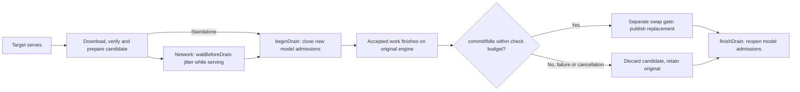
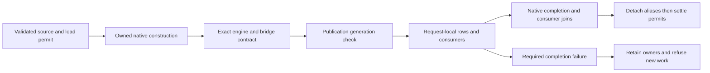

# Provider inference engine

> Last updated: 2026-10-21

How a chat-completion request is served inside the `darkbloom` provider
process: one in-process engine (`mlx-swift-lm`
ContinuousBatchingV2, "CBv2"), one `EngineV2Bridge` per resident model, no
legacy engine and no subprocess. For the memory model see
[`hardware-support.md`](hardware-support.md); for KV/prefix caching see
[`prefix-cache.md`](prefix-cache.md).
The [native block adapter](native-block-inference.md) reuses this bridge boundary
for committed diffusion output and explicit native-container slot ownership.

Native DiffusionGemma also retains image/video assets on tool-result turns.
`EngineV2VisionPrefill.prepareDiffusionUserInput` validates tool history and
orders typed results by their actual call IDs before media decoding, using
`Gemma4TurnStructure.orderTypedToolResults`. `MediaIngest.buildUserInput` keeps
decoded assets and symbolic template parts aligned in that order. System and
assistant media remain unsupported; legacy model ingestion is unchanged. Sources:
`provider-swift/Sources/ProviderCore/Inference/Vision/EngineV2DiffusionVisionPrefill.swift`,
`provider-swift/Sources/ProviderCore/Inference/Prompting/Gemma4TurnStructure.swift`,
`provider-swift/Sources/ProviderCore/Inference/Vision/MediaIngest.swift`.

## Context

The `prism_hadamard_qwen35` adapter reuses the native dense Qwen text backbone
and retains its vision wrapper. The SDK validates signed-Hadamard metadata and
packed weights before returning the model. Packed scales and embeddings are
FP16, but the published FP32 normalizers promote native KV and recurrent
convolution state to FP32; checkpoint declarations preserve that actual dtype.
Packed recurrent prefill retains a compact convolution carry rather than an
alias of the complete chunk allocation; the SDK copies those state bits without
changing the recurrence or other model families.
`EngineV2SupportedModels.bonsai2ModelID` selects paged KV automatically for
the 27B artifact, which has no MTP assistant tensors. The 9B candidate's
separate local sidecar requires the explicit validation and opt-in described
below; it does not extend the 27B qualification cohort.

Native Qwen3.5 vision blocks honor explicit checkpoint activation declarations.
For the three supported nested vision types, tanh and exact GELU are selected
from `hidden_act`; absent or unknown declarations preserve the existing fast
approximation. The SDK's `Qwen3VLConfiguration.VisionConfiguration`
(`visionMLPApproximationForConstruction`) owns this choice in
`libs/mlx-swift-lm/Libraries/MLXVLM/Models/Qwen3VL.swift`.
See `libs/mlx-swift-lm/docs/bonsai2.md` for the exact activation mapping,
checkpoint contract and qualification scope. This implementation does not
activate a catalog entry.

Every advertised model is served through CBv2; a `model_type` without a CBv2
adapter is dropped from the advertised set at scan time and never loads
(`provider-swift/Sources/ProviderCore/Inference/Engine/EngineV2SupportedModels.swift`,
`isSupported`). The path is HTTP/WebSocket → `ProviderLoop` /
`StandaloneServer` → `MultiModelBatchSchedulerEngine` → `EngineV2Bridge` →
`EngineV2` → Metal.

| Component | Role | Code |
|---|---|---|
| `ProviderLoop` / `StandaloneServer` | Coordinator WebSocket and local HTTP ingress; model load/unload; heartbeat | `provider-swift/Sources/ProviderCore/ProviderLoop.swift`, `provider-swift/Sources/ProviderCore/Server/StandaloneServer.swift` |
| `MultiModelBatchSchedulerEngine` | Implements the upstream `MLXServerEngine` contract: OpenAI translation, chat-template render, tool-parser and tool-choice resolution, model acquire, dispatch by `request.model` | `provider-swift/Sources/ProviderCore/Inference/Engine/Scheduler/MultiModelBatchSchedulerEngine.swift` |
| `EngineV2Bridge` (one per model) | Provider↔CBv2 boundary: request-id normalisation, `CBv2Request` translation, resident/SSD selection, cache evidence, shared-KV reservation, deadline projection, `engine.submit`, event pump, telemetry | `provider-swift/Sources/ProviderCore/Inference/Engine/Bridge/EngineV2Bridge.swift` with `+Submission`, `+Admission`, `+Lifecycle`, `+Resizing`, `+Identity`, `+Events`, `+Accounting`, `+Translation`, `+Profile`, `+Liveness`, `+MTP`, `+PrefixCache`, and `+PrefixCacheTelemetry`; `EngineV2RequestUsageSignal` owns per-request terminal and cache outcome reconciliation |
| `EngineV2SlotFactory` | Builds one slot: model prep, MTP assistant, KV-backend selection and vetoes, paged preflight, resident and SSD prefix-cache construction gates (a refused SSD store's typed reason reaches the bridge for local `/metrics` only); refuses an ordinary fixed-workspace bridge with zero serving width before publication | `provider-swift/Sources/ProviderCore/Inference/Engine/Factory/EngineV2SlotFactory.swift` and `EngineV2SlotFactory+AttentionPrefixCache.swift` |
| `EngineV2Factory` (production) | `prepareProductionBackend`, `productionSchedulerConfig`, engine assembly | `provider-swift/Sources/ProviderCore/Inference/Engine/Factory/EngineV2Factory+Production.swift` with `+Configuration`, `+BackendPreparation`, and `+ModelAdapter` |
| `EngineV2Runtime` | Process-wide registry of bridges; capacity summary for heartbeats; cancellation fan-out | `provider-swift/Sources/ProviderCore/Inference/Engine/EngineV2Runtime.swift` |
| CBv2 engine loop | Admission, KV allocation, chunked prefill, batched decode, detokenisation, leases | `libs/mlx-swift-lm/Libraries/MLXLMCommon/ContinuousBatchingV2/EngineLoopV2.swift`, `SchedulerV2.swift` |
| promptsidecar boundary | Coordinator-side Rust process that computes the same `prompt_contract_id` and block chain ([prefix-cache.md#block-hashing](prefix-cache.md#block-hashing)) the provider derives with `PromptContractIdentity.compute(modelDirectory:)`; the provider never calls it | [coordinator/promptsidecar/](https://github.com/Layr-Labs/darkbloom-platform/tree/48a198c71a2d30feec5597bacf1101120f7f955d/coordinator/promptsidecar/), `provider-swift/Sources/ProviderCoreFoundation/PromptContractIdentity.swift` — see [prompt-contract-sidecar.md](https://github.com/Layr-Labs/darkbloom-platform/blob/48a198c71a2d30feec5597bacf1101120f7f955d/docs/architecture/prompt-contract-sidecar.md) |

Slot construction carries the engine's immutable admission watermark into the
bridge so future load and reserve-raise checks can preserve a serviceable total
grant. These [workspace-aware floors](hardware-support.md#kv-slot-grants) do not
lower the activation reserve or replace actual per-request byte admission.

### GLM5Next implementation boundary

`glm5_next` is in the production supported set only as the exact catalog build
`glm-5.3-flash` (`EngineV2SupportedModels`, `GLM5NextCoordinatorServing`). The native SDK has an
unregistered `GLM5NextTextModel`, trained `GLM5NextMTP`, vision tower and
`GLM5NextModel` wrapper. `GLM5NextArtifactLoader` validates the pinned file
inventory and reads bounded tensor ranges instead of materializing a second
whole-model dictionary. Provider integration uses a model-bound
`GLM5NextNativeOperationOwner` for protected MTP bridge admission; it does not
borrow a MiMo transaction or bypass its checks. Shutdown consumes the actual
native engine/contract receipt before releasing the root or growing survivor
grants. Missing ownership or unproven completion refuses work and retains the
affected owners. Standing wired residency checks platform support before
creating a ticket. Once a backend start or end has been attempted, a fault
retains the ticket, policy registration and actual native owner until process
restart. Factory publication requires a settled successful start; shutdown joins
pending ticket work and requires successful end before releasing the owner's
model/resources. The bridge also retains its engine, nonzero KV claim and activity
guards until that settlement succeeds; a failed end keeps the unpublished
retirement charge instead of reporting zero capacity. A native quiescence receipt alone cannot settle a failed
residency operation (`GLM5NextWiredResidency`, `GLM5NextNativeOperationOwner`).
Synthetic tests do not establish full-model output parity or
full-artifact qualification. Source lives under
`libs/mlx-swift-lm/Libraries/MLXLLM/Models/` and
`libs/mlx-swift-lm/Libraries/MLXVLM/Models/`. See the
[in-progress integration contract](../design/glm53-flash-native.md) for the
required paged, complete-prefix and trained-MTP gates.

An explicit [local qualification selection](../reference/configuration.md#local-glm-qualification)
can admit the exact pinned local artifact into standalone discovery without
changing coordinator advertisement. The local selection cannot bypass managed
loading, native ownership, memory admission or backend requirements.

Coordinator-connected mode serves only catalog model `glm-5.3-flash`, delivered
through the ordinary model-revision download, through the same managed load
(`ProviderLoop.coordinatorGLM5NextPlan`, `GLM5NextCoordinatorServing.resolvePlan`).
Before any reservation it requires Apple M5 Max or M5 Ultra with at least
256 GiB (`GLM5NextHardwareRequirement`; the provider reports `glm5_next_v1`
only then), the embedded `apple_m5`, `mlx_nax` and `glm5_next_v1` requirement
(`ModelRuntimeRequirements`), the native step-scratch price
(`GLM5NextStepScratch`), and an identity chain: the cached catalog entry pins
version and aggregate, the revision receipt must match it and hash to that
aggregate, and the admitted load hashes every file against the same manifest.
An R2-only revision names its native identity by catalog id and the first 40 hex digits of its aggregate. The
reviewed shipped template remains mandatory. The enforced context is 262,144
tokens (`GLM5NextCoordinatorServing.maximumContextLength`); a smaller catalog
`max_context_length` lowers it and a larger one refuses the load. A revision
swap borrows the activation's writer lease
(`GLM5NextArtifactOwnership.borrowingCallerLease`). GLM MTP is on under the default `mtp_mode = "auto"`;
local startup skips GLM only when `mtp_mode = "off"` or the `DARKBLOOM_CBV2_MTP`
kill switch disables MTP (`GLM5NextLocalServing`).
A GLM slot is published only when its bundle and engine report
MTP active and the bridge carries the native operation owner; disabled MTP, the
kill switch, the assistant re-slice floor, post-build headroom fallback and
wedge recovery never rebuild GLM target-only, because target-only GLM has no
checked completion receipt. `prepareProductionBackend` also refuses a
target-only GLM engine for serving construction; only benchmarks build one.

Every GLM load fixes `GLM5NextExecutionPolicy.serving` on the target and its
embedded MTP layer (`GLM5NextManagedLoad.executionPolicy`); the reference
per-token KDA and selection graphs exceed MLX's Metal resource limit at real
prompt lengths. Routed-expert prefill on Neural-Accelerator GPUs runs the NAX
expert kernel for affine 4-bit and NVFP4 banks (`RoutedExperts.fusedDecodeNAXPrefill`;
other GPUs keep MLX's sorted gather), and prefill chunks past position 2,048 run the
native sparse-attention prefill kernel (`SparsePrefill.nativeKernel`). The policy is part of the encrypted checkpoint storage identity
(`storage.executionPolicy`, `CompleteCheckpointStorageIdentity`). The native
engine prices one worst-case step at setup and stays inactive when it exceeds
the post-load envelope (about 56.8 GB of admission on a 256 GiB host, shared
with KV). Decode and MTP verification rows (at most 8 sparse queries) read one
selection row per query, retained until the step fence (about 46 MB per query
across 11 DSA layers). A longer row whose selection rows would read at least
its history instead reads its whole latent plane once per layer through
the page table and runs the contiguous arithmetic over it
(`GLM5NextPagedPayload.latentHistory`, `GLM5NextPagedModelBinding.readsLatentHistory`),
so its retained reads are bounded by the history, not the chunk. The GLM
scheduler installs 2,048-token prefill chunks and steps, bounded by the context,
and disables solo stripes (`EngineV2Factory.glm5NextMaximumStepTokens`,
`glm5NextServingScheduler`). The price splits into setup bytes for the step
geometry and a rate per context token of each request, which covers the
request's index metadata reads, pooled index planes, latent reads and page
tables in both its step and the chained decode successor
(`GLM5NextStepScratch`, `PagedKVBackend.glm5NextStepScratch`). The setup check
charges that rate for the most history the step's rows can hold: every row at
the context limit, or the pool's whole token capacity when smaller
(`GLM5NextPagedModelBinding.validateStepEnvelope`), or the all-rows-at-context
price when that is smaller. Reads, writes and tables the step owner retains
count for every DSA layer; a layer's temporaries (scores, pooled index planes,
selections, gather blocks) count once, twice for overlap with a neighbour
(`GLM5NextStepBytes`). With FP32 sparse KV that price stays at least 1.5
times every peak measured on the real artifact (1 to 4 rows, 512- and
2,048-token steps, 32K to 261K context, MTP verification; smallest 1.57x). For 2,048-token
steps at a 262,144-token context the setup is about 5.6, 7.4 and 11.0 GB for
1, 2 and 4 rows, and the rate about 55 KB per context token
(`GLM5NextStepPriceTests`). A refused activation names the native reason (for example
`capacityExhausted(needed:available:)`) and the step geometry in the load error
(`EngineV2Factory.glm5NextActivationRefusal`).

Automatic KV selection resolves paged for every GLM target; an explicit
contiguous selection, the paged kill switch or the crash-loop guard refuses the
GLM load rather than degrading (`EngineV2Factory.prepareProductionBackend`).
GLM request memory is per reserved token (prompt + max output) plus fixed
request charges. Target KV is 33,836 bytes per token: each of the 11 DSA layers
stores one FP32 row of the 512-wide latent (no rotary part) plus 128 index-key,
128 pool-gate and one validity column; a full 262,144-token request stores
8,869,904,384 bytes. The 34 KDA layers carry fixed recurrent state
(155,975,680 bytes per generation, three live generations). The embedded MTP
layer stores 3,074 bytes of history per token; its serving plan charges
33,900 bytes per reserved token across its resident, working and host copies
plus a fixed part (`GLM5NextMTPExecution.memoryPlan`,
`EngineV2.resolvedAuxiliaryBytesPerToken`). Native step scratch splits into a
setup envelope and a price per context token (`PagedKVBackend.glm5NextStepScratch`).
The bridge prices and reports `kv_bytes_per_token` = target KV + step scratch
+ MTP per token (`EngineV2SlotFactory`, `EngineV2MTPAdmissionCharges`) beside the
engine's fixed request bytes; that rate drives `active_token_budget_max`, the
oversized-request refusal and the publication check. It is not a second
reservation, so step scratch is never charged twice: a paged GLM bridge makes no
shared-budget claim of its own (`EngineV2Bridge.submitTokenized` reserves only
for contiguous slots). One ledger, the engine's `AdmissionV2` bound to the GLM
process-memory owner, charges each request's target KV, MTP state and fixed
bytes at admission, and charges each step's scratch as a transient reservation
when the step is built (`PagedKVBackend` step work, `AdmissionV2.reserveTransient`).
Admission does not yet pre-reserve the per-token scratch, so a full ledger
refuses the step rather than the request; that native change is deferred. Coordinator publication requires the slot pool to
hold one full-bound request (`GLM5NextCoordinatorServing.fullContextRefusal`).
The bridge refuses a request whose reservation exceeds the whole pool
(`request_exceeds_slot_capacity`) or would not fit beside held requests
(`slot_capacity_committed`) instead of queueing it: `EngineV2Bridge.submitTokenized`
throws `MultiModelBatchSchedulerEngineError.tokenBudgetExhausted`
(`EngineV2Bridge.glm5NextSlotRefusal`) before any stream exists. Local HTTP
answers 503 with the fixed capacity message before response headers
(`CORSResponder`), and the coordinator receives a pre-stream `inference_error`
503 with `failure_code` `capacity` and `error_reason` `token_budget_exhausted`.
The engine's activation check prices step scratch for every row at the full
context against the same capacity, so the protected scheduler's running-row
cap is the largest value that check admits
(`EngineV2Factory.glm5NextActivatableRows`, `glm5NextActivationAdmits`). With
2048-token steps at 262,144 context the calibrated price is 55,057 bytes per
context token plus 5.59, 7.40 and 11.02 GB of setup for one, two and four rows,
so a 56.8 GB grant runs two or three rows; four need about 72.4 GB, because pool
tokens and the admissible ceiling derive from the same capacity. Publication
also charges one step's setup and the admission watermark
(`GLM5NextCoordinatorServing.fullContextRefusal`).

Request concurrency follows `engine_v2_max_concurrent` (default 4, at most 8
without a reviewed profile); GLM adds no width-1 pin, and native step pricing
and per-request admission bound what runs together. The protected profile is
rectangular MTP verification: each round drafts up to three proposals with the
trained MTP layer (proposals after the first reuse step 0's sparse selection) and
verifies them in one captured target forward over the window, whose KDA layers
stage every position's recurrent state so any accepted prefix commits without a
repair forward. An adaptive controller picks the depth (0 to 3) from measured
cost and acceptance; sampled requests speculate through exact target-prefix
acceptance. The window runs the batched multi-token kernels, so greedy output is
not token-identical to target-only decode (near-ties can flip). The speculative
batch is 1, and the profile composes with the complete-prefix store
(`glm5_next_native_paged_full_state_rectangular_mtp_v1`).
`DARKBLOOM_GLM_RECTANGULAR_VERIFY=0` (also `false`, `no`, `off`) selects the
serial-target single-proposal profile
(`GLM5NextProtectedModel.resolvedMTPConfiguration`). Prefill interleave keeps the global
one-partial-prefill default. The bridge advertises the enforced
context, so an over-length request is refused with 400 before native admission,
and an omitted `max_tokens` defaults to the smaller of the model's default output budget (4,096 for this artifact) and half the bound (`GLM5NextCoordinatorServing.boundedSizing`). Omitted sampling fields
use the artifact's `generation_config.json` (`EngineV2SamplingDefaults`).

GLM images use ordinary causal token positions: the text tower has no
positional encoding, so a submission carries causal spans and no position
state (`EngineV2VisionPrefill.prepareGLM5NextMedia`, `buildGLM5NextSubmission`).
The original request is normalized by the GLM prompt policy exactly as text is,
with symbolic image and video parts, and the processor expands each `<|image|>`
to its feature count (16 to 8000 per image). A video's single constant-frame-rate
MP4 or QuickTime track is read frame by frame, and only its 2 FPS official
sample is converted to RGB8 and kept, within the processor's decoded-frame cap
(`maximumDecodedBytes`, 512 MiB; `GLM5NextProcessor.decodeAsset`); each
pair of sampled frames becomes one image-token span between
`<|begin_of_image|>` and `<|end_of_image|>`, followed by its timestamp text
(`GLM5NextProcessor.expandPrompt`). Every placement is validated before tower
work; the tower then runs one image or frame pair at a time with MLX fused attention on the
GPU (`GLM5NextVisionAttentionKernel.automatic`; query-tiled elsewhere), so no
frame-square score tensor is allocated, and every evaluation checks the scoped
MLX fault box. The reservation below still prices the tiled working set. The scheduler's `VisionMemoryGate` reservation adds the
processor's prepared-pixel cap, the tower working set of a full 32,000-patch
frame, every image at its token cap, every video at its token ceiling and,
because videos decode one at a time, one decoded-frame cap when any video is
present (`GLM5NextVisionBudget.mediaReservation`,
`GLM5NextVisionBudget.videoTokenCeiling`). All media in one request share the
processor's prepared-pixel cap of 28,532 visual tokens.
Processor refusals, including variable-frame-rate video, are deterministic 400s; tower and MLX faults keep the
retriable refusal. Media requests are excluded from prefix lookup and capture
(`CBv2Request.permitsHybridCheckpoint`), so no KV is reused across images or videos, and
they decode without MTP speculation. A GLM slot serves media only when its
engine accepts prepared causal media (`EngineV2Bridge.servesGLM5NextMedia`); the
embedded-MTP native engine issues that permission, so media rows prefill and
decode target-only next to speculating text rows.

An unproven retirement, including one during a post-build unwind, retains the
bridge, newcomer, artifact ownership, pending-load lease, loading marker and
device activity. It never refunds the lease, clears the cache or regrows
survivors for that load. Retained GLM faults quarantine GLM work and grant
growth, but do not quarantine MiMo or other families. Their unpublished weight
and KV bytes are charged into every fleet KV budget, so other families' new and
regrown grants cannot reuse that memory. Allocator-cache trimming only frees
unowned cached allocations and is not native-retirement proof. Local `/metrics`
reports the retained-fault state, retained owner-object count and charged bytes
(`GLM5NextLoadFaultState`). `GLM5NextNativeOperationOwner.beginClosing`
refuses a second close attempt, so a retained close is never re-driven.

Before weight allocation, `GLM5NextTokenizerPreflight.validate` renders through
the selected local tokenizer using the provider's actual GLM defaults,
reasoning controls and tool/history normalization. The generic template check
also remains mandatory; neither check repairs or substitutes a template.
These boundaries are implemented in
`provider-swift/Sources/ProviderCore/Inference/Models/GLM5Next/` and
`provider-swift/Sources/ProviderCore/Inference/Engine/Bridge/EngineV2Bridge+NativeLifecycle.swift`.

Raw same-directory GLM discovery uses a
[complete header-derived LOAD quotation](../reference/model-registry-format.md#raw-glm-discovery-quotation),
including full expert-bank, vision, MTP and tokenizer accounting plus a
measured residual above raw source bytes instead of disk × 1.2. This does not
enable the native serving path. The local selection refuses a separate
tokenizer, which this raw quote does not cover, and the provider has no
tokenizer-composition load path; the resolved source
must pass the scanner recheck and the managed native loader's independent
validation before allocation.

The low-level `glm5` tool parser uses the official XML framing with
schema-disambiguated string/JSON arguments. `GLM5ToolStream` withholds the tool
suffix until EOS so quoted XML delimiters and a later malformed call cannot
commit a partial call batch. Its retained suffix is capped at 1 MiB; rejection
returns the original text through the existing parser-failure path. Ambiguous
string unions and unsupported indirect schemas are not inferred. This parser
does not implement constrained decoding or advertise function calling.
The request-local [GLM prompt contract](../reference/protocol-messages.md#glm-native-prompt-contract)
also preserves original schema values only after a trusted loaded-model check.
`GLM5NextPromptPolicy.templateSHA256` recognizes only the template shipped in
`EigenLabs/GLM-5.3-Flash-MLX-NVFP4-mtp` (and its `glm-5.3-flash` publication), and every GLM LOAD refuses any other
template (`GLM5NextLocalQualification.requireShippedTemplate`). The pinned Swift-Jinja renders it
unpatched. It is the official template with numeric attribute access written as
`[0]` subscripts; the official hash remains the golden rendering authority and
fails the load-time render check. See the [build boundary](../developer/build.md).

## Mechanism

### Prompt-completion measurements and qualified profiles

`CBv2Request.onPrefillCompleted` reports the numeric usage snapshot immediately
after actual prompt work finishes. `EngineV2Bridge+Measurements.swift`
(`consumePrefillReceipt`) consumes it once, including when generation later
cancels. Rates use actual computed suffix work and engine phase timing; zero
work, invalid cache attribution and vision-prefill samples do not train text
prefill rates. Cross-model activity is tracked across the shared runtime, not
inferred from one engine's occupancy. Engine decode rate ends at the last
confirmed token, excluding terminal delivery delays; delivered and end-to-end
rates remain separate.

Owner-bound native MiMo submissions retain target-decoder prefill observations
in the separate `native_media_prefill` workload phase. Its timer starts at the
first target prefill launch, after image/video/audio preparation, and ends at
confirmed prompt computation. The buckets retain computed-suffix size, full
context size, cache state and same/other-model overlap. They do not train text
rates. Cold, unpacked, non-preempted samples with exclusive whole-Mac ownership
and one continuously observed nominal AC/Automatic posture can inform the
native target predictor described in [first-content routing](https://github.com/Layr-Labs/darkbloom-platform/blob/48a198c71a2d30feec5597bacf1101120f7f955d/docs/architecture/first-content-routing.md#native-media-target-observations).
These online observations are not a release-certified prediction envelope.
Generic vision submissions remain excluded. The native owner and opaque media seal are checked before a
submission can produce a completed receipt
(`EngineV2Bridge+MiMoMedia.swift`, `nativeMediaMeasurementEligible`).

Consuming a valid prompt receipt requests an aggregate capacity rebuild
independently of generation completion. New measurement epochs, sample counts and cumulative work
counters are event-heartbeat material; advancing sample age alone is not.
`CapacityHeartbeatMateriality` and `CapacityHeartbeatThrottle` in
`provider-swift/Sources/ProviderCore/CapacityEventHeartbeats.swift` retain the
existing two-per-second cap and trailing-edge coalescing, so a busy provider
publishes the newest evidence without sending one heartbeat per token.

`provider-swift/Sources/ProviderCore/Inference/Performance/ServingPerformanceProfile.swift`
matches reviewed data to verified model weights, provider/runtime revision,
resolved KV backend, GPU/RAM bin and the entire configured context limit.
Unknown profiles retain the legacy policy, except that models on the native
`auto` paged allowlist start at the legacy ceiling of 8 instead of 4 on M5 Pro,
Max and Ultra (`ServingPerformanceProfiles.automaticConcurrency`; chip identity comes from one
sysctl, not full hardware detection). That width, like a profile
width, returns to the configured width under Low Power Mode or thermal pressure
(`EngineV2Bridge.hasPostureGatedWidth`). The concurrency/chunk catalogs remain empty;
the [qualification procedure](../developer/serving-performance-qualification.md)
is required before any width above 8 or model-specific chunk policy activates.
Qualified engines share one whole-Mac service allowance and retain physical KV,
architecture and explicit operator caps. A reservation is released only after
engine retirement, not when a caller merely requests cancellation. Atomic
deadline admission passes its retirement acknowledgement to the event pump;
an early terminal returns to the caller while the service and KV reservations
remain owned until that acknowledgement completes.

For queued native requests, `CBv2NativeBlockEngine.pump` makes one cancellation
decision for both `finishWaiting` and queue removal, so a concurrent cancellation
cannot remove a request without retiring its reservation. Completion remains
exactly once (`libs/mlx-swift-lm/Libraries/MLXLMCommon/ContinuousBatchingV2/NativeBlockEngine.swift`).

The optional `CBv2SchedulerConfig.mixedStepPrefillTokenCap` is per engine and
feeds the same scheduler plan used by execution and first-token projection.
An absent qualified cap preserves the existing environment/default behavior.
The prefill-only stripe, one partial prefill, recurrent checkpoints and
one-image-at-a-time vision execution keep their existing geometry.

### Model startup calibration

The startup health check exercises a one-token request through the serving
adapter with local-only `EngineMeasurementPurpose.startupWarmup`. Its first-use
timing never trains prefill, decode, workload-bucket or delivered-rate estimates.
Work accounting, resource ownership and the health-check result are unchanged;
overlapping customer requests remain independently measurable.

Completed startup preloads and the pre-registration path schedule calibration
without waiting for the first capacity tick. Ordinary model loads also schedule
it after construction releases its device-work receipt. Capacity ticks retry
when loading, foreground work or device posture initially prevents calibration.
An uncancelled calibration retirement schedules the next eligible resident
slot immediately; the process-wide owner still permits only one session at a
time. That successor scheduling runs after the session's retirement, outside
the task a preempting customer request waits for; a preempted session schedules
no successor. Ordinary and native MiMo load
completion share a handoff that releases the finished construction activity and
offers the newly loaded slot first,
while keeping the load-transition gate closed. It rechecks cancellation and
native ownership before releasing the gate and waking parked requests. Existing
foreground or calibration ownership can still defer calibration.
`refreshModelCalibration` asks the loaded bridge's `startModelCalibrationIfNeeded`
to measure its actual serving configuration. Ordinary `EngineV2` autoregressive engines, including dense and
MoE Qwens, and standalone `CBv2NativeBlockEngine` slots run an excluded
128-token warmup followed by two uncached solo probes
of at most 512 prompt tokens and 32 output tokens. Completed calibration seeds
prefill/decode evidence without requiring a customer job and runs once per loaded
engine. Failure backs off for 120 seconds; interruption backs off for 30 seconds.
An unfinished bootstrap retries when that backoff expires even if its completed
probes left fresh partial rates. Fresh serving samples from an early request do
not suppress an unfinished first bootstrap either. Only completed native MiMo
maintenance waits for rate staleness. A replaced engine starts a new measurement epoch.

Transaction-owned native MiMo slots retain the wider bootstrap and periodic
maintenance in `ModelCalibrationPolicy`: short and up-to-4,096-token text cells,
affordable concurrency sweeps and solo refresh after 90 seconds. The existing
15-second group deadline, context/KV limits and affordability checks bound work.
All calibration requires an idle Mac in nominal thermal state outside Low Power
Mode. Slots with a reviewed deadline profile never calibrate, because bounded
probes must not enter deadline-qualified rates; those profiles keep their own
applicability and posture checks.

`IdleCalibrationCoordinator.beginForeground` cancels the probe when a customer
request on any model arrives. Ordinary engines use `EngineV2.submitWithRetirement`
to retain shared service and KV reservations until the actual submitted stream
generation retires, including after an early watchdog terminal or cancelled
waiter. The customer's original first-content deadline continues through this
wait. Unsupported custom adapters remain ineligible until they expose a trusted
retirement boundary. Unload and shutdown stop calibration without retaining
retired weights.

Only completed, uncached, isolated receipts seed solo rates. Batched measurements
populate workload buckets without replacing solo admission rates. Calibration
produces no served-request/output-token counters; its actual in-flight work stays
visible until retirement. Prefill receipts retain their calibration identity
after cell cleanup, so delayed callback consumption cannot turn a cancelled
probe into serving counters or rate evidence. Fresh evidence is published through existing capacity
heartbeats. Memory floors, concurrency ceilings and deadline enforcement remain
unchanged. Scheduling is asynchronous: registration and customer service do not
wait for the full calibration plan to finish. Once completed slot publication
reaches this handoff, cancelling its load caller does not turn the resident slot into a failed
load; shutdown and slot-owner validity checks still apply. See the calibration entries in the
[code map](#code-map) for the enforcing paths and symbols.

Each cell stages its numeric prefill/decode observations until all its requests
have retired. Posture is checked before the cell and again before publication.
A failed, cancelled or non-nominal cell discards its own staged observations
and leaves the bootstrap retryable, including for the final cell. Earlier valid
cells and independent serving observations remain intact. Serving observations
still publish immediately, through the same rate/EWMA application helper.

### One request through the engine

The provider rejects `input_audio` parts for unknown or unsupported architectures
in every message role with HTTP 400 before model acquisition, prompt rendering
or media decoding. Local and encrypted ingress consult provider-owned resident
or advertised model metadata, never a request-name heuristic or a cold tokenizer
load. Exact `mimo_v2` metadata may select ordinary native acquisition; the acquired
architecture and the bridge's actual issued audio profile must still validate.
Generic vision preparation and text-only tokenization reject audio unconditionally;
native MiMo uses its separately owned preparation path and exact media accounting.
`MediaIngest.rejectUnsupportedAudio` in
`provider-swift/Sources/ProviderCore/Inference/Vision/MediaIngest.swift` is shared
by scheduler ingress, prompt-contract tokenization and media preparation. SDK
parsing of the wire part alone does not authorize an audio decoder or model load.

```mermaid
sequenceDiagram
    participant C as Coordinator / local client
    participant S as MultiModelBatchSchedulerEngine
    participant B as EngineV2Bridge
    participant K as SSDPrefixCache + GlobalKVCacheBudget
    participant E as EngineV2 (CBv2)
    C->>S: OpenAI ChatCompletionRequest
    S->>S: render chat template, resolve tool parser / tool-choice, build CBv2TokenConstraint
    S->>B: submitTokenized(tokens, request)
    B->>B: normalise request id; FirstContentDeadline.check(); samplingParams
    B->>E: probe resident prefix [text-only]
    B->>K: stage useful SSD prefix if longer; reserve prompt+maxTokens [contiguous slots]
    B->>E: submit(CBv2Request, firstTokenDeadlineAdmission?)
    E->>E: admit → adopt reusable state → prefill chunks → decode steps
    E-->>B: publish complete recurrent / historical checkpoints [successful donor]
    E-->>B: token events … terminal CBv2Usage(CBv2RequestTiming)
    B-->>S: detokenised GenerationEvent stream
    S-->>C: SSE chunks / final response
```

Bridge-side order (`EngineV2Bridge.submitTokenized`): request-id
normalisation (`maxRequestIdLength = 256`; duplicates rejected) → first
deadline check → translation (`maxTokens = request.max_tokens ??
defaultMaxTokens`, 4096) → resident probe / useful SSD stage → shared-KV reservation (contiguous slots
only; segmented paged admission and backing use the shared native process owner) → final deadline
check → engine request-id mint → `engine.submit`. The terminal `CBv2Usage`
carries `CBv2RequestTiming`, copied verbatim onto the wire and folded into
`EngineProfile` (`EngineV2Bridge+Profile.swift`).

Resident publication uses a submission-unique `prefixCacheReceiptID`; the
sampling engine ID can repeat after a seeded request completes. The bridge
correlates checkpoint callbacks to that receipt so delayed donor callbacks
cannot advertise a successor's prompt. Ready anchors describe actual input
checkpoints, and billing retains the engine's actual matched/saved token counts
(`EngineV2Bridge+PrefixCache.swift`, `ResidentPrefixCacheEvidence.swift`).

### `CBv2RequestTiming`

Stamped by the engine thread only; instants are nanoseconds from the enqueue
instant (`0` = not observed, observed values clamped ≥ 1); durations are
elapsed nanoseconds. Numerics only — never tokens, text or hashes
(`libs/mlx-swift-lm/Libraries/MLXLMCommon/ContinuousBatchingV2/CBv2Contracts.swift`,
`CBv2RequestTiming`).

| Field | Meaning |
|---|---|
| `admittedNanos` | First step whose plan included the row (queue wait) |
| `kvAllocatedNanos` | Per-layer KV state allocated (`ensureKVState`) |
| `prefillFirstLaunchNanos` | First step that launched one of the row's prefill chunks |
| `promptComputedNanos` | Finalize of the step where `numComputedTokens >= promptTokens` |
| `firstTokenNanos` | Finalize of the step that confirmed the first generated token (excludes detokenisation) |
| `finishedNanos` | `finishRequest` instant |
| `readmissions`, `preemptions`, `capacityRequeues` | Waiting→running crossings after the first admission; preemptions; capacity requeues |
| `prefillChunks`, `packedPrefillChunks`, `visionChunks`, `soloStripeChunks` | Prefill chunk forwards: all; in a rectangular `[B, chunk]` cohort; carrying image spans; solo chunks wider than `prefillChunkSize` |
| `prefillChunkTokensMax` | Widest prefill chunk |
| `decodeSteps`, `chainedDecodeSteps` | Finalized steps confirming a token beyond the first (an MTP round with ≥ 1 confirmed token counts once); of those, chained-decode launches |
| `batchRowsSum`, `batchRowsMin`, `batchRowsMax` | Token-producing rows per participated step |
| `stepLatencyNanosSum`, `stepLatencyNanosMax` | Readback-done − `wallStartedNanos`, summed and max |
| `mtpRounds`, `mtpProposed`, `mtpAccepted` | MTP verify rounds, drafted tokens, accepted tokens |
| `pausedNanos`, `pauseCount` | Backpressure pause time and transitions |
| `detokDelayFirstNanos` | First token only: engine confirm → detokenised emit |
| `prefixLookupNanos`, `prefixAdoptionNanos` | Submit-thread prefix lookup (hash + lookup + plan); `applyAdoption` on the engine thread |

### Scheduler and loop configuration

| Setting | Value in production | Code |
|---|---|---|
| `maxConcurrentRequests` | `engine_v2_max_concurrent` (default and clamp: [`../provider/cli-reference.md#providertoml-keys-read-by-the-cli`](../provider/cli-reference.md#providertoml-keys-read-by-the-cli); per-model map `engine_v2_max_concurrent_by_model`) | `provider-swift/Sources/ProviderCore/Config/ProviderConfig.swift`, `productionSchedulerConfig` |
| `maxBatchedTokensPerStep` / `prefillChunkSize` / `maxWaiting` | 2048 / 512 / 64 (`CBv2SchedulerConfig` init defaults) | `CBv2Contracts.swift`, `CBv2SchedulerConfig` |
| `soloPrefillStripeTokens` | 2048 (`defaultSoloPrefillStripeTokens`); 4096 for dense Qwen3.5/3.8 (`Qwen35Model`, not `Qwen35MoEModel`); `DARKBLOOM_CBV2_SOLO_PREFILL_STRIPE` | `EngineV2Factory+Configuration.swift` |
| `maxConcurrentPartialPrefills` | 1; `DARKBLOOM_CBV2_MAX_PARTIAL_PREFILLS` | `EngineV2Factory+Configuration.swift`, `maxPartialPrefillsKey` |
| `enablePrefixCache` | true when the slot has an effective SSD cache, enabled paged resident cache, or recurrent checkpoint-bank configuration, or complete SSD checkpoint store; engine capability gates still apply | `EngineV2Factory+Production.swift` (`assembleProductionBuild`), `EngineV2.swift` |
| `requestTimeout` | 120 s legacy total wall, used only when `DARKBLOOM_CBV2_LEGACY_REQUEST_TIMEOUT` is affirmative | `EngineLoopV2.swift`, `CBv2EngineLoopConfig`; `EngineV2Factory+Configuration.swift` |
| `stepTimeout` | 30 s | `CBv2EngineLoopConfig` |
| `admissionLease`, `prefillProgressLease`, `decodeProgressLease`, `backpressureLease` | 120 s each | `CBv2EngineLoopConfig` |
| `safetyCeilingDecodeFloorTPS` | 5 | `CBv2EngineLoopConfig` |

Environment variables are named here, never defaulted; defaults live in
[`../reference/configuration.md`](../reference/configuration.md).

### Deadlines

The coordinator's relative first-content budget is anchored once at frame
receipt (`FirstContentDeadline(relativeBudgetMilliseconds:)`,
`provider-swift/Sources/ProviderCore/Coordinator/CoordinatorClientTypes.swift`)
and checked at every pre-content boundary. `prefill_deadline_mode` ∈ {`off`,
`enforce`}; when the config key is absent, `DARKBLOOM_PREFILL_DEADLINE_MODE`
exactly `off` disables, anything else enforces
(`provider-swift/Sources/ProviderCore/Inference/Engine/PrefillDeadlineMode.swift`).
Under `enforce` the bridge builds `CBv2FirstTokenDeadlineAdmission` when
`maxConcurrentPartialPrefills == 1`, the request is not multimodal, and a
prefill estimate is available. The ordinary admission path uses valid measured
isolated-prefill and decode EWMAs directly, without a fixed 0.5 rate multiplier.
This removes the previous doubling of projected processing time; an EWMA is a
point estimate and does not guarantee the next request's speed. Actual elapsed
deadline expiry, queue/cache projection and physical admission still apply.
An independent reviewed deadline profile carries
`deadline_calibration`: prompt/context bands, actual cold/reused prefix
state, competing profile identities and work limits, phase rates, and a
measured multiplicative/additive prediction-error envelope. Independent held-out
samples must meet the profile's tail-coverage threshold; a faster live EWMA
cannot raise a reviewed phase rate. Qualified phase observations also bind the
posture epoch captured at engine submission and must remain in that same epoch
through computation and receipt consumption. A power/thermal transition clears
qualified freshness until new valid measurements arrive; generic EWMAs and
monotonic work counters remain available to unqualified models. The engine selects the largest applicable
bound after its memory-validated scheduler projection and actual prefix lookup,
then compares it with the unchanged absolute deadline. Only existing work plus
the incoming prompt and at most 33 early decode tokens enter this bound; the
incoming request's full output limit remains a memory reservation, not a TTFT
completion requirement. `deadline_profile` matches the configured context and
actual scheduler width, prefill chunk, solo stripe, mixed cap and partial-prefill
cap exactly. Its cells may cover only a measured 4k workload on a model configured
for a larger context. It has no authority over serving concurrency, chunk policy,
or throughput curves; those still require the separate full-context serving
qualification. Once a request is existing work, its full prompt/output bound
must fit its deadline profile's measured context envelope or calibration falls
back.

The deadline catalog is currently empty. Enabling a timing profile requires
independent qualification with continuous power observations, following the
[qualification procedure](../developer/serving-performance-qualification.md).
All hardware uses the ordinary observed-rate fallback in this release. Removing
the fixed rate reduction takes effect without a timing-profile entry.

`DeadlineRuntimeEnvironment.permitsQualification` rejects `MLX_*`, `MTPLX_*`,
`QWEN_*`, and unrecognized or performance-affecting `DARKBLOOM_*` settings.
Exact credential, local-state and update-control keys are exempt. The resolved
`DARKBLOOM_CBV2_KV_QUANTIZATION` key is accepted only for native precision by
both deadline and serving-profile environment checks. Balanced and 8-bit cache
formats still require separate format-bound measurements before using a profile.
CLI-projected MLX settings also retain the timing fallback until that execution
environment is covered by reviewed evidence. This deadline-only guard does not
change universal serving-profile admission.

Cooled deadline profiles preserve the collection prerequisites: whole-Mac
quiescence for 20 seconds after all request leases and unbounded GPU activity
retire, plus five seconds of observed nominal, non-Low-Power, Automatic posture
on AC power. This deadline-policy revision always rejects Battery Automatic
even when earlier AC phase rates remain fresh; battery evidence would require
a separate reviewed policy extension.
`WholeMacServiceBudget` captures the prior idle interval when acquiring the
incoming lease; only that lease may be excluded from its final atomic check.
Any intervening owned work or observed posture change invalidates the captured
guard permanently. The runtime falls back immediately when ineligible; it does
not sleep to make a request qualify.

`DeadlinePostureMonitor` observes thermal state every 500 ms and reads cached
Automatic policy through a bounded background `pmset -g custom` process every
two seconds, using public IOPS APIs for the active power source. Thermal
observations expire after one second, power-policy reads after three seconds;
unknown, stale or changed source/policy resets stability. The monitor exists
only while a loaded reviewed bridge owns a lease, and capacity notifications
occur on eligibility transitions. These are sampled OS observations, not a
guarantee against changes between observations. See
`provider-swift/Sources/ProviderCore/Inference/Performance/Deadline/`.

`prompt_work` must reconcile with actual tokenization and the factory's verified
artifact/template identity before calibration applies. MTP profiles additionally
match the verified assistant digest, draft depth, batch limit and verification
configuration; plain-target evidence cannot certify an active assistant.
Measurement expiry and a shared-ledger invalidation token are checked again on
the engine queue, so queueing cannot refresh evidence. Whole-machine work and
reservation IDs are captured under one ledger lock; full original work remains
a safe upper bound until actual retirement, including cancellation and
pre-submit ownership. The provider publishes that envelope as `deadline_work`.
Model and assistant loading, recovery, vision preparation, device cache transfers,
and GPU cache reclamation hold noncharging activity receipts while their device
work cannot be bounded by request token counts. These receipts invalidate
captured calibration guards and publish unknown work until the last overlapping
operation finishes, including failure or cancellation cleanup. A successful
multimodal preparation hands off to an unqualified service lease that remains
unknown through actual retirement. Existing memory and service charges are
unchanged. See
`provider-swift/Sources/ProviderCore/Inference/Performance/Deadline/WholeMacUnboundedActivity.swift`.
See `provider-swift/Sources/ProviderCore/Inference/Engine/Bridge/Deadline/EngineV2Bridge+CalibratedDeadline.swift`,
`provider-swift/Sources/ProviderCore/Inference/Performance/Deadline/DeadlineCalibration.swift`,
`provider-swift/Sources/ProviderCore/Inference/Performance/Profiles/ServingMTPConfiguration.swift`
and `libs/mlx-swift-lm/Libraries/MLXLMCommon/ContinuousBatchingV2/DeadlineAdmission/CalibratedFirstContentV2.swift`.

`WedgeMonitor.suspectStallSeconds =
10` flags a stalled slot
(`provider-swift/Sources/ProviderCore/Inference/Engine/WedgeMonitor.swift`).

### Multi-token prediction

| Target | Drafter | Activation |
|---|---|---|
| Qwen3.5 family (`qwen3_5`, `qwen3_5_moe`) | Embedded head (`Qwen35InlineMTPAssistant`, request-stateful) | `mtp_mode = "auto"` (default) when the checkpoint declares the embedded artifact |
| Nemotron 3.5 Lightning (`nemotron_h`) | Embedded head (`NemotronH35MTPAssistant`, request-stateful) | The MTP artifact must retain the embedded module and declare it; the non-MTP artifact remains target-only |
| Gemma 4 | Separate assistant checkpoint (`Gemma4AssistantDraftModel`, stateless) | Defaults to `auto` for exact `gemma-4-26b-qat-4bit`; other Gemma IDs require `on`. `SpecDecArtifactFunnel` resolves the catalog-declared `spec_dec` artifact, with `mtp_drafter_path` as a directory override |

The shared `MTPMode.enablesMTP` policy receives the exact model ID from both
`ProviderLoop.specDecPreparation` and `StandaloneServer.specDecPreparation`.
Startup catalog prewarm includes the automatic QAT target; ordinary slot loads
remain local-only and optional artifact prefetch remains asynchronous.
A provider or standalone server whose first QAT slot starts target-only monitors assistant
readiness asynchronously. It stages a verified assistant and an unregistered
replacement over the retained target, with a separate pending-memory lease and
only the minimum serviceable KV grant. Static fleet grants and network capacity
clamps reserve the candidate's assistant and KV bytes; if the original target
is concurrently unloaded, its retained weight basis stays counted until discard. Identity follows the shared
model container, so publishing a new bridge over that same target does not count
the weights twice. Preparation pins the target before its first asynchronous lookup;
model-load feasibility, LRU eviction and idle eviction exclude pinned targets.
Explicit retirement may still unload a slot, while retained weights remain charged.
Discard releases the actual target references before removing that charge and
regrowing survivor KV grants under the reslice/load gate. Network capacity quotes
refresh at staging changes and reject snapshots from older staging generations.
Reservations follow the load generation, so delayed cleanup cannot release a
new candidate's budget.

Once preparation succeeds, network providers keep serving during a random delay
from `UpdateJitter.delay`, using the existing
[`[provider] update_jitter_seconds`](../provider/cli-reference.md#providertoml-keys-read-by-the-cli)
setting. This staggers independent providers; it does not reserve fleet capacity
or guarantee that another provider remains available. Standalone serving skips
this fleet delay.

`MTPIdleUpgrade.run` then closes new admissions for this model through
`beginDrain`, while accepted network requests and local reservations finish on
the original engine. The admission fence is separate from the final publication
gate: accepted requests can still pass `ensureModelLoaded` and reach completion.
Network capacity advertises the existing `reloading` slot state and rejects
racing admissions with transient 503 `rejection_reason: slot_state` refusals. Other models remain
eligible; this does not put the whole provider into its update-draining state.
Standalone new acquisitions also receive 503 during the model drain.

The helper makes up to 120 idle checks with 500 ms pauses: about 60 seconds of
waiting plus actor-call latency, rather than a strict wall-clock deadline.
`commitIfIdle` requires no accepted work, queued engine requests or reserved KV
before taking the final swap gate. It publishes the replacement and releases the
old idle pool before regrowing grants; `finishDrain` reopens admission. On timeout,
cancellation or failure before publication, the helper discards the candidate
and reopens the original engine without force-cancelling accepted work. Target
replacement and insufficient staging memory also preserve the current owner;
no model is evicted for this optional upgrade. The readiness loop polls with
10–15 second jitter and retries unsuccessful staging after five minutes. Failed
artifact fetches independently back off exponentially with jitter, capped at
five minutes (`provider-swift/Sources/ProviderCore/Models/ModelIdleUpgrade.swift`,
`MTPIdleUpgrade.run`; `provider-swift/Sources/ProviderCore/ProviderLoop+MTPDrain.swift`,
`waitBeforeMTPUpgradeDrain`, `beginMTPUpgradeDrain`;
`provider-swift/Sources/ProviderCore/ProviderLoop+MTPUpgrade.swift`, `commitMTPUpgradeIfIdle`;
`provider-swift/Sources/ProviderCore/Server/StandaloneServer+MTPUpgrade.swift`,
`commitMTPUpgradeIfIdle`).



Standalone uses the same coordinator catalog authority as the provider CLI
(`coordinator.url`), downloads in the background, and retains explicit local
assistant overrides. Transition logs report preparation duration, draining accepted work,
installation and fallback without repeating every readiness poll. Unpublished
candidates suppress periodic serving posture/cache logs; these start after the
old engine shuts down at commit, and closed bridges reject queued posture ticks. Missing, incompatible, or
memory-ineligible assistants preserve target-only serving; explicit `off` and
`DARKBLOOM_CBV2_MTP=0` disable MTP
(`provider-swift/Sources/ProviderCore/Config/ProviderConfig.swift`,
`provider-swift/Sources/ProviderCore/ProviderLoop+MTP.swift`,
`provider-swift/Sources/ProviderCore/Server/StandaloneServer+MTP.swift`).

`MTPAutomaticVerificationPolicy`: `initialDraftTokens = 1`;
`fixedDraftTokens = nil` for request-stateful drafters (controller bounded by
the assistant: Qwen 0…4, Nemotron 0…7)
and exact stateless `gemma-4-26b-qat-4bit` (controller bounded to 0…1).
Other stateless assistants and explicit offline Gemma verification controls
retain fixed depth `1`; `maxRectangularTokens = 8` on
M3/M4/M5 and `4` on M1/M2/unknown, lowered only by
`DARKBLOOM_MTP_MAX_RECTANGULAR_TOKENS`
(`provider-swift/Sources/ProviderCore/Inference/MTP/MTPAutomaticVerificationPolicy.swift`).
Gemma uses bounded rectangular target verification: one target traversal scores
its seed and draft columns, while ordered attention and speculative transactions
preserve causal visibility and discard rejected suffixes. The depth controller
compares ordinary decode's chained commit intervals with actual committed output
across bounded eight-round MTP learning windows. Each round streams immediately
and retains the ordinary cancellation, output-budget and capacity gates. Adaptive
stateless Gemma pairs seed time with seed output,
excludes the first positive-shape compilation from its steady estimate while
retaining that work in telemetry. Warmup is keyed by exact verification row count
and draft depth, so three and four rows do not share a cold-shape exemption.
Learning resets when request membership changes or a participating request finishes,
even if its numeric ID is reused. Launch-generation checks discard late cost,
baseline and acceptance observations from older work. It selects ordinary decode when that is faster and periodically probes
again (`CBv2MTPCommittedGoodputClock`, `CBv2MTPCommittedWindow`,
`CBv2MTPDepthController` in
`libs/mlx-swift-lm/Libraries/MLXLMCommon/ContinuousBatchingV2/MTP/`). Wider evaluation
can change floating-point rounding and generated wording; acceptance remains
target-authoritative. Supported sampling uses the target distribution and an
output-indexed RNG stream. Penalties, bias, logprobs, stop strings and token
constraints retain their ordinary-decode exclusions. Explicit offline serial
verification remains available as a diagnostic oracle; drafter-required modes
retain priority (`provider-swift/Sources/ProviderCore/Inference/MTP/EngineV2MTPAssistant.swift`,
`providerMTPVerificationPolicy`).
When neither a global nor a per-model acceptance value is configured, serving
defaults to typical acceptance for eligible sampled target-prefix rows:
a draft is kept when the sampler-filtered target row gives it probability above
`min(1, 0.2 * exp(-H))`, `H` the row's entropy in nats; the first rejected
position and the bonus position still commit the keyed target sample. Output
is approximate, not distribution-exact for the target. Greedy rows keep the exact
walk. Explicit `"exact"` opts out; invalid values warn and safely resolve to
exact, including an invalid per-model override rather than falling back to the
global value (`MTPAcceptancePolicy.resolve`;
`CBv2MTPAcceptance` in
`libs/mlx-swift-lm/Libraries/MLXLMCommon/ContinuousBatchingV2/MTP/MTPContractsV2.swift`;
`mtp_acceptance` in slot posture telemetry). Design record:
[`../design/typical-mtp-acceptance.md`](../design/typical-mtp-acceptance.md).
Configuration precedence and exact rollback are in the
[CLI reference](../provider/cli-reference.md#providertoml-keys-read-by-the-cli).
The benchmark session and default `--mtp-acceptance exact` are unchanged
(`provider-swift/Sources/ProviderBenchmark/MTPProductionSession.swift`). The
[recorded benchmarks](../reports/2026-10-07-typical-mtp-acceptance-benchmarks.md)
cover only single-host B=1 runs; they do not qualify sampled-output quality or
fleet-wide speed.
Native MiMo remains exact: its separately owned slot construction does not
apply this preference, so `typical` is unsupported on that path
(`provider-swift/Sources/ProviderCore/Inference/Engine/Factory/EngineV2SlotFactory+Native.swift`,
`nativeMiMoMTPConfig`). The setting does not enable MTP or widen model eligibility.
Nemotron's assistant uses one speculative request and adaptive depth up to
seven proposed tokens. Captured target verification, batched M=1 projections
and KV-only trusted-history priming default on, with separate rollback controls.
Its verifier builds a layer-major window while retaining native one-token
recurrence and every-prefix state. These controls do not establish
a fleet-readiness claim. Target activations retain the
checkpoint's native dtype and persistent Mamba SSM state remains FP32
(`libs/mlx-swift-lm/Libraries/MLXLLM/Models/NemotronH35MTP.swift`,
`NemotronH35MTPAssistant`; controls in the
[configuration reference](../reference/configuration.md)).
Engine contract: `CBv2MTPConfig` with `testedMaxDraftTokens` (≤ 7) and
`testedMaxSpeculativeBatch = 8`
(`libs/mlx-swift-lm/Libraries/MLXLMCommon/ContinuousBatchingV2/MTP/MTPContractsV2.swift`).
The common planner caps every offered draft depth at the shortest eligible
row's remaining output slots minus one, including fixed and exploration offers.
A valid input carry does not consume the mandatory next target-output slot.
With one output slot left, draft depth is zero; existing seed/history handling
continues without speculative verification. The cap runs before step/KV
reservation (`libs/mlx-swift-lm/Libraries/MLXLMCommon/ContinuousBatchingV2/MTP/EngineLoopV2+MTPPlanning.swift`,
`mtpDepthWithinOutputBudget`, `beginMTPPlan`).
The process-wide kill switch is `DARKBLOOM_CBV2_MTP` (`CBv2MTPConfig.envEnabled`;
see [`../reference/configuration.md`](../reference/configuration.md)).

Complete SSD recurrent reuse with a persistent MTP assistant requires the
serializable `CBv2MTPPrefixCheckpointCoding` contract. The Qwen implementation
restores normalized trusted prompt history into fresh assistant state; verifier
mode and draft policy remain unchanged. The default store streams only a
matched checkpoint and retains no idle payload RAM. The optional resident bank
uses `CBv2MTPPrefixCheckpointDrafter` and retains its existing compact-publication
and conservative reservation behavior. Resident model measurements do not yet
validate the streamed SSD path; exact gates and validation scope are in
[`prefix-cache.md`](prefix-cache.md).
The Nemotron embedded assistant implements the same explicit checkpoint
contract using exact shifted post-norm target history and frontier
(`libs/mlx-swift-lm/Libraries/MLXLLM/Models/NemotronH35MTP+PrefixCheckpoint.swift`,
`capturePrefixCheckpoint`, `restorePrefixCheckpoint`). At a committed prefill
boundary, the complete checkpoint pairs target attention KV and Mamba state
with immutable trusted assistant history. Restoring it creates fresh
request-owned assistant pages and primes them before drafting; speculative
draft KV is never shared. This is prompt-prefix reuse, not persistence of an
in-flight speculative round. The ordinary attention-only prefix index remains
disabled for this hybrid model.

### Sampling parameters

`EngineV2Translation.samplingParams(from:defaults:)`
(`provider-swift/Sources/ProviderCore/Inference/Engine/Bridge/EngineV2Bridge+Translation.swift`):

| OpenAI field | Honoured as | Default |
|---|---|---|
| `temperature` | `temperature` | artifact default, else `0.0` (greedy) |
| `top_p` | `topP` | artifact default, else `1.0` |
| `top_k` | `topK` | artifact default, else `0` |
| `repetition_penalty` | `repetitionPenalty` | artifact default, else `1.0` |
| `frequency_penalty` / `presence_penalty` | `frequencyPenalty` / `presencePenalty` | `0` |
| `seed` | `seed`; also keys a stable engine request id | nil |
| `logit_bias` | `logitBias` — string keys parsed to non-negative `Int`; invalid keys dropped and counted | `[:]` |
| `logprobs` + `top_logprobs` | `topLogprobs = logprobs ? min(20, max(1, top_logprobs ?? 0)) : 0` | `0` |
| `max_tokens` | `maxTokens = max_tokens ?? 4096` | 4096 |
| `stop` | `stopStrings`, matched on held-back detokenised text (`EngineV2Bridge+StopSequence.swift`) | `[]` |
| `min_p`, `priority` | **Ignored**: always `0` | — |
| `n`, `best_of` | **Not represented**: one alternative | — |

"Artifact default" means the value declared in the checkpoint's
`generation_config.json`, resolved once at slot construction by
`EngineV2SamplingDefaults.resolve(modelId:modelType:modelDirectory:)`
(`provider-swift/Sources/ProviderCore/Inference/Engine/EngineV2SamplingDefaults.swift`)
and stored on the `EngineV2Bridge` next to the stop-token set. It fills only
the knobs a request omits; an explicit request value always wins, so
`temperature: 0` is still greedy. Admission is per family, like
`ToolChoiceEnforcementPolicy.nativeStructuredTarget`: `model_type == nemotron_h` with a qualified Nemotron 3.5 Lightning listing id
(`EngineV2SupportedModels.isNemotron35ListingModelID`) honours its artifact
(`temperature 1.0`, `top_p 0.95`, `do_sample true`, the values the model card
recommends). The exact `prism-ml/Ternary-Bonsai-2-9B-mlx-2bit` and
`EigenLabs/Ternary-Bonsai-2-9B-MLX-2bit` identities also require `model_type == prism_hadamard_qwen35` and honors its pinned artifact
defaults (`temperature 1.0`, `top_p 0.95`, `top_k 20`, `do_sample true`). Its
qualification requests explicitly supply `presence_penalty: 1.5`; that value
is absent from the artifact and is not injected as a default. This request
policy enables native channels, nested reasoning and forced-media framing.
These exact 9B identities separately default to paged attention and encrypted SSD
prefix caching. Explicit operator selections, kill switches, native capability
and cache identity/security checks still apply. The 27B admission/MTP cohort
does not expand to 9B.
`Bonsai9BModelPolicy.contextLimit` passes this artifact's positive native
context limit into the bridge even without a measured performance profile.
The existing overflow-safe prompt-plus-output check rejects an oversized
envelope before cache lookup or engine submission, for both KV backends.
This does not claim physical full-context capacity or alter pre-load listing
metadata.

The default `mtp_mode = "auto"` requests MTP for these exact 9B identities.
An optional `mtp_drafter_path` override takes precedence; otherwise the existing
validated catalog `spec_dec` path prepares the assistant asynchronously and
attaches it at an eligible idle boundary. No request waits for a download.
The raw publisher sidecar has a zero-layer declaration and remains invalid
for native binding: a separately qualified assistant and immutable catalog
reference are required. `off` and the process kill switch disable MTP.
`SpecDecArtifactFunnel.prepare` keeps the exact identity, Prism type, local
artifact validation and kill-switch gates. `ProductionProviderMTPAssistantLoader`
binds the independently validated head through the Prism wrapper, with exact
acceptance by default and a fixed maximum draft depth of two. The separate
head's artifact contract and unchanged base precision are documented in
`libs/mlx-swift-lm/docs/bonsai2.md`. Its strict binding accepts the inspected
F16 and affine 4-bit/group-64 heads, preserving the original path for rollback.
Actual model, cache and speed qualification
remain separate from this automatic intent and validated loading path.
Other model identities keep the legacy defaults in the table byte-for-byte. `do_sample: false` or an absent/unreadable file is legacy. The
sampler is not part of prompt or cache identity, so prefix-cache and SSD
checkpoint identity do not change.

### Collected and streaming reasoning state

The local HTTP responder selects an omitted reasoning parser from the model
type supplied by its application, using `ProviderLoop.inferReasoningParser`.
An explicit parser, including `none`, is preserved, and selecting a Responses
parser preserves the request's reasoning effort. The raw request wrappers keep
template controls while allowing parser selection before service creation
(`provider-swift/Sources/ProviderCore/Server/LocalChatUploadResponder.swift`,
`resolveReasoningParser`, `respond`; `LocalChatRequest`, `LocalResponseRequest`).

`NativeChannelSplitter` treats tool payloads as opaque while routing reasoning
markers. It emits unclosed-frame payload incrementally and retains only a
possible closing-marker suffix; it does not buffer an entire unfinished tool
call (`provider-swift/Sources/ProviderCore/Inference/Streaming/NativeChannelSplitter.swift`).

Only qualified Nemotron Lightning listings absorb a stray `</think>` already
in content state, leaving preceding text as content and tool arguments opaque.
`ToolChoiceEnforcementPolicy.absorbsStrayThinkClose` gates the behavior by exact
listing and `nemotron_h` type; `MultiModelBatchSchedulerEngine.makeEventStream`
passes it through `NativeToolStreamRouter` to the splitter. Other native-channel
families retain their previous literal-close behavior
(`provider-swift/Sources/ProviderCore/Inference/Tools/ToolChoiceEnforcementPolicy.swift`).

`ReasoningPromptProbe.streamingPrefix` in
`provider-swift/Sources/ProviderCore/Inference/Prompting/ReasoningPromptProbe.swift`
decodes only the final eight prompt tokens to initialize Qwen/DeepSeek
collected and streaming parsing. A prompt ending in `<think>` receives an opening marker;
a prompt ending in `</think>` receives an empty closed block. The downstream
think parser consumes these prefixes as state transitions, so reasoning or
ordinary answer text streams immediately. The prefix bypasses tool parsing
and does not add output frames or token usage.

Both text and media paths in `MultiModelBatchSchedulerEngine` apply the
probe before forwarding model output. This matters for media because
`templateAdditionalContext` defaults `enable_thinking` to false unless the
caller supplied a thinking control: the template already closes the block,
and generated answers need not emit another marker. Explicit `.none`, other
parser families and unrecognized prompt tails receive no prefix from the
probe. Local HTTP additionally enables `seedsContentForUnknownPromptTail`:
for a streamed think-format request with an unknown tail, `contentSeed` starts
the parser in content mode. A generated `<think>` can still open reasoning.
Other callers keep the default fallback disabled. Native parsed channels
bypass this synthetic prefix (`MultiModelBatchSchedulerEngine.makeEventStream`).

For a token-limit stop inside an open think block, the collected SDK parser
keeps the unfinished text in `reasoning_content`, retaining any answer text
that preceded the block. Chat and Responses collection, retrieval and continued
history preserve that separation; usage and the length-stop status still
describe generated tokens (`libs/mlx-swift-lm/Libraries/MLXLMServer/Parsing/ReasoningParser.swift`,
`parseThinkTags`; `MLXOpenAIService.collectChatOutput`, `responseObject`).
This requires the SDK parser's unclosed-block handling as well as the provider
prompt seed. The [local API tests](../developer/test.md#local-responses-and-reasoning-regressions)
check their composition.

Responses continuation reconstructs input history before tokenization; it does
not restore native KV state or grant model capacity. Its application-local
history LRU and the SDK response-object store have different retention rules;
see [Responses continuation and retention](../provider/direct-mode.md#responses-continuation-and-retention).

### Tool-call parsers

`ServerToolParser.resolve(requested:modelType:)` honours an explicit
`tool_call_parser`, else `ToolCallFormat.infer(from:configData:)`
(`libs/mlx-swift-lm/Libraries/MLXLMServer/Parsing/ServerToolParser.swift`,
`libs/mlx-swift-lm/Libraries/MLXLMCommon/Tool/ToolCallFormat.swift`).
Resolution happens before submit so a bad parser name never orphans a request.

| `model_type` rule | Format | Parser |
|---|---|---|
| `gpt_oss` | `.harmony` | `HarmonyToolCallParser` |
| prefix `gemma` (`gemma4`, `gemma4_text`) | `.gemma` | `GemmaFunctionParser` |
| prefix `qwen3_5` | `.qwen35` | `Qwen35ToolCallParser` (XML first, framed-JSON fallback) |
| prefix `qwen3_next` | `.xmlFunction` | `XMLFunctionParser` |
| prefix `nemotron` | `.nemotron` | Native Nemotron tool-frame parser |
| `llama` with `vocab_size ≥ 128000` or `rope_scaling.rope_type == "llama3"` | `.llama3` | `Llama3ToolCallParser` |
| prefix `lfm2` / `glm4` / `mistral3` | `.lfm2` / `.glm4` / `.mistral` | `PythonicToolCallParser` / `GLM4ToolCallParser` / `MistralToolCallParser` |
| anything else, including `qwen3_vl_moe` | `nil` → `.json` | `JSONToolCallParser` (`<tool_call>…</tool_call>`) |

`.kimiK2` and `.minimaxM2` exist but are selectable only explicitly.

### Chat-template render check

The Qwen 3.5, 3.6 and 3.8 and Ternary Bonsai 2 templates (`qwen3_5`,
`qwen3_5_moe`, `prism_hadamard_qwen35`) raise "No user query found in
messages." when no user turn is more than a `<tool_response>` wrapper. Such
histories are refused before rendering with the typed HTTP 400
`missingUserQuery` instead of a provider-fault 500 `template_render`
(`provider-swift/Sources/ProviderCore/Inference/Prompting/Qwen35TemplateFixes.swift`,
`validateUserQuery`).

At scan time `TemplateRenderCheck.renderOK(at:)` compiles every template
source in runtime precedence (`chat_template.jinja`, `chat_template.json`,
`tokenizer_config.json`) with swift-jinja `lstripBlocks: true, trimBlocks:
true` and renders canonical fixtures; multimodal fixtures run only when
`config.json` declares `vision_config`. The result is advertised per model as
`template_render_ok` (`nil` = no template, key omitted); the model stays
advertised, but the provider's capacity quotes reject it with reason `template`
and the coordinator can refuse to route
(`provider-swift/Sources/ProviderCoreFoundation/TemplateRenderCheck.swift`,
`provider-swift/Sources/ProviderCore/Coordinator/CapacityQuoteEngine.swift`).

### Vision constraints

- **One image per tower pass.** `EngineV2VisionTowerRun` drives the Qwen
  tower one image per call and evaluates final + DeepStack features before the
  next; peak attention memory falls from `(Σᵢ nᵢ)²` to `maxᵢ nᵢ²`. Gemma 4's
  SigLIP tower is one image per forward pass already. Each image is checked
  with `MLX.withError` right after `eval`
  (`provider-swift/Sources/ProviderCore/Inference/Vision/EngineV2VisionTowerRun.swift`).
- **N² budget.** `N_max = floor(sqrt(maxBufferLength / (headFactor ×
  attentionElementBytes)))` with `attentionElementBytes = 2`,
  `fusedAttentionHeadDims = {64, 80, 128}` (`headFactor = 1` when fused-eligible,
  else `numHeads`); `DARKBLOOM_VISION_MAX_TOWER_PATCHES` is a lower-only ceiling
  (`provider-swift/Sources/ProviderCore/Inference/Vision/VisionTowerBudget.swift`).
- **Media caps** (`provider-swift/Sources/ProviderCore/Inference/Vision/MediaIngest.swift`):
  `maxImagePixels` 100 Mpx, `maxRequestImagePixels` 384 Mpx,
  `maxMediaDecodedBytes` 25 MiB, `maxVideoDurationSeconds` 600,
  `maxImagesPerRequest` 16, `maxVideosPerRequest` 8,
  `maxRequestVideoFramePixels` 384 Mpx; `decodeOverheadFactor = 4`.
- Vision requests never stage SSD blocks and get no deadline projection; VLM
  slots require a backend that honors span masks. The current paged cache
  satisfies that structural gate; supported vision serving still requires its
  own regression checks before paged default promotion ([`prefix-cache.md`](prefix-cache.md)).
  `DARKBLOOM_ENGINE_V2_VLM_PARITY_CHECK` gates the load-time parity prefill
  between MLXVLM's inline text model and the extracted MLXLLM target
  (`provider-swift/Sources/ProviderCore/Inference/Vision/EngineV2VLMTextExtraction.swift`).

### Paged runtime type failures

Paged writes validate actual projected K/V dtypes against the pool's observed
native contract. `CBv2PagedKVWriteValidation` latches the first mismatch across
that pool and prevents later cache reads or writes from extending the failed
graph. `EngineLoopV2.checkedModelForward` checks the latch before evaluating
or sampling the result. Failure synchronizes submitted work, restores valid
write fences, and retires affected rows and recurrent/MTP aliases before their
request reservations return; cursor rollback alone cannot repair an overwritten
window. The diagnostic contains only layer and dtype metadata
(`libs/mlx-swift-lm/Libraries/MLXLMCommon/ContinuousBatchingV2/Paged/PagedKVWriteValidation.swift`,
`libs/mlx-swift-lm/Libraries/MLXLMCommon/ContinuousBatchingV2/EngineLoopV2.swift`).
The [runtime validation report](../reports/2026-09-05-paged-runtime-dtype.md)
records tiny-model correctness and remaining release gates.

### Supported `model_type`s and quantization

| `model_type` | Family | Notes |
|---|---|---|
| `gpt_oss` | GPT-OSS | Harmony tool format; historical complete checkpoints [default on for exact `gpt-oss-20b`](prefix-cache.md#kv-layouts); native contiguous and paged paths require observed dtype/capability gates; measured activation floor ([`hardware-support.md`](hardware-support.md)) |
| `gemma4` | Gemma 4 VLM wrapper | Served through its text tower + vision prefill; historical complete SSD is text-only and requires loaded capability and observed native types |
| `gemma4_text` | Gemma 4 text target | Assistant checkpoints share the prefix; never advertised |
| `diffusion_gemma` | Native DiffusionGemma wrapper | Committed-block generation with native image/video-frame processing; see the [native adapter and qualification boundaries](native-block-inference.md) |
| `qwen3_5` | Dense Qwen 3.5/3.8, recurrent state | Embedded MTP head; complete streamed SSD checkpoints on native contiguous or segmented paged KV; explicit paging requires observed native types; resident bank is opt-in |
| `qwen3_5_moe` | Qwen 3.5/3.6 MoE, recurrent state | Same complete-checkpoint and segmented-native paging gates as dense Qwen |
| `qwen3_vl_moe` | Qwen3-VL MoE wrapper | Served via CBv2 adapter + vision prefill; paged KV supports its positioned wrapper attention. Prefix reuse, compiled decode, packed prefill and MTP capabilities remain disabled. |
| `qwen4_exp`, `qwen4_exp_text` | Native Flash-Next candidate | Native QSA/GDN/HC/MoE with SSD PLE, retained embedded MTP, qualified image/video processing and identity-bound complete prefix state. Exact identity, capability limits and qualification are in the [support reference](../reference/qwen4-next-support.md) |
| `nemotron_h` | Nemotron 3.5 Lightning | Advertisement is limited to `EngineV2SupportedModels.isNemotron35ListingModelID`, not every checkpoint sharing this type. Native Mamba/MoE/attention target; `nemotron35LightningModelID` is target-only and `nemotron35LightningMTPModelID` retains the embedded head. Listing eligibility is not registry publication or performance qualification |

Quantization is detected by name, in order: `4bit`|`q4`|`int4` → `4bit`;
`8bit`|`q8`|`int8` → `8bit`; `3bit`|`q3` → `3bit`; `bf16`; `fp16`|`f16`; else
`quantize_config.json` `bits`; else `nil`
(`provider-swift/Sources/ProviderCore/Models/ModelScanner+Discovery.swift`,
`detectQuantization`). Weight precision is independent of live KV and checkpoint
precision. `EngineV2KVQuantizationPolicy` defaults to native live execution and
separately requests balanced checkpoint storage. Native `auto` backend selection
is unchanged; storage compression never forces paging. Eligible native paged
and contiguous checkpoints encode older attention rows and restore into native
state, preserving exact recent and recurrent/auxiliary state. Older reconstructed
rows remain lossy. Effective native fallback and the unchanged opt-in live
packed path are described in the
[precision architecture](kv-cache-quantization.md); controls are in the
[CLI reference](../provider/cli-reference.md#providertoml-keys-read-by-the-cli).
Admission prices actual live/native destination owners rather than a disk
compression ratio. Memory sizing
(native Qwen4's validated loading envelope, fallback padding and the load gate) is in
[`hardware-support.md`](hardware-support.md).

Explicit live-packed slots reuse durable prefixes only through the complete packed
checkpoint contract, which preserves the coded rows and original-precision
tail. Their legacy resident blocks and attention-only native tensor snapshots
are disabled. DiffusionGemma's packed prefix codec remains unqualified, so its
quantized slots report `unsupported_layout` and retain no resident or SSD prefix
payloads. Generation continues with packed KV; selecting `native` preserves the
existing native prefix policy.

### Native MiMo V2.6 candidate

The native `mimo_v2` path is distinct from Qwen, older MiMo Flash and a
separately packaged DFlash assistant. It preserves unequal K/V widths, hybrid
full/sliding attention, partial RoPE, trained sinks, native value scaling and
sigmoid MoE routing. The embedded three-head MTP assistant consumes target
post-final-norm features; it does not chain one predictor head's output into
the next. See the [SDK implementation map](https://github.com/Layr-Labs/mlx-swift-lm/blob/3fd4944c3b3ee5cb45c5cbfac8805876332d3a29/docs/mimo-v26/README.md).

`MiMoV26ServingLoad.inspect` validates the source-bound serial load plan.
Discovery quotes that same full main LOAD request plus the ordinary installed
audio-sidecar request through
`provider-swift/Sources/ProviderCore/Models/MiMo/MiMoV26DiscoveryLoadFootprint.swift`
(`estimate`). The quote validates a closed payload inventory without loading
tensors or authenticating weight payloads. It preserves legacy scanner pricing
when the native inventory cannot be validated; it never replaces actual load
reservations, native source authentication or post-load KV checks.
Before Standalone native allocation, `MiMoV26DiscoveryLoadFootprint.isCurrent`
revalidates a declared quote against the same main-plus-sidecar inventory without
requiring Qwen's SSD-offload field. Foreign families, positive SSD discounts and
underpriced or incomplete declared inventories refuse. A legacy nil declaration
is not allocation authority: the native caller still admits, claims and rechecks
the actual fresh load requests (`StandaloneServer.prepareAndPublishNativeMiMo`
and `buildNativeMiMoCandidate` in
`provider-swift/Sources/ProviderCore/Server/MiMo/StandaloneServer+NativeMiMo.swift`).
`MiMoV26NativeLoadTransaction` retains actual construction tasks, container,
engine, bridge and consumer leases before publication. A stopped generation
cannot publish a late load. Retirement joins real SDK/native, bridge and
consumer completion before detaching aliases and settling the existing permit.
Standalone CLI preloading precedes listener startup. Starting the listener keeps
healthy published owners in their existing open generation; incomplete or closing
loads refuse. A closed generation still requires all prior owners to retire before
the registry can reopen it (`reopenNativeMiMoLifecycleForStart` in the same file).
A required-completion fault retains actual owners and prevents new work or
speculative reclamation; a timeout, zero counter or logical settlement is not
physical release. The optional shared-manager residency ticket follows that
same lifetime and is not memory admission authority.

Ordinary serving installs the selected audio-tokenizer sidecar before publishing
the model, even when the first request is text-only. Its indexed downsampling
stage is registered as a one-element module array so the checkpoint's `.0.weight`
path installs through strict SDK loading. The target-only benchmark does not
install this sidecar; its success alone cannot validate ordinary multimodal
startup (`MiMoV26OrdinaryServingPolicy` and `makeNativeMiMoBundle`).

Managed vision prepares each temporal grid separately and synchronously
evaluates every transformer block through the existing native-work owner
(`MiMoV26VisionTower.forwardBounded`, `MiMoV26MultimodalProcessor.admitted`).
The reservation includes the largest frame/block working set plus all retained
decoded inputs, patches and features (`MiMoV26VisionWorkingSet.frameBytes`,
`MiMoV26ManagedVisualCommitment`). It does not multiply peak attention memory
by the full tower depth or video length. Codec weights, target KV and the
process OS/activation reserves remain separately enforced.

On the default Metal stream, MiMo's validated 64-wide attention heads use a
fused kernel. The vision quote counts live projection, rotary, MLP and mask
buffers without inventing a full per-head score matrix. Other head geometries,
wider local windows and CPU/custom streams retain the conservative full-score
quote. The synchronous engine scope keeps quoting and execution together.
Owned audio preparation also completes every encoder block and RVQ codebook
step; its scratch quote uses the original padded groups, actual tile length,
retained mels/features and real causal masks. Codec-load accounting and the
global activation reserve are separate from these request workspaces.
After each successful checked evaluation, the native owner retires completed
scratch-array registrations. It retains the preparation owner and loan until
the request's real retirement; a failed evaluation retains all fault roots.
This prevents the ownership registry from keeping every old layer output alive.

A refused media reservation maps to the typed `media_memory_unavailable`
reason (`MiMoV26EncodedMediaIngress.outwardFailure`). It leaves a healthy text
engine and its routing budget available. Failed required native completion
still retains and quarantines the actual owner; it is not reclassified as a
recoverable media refusal.



| Boundary | Implemented contract | Source |
|---|---|---|
| Entry point | Dedicated native factory and managed benchmark; generic TokenIterator is refused | `libs/mlx-swift-lm/Libraries/MLXVLM/Models/MiMo/MiMoV26ModelFactory.swift` (`MiMoV26FactoryError.nativeCBv2Required`); `provider-swift/Sources/ProviderCore/Inference/Engine/Factory/EngineV2Factory+BenchmarkLoading.swift` (`loadNativeMiMoBenchmarkSession`) |
| MTP | Embedded heads requested by default under `auto`, subject to real native inventory/owner/budget validation; explicit `off` or process kill switch disables them. Serial-target verification remains default; rectangular stays a separate unqualified experiment | `provider-swift/Sources/ProviderCore/Config/ProviderConfig.swift` (`MTPMode.enablesMTP`); `provider-swift/Sources/ProviderCore/Inference/Engine/Factory/EngineV2SlotFactory+Native.swift` (`nativeMiMoVerificationMode`) |
| Media | Explicit decoded visual/audio profiles bind the real processor/codec, load generation and reservation; media requests stay target-only even when a text assistant is installed | `libs/mlx-swift-lm/Libraries/MLXVLM/Models/MiMo/MiMoV26LoadedModel.swift`; `provider-swift/Sources/ProviderCore/Inference/Engine/Factory/MiMo/MiMoV26ServingLoad.swift` |
| Prefix | [Exact MiMo identities default to SSD reuse](prefix-cache.md#mimo-complete-state); text-only COMPLETE checkpoints bind the exact store, observed dtypes, assistant codec, process owner and loaded validator; async store work participates in retirement | `provider-swift/Sources/ProviderCore/Inference/Engine/Factory/MiMo/EngineV2SlotFactory+MiMoPrefix.swift` (`prepareNativeMiMoPrefix`); `libs/mlx-swift-lm/Libraries/MLXLMCommon/ContinuousBatchingV2/CBv2NativeCompletePrefixWork.swift` |
| Native paging / generic fast paths | Separate opt-in target-only or explicit serial-MTP paging binds the actual asymmetric pool, bank and process owner. Authenticated text-prefix composition restores target pages and assistant state before publication; rectangular verification and paged media remain refused. Generic prefix reuse, compiled decode and packed-prefill flags remain disabled | `libs/mlx-swift-lm/Libraries/MLXVLM/Models/MiMo/MiMoV26NativePagedProducer.swift` (`makeNativePagedExecutionResources`); `provider-swift/Sources/ProviderCore/Inference/Engine/Factory/EngineV2SlotFactory+Native.swift` (`makeNativeMiMoBundle`) |
| Fast prefill | Native-rounded NAX attention and admitted query-block grouping default on where eligible. The provider budgets fixed workspace for all configured concurrent requests, target rings, the watermark and minimum KV allowance before choosing a larger solo-text stripe. Unaffordable candidates retain a narrower or ungrouped profile; actual request charges and explicit overrides remain intact. Runtime and matched-speed qualification remain separate | `provider-swift/Sources/ProviderCore/Inference/Engine/Factory/MiMo/MiMoV26PrefillProfile.swift`; `libs/mlx-swift-lm/Libraries/MLXLMCommon/Models/MiMo/MiMoV26PrefillMemoryBudget.swift`; [SDK policy](https://github.com/Layr-Labs/mlx-swift-lm/blob/3fd4944c3b3ee5cb45c5cbfac8805876332d3a29/docs/mimo-v26/FAST-PREFILL-POLICY.md) |
| Public availability | Exact `mimo_v2` is admitted by the ordinary allowlist; normal callers select bounded visual/audio policies through MiMoV26OrdinaryServingPolicy. This does not create a catalog entry or qualify all endpoints | `provider-swift/Sources/ProviderCore/Inference/Engine/EngineV2SupportedModels.swift` (`isSupported`); `provider-swift/Sources/ProviderCore/ProviderLoop+ModelLoading.swift`; `provider-swift/Sources/ProviderCore/Server/StandaloneServer.swift` |

The native contiguous and paged factories use the same artifact-bound serving
policy as generic backends:
`provider-swift/Sources/ProviderCore/Inference/Engine/Factory/EngineV2Factory+ServingPolicy.swift`
(`productionServingPolicy`). Coordinator and standalone native load paths retain
the verified artifact identity independently of SSD cache eligibility. The
resolved scheduler width drives bridge admission and reported capacity; explicit
operator caps, benchmark construction, and assistant-ineligible qualification
remain distinct. This integration does not add a reviewed MiMo performance
profile or change native load, ownership, paging or memory admission safeguards.

A retained MiMo fault quarantines the registry's native owners; it does not
overwrite unrelated resident slots' own health or routing states.
`ProviderLoop.hasNativeMiMoOwner` follows actual containers and retained/retiring
ownership, not model-name heuristics. `nativeMiMoRefusesRequest` leaves existing
non-native residents subject to their normal retirement, request and KV gates.
`EngineV2Bridge.canSubmitWithNativeOwner` applies the same ownership distinction
at both submission boundaries, so a healthy advertised peer actually reaches
its own engine. Native bridges still require their real serving transaction.
Cold loads and allocator reclamation remain process-fenced; aggregate capacity
reports zero `freeForLoadGb` and `loadUsableGb` while that fence applies. No
retained ownership or memory credit is released by this routing distinction.

Typed media support does not grant encoded audiovisual/container support,
speech output, coordinator audio routing or media-prefix reuse. Complete
target+assistant prefix adoption, encrypted restart, paging and composed
lifecycle/API qualification are separate gates; a helper or component result
does not certify them. `input_audio` remains excluded from text-only cache
planning and is not treated as vision.

MiMo encoded audio accepts RIFF/WAVE integer PCM8/16/24/32 and IEEE Float32,
mono or stereo, at 8–192 kHz. The transport decoder converts interleaved samples
to planar Float channels and preserves the source rate; the existing native
frontend resamples each channel to 24 kHz before averaging channels. PCM8 is
unsigned and centered at 128. Float32 signed zero and finite values are preserved.
Byte, frame, channel, sample-rate and working-memory limits are checked before
allocation. Provider admission counts every channel's decoded samples and
bounds the possible 8-to-24-kHz expansion; the native plan charges the actual
resampling geometry. MP3/compressed audio and WAVE_FORMAT_EXTENSIBLE are not
accepted by this WAV path. A single AAC track in MP4/MOV is decompressed to
bounded Float PCM at its source rate/channels by `MiMoV26EncodedAACAudio`; the
native frontend then resamples and mixes. The decoder honors one container trim,
including AAC priming, and validates contiguous output timing and the complete
presented sample count. Multiple tracks, gaps and retiming remain refused.

Native MiMo preserves original function-tool schemas across model-blind provider
and local Chat ingress. `MiMoV26ToolEvidence` captures typed declarations beside
`ChatTemplateControls`; after the loaded model resolves to exact `mimo_v2`,
`restoring` replaces normalized tools before tool-choice preparation in serving,
provider-body tokenization, prompt recount and benchmark rendering. Typeless
enums and Boolean property schemas consequently reach the native template with
their original values. Other model families keep their existing normalization.

Capture shares `InboundChatNormalization.isRepresentableTool` with ingress
repair: entries with a function object or string name are retained for SDK
decoding, while unrepresentable hosted entries follow the existing fallback.
Malformed retained declarations fail. Client-supplied reserved schema metadata
is rejected before tool-choice handling, including `none`; restoring original
schemas grants no tool, media or memory-admission bypass. The bounded raw-control
refusal capsule remains separate from the typed tool declarations.

Sources: `provider-swift/Sources/ProviderCore/Inference/Prompting/MiMo/MiMoV26ToolEvidence.swift`
(`MiMoV26ToolEvidence.restoring`),
`provider-swift/Sources/ProviderCore/Inference/Prompting/ProviderPromptContractPipeline.swift`
(`tokenizeProviderBody`),
`provider-swift/Sources/ProviderCore/ProviderLoop+InboundDecode.swift`
(`promptTokenFloor`) and
`provider-swift/Sources/ProviderCore/Inference/Engine/Factory/EngineV2Factory+BenchmarkPrompt.swift`
(`benchmarkPrompt`). See the [schema regression procedure](../developer/mimo-prompt-fixtures.md#tool-schema-ingress-regressions)
for the public fixture boundary.

MiMo accepts the Boolean `chat_template_kwargs.thinking` alias used by OpenRouter.
`reasoning.enabled` takes precedence, followed by top-level `enable_thinking`,
kwargs `enable_thinking`, then kwargs `thinking`. Every supplied value is type
checked, including shadowed aliases. `MiMoV26TemplateFix` and the coordinator's
`mimo_v26::additional_context` implement the same normalization. Existing
reasoning history remains intact; this alias adds no granular effort or
reasoning-budget support.

Encoded MiMo visual ingress passes the existing transport ceiling
`MediaIngest.maxMediaDecodedBytes` to the SDK decoder's `maximumEncodedBytes`.
`MiMoV26EncodedMediaIngress.decode` enforces the same bounded input contract
before ImageIO parsing or AVFoundation asset reads; SDK callers without a
separate ceiling default to their declared working-byte limit. Raster/frame
and owned-reservation checks remain additional gates.

In 0.9.13, native MiMo's decode charge is **retained owners and RGB results +
the largest sequential decode transient**. `MiMoV26MediaDecodeMemory` sums
retained bytes and takes the maximum scratch from the SDK's
`MiMoV26VisualDecodeMemory`. Images retain 12 bytes/pixel (planar Float RGB) and
allow 20 bytes/pixel + 1 MiB scratch. Video retains only sampled Float RGB,
encoded ownership and bounded frame/control metadata; its transient is one
32 bytes/pixel + 1 MiB allowance, not that amount times every source frame.
ImageIO and each AVAssetReader iteration drain an autorelease pool. Video BGRA
is read directly under a read-only buffer lock, with actual row-stride checks,
into the retained Float output. No extra Data/CGImage/CFData raster chain is made.
A 300-frame 1080p clip sampled to 20 frames consequently needs about 0.53 GiB
of visual decode allowance, excluding encoded bytes, rather than about 19 GiB.

Native preparation also uses the actual pixel working-byte calculation shared
with `MiMoV26Pixels.prepare`, rather than reserving
`limits.pixels.maximumWorkingBytes` (a ceiling that can approach physical RAM).
The maximum actual pixel workload remains charged alongside conservative
retained decoded/patch/feature amounts. Vision work uses the largest temporal
grid/block workspace, with the fused-kernel or conservative full-score path
described above; completed frames and layers do not multiply that workspace.
Allocator node rounding and retained outputs remain charged.

This is application-owned decode accounting, not a claimed bound on private
AVFoundation codec pools. The same process ledger, system headroom, activation
reserve, native feature/KV charge, limits and ownership-until-retirement gates
remain mandatory. Pixel preprocessing separately prices every retained RGB
input and output patch. Base64 transport size is not used as KV tokens; its
bounded encoded owners/copies remain charged before decoding. Audio and
unsupported representation policies are unchanged.

The SDK's `MemoryBackedVideoAsset` derives both its resource-loader type and
in-memory URL suffix from the validated container. QuickTime uses `.mov`, MP4
uses `.mp4`; neither path writes the payload to disk. AVFoundation also consults
the suffix: a mismatched `.mp4` URL can hide valid QuickTime PCM tracks, causing
an audio-bearing clip to appear silent despite the correct type hint. The
container bytes, audio samples and frame sampling policy remain unchanged.

Valid ready zero-sample/zero-payload AV reader markers do not count as video
frames. The decoder bounds them independently, includes their metadata allowance
in the immutable working-byte quote, and intersects that allowance with a reused
caller's limit. Payload-bearing, unready or retimed markers remain typed refusals;
real-frame limits and native sampling/timestamps are unchanged.

Joint contiguous text-prefix/media issuance shares the real process/store/model
ownership contract: text can use complete checkpoints, while media remains
noncacheable and target-only. This does not enable media-prefix reuse or the
separate paged profile. The [composed SDK component record](https://github.com/Layr-Labs/mlx-swift-lm/blob/3fd4944c3b3ee5cb45c5cbfac8805876332d3a29/docs/mimo-v26/qualified-composition-20260928.md)
identifies selected executed checks and the still-open full-artifact gates.

The newer serial-paged-prefix composition retains the real encrypted store on
the existing paged process owner. Cancellation captures engine and execution IDs
before a real-store closing veto; a nil-store fallback retains the same uncached
owner. These source paths have prepared regression tests and remain unqualified
until their actual native, encrypted-restart and lifecycle runs complete.

This source candidate does not register a catalog model, change context or
hardware limits, or activate a release. Defaults and opt-in spellings are in
the [MiMo configuration reference](../reference/configuration.md#native-mimo-v26-candidate);
qualification requirements and numerical boundaries are in the
[SDK qualification contract](https://github.com/Layr-Labs/mlx-swift-lm/blob/3fd4944c3b3ee5cb45c5cbfac8805876332d3a29/docs/mimo-v26/qualification.md).

### Native Flash-Next ownership and admission

Native Qwen4 bounds assistant catch-up to2048tokens by default and initializes
an unprimed head from the trusted carry consistently across cold and restored
target histories. Already-primed caches are preserved. Eligible singleton sparse requests read only selected paged KV rows,
binding up to17 segments per pass, with the existing ordered attention math.
The exact switches, explicit zero rollback and numerical/ownership tests live
in `libs/mlx-swift-lm/docs/qwen4/qualification.md`. Target weights, native
architecture and the target's prefill chunk policy remain unchanged; assistant
proposals and their cost must be qualified separately from committed outputs.

`ModelContainerLoading.factorySelection` selects the native VLM factory for the
canonical Qwen4 artifact with validated vision geometry and explicit
`language_model_only=false`; text-only declarations retain the native text factory.
Both preserve the checkpoint config. The model owns its PLE
directory lease; `CheckpointWeightLoadFiltering` removes learned-table and
unserved vision arrays before evaluation. Failed load and normal unload release
the same owned external resources
(`provider-swift/Sources/ProviderCore/Inference/Engine/Factory/ModelContainerLoading.swift`,
`loadContainer`, `releaseExternalResources`). The shared
`ModelMediaPolicy.advertisesMedia` keeps scanner/template/loader media policy
consistent (`provider-swift/Sources/ProviderCoreFoundation/ModelMediaPolicy.swift`).

The registry and legacy serving IDs share exact native policies through
`provider-swift/Sources/ProviderCoreFoundation/Qwen4ModelIdentity.swift`.
HF source/download identifiers are not substituted for the registry ID, and
the developer-only model-path override remains limited to the legacy ID.

The slot factory passes native context (or an explicitly lower operator limit)
into the bridge; the generic bridge does not impose a second Qwen-sized cap
on this or other model families. Coordinator admission owns SLA policy, while
provider context and physical-memory checks remain mandatory.
`EngineV2Bridge.submitTokenized` checks prompt plus the translated output
reservation with overflow-safe arithmetic before cache probes or tickets.
`advertisedContextExceeded` stays a content-free client error through both
submission overloads and the shared HTTP mapper; cache hits cannot bypass it.
The [candidate reference](../reference/qwen4-next-support.md) owns the
identity, configuration and qualification boundary.

Local Chat/Responses cache usage is request-owned in
`MultiModelBatchSchedulerEngine.streamChatCompletion`; forwarding waits for the
engine's accounting rather than borrowing another request's signal. The local
connection cancellation registration reaches the owned upstream row and is
removed when forwarding ends (`makeEventStream`;
`provider-swift/Sources/ProviderCore/Server/LocalRequestCancellation.swift`).
The close callback observes complete connection closure. Legal half-close and
real cache-enabled cancellation/readmission remain runtime qualification gates.

### Coordinator-serving native channels

Coordinator requests construct `MultiModelBatchSchedulerEngine` inside
`provider-swift/Sources/ProviderCore/ProviderLoop+InferenceHandler.swift`
(`handleInferenceRequest`). Native Nemotron output passes through
`NativeToolStreamRouter` and the SDK's typed `.parsed` event, so tool arguments
are not reparsed as reasoning markers. `MLXOpenAIService.streamChatCompletionFrames`
serializes SSE frames; the provider encrypts and sends them back over the
coordinator connection. This integration does not start a local HTTP endpoint
or change consumer/OpenRouter routing.

## Invariants

1. Only `model_type`s accepted by `EngineV2SupportedModels.isSupported` are
   advertised or loaded; an unsupported load request fails the advertised-set
   guard (404) — `EngineV2SupportedModels.swift`.
2. A request is admitted to a contiguous slot only after
   `prompt + maxTokens` bytes are reserved in `GlobalKVCacheBudget`; a second
   reservation failure rejects with `token_budget_exhausted` —
   `EngineV2Bridge+Submission.swift` (`submitTokenized`).
3. Every request carries a first-content deadline anchored at frame receipt and
   checked before submit; the budget value is the coordinator's, not a provider
   constant — `CoordinatorClientTypes.swift` (`FirstContentDeadline`).
4. No request outlives its leases: 120 s admission / prefill-progress /
   decode-progress / backpressure leases and a 30 s step timeout —
   `EngineLoopV2.swift` (`CBv2EngineLoopConfig`).
5. Tool parser and tool-choice strategy are resolved before submit —
   `MultiModelBatchSchedulerEngine.swift` (`ServerToolParser.resolve`).
6. `CBv2RequestTiming` contains numerics only — `CBv2Contracts.swift`.
7. MTP is fail-open to target-only decode: artifact resolution failure or
   `DARKBLOOM_CBV2_MTP` off never refuses a load — `EngineV2SlotFactory+MTP.swift`,
   `MTPContractsV2.swift` (`envEnabled`).

## Failure modes

| Symptom | Cause | Where |
|---|---|---|
| `token_budget_exhausted: duplicate request ID` | Request id already live on the bridge | `EngineV2Bridge+Submission.swift` |
| `token_budget_exhausted: … shared KV budget has no headroom` | Two failed `GlobalKVCacheBudget` reservations | `EngineV2Bridge+Submission.swift` |
| `PreContentDeadlineFailure.deadlineUnreachable` | First-content budget spent before submit or during prefill projection | `CoordinatorClientTypes.swift`, `EngineV2Bridge+Submission.swift`, `EngineV2Bridge+Admission.swift` |
| Request cancelled by lease | No admission/prefill/decode progress within 120 s, or a step over 30 s | `EngineLoopV2.swift` |
| `advertisedContextExceeded` (400) | Candidate prompt plus resolved output reservation is invalid, overflowing or above its context limit | `provider-swift/Sources/ProviderCore/Inference/Engine/Bridge/EngineV2Bridge+Submission.swift` (`submitTokenized`); `provider-swift/Sources/ProviderCore/ProviderLoop+ErrorMapping.swift` (`sanitizedInferenceFailure`) |
| Model dropped from advertised set | Unsupported `model_type` | `EngineV2SupportedModels.swift` |
| Model advertised, capacity quotes rejected with reason `template` | Scan-time render check failed (`template_render_ok = false`) | `TemplateRenderCheck.swift`, `provider-swift/Sources/ProviderCore/Coordinator/CapacityQuoteEngine.swift` (`reject(.template)`) |
| Image rejected | Over `MediaIngest` caps or over the N² tower budget | `MediaIngest.swift`, `VisionTowerBudget.swift` |
| `missingUserQuery` (400) | Qwen 3.5/3.6/3.8 or Bonsai 2 history with no user turn beyond `<tool_response>` wrappers | `provider-swift/Sources/ProviderCore/Inference/Prompting/Qwen35TemplateFixes.swift` (`validateUserQuery`) |
| Load refused: `pagedUnavailable` (503) | Explicit `engine_v2_kv_backend = paged` and the paged pool/kernels failed | `EngineV2Factory+BackendPreparation.swift` — see [`prefix-cache.md`](prefix-cache.md) |
| Slot flagged wedged | No engine progress for `suspectStallSeconds = 10` | `WedgeMonitor.swift` |

## Code map

Folders under `provider-swift/Sources/ProviderCore/Inference/` separate
responsibilities within the existing `ProviderCore` target. SwiftPM discovers
these sources recursively (`provider-swift/Package.swift`, `package`).

| Folder | Responsibility and entry points |
|---|---|
| `Engine` | Runtime registration and slot lifetime (`EngineV2Runtime`, `ProviderEngineBundle`); `Bridge` owns request admission, submission and completion (`EngineV2Bridge`), `Factory` constructs slots (`EngineV2SlotFactory`), and `Scheduler` adapts the multi-model engine (`MultiModelBatchSchedulerEngine`). |
| `Memory` | Process and KV budgets, allocation ownership and memory telemetry (`ProcessMemoryLedger`, `GlobalKVCacheBudget`). |
| `PrefixCache` | Reuse policy, identity, receipts and routing evidence (`PrefixCachePolicy`, `ResidentPrefixCacheEvidence`). Encrypted storage stays in `provider-swift/Sources/ProviderCore/KVCacheSSD/`. |
| `MTP` | Assistant loading, verification policy and activation (`ProductionProviderMTPAssistantLoader` in `MTP/EngineV2MTPAssistant.swift`, `MTPAutomaticVerificationPolicy`). |
| `Prompting` | Request normalization, templates and tokenization (`ProviderPromptContractPipeline`). |
| `Tools` | Schema normalization and constrained generation (`ToolSchemaNormalization`, `ToolConstraintFactory`). |
| `Streaming` | Reasoning/tool output routing, logprobs and usage (`NativeToolStreamRouter`, `StreamedGenerationUsage` in `Streaming/UsageAccounting.swift`). |
| `Vision` | Media decoding, feature preparation and memory gates (`MediaIngest`, `VisionMemoryGate`). |

| Concern | File / symbol |
|---|---|
| Bridge submit path | `provider-swift/Sources/ProviderCore/Inference/Engine/Bridge/EngineV2Bridge+Submission.swift` (`submitTokenized`) |
| Calibration scheduling | `provider-swift/Sources/ProviderCore/ProviderLoop+ModelCalibration.swift` (`refreshModelCalibration`); `provider-swift/Sources/ProviderCore/ProviderLoop+StartupPreload.swift` (`finishStartupPreload`); `provider-swift/Sources/ProviderCore/ProviderLoop+Serve.swift` (`run`); `provider-swift/Sources/ProviderCore/ProviderLoop+ModelLoading.swift` (`finishModelLoad`); `provider-swift/Sources/ProviderCore/MiMo/ProviderLoop+NativeMiMo.swift` (`finishNativeMiMoSlotPublication`) |
| Calibration plan and retry gates | `provider-swift/Sources/ProviderCore/Inference/Engine/Bridge/EngineV2Bridge+ModelCalibration.swift` (`startModelCalibrationIfNeeded`, `runModelCalibration`); `provider-swift/Sources/ProviderCore/Inference/Performance/ModelCalibrationPolicy.swift` (`startup`, `bootstrap`, `maintenance`) |
| Calibration evidence and foreground priority | `provider-swift/Sources/ProviderCore/Inference/Engine/Bridge/EnginePerformanceMeasurements.swift` (`EnginePerformanceMeasurements`); `provider-swift/Sources/ProviderCore/Inference/Performance/IdleCalibrationCoordinator.swift` (`startIfIdle`, `beginForeground`) |
| Per-cell evidence publication | `provider-swift/Sources/ProviderCore/Inference/Engine/Bridge/EngineV2Bridge+RateObservations.swift` (`recordRateObservation`, `applyRateObservation`); `provider-swift/Sources/ProviderCore/Inference/Engine/Bridge/EngineV2Bridge+ModelCalibrationRequests.swift` (`runModelCalibrationCell`) |
| Request identity | `provider-swift/Sources/ProviderCore/Inference/Engine/Bridge/EngineV2Bridge+Identity.swift` (`normalizedRequestId`, `mintEngineRequestId`) |
| Admission and resizing | `provider-swift/Sources/ProviderCore/Inference/Engine/Bridge/EngineV2Bridge+Admission.swift` (`firstTokenDeadlineAdmission`); `provider-swift/Sources/ProviderCore/Inference/Engine/Bridge/EngineV2Bridge+Resizing.swift` (`updateKVBytesCapacity`) |
| Cancellation and completion | `provider-swift/Sources/ProviderCore/Inference/Engine/Bridge/EngineV2Bridge+Lifecycle.swift` (`cancel`, `shutdown`); `provider-swift/Sources/ProviderCore/Inference/Engine/Bridge/EngineV2Bridge+Events.swift` (`runPump`, `finishAndEmit`) |
| Sampling translation | `provider-swift/Sources/ProviderCore/Inference/Engine/Bridge/EngineV2Bridge+Translation.swift` (`samplingParams`) |
| Slot construction | `provider-swift/Sources/ProviderCore/Inference/Engine/Factory/EngineV2SlotFactory.swift` and `EngineV2SlotFactory+AttentionPrefixCache.swift` |
| Scheduler config, backend prep | `provider-swift/Sources/ProviderCore/Inference/Engine/Factory/EngineV2Factory+Configuration.swift` (`productionSchedulerConfig`); `provider-swift/Sources/ProviderCore/Inference/Engine/Factory/EngineV2Factory+BackendPreparation.swift` (`prepareProductionBackend`) |
| Model adaptation and assembly | `provider-swift/Sources/ProviderCore/Inference/Engine/Factory/EngineV2Factory+ModelAdapter.swift` (`ProductionModelAdapter`, `directServingModel`); `provider-swift/Sources/ProviderCore/Inference/Engine/Factory/EngineV2Factory+Production.swift` (`assembleProductionBuild`) |
| Refusal taxonomy, retired env knobs | `provider-swift/Sources/ProviderCore/Inference/Engine/Factory/EngineV2Config.swift` (`EngineV2RefusalReason`) |
| Deadlines | `provider-swift/Sources/ProviderCore/Coordinator/CoordinatorClientTypes.swift`, `provider-swift/Sources/ProviderCore/Inference/Engine/PrefillDeadlineMode.swift`, `provider-swift/Sources/ProviderCore/Inference/Engine/WedgeMonitor.swift` |
| MTP | `provider-swift/Sources/ProviderCore/Inference/MTP/MTPAutomaticVerificationPolicy.swift`, `provider-swift/Sources/ProviderCore/Inference/MTP/EngineV2MTPAssistant.swift`, `libs/mlx-swift-lm/Libraries/MLXLMCommon/ContinuousBatchingV2/MTP/MTPContractsV2.swift` |
| Vision | `provider-swift/Sources/ProviderCore/Inference/Vision/MediaIngest.swift`, `provider-swift/Sources/ProviderCore/Inference/Vision/VisionTowerBudget.swift`, `provider-swift/Sources/ProviderCore/Inference/Vision/EngineV2VisionTowerRun.swift`, `provider-swift/Sources/ProviderCore/Inference/Vision/EngineV2VisionPrefill.swift` |
| Tool constraints, reasoning probe | `provider-swift/Sources/ProviderCore/Inference/Tools/ToolConstraintFactory.swift`, `provider-swift/Sources/ProviderCore/Inference/Prompting/ReasoningPromptProbe.swift` |
| Engine contracts, timing, scheduler, loop | `libs/mlx-swift-lm/Libraries/MLXLMCommon/ContinuousBatchingV2/CBv2Contracts.swift`, `SchedulerV2.swift`, `EngineLoopV2.swift`, `CBv2RequestTiming+Stamps.swift` |

## Related

- [`prefix-cache.md`](prefix-cache.md) — KV layouts, resident prefix reuse, SSD tier
- [`hardware-support.md`](hardware-support.md) — memory model and load gate
- [`components/provider.md`](components/provider.md), [`components/mlx-swift.md`](components/mlx-swift.md) — process components and pinned submodules
- [prompt-contract-sidecar.md](https://github.com/Layr-Labs/darkbloom-platform/blob/48a198c71a2d30feec5597bacf1101120f7f955d/docs/architecture/prompt-contract-sidecar.md) — coordinator-side contract identity
- [`../reference/configuration.md`](../reference/configuration.md) — every `DARKBLOOM_*` variable and config key with its default
- [`../reference/protocol-messages.md`](../reference/protocol-messages.md) — wire shape of capacity, timing and status fields

### Bonsai 9B release verification mode

With a validated local or catalog sidecar available, `Qwen35InlineMTPAssistant` requires
rectangular verification and `providerMTPVerificationPolicy` preserves that
mode. The 9B drafter is bounded to depth two and one speculative request.
Keep `mtp_acceptance = "exact"`; the generic automatic rectangular work-cap
selector is not used by this drafter. The existing serial environment override
remains an explicit comparison/rollback control. Unsupported cache/capture
capabilities or runtime eligibility retain the target-only path, and an absent
or invalid sidecar leaves plain generation available. This mode choice does
not establish final-model qualification.

The publisher checkpoint is publicly readable at
[revision f4e28a59531731c41b6dfac88cf271bd58f0a287](https://huggingface.co/prism-ml/Ternary-Bonsai-2-9B-mlx-2bit/tree/f4e28a59531731c41b6dfac88cf271bd58f0a287).
Its optional Q4 head and original base weights match the inspected candidate.
Public availability does not correct the sidecar layer-count declaration or
substitute for native runtime and deployment qualification.

The Eigen Labs copy is published at
[revision 98deded13e48aae1f3e27d551d0e2582a7d0cc51](https://huggingface.co/EigenLabs/Ternary-Bonsai-2-9B-MLX-2bit/tree/98deded13e48aae1f3e27d551d0e2582a7d0cc51).
This documentation revision updates the EigenLabs model card, native MTP notes
and checksum inventory; all runtime files match the original Eigen publication
`afce870aab56a267b2ab35c3e3309dcec76abd05`.
Both exact identifiers use `Bonsai9BModelPolicy`. The copy preserves publisher
weights and runtime metadata, including the sidecar layer-count declaration.
Artifact copying does not grant catalog or hosted-serving qualification.
No family-name or substring alias is accepted.

GLM tool output uses the SDK GLM parser to validate the complete tool suffix at
end of stream. Malformed suffixes fail before residual text or any parsed call is
published, including when a valid call precedes the malformed suffix. Auto mode
returns a generation error. Forced-mode output validation maps failure to tool
noncompliance (422), but public GLM required/named admission remains unsupported;
this defense does not advertise constrained decoding. Void bridge shutdown logs
a fixed retirement-failure diagnostic without including the caught error payload.
