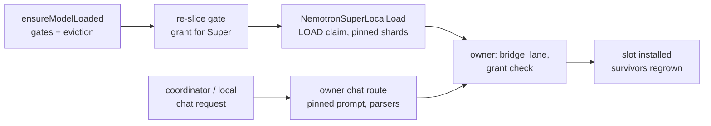
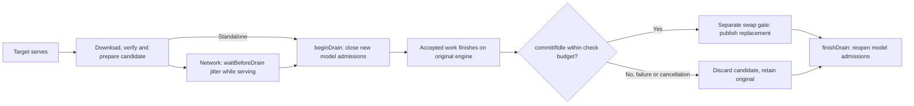
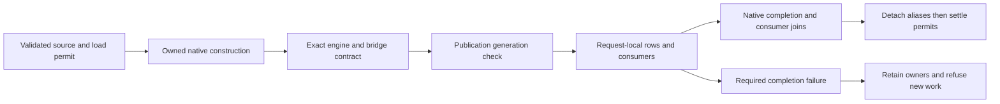
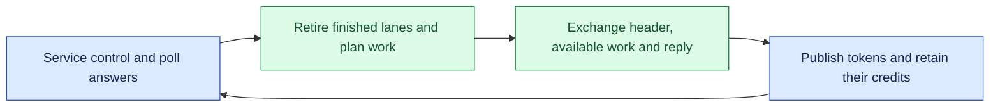
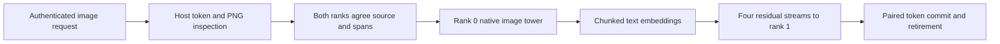
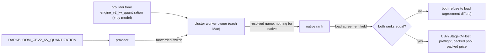
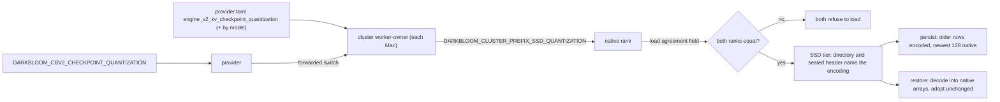

# Provider inference engine

> Last updated: 2026-10-30

How a chat-completion request is served inside the `darkbloom` provider
process: one in-process engine (`mlx-swift-lm`
ContinuousBatchingV2, "CBv2"), one `EngineV2Bridge` per resident model, no
legacy engine and no subprocess. For the memory model see
[`hardware-support.md`](hardware-support.md); for KV/prefix caching see
[`prefix-cache.md`](prefix-cache.md).
The [native block adapter](native-block-inference.md) reuses this bridge boundary
for committed diffusion output and explicit native-container slot ownership.

Standalone and cluster chat HTTP use the same scalar-stop normalization,
request-owned logprob plumbing and reasoning-token usage decoration for JSON
and SSE responses. `EngineV2Bridge.submitTokenized` forwards an explicit
`min_p` on both paths; existing engine validation still applies. Stream lifetime
and distributed retirement remain separate from these API fields. A model-free
parity fixture can supply captured logprobs, but does not establish that a
native family or generation mode implements capture. Sources:
`provider-swift/Sources/ProviderCore/Server/LocalInferenceHTTP.swift`,
`provider-swift/Sources/ProviderCore/Server/LocalChatUploadResponder.swift`, and
`provider-swift/Sources/ProviderCore/Inference/Engine/Bridge/EngineV2Bridge+Submission.swift`.

Captured metadata travels with `GenerationEvent.logprobs` and
`MLXServerGenerationEvent.logprobs` through the same ordered stream as text.
`MLXOpenAIService` attaches only already-consumed entries when encoding a content
frame; local and coordinator relay code preserve that canonical frame. A producer
running ahead cannot put a future token's logprob on an earlier text delta.
`OpenAIChatLogprobs` also carries captured entries on collected JSON responses.
The request-local pending buffer retains at most 4096 entries, dropping the oldest
on overflow. This does not classify parser source spans: reasoning/tool entries
still attach to the next visible content, and trailing entries without visible
content are discarded on stream termination. No token metadata enters telemetry.
The scheduler limits entries to the requested alternatives and drops those of
withheld reasoning (`WithheldReasoningLogprobsFilter`) before either encoder sees
them. One exception keeps the vLLM-style contract on the coordinator relay: for
GLM5-Next and the Nemotron Super owner (`ProviderLoop.logprobsCoverReasoning`)
the scheduler or the owner appends entries to an `EngineV2LogprobsChannel` before
the text they precede, and the frames loop splices them into reasoning and content
frames ([Super's contract](#nemotron-super-logprobs)), so a response that ends
while reasoning still returns them. Sources:
`provider-swift/Sources/ProviderCore/Inference/Engine/Bridge/EngineV2Bridge+Events.swift`,
`provider-swift/Sources/ProviderCore/Inference/Engine/Scheduler/MultiModelBatchSchedulerEngine.swift`
(`makeEventStream`),
`provider-swift/Sources/ProviderCore/Inference/Streaming/EngineV2Logprobs.swift`, and
`libs/mlx-swift-lm/Libraries/MLXLMServer/Runtime/MLXOpenAIService.swift`.

Cluster logprob admission follows the selected resident runtime. Both installed
and member-pair serving construct `DistributedResidentExecutionProfile` from the
verified adapter and selected generation mode; only GLM tensor parallel currently
captures token logprobs. Other modes return `logprob_capture_unsupported` as HTTP
400 before either worker reserves the request. Numeric `top_logprobs` limits
remain separate, and an ordinary request remains admissible after the refusal.
Sources: `provider-swift/Sources/ProviderCore/Inference/Distributed/DistributedResidentExecution.swift`
(`DistributedResidentExecutionProfile.refusal`),
`provider-swift/Sources/ProviderCore/Inference/Distributed/Installed/DistributedInstalledSession.swift`,
and `provider-swift/Sources/ProviderCore/Inference/Distributed/Membership/ClusterMemberPreparation+PairServing.swift`.

The cluster setup liveness probe uses the same request validation as ordinary
chat completions. `ClusterSetupProbeRequest` sends no family-specific thinking
override, so each model’s prompt policy remains authoritative.
`ClusterSetupWizardLiveOperations.prompt` recognizes reasoning-stream chunks
even when the short probe ends before answer text. This does not relax GLM
validation or qualify answer quality. Source:
`provider-swift/Sources/ProviderCore/Inference/Distributed/Console/ClusterSetupProbeRequest.swift`.

Native DiffusionGemma also retains image/video assets on tool-result turns.
`EngineV2VisionPrefill.prepareDiffusionUserInput` validates tool history and
orders typed results by their actual call IDs before media decoding, using
`Gemma4TurnStructure.orderTypedToolResults`. `MediaIngest.buildUserInput` keeps
decoded assets and symbolic template parts aligned in that order. System and
assistant media remain unsupported; legacy model ingestion is unchanged. Sources:
`provider-swift/Sources/ProviderCore/Inference/Vision/EngineV2DiffusionVisionPrefill.swift`,
`provider-swift/Sources/ProviderCore/Inference/Prompting/Gemma4TurnStructure.swift`,
`provider-swift/Sources/ProviderCore/Inference/Vision/MediaIngest.swift`.

## Automatic local cluster batching

`DistributedAutomaticBatchFactory` keeps the initial singleton placement. A
managed cluster API with queued demand may propose a wider plain pipeline for
Qwen dense/routed experts, Bonsai, Nemotron Lightning, Gemma, GPT-OSS or the
MiMo text plain-pipeline owner. Every Qwen TP row (the 9B and 27B dense rows,
the Qwen3.5 and Qwen3.6 35B A3B routed-expert rows) admits its native TP batch
owner through the feature-preserving mode filter, retaining ordinary measured
rates, keyed-link evidence and qualification shape gates.
It uses the full
listener request envelope because acquisition precedes tokenization; raw body
size never reduces the memory charge. `ClusterPlacementBatchScope` prices
independent state on both ranks, trying widths 8, 4 and 2 in that order once
real concurrent pressure exists (8, 6, 4 and 2 for a request-owned Qwen TP row,
whose owner prices any width from its own geometry;
`ClusterPlacementBatchScope.tensorParallelWidths`). Each width retains the full listener envelope;
the largest separately priced fit avoids repeated reloads as a burst grows.
For a Qwen TP row, the read-only preview requires that both ranks fit their current
memory observations, including the simultaneous LOAD reservation described in
[hardware support](hardware-support.md#automatic-qwen27-tp-width-quotation).
A higher width that fits only idle hardware does not displace a smaller width
that fits now. The preview credits back one thing only: when the replacement
keeps the running owner's exact tensor-parallel shares, a rank that does not fit
now is still proposed if its need fits once the running owner's resident
weights on that Mac are free, as they are before the replacement loads (the same
split, so the candidate's own `weightsBytes`). The owner's unallocated request
reservation is never credited and no hardware bound moves
(`DistributedAutomaticBatchPlanner.acceptsCreditingIncumbentWeights`). After
release, the planner rechecks the exact proposed width with fresh profiles and
nothing credited; it cannot silently adopt a different width from the
listener's retained intent. A credited width that this recheck refuses is
previewed without credit for 10 minutes for that setup
(`DistributedAutomaticBatchCreditRefusals`), so steady demand cannot cycle
release and restore.

Every refused width logs one line, `cluster.batch_replan refused lanes=N`, in
the preview and in the post-release recheck
(`DistributedAutomaticBatchPlanner.refusalFields`). Its fields are `phase`
(`preview` or `post_release`), `reason` (`not_now`, `not_possible`,
`outside_gpu_working_set`, `not_accepted`, `no_setup` or `no_placement`),
`requested_lanes`, `previous_lanes`, `require_now`, `credits_incumbent_weights`,
`mode`, `tensor_shares` and, for each rank N, `rankN_need_bytes`,
`rankN_load_need_bytes`, `rankN_request_need_bytes`,
`rankN_admissible_now_bytes`, `rankN_short_bytes` (need minus admissible-now,
never negative), `rankN_weights_bytes`, `rankN_fit` and `rankN_device`.
Existing per-request
admission and LOAD safeguards remain authoritative. GLM, private-image and
coordinator-installed native-member sessions do not use this
automatic policy. Explicit diagnostic mode or lane settings retain their choice.

Automatic replacement reads the installed plan helper's device profile and the
current pair's recorded keyed-link costs and served-request history. It uses
the same measurement readers as initial placement, so a supported TP batch
candidate can compete on measured costs instead of being dropped as unmeasured.
Every reader of this Mac's profile (`ClusterLocalDeviceProfile`: the setup's own
report, which answers the other Mac's update check and plans, a plan made here,
and this replacement) reads memory now but measures the model-free speed index
(`darkbloom-cluster-plan device --json --index`, about a second of GPU work)
only while no model is loaded on the Mac: no cluster worker runs there, and the
cluster service runs neither its part nor its solo server
(`ClusterService.modelLoaded`). Otherwise the index the Mac last measured stands
in, for the chip and OS build it was measured on (`ClusterDeviceIndexRecord`,
owner-only `~/.darkbloom/cluster/device-index.json`), or none. The control
leader's update check reached a serving member every 60 s
(`ClusterService.checkForUpdate`), and that member's report ran the benchmark on
its GPU each time, beside its model; a replacement is always previewed while the
running owner serves. The re-plan after an update stops both parts first, so its
profiles measure the index again.
Absent, stale, malformed or non-private link history keeps the existing
unmeasured fallback. Link records bind the unordered member pair, keyed probe
and existing 30-day freshness limit; the pair's last eight are kept and planned
on as their median ([link probe history](#link-probe-history-and-tensor-parallel-visibility)).
Served records bind the model, mode, cut,
member order and each rank's worker build, and exclude cached or concurrent
requests; a replacement uses only the records its pinned worker builds served
([served speed records](#served-speed-records-and-worker-builds)). They do not
carry artifact or backend pins. This restores the ordinary planning
contract, not stronger performance provenance. It does not force TP, assume
a batching speedup, or replace full-profile and live LOAD memory checks.

GPT-OSS and MiMo use a separate `ClusterPlacementBatchQuote` from the native
`batch-scope` metadata helper. It binds the exact width, original chunk and full
listener prompt/output limits. `ClusterPlacementBatchBudget` retains each
lane's whole request allowance; GPT-OSS includes page/COW/gather and selected
prefill charges, while MiMo adds its page supplement and host histories to the
whole existing state budget. Shared native and host decode workspace is charged
once beside all lanes. The quote takes conservative maxima across admitted
nonempty stage cuts and covers the whole-model layer-state floor; it never
changes singleton layout/request-scope results or discounts LOAD/transient
reserves. A changed or derived chunk cannot reuse it. Native arithmetic,
paged-path qualification and useful throughput remain independent gates.

A Qwen TP row's `ClusterPlacementTensorBatchQuote` comes from `tensor-batch-scope`,
priced by that row's own geometry (per-rank KV heads, recurrent state and, for a
routed-expert row, the packed MoE payload's source partials).
`ClusterPlacementArtifact.requestedTensorBatchQuote` validates the canonical
stored tensor headers and reuses `QwenTensorParallelBatchBudget.derive` at the
memory plan's full LOAD context and maximum frame, even for a short reference
request. For Qwen3.8 27B that is the standard request, not its advertised
262,144-token context ([native context](#qwen27-tensor-parallel-native-context)).
The TP floor includes all lanes, retained and temporary projection constants,
shared fusion/prefill/decode work, page-pool slack and eight separately bounded
sealed collective frames. The quote also carries `rankQuotes`: what each rank of
every supported split reserves at LOAD (see the rank ledger below). Under a split
it quotes, the planner charges each rank its own figure and that rank's share of
every lane's state, not the whole-model every-rank charge. Otherwise it takes the
maximum of the whole-model reservation and its existing estimate. Either way it
adds loading headroom once. Vision
residency stays additive; per-request media work retains its own native gates.
Pipeline pricing stays independent. Missing or incompatible TP quotes never
make TP eligible for batch placement, and no width multiplies a rate estimate.

Sources: `libs/darkbloom-cluster/Sources/DarkbloomClusterPlacement/ClusterPlacementTensorBatchQuote.swift`,
`libs/darkbloom-cluster/Sources/DarkbloomClusterRuntime/Models/Placement/ClusterPlacementTensorBatchBudget.swift`,
and `provider-swift/Sources/ProviderCore/Inference/Distributed/Onboarding/DistributedAutomaticBatchPlanner.swift`.

Planning changes no setup. If the queue empties before a valid proposal returns,
`DistributedLocalServer` keeps that metadata-only intent eligible for at most
30 seconds on the same serving generation. The next real queued pressure may
consume it once, before the planner cooldown; idle requests never trigger its
factory. Expired, stale-generation or unhelpful proposals are discarded before
use, and teardown clears them. Cancellation and every queue ticket retain their
original behavior. No native owner or HTTP response is retained by the proposal.

The HTTP host first drains acquired work and proves
both native owners and its bridge released. The deferred factory resamples
memory, adopts compatible immutable setups over the authenticated pair control
link, waits for the follower's exact launched setup digest, and prepares a fresh
session. The supervisor keeps the same leader listener only after checking its
process incarnation, both setup identities and empty device journal. A bounded
handoff record defers a setup-publication or compensation race for at most 60
seconds; it grants no worker ownership. A failed candidate is fully retired
before exact previous-setup rollback can prepare another session. Unrelated
operator changes are never overwritten.

Queued requests retain their original absolute deadlines and may expire during
planning or loading. The policy grows capacity without idle scale-down; it does
not infer batch throughput by multiplying a singleton prediction. Initial-mode
cost calibration and full-artifact throughput qualification remain separate
from this lifecycle and memory policy. Sources:
`provider-swift/Sources/ProviderCore/Inference/Distributed/Onboarding/DistributedAutomaticBatchFactory.swift`,
`provider-swift/Sources/ProviderCore/Inference/Distributed/Onboarding/DistributedAutomaticBatchPlanner.swift`,
`provider-swift/Sources/ProviderCore/Inference/Distributed/Onboarding/ClusterAutomaticSetupHandoff.swift`,
and `libs/darkbloom-cluster/Sources/DarkbloomClusterPlacement/ClusterPlacementBatchScope.swift`.

## Cluster setup presentation

`ClusterOnboardingDriver` presents connection, pairing, model choice, startup
and a test response as five stages. Completion requires the test response to
succeed; a failed response retains the saved setup for a later retry. After
the test response succeeds, the control leader registers the pair with the
coordinator when the coordinator serves a cluster approval for this pair
(`ClusterOnboardingDriver.register`, control operation `register`). Both parts
then run as coordinator-paired members
(`ClusterService.Settings.memberArguments`), which have no local API, and the
ready screen shows the registered line (`ClusterOnboardingReady.offered`,
`OnboardingLive.offeredReadiness`). How the approval is fetched, matched,
checked on each Mac and saved:
[coordinator-paired member](../reference/configuration.md#coordinator-paired-member).
The control leader checks the approval again under the command lock
(`ClusterService.checkApproval`) and checks a save against its own files
before any part stops (`ClusterApprovalSync.apply`). It compares the other
Mac's approval only when that Mac reports one
(`ClusterApprovalCheck.peerApprovalID`). It counts the quick ends of a part
only from that part's own rank-log lines (`ClusterService.lastError(in:from:)`).
`OnboardingLive` uses fresh peer display facts only while their authenticated
member identity matches the current pairing. These labels do not rewrite saved
serving intent or change model eligibility and placement. See the
[guided two-Mac setup](../provider/two-mac-cluster.md) for operator steps.

Lines name the two Macs for the screen that shows them
(`ClusterOnboardingMacName`): "this Mac" and "the other Mac (<hardware name>)",
because two Macs of one kind share the hardware name. The leader words an
answer to a command the other Mac forwarded for that Mac's screen
(`OnboardingLive.answeringForwarded`, `here`, `there`), and the cluster
service names members the same way in its control lines and refusals
(`ClusterOnboardingMacName.names`). A deployment line recorded for both Macs
keeps hardware names; lines shown now carry the screen's words
(`ClusterOnboardingDeployment.Share.label`). The Mac that joins ends its
onboarding once paired, also for `darkbloom cluster local`
(`ClusterOnboardingDriver.joinedLocalLine`). The model list keeps one line per
artifact and name (`OnboardingLive.presentedChoices`): a choice that cannot be
served is left out when another offers the same digests under the same name,
and an artifact this build serves is never called unsupported for a copy the
worker does not take (`ClusterSetupPlanning.copyNotTaken`).

A DevNet build is installed as `Darkbloom Dev.app`, and its CLI is
`darkbloom-dev`. A saved setup accepts a space in its installed paths
(`ClusterConfigurationSyntax.installedPath`). The orphan sweep, the teardown
check and `cancel-all` know an owner by the CLI name of each build environment
(`ClusterOrphanReaper.ownerExecutableNames`). The cluster service stop knows
the service by this build's CLI name (`ClusterService.isClusterService`).

## Context

The unregistered `NemotronSuperLocalBridgeBuilder` assembles an installed Super
language tower through the native CBv2 factory after rechecking a pending LOAD
lease. `NemotronSuperLocalBinding` owns acquisition through engine retirement and
drains its own requests; the owner mints one `localTextBinding` and drains it in
`closeAfterDrain` before the image binding and bridge. It accepts pretokenized text only; media, tools, schemas
and client prompt-cache keys are rejected, and text prefix reuse runs only when the owner has a
checkpoint bank (below). The builder uses serial segmented paged KV (Super has
no contiguous storage), bounded calibrated prefill, and no MTP unless the
explicit opt-in below installs text speculation. The provider installs this owner only through the
[managed Super slot](#managed-nemotron-super-slot). `NemotronSuperLocalLoad` owns
the one-shot load transaction, checks the pinned config, reserves the
conservative SDK quote and preserves charges on native completion faults. `NemotronSuperPromptContract` renders the
pinned template with reference `apply_chat_template` semantics: request-order tool
schemas and tool-call arguments, Python `str`/`strip`/`json.dumps` filters, and the
processor's ``, one `<image>` per feature, `</img>` expansion. It rejects
conflicting reasoning controls; `NemotronSuperRequestPlan` resolves those controls,
the shared tool-choice policy and the response-format instruction once per
request. A generated golden corpus pins rendered text and token IDs.
`NemotronSuperVisionSubmission` preserves causal attention and absent position
state when translating admitted SDK features. `NemotronSuperLocalOutput` applies the
reference `ultra_v3` reasoning split in `NemotronSuperReasoningChannel`, streams
reasoning and plain content, and withholds tool calls and JSON content until the
shared tool and response-format validators pass; output stays bounded. The
unregistered `runValidatedText` binding connects rendered tool/schema prompts
to withheld output validation after native retirement. It rejects truncation and
missing/error terminals. Causal vision submission is exercised by a synthetic
fixture through the real bridge, including RADIO/projector preparation, generation
and retirement; public media dispatch remains unwired. SDK fixtures compare
full-position and narrowed image logits, split prefill inside an image span and
exercise recurrent rollback with request isolation. These checks do not establish
full-checkpoint quality or speculative MTP support. Synthetic loopback HTTP tests exercise authentication, model listing, SSE, malformed input and restart through the actual Hummingbird server and native bridge; their weights and tokenizer are fixtures. The local builder wraps the
composite in `NemotronSuperRecurrentAdapter`, a serial causal adapter with explicit
scalar-cache-offset positioning. It rejects explicit position tensors, packed rows
and mismatched state/cache counts; the generic Nemotron type is not widened. Sources:
`provider-swift/Sources/ProviderCore/Inference/Vision/NemotronSuperVisionSubmission.swift`,
`provider-swift/Sources/ProviderCore/Inference/Streaming/NemotronSuperLocalOutput.swift`,
`provider-swift/Sources/ProviderCore/Inference/Streaming/NemotronSuperReasoningChannel.swift`,
`provider-swift/Sources/ProviderCore/Inference/Prompting/NemotronSuperRequestPlan.swift`.
Sources:
`provider-swift/Sources/ProviderCore/Inference/Engine/Factory/NemotronSuperLocalLoad.swift`,
`provider-swift/Sources/ProviderCore/Inference/Prompting/NemotronSuperPromptContract.swift`,
`provider-swift/Sources/ProviderCore/Inference/Engine/Factory/NemotronSuperLocalBridgeBuilder.swift`,
`provider-swift/Sources/ProviderCore/Inference/Engine/Bridge/NemotronSuperLocalBinding.swift`.

The dedicated `NemotronSuperLocalImageBinding` is minted by that exact load
owner, holds its own media reservations (its prompt's KV pages are charged
like text's, by the engine's process-memory owner), and cancels/drains
through terminal retirement. Synthetic tests exercise image cancellation, reuse
and close. It does not manufacture a shared native lease; the managed slot's
chat route is its only production caller. The CPU `NemotronSuperImageDecode` sniffs PNG or JPEG content and
reproduces the reference loader's RGB8 conversion: PNG of every colour type and
bit depth is decoded in-process and matches Pillow exactly, while JPEG samples
come from ImageIO within test-enforced bounds. Container limits are checked
before any raster buffer exists, and the SDK resize is bitwise equal to CPU
PyTorch on the golden fixtures; see the
[image format reference](../reference/nemotron-super-image-formats.md).
Its quote alone is not admission. The exact-owner `runEncoded` boundary charges
ingress before JSON/base64/header inspection and media before decode. The media
charge adds the SDK's shape-derived tower and projector working-memory bound for
the largest image, which preparation evaluates one at a time; the global
activation reserve is unchanged. It only accepts `data:image/png;base64,` and
`data:image/jpeg;base64,` URIs, whose content selects the format, and uses the
owned tokenizer. Native input arrays are constructed in a separate retained,
fenced epoch before tower preparation. Synthetic RGB tests cover generation,
cancellation, busy rejection and release after task completion; loopback HTTP
tests serve PNG and JPEG variants through the tiny synthetic owner. Actual
tokenizer parity, RADIO peak workspace and full-checkpoint image qualification
remain required.

The same binding serves one inline video as the only media of a request
(`data:video/mp4;base64,` or `data:video/quicktime;base64,`; one media request
at a time, like images). Under the ingress reservation `NemotronSuperVideoDecode.inspect`
runs the shared `MediaIngest.decodeVideo` checks (label, decoded bytes,
container, duration, coded frame size up to
`NemotronSuperServingPolicy.maximumVideoFramePixels` pixels in any shape),
admits only an H.264 or HEVC track (`NemotronSuperVideoDecode.admittedCodecs`),
then reads the compressed samples of the one video track as vLLM's OpenCV
loader reads FFmpeg's metadata: the sample count (at most
`NemotronSuperVideoDecode.maximumSourceFrames`, 36,000: ten minutes at 60 fps),
and the rate as that count over the summed sample durations; as in FFmpeg, the
last sample may have zero duration (no other may). The SDK's
`NemotronSuperVideoPreprocessing` samples 2 frames per second (at most 256,
`np.linspace` truncation), formats each tubelet's label and fixes one frame
grid of about 1,024 patches; grids above
`NemotronSuperServingPolicy.maximumVideoGridPatches` are refused. Every frame
up to the last sampled one is decoded, so a plan whose decoded frames hold
more than `NemotronSuperVideoDecode.maximumDecodedPixels` pixels (ten minutes
of 30 fps 1080p) is refused as well.
`NemotronSuperPromptContract.videoPrompt` renders the video in the template's
single media slot (the template renders a lone video exactly as a lone image,
but as plain `<video>` text) and tokenizes each label alone, later ones behind
their `\n`, as vLLM's `get_video_repl`; every tubelet then contributes its label,
``, one `<image>` per kept feature and `</img>`. EVS fixes the kept count,
`max(N, int(T * N * (1 - q)))` (`NemotronSuperVideoFeatures.retainedRows`), so
the prompt is admitted at its final length before any frame decodes. The whole
charge (`NemotronSuperLocalImageBinding.videoChargeBytes`: two encoded copies,
the decoder working set at the coded frame size, one batch of four tubelets'
frames and tower activation, its five-tubelet EVS scoring window at
`NemotronSuperServingPolicy.videoScoringBytesPerRow`, and three Float32 copies
of every projected row) is then reserved; its maximum,
`NemotronSuperServingPolicy.videoMediaChargeBytes`, stays below one largest
image's charge. As for images, a body over
`NemotronSuperServingPolicy.maximumEncodedBodyBytes` (40 MiB, which holds one
part at the shared 25 MiB inline-media cap as base64 and every body the
provider's transports deliver) returns `media_too_large`, a video prompt over
the context returns the invalid-media 400, and a charge the shared budget
cannot hold returns the media-memory 503. The owner lock covers
only the admission check while the video prompt is decoded and rendered.
`NemotronSuperVideoDecode.Frames` decodes the movie in order as the batch needs
frames: AVFoundation decodes every frame up to the last sampled one to BGRA,
each decoded frame must have the inspected size and row bytes within the
charge (`NemotronSuperVideoDecode.validateDecodedFrame`), and only the sampled
ones are copied to RGB8 (presentation order, the track's rotation applied) and
normalized with the image resize; an odd last frame repeats. Every read, and
the reader's one cancellation, runs in order on the reader's own serial queue
while the pulling thread waits for the sample, so the reader is never
cancelled during a read. Waiting on the decoder is bounded by
`NemotronSuperVideoDecode.decodeAllowance` (5 s, then 2 ms a frame and 4 ns a
coded pixel, at most 120 s): when it is spent the wait ends and the video is
refused. Cancelling the request, as the binding's `drain` does, ends the wait
at once. Either way the reader is cancelled once the read in progress
returns, and that read's sample is dropped.
`NemotronSuperVideoFeatures.prepare` runs
`videoFeatures(normalizedFrames:)` over batches of `tubeletBatch` tubelets in
the installation's native setup, checking every evaluation with
`throwIfMLXFaulted`, and keeps only projected rows. When
`DARKBLOOM_NEMOTRON_SUPER_VIDEO_PRUNING` (default `0.5`, `0` keeps every row; a
malformed value fails the load before its LOAD claim) prunes anything, each
batch is scored with `NemotronSuperEVS.dissimilarity` behind the previous
batch's last tubelet, since a token scores only against the same position of
the previous tubelet; the host scores then select the kept rows, the same rows
EVS selects over the whole video. Each tubelet's kept rows are substituted
at its `<image>` run as a causal span with `mediaKind` `video`. A tubelet whose
rows were all pruned keeps its label and wrappers and has no span. Invalid,
oversized or undecodable videos map to the invalid-media 400. AVFoundation's
BGRA conversion differs from FFmpeg's at chroma edges, so frames are close to,
not equal to, the reference loader's.

SDK installation now holds resident plus bounded staging reservations across
sequential exclusive construction epochs. Completed fences release temporary
roots, while failed completion retains resident objects and charges. Header-derived
projection/expert-bank/image staging bounds and explicit backend allowance must
still be checked against full-model measured peak memory. Bundling the upstream
MTP tensors does not qualify execution.
The optional `NemotronSuperLocalImageHTTP` hook reuses the authenticated local
application and standard JSON/SSE framing and defaults to absent. It serves text
through the owner's `localTextBinding` and images through its image binding, admits
the owner's configured number of requests before it decodes the body or renders
the prompt, and refuses another with `queueFull` (429) before any response
starts. A response starts at the first generated chunk the output parser accepts,
even one it withholds, so a held answer's failed validation ends the stream with
an error. `NemotronSuperLocalLoad.localImageHTTP(templateBytes:)` builds
it over the transaction's own owner. Only the qualification runner installs it as
a hook; the managed slot serves the same route through `engine(body:hasMedia:cacheScope:)`.
`DARKBLOOM_NEMOTRON_SUPER_MAX_CONCURRENT` (default `1`) sets how many requests
the owner serves: `1` to `64` plain, `1` to `8` with rectangular speculation, one
with serial speculation. Above one the plain builder serves
`NemotronSuperRecurrentAdapter(_:maximumDecodeRows:decodeProducts:)` with
`.rowExact`, so concurrent requests decode in one `[B, 1]` step bit-identical to
their one-token decode. The hook admits that many requests and refuses the next
with 429.
`NemotronSuperLocalPrefill` fixes prompt scheduling: chunks of
`DARKBLOOM_NEMOTRON_SUPER_PREFILL_CHUNK` tokens (default 2,048, at most the
calibrated prefill limit), at most one prompt chunk per step beside every decode
or verify row, a step budget that holds a whole chunk plus those rows, and
four decode-only steps after each chunk while requests decode
(`NemotronSuperLocalPrefill.defaultDecodeStepsBetweenChunks`;
`DARKBLOOM_NEMOTRON_SUPER_DECODE_STEPS_BETWEEN_CHUNKS` sets 0 to 64 and is
forwarded to the launchd provider job). On an M5 Ultra four held steps raised a
decoder's rate during an 8K prefill from 5.8 to 16.3 tok/s and delayed the
prefilling request's first token by 15 to 26%; eight gave 24.7 tok/s for 33 to
52%. A step without decode rows is never held. A request's chunks are
therefore the same whether or not it is served alone. Because one chunk runs per
step, the prefill activation is one owner-wide lane in the shared budget,
reserved before the first request and released only after native retirement:
`NemotronHModel.prefillActivationBoundBytes(tokens:)` (the SDK's whole-chunk bound
measured on the full checkpoint) for the pinned checkpoint, the ModelOpt
workspace quote for synthetic fixtures. A lane that does not fit fails the load;
the pinned checkpoint's LOAD claim already holds it (below).
Each request's fixed bytes count, beyond the engine's recurrent generations
and any speculation charge, `requestWorkspaceBytes`: one
`NemotronSuperDecodeCharge` decode row, which the owner reserves for every
configured request (below). The builder refuses a KV grant that
cannot hold every configured request's fixed bytes plus the minimum KV with
`UnserviceableGrant`, which names the grant, the smallest serviceable grant and
the fixed bytes per request.
`NemotronSuperLocalPrefixCache` gives either owner exact text prefix reuse. By
default the managed slot keeps it as complete encrypted SSD checkpoints (see
below); `DARKBLOOM_PREFIX_CACHE_MEMORY=1` selects the resident bank instead.
For the pinned checkpoint
`NemotronSuperServingPolicy.defaultPrefixBankBytes` sizes the SDK's resident
recurrent checkpoint bank from the KV grant and the machine:
`serving = grant - admissionKVBytes(requests, speculates) - lane bound(chunk) - one image's media charge`,
`load = memory cap - activation reserve - LOAD bytes (installation, any head) - admissionKVBytes - lane bound`,
`bank = min(16 GiB, grant / 4, serving / 2, load / 2)` rounded down to 256 MiB,
and no bank below 1 GiB. The lane and media charges come from the same ledger
the grant describes, so half of what is left beside them stays free; the single
LOAD claim holds the installation, any head, the lane, the bank and the
requests' KV, so half of what the machine's cap leaves beside it stays free.
`grant / 4` is the engine's own bank ceiling when a re-slice shrinks the grant.
A lone slot (grant = fleet KV budget) gets 16 GiB for either owner on 192, 256
and 512 GiB; on 192 GiB the speculating owner's whole claim (110.0 GiB) and
activation reserve leave 60.8 GiB of the cap for other memory, on 128 GiB
(a 5.25 GiB bank) 13.9 GiB. `DARKBLOOM_CBV2_HYBRID_PREFIX_BYTES` overrides it, other checkpoints
keep `PrefixCachePolicy.hybridConfig`'s `min(1 GiB, grant / 8)`, and the bank
holds up to one entry per 256 MiB (at least 32). The managed slot's
`loadPlan` sizes the same bank from the same grant, requests and keys, turns
the switch on only when it is non-zero and adds it to the LOAD claim's KV
headroom. The backend carves the bank from the KV
grant before the grant check, and its whole budget is reserved in the shared
budget from before the first request until native retirement, like the lane; a
bank that does not fit fails the load and a retained native fault keeps it
charged. The adapter is built with `exactPrefixCheckpoints`, so checkpoints sit
only at multiples of the prefill chunk, where a restore continues a cold prefill
bit for bit; prompts shorter than one chunk restore nothing. Text requests are
then submitted with prefix caching on, partitioned by the request's cache scope
(the hook's single local scope, or the managed slot's authenticated tenant
scope). An image request with a cache scope is bound to an identity of its
evaluated features and spans (`EngineV2VisionPrefill.PreparedSubmission.hybridPrefixIdentity`),
hashed while its media charge still covers the copy, and reuses only within
that identity: the same images at the same positions in a later turn. Without
a scope it stays cold and never publishes. On the speculating owner
the target is built with `exactPrefixCheckpoints` too and each checkpoint also
holds the assistant's queued prompt history, so a restored request drafts from
the same history as a cold one.
`UnserviceableGrant.minimumGrantBytes` and the slot's re-slice floor include
the bank, so a larger bank also keeps a co-resident load from shrinking the
grant below it. A re-slice does not give the bank up: the engine only lowers
the bank's own limit to a quarter of the new grant and keeps entries pinned by
in-flight restores and captures, and the shared ledger holds the bank's whole
reservation until native retirement, so a floor without the bank would hand a
newcomer memory the bank still holds. Sources:
`provider-swift/Sources/ProviderCore/Inference/Engine/Factory/NemotronSuperLocalPrefixCache.swift`,
`provider-swift/Sources/ProviderCore/Inference/Engine/Factory/NemotronSuperLocalAdmission.swift`.

Super serves paged attention KV only: `NemotronSuperLocalKVBackend` always
selects the segmented native paged backend (the adapter declares
`supportsPagedKV` and `requiresNativePagedKV`; the pool takes the eight
attention layers' observed BF16 types). `DARKBLOOM_NEMOTRON_SUPER_KV_BACKEND`
unset or `paged` serves it; `contiguous` fails the load as no longer supported
(`contiguousUnsupported`) and any other value as malformed (`invalidBackend`).
The load transaction refuses either, and `DARKBLOOM_CBV2_PAGED_KV` disabling
paged KV (`pagedDisabled`; the fleet kill switch would otherwise degrade the
paged selection to contiguous), before its LOAD claim and installation. A paged
construction failure fails the load, and the builder retires a built bridge
whose storage is not paged and fails the load instead of serving it
(`storageNotPaged`). The
engine's process-memory owner charges pages and recurrent rows to the shared
budget as they materialize and the bridge reserves no request bytes, so the
owner reserves `requestWorkspaceBytes` for every configured request (the
decode rows) from before the first request until native retirement, like the
lane. The text prefix bank (`CBv2HybridPrefixCacheConfig.permitsPagedStorage`)
is carved from the paged grant, a donor's prompt KV is gathered into the
bank's own buffers on the engine queue before its pages return to the pool,
and an adopter writes that prefix into fresh pages with a `.direct` plan. A
paged backend with step-owned attention, a native binding or a page-sharing
index builds no bank, and the builder then fails the load
(`NemotronSuperLocalPrefixCache.Failure.unavailable`). Within paged storage,
batched rows, captured speculation windows and rollback stay exact; the gated
`NemotronSuperPagedLiveTests` hold paged logits to a contiguous reference arm,
which reduces differently, within a stated tolerance.
`NemotronSuperLocalMTP` installs text speculation only when
`DARKBLOOM_NEMOTRON_SUPER_MTP` is exactly `1` (the hook's default is off; the
managed slot's policy sets it). The load transaction
adds the embedded head's header-derived payload and loader construction allowance
to its single LOAD claim, loads the head in its own fenced construction epoch, and
the builder serves the SDK `NemotronSuperMTPAssistant`: greedy, up to the
configured requests per round, fixed depth (`DARKBLOOM_NEMOTRON_SUPER_MTP_DEPTH`,
`1` to `3`), a depth by the requests decoding in the step (a comma list; SDK
`CBv2MTPConfig.fixedDraftTokensByDecodeRows`) or `auto` (the engine's marginal
policy picks each step's depth). Verification
(`DARKBLOOM_NEMOTRON_SUPER_MTP_VERIFICATION`) defaults to `rectangular`:
`NemotronSuperMTPCaptureTarget` verifies the seed and drafts in one captured
target window, bit-identical per position to plain decode, and the engine commits
the Mamba state after the last accepted token and trims attention KV. `serial`
serves `NemotronSuperMTPTextTarget` with one ordinary target step per draft. The
shared production factory recognizes both targets like `NemotronSuperRecurrentAdapter`
(layer kinds, caches and the calibrated prefill bound).
The engine admits the assistant's bounded per-request charge (FP8 history, backlog,
every draft step's dense FP8 output head, the rectangular verify window and an
unmeasured 256 MiB backend scratch allowance) plus captured recurrent states before
allocation and holds them until retirement. On an owner with speculation each
image request runs target-only (SDK `CBv2RecurrentMTPRequestScopedMediaFallback`):
no draft, carry or assistant state, while text keeps speculating. Synthetic fixtures show
token-exact greedy output against the ordinary owner in both modes, forced
rejection rollback and cancellation; serial verification cannot beat plain
decode. On the full checkpoint (`scripts/nemotron-qualification/bench_serving.py`,
16 natural prompts, greedy, every output byte-identical to the plain owner's)
71–91% of drafts were accepted; aggregate tok/s against the plain owner was
57.0 / 32.5 at one client (depth 3), 65.0 / 50.7 at two and 78.4 / 67.2 at four
(depth 2) and 86.9 / 82.8 at eight (depth 1), hence the managed default
`3,2,2,2,1`. The M5 Ultra measured differently (384-token greedy and sampled
requests; per-request tok/s against target-only decode): +20% to +24% alone at
depth 3, a tie at two (depth 2: greedy +3%, sampled -4%), at four depth 1 within
2% where depth 2 costs 7% to 9%, and at eight depth 1 costs 13% to 15% of
aggregate. An M5 therefore defaults to `3,2,1,1,0`: five or more decoding
requests run target-only. Sources:
`provider-swift/Sources/ProviderCore/Inference/Engine/Factory/NemotronSuperLocalMTP.swift`.

### Nemotron Super logprobs

Super serves OpenAI `logprobs` and `top_logprobs` on text, image and video
requests. `NemotronSuperRequestPlan.topLogprobs` reads both from the raw body
(`EngineV2Translation.topLogprobs`: `logprobs: true` captures at least one
alternative) and the plan refuses `top_logprobs` outside 0 to 20. Entries leave
on an `EngineV2LogprobsChannel` the caller passes to the owner's chat route
(`NemotronSuperLocalImageHTTP.engine`, `NemotronSuperSlotOwner.chatEngine`);
both bindings refuse a logprobs request without one. The coordinator relay
passes the channel its frames loop splices. For a local `logprobs` body,
`LocalChatUploadResponder` creates one and splices entries into reasoning and
content frames with `ProviderLoop.injectLogprobs`. A complete response attaches
the entries its stream would carry: the owner also passes each chunk through a
streaming split of the request and keeps the entries gathered so far only when
that chunk shows reasoning or content (`NemotronSuperCompleteLogprobs`).

The contract matches vLLM and SGLang: `logprobs.content` has one entry per
generated token, in generation order, covering reasoning, answer and tool-call
tokens. Joined, the entry tokens spell the reasoning text and then the answer
text, not the answer alone; they also include the `</think>` marker that ends
the reasoning, which neither `reasoning_content` nor `content` shows. A
stream's reasoning chunks carry their tokens' entries and its content chunks
theirs. An entry rides the chunk that carries its token or a neighbouring one:
a token that renders nothing, such as the marker or a tool call's tokens, rides
the next chunk that shows text, and the frames loop drains whatever the owner
has appended. Order and exactly-once are exact, so clients accumulate entries
across chunks. A complete response carries the same entries as one list. A
response that ends while reasoning (its `max_tokens` spent) carries an entry
for every token. Tokens that no shown text follows carry none, such as the stop
token that ends a `stop` finish. Super's tool-call tokens therefore lack
entries only in the rare case that nothing follows the call: its own call turns
end with a newline after `</tool_call>`, whose chunk carries the call's
entries. A held JSON answer, which shows only at the end, carries every entry
before it, the stop token's included. On the coordinator relay
`ProviderLoop.logprobsCoverReasoning` selects this contract for the Super owner
and GLM5-Next; other models attach entries to content chunks only.

A logprob row never drafts or verifies (`EngineLoopV2.mtpBasicEligible`). On a
target with the request-scoped fallback, `EngineLoopV2.mtpDraftBatchRows`
removes it from the draft cohort as it removes an image request, so the other
rows keep speculating while it decodes one ordinary target token per step; the
row-exact decode keeps every output exact. Synthetic fixtures check its tokens
and logprobs against the plain owner's and that a text row beside it still
speculates (`NemotronSuperMTPMediaFallbackTests`). On Super's row-exact
recurrent target every other row the engine cannot draft for (a `stop` string,
a repetition, frequency or presence penalty, `logit_bias`) leaves the draft
cohort the same way, so one such request no longer turns speculation off for
the whole step (`NemotronSuperMTPRequestControlsTests`). Sampled Super rows
speculate: the assistant's greedy proposals are accepted only where they equal
the token pre-sampled with the request's own sampler and seed (exact
target-prefix acceptance), so sampled output equals target-only sampling.
`NemotronSuperLocalMTPTests` checks both through the provider's local binding
and bridge against the plain owner's tokens.
Sources:
`provider-swift/Sources/ProviderCore/Server/LocalChatUploadResponder.swift`,
`provider-swift/Sources/ProviderCore/Inference/Streaming/NemotronSuperCompleteLogprobs.swift`,
`libs/mlx-swift-lm/Libraries/MLXLMCommon/ContinuousBatchingV2/MTP/EngineLoopV2+MTPPlanning.swift`.

### Managed Nemotron Super slot

The distribution is one manifest and one model installation: all 88 shards
include the embedded MTP head, alongside the tokenizer, processor and template
assets. There is no separate MTP download or manual assistant binding. The
Super manifest scanner also retains root `LICENSE.txt` and
`UPSTREAM_README.md` notices in the download and integrity aggregate; adding
these notices requires a new immutable artifact revision. Other model families'
integrity inventories are unchanged. Managed `auto` enables text speculation;
image and video requests automatically use the target-only path on that same owner.

The provider serves exactly one Super artifact, `NemotronSuperServingPolicy.modelID`
(`nvidia-nemotron-3.5-super`): the complete pinned NVIDIA NVFP4 checkpoint, embedded
MTP head included, discovered as described in the
[model registry](model-registry.md#nemotron-super-discovery). It has no
`ModelContainer`: its slot holds `ProviderModelContainer.nemotronSuper`, a
`NemotronSuperSlotOwner` over the load transaction and its chat route. Generic
factories (`ModelContainerLoading`, `EngineV2SlotFactory`), warm liveness
rebuilds, the MTP upgrade and the standalone server refuse it.



`ensureModelLoaded` runs its ordinary selection and Super's own eviction and
load gate (below), then hands the load to `ProviderLoop.loadNemotronSuperSlot`.
Under the re-slice gate, held until installation, `resliceShrinkingForNewcomer`
shrinks survivors and returns Super's grant; `NemotronSuperSlotLoader.pinnedCheckpoint`
opens every shard against its pin (`NemotronSuperCheckpoint`) and runs the
transaction. Its LOAD claim holds the installation's and (with speculation) the
head's resident payloads, and
`NemotronSuperServingPolicy.admissionKVBytes` of KV headroom: every configured
request's measured fixed bytes, rounded up (576 MiB with speculation, 512 MiB
plain, at any context), 2 GiB and any prefix bank, which the grant holds and
which never exceed it (`grantKVBytes`), and a speculating owner's round work
once (`speculativeOwnerBoundBytes`, below), which is reserved beside the grant
whatever its size. The grant itself must still hold every configured
request's fixed bytes and the minimum KV: a smaller co-resident grant serves
fewer requests, and one that cannot serve a single request fails the load
at publication (below). For the pinned checkpoint the same claim also holds
the prefill lane at its measured bound (`NemotronSuperLocalBridgeBuilder.pinnedOwnerShares`),
so one admission before any allocation covers everything the loaded owner keeps
and a load that cannot hold it is refused before a shard is read into memory.
A refused claim first returns MLX's cached buffers (once per load) and asks
again for the same configuration; a refusal alone only schedules the
reclaimer's flush. Before refusing, the transaction tries narrower
configurations in order
(`NemotronSuperLoadFit`): the same policy without the prefix bank, then half
the concurrent requests at a time down to one, then that request with
1,024-token prompt chunks (a 4.75 GiB lane instead of 8.5 GiB), each with
every measured bound (installation, head, the lane of its chunk, per-request
bytes, the round at the whole context). It builds the first one the gate
admits with `NemotronSuperLoadFit.admissionSlackBytes` (3 GiB) to spare
beside the claim: while the claim is held the process grows up to 2.6 GB past
the installation's quote, and a configuration admitted with 1.9 GB to spare
lost its admission after its weights were installed. If memory still drops
by more than the slack while the weights install (other applications
swapping), the owner build's memory refusal (`loadAdmissionLost`, or a refused
lane, decode rows, round or bank) does not retire the load: the transaction
keeps the installed weights and head, finishes that claim (its attempt is
marked `lostAfterInstallation`) and asks the gate for each next narrower
configuration's owner shares, KV floor and slack
(`NemotronSuperLoadFit.Claim.installedAskedWeightBytes`), failing with the
builder's last refusal when none fits. Super's claims keep no
OS reserve beyond that slack and the activation reserve
(`NemotronSuperLoadFit.systemReserveBytes`, in place of the provider's 10%
load reserve) unless the operator raised `memory_reserve_gb` above its 4 GiB
default, which then stays free whole. So the narrowest configuration loads
with `NemotronSuperLoadFit.minimumAvailableBytes` (85.6 GiB) available: its
80.6 GiB claim, the slack and the 2 GiB activation reserve. The default (eight
requests and a bank, about 99 GiB) needs about 104 GiB. Every attempt is
recorded (`fitAttempts`; the provider logs an owner narrower than planned,
the qualification runner's `load.fit` event lists each claim beside the
gate's terms).
Pre-accept (`fastAdmissionReject`), eviction and startup preload decide on
the same terms (`ProviderLoop+NemotronSuperAdmission`): the room the claim
would be admitted with (`GlobalKVCacheBudget.HeadroomSnapshot.loadClaimRemainingBytes`,
the ledger's own admission with Super's system reserve) against what each
configuration requires (`NemotronSuperLoadFit.Claim.requiredBytes`; for the
pinned checkpoint `pinnedRequirements`, the plan sized for a lone slot
first). On memory, pre-accept refuses only when evicting every idle model
cannot make room for the narrowest configuration. Eviction removes idle
models, least recently used first, until the room holds the widest
configuration such eviction can reach, so an idle model yields to the
planned owner rather than to a narrower one, and refuses without evicting
when not even the narrowest is reachable. A victim that takes work while its
unload suspends declines it, and eviction plans again from the models still
idle; the third decline refuses the load. Like the ordinary gate, eviction
first releases retained free KV segments and drops MLX's buffer cache once
(`releaseReclaimableMemoryForLoad`), before its first eviction or a refusal
with nothing idle, and counts those segments as reachable only until then:
segments still parked after the release never justify an eviction.
Pre-accept performs the same release and judges the room it leaves when
nothing is idle or only those segments could close the gap.
Startup preload, which never evicts, admits Super by the same room and
orders it by its planned requirement. The discovery footprint
(`estimated_memory_gb`) is the narrowest configuration's requirement itself,
89,750,767,136 bytes (83.6 GiB) on every Mac. Cold capacity quotes and the
coordinator's cold-load routing compare it and the load headroom with free
memory less the provider's load reserve (`free_for_load_gb`), so they stay
stricter than the provider's 85.6 GiB minimum (about 99.4 GiB available on
128 GB) until the platform adopts a Super-specific rule.
The bridge reports the width it was built with, so capacity quotes route no
more concurrent work to it. A resident slot's image or video probe is quoted
against the ledger room its media reservation is admitted by
(`process_memory.remaining_bytes`), not the load gate's room.
The load's transient (`NemotronSuperLoadClaim`) is the larger of the
installation's staging with its 2 GiB backend allowance and the head's
construction allowance, and the claim adds only the part beyond that serving
room: the transaction returns each phase's freed buffers from MLX's cache
(synchronize, `clearCache`) before the head loads and before the builder
reserves the lane and bank, under the same rule as the shared budget's
reclaimer. When a retained or closing native owner forbids reclamation the
claim holds both transients beside the room, and a load whose reclamation turns
unsafe after installation fails.
Once the installation and head are resident (MLX usage), their share of the claim
is handed over to that live view, as the ordinary managed load does
(`reducePendingLoad`), and the builder hands the lane, round and bank shares to
their own reservations right before taking them, so no byte is counted twice.
The grant itself stays the engine's admission ceiling, re-sliced like every slot's; the
builder still refuses a grant that cannot serve every configured request with
`UnserviceableGrant`. After the post-build headroom guard the bridge is
registered and the slot installed. The lane, the decode rows and the
round sit in the shared budget beside the grant (only the bank is carved from
it), so the re-slice (`fleetKVBudgetBytes`) and the heartbeat clamp count them
as resident, like weights (`NemotronSuperSlotOwner.reservedBesideGrantBytes`):
the newcomer's re-slice counts the planned lane and round, and publication
re-slices every grant with the actual reservations, so Super's engine ceiling
and advertised token budget stay within what the ledger holds beside them.
The builder checked its configured requests against the grant with the
planned lane and round, so beside other models the published grant alone
can be too small for one request (`superGrantRefusal`); publication then
logs the refusal, unpublishes the slot, retires the owner and restores every
survivor's grant instead of keeping a loaded slot that serves nothing.

`NemotronSuperServingPolicy.loadPlan` sets the runtime policy: `mtp_mode` `auto`
or `on` installs rectangular speculation at depth `3,2,2,2,1` by decoding
requests, `3,2,1,1,0` on an M5 (`off` or `DARKBLOOM_CBV2_MTP=0`
serves the plain owner); eight requests unless `engine_v2_max_concurrent` or its
per-model entry is explicit, which then bounds it (at most eight with
speculation). The depth, verification, prefill chunk and decode-step keys above
keep an operator's value. Either owner's exact text prefix reuse is complete SSD
checkpoints, which take no grant; the resident bank is reserved only when the
operator sets `DARKBLOOM_PREFIX_CACHE_MEMORY=1`, and a cache kill switch turns
both off.

On NAX GPUs (M5 and later) prompt processing runs the routed NVFP4 experts
on dedicated NAX kernels behind one fused expert route
(`ModelOptNVFP4NAXExperts`) instead of the simdgroup grouped GEMM, and the
dense FP8 and NVFP4 projections decode their weights inside the NAX GEMM
(`ModelOptNAXDenseLinear`): the expert summation order differs from the
grouped GEMM, the teacher-forced accuracy does not
(`libs/mlx-swift-lm/docs/nemotron-super.md`).
Speculative rounds submit the verify window to the GPU every 12 blocks
(`DARKBLOOM_NEMOTRON_SUPER_MTP_WINDOW_SUBMIT`, `0` builds it whole) and run it
and the MTP head on Super's fused decode kernels row by row
(`DARKBLOOM_NEMOTRON_SUPER_MTP_FUSION=0` restores the op chains); neither
changes a token.

The slot serves and advertises its whole verified context, 262,144 tokens,
prompt plus output (`NemotronSuperServingPolicy.contextTokens`, equal to
`maximumContextTokens`, the most the builder and the image binding accept); the
qualification runner's `--max-context` can select less. The checkpoint's attention has no positional
encoding and its eight attention layers keep 8 KiB of BF16 KV per token,
which the engine's admission ledger reserves for each request by its own
length. Recurrent state, the decode row and the
prefill lane do not grow with the context: on the full checkpoint each
2,048-token chunk peaked 7.7 to 8.7 GB above the state held before it through
131,056 tokens, with finite logits throughout; the larger figures are first
chunks, which also allocate the whole prompt's KV slots (charged to the
request). The chunk's own transient, peak minus what it retains, measured
7.50 to 7.67 GB at every chunk of a 32,768-token prompt on contiguous and paged
KV, inside the 8.5 GiB lane (`NemotronHModel.prefillActivationBoundBytes`). The speculating
owner's assistant keeps state that grows with each request: its FP8 history
and decoded mirror, allocated once for the request's prompt plus `max_tokens`
and written in place. The SDK declares it as a per-token buffer
(`CBv2MTPSequenceScaledAllocationProviding`): EngineV2 prices it for each
request's reserved tokens through its auxiliary ledger, 1,536 bytes per token
beside the 8,192 of KV, with the projection's rounding slack in its fixed
bytes. The fixed per-request bytes are
533,401,365 whatever the configured context (measured; 2,450,016,143 while the
round work was charged to every request, 4.43 GB at 65,536 while the window
was charged up front); the plain owner's stay 516,253,712. Work of one round
exists once per owner, whatever the number of requests, and the builder
reserves it once as `mtp_round` before the first request: the draft steps the
depth table allows at its widest round, one prompt-history chunk, the backend
scratch, the verify window, the captured windows' recurrent generations and
the whole-history copies MLX may hold at once when a write cannot donate its
buffer (each speculating row once per draft step plus once, every other
request once, each at the configured sequence bound). For the default table,
eight requests and 65,536 tokens that is 4,935,449,637 bytes (measured);
`speculativeOwnerBoundBytes` estimates it for the LOAD claim from the engine's
own counts for the depth table in effect (5.03 GB here; less when the table
drafts less at a width) and the builder refuses the build when the exact
reservation does not fit. At the served 262,144 tokens only the history
copies grow (16 for the default table and eight requests, 1,536 bytes per
token each), to 9,865,003,008 bytes (estimate; the engine reserved 9,767,287,845
on the full checkpoint). With the round reserved once, eight speculating requests need a 6.7 GB
minimum grant with a 1 GiB bank (22.8 GB before), and the full checkpoint's
decode-window peak above idle at 131,041 prompt tokens fell from 3.80 to
2.36 GB. Long prompts are slow and recall degrades with length: a
130,058-token prompt takes 5.4 minutes to its first token, and whole-document
recall degrades beyond about 32K tokens. The slot still serves the whole
window; whether a long prompt's prefill time suits a request is the
coordinator's routing decision, not a provider cap. On the default owner (paged KV,
prefix bank, MTP) a 258,036-token needle through the managed local endpoint
returned its passphrase exactly in 888.8 s (2026-10-21, M3 Ultra).

Coordinator requests on the slot (`ProviderLoop+InferenceHandler`) and unified
local-endpoint chat completions (`NemotronSuperLocalEndpointEngine`) run on the
owner's chat route, not the generic engine: the pinned prompt contract, reasoning
channel, tool and structured-output validation, cancellation and usage are the
hook's. A JSON response format may come with tools: a turn that calls tools
returns its calls, and only an answer without calls is validated as JSON.
Coordinator text prefix reuse is partitioned by the authenticated cache
scope and off without one. The managed load binds the owner's checkpoints to
the aggregate it published for the checkpoint and the checkpoint's
`PromptContractIdentity` (`NemotronSuperLocalPrefixCache.RoutingIdentity`).
Without a bank (the default) the builder keeps them in an
`SSDHybridCheckpointStore` (`NemotronSuperLocalPrefixCache.durableIdentity`):
the SDK's complete codec writes each chunk checkpoint's KV, conv/SSM state and
the assistant's prompt history encrypted under the provider's cache root, at
the slot's effective checkpoint precision (`engine_v2_kv_checkpoint_quantization`,
`balanced` by default): older attention rows are coded, while the conv/SSM
state and the assistant's history stay exact
([checkpoint precision](kv-cache-quantization.md#native-execution-with-quantized-checkpoints)). The
slot then advertises a durable capability (`prefix_cache_v2_models`), its
checkpoints survive restarts within the store's TTL, and the coordinator's
repeat hint gates their writes as for every other model. A durable checkpoint
outlives the process, so its identity rests on this load: every shard was
staged against its pinned SHA-256, and the prompt contract hashes the prompt
files the load read. A load whose post-load artifact hash differs from the
published one is refused. With the bank the slot advertises a resident
capability (`prefix_cache_memory_models`), and such a load advertises nothing.
Either way the coordinator can send the slot a cache scope, and a request
reports its lookup and ready receipts, `prompt_tokens_details.cached_tokens`
and its cache usage through the request's own usage signal, as on the generic
engine. Image checkpoints have no durable layout, so only the bank reuses
image turns. A cancelled stream bills delivered output and the reference
prompt length, and reports cache usage only when the native terminal already
recorded it. Inline JPEG and PNG images (`data:` URIs, within the
[image format reference](../reference/nemotron-super-image-formats.md) limits)
run on the owner's image binding. On the default speculating owner every image
request is target-only for its whole lifetime: the engine prefills and decodes
it on the target with no draft, carry or assistant state, while text requests
keep speculating in the same steps. The image's media reservation (decode,
normalization, features and the largest image's tower and projector bound) is
taken from the shared budget before decoding and held until the request
retires; one that does not fit is refused with 503 before anything is
allocated. A body over 40 MiB (`media_too_large`), visual tokens beyond the
context or a prompt that overflows it is the request's own fault: 400, never a
retryable 503.
One image request runs at a time per owner, beside text requests; a
second concurrent one gets 429 before any response starts. The Super model
quantizes activations with deployment (SATFINITE) overflow semantics: an image
embedding beyond a layer's text-calibrated activation scale saturates as on
TensorRT-LLM and vLLM, where ModelOpt's eager cast rule would turn it into NaN
(see `libs/mlx-swift-lm/docs/nemotron-super.md`). Non-finite tower or projector
features still fail the request; that check, like every image evaluation, runs
under `MLX.withError`. The owner's lock covers only each image step's admission
check, so text admission never waits on image preparation.
The generic local engine refuses Super; only chat completions serve it.

`retireNemotronSuperSlot` unregisters the bridge, drains and closes the owner
(bindings, bridge, prefill lane, any bank, installation), then regrows
survivors. A wedged slot is retired, never rebuilt: no wedged row ever drains,
so `retireWedgedNemotronSuperSlot` takes it out of serving at once and, off the
capacity tick, shuts the bridge down before the same drain and close, within
`nemotronSuperWedgeRetirementBound` (twice `CBv2EngineLoopConfig.shutdownTimeout`);
the model reloads only after `engineV2RecoveryCooldown`. An owner whose native
work did not retire, or whose wedged retirement outlives that bound, keeps its
weights, reservations and bank in the fleet KV budget
(`nemotronSuperRetainedWeightBytes`; a load that faults keeps its installation's
size and the lane, round and bank its plan reserves) and refuses later Super
loads until restart, except that a wedged retirement completing after its
bound releases its charge and reopens the memory retirement window.
`ensureModelLoaded` asks both refusals (`refuseNemotronSuperReload`) before it
evicts anything for Super, and pre-accept refuses Super requests on them
(`nemotronSuperRefusesRequest`), also while the wedged slot, still resident,
retires. Sources:
`provider-swift/Sources/ProviderCore/NemotronSuper/ProviderLoop+NemotronSuper.swift`,
`provider-swift/Sources/ProviderCore/NemotronSuper/ProviderLoop+NemotronSuperAdmission.swift`,
`provider-swift/Sources/ProviderCore/Inference/Engine/Factory/NemotronSuperLoadFit.swift`,
`provider-swift/Sources/ProviderCore/Inference/Engine/Factory/NemotronSuperServingPolicy.swift`,
`provider-swift/Sources/ProviderCore/Inference/Engine/Factory/NemotronSuperSlotOwner.swift`,
`provider-swift/Sources/ProviderCore/Inference/Engine/Factory/NemotronSuperCheckpoint.swift`,
`provider-swift/Sources/ProviderCore/Server/NemotronSuperLocalEndpointEngine.swift`.

The `prism_hadamard_qwen35` adapter reuses the native dense Qwen text backbone
and retains its vision wrapper. The SDK validates signed-Hadamard metadata and
packed weights before returning the model. Packed scales and embeddings are
FP16, but the published FP32 normalizers promote native KV and recurrent
convolution state to FP32; checkpoint declarations preserve that actual dtype.
Packed recurrent prefill retains a compact convolution carry rather than an
alias of the complete chunk allocation; the SDK copies those state bits without
changing the recurrence or other model families.
`EngineV2SupportedModels.bonsai2ModelID` selects paged KV automatically for
the 27B artifact, which has no MTP assistant tensors. The 9B candidate's
separate local sidecar requires the explicit validation and opt-in described
below; it does not extend the 27B qualification cohort.

Native Qwen3.5 vision blocks honor explicit checkpoint activation declarations.
For the three supported nested vision types, tanh and exact GELU are selected
from `hidden_act`; absent or unknown declarations preserve the existing fast
approximation. The SDK's `Qwen3VLConfiguration.VisionConfiguration`
(`visionMLPApproximationForConstruction`) owns this choice in
`libs/mlx-swift-lm/Libraries/MLXVLM/Models/Qwen3VL.swift`.
See `libs/mlx-swift-lm/docs/bonsai2.md` for the exact activation mapping,
checkpoint contract and qualification scope. This implementation does not
activate a catalog entry.

Gated DeltaNet prompt windows of `qwen3_5`, `qwen3_5_moe` and
`prism_hadamard_qwen35` models with at least `minT = 16` unmasked positions run
a four-row recurrence kernel
(`libs/mlx-swift-lm/Libraries/MLXLMCommon/GatedDelta.swift`, `GatedDeltaPrefill`).
In each process, the first such window of each kernel instantiation (input
dtype and head geometry) tries the `packed` and then the `rows` kernel on a
fixed probe window and keeps the first that reproduces `gated_delta_step` bit
for bit on the GPU, or else the stock kernel.
Decode, MTP verification, masked updates and shorter windows always run the
stock kernel; because a selected kernel matches it bit for bit, mixing kernels
across chunks cannot change the recurrent state that
[checkpoint capture](prefix-cache.md#streamed-complete-checkpoints) relies on.
`qwen4_exp` and `qwen4_exp_text` keep their blocked-seq path.
`DARKBLOOM_TTFT_GDN_BLOCKED`
([configuration](../reference/configuration.md#engine-and-scheduler)) keeps the
stock kernel or forces `packed` or `rows` for A/B measurement.

Every advertised model is served through CBv2; a `model_type` without a CBv2
adapter is dropped from the advertised set at scan time and never loads
(`provider-swift/Sources/ProviderCore/Inference/Engine/EngineV2SupportedModels.swift`,
`isSupported`). The path is HTTP/WebSocket → `ProviderLoop` /
`StandaloneServer` → `MultiModelBatchSchedulerEngine` → `EngineV2Bridge` →
`EngineV2` → Metal.

| Component | Role | Code |
|---|---|---|
| `ProviderLoop` / `StandaloneServer` | Coordinator WebSocket and local HTTP ingress; model load/unload; heartbeat | `provider-swift/Sources/ProviderCore/ProviderLoop.swift`, `provider-swift/Sources/ProviderCore/Server/StandaloneServer.swift` |
| `MultiModelBatchSchedulerEngine` | Implements the upstream `MLXServerEngine` contract: OpenAI translation, chat-template render, tool-parser and tool-choice resolution, model acquire, dispatch by `request.model` | `provider-swift/Sources/ProviderCore/Inference/Engine/Scheduler/MultiModelBatchSchedulerEngine.swift` |
| `EngineV2Bridge` (one per model) | Provider↔CBv2 boundary: request-id normalisation, `CBv2Request` translation, resident/SSD selection, cache evidence, shared-KV reservation, deadline projection, `engine.submit`, event pump, telemetry | `provider-swift/Sources/ProviderCore/Inference/Engine/Bridge/EngineV2Bridge.swift` with `+Submission`, `+Admission`, `+Lifecycle`, `+Resizing`, `+Identity`, `+Events`, `+Accounting`, `+Translation`, `+Profile`, `+Liveness`, `+MTP`, `+PrefixCache`, and `+PrefixCacheTelemetry`; `EngineV2RequestUsageSignal` owns per-request terminal and cache outcome reconciliation |
| `EngineV2SlotFactory` | Builds one slot: model prep, MTP assistant, KV-backend selection and vetoes, paged preflight, resident and SSD prefix-cache construction gates (resident tiers only for engines that host them, so GLM keeps its SSD store under the memory opt-in; a refused SSD store's typed reason rides on the heartbeat status as `detail`); refuses an ordinary fixed-workspace bridge with zero serving width before publication | `provider-swift/Sources/ProviderCore/Inference/Engine/Factory/EngineV2SlotFactory.swift` and `EngineV2SlotFactory+AttentionPrefixCache.swift` |
| `EngineV2Factory` (production) | `prepareProductionBackend`, `productionSchedulerConfig`, engine assembly | `provider-swift/Sources/ProviderCore/Inference/Engine/Factory/EngineV2Factory+Production.swift` with `+Configuration`, `+BackendPreparation`, and `+ModelAdapter` |
| `EngineV2Runtime` | Process-wide registry of bridges; capacity summary for heartbeats; cancellation fan-out | `provider-swift/Sources/ProviderCore/Inference/Engine/EngineV2Runtime.swift` |
| CBv2 engine loop | Admission, KV allocation, chunked prefill, batched decode, detokenisation, leases | `libs/mlx-swift-lm/Libraries/MLXLMCommon/ContinuousBatchingV2/EngineLoopV2.swift`, `SchedulerV2.swift` |
| promptsidecar boundary | Coordinator-side Rust process that computes the same `prompt_contract_id` and block chain ([prefix-cache.md#block-hashing](prefix-cache.md#block-hashing)) the provider derives with `PromptContractIdentity.compute(modelDirectory:)`; the provider never calls it | [coordinator/promptsidecar/](https://github.com/Layr-Labs/darkbloom-platform/tree/48a198c71a2d30feec5597bacf1101120f7f955d/coordinator/promptsidecar/), `provider-swift/Sources/ProviderCoreFoundation/PromptContractIdentity.swift` — see [prompt-contract-sidecar.md](https://github.com/Layr-Labs/darkbloom-platform/blob/48a198c71a2d30feec5597bacf1101120f7f955d/docs/architecture/prompt-contract-sidecar.md) |

Slot construction carries the engine's immutable admission watermark into the
bridge so future load and reserve-raise checks can preserve a serviceable total
grant. These [workspace-aware floors](hardware-support.md#kv-slot-grants) do not
lower the activation reserve or replace actual per-request byte admission.

### GLM5Next implementation boundary

`glm5_next` is in the production supported set only as the exact catalog build
`glm-5.3-flash` (`EngineV2SupportedModels`, `GLM5NextCoordinatorServing`). The native SDK has an
unregistered `GLM5NextTextModel`, trained `GLM5NextMTP`, vision tower and
`GLM5NextModel` wrapper. `GLM5NextArtifactLoader` validates the pinned file
inventory and reads bounded tensor ranges instead of materializing a second
whole-model dictionary. Provider integration uses a model-bound
`GLM5NextNativeOperationOwner` for protected MTP bridge admission; it does not
borrow a MiMo transaction or bypass its checks. Shutdown consumes the actual
native engine/contract receipt before releasing the root or growing survivor
grants. Missing ownership or unproven completion refuses work and retains the
affected owners. Standing wired residency checks platform support before
creating a ticket. Once a backend start or end has been attempted, a fault
retains the ticket, policy registration and actual native owner until process
restart. Factory publication requires a settled successful start; shutdown joins
pending ticket work and requires successful end before releasing the owner's
model/resources. The bridge also retains its engine, nonzero KV claim and activity
guards until that settlement succeeds; a failed end keeps the unpublished
retirement charge instead of reporting zero capacity. A native quiescence receipt alone cannot settle a failed
residency operation (`GLM5NextWiredResidency`, `GLM5NextNativeOperationOwner`).
Synthetic tests do not establish full-model output parity or
full-artifact qualification. Source lives under
`libs/mlx-swift-lm/Libraries/MLXLLM/Models/` and
`libs/mlx-swift-lm/Libraries/MLXVLM/Models/`. See the
[in-progress integration contract](../design/glm53-flash-native.md) for the
required paged, complete-prefix and trained-MTP gates.

The target also declares the activation dtype that the latent keys, the
`[index keys, pool gates, validity]` values row and the KDA convolution history
only widen to FP32 (`GLM5NextTextModel.glm5NextPagedPayloadStorage`, derived
from the loaded weights' dtypes with the forward's own promotion). The paged
binding passes it to the complete-checkpoint codec, which stores those roles at
that dtype and widens them back exactly on import
([SSD reference](../reference/ssd-kv-cache.md#complete-checkpoint-payload)).

An explicit [local qualification selection](../reference/configuration.md#local-glm-qualification)
can admit the exact pinned local artifact into standalone discovery without
changing coordinator advertisement. The local selection cannot bypass managed
loading, native ownership, memory admission or backend requirements.

Coordinator-connected mode serves only catalog model `glm-5.3-flash`, delivered
through the ordinary model-revision download, through the same managed load
(`ProviderLoop.coordinatorGLM5NextPlan`, `GLM5NextCoordinatorServing.resolvePlan`).
Before any reservation it requires Apple M5 Max or M5 Ultra with at least
256 GiB (`GLM5NextHardwareRequirement`; the provider reports `glm5_next_v1`
only then), the embedded `apple_m5`, `mlx_nax` and `glm5_next_v1` requirement
(`ModelRuntimeRequirements`), the native step-scratch price
(`GLM5NextStepScratch`), and an identity chain: the cached catalog entry pins
version and aggregate, the revision receipt must match it and hash to that
aggregate, and the admitted load hashes every file against the same manifest.
That verification is the published weight hash: once every manifest file has
matched and no file identity changed through construction, the load reports the
manifest aggregate (`GLM5NextManagedLoad.verifiedArtifactSHA256`), which both
modes publish instead of separate pre-load and post-load `WeightHasher` passes
(`ProviderLoop.verifiedGLM5NextWeightHash`). The next coordinator-mode start
registers that hash without reading the weights while every file keeps its
device, inode, size and modification and status-change times
(`VerifiedWeightHashStore`); the load verifies again before serving.
An R2-only revision names its native identity by catalog id and the first 40 hex digits of its aggregate. The
reviewed shipped template remains mandatory. The enforced context is 262,144
tokens (`GLM5NextCoordinatorServing.maximumContextLength`); a smaller catalog
`max_context_length` lowers it and a larger one refuses the load. A revision
swap borrows the activation's writer lease
(`GLM5NextArtifactOwnership.borrowingCallerLease`). GLM MTP is on under the default `mtp_mode = "auto"`;
local startup skips GLM only when `mtp_mode = "off"` or the `DARKBLOOM_CBV2_MTP`
kill switch disables MTP (`GLM5NextLocalServing`).
A GLM slot is published only when its bundle and engine report
MTP active and the bridge carries the native operation owner; disabled MTP, the
kill switch, the assistant re-slice floor, post-build headroom fallback and
wedge recovery never rebuild GLM target-only, because target-only GLM has no
checked completion receipt. `prepareProductionBackend` also refuses a
target-only GLM engine for serving construction; only benchmarks build one.

Every GLM load fixes `GLM5NextExecutionPolicy.serving` on the target and its
embedded MTP layer (`GLM5NextManagedLoad.executionPolicy`); the reference
per-token KDA and selection graphs exceed MLX's Metal resource limit at real
prompt lengths. Routed-expert prefill on Neural-Accelerator GPUs runs the NAX
expert kernel for affine 4-bit and NVFP4 banks (`RoutedExperts.fusedDecodeNAXPrefill`;
other GPUs keep MLX's sorted gather), and prefill chunks past position 2,048 run the
native sparse-attention prefill kernel (`SparsePrefill.nativeKernel`). A prefill
chunk's KDA recurrence runs the pipelined value-row ranges
(`GLM5NextKDAPrefillKernel.Launch.pipelined`): on an 80-core M5 Ultra the model's
64 heads take a 56/56/32/56/56 cut per head pair, two ranges per GPU core, with
every row's FP32 steps in the same order as the even per-core split, so the
bits are unchanged. The policy is part of the encrypted checkpoint storage identity
(`storage.executionPolicy`, `CompleteCheckpointStorageIdentity`). The native
engine prices one worst-case step at setup and stays inactive when it exceeds
the post-load envelope (about 56.8 GB of admission on a 256 GiB host, shared
with KV). Decode and MTP verification rows (at most 8 sparse queries) read one
selection row per query, retained until the step fence (about 46 MB per query
across 11 DSA layers). Each paged read launch binds up to 17 of the 64 MiB
segments that hold the row's pages (`PagedSegmentDispatchPlan.maximumBindings`):
index metadata and latent-history reads cover only those segments' pages, one
threadgroup per page, with no zero fill, and a selection read copies each row
with one SIMD-group (`GLM5NextPagedTransfers`). Plain decode steps (every row
one token) and MTP rounds whose rows are all decode or verification rows (at
most 8 tokens) commit a Metal command buffer every 100 operations with no
input-size bound, as Nemotron Super and Flint do for plain decode
(`GLM5NextDecodeCommandBuffers`); prefill chunks keep MLX's defaults. A longer
row whose selection rows would read at least
its history instead reads its whole latent plane once per layer through
the page table and runs the contiguous arithmetic over it
(`GLM5NextPagedPayload.latentHistory`, `GLM5NextPagedModelBinding.readsLatentHistory`),
so its retained reads are bounded by the history, not the chunk. The GLM
scheduler installs 2,048-token prefill chunks and steps, bounded by the context,
and disables solo stripes (`EngineV2Factory.glm5NextMaximumStepTokens`,
`glm5NextServingScheduler`). Decode rows share that step budget and push every
prefill range off the 256-token checkpoint grid, so with the GLM complete store
the scheduler also ends a cacheable request's range on its checkpoint
boundaries (`EngineV2Factory.demandedCaptureBoundaryMinimumTokens`; see
[streamed complete checkpoints](prefix-cache.md#streamed-complete-checkpoints)).
While other requests decode, each prompt chunk is
followed by eight decode-only steps
(`EngineV2Factory.glm5NextDefaultDecodeStepsBetweenChunks`,
`CBv2SchedulerConfig.decodeStepsBetweenPrefillChunks`;
`DARKBLOOM_GLM_DECODE_STEPS_BETWEEN_CHUNKS` sets 0 to 64, and any other value
refuses the load). A chunk step takes about a second on an M5 Ultra, so without
them a decoding request got about one token per chunk while another request
prefilled: 2.8 tok/s beside an 8K prefill and 1.2 to 1.5 with two decoders.
Eight steps measured 19.5 and 7.1 to 7.2 tok/s, and the prefilling request's
first token 6 to 20% later (5.3 to 5.6 s at 8K beside one decoder, 18.6 to
21.2 s at 32K beside two). A step without decode rows is never held, so a
request served alone prefills as before, and the
[deadline projection](#deadlines) charges every held step. The price splits into setup bytes for the step
geometry and a rate per context token of each request, which covers the
request's index metadata reads, pooled index planes, latent reads and page
tables in both its step and the chained decode successor
(`GLM5NextStepScratch`, `PagedKVBackend.glm5NextStepScratch`). The setup check
charges that rate for the most history the step's rows can hold: every row at
the context limit, or the pool's whole token capacity when smaller
(`GLM5NextPagedModelBinding.validateStepEnvelope`), or the all-rows-at-context
price when that is smaller. Reads, writes and tables the step owner retains
count for every DSA layer; a layer's temporaries (scores, pooled index planes,
selections, gather blocks) count once, twice for overlap with a neighbour
(`GLM5NextStepBytes`). With FP32 sparse KV that price stays at least 1.5
times every peak measured on the real artifact (1 to 4 rows, 512- and
2,048-token steps, 32K to 261K context, MTP verification; smallest 1.57x). For 2,048-token
steps at a 262,144-token context the setup is about 5.6, 7.4 and 11.0 GB for
1, 2 and 4 rows, and the rate about 55 KB per context token
(`GLM5NextStepPriceTests`). A refused activation names the native reason (for example
`capacityExhausted(needed:available:)`) and the step geometry in the load error
(`EngineV2Factory.glm5NextActivationRefusal`).

Automatic KV selection resolves paged for every GLM target; an explicit
contiguous selection, the paged kill switch or the crash-loop guard refuses the
GLM load rather than degrading (`EngineV2Factory.prepareProductionBackend`).
GLM request memory is per reserved token (prompt + max output) plus fixed
request charges. Target KV is 33,836 bytes per token: each of the 11 DSA layers
stores one FP32 row of the 512-wide latent (no rotary part) plus 128 index-key,
128 pool-gate and one validity column; a full 262,144-token request stores
8,869,904,384 bytes. The 34 KDA layers carry fixed recurrent state
(155,975,680 bytes per generation, three live generations). The embedded MTP
layer stores 3,074 bytes of history per token; its serving plan charges
33,900 bytes per reserved token across its resident, working and host copies
plus a fixed part (`GLM5NextMTPExecution.memoryPlan`,
`EngineV2.resolvedAuxiliaryBytesPerToken`). Native step scratch splits into a
setup envelope and a price per context token (`PagedKVBackend.glm5NextStepScratch`).
The bridge prices and reports `kv_bytes_per_token` = target KV + step scratch
+ MTP per token (`EngineV2SlotFactory`, `EngineV2MTPAdmissionCharges`) beside the
engine's fixed request bytes; that rate drives `active_token_budget_max`, the
oversized-request refusal and the publication check. It is not a second
reservation, so step scratch is never charged twice: a paged GLM bridge makes no
shared-budget claim of its own (`EngineV2Bridge.submitTokenized` reserves only
for contiguous slots). One ledger, the engine's `AdmissionV2` bound to the GLM
process-memory owner, charges each request's target KV, MTP state and fixed
bytes at admission, and charges each step's scratch as a transient reservation
when the step is built (`PagedKVBackend` step work, `AdmissionV2.reserveTransient`).
Admission does not yet pre-reserve the per-token scratch, so a full ledger
refuses the step rather than the request; that native change is deferred. Coordinator publication requires the slot pool to
hold one full-bound request (`GLM5NextCoordinatorServing.fullContextRefusal`).
The bridge refuses a request whose reservation exceeds the whole pool
(`request_exceeds_slot_capacity`) or would not fit beside held requests
(`slot_capacity_committed`) instead of queueing it: `EngineV2Bridge.submitTokenized`
throws `MultiModelBatchSchedulerEngineError.tokenBudgetExhausted`
(`EngineV2Bridge.glm5NextSlotRefusal`) before any stream exists. Local HTTP
answers 503 with the fixed capacity message before response headers
(`CORSResponder`), and the coordinator receives a pre-stream `inference_error`
503 with `failure_code` `capacity` and `error_reason` `token_budget_exhausted`.
The engine's activation check prices step scratch for every row at the full
context against the same capacity, so the protected scheduler's running-row
cap is the largest value that check admits
(`EngineV2Factory.glm5NextActivatableRows`, `glm5NextActivationAdmits`). With
2048-token steps at 262,144 context the calibrated price is 55,057 bytes per
context token plus 5.59, 7.40 and 11.02 GB of setup for one, two and four rows,
so a 56.8 GB grant runs two or three rows; four need about 72.4 GB, because pool
tokens and the admissible ceiling derive from the same capacity. Publication
also charges one step's setup and the admission watermark
(`GLM5NextCoordinatorServing.fullContextRefusal`).

Request concurrency follows `engine_v2_max_concurrent` (default 4, at most 8
without a reviewed profile); GLM adds no width-1 pin, and native step pricing
and per-request admission bound what runs together. The protected profile is
rectangular MTP verification: each round drafts up to three proposals with the
trained MTP layer (proposals after the first reuse step 0's sparse selection) and
verifies them in one captured target forward over the window, whose KDA layers
stage every position's recurrent state so any accepted prefix commits without a
repair forward. An adaptive controller picks the depth (0 to 3) from measured
cost and acceptance; sampled requests speculate through exact target-prefix
acceptance. Each draft step is submitted to the GPU as soon as it is built
(`GLM5NextMTPAdapter.submitsEveryDraftStepEarly`), so the proposals draft while
the engine still builds the verification forward; the graphs are the same. The window runs the batched multi-token kernels, so greedy output is
not token-identical to target-only decode (near-ties can flip). The speculative
batch is 2 (`GLM5NextProtectedModel.rectangularSpeculativeBatch`): while one or
two requests decode, every decoding row drafts and one captured forward verifies
all windows; with three or more decoding rows the step decodes target-only. On
an M5 Ultra two concurrent requests decode at about 46 tok/s each instead of 38
target-only, while speculating three or four rows cost about 5% of aggregate
throughput. The paged backend's gathered-attention batch holds at least the
speculative batch. The profile composes with the complete-prefix store
(`glm5_next_native_paged_full_state_rectangular_mtp_v1`).
`DARKBLOOM_GLM_RECTANGULAR_VERIFY=0` (also `false`, `no`, `off`) selects the
serial-target single-proposal profile
(`GLM5NextProtectedModel.resolvedMTPConfiguration`). Prefill interleave keeps the global
one-partial-prefill default. The bridge advertises the enforced
context, so an over-length request is refused with 400 before native admission,
and an omitted `max_tokens` defaults to the smaller of the model's default output budget (4,096 for this artifact) and half the bound (`GLM5NextCoordinatorServing.boundedSizing`). Omitted sampling fields
use the artifact's `generation_config.json` (`EngineV2SamplingDefaults`).

GLM images use ordinary causal token positions: the text tower has no
positional encoding, so a submission carries causal spans and no position
state (`EngineV2VisionPrefill.prepareGLM5NextMedia`, `buildGLM5NextSubmission`).
The original request is normalized by the GLM prompt policy exactly as text is,
with symbolic image and video parts, and the processor expands each `<|image|>`
to its feature count (16 to 8000 per image). A video's single MP4 or QuickTime
track is read frame by frame in presentation order. As in the reference loader,
frame i is timed at i / the track's average frame rate (`nominalFrameRate`), so a
variable-frame-rate track is indexed, not refused. Only its 2 FPS official
sample is converted to RGB8 and kept, within the processor's decoded-frame cap
(`maximumDecodedBytes`, 512 MiB; `GLM5NextProcessor.decodeAsset`); each
pair of sampled frames becomes one image-token span between
`<|begin_of_image|>` and `<|end_of_image|>`, followed by its timestamp text
(`GLM5NextProcessor.expandPrompt`). Every placement is validated before tower
work; the tower then runs one image or frame pair at a time with MLX fused attention on the
GPU (`GLM5NextVisionAttentionKernel.automatic`; query-tiled elsewhere), so no
frame-square score tensor is allocated, and every evaluation checks the scoped
MLX fault box. The reservation below still prices the tiled working set. The scheduler's `VisionMemoryGate` reservation adds the
processor's prepared-pixel cap, the tower working set of a full 32,000-patch
frame, every image at its token cap, every video at its token ceiling and,
because videos decode one at a time, one decoded-frame cap when any video is
present (`GLM5NextVisionBudget.mediaReservation`,
`GLM5NextVisionBudget.videoTokenCeiling`). All media in one request share the
processor's prepared-pixel cap of 28,532 visual tokens.
Processor refusals are deterministic 400s; tower and MLX faults keep the
retriable refusal. Media requests are excluded from prefix lookup and capture
(`CBv2Request.permitsHybridCheckpoint`), so no KV is reused across images or videos, and
they decode without MTP speculation. A GLM slot serves media only when its
engine accepts prepared causal media (`EngineV2Bridge.servesGLM5NextMedia`); the
embedded-MTP native engine issues that permission, so media rows prefill and
decode target-only next to speculating text rows.

An unproven retirement, including one during a post-build unwind, retains the
bridge, newcomer, artifact ownership, pending-load lease, loading marker and
device activity. It never refunds the lease, clears the cache or regrows
survivors for that load. Retained GLM faults quarantine GLM work and grant
growth, but do not quarantine MiMo or other families. Their unpublished weight
and KV bytes are charged into every fleet KV budget, so other families' new and
regrown grants cannot reuse that memory. Allocator-cache trimming only frees
unowned cached allocations and is not native-retirement proof. Local `/metrics`
reports the retained-fault state, retained owner-object count and charged bytes
(`GLM5NextLoadFaultState`). `GLM5NextNativeOperationOwner.beginClosing`
refuses a second close attempt, so a retained close is never re-driven.

Before weight allocation, `GLM5NextTokenizerPreflight.validate` renders through
the selected local tokenizer using the provider's actual GLM defaults,
reasoning controls and tool/history normalization. The generic template check
also remains mandatory; neither check repairs or substitutes a template.
These boundaries are implemented in
`provider-swift/Sources/ProviderCore/Inference/Models/GLM5Next/` and
`provider-swift/Sources/ProviderCore/Inference/Engine/Bridge/EngineV2Bridge+NativeLifecycle.swift`.

Raw same-directory GLM discovery uses a
[complete header-derived LOAD quotation](../reference/model-registry-format.md#raw-glm-discovery-quotation),
including full expert-bank, vision, MTP and tokenizer accounting plus a
measured residual above raw source bytes instead of disk × 1.2. This does not
enable the native serving path. The local selection refuses a separate
tokenizer, which this raw quote does not cover, and the provider has no
tokenizer-composition load path; the resolved source
must pass the scanner recheck and the managed native loader's independent
validation before allocation.

The low-level `glm5` tool parser uses the official XML framing with
schema-disambiguated string/JSON arguments. `GLM5ToolStream` withholds the tool
suffix until EOS so quoted XML delimiters and a later malformed call cannot
commit a partial call batch. Its retained suffix is capped at 1 MiB; rejection
returns the original text through the existing parser-failure path. Ambiguous
string unions and unsupported indirect schemas are not inferred. This parser
does not implement constrained decoding or advertise function calling.
The request-local [GLM prompt contract](../reference/protocol-messages.md#glm-native-prompt-contract)
also preserves original schema values only after a trusted loaded-model check.
It renders reasoning that OpenRouter returns on earlier assistant turns
(`reasoning` or `reasoning_details` text) as the template's `reasoning_content`
(`GLM5NextPromptPolicy.RawControls.returnedReasoning`); OpenRouter's
`reasoning.context` chooses which of it renders, `current_turn` meaning the
template's `clear_thinking` (`RawControls.contextClearThinking`). It serves
`strict` tools by validating each `auto` call against its schema before
exposure (`ToolConstraintValidation.validate`), not by constraining decoding.
GLM's native engine refuses sampler token constraints, so a JSON
`response_format` is likewise prompt-steered and validated, not constrained:
the service's instruction message renders through the template, reasoning
streams on a separate typed channel, and the answer is withheld until
generation ends, then decoded and checked (`json_schema` against the caller's
schema, through the shared compiled subset when the schema fits it) before it
is exposed; invalid output is a 422 with no
content (`GLM5NextResponseFormat`, `GLM5NextResponseFormatOutput`). Forced
`tool_choice` (required or a named function) is structured post-validation, as
on Qwen 3.5/3.8 and Nemotron: the forcing instruction renders, the native GLM
parser withholds the call until end of stream, and `ToolConstraintValidation`
must accept it before it is exposed (`ToolChoiceEnforcementPolicy.forcedStrategy`).
The provider advertises it for the managed GLM identities. Neither mode
installs a token constraint or requests logprobs, so these rows stay
MTP-eligible and pass the native engine's output-control refusal
(`EngineV2Bridge.nativeOutputControlRefusal`).
OpenRouter's hidden reasoning (`reasoning.exclude`, `include_reasoning` false,
or Anthropic's `thinking.display` `omitted`) leaves the prompt unchanged: on
text and media, GLM's reasoning then also takes the native typed channel, where
`NativeToolStreamRouter` withholds it as it does for Flint. It still counts as
reasoning tokens, and `WithheldReasoningLogprobsFilter` starts inside the
prompt's open `<think>`, read from the rendered prompt that seeds the native
channel (`GLM5NextPromptPolicy.withholdsReasoning`,
`MultiModelBatchSchedulerEngine.makeEventStream`). A tensor-parallel pair's
image and video paths withhold it the same way.
`GLM5NextPromptPolicy.templateSHA256` recognizes only the template shipped in
`EigenLabs/GLM-5.3-Flash-MLX-NVFP4-mtp` (and its `glm-5.3-flash` publication), and every GLM LOAD refuses any other
template (`GLM5NextLocalQualification.requireShippedTemplate`). The pinned Swift-Jinja renders it
unpatched. It is the official template with numeric attribute access written as
`[0]` subscripts; the official hash remains the golden rendering authority and
fails the load-time render check. See the [build boundary](../developer/build.md).

## Mechanism

### Prompt-completion measurements and qualified profiles

`CBv2Request.onPrefillCompleted` reports the numeric usage snapshot immediately
after actual prompt work finishes. `EngineV2Bridge+Measurements.swift`
(`consumePrefillReceipt`) consumes it once, including when generation later
cancels. Rates use actual computed suffix work and engine phase timing; zero
work, invalid cache attribution and vision-prefill samples do not train text
prefill rates. Cross-model activity is tracked across the shared runtime, not
inferred from one engine's occupancy. Engine decode rate ends at the last
confirmed token, excluding terminal delivery delays; delivered and end-to-end
rates remain separate.

Completed observations can reach the bridge out of engine-time order.
`EnginePerformanceMeasurements.Rate` keeps age and expiry anchored to the newest
observation in each aggregate, current-posture or workload-bucket series.
Rate averaging and sample counts still follow receipt consumption order;
an older receipt cannot move freshness backward or create a false evidence gap
for the next observation. A heartbeat snapshot alone never renews evidence.

Owner-bound native MiMo submissions retain target-decoder prefill observations
in the separate `native_media_prefill` workload phase. Its timer starts at the
first target prefill launch, after image/video/audio preparation, and ends at
confirmed prompt computation. The buckets retain computed-suffix size, full
context size, cache state and same/other-model overlap. They do not train text
rates. Cold, unpacked, non-preempted samples with exclusive whole-Mac ownership
and one continuously observed nominal AC/Automatic posture can inform the
native target predictor described in [first-content routing](https://github.com/Layr-Labs/darkbloom-platform/blob/48a198c71a2d30feec5597bacf1101120f7f955d/docs/architecture/first-content-routing.md#native-media-target-observations).
These online observations are not a release-certified prediction envelope.
Generic vision submissions remain excluded. The native owner and opaque media seal are checked before a
submission can produce a completed receipt
(`EngineV2Bridge+MiMoMedia.swift`, `nativeMediaMeasurementEligible`).

Consuming a valid prompt receipt requests an aggregate capacity rebuild
independently of generation completion. New measurement epochs, sample counts and cumulative work
counters are event-heartbeat material; advancing sample age alone is not.
`CapacityHeartbeatMateriality` and `CapacityHeartbeatThrottle` in
`provider-swift/Sources/ProviderCore/CapacityEventHeartbeats.swift` retain the
existing two-per-second cap and trailing-edge coalescing, so a busy provider
publishes the newest evidence without sending one heartbeat per token.

`provider-swift/Sources/ProviderCore/Inference/Performance/ServingPerformanceProfile.swift`
matches reviewed data to verified model weights, provider/runtime revision,
resolved KV backend, GPU/RAM bin and the entire configured context limit.
Unknown profiles retain the legacy policy, except that models on the native
`auto` paged allowlist start at the legacy ceiling of 8 instead of 4 on M5 Pro,
Max and Ultra (`ServingPerformanceProfiles.automaticConcurrency`; chip identity comes from one
sysctl, not full hardware detection). That width, like a profile
width, returns to the configured width under Low Power Mode or thermal pressure
(`EngineV2Bridge.hasPostureGatedWidth`). The concurrency/chunk catalogs remain empty;
the [qualification procedure](../developer/serving-performance-qualification.md)
is required before any width above 8 or model-specific chunk policy activates.
Qualified engines share one whole-Mac service allowance and retain physical KV,
architecture and explicit operator caps. A reservation is released only after
engine retirement, not when a caller merely requests cancellation. Atomic
deadline admission passes its retirement acknowledgement to the event pump;
an early terminal returns to the caller while the service and KV reservations
remain owned until that acknowledgement completes.

For queued native requests, `CBv2NativeBlockEngine.pump` makes one cancellation
decision for both `finishWaiting` and queue removal, so a concurrent cancellation
cannot remove a request without retiring its reservation. Completion remains
exactly once (`libs/mlx-swift-lm/Libraries/MLXLMCommon/ContinuousBatchingV2/NativeBlockEngine.swift`).

The optional `CBv2SchedulerConfig.mixedStepPrefillTokenCap` is per engine and
feeds the same scheduler plan used by execution and first-token projection.
An absent qualified cap preserves the existing environment/default behavior.
The prefill-only stripe, one partial prefill, recurrent checkpoints and
one-image-at-a-time vision execution keep their existing geometry.

### Model startup calibration

The startup health check exercises a one-token request through the serving
adapter with local-only `EngineMeasurementPurpose.startupWarmup`. Its first-use
timing never trains prefill, decode, workload-bucket or delivered-rate estimates.
Work accounting, resource ownership and the health-check result are unchanged;
overlapping customer requests remain independently measurable.

Completed startup preloads and the pre-registration path schedule calibration
without waiting for the first capacity tick. Ordinary model loads also schedule
it after construction releases its device-work receipt. Capacity ticks retry
when loading, foreground work or device posture initially prevents calibration.
An uncancelled calibration retirement schedules the next eligible resident
slot immediately; the process-wide owner still permits only one session at a
time. That successor scheduling runs after the session's retirement, outside
the task a preempting customer request waits for; a preempted session schedules
no successor. Ordinary and native MiMo load
completion share a handoff that releases the finished construction activity and
offers the newly loaded slot first,
while keeping the load-transition gate closed. It rechecks cancellation and
native ownership before releasing the gate and waking parked requests. Existing
foreground or calibration ownership can still defer calibration.
`refreshModelCalibration` asks the loaded bridge's `startModelCalibrationIfNeeded`
to measure its actual serving configuration. Ordinary `EngineV2` autoregressive engines, including dense and
MoE Qwens, and standalone `CBv2NativeBlockEngine` slots run an excluded
128-token warmup followed by two uncached solo probes
of at most 512 prompt tokens and 32 output tokens. Completed calibration seeds
prefill/decode evidence without requiring a customer job and runs once per loaded
engine. Failure backs off for 120 seconds; interruption backs off for 30 seconds.
An unfinished bootstrap retries when that backoff expires even if its completed
probes left fresh partial rates. Fresh serving samples from an early request do
not suppress an unfinished first bootstrap either. Only completed native MiMo
maintenance waits for rate staleness. A replaced engine starts a new measurement epoch.

Before those probes, ordinary `EngineV2` slots run an excluded shape warmup
once per loaded engine (`ModelCalibrationPolicy.shapeWarmup`). MLX compiles
each kernel specialization from source on first use in a process, and macOS
caches the compiled libraries per app, keyed by source and GPU compiler. With a
cold cache (a new install, or the first start after macOS or the MLX kernel
sources change), the first long customer prompt paid those compiles; with the
warmup it matched later requests (measurements in the
[startup shape warmup report](../reports/2026-10-21-startup-shape-warmup-first-request.md)).
A warm cache leaves no measurable first-request penalty, so the
warmup first runs a greedy 128-token probe twice. Only a first run that
exceeds its repeat by more than the repeat itself and 750 ms proceeds to the
shape cells; otherwise they are skipped. One solo prompt covers stripe-wide
chunks, keys past MLX's 4,096-key looped-softmax limit and an unaligned tail.
One cell at the served width covers plain chunks beside decoding rows and decode
or MTP verify at that width. Both use the artifact's default sampling. A cell
counts only when every row reaches its requested length: a row the sampler
stops early can retire before later rows join, so the cell reruns with another
prompt, and its third try is accepted so an artifact that always stops early
cannot keep the warmup due
(`provider-swift/Sources/ProviderCore/Inference/Performance/ModelCalibrationPolicy.swift`,
`shapeWarmupCellTries`). No probe
or cell trains a rate or counter. They share a 20-second wall budget that
includes prompt rendering. A timeout or refusal completes the attempt; only
preemption leaves it due, and the retry resumes after the probes and cells
already finished. Each finished pass records the served width it covered
(`ModelCalibrationState.shapeWarmupWidth`). If the probe judged the cache cold
(or the mode is `always`) and serving concurrency later grows past that width
(posture returns to nominal, or the KV grant grows), the warmup is due again and
the next idle session runs only the wider width's cell
(`provider-swift/Sources/ProviderCore/Inference/Engine/Bridge/EngineV2Bridge+ShapeWarmup.swift`,
`shapeWarmupDue`); a narrower width never lowers the record. The probe judges
the whole cache from its one short shape, so a cache that holds it but not the
long-prompt or served-width kernels (a process stopped between the probe and the
cells, an earlier attempt the budget cut short, or a cache that only saw short
prompts) skips the cells, and the first such request compiles them as before.

The startup preload warms each loaded model after any passing self-test, before
registration (or before a standalone listener opens), so routed traffic cannot
preempt it; a local-endpoint request still can. Posture does not gate this pass
because it measures nothing, and the registration gate's timeout still bounds
the preload. Later engines (lazy loads, MTP replacement engines) run it in the
idle calibration session after a 0.5-second pause that lets a triggering request
preempt first. Slots with a reviewed deadline profile run it alone under the same
idle gate, and standalone servers retry deferred engines from their 5-second
sweep tick. Each attempt logs its outcome, duration and probe times.
`DARKBLOOM_TTFT_SHAPE_WARMUP=0` restores the plain probes and `always` skips the
shader-cache probe; the launchd job forwards it.

Transaction-owned native MiMo slots retain the wider bootstrap and periodic
maintenance in `ModelCalibrationPolicy`: short and up-to-4,096-token text cells,
affordable concurrency sweeps and solo refresh after 90 seconds. The existing
15-second group deadline, context/KV limits and affordability checks bound work.
All calibration requires an idle Mac in nominal thermal state outside Low Power
Mode. Slots with a reviewed deadline profile never calibrate, because bounded
probes must not enter deadline-qualified rates; those profiles keep their own
applicability and posture checks.

`IdleCalibrationCoordinator.beginForeground` cancels the probe when a customer
request on any model arrives. Ordinary engines use `EngineV2.submitWithRetirement`
to retain shared service and KV reservations until the actual submitted stream
generation retires, including after an early watchdog terminal or cancelled
waiter. The customer's original first-content deadline continues through this
wait. Unsupported custom adapters remain ineligible until they expose a trusted
retirement boundary. Unload and shutdown stop calibration without retaining
retired weights.

Only completed, uncached, isolated receipts seed solo rates. Batched measurements
populate workload buckets without replacing solo admission rates. Calibration
produces no served-request/output-token counters; its actual in-flight work stays
visible until retirement. Prefill receipts retain their calibration identity
after cell cleanup, so delayed callback consumption cannot turn a cancelled
probe into serving counters or rate evidence. Fresh evidence is published through existing capacity
heartbeats. Memory floors, concurrency ceilings and deadline enforcement remain
unchanged. Scheduling is asynchronous: registration and customer service do not
wait for the full calibration plan to finish. Once completed slot publication
reaches this handoff, cancelling its load caller does not turn the resident slot into a failed
load; shutdown and slot-owner validity checks still apply. See the calibration entries in the
[code map](#code-map) for the enforcing paths and symbols.

Each cell stages its numeric prefill/decode observations until all its requests
have retired. Posture is checked before the cell and again before publication.
A failed, cancelled or non-nominal cell discards its own staged observations
and leaves the bootstrap retryable, including for the final cell. Earlier valid
cells and independent serving observations remain intact. Serving observations
still publish immediately, through the same rate/EWMA application helper.

### One request through the engine

The provider rejects `input_audio` parts for unknown or unsupported architectures
in every message role with HTTP 400 before model acquisition, prompt rendering
or media decoding. Local and encrypted ingress consult provider-owned resident
or advertised model metadata, never a request-name heuristic or a cold tokenizer
load. Exact `mimo_v2` metadata may select ordinary native acquisition; the acquired
architecture and the bridge's actual issued audio profile must still validate.
Generic vision preparation and text-only tokenization reject audio unconditionally;
native MiMo uses its separately owned preparation path and exact media accounting.
`MediaIngest.rejectUnsupportedAudio` in
`provider-swift/Sources/ProviderCore/Inference/Vision/MediaIngest.swift` is shared
by scheduler ingress, prompt-contract tokenization and media preparation. SDK
parsing of the wire part alone does not authorize an audio decoder or model load.

```mermaid
sequenceDiagram
    participant C as Coordinator / local client
    participant S as MultiModelBatchSchedulerEngine
    participant B as EngineV2Bridge
    participant K as SSDPrefixCache + GlobalKVCacheBudget
    participant E as EngineV2 (CBv2)
    C->>S: OpenAI ChatCompletionRequest
    S->>S: render chat template, resolve tool parser / tool-choice, build CBv2TokenConstraint
    S->>B: submitTokenized(tokens, request)
    B->>B: normalise request id; FirstContentDeadline.check(); samplingParams
    B->>E: probe resident prefix [text-only]
    B->>K: stage useful SSD prefix if longer; reserve prompt+maxTokens [contiguous slots]
    B->>E: submit(CBv2Request, firstTokenDeadlineAdmission?)
    E->>E: admit → adopt reusable state → prefill chunks → decode steps
    E-->>B: publish complete recurrent / historical checkpoints [successful donor]
    E-->>B: token events … terminal CBv2Usage(CBv2RequestTiming)
    B-->>S: detokenised GenerationEvent stream
    S-->>C: SSE chunks / final response
```

For coordinator requests, `ProviderLoop+InferenceHandler.swift` encrypts each
SSE frame and sends it through `SendHandle.sendChunk`. The serial queue in
`provider-swift/Sources/ProviderCore/Coordinator/ChunkBatcher.swift` coalesces
frames for `ChunkFrameWriter`, while `SendHandle.send` flushes queued frames
before sending a terminal message. On that queue, `ChunkBatcher.enqueue`
drops a frame immediately if no session sink is bound. It cannot leave that
frame pending for a deferred flush after a replacement session binds.
`CoordinatorClient+Connection.swift` unbinds the old session during teardown;
`ProviderLoop+Cancellation.swift` cancels its in-flight requests separately.
The sink check occurs when the enqueue closure runs, not when its caller
submits the frame. `SendHandle` and `ChunkSender` persist across reconnects,
so an old request's frame processed after a replacement sink binds still
passes this check; it does not enforce request-to-session identity.

The chat template is rendered on every request. When caching is enabled for
the request, `LocalTokenizerBridge` encodes the rendered prompt through
`PromptTokenCache` (`provider-swift/Sources/ProviderCore/Inference/Prompting/PromptTokenCache.swift`):
it cuts the text where an added token begins, under the conditions in which the
swift-transformers encoder already encodes those pieces independently, and
reuses the token IDs of pieces seen before in the same prefix-cache scope. New
long prompts encode their pieces on up to four cores. `PromptPieceTokenStore.lookup`
snapshots all of a request's hits before promoting them between its two bounded
generations: a promotion that rotates the cache cannot turn a later piece in
the same lookup into a miss. Token arrays share storage during that snapshot;
the existing admission and byte bounds still apply. Batches with no old-generation
hits return the snapshot without a promotion pass. The cache renders Gemma 4
and GPT-OSS templates through `ChatTemplateLoopRewrites`, linear-time forms of
their per-message history scans that render the same text, so render time no
longer grows with the square of the history length. The IDs equal the unchanged
`applyChatTemplate` path's: tokenizers or templates outside
those conditions, or failing a load-time comparison, keep that path, and
sampled background comparisons against the served template disable reuse on a
mismatch, or when the served template rejects a prompt the cache rendered. Reuse
never crosses a cache scope; `DARKBLOOM_TTFT_PROMPT_CACHE=0` restores the
unchanged path
([configuration](../reference/configuration.md#prompt-preparation-and-admission)).

Bridge-side order (`EngineV2Bridge.submitTokenized`): request-id
normalisation (`maxRequestIdLength = 256`; duplicates rejected) → first
deadline check → translation (`maxTokens = request.max_tokens ??
defaultMaxTokens`, 4096) → resident probe / useful SSD stage → shared-KV reservation (contiguous slots
only; segmented paged admission and backing use the shared native process owner) → final deadline
check → engine request-id mint → `engine.submit`. The terminal `CBv2Usage`
carries `CBv2RequestTiming`, copied verbatim onto the wire and folded into
`EngineProfile` (`EngineV2Bridge+Profile.swift`).

The SSD stage runs before `engine.submit`, off the engine queue, while the
engine may be evaluating another request's prefill chunk under MLX-Swift's
process-wide `evalLock`. A provider-staged complete-checkpoint import therefore
creates its destinations already available from host bytes and never evaluates
or fences them, so staging does not wait for that chunk
([destination contract](../reference/ssd-kv-cache.md#complete-checkpoint-payload),
`libs/mlx-swift-lm/Libraries/MLXLMCommon/ContinuousBatchingV2/Prefix/CompleteCheckpointTransfer.swift`
(`CBv2CompleteCheckpointImport`)).

Segmented paged admission no longer waits for queued GPU work. A released row's
free 64 MiB segments are parked per pool, up to `min(2 GiB, slot grant / 8)`,
outside the grant, floor and ledger charge, and the next admission of the same
size class reinstalls them. New segments wrap zero-fill-on-demand host pages
when their size is a whole number of VM pages, so growth neither zero-fills on
the device nor waits on a stream synchronize under the process-wide MLX eval
lock
(`provider-swift/Sources/ProviderCore/Inference/Engine/Factory/EngineV2Factory+SegmentedBackend.swift`
(`makeSegmentedPagedBackend`),
`libs/mlx-swift-lm/Libraries/MLXLMCommon/ContinuousBatchingV2/Paged/PagedKVSegments.swift`
(`cbv2ZeroFilledPages`)). Parked backing is dropped on a refused admission, on
a process-wide release request (memory pressure, a refused charge, a load gate
or startup-preload check short of memory) and after 30 s of engine idleness.
The proactive allocator-cache sweep flushes between busy engines' steps only
when the pool crowds out admission headroom
(`KVPoolReclaimer.proactiveWindow`); otherwise it waits for 5 s of whole-Mac
idleness and clears while request admission waits
(`WholeMacServiceBudget.performIfIdle`).
`DARKBLOOM_TTFT_SEGMENT_RETENTION=0` and `DARKBLOOM_TTFT_IDLE_CACHE_SWEEP=0`
restore the previous behavior ([configuration](../reference/configuration.md)).

Resident publication uses a submission-unique `prefixCacheReceiptID`; the
sampling engine ID can repeat after a seeded request completes. The bridge
correlates checkpoint callbacks to that receipt so delayed donor callbacks
cannot advertise a successor's prompt. Ready anchors describe actual input
checkpoints, and billing retains the engine's actual matched/saved token counts
(`EngineV2Bridge+PrefixCache.swift`, `ResidentPrefixCacheEvidence.swift`).

### `CBv2RequestTiming`

Stamped by the engine thread only; instants are nanoseconds from the enqueue
instant (`0` = not observed, observed values clamped ≥ 1); durations are
elapsed nanoseconds. Numerics only — never tokens, text or hashes
(`libs/mlx-swift-lm/Libraries/MLXLMCommon/ContinuousBatchingV2/CBv2Contracts.swift`,
`CBv2RequestTiming`).

| Field | Meaning |
|---|---|
| `admittedNanos` | First step whose plan included the row (queue wait) |
| `kvAllocatedNanos` | Per-layer KV state allocated (`ensureKVState`) |
| `prefillFirstLaunchNanos` | First step that launched one of the row's prefill chunks |
| `promptComputedNanos` | Finalize of the step where `numComputedTokens >= promptTokens` |
| `firstTokenNanos` | Finalize of the step that confirmed the first generated token (excludes detokenisation) |
| `finishedNanos` | `finishRequest` instant |
| `readmissions`, `preemptions`, `capacityRequeues` | Waiting→running crossings after the first admission; preemptions; capacity requeues |
| `prefillChunks`, `packedPrefillChunks`, `visionChunks`, `soloStripeChunks` | Prefill chunk forwards: all; in a rectangular `[B, chunk]` cohort; carrying image spans; solo chunks wider than `prefillChunkSize` |
| `prefillChunkTokensMax` | Widest prefill chunk |
| `decodeSteps`, `chainedDecodeSteps` | Finalized steps confirming a token beyond the first (an MTP round with ≥ 1 confirmed token counts once); of those, chained-decode launches |
| `batchRowsSum`, `batchRowsMin`, `batchRowsMax` | Token-producing rows per participated step |
| `stepLatencyNanosSum`, `stepLatencyNanosMax` | Readback-done − `wallStartedNanos`, summed and max |
| `mtpRounds`, `mtpProposed`, `mtpAccepted` | MTP verify rounds, drafted tokens, accepted tokens |
| `pausedNanos`, `pauseCount` | Backpressure pause time and transitions |
| `detokDelayFirstNanos` | First token only: engine confirm → detokenised emit |
| `prefixLookupNanos`, `prefixAdoptionNanos` | Submit-thread prefix lookup (hash + lookup + plan); `applyAdoption` on the engine thread |

### Scheduler and loop configuration

| Setting | Value in production | Code |
|---|---|---|
| `maxConcurrentRequests` | `engine_v2_max_concurrent` (default and clamp: [`../provider/cli-reference.md#providertoml-keys-read-by-the-cli`](../provider/cli-reference.md#providertoml-keys-read-by-the-cli); per-model map `engine_v2_max_concurrent_by_model`) | `provider-swift/Sources/ProviderCore/Config/ProviderConfig.swift`, `productionSchedulerConfig` |
| `prefillChunkSize` / `maxBatchedTokensPerStep` | 2048 / 4096 (`widePrefillChunkTokens`; the step defaults to twice the chunk) for Gemma 4 (`usesWidePrefillChunk`); 512 / 2048 (`CBv2SchedulerConfig` init defaults) for every other family; `DARKBLOOM_CBV2_PREFILL_CHUNK`, `DARKBLOOM_CBV2_STEP_TOKENS` | `EngineV2Factory+Configuration.swift` (`prefillGeometry`) |
| `maxWaiting` | 64 (`CBv2SchedulerConfig` init default) | `CBv2Contracts.swift`, `CBv2SchedulerConfig` |
| `soloPrefillStripeTokens` | 4096 for dense Qwen3.5/3.8 (`Qwen35Model`, not `Qwen35MoEModel`); 2048 (`defaultSoloPrefillStripeTokens`) for families on the 512-token chunk; none for Gemma 4, because a stripe arms only above the plain chunk; `DARKBLOOM_CBV2_SOLO_PREFILL_STRIPE` | `EngineV2Factory+Configuration.swift` (`soloPrefillStripeTokens`) |
| `bidirectionalMediaPrefillChunkCeiling` | 512 whenever the plain chunk is wider, otherwise unset | `EngineV2Factory+Configuration.swift` (`prefillGeometry`); `CBv2Contracts.swift` (`plainPrefillChunkSize`) |
| `demandedLatestCheckpointMinimumTokens` | The paged complete store's effective-token floor for dense Qwen3.5/3.8 (`Qwen35Model`, not `Qwen35MoEModel`), otherwise unset: a range ends just below the prompt end when that saves at least the floor ([end-of-prompt boundary](prefix-cache.md#streamed-complete-checkpoints)) | `EngineV2Factory+DemandedCheckpoint.swift` (`demandedLatestCheckpointMinimumTokens`) |
| `maxConcurrentPartialPrefills` | 1; `DARKBLOOM_CBV2_MAX_PARTIAL_PREFILLS` | `EngineV2Factory+Configuration.swift`, `maxPartialPrefillsKey` |
| Prompt-chunk attention | 128-query blocks (`DARKBLOOM_CBV2_ATTN_QUERY_BLOCK`; paged blocks other than Qwen4 QSA build an absolute mask), bounding the composed score tensor. A full-attention chunk with no window, softcap, vision span or bidirectional mask, whose head_dim MLX fuses (64/72/80/96/128; 256 on NAX from 1024 queries in bf16/fp16), is one `.causal` call on either KV backend (live packed paged KV keeps its own path); `DARKBLOOM_TTFT_FUSED_CAUSAL_PREFILL=0` restores blocks | `libs/mlx-swift-lm/Libraries/MLXLMCommon/ContinuousBatchingV2/AttentionV1.swift` (`usesFusedCausalPrefill`), `libs/mlx-swift-lm/Libraries/MLXLMCommon/ContinuousBatchingV2/Paged/PagedLayerCache.swift` (`prefillAttend`) |
| `enablePrefixCache` | true when the slot has an effective SSD cache, enabled paged resident cache, or recurrent checkpoint-bank configuration, or complete SSD checkpoint store; engine capability gates still apply | `EngineV2Factory+Production.swift` (`assembleProductionBuild`), `EngineV2.swift` |
| `requestTimeout` | 120 s legacy total wall, used only when `DARKBLOOM_CBV2_LEGACY_REQUEST_TIMEOUT` is affirmative | `EngineLoopV2.swift`, `CBv2EngineLoopConfig`; `EngineV2Factory+Configuration.swift` |
| `stepTimeout` | 30 s | `CBv2EngineLoopConfig` |
| `admissionLease`, `prefillProgressLease`, `decodeProgressLease`, `backpressureLease` | 120 s each | `CBv2EngineLoopConfig` |
| `safetyCeilingDecodeFloorTPS` | 5 | `CBv2EngineLoopConfig` |

Environment variables are named here, never defaulted; defaults live in
[`../reference/configuration.md`](../reference/configuration.md).

### Prompt geometry

With one partial prefill (`maxConcurrentPartialPrefills`), the plain chunk is
the prompt work a busy engine runs beside its decode rows: a solo stripe never
arms beside an unpaused decode row (`SchedulerV2.plan`). Gemma 4 takes the
2,048-token plain chunk and a 4,096-token step, so a full chunk and a finishing
row's remainder share one step with the decode rows. The wider chunk amortizes
each step's fixed host and readback cost over more prompt tokens and gives MoE
expert GEMMs more rows per expert; a prompt needs a quarter of the mixed steps,
so decode rows also spend more steps without prompt work. The chunk replaces
Gemma 4's 2,048-token stripe rather than exceeding it, so the paged pool's
`maxPrefillChunk` (`max(prefillChunkSize, soloPrefillStripeTokens)`,
`makeSegmentedPagedBackend`) and every windowed-ring KV charge stay unchanged.
The same holds for the GPT-OSS and dense Qwen opt-in below. The trade is
inter-token latency: a decode token that shares a step with prompt work waits
for the whole chunk, so the p90 gap shrinks while the p99 gap grows two to
three times. The
[2026-10-21 measurements](../reports/2026-10-21-mixed-step-prefill-geometry.md)
record the load, engine and memory evidence; the activation effect is in
[hardware support](hardware-support.md#serving-width-by-chip).

Requests with bidirectional media blocks, Gemma 4 images and video frames,
keep the SDK's 512-token plain chunk (`bidirectionalMediaPrefillChunkCeiling`,
`CBv2SchedulerConfig.plainPrefillChunkSize`). A paged span-bearing chunk
attends in one unblocked call whose score tensor grows with the chunk length
times the history (`PagedLayerCache.prefillAttend`); a chunk that begins at a
block still extends over the whole block. Qwen media is causal, attends in
query blocks like text and takes the plain chunk.

Other families keep 512 / 2048 (`usesWidePrefillChunk`):

| Family | Reason |
|---|---|
| GPT-OSS (`GPTOSSModel`), dense Qwen3.5/3.8 (`Qwen35Model`) | Both reached the first token sooner under 2,048 / 4,096, but at eight 32k-token prompts it lifted their KV-subtracted activation peaks further above their floors: GPT-OSS from 3.50 to 3.62 GiB against 3.5, Qwen3.5-9B from 5.73 to 6.03 against 5.5. Floors are measured constants that move only with platform admission. Setting both keys to `2048` and `4096` opts them in. |
| Nemotron 3.5 Lightning, Ternary Bonsai 2 (`MLXVLM.PrismHadamardQwen35`) | Their qualified demanded short checkpoints split only an armed solo stripe (`demandedCheckpointRange`), and the 2,048-token stripe would not exceed a 2,048-token plain chunk. |
| MoE Qwen (`Qwen35MoEModel`) | Its measured activation peak rises about 2 GiB under 2,048 / 4,096, past the default floor at eight 32k-token prompts, and it has no busy-engine TTFT measurement. |
| Qwen3-VL, Qwen4, MiMo and other families | No busy-engine measurement of the wide geometry. MiMo's grouped-prefill, step-owned attention and bounded MTP envelopes grow with the step budget (`EngineV2.init`). |

An explicit `DARKBLOOM_CBV2_PREFILL_CHUNK` applies to every family, and the
step budget follows it unless `DARKBLOOM_CBV2_STEP_TOKENS` is set, except
where a later family policy replaces the geometry. GLM5Next takes its own
2,048-token chunk and step limits and no stripe (`glm5NextServingScheduler`),
and calibrated Nemotron models cap the chunk at their calibrated prefill limit
and drop the stripe (`calibratedPrefillTokenLimit`), both in
`provider-swift/Sources/ProviderCore/Inference/Engine/Factory/EngineV2Factory+Configuration.swift`.
Nemotron Super local serving takes `DARKBLOOM_NEMOTRON_SUPER_PREFILL_CHUNK`
and a step that holds one chunk plus its decode rows
(`provider-swift/Sources/ProviderCore/Inference/Engine/Factory/NemotronSuperLocalPrefill.swift`,
`NemotronSuperLocalPrefill.Policy.apply`). Scheduler-prefill
benchmark receipts record the geometry the engine was actually built with
(`EngineV2Factory.ProductionBuild.prefillGeometry`). Like every
`DARKBLOOM_CBV2_*` key, either override enters the complete-checkpoint
numerics fingerprint (`PrefixCachePolicy.completeCheckpointIdentity`) and
disqualifies reviewed serving and deadline profiles
(`ServingPerformanceProfiles.runtimeOverridesAreAbsent`,
`DeadlineRuntimeEnvironment.permitsQualification`). A solo chunk on Gemma 4
no longer counts toward `soloStripeChunks`, which still counts chunks wider
than `prefillChunkSize`.

### Deadlines

The coordinator's relative first-content budget is anchored once at frame
receipt (`FirstContentDeadline(relativeBudgetMilliseconds:)`,
`provider-swift/Sources/ProviderCore/Coordinator/CoordinatorClientTypes.swift`)
and checked at every pre-content boundary. `prefill_deadline_mode` ∈ {`off`,
`enforce`}; when the config key is absent, `DARKBLOOM_PREFILL_DEADLINE_MODE`
exactly `off` disables, anything else enforces
(`provider-swift/Sources/ProviderCore/Inference/Engine/PrefillDeadlineMode.swift`).
Under `enforce` the bridge builds `CBv2FirstTokenDeadlineAdmission` when
`maxConcurrentPartialPrefills == 1`, the request is not multimodal, and a
prefill estimate is available. The engine's projection replays decode-only
steps between prompt chunks (`decodeStepsBetweenPrefillChunks`, GLM's
default) from the scheduler's live owed count and charges each held step as a
decode step of the rows decoding then
(`libs/mlx-swift-lm/Libraries/MLXLMCommon/ContinuousBatchingV2/FirstTokenDeadlineAdmissionV2.swift`,
`SchedulerV2.firstTokenWorkProjection`). A prompt-row ceiling
(`maxPrefillRowsPerStep`) is not projected (`unsupported_scheduler`); the
Nemotron Super owner, which sets it, submits without a first-content deadline
(`NemotronSuperLocalBinding`). The ordinary admission path uses valid measured
isolated-prefill and decode EWMAs directly, without a fixed 0.5 rate multiplier.
This removes the previous doubling of projected processing time; an EWMA is a
point estimate and does not guarantee the next request's speed. Actual elapsed
deadline expiry, queue/cache projection and physical admission still apply.

Three estimator corrections shape those inputs;
`DARKBLOOM_TTFT_ADMISSION_FIXES=0` restores the previous estimators
(`provider-swift/Sources/ProviderCore/Inference/Performance/Deadline/AdmissionRateEstimators.swift`).

Decode is charged per batch step. The decode EWMA is a per-request rate, so
the policy carries the step shape of the requests that measured it
(`libs/mlx-swift-lm/Libraries/MLXLMCommon/ContinuousBatchingV2/FirstTokenDeadlineAdmissionV2.swift`,
`CBv2DecodeRateShape`: token-producing rows, confirmed tokens and assigned
width per decode step). The rows exclude the first-token step, which the rate
does not time, unless that step's row count is unavailable
(`provider-swift/Sources/ProviderCore/Inference/Engine/Bridge/EnginePerformanceMeasurements.swift`,
`EnginePrefillReceipt.firstTokenStepRows`). The engine prices each projected
step as one measured step, `tokensPerStep / rate`, scaled by `max(1, width / stepWidth)`
and `max(1, rows / batchRows)`, instead of summing every row's tokens. A step
no wider and with no more decode rows than the measured steps therefore costs
one measured step: an MTP round costs the tokens it was measured confirming,
not its `1+k` draft width. For a single measurement the scaling is a bound
when step time never falls and grows at most linearly with rows and width.
Admission smooths each request's mean step duration together with its shape
(`provider-swift/Sources/ProviderCore/Inference/Performance/Deadline/AdmissionRateEstimators.swift`,
`MeasuredDecodeStep`) and passes the rate implied by that duration, so the
priced step time and time per row stay within the measured range. Across
batch widths this is an average of measured steps, not a bound; the routing
heartbeat keeps the per-request decode EWMA. The projection also mirrors the
live MTP plan's depth gates
(`libs/mlx-swift-lm/Libraries/MLXLMCommon/ContinuousBatchingV2/MTP/CBv2MTPRoundDriver.swift`,
`CBv2MTPRoundDriver.speculationDepthCeiling`): a step with more decode rows
than `maxSpeculativeBatch`, or with no depth left inside the automatic
verification envelope (`maxAutomaticRectangularTokens / rows - 1`; five or
more rows at the 8-token M3-M5 envelope; both are
`libs/mlx-swift-lm/Libraries/MLXLMCommon/ContinuousBatchingV2/MTP/MTPContractsV2.swift`
`CBv2MTPConfig` fields), charges each row one target token instead of `1+k`,
and no step charges more depth than that ceiling. A projection with any media
row keeps `1+k`, because target-only media rows can leave the planner's batch
count. A request carrying a reviewed deadline calibration gets no shape: its
calibrated conversion and its fallback keep the per-row charge with the
per-request decode EWMA, at the configured `1+k` width, that its error envelope
was measured against and that serving qualification's two-conversion proof
(`provider-swift/Tests/ServingQualificationTests/ServingQualificationDeadlineEvidence.swift`,
`ServingQualificationDeadlineEvidence`) assumes.

Ordinary engines (without the native recovery probe) bound the aggregate
isolated prefill rate by the startup calibration cell's idle rate
(`provider-swift/Sources/ProviderCore/Inference/Performance/Deadline/AdmissionRateEstimators.swift`,
`IsolatedPrefillAdmissionRate`): it is never priced below one eighth of that
rate, and evidence that expired while the Mac sat idle at nominal posture is
priced at no less than it. Evidence older than 30 minutes on an idle Mac is
treated as absent, anchored or not, because a calibration cell can itself run
under another process's GPU load. Idle means no other request on this engine
and, through the shared whole-Mac service budget, no other resident model's
request and no load, encoder preparation or cache transfer
(`provider-swift/Sources/ProviderCore/Inference/Performance/WholeMacServiceBudget.swift`,
`WholeMacServiceBudget.isIdle(except:)`). A fresh isolated sample in the
request's prompt-size bucket still tightens the bounded aggregate, even below
that floor, because the anchor comes from a short calibration cell
(`provider-swift/Sources/ProviderCore/Inference/Performance/ModelCalibrationPolicy.swift`,
`ModelCalibrationPolicy.startup`) that never certifies longer work; bucket
evidence expires after 120 seconds. The published isolated rate is unchanged.
A late older cold sample no longer restarts the combined prefill EWMA.

An independent reviewed deadline profile carries
`deadline_calibration`: prompt/context bands, actual cold/reused prefix
state, competing profile identities and work limits, phase rates, and a
measured multiplicative/additive prediction-error envelope. Independent held-out
samples must meet the profile's tail-coverage threshold; a faster live EWMA
cannot raise a reviewed phase rate. Qualified phase observations also bind the
posture epoch captured at engine submission and must remain in that same epoch
through computation and receipt consumption. A power/thermal transition clears
qualified freshness until new valid measurements arrive; generic EWMAs and
monotonic work counters remain available to unqualified models. The engine selects the largest applicable
bound after its memory-validated scheduler projection and actual prefix lookup,
then compares it with the unchanged absolute deadline. Only existing work plus
the incoming prompt and at most 33 early decode tokens enter this bound; the
incoming request's full output limit remains a memory reservation, not a TTFT
completion requirement. `deadline_profile` matches the configured context and
actual scheduler width, prefill chunk, solo stripe, mixed cap and partial-prefill
cap exactly. Its cells may cover only a measured 4k workload on a model configured
for a larger context. It has no authority over serving concurrency, chunk policy,
or throughput curves; those still require the separate full-context serving
qualification. Once a request is existing work, its full prompt/output bound
must fit its deadline profile's measured context envelope or calibration falls
back.

The deadline catalog is currently empty. Enabling a timing profile requires
independent qualification with continuous power observations, following the
[qualification procedure](../developer/serving-performance-qualification.md).
All hardware uses the ordinary observed-rate fallback in this release. Removing
the fixed rate reduction takes effect without a timing-profile entry.

`DeadlineRuntimeEnvironment.permitsQualification` rejects `MLX_*`, `MTPLX_*`,
`QWEN_*`, and unrecognized or performance-affecting `DARKBLOOM_*` settings.
Exact credential, local-state and update-control keys are exempt. The resolved
`DARKBLOOM_CBV2_KV_QUANTIZATION` key is accepted only for native precision by
both deadline and serving-profile environment checks. Balanced and 8-bit cache
formats still require separate format-bound measurements before using a profile.
CLI-projected MLX settings also retain the timing fallback until that execution
environment is covered by reviewed evidence. This deadline-only guard does not
change universal serving-profile admission.

Cooled deadline profiles preserve the collection prerequisites: whole-Mac
quiescence for 20 seconds after all request leases and unbounded GPU activity
retire, plus five seconds of observed nominal, non-Low-Power, Automatic posture
on AC power. This deadline-policy revision always rejects Battery Automatic
even when earlier AC phase rates remain fresh; battery evidence would require
a separate reviewed policy extension.
`WholeMacServiceBudget` captures the prior idle interval when acquiring the
incoming lease; only that lease may be excluded from its final atomic check.
Any intervening owned work or observed posture change invalidates the captured
guard permanently. The runtime falls back immediately when ineligible; it does
not sleep to make a request qualify.

`DeadlinePostureMonitor` observes thermal state every 500 ms and reads cached
Automatic policy through a bounded background `pmset -g custom` process every
two seconds, using public IOPS APIs for the active power source. Thermal
observations expire after one second, power-policy reads after three seconds;
unknown, stale or changed source/policy resets stability. The monitor exists
only while a loaded reviewed bridge owns a lease, and capacity notifications
occur on eligibility transitions. These are sampled OS observations, not a
guarantee against changes between observations. See
`provider-swift/Sources/ProviderCore/Inference/Performance/Deadline/`.

`prompt_work` must reconcile with actual tokenization and the factory's verified
artifact/template identity before calibration applies. MTP profiles additionally
match the verified assistant digest, draft depth, batch limit and verification
configuration; plain-target evidence cannot certify an active assistant.
Measurement expiry and a shared-ledger invalidation token are checked again on
the engine queue, so queueing cannot refresh evidence. Whole-machine work and
reservation IDs are captured under one ledger lock; full original work remains
a safe upper bound until actual retirement, including cancellation and
pre-submit ownership. The provider publishes that envelope as `deadline_work`.
Model and assistant loading, recovery, vision preparation, device cache transfers,
and GPU cache reclamation hold noncharging activity receipts while their device
work cannot be bounded by request token counts. These receipts invalidate
captured calibration guards and publish unknown work until the last overlapping
operation finishes, including failure or cancellation cleanup. A successful
multimodal preparation hands off to an unqualified service lease that remains
unknown through actual retirement. Existing memory and service charges are
unchanged. See
`provider-swift/Sources/ProviderCore/Inference/Performance/Deadline/WholeMacUnboundedActivity.swift`.
See `provider-swift/Sources/ProviderCore/Inference/Engine/Bridge/Deadline/EngineV2Bridge+CalibratedDeadline.swift`,
`provider-swift/Sources/ProviderCore/Inference/Performance/Deadline/DeadlineCalibration.swift`,
`provider-swift/Sources/ProviderCore/Inference/Performance/Profiles/ServingMTPConfiguration.swift`
and `libs/mlx-swift-lm/Libraries/MLXLMCommon/ContinuousBatchingV2/DeadlineAdmission/CalibratedFirstContentV2.swift`.

`WedgeMonitor.suspectStallSeconds =
10` flags a stalled slot
(`provider-swift/Sources/ProviderCore/Inference/Engine/WedgeMonitor.swift`).

### Multi-token prediction

| Target | Drafter | Activation |
|---|---|---|
| Qwen3.5 family (`qwen3_5`, `qwen3_5_moe`) | Embedded head (`Qwen35InlineMTPAssistant`, request-stateful) | `mtp_mode = "auto"` (default) when the checkpoint declares the embedded artifact |
| Nemotron 3.5 Lightning (`nemotron_h`) | Embedded head (`NemotronH35MTPAssistant`, request-stateful) | The MTP artifact must retain the embedded module and declare it; the non-MTP artifact remains target-only |
| Gemma 4 | Separate assistant checkpoint (`Gemma4AssistantDraftModel`, stateless) | Defaults to `auto` for exact `gemma-4-26b-qat-4bit`; other Gemma IDs require `on`. `SpecDecArtifactFunnel` resolves the catalog-declared `spec_dec` artifact, with `mtp_drafter_path` as a directory override |

The shared `MTPMode.enablesMTP` policy receives the exact model ID from both
`ProviderLoop.specDecPreparation` and `StandaloneServer.specDecPreparation`.
Startup catalog prewarm includes the automatic QAT target; ordinary slot loads
remain local-only and optional artifact prefetch remains asynchronous.
A provider or standalone server whose first QAT slot starts target-only monitors assistant
readiness asynchronously. It stages a verified assistant and an unregistered
replacement over the retained target, with a separate pending-memory lease and
only the minimum serviceable KV grant. Static fleet grants and network capacity
clamps reserve the candidate's assistant and KV bytes; if the original target
is concurrently unloaded, its retained weight basis stays counted until discard. Identity follows the shared
model container, so publishing a new bridge over that same target does not count
the weights twice. Preparation pins the target before its first asynchronous lookup;
model-load feasibility, LRU eviction and idle eviction exclude pinned targets.
Explicit retirement may still unload a slot, while retained weights remain charged.
Discard releases the actual target references before removing that charge and
regrowing survivor KV grants under the reslice/load gate. Network capacity quotes
refresh at staging changes and reject snapshots from older staging generations.
Reservations follow the load generation, so delayed cleanup cannot release a
new candidate's budget.

Once preparation succeeds, network providers keep serving during a random delay
from `UpdateJitter.delay`, using the existing
[`[provider] update_jitter_seconds`](../provider/cli-reference.md#providertoml-keys-read-by-the-cli)
setting. This staggers independent providers; it does not reserve fleet capacity
or guarantee that another provider remains available. Standalone serving skips
this fleet delay.

`MTPIdleUpgrade.run` then closes new admissions for this model through
`beginDrain`, while accepted network requests and local reservations finish on
the original engine. The admission fence is separate from the final publication
gate: accepted requests can still pass `ensureModelLoaded` and reach completion.
Network capacity advertises the existing `reloading` slot state and rejects
racing admissions with transient 503 `rejection_reason: slot_state` refusals. Other models remain
eligible; this does not put the whole provider into its update-draining state.
Standalone new acquisitions also receive 503 during the model drain.

The helper makes up to 120 idle checks with 500 ms pauses: about 60 seconds of
waiting plus actor-call latency, rather than a strict wall-clock deadline.
`commitIfIdle` requires no accepted work, queued engine requests or reserved KV
before taking the final swap gate. It publishes the replacement and releases the
old idle pool before regrowing grants; `finishDrain` reopens admission. On timeout,
cancellation or failure before publication, the helper discards the candidate
and reopens the original engine without force-cancelling accepted work. Target
replacement and insufficient staging memory also preserve the current owner;
no model is evicted for this optional upgrade. The readiness loop polls with
10–15 second jitter and retries unsuccessful staging after five minutes. Failed
artifact fetches independently back off exponentially with jitter, capped at
five minutes (`provider-swift/Sources/ProviderCore/Models/ModelIdleUpgrade.swift`,
`MTPIdleUpgrade.run`; `provider-swift/Sources/ProviderCore/ProviderLoop+MTPDrain.swift`,
`waitBeforeMTPUpgradeDrain`, `beginMTPUpgradeDrain`;
`provider-swift/Sources/ProviderCore/ProviderLoop+MTPUpgrade.swift`, `commitMTPUpgradeIfIdle`;
`provider-swift/Sources/ProviderCore/Server/StandaloneServer+MTPUpgrade.swift`,
`commitMTPUpgradeIfIdle`).



Standalone uses the same coordinator catalog authority as the provider CLI
(`coordinator.url`), downloads in the background, and retains explicit local
assistant overrides. Transition logs report preparation duration, draining accepted work,
installation and fallback without repeating every readiness poll. Unpublished
candidates suppress periodic serving posture/cache logs; these start after the
old engine shuts down at commit, and closed bridges reject queued posture ticks. Missing, incompatible, or
memory-ineligible assistants preserve target-only serving; explicit `off` and
`DARKBLOOM_CBV2_MTP=0` disable MTP
(`provider-swift/Sources/ProviderCore/Config/ProviderConfig.swift`,
`provider-swift/Sources/ProviderCore/ProviderLoop+MTP.swift`,
`provider-swift/Sources/ProviderCore/Server/StandaloneServer+MTP.swift`).

`MTPAutomaticVerificationPolicy`: `initialDraftTokens = 1`;
`fixedDraftTokens = nil` for request-stateful drafters (controller bounded by
the assistant: Qwen 0…4, Nemotron 0…7)
and exact stateless `gemma-4-26b-qat-4bit` (controller bounded to 0…1).
Other stateless assistants and explicit offline Gemma verification controls
retain fixed depth `1`; `maxRectangularTokens = 8` on
M3/M4/M5 and `4` on M1/M2/unknown, lowered only by
`DARKBLOOM_MTP_MAX_RECTANGULAR_TOKENS`
(`provider-swift/Sources/ProviderCore/Inference/MTP/MTPAutomaticVerificationPolicy.swift`).
Gemma uses bounded rectangular target verification: one target traversal scores
its seed and draft columns, while ordered attention and speculative transactions
preserve causal visibility and discard rejected suffixes. The depth controller
compares ordinary decode's chained commit intervals with actual committed output
across bounded eight-round MTP learning windows. Each round streams immediately
and retains the ordinary cancellation, output-budget and capacity gates. Adaptive
stateless Gemma pairs seed time with seed output,
excludes the first positive-shape compilation from its steady estimate while
retaining that work in telemetry. Warmup is keyed by exact verification row count
and draft depth, so three and four rows do not share a cold-shape exemption.
Learning resets when request membership changes or a participating request finishes,
even if its numeric ID is reused. Launch-generation checks discard late cost,
baseline and acceptance observations from older work. It selects ordinary decode when that is faster and periodically probes
again (`CBv2MTPCommittedGoodputClock`, `CBv2MTPCommittedWindow`,
`CBv2MTPDepthController` in
`libs/mlx-swift-lm/Libraries/MLXLMCommon/ContinuousBatchingV2/MTP/`). Wider evaluation
can change floating-point rounding and generated wording; acceptance remains
target-authoritative. Supported sampling uses the target distribution and an
output-indexed RNG stream. Penalties, bias, logprobs, stop strings and token
constraints retain their ordinary-decode exclusions. Explicit offline serial
verification remains available as a diagnostic oracle; drafter-required modes
retain priority (`provider-swift/Sources/ProviderCore/Inference/MTP/EngineV2MTPAssistant.swift`,
`providerMTPVerificationPolicy`).
When neither a global nor a per-model acceptance value is configured, serving
defaults to typical acceptance for eligible sampled target-prefix rows:
a draft is kept when the sampler-filtered target row gives it probability above
`min(1, 0.2 * exp(-H))`, `H` the row's entropy in nats; the first rejected
position and the bonus position still commit the keyed target sample. Output
is approximate, not distribution-exact for the target. Greedy rows keep the exact
walk. Explicit `"exact"` opts out; invalid values warn and safely resolve to
exact, including an invalid per-model override rather than falling back to the
global value (`MTPAcceptancePolicy.resolve`;
`CBv2MTPAcceptance` in
`libs/mlx-swift-lm/Libraries/MLXLMCommon/ContinuousBatchingV2/MTP/MTPContractsV2.swift`;
`mtp_acceptance` in slot posture telemetry). Design record:
[`../design/typical-mtp-acceptance.md`](../design/typical-mtp-acceptance.md).
Configuration precedence and exact rollback are in the
[CLI reference](../provider/cli-reference.md#providertoml-keys-read-by-the-cli).
The benchmark session and default `--mtp-acceptance exact` are unchanged
(`provider-swift/Sources/ProviderBenchmark/MTPProductionSession.swift`). The
[recorded benchmarks](../reports/2026-10-07-typical-mtp-acceptance-benchmarks.md)
cover only single-host B=1 runs; they do not qualify sampled-output quality or
fleet-wide speed.
Native MiMo remains exact: its separately owned slot construction does not
apply this preference, so `typical` is unsupported on that path
(`provider-swift/Sources/ProviderCore/Inference/Engine/Factory/EngineV2SlotFactory+Native.swift`,
`nativeMiMoMTPConfig`). The setting does not enable MTP or widen model eligibility.
Nemotron's assistant uses one speculative request and adaptive depth up to
seven proposed tokens. Captured target verification, batched M=1 projections
and KV-only trusted-history priming default on, with separate rollback controls.
Its verifier builds a layer-major window while retaining native one-token
recurrence and every-prefix state. These controls do not establish
a fleet-readiness claim. Target activations retain the
checkpoint's native dtype and persistent Mamba SSM state remains FP32
(`libs/mlx-swift-lm/Libraries/MLXLLM/Models/NemotronH35MTP.swift`,
`NemotronH35MTPAssistant`; controls in the
[configuration reference](../reference/configuration.md)).
Engine contract: `CBv2MTPConfig` with `testedMaxDraftTokens` (≤ 7) and
`testedMaxSpeculativeBatch = 8`
(`libs/mlx-swift-lm/Libraries/MLXLMCommon/ContinuousBatchingV2/MTP/MTPContractsV2.swift`).
The common planner caps every offered draft depth at the shortest eligible
row's remaining output slots minus one, including fixed and exploration offers.
A valid input carry does not consume the mandatory next target-output slot.
With one output slot left, draft depth is zero; existing seed/history handling
continues without speculative verification. The cap runs before step/KV
reservation (`libs/mlx-swift-lm/Libraries/MLXLMCommon/ContinuousBatchingV2/MTP/EngineLoopV2+MTPPlanning.swift`,
`mtpDepthWithinOutputBudget`, `beginMTPPlan`).
The process-wide kill switch is `DARKBLOOM_CBV2_MTP` (`CBv2MTPConfig.envEnabled`;
see [`../reference/configuration.md`](../reference/configuration.md)).
The Qwen inline assistant speculates for one decode row only. While more rows
decode, its rows run ordinary decode that may chain: the target forward also
returns its hidden rows, and finalize appends them to the assistant history in
step order and stores the carry once no successor is in flight, with no policy
top-two or extra readback. The final prompt row's hidden is the first carry, so
a round can follow the first token without a seed step. Opt-in is per drafter
(`supportsOrdinaryDecodeHistory`); drafters that need the committed-observation
fence and native completion tracking keep MTP steps
(`libs/mlx-swift-lm/Libraries/MLXLMCommon/ContinuousBatchingV2/MTP/EngineLoopV2+MTPOrdinaryHistory.swift`,
`finalizeMTPOrdinaryHistory`). The rollback switches are
`DARKBLOOM_TTFT_QWEN_MTP_CHAINED` and `DARKBLOOM_TTFT_QWEN_MTP_CARRY`
(`CBv2MTPConfig.envOrdinaryDecodeHistory`, `envPrefillCarry`; see
[`../reference/configuration.md`](../reference/configuration.md)).

Complete SSD recurrent reuse with a persistent MTP assistant requires the
serializable `CBv2MTPPrefixCheckpointCoding` contract. The Qwen implementation
restores normalized trusted prompt history into fresh assistant state; verifier
mode and draft policy remain unchanged. The default store streams only a
matched checkpoint and retains no idle payload RAM. The optional resident bank
uses `CBv2MTPPrefixCheckpointDrafter` and retains its existing compact-publication
and conservative reservation behavior. Resident model measurements do not yet
validate the streamed SSD path; exact gates and validation scope are in
[`prefix-cache.md`](prefix-cache.md).
The Nemotron embedded assistant implements the same explicit checkpoint
contract using exact shifted post-norm target history and frontier
(`libs/mlx-swift-lm/Libraries/MLXLLM/Models/NemotronH35MTP+PrefixCheckpoint.swift`,
`capturePrefixCheckpoint`, `restorePrefixCheckpoint`). At a committed prefill
boundary, the complete checkpoint pairs target attention KV and Mamba state
with immutable trusted assistant history. Restoring it creates fresh
request-owned assistant pages and primes them before drafting; speculative
draft KV is never shared. This is prompt-prefix reuse, not persistence of an
in-flight speculative round. The ordinary attention-only prefix index remains
disabled for this hybrid model.

### Sampling parameters

`EngineV2Translation.samplingParams(from:defaults:)`
(`provider-swift/Sources/ProviderCore/Inference/Engine/Bridge/EngineV2Bridge+Translation.swift`):

| OpenAI field | Honoured as | Default |
|---|---|---|
| `temperature` | `temperature` | artifact default, else `0.0` (greedy) |
| `top_p` | `topP` | artifact default, else `1.0` |
| `top_k` | `topK` | artifact default, else `0` |
| `repetition_penalty` | `repetitionPenalty` | artifact default, else `1.0` |
| `frequency_penalty` / `presence_penalty` | `frequencyPenalty` / `presencePenalty` | `0`; `presence_penalty` takes a model-card default (catalog Qwen 3.5/3.6) |
| `seed` | `seed`; also keys a stable engine request id | nil |
| `logit_bias` | `logitBias` — string keys parsed to non-negative `Int`; invalid keys dropped and counted | `[:]` |
| `logprobs` + `top_logprobs` | `topLogprobs = logprobs ? min(20, max(1, top_logprobs ?? 0)) : 0` | `0` |
| `max_tokens` | `maxTokens = max_tokens ?? 4096` | 4096 |
| `stop` | `stopStrings`, matched on held-back detokenised text (`StopHoldback`). GPT-OSS sets `stopStringScope` to the Harmony `final` message (`ModelEOSPolicy.stopStringScope`), so analysis and tool-call frames never match; the reported sequence replays the same scope (`EngineV2Bridge+StopSequence.swift`) | `[]` |
| `min_p` | `minP`, forwarded by `EngineV2Bridge.submitTokenized` after translation | `0` |
| `priority` | **Ignored**: always `0` | — |
| `n`, `best_of` | **Not represented**: one alternative | — |

"Artifact default" means the value declared in the checkpoint's
`generation_config.json`, resolved once at slot construction by
`EngineV2SamplingDefaults.resolve(modelId:modelType:modelDirectory:)`
(`provider-swift/Sources/ProviderCore/Inference/Engine/EngineV2SamplingDefaults.swift`)
and stored on the `EngineV2Bridge` next to the stop-token set. It fills only
the knobs a request omits; an explicit request value always wins, so
`temperature: 0` is still greedy. Admission is per family, like
`ToolChoiceEnforcementPolicy.nativeStructuredTarget`: `model_type == nemotron_h` with a qualified Nemotron 3.5 Lightning listing id
(`EngineV2SupportedModels.isNemotron35ListingModelID`) honours its artifact
(`temperature 1.0`, `top_p 0.95`, `do_sample true`, the values the model card
recommends). The exact `prism-ml/Ternary-Bonsai-2-9B-mlx-2bit` and
`EigenLabs/Ternary-Bonsai-2-9B-MLX-2bit` identities also require `model_type == prism_hadamard_qwen35` and honors its pinned artifact
defaults (`temperature 1.0`, `top_p 0.95`, `top_k 20`, `do_sample true`). Its
qualification requests explicitly supply `presence_penalty: 1.5`; that value
is absent from the artifact and is not injected as a default. The catalog
`Qwen3.5-9B`, `qwen3.5-35b-a3b` and `qwen3.6-35b-a3b-vl-mtp-mxfp8` builds
(`EngineV2SamplingDefaults.qwen35CardModelTypes`, each bound to its `model_type`)
ship no `generation_config.json`; omitted knobs take their model cards'
thinking-mode values
(`EngineV2SamplingDefaults.qwen35CardDefaults`: `temperature 1.0`, `top_p 0.95`,
`top_k 20`, `presence_penalty 1.5`). Greedy decoding with no presence penalty
made them repeat themselves until `max_tokens` (#1530). This request
policy enables native channels, nested reasoning and forced-media framing.
These exact 9B identities separately default to paged attention and encrypted SSD
prefix caching. Explicit operator selections, kill switches, native capability
and cache identity/security checks still apply. The 27B admission/MTP cohort
does not expand to 9B.
`Bonsai9BModelPolicy.contextLimit` passes this artifact's positive native
context limit into the bridge even without a measured performance profile.
The existing overflow-safe prompt-plus-output check rejects an oversized
envelope before cache lookup or engine submission, for both KV backends.
This does not claim physical full-context capacity or alter pre-load listing
metadata.

The default `mtp_mode = "auto"` requests MTP for these exact 9B identities.
An optional `mtp_drafter_path` override takes precedence; otherwise the existing
validated catalog `spec_dec` path prepares the assistant asynchronously and
attaches it at an eligible idle boundary. No request waits for a download.
The raw publisher sidecar has a zero-layer declaration and remains invalid
for native binding: a separately qualified assistant and immutable catalog
reference are required. `off` and the process kill switch disable MTP.
`SpecDecArtifactFunnel.prepare` keeps the exact identity, Prism type, local
artifact validation and kill-switch gates. `ProductionProviderMTPAssistantLoader`
binds the independently validated head through the Prism wrapper, with exact
acceptance by default and a fixed maximum draft depth of two. The separate
head's artifact contract and unchanged base precision are documented in
`libs/mlx-swift-lm/docs/bonsai2.md`. Its strict binding accepts the inspected
F16 and affine 4-bit/group-64 heads, preserving the original path for rollback.
Actual model, cache and speed qualification
remain separate from this automatic intent and validated loading path.
Other model identities keep the legacy defaults in the table byte-for-byte. `do_sample: false` or an absent/unreadable file is legacy. The
sampler is not part of prompt or cache identity, so prefix-cache and SSD
checkpoint identity do not change.

A native-tracked engine (`EngineV2.nativeShutdownExecutionContractID` set: the
protected GLM5-Next and MiMo V2.6 engines) refuses a token constraint at
submit, and a `topLogprobs` row unless its contract qualifies capture
(`EngineV2.acceptsLogprobRows`; the GLM5-Next page-bank profiles do, MiMo
does not). The engine's SDK-internal error could reach the coordinator only
as a 500 `generation_failure`, which strikes its inference-error breaker, so
`EngineV2Bridge.nativeOutputControlRefusal`
(`provider-swift/Sources/ProviderCore/Inference/Engine/Bridge/EngineV2Bridge+Submission.swift`)
refuses such a request first, before any reservation, as
`MultiModelBatchSchedulerEngineError.unsupportedOutputControl`: 400
`invalid_request` with reason `client_error` on both submit paths.

A GLM5-Next logprob row samples through the engine's ordinary sampler, like a
logprob row on any CBv2 engine: it never drafts or verifies
(`EngineLoopV2.mtpBasicEligible`), and its gather rides the step's retained
native work. GLM has no request-scoped target-only fallback, so while such a
row decodes beside other rows the whole step decodes target-only, as it does
beside a GLM media row; output stays exact and the other rows speculate again
once it finishes. Its entries follow
[Super's contract](#nemotron-super-logprobs) on the relay
(`ProviderLoop.logprobsCoverReasoning`): one per generated token in generation
order, reasoning tokens included, so a response that ends while reasoning still
carries them. The local API returns GLM's entries through the ordered stream
instead: content chunks carry them, and a reply that ends while reasoning carries
none.

### Collected and streaming reasoning state

The local HTTP responder selects an omitted reasoning parser from the model
type supplied by its application, using `ProviderLoop.inferReasoningParser`.
An explicit parser, including `none`, is preserved, and selecting a Responses
parser preserves the request's reasoning effort. The raw request wrappers keep
template controls while allowing parser selection before service creation
(`provider-swift/Sources/ProviderCore/Server/LocalChatUploadResponder.swift`,
`resolveReasoningParser`, `respond`; `LocalChatRequest`, `LocalResponseRequest`).

`NativeChannelSplitter` treats tool payloads as opaque while routing reasoning
markers. It emits unclosed-frame payload incrementally and retains only a
possible closing-marker suffix; it does not buffer an entire unfinished tool
call (`provider-swift/Sources/ProviderCore/Inference/Streaming/NativeChannelSplitter.swift`).

Only qualified Nemotron Lightning listings absorb a stray `</think>` already
in content state, leaving preceding text as content and tool arguments opaque.
`ToolChoiceEnforcementPolicy.absorbsStrayThinkClose` gates the behavior by exact
listing and `nemotron_h` type; `MultiModelBatchSchedulerEngine.makeEventStream`
passes it through `NativeToolStreamRouter` to the splitter. Other native-channel
families retain their previous literal-close behavior
(`provider-swift/Sources/ProviderCore/Inference/Tools/ToolChoiceEnforcementPolicy.swift`).

`ReasoningPromptProbe.streamingPrefix` in
`provider-swift/Sources/ProviderCore/Inference/Prompting/ReasoningPromptProbe.swift`
decodes only the final eight prompt tokens to initialize Qwen/DeepSeek
collected and streaming parsing. A prompt ending in `<think>` receives an opening marker;
a prompt ending in `</think>` receives an empty closed block. The downstream
think parser consumes these prefixes as state transitions, so reasoning or
ordinary answer text streams immediately. The prefix bypasses tool parsing
and does not add output frames or token usage.

Both text and media paths in `MultiModelBatchSchedulerEngine` apply the
probe before forwarding model output. This matters for media because
`templateAdditionalContext` defaults `enable_thinking` to false unless the
caller supplied a thinking control: the template already closes the block,
and generated answers need not emit another marker.

The same default applies to a JSON `response_format` (`json_object` or
`json_schema`) on the Qwen template family (`Qwen35TemplateFix.applies`).
The answer follows the reasoning block, and Qwen's default thinking regularly
spends the caller's `max_tokens` before any JSON is written. A nested
`reasoning.enabled`, a raw `enable_thinking` or `chat_template_kwargs`
switch, any reasoning effort, or a positive `reasoning.max_tokens` budget
keeps the caller's choice. The family predicate also matches Qwen3.8
Flash-Next by model ID; `Qwen4SupportPolicy.validateReasoningContext` accepts
the closed block. Other families keep their thinking defaults because the
predicate excludes them; GLM5-Next, MiMo and Nemotron Super also build their
own template context, and Flint's template ignores the switch.
The coordinator prompt sidecar mirrors the rule so cache planning renders the
same prompt; the public prompt vectors pin it for the Qwen-family JSON cases.
On `qwen3_5` and `qwen3_5_moe` text requests the answer itself is then
grammar-constrained ([constrained Qwen JSON answers](#constrained-qwen-json-answers)).

A Qwen3-VL (`qwen3_vl_moe`) request on the `qwen3` parser whose tail carries
no think marker also receives the empty closed block
(`ReasoningPromptProbe.plainTailContentModelTypes`). Qwen3-VL Instruct
renders a bare `<|im_start|>assistant\n` generation prompt and does not
reason; without the seed its whole answer waited for a tag or the end of
generation. A `<think>` the model emits itself still opens reasoning in
content state. Other Qwen types get no seed: the Qwen 3.5, 3.6 and 3.8
templates always end in a marker, and a close-only reasoner such as
`qwen3_next` writes its reasoning before a bare `</think>`, which a content
seed would expose as answer text. `DARKBLOOM_TTFT_THINK_CONTENT_SEED=0`
disables the seed.

Explicit `.none`, other parser families (`deepseekR1` keeps close-only
parsing) and other unrecognized prompt tails receive no prefix from the
probe. Local HTTP additionally enables `seedsContentForUnknownPromptTail`:
for a streamed think-format request with an unknown tail, `contentSeed` starts
the parser in content mode. A generated `<think>` can still open reasoning.
Other callers keep the default fallback disabled. Native parsed channels
bypass this synthetic prefix (`MultiModelBatchSchedulerEngine.makeEventStream`).

For a token-limit stop inside an open think block, the collected SDK parser
keeps the unfinished text in `reasoning_content`, retaining any answer text
that preceded the block. Chat and Responses collection, retrieval and continued
history preserve that separation; usage and the length-stop status still
describe generated tokens (`libs/mlx-swift-lm/Libraries/MLXLMServer/Parsing/ReasoningParser.swift`,
`parseThinkTags`; `MLXOpenAIService.collectChatOutput`, `responseObject`).
This requires the SDK parser's unclosed-block handling as well as the provider
prompt seed. The [local API tests](../developer/test.md#local-responses-and-reasoning-regressions)
check their composition.

Responses continuation reconstructs input history before tokenization; it does
not restore native KV state or grant model capacity. Its application-local
history LRU and the SDK response-object store have different retention rules;
see [Responses continuation and retention](../provider/direct-mode.md#responses-continuation-and-retention).

### Constrained Qwen JSON answers

The format instruction alone leaves some Qwen answers outside the requested
schema: a near-miss key, a string for an integer, or prose. On the Qwen text
path the answer is therefore sampled under a grammar, as on
[exact Flint](#native-flint). `ToolConstraintFactory.make` asks
`QwenJSONAnswerPolicy` before any tool-choice constraint: a text request on
`qwen3_5` or `qwen3_5_moe` with a JSON `response_format`, no `tools`, no
`tool_choice` and the `qwen3` reasoning parser gets a `JSONAnswerConstraint`.
The prompt is unchanged (the service's format instruction and the no-thinking
default above), so the coordinator prompt sidecar needs no rule.

The rendered prompt's tail selects the first phase
(`JSONAnswerProfile.initialPhase`, through `ReasoningPromptProbe.streamingPrefix`).
After `</think>` output starts in the answer. After `<think>` it starts in
reasoning, which stays free except that every EOS is masked, the spellings
`<|im_end|>`, `<|endoftext|>` and `<|im_start|>` cannot complete, and the first
`</think>`, as its token or spelled from ordinary pieces, ends it. The answer is
one JSON value of the grammar compiled from the schema (`JSONAnswerFormat`: the
shared fail-closed subset and the byte-level `FlintJSONGrammar` automaton), so
declared properties are the only keys generated. `<think>`, `</think>`,
`<tool_call>`, `</tool_call>`, `<function=`, `<|im_start|>`, `<|im_end|>` and
`<|endoftext|>` cannot complete anywhere in it, strings included, and
`<|im_end|>` or `<|endoftext|>` is allowed only once the value is complete.

`JSONAnswerVocabulary` admits the byte-level BPE ids below `<|endoftext|>`
(248044) and the `<think>`/`</think>` tokens only. Other added and special tokens
and the model's padding up to 248,320 ids are never allowed. Before constraining,
it checks `<think>` 248068, `</think>` 248069, `<|im_end|>` 248046 and
`<|endoftext|>` 248044 by id, spelling, encoding and decoding, that every base
id decodes as a byte-level piece, and that both terminators are engine stop
tokens. It is built on the first such request per loaded tokenizer and stop set
and cached like Flint's (`TokenizerVocabularyCache`, four entries).

A constraint's budget must equal the engine request's `maxTokens`, or the engine
refuses it (`CBv2SchedulerError.tokenConstraintBudgetMismatch`). The bridge
resolves an omitted `max_tokens` with its own default (`EngineV2Bridge`
`defaultMaxTokens`, from the model's sizing), so the text path builds every token
constraint, Qwen's and Flint's, from that same default.

The request streams through the native reasoning split (`NativeToolStreamRouter`
seeded from `JSONAnswerConstraint.channelPrefix`), so `JSONAnswerOutput` checks
only the answer when generation ends: content that is not one JSON value of the
schema, or a budget that ends first, is a 422
`MLXOpenAIServiceError.invalidResponseFormatOutput` (`tool_noncompliance`) after
the content has streamed. Engine `stop` strings still apply as for the other
Qwen requests; a stop that cuts the value short fails the same check.

Every other case keeps prompt-only steering and gains no refusal. A schema
outside the subset (including an enum value containing a forbidden spelling), a
tokenizer that fails the checks, a prompt tail without a think marker or a
nonpositive budget logs one content-free private line (category `json-answer`).
Tools or `tool_choice` beside the format keep today's behavior; Flint's
format-over-tools precedence does not apply. Image and video requests take the
media path, which installs no token constraint.

A constrained row never drafts (`EngineLoopV2.mtpBasicEligible`). Qwen 3.5
targets do not declare the row-exact recurrent fallback
(`CBv2RecurrentMTPRequestScopedMediaFallback`), so
`ineligibleRowsDecodeBesideSpeculation` is false for their MTP driver and
`EngineLoopV2.mtpDraftBatchRows` keeps the whole cohort: while a constrained
row is in a decode step, no row in that step speculates. A `stop`,
`logit_bias`, penalty or logprob row has the same effect on these engines.
Decoding such rows beside speculation needs that SDK capability and row-exactness
evidence for the Qwen target.

Sources: `provider-swift/Sources/ProviderCore/Inference/Tools/QwenJSONAnswerPolicy.swift`,
`provider-swift/Sources/ProviderCore/Inference/JSONAnswerProfile.swift`,
`provider-swift/Sources/ProviderCore/Inference/JSONAnswerVocabulary.swift`,
`provider-swift/Sources/ProviderCore/Inference/JSONAnswerConstraint.swift`,
`provider-swift/Sources/ProviderCore/Inference/Prompting/JSONAnswerFormat.swift`,
`provider-swift/Sources/ProviderCore/Inference/Engine/Scheduler/MultiModelBatchSchedulerEngine.swift` (`makeEventStream`),
`libs/mlx-swift-lm/Libraries/MLXLMCommon/ContinuousBatchingV2/MTP/EngineLoopV2+MTPPlanning.swift`.

### Tool-call parsers

`ServerToolParser.resolve(requested:modelType:)` honours an explicit
`tool_call_parser`, else `ToolCallFormat.infer(from:configData:)`
(`libs/mlx-swift-lm/Libraries/MLXLMServer/Parsing/ServerToolParser.swift`,
`libs/mlx-swift-lm/Libraries/MLXLMCommon/Tool/ToolCallFormat.swift`).
Resolution happens before submit so a bad parser name never orphans a request.

| `model_type` rule | Format | Parser |
|---|---|---|
| `gpt_oss` | `.harmony` | `HarmonyToolCallParser` |
| prefix `gemma` (`gemma4`, `gemma4_text`) | `.gemma` | `GemmaFunctionParser` |
| prefix `qwen3_5` | `.qwen35` | `Qwen35ToolCallParser` (XML first, framed-JSON fallback) |
| prefix `qwen3_next` | `.xmlFunction` | `XMLFunctionParser` |
| prefix `nemotron` | `.nemotron` | Native Nemotron tool-frame parser |
| `llama` with `vocab_size ≥ 128000` or `rope_scaling.rope_type == "llama3"` | `.llama3` | `Llama3ToolCallParser` |
| prefix `lfm2` / `glm4` / `mistral3` | `.lfm2` / `.glm4` / `.mistral` | `PythonicToolCallParser` / `GLM4ToolCallParser` / `MistralToolCallParser` |
| anything else, including `qwen3_vl_moe` | `nil` → `.json` | `JSONToolCallParser` (`<tool_call>…</tool_call>`) |

`.kimiK2` and `.minimaxM2` exist but are selectable only explicitly.

Required/named `tool_choice` on a Qwen 3.5-family checkpoint accepts its
inferred `.qwen35` parser or `.xmlFunction`. The coordinator routes those
requests only to builds listed in `tool_constraint_models`, which
`ToolChoiceEnforcementPolicy.advertisesCapability` fills per exact build
(`provider-swift/Sources/ProviderCore/Inference/Tools/ToolChoiceEnforcementPolicy.swift`).
Both concrete Qwen3.8-27B builds, including the embedded-MTP one, are listed.
So are the `structuredForcedToolModelTypes` catalog builds, each only with
its own `model_type`:

| Build | `model_type` | Parser |
|---|---|---|
| `Qwen3.5-9B` | `qwen3_5` | `.qwen35` |
| `qwen3.5-35b-a3b` | `qwen3_5_moe` | `.qwen35` |
| `qwen3.6-35b-a3b-vl-mtp-mxfp8` | `qwen3_5_moe` | `.qwen35` |
| `mimo-v2.6-flash-mopd` | `mimo_v2` | `.mimoV2` |

These calls are prompt-forced, withheld and schema-validated
(`ToolChoiceEnforcementPolicy.forcedStrategy` `.structuredPostValidation`).
GPT-OSS (`gpt_oss`, `.harmony`) has no forced strategy and is not listed. In
forced mode `NativeToolStreamRouter` drops framing whitespace (ASCII space,
tab, CR and LF; `ToolChoiceEnforcementPolicy.isFramingWhitespace`) around and
between call frames on every path, including legacy Qwen text without native
channels. Whitespace alone is still a missing call
(`ToolConstraintValidation.validate`), and any other visible text, including
other Unicode whitespace, is a `tool_choice` violation (422).

### Streamed auto tool calls

Chat streams (`MLXOpenAIService.streamChatCompletionFrames`, which serves the
coordinator path and local `stream: true` requests) set `streamToolCallDeltas`.
For `tool_choice` `auto` on the `.gemma`, `.qwen35`, `.harmony` and `.json`
formats, `ToolStreamPreparation.makeHandler` then gives `ToolCallProcessor`
streaming options. Once a frame's function name resolves to a declared tool,
the processor emits the name, then argument JSON fragments as they become
certain: Gemma marker-quoted strings and Qwen XML string parameters stream as
generated, other Qwen XML parameters once they close, and framed-JSON and
Harmony arguments verbatim. Other Gemma values arrive with the closing frame,
because one later value outside the strict grammar makes the complete parse
read bare scalars and composites as raw strings. When the frame closes, the
complete parse must agree with everything already exposed
(`libs/mlx-swift-lm/Libraries/MLXLMCommon/Tool/ToolCallStreaming.swift`).
`NativeToolStreamRouter` admits `parallel_tool_calls` cardinality at the first
fragment and validates name and schema at frame close; the service renders
OpenAI fragments (`index`, `id`, `type` and `function.name` first, then
`function.arguments` pieces). A response that begins with a call therefore
reaches its first content frame at the function name instead of the engine
terminal, which also ends the frame loop's pre-content deadline check.

| Case | Behavior |
|---|---|
| Undeclared or unresolvable name | Never exposed: completes in one piece with the existing validation or text fallback |
| Parse failure, divergence or schema violation after exposure | Typed `tool_choice` violation on the stream |
| Call cut off by `max_tokens`, even when the end-of-generation parse of its partial frame fails or diverges | Fragments stop; `finish_reason` is `length` |
| Required or named `tool_choice`, native-channel families, other formats, non-chat surfaces, `DARKBLOOM_TTFT_STREAM_TOOL_CALLS=0` | Complete calls released at the engine terminal after validation |

The response hash adds one `tool_call` marker per fragment in wire order; a
complete call encodes exactly as before
(`provider-swift/Sources/ProviderCore/ProviderLoop+SSEParser.swift`,
`encodeToolCallsForHash`).

### Chat-template render check

The Qwen 3.5, 3.6 and 3.8 and Ternary Bonsai 2 templates (`qwen3_5`,
`qwen3_5_moe`, `prism_hadamard_qwen35`) raise "No user query found in
messages." when no user turn is more than a `<tool_response>` wrapper. Such
histories are refused before rendering with the typed HTTP 400
`missingUserQuery` instead of a provider-fault 500 `template_render`
(`provider-swift/Sources/ProviderCore/Inference/Prompting/Qwen35TemplateFixes.swift`,
`validateUserQuery`).

At scan time `TemplateRenderCheck.renderOK(at:)` compiles every template
source in runtime precedence (`chat_template.jinja`, `chat_template.json`,
`tokenizer_config.json`) with swift-jinja `lstripBlocks: true, trimBlocks:
true` and renders canonical fixtures; multimodal fixtures run only when
the shared media discovery policy accepts the configuration (see
[model registry boundary](model-registry.md#mechanism)). The result is advertised per model as
`template_render_ok` (`nil` = no template, key omitted); the model stays
advertised, but the provider's capacity quotes reject it with reason `template`
and the coordinator can refuse to route
(`provider-swift/Sources/ProviderCoreFoundation/TemplateRenderCheck.swift`,
`provider-swift/Sources/ProviderCore/Coordinator/CapacityQuoteEngine.swift`).

A template `raise_exception` at request time is classified `jinja_template`
and returned as HTTP 500, the provider-fault class, so a caller control that
a template is known to reject must be validated before rendering. The
Flash-Next and Qwen3.8-27B templates accept only `low`, `medium` and `xhigh`
while thinking is enabled; any other active effort, such as OpenAI's `high`
or `minimal`, is a typed HTTP 400 `client_error` and never reaches Jinja, on
text and media requests alike
(`provider-swift/Sources/ProviderCore/Inference/Qwen4SupportPolicy.swift`,
`validateReasoningContext`). Media preparation rethrows such typed request
errors instead of wrapping them as a retryable 503 construction refusal.

### Vision constraints

- **One image per tower pass.** `EngineV2VisionTowerRun` drives the Qwen
  tower one image per call and evaluates final + DeepStack features before the
  next; peak attention memory falls from `(Σᵢ nᵢ)²` to `maxᵢ nᵢ²`. Gemma 4's
  SigLIP tower is one image per forward pass already. Each image is checked
  with `MLX.withError` right after `eval`
  (`provider-swift/Sources/ProviderCore/Inference/Vision/EngineV2VisionTowerRun.swift`).
- **N² budget.** `N_max = floor(sqrt(maxBufferLength / (headFactor ×
  attentionElementBytes)))` with `attentionElementBytes = 2`,
  `fusedAttentionHeadDims = {64, 80, 128}` (`headFactor = 1` when fused-eligible,
  else `numHeads`); `DARKBLOOM_VISION_MAX_TOWER_PATCHES` is a lower-only ceiling
  (`provider-swift/Sources/ProviderCore/Inference/Vision/VisionTowerBudget.swift`).
- **Media caps** (`provider-swift/Sources/ProviderCore/Inference/Vision/MediaIngest.swift`):
  `maxImagePixels` 100 Mpx, `maxRequestImagePixels` 384 Mpx,
  `maxMediaDecodedBytes` 25 MiB, `maxVideoDurationSeconds` 600,
  `maxImagesPerRequest` 16, `maxVideosPerRequest` 8,
  `maxRequestVideoFramePixels` 384 Mpx; `decodeOverheadFactor = 4`.
- Vision requests never stage SSD blocks and get no deadline projection; VLM
  slots require a backend that honors span masks. The current paged cache
  satisfies that structural gate; supported vision serving still requires its
  own regression checks before paged default promotion ([`prefix-cache.md`](prefix-cache.md)).
  `DARKBLOOM_ENGINE_V2_VLM_PARITY_CHECK` gates the load-time parity prefill
  between MLXVLM's inline text model and the extracted MLXLLM target
  (`provider-swift/Sources/ProviderCore/Inference/Vision/EngineV2VLMTextExtraction.swift`).

### Paged runtime type failures

Paged writes validate actual projected K/V dtypes against the pool's observed
native contract. `CBv2PagedKVWriteValidation` latches the first mismatch across
that pool and prevents later cache reads or writes from extending the failed
graph. `EngineLoopV2.checkedModelForward` checks the latch before evaluating
or sampling the result. Failure synchronizes submitted work, restores valid
write fences, and retires affected rows and recurrent/MTP aliases before their
request reservations return; cursor rollback alone cannot repair an overwritten
window. The diagnostic contains only layer and dtype metadata
(`libs/mlx-swift-lm/Libraries/MLXLMCommon/ContinuousBatchingV2/Paged/PagedKVWriteValidation.swift`,
`libs/mlx-swift-lm/Libraries/MLXLMCommon/ContinuousBatchingV2/EngineLoopV2.swift`).
The [runtime validation report](../reports/2026-09-05-paged-runtime-dtype.md)
records tiny-model correctness and remaining release gates.

### Supported `model_type`s and quantization

| `model_type` | Family | Notes |
|---|---|---|
| `gpt_oss` | GPT-OSS | Harmony tool format; a bf16 checkpoint keeps bf16 activations and native K/V on every layer, because the expert SwiGLU clamps with scalar bounds that take the activation dtype (`libs/mlx-swift-lm/Libraries/MLXLLM/Models/GPTOSS+Experts.swift`, `swiglu`); historical complete checkpoints [default on for exact `gpt-oss-20b`](prefix-cache.md#kv-layouts); native contiguous and paged paths require observed dtype/capability gates; measured activation floor ([`hardware-support.md`](hardware-support.md)) |
| `gemma4` | Gemma 4 VLM wrapper | Served through its text tower + vision prefill; historical complete SSD is text-only and requires loaded capability and observed native types |
| `gemma4_text` | Gemma 4 text target | Assistant checkpoints share the prefix; never advertised |
| `diffusion_gemma` | Native DiffusionGemma wrapper | Committed-block generation with native image/video-frame processing; see the [native adapter and qualification boundaries](native-block-inference.md) |
| `qwen3_5` | Dense Qwen 3.5/3.8, recurrent state | Embedded MTP head; complete streamed SSD checkpoints on native contiguous or segmented paged KV; explicit paging requires observed native types; resident bank is opt-in |
| `qwen3_5_moe` | Qwen 3.5/3.6 MoE, recurrent state | Same complete-checkpoint and segmented-native paging gates as dense Qwen |
| `qwen3_vl_moe` | Qwen3-VL MoE wrapper | Served via CBv2 adapter + vision prefill; paged KV supports its positioned wrapper attention. Prefix reuse, compiled decode, packed prefill and MTP capabilities remain disabled. |
| `qwen4_exp`, `qwen4_exp_text` | Native Flash-Next candidate | Native QSA/GDN/HC/MoE with SSD PLE, retained embedded MTP, qualified image/video processing and identity-bound complete prefix state. Exact identity, capability limits and qualification are in the [support reference](../reference/qwen4-next-support.md) |
| `nemotron_h` | Nemotron 3.5 Lightning | Advertisement is limited to `EngineV2SupportedModels.isNemotron35ListingModelID`, not every checkpoint sharing this type. Native Mamba/MoE/attention target; `nemotron35LightningModelID` is target-only and `nemotron35LightningMTPModelID` retains the embedded head. Listing eligibility is not registry publication or performance qualification |

Quantization is detected by name, in order: `4bit`|`q4`|`int4` → `4bit`;
`8bit`|`q8`|`int8` → `8bit`; `3bit`|`q3` → `3bit`; `bf16`; `fp16`|`f16`; else
`quantize_config.json` `bits`; else `nil`
(`provider-swift/Sources/ProviderCore/Models/ModelScanner+Discovery.swift`,
`detectQuantization`). Weight precision is independent of live KV and checkpoint
precision. `EngineV2KVQuantizationPolicy` defaults to native live execution and
separately requests balanced checkpoint storage. Native `auto` backend selection
is unchanged; storage compression never forces paging. Eligible native paged
and contiguous checkpoints encode older attention rows and restore into native
state, preserving exact recent and recurrent/auxiliary state. Older reconstructed
rows remain lossy. Effective native fallback and the unchanged opt-in live
packed path are described in the
[precision architecture](kv-cache-quantization.md); controls are in the
[CLI reference](../provider/cli-reference.md#providertoml-keys-read-by-the-cli).
Admission prices actual live/native destination owners rather than a disk
compression ratio. Memory sizing
(native Qwen4's validated loading envelope, fallback padding and the load gate) is in
[`hardware-support.md`](hardware-support.md).

Explicit live-packed slots reuse durable prefixes only through the complete packed
checkpoint contract, which preserves the coded rows and original-precision
tail. Their legacy resident blocks and attention-only native tensor snapshots
are disabled. DiffusionGemma's packed prefix codec remains unqualified, so its
quantized slots report `unsupported_layout` and retain no resident or SSD prefix
payloads. Generation continues with packed KV; selecting `native` preserves the
existing native prefix policy.

### Native MiMo V2.6 candidate

The native `mimo_v2` path is distinct from Qwen, older MiMo Flash and a
separately packaged DFlash assistant. It preserves unequal K/V widths, hybrid
full/sliding attention, partial RoPE, trained sinks, native value scaling and
sigmoid MoE routing. The embedded three-head MTP assistant consumes target
post-final-norm features; it does not chain one predictor head's output into
the next. See the [SDK implementation map](https://github.com/Layr-Labs/mlx-swift-lm/blob/3fd4944c3b3ee5cb45c5cbfac8805876332d3a29/docs/mimo-v26/README.md).

`MiMoV26ServingLoad.inspect` validates the source-bound serial load plan.
Discovery quotes that same full main LOAD request plus the ordinary installed
audio-sidecar request through
`provider-swift/Sources/ProviderCore/Models/MiMo/MiMoV26DiscoveryLoadFootprint.swift`
(`estimate`). The quote validates a closed payload inventory without loading
tensors or authenticating weight payloads. It preserves legacy scanner pricing
when the native inventory cannot be validated; it never replaces actual load
reservations, native source authentication or post-load KV checks.
Before Standalone native allocation, `MiMoV26DiscoveryLoadFootprint.isCurrent`
revalidates a declared quote against the same main-plus-sidecar inventory without
requiring Qwen's SSD-offload field. Foreign families, positive SSD discounts and
underpriced or incomplete declared inventories refuse. A legacy nil declaration
is not allocation authority: the native caller still admits, claims and rechecks
the actual fresh load requests (`StandaloneServer.prepareAndPublishNativeMiMo`
and `buildNativeMiMoCandidate` in
`provider-swift/Sources/ProviderCore/Server/MiMo/StandaloneServer+NativeMiMo.swift`).
`MiMoV26NativeLoadTransaction` retains actual construction tasks, container,
engine, bridge and consumer leases before publication. A stopped generation
cannot publish a late load. Retirement joins real SDK/native, bridge and
consumer completion before detaching aliases and settling the existing permit.
Standalone CLI preloading precedes listener startup. Starting the listener keeps
healthy published owners in their existing open generation; incomplete or closing
loads refuse. A closed generation still requires all prior owners to retire before
the registry can reopen it (`reopenNativeMiMoLifecycleForStart` in the same file).
A required-completion fault retains actual owners and prevents new work or
speculative reclamation; a timeout, zero counter or logical settlement is not
physical release. The optional shared-manager residency ticket follows that
same lifetime and is not memory admission authority.

Ordinary serving installs the selected audio-tokenizer sidecar before publishing
the model, even when the first request is text-only. Its indexed downsampling
stage is registered as a one-element module array so the checkpoint's `.0.weight`
path installs through strict SDK loading. The target-only benchmark does not
install this sidecar; its success alone cannot validate ordinary multimodal
startup (`MiMoV26OrdinaryServingPolicy` and `makeNativeMiMoBundle`).

Managed vision prepares each temporal grid separately and synchronously
evaluates every transformer block through the existing native-work owner
(`MiMoV26VisionTower.forwardBounded`, `MiMoV26MultimodalProcessor.admitted`).
The reservation includes the largest frame/block working set plus all retained
decoded inputs, patches and features (`MiMoV26VisionWorkingSet.frameBytes`,
`MiMoV26ManagedVisualCommitment`). It does not multiply peak attention memory
by the full tower depth or video length. Codec weights, target KV and the
process OS/activation reserves remain separately enforced.

On the default Metal stream, MiMo's validated 64-wide attention heads use a
fused kernel. The vision quote counts live projection, rotary, MLP and mask
buffers without inventing a full per-head score matrix. Other head geometries,
wider local windows and CPU/custom streams retain the conservative full-score
quote. The synchronous engine scope keeps quoting and execution together.
Owned audio preparation also completes every encoder block and RVQ codebook
step; its scratch quote uses the original padded groups, actual tile length,
retained mels/features and real causal masks. Codec-load accounting and the
global activation reserve are separate from these request workspaces.
After each successful checked evaluation, the native owner retires completed
scratch-array registrations. It retains the preparation owner and loan until
the request's real retirement; a failed evaluation retains all fault roots.
This prevents the ownership registry from keeping every old layer output alive.

A refused media reservation maps to the typed `media_memory_unavailable`
reason (`MiMoV26EncodedMediaIngress.outwardFailure`). It leaves a healthy text
engine and its routing budget available. Failed required native completion
still retains and quarantines the actual owner; it is not reclassified as a
recoverable media refusal.



| Boundary | Implemented contract | Source |
|---|---|---|
| Entry point | Dedicated native factory and managed benchmark; generic TokenIterator is refused | `libs/mlx-swift-lm/Libraries/MLXVLM/Models/MiMo/MiMoV26ModelFactory.swift` (`MiMoV26FactoryError.nativeCBv2Required`); `provider-swift/Sources/ProviderCore/Inference/Engine/Factory/EngineV2Factory+BenchmarkLoading.swift` (`loadNativeMiMoBenchmarkSession`) |
| MTP | Embedded heads requested by default under `auto`, subject to real native inventory/owner/budget validation; explicit `off` or process kill switch disables them. Serial-target verification remains default; rectangular stays a separate unqualified experiment | `provider-swift/Sources/ProviderCore/Config/ProviderConfig.swift` (`MTPMode.enablesMTP`); `provider-swift/Sources/ProviderCore/Inference/Engine/Factory/EngineV2SlotFactory+Native.swift` (`nativeMiMoVerificationMode`) |
| Media | Explicit decoded visual/audio profiles bind the real processor/codec, load generation and reservation; media requests stay target-only even when a text assistant is installed | `libs/mlx-swift-lm/Libraries/MLXVLM/Models/MiMo/MiMoV26LoadedModel.swift`; `provider-swift/Sources/ProviderCore/Inference/Engine/Factory/MiMo/MiMoV26ServingLoad.swift` |
| Prefix | [Exact MiMo identities default to SSD reuse](prefix-cache.md#mimo-complete-state); text-only COMPLETE checkpoints bind the exact store, observed dtypes, assistant codec, process owner and loaded validator; async store work participates in retirement | `provider-swift/Sources/ProviderCore/Inference/Engine/Factory/MiMo/EngineV2SlotFactory+MiMoPrefix.swift` (`prepareNativeMiMoPrefix`); `libs/mlx-swift-lm/Libraries/MLXLMCommon/ContinuousBatchingV2/CBv2NativeCompletePrefixWork.swift` |
| Native paging / generic fast paths | Separate opt-in target-only or explicit serial-MTP paging binds the actual asymmetric pool, bank and process owner. Authenticated text-prefix composition restores target pages and assistant state before publication; rectangular verification and paged media remain refused. Generic prefix reuse, compiled decode and packed-prefill flags remain disabled | `libs/mlx-swift-lm/Libraries/MLXVLM/Models/MiMo/MiMoV26NativePagedProducer.swift` (`makeNativePagedExecutionResources`); `provider-swift/Sources/ProviderCore/Inference/Engine/Factory/EngineV2SlotFactory+Native.swift` (`makeNativeMiMoBundle`) |
| Fast prefill | Native-rounded NAX attention and admitted query-block grouping default on where eligible. The provider budgets fixed workspace for all configured concurrent requests, target rings, the watermark and minimum KV allowance before choosing a larger solo-text stripe. Unaffordable candidates retain a narrower or ungrouped profile; actual request charges and explicit overrides remain intact. Runtime and matched-speed qualification remain separate | `provider-swift/Sources/ProviderCore/Inference/Engine/Factory/MiMo/MiMoV26PrefillProfile.swift`; `libs/mlx-swift-lm/Libraries/MLXLMCommon/Models/MiMo/MiMoV26PrefillMemoryBudget.swift`; [SDK policy](https://github.com/Layr-Labs/mlx-swift-lm/blob/3fd4944c3b3ee5cb45c5cbfac8805876332d3a29/docs/mimo-v26/FAST-PREFILL-POLICY.md) |
| Public availability | Exact `mimo_v2` is admitted by the ordinary allowlist; normal callers select bounded visual/audio policies through MiMoV26OrdinaryServingPolicy. This does not create a catalog entry or qualify all endpoints | `provider-swift/Sources/ProviderCore/Inference/Engine/EngineV2SupportedModels.swift` (`isSupported`); `provider-swift/Sources/ProviderCore/ProviderLoop+ModelLoading.swift`; `provider-swift/Sources/ProviderCore/Server/StandaloneServer.swift` |

The native contiguous and paged factories use the same artifact-bound serving
policy as generic backends:
`provider-swift/Sources/ProviderCore/Inference/Engine/Factory/EngineV2Factory+ServingPolicy.swift`
(`productionServingPolicy`). Coordinator and standalone native load paths retain
the verified artifact identity independently of SSD cache eligibility. The
resolved scheduler width drives bridge admission and reported capacity; explicit
operator caps, benchmark construction, and assistant-ineligible qualification
remain distinct. This integration does not add a reviewed MiMo performance
profile or change native load, ownership, paging or memory admission safeguards.

A retained MiMo fault quarantines the registry's native owners; it does not
overwrite unrelated resident slots' own health or routing states.
`ProviderLoop.hasNativeMiMoOwner` follows actual containers and retained/retiring
ownership, not model-name heuristics. `nativeMiMoRefusesRequest` leaves existing
non-native residents subject to their normal retirement, request and KV gates.
`EngineV2Bridge.canSubmitWithNativeOwner` applies the same ownership distinction
at both submission boundaries, so a healthy advertised peer actually reaches
its own engine. Native bridges still require their real serving transaction.
Cold loads and allocator reclamation remain process-fenced; aggregate capacity
reports zero `freeForLoadGb` and `loadUsableGb` while that fence applies. No
retained ownership or memory credit is released by this routing distinction.

Typed media support does not grant encoded audiovisual/container support,
speech output, coordinator audio routing or media-prefix reuse. Complete
target+assistant prefix adoption, encrypted restart, paging and composed
lifecycle/API qualification are separate gates; a helper or component result
does not certify them. `input_audio` remains excluded from text-only cache
planning and is not treated as vision.

MiMo encoded audio accepts RIFF/WAVE integer PCM8/16/24/32 and IEEE Float32,
mono or stereo, at 8–192 kHz. The transport decoder converts interleaved samples
to planar Float channels and preserves the source rate; the existing native
frontend resamples each channel to 24 kHz before averaging channels. PCM8 is
unsigned and centered at 128. Float32 signed zero and finite values are preserved.
Byte, frame, channel, sample-rate and working-memory limits are checked before
allocation. Provider admission counts every channel's decoded samples and
bounds the possible 8-to-24-kHz expansion; the native plan charges the actual
resampling geometry. MP3/compressed audio and WAVE_FORMAT_EXTENSIBLE are not
accepted by this WAV path. A single AAC track in MP4/MOV is decompressed to
bounded Float PCM at its source rate/channels by `MiMoV26EncodedAACAudio`; the
native frontend then resamples and mixes. The decoder honors one container trim,
including AAC priming, and validates contiguous output timing and the complete
presented sample count. Multiple tracks, gaps and retiming remain refused.

Native MiMo preserves original function-tool schemas across model-blind provider
and local Chat ingress. `MiMoV26ToolEvidence` captures typed declarations beside
`ChatTemplateControls`; after the loaded model resolves to exact `mimo_v2`,
`restoring` replaces normalized tools before tool-choice preparation in serving,
provider-body tokenization, prompt recount and benchmark rendering. Typeless
enums and Boolean property schemas consequently reach the native template with
their original values. Other model families keep their existing normalization.

Capture shares `InboundChatNormalization.isRepresentableTool` with ingress
repair: entries with a function object or string name are retained for SDK
decoding, while unrepresentable hosted entries follow the existing fallback.
Malformed retained declarations fail. Client-supplied reserved schema metadata
is rejected before tool-choice handling, including `none`; restoring original
schemas grants no tool, media or memory-admission bypass. The bounded raw-control
refusal capsule remains separate from the typed tool declarations.

Sources: `provider-swift/Sources/ProviderCore/Inference/Prompting/MiMo/MiMoV26ToolEvidence.swift`
(`MiMoV26ToolEvidence.restoring`),
`provider-swift/Sources/ProviderCore/Inference/Prompting/ProviderPromptContractPipeline.swift`
(`tokenizeProviderBody`),
`provider-swift/Sources/ProviderCore/ProviderLoop+InboundDecode.swift`
(`promptTokenFloor`) and
`provider-swift/Sources/ProviderCore/Inference/Engine/Factory/EngineV2Factory+BenchmarkPrompt.swift`
(`benchmarkPrompt`). See the [schema regression procedure](../developer/mimo-prompt-fixtures.md#tool-schema-ingress-regressions)
for the public fixture boundary.

MiMo accepts the Boolean `chat_template_kwargs.thinking` alias used by OpenRouter.
`reasoning.enabled` takes precedence, followed by top-level `enable_thinking`,
kwargs `enable_thinking`, then kwargs `thinking`. Every supplied value is type
checked, including shadowed aliases. `MiMoV26TemplateFix` and the coordinator's
`mimo_v26::additional_context` implement the same normalization. Existing
reasoning history remains intact; this alias adds no granular effort or
reasoning-budget support.

MiMo tool results pair with their calls by `tool_call_id` only. The pinned
template renders a result's content but never its `name` or ID, so
`MiMoV26TemplateFix.normalizeHistory` keeps a result's `name` unchanged and does
not compare it with the call's function. It reorders a complete parallel result
batch into call order. A result without a pending call, a repeated result, and a
call left unanswered before the next non-tool message or the end of history are
refused with 400 `invalid_request`. The coordinator's
[`mimo_v26::normalize_history`](https://github.com/Layr-Labs/darkbloom-platform/blob/4b048a0edb1596df055aa27db494fc4df0474a1e/coordinator/promptsidecar/src/mimo_v26.rs)
still compares the name. For such a request it returns no exact prompt plan,
and the coordinator dispatches the request without one.

Encoded MiMo visual ingress passes the existing transport ceiling
`MediaIngest.maxMediaDecodedBytes` to the SDK decoder's `maximumEncodedBytes`.
`MiMoV26EncodedMediaIngress.decode` enforces the same bounded input contract
before ImageIO parsing or AVFoundation asset reads; SDK callers without a
separate ceiling default to their declared working-byte limit. Raster/frame
and owned-reservation checks remain additional gates.

In 0.9.13, native MiMo's decode charge is **retained owners and RGB results +
the largest sequential decode transient**. `MiMoV26MediaDecodeMemory` sums
retained bytes and takes the maximum scratch from the SDK's
`MiMoV26VisualDecodeMemory`. Images retain 12 bytes/pixel (planar Float RGB) and
allow 20 bytes/pixel + 1 MiB scratch. Video retains only sampled Float RGB,
encoded ownership and bounded frame/control metadata; its transient is one
32 bytes/pixel + 1 MiB allowance, not that amount times every source frame.
ImageIO and each AVAssetReader iteration drain an autorelease pool. Video BGRA
is read directly under a read-only buffer lock, with actual row-stride checks,
into the retained Float output. No extra Data/CGImage/CFData raster chain is made.
A 300-frame 1080p clip sampled to 20 frames consequently needs about 0.53 GiB
of visual decode allowance, excluding encoded bytes, rather than about 19 GiB.

Native preparation also uses the actual pixel working-byte calculation shared
with `MiMoV26Pixels.prepare`, rather than reserving
`limits.pixels.maximumWorkingBytes` (a ceiling that can approach physical RAM).
The maximum actual pixel workload remains charged alongside conservative
retained decoded/patch/feature amounts. Vision work uses the largest temporal
grid/block workspace, with the fused-kernel or conservative full-score path
described above; completed frames and layers do not multiply that workspace.
Allocator node rounding and retained outputs remain charged.

This is application-owned decode accounting, not a claimed bound on private
AVFoundation codec pools. The same process ledger, system headroom, activation
reserve, native feature/KV charge, limits and ownership-until-retirement gates
remain mandatory. Pixel preprocessing separately prices every retained RGB
input and output patch. Base64 transport size is not used as KV tokens; its
bounded encoded owners/copies remain charged before decoding. Audio and
unsupported representation policies are unchanged.

The SDK's `MemoryBackedVideoAsset` derives both its resource-loader type and
in-memory URL suffix from the validated container. QuickTime uses `.mov`, MP4
uses `.mp4`; neither path writes the payload to disk. AVFoundation also consults
the suffix: a mismatched `.mp4` URL can hide valid QuickTime PCM tracks, causing
an audio-bearing clip to appear silent despite the correct type hint. The
container bytes, audio samples and frame sampling policy remain unchanged.

Valid ready zero-sample/zero-payload AV reader markers do not count as video
frames. The decoder bounds them independently, includes their metadata allowance
in the immutable working-byte quote, and intersects that allowance with a reused
caller's limit. Payload-bearing, unready or retimed markers remain typed refusals;
real-frame limits and native sampling/timestamps are unchanged.

Joint contiguous text-prefix/media issuance shares the real process/store/model
ownership contract: text can use complete checkpoints, while media remains
noncacheable and target-only. This does not enable media-prefix reuse or the
separate paged profile. The [composed SDK component record](https://github.com/Layr-Labs/mlx-swift-lm/blob/3fd4944c3b3ee5cb45c5cbfac8805876332d3a29/docs/mimo-v26/qualified-composition-20260928.md)
identifies selected executed checks and the still-open full-artifact gates.

The newer serial-paged-prefix composition retains the real encrypted store on
the existing paged process owner. Cancellation captures engine and execution IDs
before a real-store closing veto; a nil-store fallback retains the same uncached
owner. These source paths have prepared regression tests and remain unqualified
until their actual native, encrypted-restart and lifecycle runs complete.

This source candidate does not register a catalog model, change context or
hardware limits, or activate a release. Defaults and opt-in spellings are in
the [MiMo configuration reference](../reference/configuration.md#native-mimo-v26-candidate);
qualification requirements and numerical boundaries are in the
[SDK qualification contract](https://github.com/Layr-Labs/mlx-swift-lm/blob/3fd4944c3b3ee5cb45c5cbfac8805876332d3a29/docs/mimo-v26/qualification.md).

### Native Flash-Next ownership and admission

Native Qwen4 bounds assistant catch-up to2048tokens by default and initializes
an unprimed head from the trusted carry consistently across cold and restored
target histories. Already-primed caches are preserved. Eligible singleton sparse requests read only selected paged KV rows,
binding up to17 segments per pass, with the existing ordered attention math.
The exact switches, explicit zero rollback and numerical/ownership tests live
in `libs/mlx-swift-lm/docs/qwen4/qualification.md`. Target weights, native
architecture and the target's prefill chunk policy remain unchanged; assistant
proposals and their cost must be qualified separately from committed outputs.

`ModelContainerLoading.factorySelection` selects the native VLM factory for the
canonical Qwen4 artifact with validated vision geometry and explicit
`language_model_only=false`; text-only declarations retain the native text factory.
Both preserve the checkpoint config. The model owns its PLE
directory lease; `CheckpointWeightLoadFiltering` removes learned-table and
unserved vision arrays before evaluation. Failed load and normal unload release
the same owned external resources
(`provider-swift/Sources/ProviderCore/Inference/Engine/Factory/ModelContainerLoading.swift`,
`loadContainer`, `releaseExternalResources`). The shared
`ModelMediaPolicy.advertisesMedia` keeps scanner/template/loader media policy
consistent (`provider-swift/Sources/ProviderCoreFoundation/ModelMediaPolicy.swift`).

The registry and legacy serving IDs share exact native policies through
`provider-swift/Sources/ProviderCoreFoundation/Qwen4ModelIdentity.swift`.
HF source/download identifiers are not substituted for the registry ID, and
the developer-only model-path override remains limited to the legacy ID.

The slot factory passes native context (or an explicitly lower operator limit)
into the bridge; the generic bridge does not impose a second Qwen-sized cap
on this or other model families. Coordinator admission owns SLA policy, while
provider context and physical-memory checks remain mandatory.
`EngineV2Bridge.submitTokenized` checks prompt plus the translated output
reservation with overflow-safe arithmetic before cache probes or tickets.
`advertisedContextExceeded` stays a content-free client error through both
submission overloads and the shared HTTP mapper; cache hits cannot bypass it.
The [candidate reference](../reference/qwen4-next-support.md) owns the
identity, configuration and qualification boundary.

Local Chat/Responses cache usage is request-owned in
`MultiModelBatchSchedulerEngine.streamChatCompletion`; forwarding waits for the
engine's accounting rather than borrowing another request's signal. The local
connection cancellation registration reaches the owned upstream row and is
removed when forwarding ends (`makeEventStream`;
`provider-swift/Sources/ProviderCore/Server/LocalRequestCancellation.swift`).
The close callback observes complete connection closure. Legal half-close and
real cache-enabled cancellation/readmission remain runtime qualification gates.

### Coordinator-serving native channels

Coordinator requests construct `MultiModelBatchSchedulerEngine` inside
`provider-swift/Sources/ProviderCore/ProviderLoop+InferenceHandler.swift`
(`handleInferenceRequest`). Native Nemotron output passes through
`NativeToolStreamRouter` and the SDK's typed `.parsed` event, so tool arguments
are not reparsed as reasoning markers. `MLXOpenAIService.streamChatCompletionFrames`
serializes SSE frames; the provider encrypts and sends them back over the
coordinator connection. This integration does not start a local HTTP endpoint
or change consumer/OpenRouter routing.

### Cluster member registration

A member whose saved setup carries a cluster approval registers the roster and
the plan both members derive from their saved setups
(`provider-swift/Sources/ProviderCore/Coordinator/NativePairMemberRoster.swift`).
The plan names its generation mode and that mode's layer cuts
(`provider-swift/Sources/ProviderCore/Protocol/ClusterRosterRegistration.swift`,
`ClusterPlan.cutCount`): none for `tensor_parallel_v1`, where every member holds
a share of every layer, and one fewer than the members otherwise, as the
coordinator requires. A setup with unequal tensor-parallel shares is refused at
registration, because the provider does not encode the plan's
`tensor_parallel_shares` yet: a plan without them is an equal split to the
coordinator. Under a model approval, which names no build, the plan also carries
the member's own runtime block (`ClusterPlan.runtime`: worker, capability,
resource policy and profile from its saved setup,
`DistributedInstalledNativeStart.runtimeBlock`), so both members must run the
same runtime to register the same plan; the start must carry that block
([model approvals](../reference/configuration.md#model-approvals)). For a
cluster that serves through Darkbloom, the onboarding's start
line says it serves its owner's requests, and public requests where Darkbloom
has qualified the model and split
(`provider-swift/Sources/ProviderCore/Inference/Distributed/Onboarding/ClusterOnboardingFlow.swift`);
the coordinator decides each public placement.

### Two-Mac cluster stages (experimental)

The registered `EigenLabs/Ternary-Bonsai-2-9B-MLX-2bit` revision
`2026-10-15-base-r2` has its own Prism pipeline row. Its 32 layers admit
whole-interval cuts 4 through 28; pipeline, compact decode and phase split
retain F32 activations and the artifact's 4096-wide Hadamard blocks. The 27B
pack retains its 1024-wide blocks. Configuration, manifest and canonical text
inventory hashes bind each row before loading; mixed or unsupported blocks
and a transform file that disagrees with the declaration fail closed. Neither
Prism row declares tensor parallelism or an inline speculative head. Sources:
`libs/darkbloom-cluster/Sources/DarkbloomClusterRuntime/Models/Qwen/Metadata/QwenDenseRegisteredSpecification.swift`
(`QwenDenseRegisteredSpecification`),
`libs/darkbloom-cluster/Sources/DarkbloomClusterRuntime/Models/Qwen/Prism/QwenPrismHadamardStage.swift`
(`QwenPrismHadamardSource`). This implementation still requires the installed
worker's numerical and hardware qualification before a pair-serving grant.

The Bonsai 9B qualification request and prompt catalogs bind the same exact
manifest and runtime identity. `PromptTokenizer` verifies the three tokenizer
files before encoding the artifact's existing Qwen wrapper; `QualificationRequest`
selects this row's profile, cuts and Prism arithmetic switches. Its declared
context is cut by the worker protocol limits in `QualificationLimits`, and
`PairBatchCancellation` applies the Qwen pipeline lane retirement contract.
These control-only catalogs live in `libs/darkbloom-cluster-worker/Sources/`;
request construction does not establish a numerical or hardware qualification.

A paired cluster splits one model across Macs joined by Thunderbolt 5. Each Mac
runs a rank: a `darkbloom-cluster-worker` process started by that Mac's own
installed owner, driven over the owner-authenticated link control channel, with
activations and KV hand-offs crossing the cable only on the encrypted,
authenticated data plane (JACCL over RDMA). The stage runtimes reuse the CBv2
engine: `libs/darkbloom-cluster/Sources/DarkbloomClusterRuntime/` hosts each
stage's KV pool (`CBv2StageKVHost`, at the single-Mac live precision, see
[cluster stage KV precision](#cluster-stage-kv-precision); the prefill mirror is on
only for one-request hosts) on the paged chain of
`libs/mlx-swift-lm/Libraries/MLXLMCommon/ContinuousBatchingV2/Paged/PagedLayerCache.swift`
(pinned to the paged-engine branch; the mirror refuses quantized KV layers).
Both ranks keep and look up prompt prefixes only under the request's own
partition, its cache switch and tenant, which its reservation carries from the
leader ([tenant partitions](prefix-cache.md#cluster-prefix-tenant-partitions)).
Placement is derived at run time from both Macs' device profiles, measured
speed records and the model's own configuration
(`libs/darkbloom-cluster/Sources/DarkbloomClusterPlacement/`); a pair serves a
model only on the chip and numerics classes its qualification records granted
(`libs/darkbloom-cluster-worker/`). Provider-side membership, onboarding,
pairing, model provisioning, control leadership and the installed session live
in `provider-swift/Sources/ProviderCore/Inference/Distributed/`. The user
procedure is [two Macs as one provider](../provider/two-mac-cluster.md):
`darkbloom cluster` on each Mac, pick a model, done. The onboarding
(`Onboarding/ClusterOnboardingFlow.swift`, pure; `ClusterOnboardingLive.swift`)
shows the adopted plan as one deployment line (`ClusterOnboardingDeployment`:
the plan's mode in words, each Mac's layers or tensor-parallel share), lists
the choices that fit in free memory first and measures the fit again before
the start, and never offers a model whose pair-serving grant refuses the pair.
A copy or download of the chosen model shows its progress on the console's
live line (`ClusterOnboardingDriver.move`, `ClusterOnboardingProgress.live`),
laid out by `TransferProgressLine` through `ClusterTransferReports`; a
transcript without a live line keeps only the reports
`TransferProgressLine.takeLogLine` marks and the lines for the record.
After a Darkbloom update changes a Mac's worker digest, the control leader's
cluster service re-plans and re-adopts the same model by itself
(`ClusterService.checkForUpdate`, `ClusterOnboardingUpdate`). A model change of
a serving cluster (`m`, or `darkbloom cluster local <model>`) plans the same way:
its list was priced while the running parts held their memory, where tensor
parallel may not fit now, so once both parts stopped and both Macs gave the
memory back (`OnboardingLive.awaitReleased`) it plans again and adopts the
chosen model's new plan, found by its id (`OnboardingLive.localAdopt`,
`ClusterOnboardingUpdate.servableIndex`). When planning again fails, the listed
plan stands (it was priced with less memory than the Macs then have); a model
the new plan does not offer is not started, and the screen says why. The
automatic re-plan after repeated memory refusals at load adopts through the
same path (`ClusterService.noteMemoryRefusal`). The stage memory
gate's two fixed margins (the admissible floor, 6 GiB, and the loading
headroom, 4 GiB, measured on 256 GiB Macs) apply on Macs with 96 GiB or more;
below that they are the same share of the observed Mac's memory, never under
2 and 1.5 GiB (`QwenDenseStageLoadPolicy.minimumAdmissibleBytes(physicalMemoryBytes:)`),
so a smaller Mac takes the share it can hold instead of none. Every load and
request is still checked against that Mac's memory at that moment. At normal
memory pressure the gate counts every file-backed page as admissible
(`QwenDenseStageLoadPolicy.decide`): the kernel drops clean file pages on
demand. The kernel's file-cache minimum and its inactive-share bound are
recorded with each decision, not applied. Pressure above normal, or more than
512 MiB compressed or 64 MiB swapped out since a load's or request's first
sample, withdraws all of it, and such a refusal stands on the gate's own
sample: the room-making pass (`QwenDenseStageLoadReclaim`) runs only at normal
pressure, for file cache the gate does not count.

Explicit placement requests may exceed a layout's default prompt or output
reference while remaining inside the registered family profile. Both the native
helper and provider obtain a metadata-only `ClusterPlacementRequestScope` for
that exact request, bound to the model, artifact and configuration. The provider
also compares its bounds with the pinned worker capability. The planner applies
the family's conservative every-rank charge and continues pricing per-layer
state and transients at the requested context. Missing or mismatched quotes
refuse extension; default layouts and GLM's exact adapter quotations are
unchanged. Sources: `ClusterPlacementArtifact.requestedScope` in
`libs/darkbloom-cluster/Sources/DarkbloomClusterRuntime/Models/Placement/ClusterPlacementArtifact.swift`,
`libs/darkbloom-cluster/Sources/DarkbloomClusterPlacement/ClusterPlacementRequestScope.swift`,
and `ClusterPlacementFlow.decide` in
`provider-swift/Sources/ProviderCore/Inference/Distributed/Placement/ClusterPlacementFlow.swift`.

In optional Qwen pipeline batches, decode selection uses each row's own
request sampler, including its bias, penalties, seed and output history.
`QwenResidentRuntime.selectBatchTokens` checks the complete logits matrix
before advancing any sampler. An all-greedy batch keeps the vectorized argmax
path. Qwen 3.5's batched decode frame scopes its GDN, attention, dense MLP
and readout projections to singleton matmul arithmetic. Supported ordinary
affine packed projections broadcast the weights over `[B,1,K]`, preserving
native `M=1` without repeating the weights. Floating/custom modules (including
Hadamard transforms) and routed sparse blocks use their original forward once
per row. The scope applies only to the model's ordinary CBv2 decode entry
points; singleton, prompt, speculative, Qwen4 and GLM paths keep their original
graph. Both peers bind `qwen35-row-m1` in batch load agreement v3, so an older
batch worker cannot silently join. Full-model output agreement remains an
artifact qualification requirement; projection tests alone do not establish
recurrent/attention parity or throughput
(`libs/mlx-swift-lm/Libraries/MLXLLM/Models/Qwen35BatchDecodeProjection.swift`,
`Qwen35BatchDecodeProjection`;
`libs/darkbloom-cluster/Sources/DarkbloomClusterRuntime/Models/Qwen/Generation/QwenLayerStageSession.swift`,
`decodeBatch`).


Nemotron Lightning's installed plain text pipeline accepts an explicit
`DARKBLOOM_CLUSTER_BATCH_LANES` width through the existing typed owner launch.
The default remains one, and speculative, compact, phase-split, tensor-parallel
and media paths do not gain lanes. The qualification driver admits only the
registered Lightning row for isolated lane cancellation. Each lane retains
the existing live memory and request-capacity gates; this source capability
is not full-artifact or paired throughput qualification. Sources:
`DistributedInstalledPlan.laneAdapters` in
`provider-swift/Sources/ProviderCore/Inference/Distributed/Installed/DistributedInstalledPlan.swift`
and `PairConfiguration.lanesRetireAlone` in
`libs/darkbloom-cluster-worker/Sources/DarkbloomClusterQualification/PairBatchCancellation.swift`.

Qwen's pipeline loop retains an outstanding token credit for each published
lane. `QwenBatchDecisionProgress` services queued control and polls answers at
step boundaries; a lane without its answer cannot run another forward. The
leader still exchanges headers and replies when no lane can advance, with
`role.none` and no model work. This lets the follower admit a joining request
while the provider's synchronous reservation is holding the queue needed to
answer an older token. The installed lane default stays one; multi-lane
sampling, joining and native output equivalence require separate qualification
(`libs/darkbloom-cluster/Sources/DarkbloomClusterRuntime/Models/Qwen/Batch/QwenBatchDecisionProgress.swift`,
`QwenResidentRuntime.leadBatch`).

If some decode rows are ready while other decode rows still owe a token
credit, `QwenBatchDecodeCoalescing` gives nearby answers up to two milliseconds
from the first partial-ready observation. This absolute scheduling window
never extends as answers arrive; an unanswered client cannot hold the other
rows indefinitely. A complete or sole live decode lane needs no clock read or
delay. Joins, prefills and retirement bypass the window, and every deferred
step still services control and exchanges a header/reply before the existing
idle backoff. Cancellation and deadline checks remain before planning. The
window changes no model arithmetic or token credit. Width and clean throughput
measurements, separate from output parity, determine its benefit
(`libs/darkbloom-cluster/Sources/DarkbloomClusterRuntime/Models/Qwen/Batch/QwenBatchDecodeCoalescing.swift`).



A step with no available work still exchanges control; it changes no lane's
native frontier. In the optional plain-pipeline batch loop, cancellation or a
request deadline retires that lane at a common step boundary. A forward already
announced by rank 0 completes on both ranks before either leaves it. Rank 1
reports cancellation in its reply; rank 0's next header names the cancelled
leave and both ranks validate the request and selected frontier. Batch wire
version 2 and the load agreement refuse older peers before native work.

`QwenBatchCancellation.retire` attempts every active or tentatively restored
session's cleanup, verifies closure and discards captured prefixes before
releasing that lane's charge and publishing retirement. A cleanup failure
still fails the pair; an acknowledgment never substitutes for native release.
The loop removes only the retiring lane's token credit. A start accepted but
not yet joined follows the same matched join/leave protocol, so it cannot be
withdrawn while the other rank expects it. A reservation whose start was never
accepted retains the existing withdrawal path. Duplicate cancellation shares
the worker's pending acknowledgment
(`libs/darkbloom-cluster/Sources/DarkbloomClusterRuntime/Models/Qwen/Batch/QwenBatchCancellation.swift`,
`QwenResidentRuntime.cancelLane`, `QwenBatchLaneBook`, `WorkerCoordinator`).

Native, installed-owner and qualification gates enable independent retirement
only for the existing Qwen-family lane adapters in plain pipeline with 2...8
lanes (installed image candidates are excluded). The default stays one. Other
modes retain their existing failure policy, and GLM tensor-parallel retirement
and its eight-lane default are unchanged. A cancellation racing an already
finishing lane retains the existing clean-finish linearization: native state
is closed and the coordinator reports cancellation, but a valid prompt prefix
may already have entered the cache. Multi-lane hardware cancellation and
output agreement remain separate qualification requirements
(`NativeWorkerRuntime.qwenLanesRetireAlone`,
`DistributedInstalledPlan.lanesRetireAlone`, `PairConfiguration.lanesRetireAlone`).

The installed provider, owner lease and native worker use the same locally
resolved lane count. `DistributedInstalledPlan.localOwnerConfiguration` passes
only that typed 1...8 value through the fixed local-owner launch for the leader
and link follower; coordinator-member installation carries the same value.
Unsupported modes and pipeline image profiles keep nil; model defaults are unchanged.
A malformed override resolves explicitly to one lane on both sides; absence
cannot silently restore a wider family default.
`ClusterLocalOwnerConfiguration` validates the integer before child creation and
adds only its canonical decimal spelling to the otherwise fixed environment.
No peer-supplied environment or launch argument is accepted. This prevents API
admission from offering multiple lanes while the sanitized owner child silently
falls back to one. Both workers still bind their lane count in load agreement
and refuse a disagreement before serving.

For installed tensor-parallel diagnostics, each Mac may also resolve its own
`MLX_METAL_FAST_SYNCH=0|1` into an optional boolean. The fixed owner launcher
passes its canonical binary spelling, and the native launch preserves it.
Absent or malformed values leave the worker default unchanged; non-TP modes
do not forward it. The service's arbitrary environment, peer inputs and secrets
remain excluded. A job setting alone is insufficient evidence: fresh native
startup must report `fast_synch=0 source=launcher` for a slow-fence diagnostic.

Before native initialization, `WorkerCollectiveSynchronization` gives every TP
worker MLX fast synchronization, widened Qwen TP workers included (pair
diagnostic qwen27-c40-fast1-02 at two lanes, and the installed acceptances since
c41, four lanes on c44 with rows retiring mid-cohort: no stall);
the event path below is history. The event path adds
about 230 µs to each of a round's ~140 sealed sums (a widened owner's
one-request round took 99.7 ms against 67.4 ms with fast fences), but the fast
fence still stalls widened owners: after c37 gave them fast fences, a
four-lane owner's ranks stopped meeting in the next collective right after a
row retired (c39, 2026-10-25; the same signature as c17), even with the rule
that never evaluates independent rows' collectives together. The existing runtime lane parser still determines
capacity, and invalid values refuse startup. The batch driver, tensor shards,
simultaneous rows, media and memory accounting are unchanged. A local launcher
override still wins. Exact output comparisons remain a separate release gate.

An optional local `MLX_EAGER_FENCE_COMMIT=0|1` diagnostic follows the same typed
owner/native boundaries. It keeps the existing default off and is forwarded only
for TP. `WorkerEagerFenceCommit.report` emits its explicit canonical value before
MLX initialization without changing it. In the MLX fork, enabling this choice
commits a cross-device GPU producer immediately after its fence update. It does
not change lane capacity, tensor placement, memory guards or the synchronization
default; native progress and throughput must be measured separately.

Optional Qwen batch diagnostics leave selection and scheduling unchanged.
`QwenBatchStepSummary` records decode-width and token-credit counts, emitting
one content-free summary per batch. `QwenBatchRowCapture` copies selected
native rows at six fixed output ordinals only when explicitly requested through
the qualification helper; raw rows, request identities and frontier hashes stay
in the separately named private directory. Its bounded output is diagnostic
evidence, not a change to the normal final-row contract or the near-tie rule
(`libs/darkbloom-cluster/Sources/DarkbloomClusterRuntime/Models/Qwen/Batch/QwenBatchDiagnostics.swift`).

## Invariants

1. Only `model_type`s accepted by `EngineV2SupportedModels.isSupported` are
   advertised or loaded; an unsupported load request fails the advertised-set
   guard (404) — `EngineV2SupportedModels.swift`.
2. A request is admitted to a contiguous slot only after
   `prompt + maxTokens` bytes are reserved in `GlobalKVCacheBudget`; a second
   reservation failure rejects with `token_budget_exhausted` —
   `EngineV2Bridge+Submission.swift` (`submitTokenized`).
3. Every request carries a first-content deadline anchored at frame receipt and
   checked before submit; the budget value is the coordinator's, not a provider
   constant — `CoordinatorClientTypes.swift` (`FirstContentDeadline`).
4. No request outlives its leases: 120 s admission / prefill-progress /
   decode-progress / backpressure leases and a 30 s step timeout —
   `EngineLoopV2.swift` (`CBv2EngineLoopConfig`).
5. Tool parser and tool-choice strategy are resolved before submit —
   `MultiModelBatchSchedulerEngine.swift` (`ServerToolParser.resolve`).
6. `CBv2RequestTiming` contains numerics only — `CBv2Contracts.swift`.
7. MTP is fail-open to target-only decode: artifact resolution failure or
   `DARKBLOOM_CBV2_MTP` off never refuses a load — `EngineV2SlotFactory+MTP.swift`,
   `MTPContractsV2.swift` (`envEnabled`).
8. Default prompt geometry never widens the largest schedulable chunk or a
   bidirectional media chunk: the wide plain chunk equals Gemma 4's former
   stripe, and block-bearing requests keep the SDK chunk — `EngineV2Factory+Configuration.swift`
   (`usesWidePrefillChunk`, `prefillGeometry`), `SchedulerV2.swift`
   (`prefillChunkCap`).
9. A Gemma 4 block chunk never exceeds the `maxPrefillChunk` its windowed
   rings hold, although a chunk that starts at a block covers the whole block
   and submit validation bounds blocks only by the step budget:
   `Gemma4Processor` gives every image and video frame its own
   `boi`/`eoi`-delimited block of `image_seq_length` or
   `video_processor.max_soft_tokens` soft tokens (280 and 70 by default; the
   vision family's largest image budget is 1,120). The default 2,048-token
   chunk covers that, and a chunk override that leaves `max(chunk, stripe)`
   below 1,120 tokens is raised to 1,120. A step budget below 1,120 is raised
   to 1,120 as well, because submit validation refuses a block longer than the
   step budget —
   `libs/mlx-swift-lm/Libraries/MLXVLM/Models/Gemma4.swift` (`Gemma4Processor`),
   `MultimodalV2.swift` (`CBv2MultimodalPlan.validate`),
   `EngineV2Factory+Configuration.swift` (`gemma4MaximumMediaBlockTokens`,
   `prefillGeometry`).
10. A coordinator request refused as a client error, before its inference task
   or while its prompt is prepared, writes exactly one fixed public log line
   naming a closed `InferenceRefusalReason` and a private line pairing it with
   the request ID, never request text; the refusal's `inference_error` frame is
   unchanged. Prompt-time reasons ride on the typed error
   (`MultiModelBatchSchedulerEngineError.invalidToolPayload`'s `refusal`, or the
   error case), never on its message —
   `provider-swift/Sources/ProviderCore/ProviderLoop+InferenceHandler.swift`
   (`handleInferenceRequest`),
   `provider-swift/Sources/ProviderCore/Inference/Engine/InferenceFailure.swift`
   (`InferenceFailureLogger`),
   `provider-swift/Sources/ProviderCore/Inference/Engine/InferenceRefusalReason.swift`
   (`init(promptRefusal:)`). The lines are listed in the
   [CLI reference](../provider/cli-reference.md#refusal-lines).

## Failure modes

| Symptom | Cause | Where |
|---|---|---|
| `token_budget_exhausted: duplicate request ID` | Request id already live on the bridge | `EngineV2Bridge+Submission.swift` |
| `token_budget_exhausted: … shared KV budget has no headroom` | Two failed `GlobalKVCacheBudget` reservations | `EngineV2Bridge+Submission.swift` |
| `PreContentDeadlineFailure.deadlineUnreachable` | First-content budget spent before submit or during prefill projection | `CoordinatorClientTypes.swift`, `EngineV2Bridge+Submission.swift`, `EngineV2Bridge+Admission.swift` |
| Request cancelled by lease | No admission/prefill/decode progress within 120 s, or a step over 30 s | `EngineLoopV2.swift` |
| `advertisedContextExceeded` (400) | Candidate prompt plus resolved output reservation is invalid, overflowing or above its context limit | `provider-swift/Sources/ProviderCore/Inference/Engine/Bridge/EngineV2Bridge+Submission.swift` (`submitTokenized`); `provider-swift/Sources/ProviderCore/ProviderLoop+ErrorMapping.swift` (`sanitizedInferenceFailure`) |
| `unsupportedReasoningEffort` (400) | Active effort outside `low`/`medium`/`xhigh` on a restricted-effort template (Flash-Next, Qwen3.8-27B) | `provider-swift/Sources/ProviderCore/Inference/Qwen4SupportPolicy.swift` (`validateReasoningContext`) |
| Model dropped from advertised set | Unsupported `model_type` | `EngineV2SupportedModels.swift` |
| Model advertised, capacity quotes rejected with reason `template` | Scan-time render check failed (`template_render_ok = false`) | `TemplateRenderCheck.swift`, `provider-swift/Sources/ProviderCore/Coordinator/CapacityQuoteEngine.swift` (`reject(.template)`) |
| Image rejected | Over `MediaIngest` caps or over the N² tower budget | `MediaIngest.swift`, `VisionTowerBudget.swift` |
| `missingUserQuery` (400) | Qwen 3.5/3.6/3.8 or Bonsai 2 history with no user turn beyond `<tool_response>` wrappers | `provider-swift/Sources/ProviderCore/Inference/Prompting/Qwen35TemplateFixes.swift` (`validateUserQuery`) |
| `Inference failure: invalid request (<reason>)` in `darkbloom logs` (400) | The sealed request, its body decode or the model's native controls refused it before the inference task, or a prompt policy or engine admission refused it while its prompt was prepared; the reason is the closed [refusal line](../provider/cli-reference.md#refusal-lines) | `provider-swift/Sources/ProviderCore/Inference/Engine/InferenceRefusalReason.swift` (`InferenceRefusalReason`, `init(promptRefusal:)`); `provider-swift/Sources/ProviderCore/Inference/Prompting/ProviderPromptContractPipeline.swift` (`nativeControlsRefusal`) |
| Load refused: `pagedUnavailable` (503) | Explicit `engine_v2_kv_backend = paged` and the paged pool/kernels failed | `EngineV2Factory+BackendPreparation.swift` — see [`prefix-cache.md`](prefix-cache.md) |
| Cold load refused with the ordinary slot (503) or insufficient-memory error although an idle model is resident | That slot holds an unexpired Autopilot placement hold: held slots are excluded from eviction (`ProviderLoop.evictableModelSlots`, `autopilotHoldsModel`) and their weights get no `free_for_load_gb` reclaim credit (`autopilotHeldWeightBytes`); the refusal's `Not evictable:` list names it with the hold's UTC expiry; see [Autopilot placements](model-autopilot.md#placements-after-an-operation) | `provider-swift/Sources/ProviderCore/Autopilot/ProviderLoop+AutopilotPlacement.swift`, `provider-swift/Sources/ProviderCore/ProviderLoop+EvictionExclusions.swift` |
| Load refused (503), or a running load ends before it installs a slot | An [add-on hold](addon-hold.md) is active: no load takes the load gate, and one already running stops at its next check (after hashing, after the weight load or before install; the managed Super and native MiMo loads before their weights and at publication) | `provider-swift/Sources/ProviderCore/Addon/ProviderLoop+AddonHold.swift` (`addonHoldLoadRefusal`), `provider-swift/Sources/ProviderCore/ProviderLoop+ModelLoading.swift` (`ensureModelLoaded`), `provider-swift/Sources/ProviderCore/MiMo/ProviderLoop+NativeMiMo.swift` (`requireNativeMiMoPublication`) |
| Slot flagged wedged | No engine progress for `suspectStallSeconds = 10` | `WedgeMonitor.swift` |
| Provider exits with `Trace/BPT trap: 5`; its log shows `[metal::Device] Unable to build metal library from source` | MLX compiled a Metal kernel at runtime and the compile failed. mlx-swift builds MLX's JIT kernel path, and the release metallib holds no NAX attention kernels, so on M5 GPUs fused attention compiles on the Mac when a shape is first used; MLX throws on a failed compile and the Swift error handler stops the process. 0.10.2 failed this way for full attention with head dim 256 or 512 and at least 1,024 query tokens (`attention_nax_dsplit`), fixed in 0.10.3. Check an MLX pin change that touches `jit_kernels.cpp` or the NAX kernels on an M5 with a long Gemma 4 or Qwen prompt | `libs/mlx-swift/Source/Cmlx/mlx/mlx/backend/metal/jit_kernels.cpp`, `device.cpp` (`build_library_`) |

## Code map

Folders under `provider-swift/Sources/ProviderCore/Inference/` separate
responsibilities within the existing `ProviderCore` target. SwiftPM discovers
these sources recursively (`provider-swift/Package.swift`, `package`).

| Folder | Responsibility and entry points |
|---|---|
| `Engine` | Runtime registration and slot lifetime (`EngineV2Runtime`, `ProviderEngineBundle`); `Bridge` owns request admission, submission and completion (`EngineV2Bridge`), `Factory` constructs slots (`EngineV2SlotFactory`), and `Scheduler` adapts the multi-model engine (`MultiModelBatchSchedulerEngine`). |
| `Memory` | Process and KV budgets, allocation ownership and memory telemetry (`ProcessMemoryLedger`, `GlobalKVCacheBudget`). |
| `PrefixCache` | Reuse policy, identity, receipts and routing evidence (`PrefixCachePolicy`, `ResidentPrefixCacheEvidence`). Encrypted storage stays in `provider-swift/Sources/ProviderCore/KVCacheSSD/`. |
| `MTP` | Assistant loading, verification policy and activation (`ProductionProviderMTPAssistantLoader` in `MTP/EngineV2MTPAssistant.swift`, `MTPAutomaticVerificationPolicy`). |
| `Prompting` | Request normalization, templates and tokenization (`ProviderPromptContractPipeline`). |
| `Tools` | Schema normalization and constrained generation (`ToolSchemaNormalization`, `ToolConstraintFactory`). |
| `Streaming` | Reasoning/tool output routing, logprobs and usage (`NativeToolStreamRouter`, `StreamedGenerationUsage` in `Streaming/UsageAccounting.swift`). |
| `Vision` | Media decoding, feature preparation and memory gates (`MediaIngest`, `VisionMemoryGate`). |
| `Distributed` | Two-Mac cluster (experimental): onboarding, pairing, link control, model provisioning, derived control leadership and failover, installed sessions and diagnostics (`ClusterService`, `ClusterControlNode`, `ClusterModelProvisionResponder`). |

| Concern | File / symbol |
|---|---|
| Bridge submit path | `provider-swift/Sources/ProviderCore/Inference/Engine/Bridge/EngineV2Bridge+Submission.swift` (`submitTokenized`) |
| Calibration scheduling | `provider-swift/Sources/ProviderCore/ProviderLoop+ModelCalibration.swift` (`refreshModelCalibration`); `provider-swift/Sources/ProviderCore/ProviderLoop+StartupPreload.swift` (`finishStartupPreload`); `provider-swift/Sources/ProviderCore/ProviderLoop+Serve.swift` (`run`); `provider-swift/Sources/ProviderCore/ProviderLoop+ModelLoading.swift` (`finishModelLoad`); `provider-swift/Sources/ProviderCore/MiMo/ProviderLoop+NativeMiMo.swift` (`finishNativeMiMoSlotPublication`) |
| Calibration plan and retry gates | `provider-swift/Sources/ProviderCore/Inference/Engine/Bridge/EngineV2Bridge+ModelCalibration.swift` (`startModelCalibrationIfNeeded`, `runModelCalibration`); `provider-swift/Sources/ProviderCore/Inference/Performance/ModelCalibrationPolicy.swift` (`startup`, `bootstrap`, `maintenance`) |
| Calibration evidence and foreground priority | `provider-swift/Sources/ProviderCore/Inference/Engine/Bridge/EnginePerformanceMeasurements.swift` (`EnginePerformanceMeasurements`); `provider-swift/Sources/ProviderCore/Inference/Performance/IdleCalibrationCoordinator.swift` (`startIfIdle`, `beginForeground`) |
| Per-cell evidence publication | `provider-swift/Sources/ProviderCore/Inference/Engine/Bridge/EngineV2Bridge+RateObservations.swift` (`recordRateObservation`, `applyRateObservation`); `provider-swift/Sources/ProviderCore/Inference/Engine/Bridge/EngineV2Bridge+ModelCalibrationRequests.swift` (`runModelCalibrationCell`) |
| Request identity | `provider-swift/Sources/ProviderCore/Inference/Engine/Bridge/EngineV2Bridge+Identity.swift` (`normalizedRequestId`, `mintEngineRequestId`) |
| Admission and resizing | `provider-swift/Sources/ProviderCore/Inference/Engine/Bridge/EngineV2Bridge+Admission.swift` (`firstTokenDeadlineAdmission`); `provider-swift/Sources/ProviderCore/Inference/Engine/Bridge/EngineV2Bridge+Resizing.swift` (`updateKVBytesCapacity`) |
| Cancellation and completion | `provider-swift/Sources/ProviderCore/Inference/Engine/Bridge/EngineV2Bridge+Lifecycle.swift` (`cancel`, `shutdown`); `provider-swift/Sources/ProviderCore/Inference/Engine/Bridge/EngineV2Bridge+Events.swift` (`runPump`, `finishAndEmit`) |
| Sampling translation | `provider-swift/Sources/ProviderCore/Inference/Engine/Bridge/EngineV2Bridge+Translation.swift` (`samplingParams`) |
| Slot construction | `provider-swift/Sources/ProviderCore/Inference/Engine/Factory/EngineV2SlotFactory.swift` and `EngineV2SlotFactory+AttentionPrefixCache.swift` |
| Scheduler config, backend prep | `provider-swift/Sources/ProviderCore/Inference/Engine/Factory/EngineV2Factory+Configuration.swift` (`productionSchedulerConfig`); `provider-swift/Sources/ProviderCore/Inference/Engine/Factory/EngineV2Factory+BackendPreparation.swift` (`prepareProductionBackend`) |
| Model adaptation and assembly | `provider-swift/Sources/ProviderCore/Inference/Engine/Factory/EngineV2Factory+ModelAdapter.swift` (`ProductionModelAdapter`, `directServingModel`); `provider-swift/Sources/ProviderCore/Inference/Engine/Factory/EngineV2Factory+Production.swift` (`assembleProductionBuild`) |
| Refusal taxonomy, retired env knobs | `provider-swift/Sources/ProviderCore/Inference/Engine/Factory/EngineV2Config.swift` (`EngineV2RefusalReason`) |
| Deadlines | `provider-swift/Sources/ProviderCore/Coordinator/CoordinatorClientTypes.swift`, `provider-swift/Sources/ProviderCore/Inference/Engine/PrefillDeadlineMode.swift`, `provider-swift/Sources/ProviderCore/Inference/Engine/WedgeMonitor.swift`, `provider-swift/Sources/ProviderCore/Inference/Performance/Deadline/AdmissionRateEstimators.swift` (`DeadlineAdmissionFixes`, `MeasuredDecodeStep`, `IsolatedPrefillAdmissionRate`) |
| MTP | `provider-swift/Sources/ProviderCore/Inference/MTP/MTPAutomaticVerificationPolicy.swift`, `provider-swift/Sources/ProviderCore/Inference/MTP/EngineV2MTPAssistant.swift`, `libs/mlx-swift-lm/Libraries/MLXLMCommon/ContinuousBatchingV2/MTP/MTPContractsV2.swift` |
| Vision | `provider-swift/Sources/ProviderCore/Inference/Vision/MediaIngest.swift`, `provider-swift/Sources/ProviderCore/Inference/Vision/VisionTowerBudget.swift`, `provider-swift/Sources/ProviderCore/Inference/Vision/EngineV2VisionTowerRun.swift`, `provider-swift/Sources/ProviderCore/Inference/Vision/EngineV2VisionPrefill.swift` |
| Tool constraints, reasoning probe | `provider-swift/Sources/ProviderCore/Inference/Tools/ToolConstraintFactory.swift`, `provider-swift/Sources/ProviderCore/Inference/Prompting/ReasoningPromptProbe.swift` |
| Constrained JSON answers | `provider-swift/Sources/ProviderCore/Inference/Tools/QwenJSONAnswerPolicy.swift` (`QwenJSONAnswerPolicy`), `provider-swift/Sources/ProviderCore/Inference/Prompting/JSONAnswerFormat.swift` (`JSONAnswerFormat`, `JSONAnswerOutput`), `provider-swift/Sources/ProviderCore/Inference/JSONAnswerConstraint.swift`, `provider-swift/Sources/ProviderCore/Inference/ByteLevelVocabulary.swift` |
| Engine contracts, timing, scheduler, loop | `libs/mlx-swift-lm/Libraries/MLXLMCommon/ContinuousBatchingV2/CBv2Contracts.swift`, `SchedulerV2.swift`, `EngineLoopV2.swift`, `CBv2RequestTiming+Stamps.swift` |

### Native Flint

`model_type: flint` resolves to `FlintModel` and the production CBv2 adapter.
The model derives its full/sliding layer map from the checkpoint: per-head QK
normalization, learned attention sinks, RoPE only on sliding layers, dense early
MLPs and sigmoid-routed experts with a shared expert. Router correction bias
changes selection only; selected sigmoid probabilities are normalized. The
output head and routed weighted reduction use FP32 arithmetic inputs/reduction.

`FlintModel.cbv2Prefill` implements `CBv2LanguageModelPrefillForwardable`: every
prompt token traverses the full trunk and writes KV. Evaluation-only chunks omit
the vocabulary projection; a chunk requiring logits projects only its last
position, with FP32 head inputs. Ordinary forward retains full logits and packed
prefill remains disabled. This removes unused head work; its throughput effect
requires a matched benchmark. Source:
`libs/mlx-swift-lm/Libraries/MLXLLM/Models/Flint/Flint+PrefillOutput.swift`.

The strict model-owned loader accepts the documented BF16 layout or Recursive's
mixed affine export (group-64 INT4 projections/experts, INT8 embeddings, BF16
sensitive tensors), with native BF16 KV for the official export. It rejects
missing/extra/duplicate tensors, conflicting aliases and unsupported geometry
rather than silently filling a checkpoint.
This format is not NVFP4. Flint always uses native KV and native checkpoint
precision. `EngineV2KVQuantizationPolicy.resolve` ignores the provider-wide
defaults for it (checkpoints default to `balanced`), so a default configuration
serves Flint, and refuses an explicit per-model or environment selection of
anything other than native. The production factory also checks an explicitly
supplied checkpoint selection. Reduced KV and MTP are not supported by this
integration.

Flint is served only on paged attention.
`EngineV2Factory.prepareProductionBackend` treats an automatic
`engine_v2_kv_backend` selection for a verified `FlintModel` as explicit paged:
the automatic crash-loop guard cannot move it to contiguous, and paged
construction failures refuse the load. An explicit `contiguous` selection, the
paged kill switch or a model-capability veto also refuses the load instead of
serving contiguous. Pass `--kv-backend paged` to its qualification benchmarks
and record the resolved backend in every performance receipt. The plain
`darkbloom benchmark` command runs Flint through the production CBv2 session
(`ModelBenchmark.usesNativeGeneration`), and `--sweep` skips its scalar,
non-paged prefill pass for Flint (`ThroughputSweep.measuresScalarPrefill`);
measure paged prefill with `--scheduler-prefill`.

Flint always decides for itself whether to reason; it has no trained switch,
effort level or budget, and its pinned template reads none of these controls
([Recursive's serving guide](https://github.com/RecursiveSI/flint/blob/2a247be0c0aec895ccb0ac7ca92229ec6df37288/sglang/README.md)).
`FlintRequestPolicy` accepts `reasoning_effort` and `reasoning.effort` (none,
minimal, low, medium, high or xhigh), `reasoning.enabled`, `enable_thinking`
and `chat_template_kwargs.enable_thinking`/`thinking` with no effect on the
prompt. Malformed values, unknown efforts, `preserve_thinking`, other reasoning
keys and media are refused. When a request sets `reasoning.exclude` true,
`include_reasoning` false or `reasoning.enabled` false, `NativeToolStreamRouter`
withholds the generated reasoning, so chat completions, the Responses API and
the coordinator relay return only content and tool calls. The withheld tokens
still count in `completion_tokens` and `completion_tokens_details.reasoning_tokens`;
the response hash covers only emitted output, and withheld reasoning counts as
first output for the first-content deadline. Relay logprobs cover every sampled
token and attach to the next content frame; for withheld reasoning,
`WithheldReasoningLogprobsFilter` drops the entries of the initial
`<think>…</think>` span, matched on bytes like the native boundary, so hidden
reasoning never returns as entry tokens. GLM-5.3-Flash withholds hidden
reasoning through the same router and filter. Output limits remain ordinary
completion-token limits.

`ToolConstraintFactory.make` attaches `FlintNativeProtocolConstraint` to every
exact `model_type: flint` request, including requests without tools. It verifies
the rendered assistant boundary and pinned tokenizer markers. Engine stop-string
matching stays off for Flint because it could end an unfinished reasoning span
or call. Instead, up to four client `stop` sequences of at most 256 bytes are
matched by `FlintAnswerStops` against visible answer bytes only: reasoning,
call frames and arguments never advance a match. `FlintAnswerStopConstraint`
leaves only an answer EOS after the first match, so the request finishes with
`stop`, and `FlintAnswerStopFilter` withholds the sequence and everything after
it before the channel splitter or tool parser sees it. Other model families
retain their policies.

A JSON `response_format` (`json_object`, or `json_schema` within the shared
fail-closed schema subset) constrains the content after optional reasoning, as
in Recursive's guide. `FlintJSONContentAutomaton` replaces the boundary's
content phase: reasoning is unconstrained, and visible content must be one JSON
value of the compiled grammar; declared object properties are the only keys
generated. A schema outside the subset is a 400 before generation.
`JSONAnswerFormat.validate`, shared with
[constrained Qwen answers](#constrained-qwen-json-answers), decodes and checks
the completed content again; a failure, including an output budget that ends
before the value completes, is a typed 422 rather than a successful completion.
Tools plus a response format
get only the response format, whatever `tool_choice` asked: the prompt renders
as it would without the format, so the coordinator prompt sidecar needs no
format rule, and no call may be generated or returned.

| Prepared tool choice | Native output boundary |
|---|---|
| `none` | Optional initial reasoning, then ordinary content; no top-level call |
| `auto` | Optional initial reasoning, then content or declared calls; content may precede calls |
| `required` | Optional initial reasoning, then at least one declared call; visible prose is prohibited |
| Named function | Required-call behavior restricted to the selected function |

Because this constraint enforces required/named framing,
`ToolChoicePromptPolicy.prepare` keeps the caller's messages and the trained
template for exact `flint` rather than adding the generic tool-only instruction
to system and user text. Named choice still renders only the selected
declaration, and name, schema and cardinality validation are unchanged. The
verified artifact type selects this path, never the catalog ID or a request
field. With the generic instruction, a greedy paged named-tool request wrote
its call inside an unclosed reasoning span; reasoning masks the observation
stop, so the call repeated until the 512-token budget and the request failed.
With native framing the same request closed reasoning and emitted one valid
call. The model can still quote calls inside reasoning; that text stays
reasoning and stops stay masked there, as in rec. The prompt-token change is
request-normalization v9, mirrored by the platform prompt sidecar.

`parallel_tool_calls=false` prevents a second call. The byte-level boundary
machine recognizes markers split across tokens and checks the entire candidate
piece, including text after a close. Effective EOS token IDs are masked while
reasoning or a call is open. Answer termination permits end-of-text/user EOS;
observation EOS is permitted only after a completed call. Developer EOS is never
a successful assistant terminator. Reasoning also excludes textual stop-marker
spellings, including spellings assembled from ordinary tokens. A tool-looking
quotation inside reasoning remains reasoning; the first `</think>` closes that
channel, without enabling nested-reasoning semantics.

The constraint receives the exact prepared tool specifications. Declared string
arguments retain raw whitespace even when they begin with `{` or `[`. Structured
JSON values protect quoted delimiters and escapes; payload text cannot switch
channels or create nested calls. Dedicated EOS tokens remain unavailable inside
payloads because the engine terminates on their IDs. Their literal spellings can
still be represented by ordinary token pieces inside opaque values.

This is an envelope constraint, not a full JSON-Schema sampler. The `.flint`
complete-frame parser and `ToolConstraintValidation.validate` still reject
malformed JSON, duplicate arguments, schema violations and invalid call sets
before tool calls are exposed. Auto mode does not require the finite schema
compiler to accept every schema. Native `<think>` output is separated from
content, and `FlintTemplateNormalization` preserves null object values and array
positions during template replay. A valid envelope does not prove a useful
answer: output-budget exhaustion does not synthesize a close, and the constraint
does not force nonempty visible content.

The protocol design credits Recursive's Apache-2.0
[pinned rec grammar](https://github.com/recursive-oss/rec/blob/e53663b262af4cb1ca498e596ca8b1a2d79e0800/engine/src/rec_mlx/grammar_builder.py).
The independent Swift implementation adds required/named and single-call policy,
covers the artifact's developer EOS in addition to rec's three stop markers,
and retains full JSON/schema post-validation. It does not import rec's scheduler
or XGrammar runtime. Constraint memory and decode scheduling costs are described
under [Flint memory admission](hardware-support.md#flint-memory-admission).

The constraint does not stall decode. `FlintNativeProtocolConstraint` and
`FlintAnswerStopConstraint` opt into the CBv2 engine's constrained chaining:
step N+1 is sampled while step N is still on the GPU, using the mask of the
state confirmed through N-1, and is redrawn from its retained logits (penalty
state and per-row RNG step restored) when N moves to a different state, so the
token stream is identical to unchained decode. Their `maskCacheKey` is the
constraint state while output budget remains, because the allowed set depends
only on the state; repeated states reuse a cached device mask instead of
rebuilding the vocabulary-sized mask on the host. The catalog artifact
`RecursiveSI/flint-int4` is on the automatic paged list, so it starts at the
legacy serving width (`ServingPerformanceProfiles.legacyMaximumConcurrency`) on
M5 Pro, Max and Ultra without an operator override.

Decode also runs fewer, fused kernels: one quantized matmul for q/k/v on single
rows and for dense/shared gate+up on small batches, routed gate/up banks fused
at load (the checkpoint is still validated in split form), compiled router
steps, and one kernel for the MoE combine, shared-expert add and residual add.
The batch-1 decode graph drops from about 2,000 to about 1,200 GPU primitives
per token with byte-identical outputs. Larger row counts keep the separate
projections, because MLX's split-K choice depends on the output width.

The published tool protocol has no escape for a literal `</arg_value>` in a
top-level raw string value. `FlintRequestPolicy` rejects such historical
arguments; syntactically indistinguishable generated frames cannot be recovered
unambiguously. Arbitrary delimiter-bearing strings are not a supported
round-trip contract. Malformed or incomplete frames fail closed.

The loaded Flint configuration supplies the context bound to both backend
sizing and bridge admission. Prompt tokens plus the reserved output budget
must fit that bound; excess requests return HTTP 400 before success or SSE
headers. The limit is not replaced with the largest locally tested prompt.
Native memory admission still bounds executable work on the current host. [Physical validation scope](../provider/hardware-requirements.md#flint-validation-scope)
is separate from architecture registration and public catalog activation.

Sources: `libs/mlx-swift-lm/Libraries/MLXLLM/Models/Flint/`,
`provider-swift/Sources/ProviderCore/Inference/Engine/Factory/EngineV2Factory+ModelAdapter.swift`,
`provider-swift/Sources/ProviderCore/Inference/Prompting/FlintRequestPolicy.swift`,
`provider-swift/Sources/ProviderCore/Inference/Prompting/FlintTemplateNormalization.swift`,
`provider-swift/Sources/ProviderCore/Inference/Prompting/ToolChoicePromptPolicy.swift` (`prepare`),
`provider-swift/Sources/ProviderCore/Inference/Tools/ToolConstraintFactory.swift` (`make`),
`provider-swift/Sources/ProviderCore/Inference/FlintNativeProtocolConstraint.swift` (`FlintNativeProtocolConstraint`),
`provider-swift/Sources/ProviderCore/Inference/FlintNativeProtocolBoundary.swift` (`FlintNativeProtocolBoundary`),
`provider-swift/Sources/ProviderCore/Inference/FlintAnswerStops.swift`,
`provider-swift/Sources/ProviderCore/Inference/FlintAnswerStopConstraint.swift`,
`provider-swift/Sources/ProviderCore/Inference/FlintJSONContentAutomaton.swift`,
`provider-swift/Sources/ProviderCore/Inference/Prompting/FlintResponseFormat.swift`,
`provider-swift/Sources/ProviderCore/Inference/Prompting/JSONAnswerFormat.swift`,
`provider-swift/Sources/ProviderCore/Inference/Streaming/NativeToolStreamRouter.swift`,
`provider-swift/Sources/ProviderCore/Inference/Streaming/WithheldReasoningLogprobsFilter.swift`,
`provider-swift/Sources/ProviderCore/Inference/Tools/ToolConstraintValidation.swift` (`validate`),
`provider-swift/Sources/ProviderCore/Inference/Engine/EngineV2KVQuantizationPolicy.swift`,
`provider-swift/Sources/ProviderCore/Inference/Engine/Factory/EngineV2Factory+Production.swift`,
and [SDK notices](../../libs/mlx-swift-lm/ThirdPartyNotices/Flint.md) (Prince Canuma/mlx-vlm, MIT;
Recursive rec, Apache-2.0, immutable revisions and full license texts).

## Related

- [`prefix-cache.md`](prefix-cache.md) — KV layouts, resident prefix reuse, SSD tier
- [`hardware-support.md`](hardware-support.md) — memory model and load gate
- [`components/provider.md`](components/provider.md), [`components/mlx-swift.md`](components/mlx-swift.md) — process components and pinned submodules
- [prompt-contract-sidecar.md](https://github.com/Layr-Labs/darkbloom-platform/blob/48a198c71a2d30feec5597bacf1101120f7f955d/docs/architecture/prompt-contract-sidecar.md) — coordinator-side contract identity
- [`../reference/configuration.md`](../reference/configuration.md) — every `DARKBLOOM_*` variable and config key with its default
- [`../reference/protocol-messages.md`](../reference/protocol-messages.md) — wire shape of capacity, timing and status fields

### Bonsai 9B release verification mode

With a validated local or catalog sidecar available, `Qwen35InlineMTPAssistant` requires
rectangular verification and `providerMTPVerificationPolicy` preserves that
mode. The 9B drafter is bounded to depth two and one speculative request.
Keep `mtp_acceptance = "exact"`; the generic automatic rectangular work-cap
selector is not used by this drafter. The existing serial environment override
remains an explicit comparison/rollback control. Unsupported cache/capture
capabilities or runtime eligibility retain the target-only path, and an absent
or invalid sidecar leaves plain generation available. This mode choice does
not establish final-model qualification.

The publisher checkpoint is publicly readable at
[revision f4e28a59531731c41b6dfac88cf271bd58f0a287](https://huggingface.co/prism-ml/Ternary-Bonsai-2-9B-mlx-2bit/tree/f4e28a59531731c41b6dfac88cf271bd58f0a287).
Its optional Q4 head and original base weights match the inspected candidate.
Public availability does not correct the sidecar layer-count declaration or
substitute for native runtime and deployment qualification.

The Eigen Labs copy is published at
[revision 98deded13e48aae1f3e27d551d0e2582a7d0cc51](https://huggingface.co/EigenLabs/Ternary-Bonsai-2-9B-MLX-2bit/tree/98deded13e48aae1f3e27d551d0e2582a7d0cc51).
This documentation revision updates the EigenLabs model card, native MTP notes
and checksum inventory; all runtime files match the original Eigen publication
`afce870aab56a267b2ab35c3e3309dcec76abd05`.
Both exact identifiers use `Bonsai9BModelPolicy`. The copy preserves publisher
weights and runtime metadata, including the sidecar layer-count declaration.
Artifact copying does not grant catalog or hosted-serving qualification.
No family-name or substring alias is accepted.

## Cluster serving and idle sleep

`ClusterService.run` acquires power protection before recovering a leftover
rank and refreshes it around supervision. `ClusterServicePowerAssertions` keeps
the inference and network assertions while saved serving intent, a child, or a
relay remains active. Failed setup reads preserve intent; failed system assertion
creation is retried without adding an owner. A leftover rank retains its PID and
start-time identity after a cleanup timeout: it remains in status, keeps power
protection and prevents replacement model loads until that exact process exits.
Clean stop and service exit release
the assertions. These types live in
`provider-swift/Sources/ProviderCore/Inference/Distributed/Onboarding/` and use
the system assertion wrappers in `provider-swift/Sources/ProviderCore/System/`.
See [cluster member operation](../provider/cluster-always-on.md) for the limits
on explicit sleep and laptop lid closure.

## GLM tool-stream completion

GLM tool output uses the SDK GLM parser to validate the complete tool suffix at
end of stream. Malformed suffixes fail before residual text or any parsed call is
published, including when a valid call precedes the malformed suffix. Auto mode
returns a generation error. Forced-mode output validation maps failure to tool
noncompliance (422), but public GLM required/named admission remains unsupported;
this defense does not advertise constrained decoding. Void bridge shutdown logs
a fixed retirement-failure diagnostic without including the caught error payload.

## Finite GLM paired-control retirement

`GLM5NextCalibrationPairedControl.requireTerminalContextLocked` uses one returned
peer status value for the frozen connection identity and terminal connected or
expected-close decision. The low-level reader can update status while the ordered
disconnect callback waits for the channel condition; repeated status reads can
combine observations from either side of an expected close.

The narrow terminal path requires both validated retirements and local ownership
drain before arming an exact archive-digest acknowledgment. The application still
consumes that acknowledgment in sequence and confirms outgoing delivery. A
replacement connection, malformed acknowledgment or operational disconnect fails
the channel. Pair identity rechecks and durable archive/fence retirement remain
mandatory. See `provider-swift/Sources/ProviderCore/Inference/Distributed/Calibration/GLM5NextCalibrationPairedControl.swift`
(`exchangeTerminalAcknowledgment`, `requireTerminalContextLocked`),
`provider-swift/Sources/ProviderCore/Inference/Distributed/Calibration/GLM5NextCalibrationDispatch.swift`
(`execute`, `drainLocalOwnership`) and
`provider-swift/Sources/ProviderCore/Inference/Distributed/Calibration/GLM5NextCalibrationDispatchFence.swift` (`finish`).

## Measured tensor-parallel costs

`ClusterDecodeSplit` preserves an actual measured shard step at its measured
share, including a half that runs slower than the whole model. The nonnegative
floor/weight model is a fallback for devices without measured shares; it cannot
cap or replace an exact measured point. Equal-rank and fractional-share lookups
agree on those points. Once shares are measured, the whole model's step is no
point of the line: a shard runs other kernels on float32 partials (the M3
Ultra's 27B shard at 2/3 stepped in 32.1 ms on c38 kernels; its whole model
stepped in 26.1 ms on 2026-10-14), so a line drawn to it predicted larger
shares faster than smaller ones. Between
measured shares the step is interpolated; past them it follows the nearest
segment (one measured share: in proportion), bounded by proportion to the
nearest measured share and by that share's own step.
`ClusterServedCalibration` can therefore retain a severe observed slowdown when
the next plan compares tensor parallel with a pipeline. It scales every share
point of a device by its decode factor, not only the served share's, so the
ratio measured between the ranks stands; a share's prefill without a probe of
its own is predicted from the nearest measured share in proportion, as the half
already was. Finite, positive speed-record validation, unmeasured hardware
priors, memory gates and qualification rules are unchanged. A calibrated
estimate is not a new hardware qualification or a batch-throughput measurement.
Source:
`libs/darkbloom-cluster/Sources/DarkbloomClusterPlacement/ClusterTensorParallel.swift`.

## Link probe history and tensor-parallel visibility

Every load over the cable measures the link before it reads a weight
(`QwenTensorParallelLinkProbe`), and the serving leader records the probe per
unordered member pair in owner-only `~/.darkbloom/cluster/link-probes.json`
(`ClusterLinkProbeHistory`). The file keeps each pair's last eight probes from
the last 30 days. Schema `darkbloom_cluster_link_probes_v1` is unchanged:
`pairs` still names the latest probe, which carries the earlier ones in
`earlier`, newest first. A file an earlier build wrote reads as one probe, and
an earlier build reads the latest probe of a new file. Every plan of the pair,
initial setup and automatic batch replacement alike, prices the link with
`ClusterLinkCosts(measurements:)`: each figure (the reduction's fixed part and
per-byte slope, a pipeline step's records, a record's fixed part and per-byte
slope) is the median over the keyed probes, or over the plaintext ones when no
keyed probe exists. A pipeline's prefill pays one hop per chunk and cut, priced
as the bytes that cross (the chunk's rows of the residual,
`ClusterModelLayout.boundaryBytesPerToken` each) at the records' per-byte slope
plus a record's fixed part, both from the probe's 64 B and 4 MiB records
(`ClusterLinkCosts.chunkHopSeconds`). A GLM chunk carries 2,048 x 32,768 B =
64 MiB, and pricing every hop as the probe's one 4 MiB record undercounted it:
on the pair's measured probe a 32K-token prompt's 16 hops cost about 0.6 s, not
0.04 s. The saved probes give the fixed part whichever build recorded them, since
the file keeps each probe itself; link costs an earlier build encoded (the plan
tool's `--link` file) have none (`recordFixedSeconds` absent) and still price
every hop as their large record. The latest probe alone flipped the choice between loads: one pair's
sealed all-sum varied from 43 to 109 µs per reduction, and its 9B breaks even
near 70 µs. A new load moves the median by at most one place, and one odd load
does not move it. An upper quantile was rejected because it would bias every pair
against tensor parallel on top of `tensorParallelMargin`. One probe gives
exactly what `ClusterLinkCosts(probe:)` gives.

The product places tensor parallel first wherever it fits (owner rule,
2026-10-24: if tensor parallel fits it should always be faster;
`ClusterPlacementPolicy.tensorParallelFirst`, set by `ClusterPlacementFlow` and the
request router). Within each hardware group a tensor-parallel candidate ranks
ahead of every other mode, fastest split first, whatever the predictions say,
and neither `tensorParallelMargin` nor a kept mode holds it back; a group that
loads now still goes ahead of tensor parallel that would not. The reason line
then gives the rule ("Tensor parallel: the model fits, so both Macs share every
layer of every token.") unless tensor parallel is also predicted faster, when it
says the gain. Predictions are still made and reported. A first placement, before
any load measured the link, plans tensor parallel on the keyed reduction a forced
plan assumes (`tensorParallelAssumesUnmeasuredLink`, labelled as assumed), so a new
pair's first setup is tensor parallel too: every plan made by `ClusterPlacementFlow.decide`
(the onboarding, `m`, the re-plan after a Darkbloom update or after two load
refusals) is a first placement in this sense. Since tensor parallel's place no
longer depends on the link's speed, the first load's keyed probe changes no
choice, and nothing has to re-plan a pair after it. A pair still serves a
pipeline when its plan had no tensor-parallel candidate that loads as the Macs
were then (a hardware group that loads now goes first), when the model or the
policy leaves tensor parallel out (its features, a private image profile, a
quote for another mode, a cross-cable check that diverged at the shape), or
under a developer's forced mode; a pipeline chosen for memory stays until the
next plan of the pair, which nothing starts when memory frees. An automatic batch replacement
(`DistributedAutomaticBatchPlanner`) never assumes a rate: it prices only the
pair's own fresh, keyed, owner-only link record, and without one it keeps the
running setup. The planner's own default, and the plan tool without
`--tensor-parallel-first`, keep the speed comparison.

The setup's model list (`ClusterOnboardingModelChoice.listLine`) ends a model's
one line with a short note when its layout has a tensor-parallel plan and the
planner splits it otherwise, for example `tensor parallel: slower here`, `about as fast`
(inside the margin), `does not fit now`, `link unmeasured`, or `no tensor parallel
for this model`. The note comes from the planner's own assessment
(`ClusterPlacementExplanation.tensorParallelNote`, carried in
`ClusterSetupPlanSummary.tensorParallelNote`). It has at most 33 characters, and
the list keeps one line per model. A model without tensor-parallel facts gets no
note. When a placement policy leaves out a whole
mode family, it can name the reason (`ClusterPlacementPolicy.modesReason`, kept
as `ClusterPlacementResult.modesReason` and omitted otherwise). The reason line
then says so instead of comparing with a mode it never placed. For example, it
says "Tensor parallel: pipeline is left out (Qwen3.8 27B keeps images, video and
committed-token logprobs only in tensor parallel)." rather than "no pipeline
placement fits these Macs". The plan tool's `plan` reads the same saved probes
when it is given no `--link`, or `--link-probes FILE`, says what it found, and
prints the reductions' cost in ms or µs. Source:
`libs/darkbloom-cluster/Sources/DarkbloomClusterPlacement/ClusterLinkProbeHistory.swift`,
`libs/darkbloom-cluster/Sources/DarkbloomClusterPlacement/ClusterRequestMix.swift`
and `provider-swift/Sources/ProviderCore/Inference/Distributed/Placement/ClusterLinkProbeHistory.swift`.

## Tensor-parallel share probes

A dense Qwen tensor-parallel load times its own share before its ready record
(`QwenTensorParallelShareProbe`), with no peer traffic: the shard is loaded with
`QwenTensorParallelSwitchableReduction`, which forwards every all-sum to the
pair's group except during the probe, when it returns the rank's partial
unchanged. After the weights and the KV host, one throwaway request of 64
synthetic tokens on a one-lane KV host of its own is prefilled, then two
warm-up rounds and seven timed ones of the plain decode step (one row, one
token, as the batch path decodes it) and, when the load serves the model's
speculative head, of the verify window (one row, depth + 1 tokens, verified and
settled). The ready record carries the medians in microseconds and the rank's
share in per mille of the divided parts (`ClusterWorkerShareProbe`, omitted when
absent, so a record without it reads as before). The request is retired and its
pages freed, and the freed-buffer cache is emptied. The probe's memory is the
load's own batch ledger for a one-lane request of its size, with the loading
headroom, asked of the gate without a reclaim; the batch owner's allocation
baseline is taken before it, so the widened projection constants its forward
keeps count as a first request's would. Memory the gate does not admit, a load
deadline nearer than 10 s, a 1.5 s budget reached before three timed rounds, or
any error gives no probe, never a failed load; only a throwaway request that
cannot be retired fails it.

The serving leader records both ranks' probes when the pair becomes ready, next
to the link probe, in owner-only `~/.darkbloom/cluster/share-probes.json`
(`ClusterShareProbeHistory`, schema `darkbloom_cluster_share_probes_v1`), by
model artifact SHA-256 and member ID: each member keeps its newest point per
share, at most eight, from one worker build (a probe from another build starts
the member again), for 30 days; at most four members per model and eight models,
the ones measured last. Every plan of the pair (`ClusterPlacementFlow.decide`:
the plan command, the setup screen and automatic batch replacement) adds each
member's points for the model to its share rates (`addingShareRates`; a load
that serves the speculative head is rated by its verify window, the window's
target positions over its step, since its rounds run windows; any other load
by one over its plain step) before served requests calibrate them; a point
already there, such as one served requests corrected, stays, and a speed known
only as a ratio takes none. A probe times decode only, so prefill predictions
are what they were without it.

Measured with the same local timing on c38 kernels (27B, 2026-10-24), the M3
Ultra stepped 32.1 ms at 2/3, 24.9 at 1/2 and 22.5 at 2/5; the M5 Max 17.4 at
1/3, 26.1 at 1/2 and 29.2 at 3/5. The pair, bound by its slower rank, served
plain decode at 24.7 tok/s at 2:1, 26.5 at 3:2, 28.3 at 1:1 and 25.1 at 2:3.
With those steps as probes, the planner balances the 27B 1:1 after one load at
2:1 and keeps 1:1 after a load at 1:1 (`ShareProbeChecks`, constructed Macs).
Installed c40 (MTP depth 3) measured, at 3:2, the M3 Ultra at 31.3 ms per token
but 51.9 ms per four-column window and the M5 Max at 27.0 and 33.0 ms: per token
the M3 is faster, per window the M5 is, so balancing plain steps kept 3:2 while
the rounds were bound by the M3's windows; window rates balance them near 1:1;
memory fit still ranks first, so a split toward the M5 Max is chosen only when
its admitted memory holds that share.
Source: `libs/darkbloom-cluster/Sources/DarkbloomClusterRuntime/Models/Qwen/TensorParallel/QwenTensorParallelShareProbe.swift`,
`libs/darkbloom-cluster/Sources/DarkbloomClusterPlacement/ClusterShareProbeHistory.swift`
and `provider-swift/Sources/ProviderCore/Inference/Distributed/Placement/ClusterShareProbeHistory.swift`.

## Batch-invariant tensor-parallel decode projections

Every affine projection of a Qwen tensor-parallel plain decode step, verify
window and batched row (the 9B and 27B dense rows; the attention and Gated
DeltaNet projections of the 35B A3B rows) runs through `AffineQuantizedVectors`:
one arithmetic for every vector, whatever the call's vector count, the vector's
place in it or the way the kernel divides it. MLX changes kernel with the
vector count (qmv for one vector, qmv_wide below the device's vector limit,
split-K QMM past it), so a verify window's position did not have the bits of the
plain decode step that computes the same token, and a row's bits depended on its
cohort's width. Now each window position equals that plain step byte for byte
(logits, captured hidden row and settled history, on both ranks), and each row
equals itself alone.

Products that still go through MLX's own quantized kernels keep a row's bits
at every row count through the cluster core's `MLX_QMV_BATCH_INVARIANT=1`, which
every cluster process (worker, single-Mac reference, tensor-parallel check) sets
before anything native unless its launcher chose a value
(`ClusterQuantizedRowRouting`, logged as `darkbloom-qmv-batch-invariant-v1`):
the core then runs 2 to (vector limit - 1) rows on qmv_wide, instead of the
routes MLX main added for those counts (upstream #4712: NVFP4, MXFP4 and MXFP8
at 6-16 rows; #4682: affine split-K from 8 rows), whose bits change with the
row count. One row still takes qmv, whose bits differ from qmv_wide's, so a path
that must equal a single row keeps it in a launch of single rows, as before.
Single-Mac serving leaves the switch off and keeps MLX main's kernels.

The arithmetic is one per process, resolved at start from the GPU family and the
weight's packing only, never from timing: its form (MLX qmv's scaled inputs, or
dequantized weights, each weight `s * q + b` rounded once and then one fused
multiply-add per weight and vector) and the words a lane takes per step (capped
to the weight's quantization group). The M3 Ultra (family 15) and the M5 Max
(17) take the dequantized weights at one word per lane, with layouts `a:4:4:1`
for one vector, `a:2:4:4` for two to four and `a:2:4:5` for five, and tiles of
four (`a:2:4:4`) past five. The M5 Ultra (`applegpu_g17d`, family 17) has its
own table in `architectureLayouts`, read before the family's: rows in registers
for two to five vectors (`b:2:2:4`, `b:2:2:5`) and family 17's for the rest.
On two M5 Ultra 256 GB serving the 27B pair the table cut the one-request round
from 35.3 ms (family 17's layout, same build) to 33.2 ms. Against the
`0.10.4-dev.branch.9` release (34.5 ms) it raised decode from 75.8 to 80.5 tok/s
at 256 tokens (62.7 to 66.8 at 1,024), with identical outputs.
The kernel also serves whole-cohort tiles (one tile
of eight, `b:4:4:8`, or tiles of sixteen, `b:2:4:16`, reading the weights once
for up to 32 vectors; a tile that runs past the call's end skips its missing
vectors), but no table selects them: on two M5 Ultra 256 GB serving the 27B
pair they lowered the four-request aggregate by 19 % (73.1 against 90.1 tok/s,
identical outputs). Other families take the scaled inputs and the generic
layouts. A layout (rows per SIMD group, SIMD groups, vectors per weight read,
up to 32) never changes a result. The kernel source pins the order of every operation
(contraction off, explicit `fma`, safe math), and byte-parity tests compare every
vector with its own call at rows 1-8 by columns 1-6, 2/4/8 bits, groups of
32/64/128, every layout (tiles of 1-32 vectors) and both forms. On the shard shapes, four vectors run
1.5-2.6x faster than MLX's own calls on the M3 Ultra (bf16 projections and the
FP32 row-parallel partials alike) and level to 20% faster on the M5 Max; one
vector runs level with qmv.

A row-parallel projection reads its bf16 activation directly into its FP32
partial (no widening launch, no FP32 copy of its scales), and its FP32 all-sum
is rounded by the residual step that follows it. Decode-shaped Qwen 3.5
forwards fuse, on the families measured byte-equal to the unfused operations
(15 and 17): each residual sum into the RMSNorm after it (`ResidualRMSNorm`),
the Gated DeltaNet convolution step (concatenation, depthwise convolution and
SiLU) and its q/k normalization, the attention output gate, the SwiGLU product,
and a single vector's gate, up and SwiGLU in one launch (a window keeps the two
projections: the fused kernel measured slower there). A residual stream
narrower than its norms (the Prism/Bonsai packs: FP16 packed embedding rows
under FP32 norms and projections) keeps the unfused sum that promotes it to
FP32 on every family (`Qwen35DecoderLayer.residualNorm`); the fused step
rounds a wider branch to the stream's dtype, which would keep such a stream in
FP16 and leave a producer stage's residual outside its FP32 contract. A 27B
step runs 934 non-view kernels instead of 1,862. Measured locally on the M3 Ultra's 27B shard
at 3/5 (2026-10-25, product path): the four-token verify window 24.3 ms against
37.3 ms on the c41 kernels, the plain step 16.9 against 18.2 ms. The change of
rounding means tensor-parallel references recorded before it are regenerated
once.

Each rank logs the arithmetic it resolved once per load (`darkbloom-aqv-kernel-v1
rank=... exact_vectors=on bits=... group_size=... family=... arch=...
arithmetic=... words_per_lane=... layouts=... swiglu_fused=...
residual_rms_norm=...`), and the pair binds whether the projections are
batch-invariant into its load agreement
(`qwen-tensor-parallel-decode-projections-v1`), so two ranks that resolved it
differently refuse to load rather than serve a mixed configuration; each rank's
words per lane is its own arithmetic and is not bound.
`DARKBLOOM_QWEN_TP_EXACT_VECTORS=0` keeps MLX's kernels for a diagnosis in a
developer's own process; an installed owner never forwards it to a rank (the
rank environment is an allowlist, checked by `InstalledSessionCheck`). Kernel
studies override the arithmetic and layouts through task-local values only;
no environment variable changes them.

Speculative drafts take the same kernel (`QwenTensorParallelMTPDecoder.draftsOnExactVectors`,
on by default). Every draft head call projects the rank's vocabulary shard
through `AffineQuantizedVectors` (`QwenTensorParallelMTPProjection.exactRows`),
and a round's later draft steps run all of a cohort's requests through one
assistant forward (`Qwen35InlineMTPAssistant.draftHiddens`,
`libs/mlx-swift-lm/Libraries/MLXLLM/Models/Qwen35MTPDraftRows.swift`): one
embedding, pre-FC norm pair, FC, decoder layer and final norm for the rows
together, every projection through the kernel with one vector per row, and
attention per row against that row's own pages and offset. A draft step
therefore reads each assistant and head weight once for the cohort instead of
once per row. A request drafting alone runs the same function with one row. A
round's first step keeps the request's own forward on MLX's kernels (it also
feeds the request's trusted history), with its head call on the kernel. A row
therefore proposes the same tokens alone and in a cohort of any width, byte for
byte on both ranks (`QwenTensorParallelExactDraftRowsTests`,
`QwenTensorParallelMTPHeadRowsTests`, and
`QwenTensorParallelBatchMTPTransitionTests.exactDraftRowsEqualTheirSoloRunsAndThePlainTargetAtEveryWidth`
at one to eight rows, with every proposal accepted and with proposals rejected).
This changes the drafts' arithmetic relative to MLX's kernels, so a proposal can
differ at a near-tie. Target verification decides every emitted token, so the
output stays the plain target's greedy tokens. Measured on one M5 Max rank
(2026-10-25, treatments interleaved, a thermally throttled machine), a cohort's
draft phase per round fell from 19.5 to 12.8 ms at four 27B rows and from 37.9
to 23.5 ms at eight (9B: 14.9 to 9.2 and 24.6 to 15.6 ms); one row stayed
within run-to-run noise. It covers assistants of one decoder layer with a dense
MLP whose projections are affine `QuantizedLinear` (2, 4 or 8 bits, groups of
32, 64 or 128): the 9B and 27B heads. Any other assistant drafts each row
through its own forward, as before. The pair binds the draft kernel into its MTP
load agreement (`draft-vectors=batch-invariant-affine`), so two ranks that
resolved it differently refuse to load. `DARKBLOOM_QWEN_TP_MTP_EXACT_DRAFTS=0`
keeps MLX's kernels for a diagnosis in a developer's own process; an installed
owner never forwards it to a rank. The single-Mac engine's drafts are
unchanged: it never calls `draftHiddens` and does not use the tensor-parallel
head.

Source: `libs/mlx-swift-lm/Libraries/MLXLMCommon/AffineQuantizedVectors.swift`,
`libs/mlx-swift-lm/Libraries/MLXLMCommon/ResidualRMSNorm.swift`,
`libs/mlx-swift-lm/Libraries/MLXLLM/Models/GatedDeltaConvolution.swift`,
`libs/mlx-swift-lm/Libraries/MLXLLM/Models/Qwen35BatchDecodeProjection.swift`
and `libs/darkbloom-cluster/Sources/DarkbloomClusterRuntime/Models/Qwen/TensorParallel/QwenTensorParallelBatchSession.swift`.

## Served speed records and worker builds

The serving leader keeps a speed record of every request that computed its
whole prompt, completed, had the pair to itself and answered at least 64 tokens
(`ClusterServedSpeedRule.minimumCompletionTokens`), in owner-only
`~/.darkbloom/cluster/served-speed.json` (`ClusterServedSpeedFile`, schema
`darkbloom_served_speed_v1`, records `ClusterPairRequestTelemetry`): per setup
(model, mode, cut with any tensor-parallel shares, members in rank order) and
route, at most 32 per route and 512 in all, oldest out first. Each record names
the worker build each rank served with (`rankBuildSHA256`, rank order: the
SHA-256 of that rank's worker binary as the pair's admission identity names it,
the value share probes and the prefix SSD scope use); a record written before
builds were recorded has none and still reads. A shorter answer is
probe-sized: mostly its first token, its decode rate a handful of steps. Every
request Darkbloom sends to check a pair asks for fewer tokens (the warm-up
canary `ProviderLoop.clusterWarmupMaxTokens`, the setup's check
`ClusterSetupState.checkTokens`, the onboarding's test answer
`ClusterService.testAnswerTokens`), and readiness probes and short chats answer
fewer; such requests once set the request a plan was made for and decided the
served race between modes (2026-10-22: a pipeline decoding 39.6 tok/s was kept
over tensor parallel decoding 114.8). They stay in the telemetry, and the first
cold request a session serves on a route still warms that route whatever its
length. Every reader applies the rule again (`ClusterServedSample.fromTelemetry`,
`ClusterServedSpeedHistory.entries`, the plan tool's `--served`), so records an
earlier build kept read the same way; the request mix's 64-token floor on the
answer (`ClusterRequestMix.minimumOutputTokens`) stays for samples a plan is
given directly.

Every plan of the pair (`ClusterPlacementFlow.decide`: the plan command, the
setup screen with the other Mac's shared records, and automatic batch
replacement) and the leader's per-request router (`ClusterRequestRoutingBasis`)
turn the records into speed measurements (`ClusterServedCalibration`), and use
only those every rank of which ran the worker build the plan is for
(`ClusterServedSpeedRecords.servedBy`): each member's build as the pair
description names it, which the setups pin and every start checks the installed
worker against; the router takes the saved setup's pinned builds, and its setup
key names them. A record of another build, of two builds, or without a build
counts for no speed, and the plan says how many it left out under "Speed records
from served requests" (`N record(s) from other worker builds ignored`). The
request the plan is made for (`ClusterRequestMix`: the median prompt and answer
of the pair's served requests) still reads every build's records of the pair and
model: lengths are what clients sent, which no build changes, and without them
each update's first plan, which capacity changes then keep, would be made for
the layout's largest request instead of the pair's own. A build changes the
kernels a request runs, so a speed it served says nothing of another build's: on
the M3 Ultra + M5 Max pair (2026-10-25) the leader's records of builds before
c41, some served while the M3 Ultra was busy, kept steering the 27B's plans:
c41's first plan of it predicted about 20 tok/s (at 3:2), where c41's own share
probes predict 55.7 at 1:1. A new build therefore plans without served speeds
until it has served, from the share probes (its first load records its own,
starting each member again) and the link. The bound keeps no build apart: as the
new build serves, its records push an earlier build's out of their setup and
route, and records of a route it never serves wait, unused, for the 512 bound.
`darkbloom cluster status` counts the records by route. The plan tool reads them
only for a build it is told: `darkbloom-cluster-plan plan --served FILE
--served-build SHA256` (the capability record's `runtimeBinarySHA256`); without
`--served-build` it cannot know which build the plan is for, uses no record, and
says so. The checks replay the pair's own leader file (member and request IDs
relabeled) for the 27B with c41's share probes (`ServedBuildScopeChecks`;
through `ClusterPlacementFlow.decide` in
`PlacementSetupCheck.servedBuildRegression`): as they are, the pair's 131 speed
records of the model (87 of its 218 records answered fewer than 64 tokens) give
no speed and the plan is the one made without them, 1:1 at a predicted 55.7
tok/s for the pair's own request (96 prompt and 128 answer tokens); taken as
this build's, as every plan before the fix took them, they rescale every share
point and cut the prediction to 23.2 tok/s. The split itself
stays 1:1 there, since served tensor-parallel requests scale both Macs' share
points by one factor; the 1:3 toward the M5 Max appears instead whenever the
plan is made for the layout's largest request (8192 prompt tokens), where
prefill decides, which is why request lengths keep every build's records.
Source: `libs/darkbloom-cluster/Sources/DarkbloomClusterRemote/ClusterPairTelemetry.swift`,
`libs/darkbloom-cluster/Sources/DarkbloomClusterPlacement/ClusterServedSpeed.swift`,
`provider-swift/Sources/ProviderCore/Inference/Distributed/Placement/ClusterRequestRoutingBasis.swift`
and `ClusterPlacementFlow.swift` beside it.

## Qwen3.5 routed-expert tensor parallel

The registered `qwen3.5-35b-a3b` and `qwen3.6-35b-a3b-vl-mtp-mxfp8` text targets
can use two equal tensor-parallel shares. `QwenResidentModelDefinition` advertises
the mode for these routed rows; `QwenTensorParallelVerifiedLoad.requireSupportedProduct`
checks the exact row and equal positive shares before source preparation. Vision
and the inline speculative head are not loaded for this target-only mode. The
existing whole-artifact identity, canonical inventories, pinned file reads and
memory gate still apply.

Qwen3.6's text projections and expert banks use affine4/group64. Its 80 routing
and shared-expert gate modules use affine8/group64 and remain replicated.
`QwenTensorParallelPlan.affineQuantization(forModule:)` preserves those per-module
settings during construction while every divided projection retains default
packing. The plan admits only complete routing-gate pairs for every layer;
missing, malformed, extra, non-affine or divided-module overrides are refused
before tensor reads. MXFP8 vision and MTP payloads remain outside this text path.
The existing uniform Qwen3.5 and dense packing is unchanged.

Every rank retains the routers and each expert, with half its intermediate
channels. Verified payloads fuse each expert's gate rows before its up rows:
`QwenTensorParallelPlan.disposition` assigns two ordered axis-1 ranges, and
`QwenTensorParallelSlicer.cut` gathers the same ranges from weights, scales and
biases. For width 512, rank 0 keeps `[0..<256, 512..<768]` and rank 1 keeps
`[256..<512, 768..<1024]`. The loader materializes each cut before releasing the
whole tensor; stored separate-bank diagnostic checkpoints retain their existing
cuts. A cut on an interior axis (input columns of every row-parallel
projection, expert rows, expert input columns) is copied once into a row-major
buffer: MLX's `take` on an interior axis returns a transposed view of its
gather, which every quantized matmul and expert gather copies whole to a
row-major buffer at each call (`ensure_row_contiguous_matrix`), so each decode
step used to copy every rank's expert banks and row-parallel weights. The
kernels read the same elements in the same order either way, so every product
is unchanged. The registered geometry gives each rank eight query heads, one KV head,
eight GDN key heads, sixteen GDN value heads and 256 shared/expert channels.

The expert down projection uses `Qwen35TensorParallelSwitchLinear` to compute
float32 partials and sum them before rounding, route restoration and router
weighting. The shared expert down projection's float32 partial is summed before
its sigmoid gate and the routed/shared combination. Both travel in one
collective: the sparse block computes the shared partial first
(`QwenTensorParallelRowLinear` is a `Qwen35TensorParallelPackedPartial`) and
`Qwen35TensorParallelSwitchLinear.carrying` packs it behind the expert rows of
the expert projection's collective, so a routed layer issues two collectives
(its mixer's and its MLP's) instead of three. The collective adds each element
across the two ranks on its own (one commutative float32 add, in rank order for
the sealed all-gather sum), so every expert and shared value is summed and
rounded exactly as two separate collectives would: logits and tokens are
bit-identical to the earlier schedule. Adding the routed and shared partials on
each rank before one hidden-width sum is not equivalent: the summed expert rows
are rounded to BF16 before router weighting and the shared row before its gate,
so a local pre-sum would weight unrounded partials and reassociate float32
additions, a different arithmetic contract. The pre-load agreement binds
`qwen-moe-down-projections-f32-sum-before-weighting-packed-v3`, so peers with
the separate collectives (`...-v2`) or the earlier combined-block reduction
refuse to load together; `darkbloom-cluster-tp-check` launches carry
`darkbloom-tp-launch-v5` for the same reason. Routed rows require float32
partials. Dense projections keep their existing arithmetic, collectives and
agreement fields. The routed path retains existing kernel eligibility; a
half-width projection can use a general kernel.
The MoE collective retains selected-expert vectors until weighting, so its
payload is chunk tokens times (top-K + 1) times hidden width times four bytes;
its two source partials exist beside the packed copy while it is built and are
charged separately (`QwenTensorParallelRequestBudget.packingBytes`). Placement
charges each collective by its own rows: a routed layer's
`layerPartialBytesPerToken` is one mixer row plus the top-K + 1 packed rows, so
the top-K rows are charged once a layer rather than the largest payload on every
collective (`ClusterTensorParallelFamilyPlan.decodeReductionSeconds`,
`prefillReductionSeconds`; families without per-layer bytes keep the scalar
charge exactly).
The Qwen placement and native LOAD paths share `QwenTensorParallelRequestBudget`:
full-model conservative state, canonical fused projections, retained float32
projection scales and offsets, the packed MoE payload's source partials,
attention workspace, three logits arrays, and eight individually
allocator-bounded authenticated
frames. The native path also checks its state, fusion and transient totals
against both admitted pipeline stage ledgers. This quote is a conservative
reservation floor, not a measured whole-process peak.
These structural cuts do not establish numerical acceptance or a speedup:
qualification must retain the existing comparator and near-tie rules.
Widening a row-parallel input to float32 also changes the arithmetic inside
MLX's quantized kernels: weights are dequantized in float32 (or TF32 on the M5's
neural-accelerator path, which `MLX_ENABLE_TF32` admits) instead of the single
Mac's bfloat16, so a tensor-parallel run is not the single-Mac arithmetic merely
reassociated. On the registered Qwen3.6 16,384-token qualification request this
precision change alone (the whole model on one M5, no split) moves step 10's
top-two margin from +1.0 to -0.125 logits, the choice the M3-leading pair made;
which rank's shard runs in TF32 decides the sign. Placement
uses measured keyed link costs and native rates and may select pipeline.

Code: `libs/darkbloom-cluster/Sources/DarkbloomClusterRuntime/Models/Qwen/Resident/QwenResidentModelDefinition.swift`,
`libs/darkbloom-cluster/Sources/DarkbloomClusterRuntime/Models/Qwen/TensorParallel/QwenTensorParallelVerifiedLoad.swift`,
`libs/darkbloom-cluster/Sources/DarkbloomClusterRuntime/Models/Qwen/TensorParallel/QwenTensorParallelPlan.swift`,
`libs/darkbloom-cluster/Sources/DarkbloomClusterRuntime/Models/Qwen/TensorParallel/QwenTensorParallelLinear.swift`,
`libs/darkbloom-cluster/Sources/DarkbloomClusterRuntime/Models/Qwen/TensorParallel/QwenTensorParallelResidentRuntime.swift`,
`libs/mlx-swift-lm/Libraries/MLXLMCommon/Qwen35TensorParallelSwitchLinear.swift`,
`libs/mlx-swift-lm/Libraries/MLXLLM/Models/Qwen35.swift` (`Qwen35SparseMoeBlock`).
See [focused cluster tests](../developer/test.md#focused-qwen35-moe-tensor-parallel-checks).

## Exact-quote placement

`ClusterPlacementPlanner.rankQuoted` is the model-independent decision seam for adapters that provide exact simultaneous native/host peaks and current bounds. It filters infeasible shapes and unsupported modes, then uses the same hardware-only ordering as `plan`: candidates whose every range fits its Mac's hardware (`ClusterDeviceProfile.hardwareFits`: buffer and allocator limits, need within the GPU working set and the at-rest admissible memory `atRestAdmissibleBytes`), then predicted request time, ties and the tensor-parallel margin. Live free memory and file cache never order candidates; each rank's live fit is reported and the load gate still decides each load. A supported TP adapter must supply TP layout facts and keyed reduction measurements. Neither resource balance nor chip-name rules replace request-time scoring; balance only breaks ties. Candidates whose predicted times differ only by rounding (relative 1e-9, as every serial pipeline cut does on identical Macs) are ordered by `capacityBalance`, the smallest share of a rank's hardware capacity (`min(residentCapacityBytes, atRestAdmissibleBytes)`) left beyond its need, before the lower cut, so identical Macs split evenly and live free memory cannot pick the cut. Every structural boundary, including one layer on a slower member, remains available when its adapter quotes fit.

GLM's placement family (`GLM5NextPlacementFamily`, `libs/darkbloom-cluster/Sources/DarkbloomClusterRuntime/Models/GLM5Next/Metadata/GLM5NextServingMetadata.swift`) offers the two-rank plan `glm5_next_heads_and_expert_channels_v1` whenever the registered row lists `tensor_parallel_v1` and the geometry halves. Each text-layer tensor is divided or replicated exactly as the SDK's `GLM5NextTensorShard.splitAxis` loads it; the embedding, final norm and head are replicated, and the NextN layer and vision tower belong to no text range. Every rank decodes in speculative rounds with the NextN layer, which it holds whole beside its share, so the plan states it (`ClusterTensorParallelFamilyPlan.speculativeHead`, `GLM5NextPlacementFamily.tensorParallelSpeculativeHead`): the planner charges each tensor-parallel rank the layout's `speculativeHead` part (4,183,320,576 stored bytes, each tensor in whole pages, as `mtp_bytes` on the worker's load line) and the request memory the rounds add at the memory plan's context (the larger of the contiguous and the paged NextN charge of `GLM5NextTensorParallelRequestCharge`), and divides a token's predicted decode step by the speed-up the pair measured at the runtime's depth over one token per step (76.0 against 62.6 tok/s at depth 2, `GLM5NextPlacementFamily.measuredTensorParallelDecode`). Served tensor-parallel requests are taken back to one-token steps by the same speed-up before they correct the shares (`ClusterServedCalibration`), so the next plan predicts what was served. Without it the plan priced no NextN bytes and one token per step: it could admit a pair the load gate then refused, and it predicted decode too slow. Three terms of the load gate are not in the plan yet: the vision tower rank 0 holds for media (1.13 GB), the freed-buffer cache (`GLM5NextTensorParallelResidentRuntime.freedBufferCacheBytes`) and the bulk prefill's further workspaces and sealed sums' buffers (`bulkPrefillChunkTokens`). On two M5 Ultra 256 GB, adding them to the planner's estimate as it stands would put each rank's need above the at-rest ceiling (`ClusterDeviceProfile.atRestAdmissibleBytes`), so the pair would no longer plan tensor parallel; they wait for the gate's own charge to replace the estimate rather than be added to it. The plan sums two partials of the 4096-wide residual per layer and one per step (91 per decode step); the partials are the row-parallel projections' bfloat16 outputs, sent as they are and added in float32 with one rounding (`GLM5NextTensorParallelResidentRuntime.partialsTransport`, bound into the load agreement). That is bit-identical to widening them to float32 before the link, as `ClusterTensorParallelTerms.current` (`partialsDType` float32) describes, with half the bytes: GLM's projections never kept float32 partials (flagged for platform review) and holds request state whole on each rank, since the DSA latent cache is replicated. The pipeline's private image profile stays pipeline-only, in both the layout and the capability; tensor parallel serves media under the text profile (below). The hardware prior (`ClusterHardwarePrior.decodeBytesPerToken`) counts a mixture of experts' routed experts at the fraction a token is routed to (`ClusterRoutedExperts`; 8 of GLM's 288), not every expert byte. Of the bytes a step reads, a tensor-parallel share divides only the plan's divided bytes (`dividedDecodeFraction`), because every rank reads its replicated bytes whole. On two identical M5 Ultra 256 GB with GLM measured alone the product's rule (tensor parallel first wherever it fits) places tensor parallel on equal shares with the NextN layer priced, both on a new pair before any load measured the link and after the first load's keyed probe; the planner's own speed comparison (the plan tool without `--tensor-parallel-first`) chooses tensor parallel once the keyed link is measured and a pipeline before (`GLMTensorParallelChecks`; through `ClusterPlacementFlow.decide` in `PlacementSetupCheck.glmTensorParallelPair`). The pair serves it with eight lanes (`DistributedInstalledPlan.tensorParallelBatchLanes`).

A chosen GLM tensor-parallel placement is served by `GLM5NextTensorParallelResidentRuntime` (`libs/darkbloom-cluster/Sources/DarkbloomClusterRuntime/Models/GLM5Next/TensorParallel/`). Each rank verifies the whole artifact, loads every layer's share through `GLM5NextTensorShard`, and sums each layer's attention and feed-forward partials (bfloat16, added in float32) over the sealed all-sum (AES-256-GCM on the keyed JACCL data plane; a peer piece that does not open fails the request). On the JACCL mesh the sum is streamed in one CPU-stream task: each 256 KiB sealed piece carries its own tag, crosses as soon as it is sealed and is opened and added as soon as it lands, so only the first and last pieces wait for crypto (`SealedAllSum`, `sealed_stream.h`); other groups seal and gather the whole frame. Prefill runs 4,096-token chunks on both ranks (`prefillChunkTokens`: the M5 neural accelerators reach ~94 TFLOPS on 4,096-row NVFP4 matmuls against ~62 at 2,048; charged as a second request workspace), each chunk as two micro-batches whose sums are issued as soon as their partials exist, so one computes while the other's sum crosses the link (`GLM5NextTextStage.tensorParallelMicroBatches`; 2,532 against 1,767 tok/s whole); sampled decode runs one token per step, and the ranks' tokens must agree at every step. A tensor-parallel worker lifts MLX's per-command-buffer input-size bound before anything native starts (`WorkerCommandBufferBudget`, `MLX_MAX_MB_PER_BUFFER`; a launcher value is kept): every MoE launch takes a whole expert bank as input, so decode committed ~88 buffers a step instead of ~22 (measured 19.0 -> 16.8 ms a step; the 50-operation bound stays). Decode steps, MTP rounds and lane rounds encode with at most 100 operations a buffer on the thread that encodes them (`GLM5NextTensorParallelResidentRuntime.decodeCommandBuffers`), above the owner's 16-operation rank guard, which prefill keeps: each further buffer is a GPU gap of about 10 µs (13.24 -> 12.56 ms a step, tokens identical). An MTP round submits its NextN priming and proposals as soon as they are built, so the GPU runs them while the host builds the verification forward (`GLM5NextTensorParallelSpeculation.EarlySubmission.proposals`; before, the whole round's graph, about 1.8 ms of host work, was built with the GPU idle): a depth-2 round 23.06 -> 21.64 ms (95.9 -> 102.7 tok/s), two lanes 115.2 -> 121.6 tok/s, tokens and top logits identical. A greedy round reads out half the head's vocabulary rows on each rank and agrees on every window token through the round's existing agreement sum: each rank's slot carries its half's maximum and argmax, and the larger maximum wins, rank 0's lower index on a tie, which is the whole head's argmax (`GLM5NextTensorParallelSpeculation.splitsVocabulary`, `GLM5NextTextStageReadout.allTokensVocabularyPart`): 21.32 -> 21.05 ms a depth-2 round, tokens identical; sampled rounds keep the whole head. A GLM tensor-parallel worker lets the hyper-connection site that reads a sum wait for it itself (`WorkerFenceFusion`: `MLX_METAL_FENCED_INPUTS`; a launcher value is kept), one dependent dispatch fewer on each of a step's 90 sums. The core's fused fence update (`MLX_METAL_FUSED_FENCE_UPDATE`) stays a launcher's choice: above 32 KB a partial's update is split over several threadgroups and that path never signals the CPU, so two batched lanes (six verification rows) stalled every round about 0.7 s. The load gate charges the shard, the NextN layer, both pipeline ranks' request budgets plus speculative decode's request state, and a 4 GiB freed-buffer cache (the load runs with MLX's cache at zero; serving with it at zero halves prefill and decode). READY names the installed partition's plan hash, as a pipeline rank does. Prompt prefixes are reused as under Qwen tensor parallel: each rank keeps its own stage cache (its heads' KDA state and the replicated DSA latents) at a prompt's last whole chunk boundary in memory (`GLM5NextTensorParallelPrefixCache`, at most 8 GiB), and a request restores the longest boundary both ranks hold after one sealed vote, or neither does; entries give way first under memory pressure and every failure drops them. Each request's entries are its own partition's (`GLM5NextTensorParallelResidentRuntime.prefixScope`, see [tenant partitions](prefix-cache.md#cluster-prefix-tenant-partitions)): a tenant's boundaries are voted, restored and kept for that tenant alone, and a request whose cache is off votes and keeps none, on a cache-on request's frames. Each rank also keeps a cleanly retired request's boundary in the encrypted SSD tier, read from the memory entry's pages behind serving; the vote counts those records, and a boundary taken from one is restored into the request's own pages only after a second sealed exchange confirms both ranks have it, in the same partition (`prefixDiskScope`), so a restarted pair restores what the last one kept ([GLM TP prefix SSD tier](prefix-cache.md#glm-tp-prefix-ssd-tier)). The link probe that prices the reduction (`QwenTensorParallelLinkProbe`, recorded by both pipeline and tensor-parallel loads) times the sealed all-sum after one unmeasured pass with the same bounded cache, so the planner prices what a ready rank pays (a cold probe read 16.9 ms per 32 MiB against 5.8 ms ready).

Greedy requests under GLM tensor parallel decode speculatively with the model's own NextN (MTP) layer (`GLM5NextTensorParallelResidentRuntime.mtpDepth`, depth 2; `GLM5NextTensorParallelSpeculation`). Every rank loads the layer whole beside its shard (about 4.2 GB; it shares the replicated embedding and head and needs no sums), so both ranks propose the same tokens from the same inputs. A round proposes up to `mtpDepth` tokens (step 0, then index-shared continuations for depth 2 and 3), verifies the last committed token and the proposals in one stage forward (`GLM5NextTextStage.prepareVerification`: a `[1, 1 + depth]` window through the same 91 sums), and keeps the longest prefix of proposals equal to the target's greedy tokens, plus the target's next token. Each KDA layer adopts the state it captured after the last kept token and each DSA history drops the rest (`GLM5NextTextStageCandidate.commit(afterEvaluating:keeping:)`), so a rejected proposal costs no replay forward. The round's one sealed reduction carries each rank's target tokens, proposals and stop flag: tokens or proposals that differ end the request, and a stop flag on either rank ends both after the same round. Rounds are not pipelined; each reads its agreement before the next is built, but a round's tokens are committed while the next round runs (`GLM5NextTensorParallelSpeculation.round`, `whileRunning`), unless they end the request. The NextN history is primed from the prompt's hidden rows (history only: no attention, MoE or readout) and afterwards only from verified pairs, and prompt-prefix entries keep it at their boundary. Tokens leave one at a time through the same stop and length rules. The output is the target's greedy tokens, computed in windows of up to `1 + depth` rows instead of one-row steps. MLX runs a one-row quantized projection (and the head) as `qmv` and a multi-row one as `qmv_wide`, which reduces K in a different order, so every window rounds differently from a one-token step and the KDA and DSA histories carry that forward: a long speculative decode drifts from one-token greedy decode and can choose a different token after tens to hundreds of tokens, not only at near-ties (measured on the 3,931-token prompt: first difference at output 104 for depths 1 and 2, and at 89 for depth 3; `qmv_wide` rounds a row the same in two- and three-row windows). The ranks never differ, and a one-token window is bitwise an ordinary step (`darkbloom-cluster-tp-check glm --mtp-check one-token`; `keep-first` decodes one token per round through full windows to separate this arithmetic from acceptance and rollback). On the pair (sealed, 256 tokens) decode measured 62.6 tok/s one token per step, 68.7 at depth 1, 76.0 at depth 2 (2.24 tokens a round) and 71.8 at depth 3. Sampled requests decode in rounds too: each proposal is drawn with the request's own sampler and the keyed noise of the output index it is for (coupled drafting, `GLM5NextTensorParallelResidentRuntime.coupledDraftSharpness`), and every committed token is the target's draw from its window logits; the sampler moves only acceptance. The load agreement binds the depth (`glm5-next-tp-mtp-v1`). The planner prices the rounds and the NextN layer as described above (`ClusterTensorParallelSpeculativeHead`).

The proposals a round verifies can follow the pair's load (`GLM5NextTensorParallelDecodePolicy`, `DARKBLOOM_GLM_TP_MTP_DEPTH_POLICY`): `fixed` (the default) verifies up to `mtpDepth` proposals every round; `load` verifies one while `DARKBLOOM_GLM_TP_MTP_LOAD_LANES` (2 through 8, default 3) or more lanes decode in the step and `mtpDepth` otherwise, so a busy pair verifies fewer rows per accepted token (pair sweep, c40: c4 143.6 tok/s at depth 1 against 132.1 at depth 2). Each window follows agreed state only: the lanes decoding in the agreed step plan (rank 1 checks every unit's window against its own count) and the request's agreed tokens. It is meant to be lossless, which needs a verification row's bits not to depend on its window's width or its column, but it is not yet: on the pair's endpoint (candidate c49, `cn_equal`, staggered lanes and short histories) requests decoded under `load` at 4, 8 and 16 concurrent differed from their solo decode (c4: 2 of 4, c8: 2 of 8, c16: 7 of 16) while gaining 11 % aggregate, so `load` stays an opt-in for diagnosis and the default is `fixed`. On the pair (real model, c48, 4,096-token prompt, 256 tokens) depth 1 decodes the same tokens and top logits as depth 2, and so does depth 2 keeping only each round's first token, so two- and three-row windows are one arithmetic class. One row is another class (one-row `qmv` and the one-token dense and KDA kernels; plain decode differs at output 65), and so were four rows (depth 3 differed at output 12): the absorbed MLA query product is a quantized `x @ w`, which MLX runs as `qvm` below four rows and as `qmm` from four. The width-invariance switch (`DARKBLOOM_GLM_TP_WIDTH_INVARIANT=1`, implied by `load`; `GLM5NextTensorParallelDecodePolicy.widthInvariant`) removes every such place: a request's last round at its output limit (no proposal) verifies its token beside a padding row, the NextN step-0 proposal the round computes anyway, and keeps only its token (`GLM5NextTensorParallelSpeculation.padsSingleRowWindows`); every DSA layer absorbs a decode step's queries in products of at most three rows, takes the dense history attention in blocks of at most three, and projects a window straddling the dense-to-sparse switch at 2,048 tokens of history in one product instead of one per part (`GLM5NextTextStage.widthInvariantWindows`). Off, every product is today's bit for bit; on, the rows those places computed round as window rows: a request's last token when its last round had none, a straddling window's rows when a part had one row, and every row of a four-row window. On the synthetic stage at GLM's widths, whole and as rank 0 of the two-rank split, windows of two to four rows then give every position the same logits and every layer the same cache state at any column (`GLM5NextTensorParallelWindowCensusTests`, histories 40, 63, 2,045 and 2,061), and a request decodes to the same tokens, per-token logits and caches at depth 1, 2 or 3, with forced kept patterns, a pseudo-random depth per round, and beside staggered lanes under `load` (`GLM5NextTensorParallelDepthInvarianceTests`). Both ranks bind the policy into their load agreement (no fields for the default) and log it on the load line (`mtp_policy`, `mtp_load_lanes`, `width_invariant`); the installed owner forwards the three switches from the cluster service's environment to its worker (`ClusterGLMTensorParallel.decodeSwitches`, `DistributedInstalledPlan.nativeEnvironment`), so both Macs' services must set the same values. `darkbloom-cluster-tp-check glm` takes `--mtp-depth-policy`, `--mtp-load-lanes`, `--width-invariant` (each defaulting to the switch in its environment), `--mtp-depth-schedule random` (1 to `--mtp-depth` proposals a round, pseudo-random by round) and, with `--lanes`, `--lanes-check-solo yes` (each lane's prompt decoded again alone and its tokens compared); its run line prints the policy, the rounds by window and `lanes EQUAL solo` or the first difference.

GLM image and video input under tensor parallel (`ClusterGLMMedia`, contract `glm53_tp_media_v1`) is the single-Mac product's media path split across the leader and rank 0. The leader runs the product's code up to the vision tower (`DistributedGLMMediaIngress`): `EngineV2VisionPrefill.glm5NextUserInput` (the bounded `MediaIngest` decode and every product cap) and `GLM5NextProcessor.prepareDetailed` with the artifact's processor budgets and the thinking-off tokenizer, on the CPU device, so the expanded prompt, its spans and its patches are the product's; it checks them as `buildGLM5NextSubmission` does and describes each part: its encoded bytes' digest, grid, per-pair token offsets, the product's tower limits for one frame (`VisionTowerBudget.glm5FrameLimits`) and a SHA-256 of its prepared patches. Rank 0's reservation carries the encoded bytes as well (at most 32 MiB, the one worker command above the 8 MiB command bound: `ClusterWorkerLimits.mediaCommandBytes`); rank 1's carries the digests only, and both bind the envelope's fingerprint into the request digest. Rank 0 holds the vision tower (1.13 GB of bfloat16 weights, charged at load). From the reservation on, off the executor and without MLX, rank 0 rebuilds the ingest's media values, prepares them with the SDK's `GLM5NextProcessor.prepareMediaValues` (the media half of `prepareDetailed`, as host values) and requires every grid and patch digest to equal the leader's; the reservation itself returns at once. When the request opens, after the digest agreement, both ranks exchange small sealed sums carrying that preparation's status and each rank's stop until it ended (a stop ends the request on both ranks before anything is made; a failed or different preparation is an agreement failure on both). Rank 0 then runs the tower once per temporal pair with the leader's limits on the default GPU stream, as the product does, and one sealed all-sum per frame carries the features to rank 1, which adds negative zero (the additive identity for every value, signed zeros included, rounded once); rank 0 checks each result bit for bit and a last small sum carries its verdict, so both ranks end together on a difference. Every one of these sums is evaluated alone. With batch lanes a media lane runs the same open, frames and rounds: rank 0 joins it only once its preparation ended (`GLM5NextTensorParallelLaneReservation.joinable`), so the running lanes never wait for a decode, and its media charge is held with its lane state. A prefill frame that holds media positions replaces their embedding rows with the features by concatenation (the product's `spliceEmbeddings`) and runs from those embeddings through the same chunks and micro-batches (`GLM5NextTextStage.prepareForward(embeddings:cache:segments:readout:snapshotAfter:)`), so a frame merging several chunks stays bitwise for media rows as for text; every other row and frame is the text path's, on tensor parallel's own chunk grid. Unlike the single-Mac product, which decodes media requests target-only, a media request here decodes speculatively as text does: the NextN history is primed with the same input rows, so a media position's next input is its feature row (`GLM5NextMTP.primeHistory(shiftedEmbeddings:)`, as a multimodal target's drafter is fed). It neither restores nor stores prompt prefixes. Workers advertise the contract at READY (`ClusterWorkerReady.media`) with a request capacity that covers one media request (`GLM5NextTensorParallelMedia.capacityBytes`); a text request is still charged only its own context. The leader binds media only when both ranks advertise it, and the pipeline's private image profile is unchanged.

Rank 0 hands each committed token to its owner and reads the owner's answer late (`ClusterCommittedTokenChannel`, `WorkerRuntime.start(_:tokens:)`): it publishes the token at once, and reads the answer after the next step or round was submitted, before it publishes the next token. The protocol's token credit is unchanged (`ClusterWorkerSession` still refuses a token before the answer to the one before, and anything after a stop), but the answer's round trip through the owner (pipes, the provider's token callback and detokenizer; about 0.7 ms a token measured at the endpoint; greedy decode went from 73.5 to 76.8 tok/s through the API, matching the bench) now overlaps the next step's encoding and GPU time instead of sitting between steps. A stop answer takes effect one step or round later; that work is computed and never published, and its flag reaches the peer in the next submitted sum as before. Other runtimes publish and wait as before (the protocol's default implementation).

GLM's decode and prefill kernels changed only in ways that keep every output bit for bit (they serve one Mac and the cluster alike). Decode: each hyper-connection site is one launch whose last threadgroup finishes the Sinkhorn and collapse (`GLM5NextHyperConnectionNormFusion`, `SplitForm.oneLaunch`); the MoE decode router spreads each expert row over 8 SIMD groups and replays top-K with `simd_max`/`simd_min` in the same order (`GLM5NextMoEDecodeKernel`); DSA decode uses smaller, more numerous threadgroups, a 1,024-thread top-k and a two-launch cache append that writes fresh buffers (`GLM5NextSparseDecodeKernel`, `GLM5NextTextCache`); per-call constants are cached and dead KDA nodes are no longer built. Prefill: the MoE gathers decode a packed NVFP4 word at a time (`GLM5NextMoEPrefillKernel`) and DSA's absorbed queries run beside the first index-score block. A prefill hyper-connection site that folds the previous expand (89 of a forward's 90) computes each expanded value inside the mix fragment that multiplies it and stores it there, so the expand's memory traffic overlaps the matrix products and no barrier precedes the mix, and its rows' collapses share one barrier (`GLM5NextHyperConnectionKernel.fusedExpandPrefillSource`; `GLM53_HC_FUSED_EXPAND=0` keeps the two-pass site): every per-element expression and sum order is the two-pass kernel's, 0.61 -> 0.56 ms a site at 4,096 rows on one M5 Ultra rank, about 5 ms per 4,096 prompt tokens per rank. Host: MLX shares generated kernel sources, resolves pipelines once and binds repeat launches without rebuilding names or keys. Core's fused fence update and fenced custom-kernel inputs (`MLX_METAL_FUSED_FENCE_UPDATE`, `MLX_METAL_FENCED_INPUTS`) are off by default; a GLM tensor-parallel rank turns the fenced inputs on (`WorkerFenceFusion`) and leaves the fused fence update to its launcher. Measured on two M5 Ultra (sealed TP2, MTP depth 2): plain decode 14.45 -> 12.43 ms a step, an MTP round 27.8 -> 23.9 ms, 15.7K-token prefill 3,819 -> 3,917 tok/s, tokens and top logits identical. Changes that only reorder sums were measured with a teacher-forced full-model perplexity bench and rejected (KDA paired order, DSA absorbed product on the tensor units, the tensor-unit prefill router, INT8 activations: +0.4 to +5.6 % perplexity, about 79 % top-1 agreement against a 99.4 % noise floor of the product's own chunking).

What a tensor-parallel setup served corrects only its shard rates (`ClusterServedCalibration.tensorParallelMeasurements`); the whole-model rates it carries are the estimate it started from. `ClusterSpeedEstimator` therefore takes a device's whole-model rates from its best other measurement (a probe, or what a pipeline or one Mac served) and lays the served shard rates on top (`ClusterSpeedMeasurement.correctsShardRatesOnly`). Before, the tensor-parallel record, being nearest the request mix, replaced a pipeline's served rates with the prior and priced a serial pipeline as fast as one Mac.

Each sealed sum is a GPU -> CPU -> GPU chain. With `MLX_METAL_FAST_SYNCH=1` the GPU waits for the CPU result in a spinning kernel; the core now orders that kernel's pass after every pending pass on its queue (`CommandEncoder::wait_for_all_pending`), because Metal could otherwise start it before an earlier pass the CPU work depends on and spin forever.

A Qwen tensor-parallel rank waits for each all-sum the same way GLM's does: the residual step (`ResidualRMSNorm`, which reads the FP32 all-sum of every row-parallel projection) declares the sum a fenced input, and the worker turns `MLX_METAL_FENCED_INPUTS` on for every tensor-parallel family whose kernels read their sums that way (`ClusterResidentModelCatalog.Family.tensorParallelSumsAreFencedInputs`: GLM and the Qwen dense family; a launcher's own value is kept, and the fused fence update stays its choice). The kernel then waits for the CPU itself instead of a separate spinning launch before it: 128 fewer launches in a 27B verify window, two a layer. MLX consults the setting only for inputs a kernel declares fenced, so every other launch, including other rows of the family, is unchanged, and only where the GPU waits changes, never a value (GPU checks compare each fenced residual step, and a 128-step chain of CPU hops, bitwise with the unfenced result, with and without the setting). Each rank logs the choice (`fenced_sums=` in `darkbloom-aqv-kernel-v1`) and binds it into the load agreement (`qwen-tensor-parallel-fenced-sums-v1`). Source: `libs/mlx-swift-lm/Libraries/MLXLMCommon/ResidualRMSNorm.swift`, `libs/darkbloom-cluster-worker/Sources/DarkbloomClusterWorker/Startup/WorkerCollectiveSynchronization.swift`.

The GLM finite-calibration adapter samples each Mac locally and reuses `GLM5NextQualificationPlacement.evaluateLocal`. It supplies serial PP only; TP, lookahead and speculative execution are not part of that calibration seam. The cost layout leaves public admitted cuts empty. Existing keyed measurements feed `ClusterSpeedEstimator`; absent measurements remain priors, and the uniform layer-cost and unmeasured-link assumptions are reported. Predicted fastest is not measured-best pair throughput. Experimental workspace allowances never become measured or calibrated serving evidence.

The installed run command recomputes the decision from both snapshots, binds it to the unchanged local template, and then invokes the existing signed quotation/owner path with the chosen cut. Local and peer quotes must still agree, and current-device/load/reserve/start checks retain authority. Public endpoint activation, automated calibration scheduling and a MiMo adapter for this exact-quote seam are separate integrations.

## GLM cluster prefill bounds

The registered NVFP4 GLM cluster candidate admits a maximum prefill chunk of
2048 tokens. This model-local cap leaves the shared Qwen and phase-split defaults
unchanged (`GLM5NextRegisteredSpecification.profile`,
`libs/darkbloom-cluster/Sources/DarkbloomClusterRuntime/Models/GLM5Next/Metadata/GLM5NextRegisteredSpecification.swift`;
`QwenResidentContextLimits`,
`libs/darkbloom-cluster/Sources/DarkbloomClusterRuntime/Models/Qwen/Resources/QwenResidentContextLimits.swift`).
The enlarged scope requires qualification of the composed binaries, memory peaks
and paired serving. Existing public qualification records remain unchanged; an
earlier short-prompt pass does not qualify this larger chunk.

Each BF16 boundary carries four 4096-wide residual streams. A full chunk is a
bounded logical array transferred as authenticated records; it is not one raw
native or socket frame. `GLM5NextPipelineGeneration` requires an active encrypted
data plane when the actual boundary exceeds the raw limit. A later data-plane
failure refuses the request rather than falling back to raw transport.

| Bound | Compiled value | Enforcement |
|---|---|---|
| Whole authenticated array | `64 * 1024 * 1024` bytes | `CollectivePointToPointShape.authenticatedArray`, `libs/darkbloom-cluster/Sources/DarkbloomClusterRuntime/Transport/CollectivePointToPointShape.swift` |
| Raw native/socket frame | `16 * 1024 * 1024` bytes | `CollectivePointToPointShape.hardByteLimit`, same source |
| Record plaintext | `8 * 1024 * 1024` bytes, or the smaller negotiated plaintext limit | `CollectiveAuthenticatedRecords.chunkBytes`, `libs/darkbloom-cluster/Sources/DarkbloomClusterRuntime/Transport/CollectiveAuthenticatedRecords.swift` |

A full boundary uses eight records at the default plaintext limit. Ciphertext,
authentication and framing overhead remain within the raw frame bound.
`CollectiveAuthenticatedRecords` checks the operation before reserving plaintext
assembly capacity and validates each record before native reconstruction.
`GLM5NextRequestStateBudget` charges whole boundary buffers, chunk-dependent
transaction state and plaintext host buffers separately from bounded wire
records. Native readout keeps only the required logit row, while the request
quotation retains its conservative whole-chunk logit allowance.

KDA transaction state uses compact current/rollback buffers after the SDK's
fence evaluates and joins every retained state root. Each separately rounded
convolution/recurrent buffer includes the native contiguous operation's 16 KiB
sharing allowance. Six state pairs remain reserved without relying on donation
or aliases, plus two full FP32 K+chunk histories per layer for pending history
and cast storage. The shared linearTransactionBytes geometry is used by
placement and allocator-aware request admission. This bound applies to the
single-candidate serial owner; prefix snapshots and opaque graph/kernel scratch
retain their separate reservations. Creating a lazy compact operation alone is
not a reclamation or whole-peak proof.

The additional workspace remains conservative: native
`11 * 1024 * 1024 * 1024 / 2` bytes and host `1024 * 1024 * 1024` bytes.
These are not measured GLM2048 peaks. Qualification must bind the artifact,
policy, rank/layers, request scope, device and compiled environment, measure the
actual serving MoE/KDA/DSA graph and transport lifetime, and retain all load,
request and per-buffer admission checks. Text measurements do not qualify the
private image profile or MTP; no throughput or production-readiness claim follows
from the larger cap. See [test gates](../developer/test.md#glm-cluster-prefill-gates).

Sources:
`libs/darkbloom-cluster/Sources/DarkbloomClusterRuntime/Models/GLM5Next/Generation/GLM5NextPipelineGeneration.swift`
(`init`),
`libs/darkbloom-cluster/Sources/DarkbloomClusterRuntime/Models/GLM5Next/Generation/GLM5NextStageSession.swift`
(`forward`),
`libs/darkbloom-cluster/Sources/DarkbloomClusterRuntime/Models/GLM5Next/Metadata/GLM5NextRequestStateBudget.swift`
(`estimate`), and
`libs/darkbloom-cluster/Sources/DarkbloomClusterRuntime/Models/GLM5Next/Metadata/GLM5NextServingMetadata.swift`
(`GLM5NextServingResources`).

## Bounded GLM cluster still images

Only the explicit `ClusterGLMImageCandidate.profileID` accepts one inline PNG
within the bounds of `ClusterStillImages`; video remains unqualified and audio is
refused. Ordinary GLM text profiles reject media before request reservation and
do not construct image ingress or load a vision tower. The local qualification
selection binds the candidate profile through planning, worker startup and LOAD;
coordinator grants reject it and it never falls back to solo serving.
`DistributedGLMImageIngress` preserves native GLM tool/history normalization
and expands image tokens on the host without constructing pixels or MLX arrays.
`ClusterWorkerReservation.stillImages` carries encoded bytes, immutable config
identity and causal spans through the existing authenticated request channel.
Both ranks inspect image metadata and bind the envelope commitment into their
generation agreement before rank 0 runs the native `GLM5NextVisionTower`.



The tower shares the verified resident loader, construction roots and process
lease with rank 0's text stage. LOAD quotes source allocations, constructor and
layout copies; `GLM5NextImageBudget` adds bounded pixel, feature, tiled-attention,
splice and conservative kernel scratch charges beside text request state.
Media requests bypass prefix reuse and capture on both ranks. Fault/cancel
paths retain the active driver and image roots until checked local drain and
peer retirement/fencing. Full-model parity, peak memory, fault injection,
real CLI/HTTP serving and paired cancellation remain qualification gates;
this source slice does not advertise a new catalog modality.

Sources: `provider-swift/Sources/ProviderCore/Inference/Distributed/Requests/DistributedGLMImageIngress.swift`
(`DistributedGLMImageIngress`),
`libs/darkbloom-cluster/Sources/DarkbloomClusterRuntime/Models/GLM5Next/Resident/GLM5NextStageVision.swift`
(`GLM5NextStageVision`, `GLM5NextStageImageFeatures`), and
`libs/darkbloom-cluster/Sources/DarkbloomClusterRuntime/Models/GLM5Next/Resident/GLM5NextResidentRuntime.swift`
(`run`, `shutdown`).

Background cluster control depends on the app's macOS Local Network identity.
`ClusterServiceAgent.job` reads the enclosing app and records its identifier in
the login agent; this keeps the service and its follower attributed to the app
after the setup terminal exits. A one-way connection failure can expire the
control lease even while an established native session still runs. Setup lease
diagnostics retain the dial failure; the lease timeout and election rules stay
unchanged. See [cluster permissions](../provider/cluster-always-on.md#permissions-asked-once).


## Cluster stage KV precision

A cluster stage's attention rows live on the provider's own pool, built one
way for both: `PagedKVBackend.segmented` (64 MB segments that follow the
admitted grant; the single-Mac pool also retains free segments,
`DARKBLOOM_TTFT_SEGMENT_RETENTION`, which a stage pool does not) at the live
precision the single-Mac engine would use for the same public model
(`PagedKVQuantizationSelection`, default native). The
selection type, its resolution (`PagedKVQuantizationPolicy`), the pool builder
and the kernel preflight core (`PagedKernelSmokePlan`) live in
`libs/mlx-swift-lm/Libraries/MLXLMCommon/ContinuousBatchingV2/Paged/`; the
provider keeps reading its settings and runs the same plan in a child process
first (`PagedKernelPreflight`).



- **Launch.** Each Mac's `cluster worker-owner` installs the resolver from the
  saved configuration (`DistributedInstalledKVQuantization.installProduct`):
  the switch, then the per-model setting, then the global setting, as
  `EngineV2KVQuantizationPolicy.resolve` resolves them. The provider forwards
  its own switch to the owner it starts. The rank gets the resolved name
  (`DARKBLOOM_CBV2_KV_QUANTIZATION`), nothing for native; a setting main would
  refuse arrives as a bounded name the rank refuses by name.
- **Agreement.** A packed precision adds `cluster-stage-kv-quantization-v1`,
  its name and format identity to the load agreement of the stage runtime and
  of every Qwen tensor-parallel row; native adds nothing, so a native load keeps its
  agreement bytes. Peers told different precisions stop at the first exchange
  (the load agreement differs); each Mac reads its own settings.
- **Host.** A packed host passes main's in-process kernel preflight, builds its
  pool with the selection's format, and prices each request at the pool's real
  bytes per token (`PagedKVGroupKey.bytesPerToken`: packed rows and their FP32
  scales and offsets). Each request's original-precision recent rows are
  priced as main's admission prices them (`nativeRecentBytesPerRequest`) and
  stay inside the stage's resident request allowance and the tensor-parallel
  batch quote (`CBv2StageKVAllowanceTests`, `QwenTensorParallelBatchBudgetTests`,
  `Gemma4StagePagedSyntheticTests`).
  A layout main does not pack refuses the load with main's refusal.
- **Steps.** A refused packed write fails its step after the graph is built
  and before it is evaluated (`PagedKVBackend.checkOwnedStepWrites`), as main's
  engine checks. After every confirmed step (a speculative window once, after
  its settlement) the host completes packed storage's step as main's engine
  does (`PagedKVBackend.finishOwnedStep`): step scratch retired and each row's
  native band compacted. Windows write inside main's row transaction
  (`beginSpeculativeWrite`/`commitSpeculativeWrite`), and no step completes
  while another request's window is open on the host. A failed request
  discards its step and clears the latch after its rows are released. Native
  hosts keep every step and byte they had.
- **Prefixes.** Packed rows have no exact snapshot, so a packed stage keeps no
  prompt prefixes (memory or SSD) and refuses adopted arrays, as main keeps no
  snapshot prefixes for packed storage; main's packed complete-checkpoint codec
  is not ported. A phase-split hand-off refuses a packed precision. With native
  live rows, the pair's SSD records follow main's separate checkpoint
  precision ([SSD prefix record encoding](#cluster-ssd-prefix-record-encoding)).
- **Other paths.** GPT-OSS stage storage and GLM (native FP32 payload KV)
  refuse a packed precision by name; MiMo resolves native as on one Mac. A
  packed tensor-parallel step is evaluated whole rather than layer by layer, so
  its refused writes are still checked before any of it runs.

`DARKBLOOM_CLUSTER_KV_BACKEND` is removed: `paged` is accepted, `contiguous`
stops the load. Contiguous host storage remains only as the in-process reference
for tests. Sources: `CBv2StageKVHost.swift` and `CBv2OwnedRequestState.swift` in
`libs/darkbloom-cluster/Sources/DarkbloomClusterRuntime/State/`; tests
`CBv2StageKVQuantizationTests` and `CBv2PagedQuantizedStageTests` (a stage's
packed decode equals main's engine on the same packed pool, synthetic model).

## Cluster SSD prefix record encoding

Each rank of a pair keeps its prompt prefixes on its Mac's encrypted SSD tier
(`QwenStagePrefixDiskTier`). Attention rows in those records are stored at the
single-Mac product's checkpoint precision for the pair's public model
(`engine_v2_kv_checkpoint_quantization`, default `balanced`), through the row
codec main's complete checkpoints use; live KV stays native. `native` keeps
records byte-exact. The record format is in the
[SSD reference](../reference/ssd-kv-cache.md#cluster-prompt-prefix-records).



- **Launch.** `cluster worker-owner` installs the checkpoint resolver from the
  saved configuration (`DistributedInstalledKVQuantization.installProduct`):
  the switch, then the per-model setting, then the global setting, as
  `EngineV2KVQuantizationPolicy.resolve` resolves the `.checkpoint` purpose.
  The provider forwards its own switch to the owner it starts. While the
  prefix cache is on, the rank gets the resolved name in
  `DARKBLOOM_CLUSTER_PREFIX_SSD_QUANTIZATION`; that variable in the owner's
  own environment is a diagnosis override. The rank parses it as main parses a
  checkpoint precision (`QwenStagePrefixDiskEncoding.fromEnvironment`; absent
  is `balanced`) and refuses any other value by name. The leader does not sync
  the precision: both Macs default to `balanced`, and a Mac set to another
  precision makes the pair refuse to load (the ranks' load agreement differs)
  rather than serve with records the other Mac would write differently; that
  is the expected, fail-closed behavior.
- **Profile.** `balanced` is 4-bit keys and values in affine groups of 64 with
  FP32 scale and offset, keys in a normalized signed Hadamard basis (block 128,
  or the key width's largest power-of-two divisor when smaller); `k8v4` and
  `k8v8` widen keys or both to 8 bits (`PagedKVQuantizationSelection`). Rows
  pass through `CBv2CheckpointRowCodec`, so a record's encoded row is the row
  main's complete checkpoints store. Recurrent, convolution and
  speculative-history state stays native.
- **Eligibility.** `QwenStagePrefixDiskFamily` decides which attention slots
  may be encoded; the tier's `QwenStagePrefixDiskEncoding.nativeLayers` keep a
  speculative head's history native where a record stores it as an attention
  entry (a NextN history); the codec's geometry check (width a multiple of 64,
  at most 512; FP16, BF16 or FP32) decides the rest. Every attention entry is
  laid out in one place (`QwenStagePrefixDiskJob.prepare`), and a unit read
  row by row from a history encodes to the bytes of the same rows sliced from
  an array (`QwenStagePrefixDiskEncodedRows.encode(unit:heads:first:rows:)`):

  | Family | Encoded | Native |
  |---|---|---|
  | `qwenAttention` (Qwen 3.5 9B, 3.8 27B, 3.5 and 3.6 35B A3B, Bonsai; tensor parallel and pipeline) | Full-attention keys and values | Linear-attention convolution and SSM state, assistant history |
  | `glm5NextDSA` (GLM-5.3-Flash pipeline stage and tensor-parallel rank) | DSA latents (`keys` slot, `kv_lora_rank` 512) | Index keys and pool gates (`values` slot): they choose each query's top-k rows, and an approximate index key can choose another row; KDA state; the NextN history, which a tensor-parallel record keeps as an attention entry under its own layer (`GLM5NextTensorParallelPrefixDisk.encoding` names that layer native) |
  | `native` (MiMo, as on one Mac; Gemma 4; Nemotron; any tier that names no family) | Nothing | Everything |

- **Frontiers.** A record holds rows `[0, N)` of the prompt's deepest kept
  frontier and serves every kept frontier `f` with rows `[0, f)`. Rows below
  `N - 128` are encoded; rows `[N - 128, N)`, the record's newest, are stored
  native (`QwenStagePrefixDiskEncodedRows.nativeFrom`). The deepest frontier
  therefore restores its newest 128 rows exactly; a shallower frontier reads
  approximate rows except those inside that band. Restored older rows are
  approximate by contract: a request after a restore from an encoded record is
  not byte-equal to the same request computed from zero, and tokens can
  diverge. Each rank restores from its own tiers, memory first, and a state
  read from disk becomes resident as decoded, so one rank can restore exact
  rows from memory while its peer decodes approximate rows from disk. Under
  GLM tensor parallel each rank holds its own copy of the replicated DSA
  latents, so the two copies can then differ; the index keys and pool gates
  are exact on both, so both ranks choose the same top-k rows. That mix is
  accepted for the encoded precisions, which are lossy by contract; `native`
  records keep every restore byte-exact on every family.
- **Re-encoding.** Decode then encode is not idempotent on the codec's own
  output: a key row is rotated before it is quantized and rounded to its dtype
  after it is decoded, so encoding a decoded row again stores other scales and
  offsets and its decode moves (in every dtype, at every profile); FP32 value
  rows move too, while FP16 and BF16 value rows came back bit for bit on every
  row tested (`NativeCheckpointRowCodecTests`), which is not a proof. Each
  restore-and-write cycle would move such rows again. So a record written from
  a request that was itself restored keeps the restored rows' first encoding:
  the writer takes the record holding the deepest kept prefix of the same
  prompt on this rank, pins it until the new record is written, and stores
  every row whose native bytes equal the decode of that record's bytes for it
  as those bytes (`QwenStagePrefixDiskVerbatimSource`); other rows, computed
  rather than restored, are encoded as usual. Restore, extend and write
  therefore return the same restored rows bit for bit through every
  generation. If that record cannot be read when the new one is written, the
  new record is dropped rather than encoded again. Only a request whose
  source record has left this rank before its own record is written (evicted
  or expired, although memory hits keep it recent) has its decoded rows
  encoded once more.
- **Binding.** The encoding names the tier's directory (`planScopeSuffix`, so
  records of another encoding are never offered and stay as another plan's
  within the byte budget until they expire), is sealed in every record header
  (`QwenStagePrefixDiskHeader.encoding`; a record of another encoding, or with
  entries other than this encoding writes, is refused and deleted), and enters
  the load agreement as `cluster-prefix-ssd-records-v1`, the selection, the
  profile identity and the family. An encoding that encodes nothing adds
  nothing to any of the three. Qwen tensor parallel binds it while the prefix
  cache is on, the Qwen pipeline while it keeps prefixes, the GLM pipeline
  stage and GLM tensor parallel while their caches are on. Native layers bind
  nothing of their own: the
  model and the build fix them and both name the directory, and a record whose
  entries were encoded under another set is refused at restore.
- **Size.** From the record layout: a Qwen 3.8 27B tensor-parallel rank (two
  key/value heads of 256 per full-attention layer, BF16) stores 160 bytes per
  encoded row against 512, so its attention rows are 3.17 times smaller at
  32,768 tokens; a GLM-5.3-Flash DSA layer is 1.85 times smaller with BF16
  latents and 2.28 times with FP32 latents, its index keys and gates
  unchanged. Recurrent state and assistant history keep their size, so a whole
  record shrinks less [INFERENCE: about 2 times for a 27B rank's 32,768-token
  record with its MTP history, whose 5,120-wide BF16 rows cost as much as the
  encoded attention].
- **Cost.** Encoding runs behind serving on the tier's writer, on
  `QwenStagePrefixDiskIO.encodingWriters` threads for a record with encoded
  entries; restore decodes rows inside its parallel unit reads, into the
  page-aligned buffers the arrays then own. The serving thread only borrows
  the captured arrays, as for a native record.

Failure modes: an unparsable precision refuses the load by name; Macs that
resolved different precisions refuse to load (the agreement differs); a row
the codec refuses (non-finite, or a reconstruction outside the dtype) drops the
record (`persist-dropped reason=write_failed`); an earlier record the writer
would keep restored rows from that cannot be opened drops the new record
(`persist-dropped reason=verbatim_source_unreadable`; a unit of it that fails
authentication mid-write gives `write_failed`); a changed, truncated,
foreign-encoding or undecodable record restores nothing, is deleted, and both
ranks prefill from zero. The tier's `persist` line logs `verbatim_rows`, and
`QwenStagePrefixDiskTier.Statistics.verbatimRows` counts them.

Measurement on real weights: `darkbloom-cluster-tp-check run --prefix-records
native|balanced|k8v4|k8v8` (full, simulated or tp) puts the prompt's state at
its last whole chunk through a record of that encoding in memory, with the
writer's and reader's unit code (`QwenStagePrefixDiskMeasurement`), and
continues from the restored state: the report adds each layer's largest, mean
and RMS error and bytes against a native record, and, unsharded, the prompt
tail teacher-forced from the captured and the restored state (mean NLL, greedy
agreement, largest logit difference). `native` reproduces the plain run's
tokens bit for bit. `darkbloom-cluster-pair-check --prefix-ssd-quantization`
selects the workers' encoding; the tier's `persist` lines log
`attention_bytes` and `native_attention_bytes`.

| Concern | Code |
|---|---|
| Encoding, family eligibility, row layout | `libs/darkbloom-cluster/Sources/DarkbloomClusterRuntime/Models/Qwen/Prefix/QwenStagePrefixDiskEncoding.swift` (`QwenStagePrefixDiskEncoding`, `QwenStagePrefixDiskFamily`, `QwenStagePrefixDiskEncodedRows`) |
| Record writer and reader | `QwenStagePrefixDiskRecord.swift` (`QwenStagePrefixDiskJob`, `QwenStagePrefixDiskRestoreWork.place`) and `QwenStagePrefixDiskTier.swift` in the same directory |
| Restored rows kept verbatim | `QwenStagePrefixDiskVerbatim.swift` there (`QwenStagePrefixDiskVerbatimSource`); `QwenStagePrefixDiskEncodedRows.encode(source:heads:committed:first:rows:verbatim:)`; the source chosen and pinned in `QwenStagePrefixDiskTier.persist` |
| Measurement | `QwenStagePrefixDiskMeasurement.swift` there; `libs/darkbloom-cluster/Sources/DarkbloomClusterRuntime/Models/Qwen/TensorParallel/QwenTensorParallelPrefixRecordCheck.swift` |
| GLM tensor parallel | `libs/darkbloom-cluster/Sources/DarkbloomClusterRuntime/Models/GLM5Next/TensorParallel/GLM5NextTensorParallelPrefixDisk.swift` (`GLM5NextTensorParallelPrefixDisk.encoding`; its records' rows read through `QwenStagePrefixDiskRows`) |
| Row codec | `libs/mlx-swift-lm/Libraries/MLXLMCommon/ContinuousBatchingV2/Prefix/NativeCheckpointRowCodec.swift` (`CBv2CheckpointRowCodec`) |
| Owner resolution | `provider-swift/Sources/ProviderCore/Inference/Distributed/Installed/DistributedInstalledKVQuantization.swift` (`recordsEnvironment`), `provider-swift/Sources/ProviderCore/Inference/Distributed/DistributedInstalledKVQuantization+Product.swift` (`recordsResolver`) |

Tests: `PrefixDiskEncodingTests` (with
`restoredRowsKeepTheirFirstEncodingThroughLaterRecords`: three generations of
records at every precision and dtype),
`QwenTensorParallelBatchSessionTests.ssdBalancedRecordsAdoptOnBothRanksWithAnExactBand`
(both ranks adopt a balanced record; the band equals a cold prefill),
`GLM5NextTensorParallelPrefixRecordEncodingTests` (a GLM tensor-parallel rank's
record read row by row: only the DSA latents encoded, it adopts, and a
deeper record keeps the restored latents' bytes),
`NativeCheckpointRowCodecTests.testReencodingDecodedRowsIsIdempotentOnlyForHalfPrecisionValues`
in the SDK and, with `GLM53_PREFIX_SSD=1`,
`GLM5NextTensorParallelPrefixRestoreTests.aServingStageRestoresFromABalancedRecord`
(the serving-width stage's paged histories through a balanced record).

## GPT-OSS cluster paged KV

The GPT-OSS layer-stage runtime stores full and sliding attention histories in
request-owned 64-token pages. Pages are allocated as tokens arrive; constructing
a request cache allocates no KV buffers. Full attention appends pages. Sliding
attention preserves `RotatingKVCache(keep: 0)` physical ring order for decode and
its chronological window-minus-one prefix for a multi-token chunk. Absolute
RoPE offsets, masks, key/value dtypes and learned per-head sinks retain the
SDK's behavior. The cache gathers a temporary attention view for the existing
SDPA call; this change does not introduce a paged attention kernel or change
MXFP4 projections, expert routing, activation functions or residual math.

`GPTOSSPagedKVLayout` binds this policy into the GPT-OSS peer load agreement.
`GPTOSSLayerStageSession` evaluates page roots with each completed forward and
synchronizes before dropping request caches on completion or failure. Copies
share immutable old pages; a later write replaces the affected page handle.
Sliding histories release old pages when they repack or enter the fixed ring.

`GPTOSSRequestStateBudget` keeps the existing full-request admission scope and
never lowers its previous contiguous allowance. It also charges each page's
allocator bound separately, the gathered attention view, and partial-page
copies; sliding repacking includes old and new page versions. Physical
allocation is demand-grown even though the request is admitted conservatively
for its whole declared scope. LOAD and live-memory gates remain authoritative.
CPU parity against the actual SDK caches covers ring/page/chunk boundaries and
sinks. Real two-Mac numerical acceptance, resource release and performance
remain separate qualification gates.

Code: `libs/darkbloom-cluster/Sources/DarkbloomClusterRuntime/Models/GPTOSS/Generation/GPTOSSPagedKVCache.swift`
(`GPTOSSPagedKVCache`), `libs/darkbloom-cluster/Sources/DarkbloomClusterRuntime/Models/GPTOSS/Metadata/GPTOSSPagedKVLayout.swift`,
`libs/darkbloom-cluster/Sources/DarkbloomClusterRuntime/Models/GPTOSS/Metadata/GPTOSSRequestStateBudget.swift`, and
`libs/darkbloom-cluster/Sources/DarkbloomClusterRuntime/Models/GPTOSS/Resident/GPTOSSResidentAdmission.swift` (`loadAgreementFingerprint`).
See [focused cache checks](../developer/test.md#gpt-oss-cluster-paged-kv-checks).

## GPT-OSS native residual dtype

The registered GPT-OSS checkpoint stores its floating parameters in BF16. The
pinned SDK clips expert activations with scalar limits, preserving BF16 through
the residual stream, KV state and output head. The cluster profile and loaded
stage therefore declare BF16; the session refuses a differing native result.
No forward cast is added. Profile fingerprints bind the dtype, so workers using
the obsolete float32 promotion contract cannot silently pair with this one.

Placement charges the actual two-byte residual on the wire. Request-state,
boundary-buffer and score-workspace memory allowances retain their conservative
four-byte estimates. Exact configuration, manifest and tensor inventory pins,
MXFP4 experts, affine projections and GLM behavior remain unchanged. Small CPU
model tests establish the dtype and split-forward behavior; exact-artifact
hardware numerical acceptance remains a separate qualification gate.

Code: `libs/darkbloom-cluster/Sources/DarkbloomClusterRuntime/Models/GPTOSS/Metadata/GPTOSSRegisteredSpecification.swift`,
`libs/darkbloom-cluster/Sources/DarkbloomClusterRuntime/Models/GPTOSS/Loading/GPTOSSStageLoading.swift`,
`libs/darkbloom-cluster/Sources/DarkbloomClusterRuntime/Models/GPTOSS/Generation/GPTOSSLayerStageSession.swift`, and
`libs/darkbloom-cluster/Sources/DarkbloomClusterRuntime/Models/GPTOSS/Metadata/GPTOSSPlacementFamily.swift`.

### Gemma ordinary batch decode arithmetic

`Gemma4LayerStageModel.layerStageForward` explicitly enables
`Gemma4BatchDecodeScope` only for decode frames containing 2–8 independent
one-token requests. Ordinary affine 4/8-bit group-64 projections retain native
matmul `M=1` through leading weight views; custom and floating modules retain
their original per-request forward method. The unscaled value RMS reduction
and each routed expert operation retain singleton request shapes as well.
The scope owns no cache, changes no shared MLX dispatcher, and is disabled for
singletons, prefill and speculative rectangles.

Both ranks bind `gemma4-batch-row-m1-v1` and the lane count before loading
weights (`Gemma4BatchArithmeticAgreement`). Other families and singleton
agreement bytes remain unchanged. Existing cache ownership, admission,
fences and retirement remain in the stage session. The projections broadcast
weight views without replicating checkpoint arrays. No persistent request state
or allowance changes; full-artifact peak memory remains a hardware check.

The implementation is in
`libs/mlx-swift-lm/Libraries/MLXLLM/Models/Gemma4BatchDecodeProjection.swift`,
`Gemma4Text.swift` beside it, and
`libs/darkbloom-cluster/Sources/DarkbloomClusterRuntime/Models/Gemma4/Model/Gemma4LayerStageModel.swift`.
Tiny seeded BF16 fixtures exercise the actual Gemma decoder and contiguous
ring/full caches, mixed quantization, differing histories, reordered membership
and leaving/rejoining rows. Their CPU checks require identical native logits
and all live KV values. This is not full-artifact GPU, pair or throughput
qualification; those checks remain required.

### Qualification records for identical catalog files

The plain `gemma-4-26b` and `gemma-4-26b-8bit` catalog entries have identical
files and aggregate digest, but distinct manifest pins and runtime identities
(`Gemma4RegisteredSpecification` in
`libs/darkbloom-cluster/Sources/DarkbloomClusterRuntime/Models/Gemma4/Metadata/Gemma4RegisteredSpecification.swift`).
`scripts/cluster-bundle-pair-qualifications.sh` accepts both identities only
for that exact registered aggregate and preserves each record unchanged. Other
multiple-identity aggregates remain refused. A run of one alias supplies no
record or serving grant for the other: `ClusterPairServingDecisions` in
`provider-swift/Sources/ProviderCore/Inference/Distributed/Installed/DistributedInstalledPairServingGrant.swift`
continues to scope decisions by runtime identity and artifact.

### Registered manifest pins

Each registered cluster model pins the SHA-256 of its manifest's exact bytes
(`manifestSHA256` in the model's registered specification under
`libs/darkbloom-cluster/Sources/DarkbloomClusterRuntime/Models/`, and
`PromptTokenizer.registeredManifests` in
`libs/darkbloom-cluster-worker/Sources/DarkbloomClusterPrompt/PromptTokenizer.swift`).
The pinned bytes are the model CDN's `manifest.json` at the catalog row's
`r2_prefix`. Every build environment reads the same CDN
(`BuildEnvironment.modelCDNURL`), so the bytes are the same on production,
staging and DevNet. The coordinator's
`/v1/models/catalog/manifest/{id}` answer names the same files, but its
`created_at` is the time of each environment's own registration, so its bytes
are different on each environment and are not a pin.

The product's download keeps only a re-encoded receipt
(`.darkbloom-manifest.json`, `ModelDownloader.writeRevisionReceipt`). When a
model is cloned into the cluster store, `ClusterProductModelStore.catalogManifest`
in `provider-swift/Sources/ProviderCore/Inference/Distributed/Onboarding/ClusterModelProvisioningStore.swift`
fetches the CDN's file first and writes the first encoding this Mac's worker
describes as `manifest.json`. A copy over the cable sends those same bytes, and
the receiving Mac's worker checks them before the folder is renamed into place.

A folder whose manifest this Mac's worker refuses, for example a folder that
was copied over the cable before a pin change, is repaired by
`ClusterProductModelStore.repairStoreManifests`. Each Mac runs it after the
clone-in when its setup report lists the models, and the leader runs it before
it plans (`ClusterProductModelStore.updateClusterStore`). It fetches the
published manifest in the same order and replaces `manifest.json` atomically
only when the fetched bytes name the same model, version, aggregate and files
(`ClusterCatalogArtifact.sameArtifact`) and the worker describes them. It never
writes the weight files. When nothing answers, or the worker refuses the
fetched bytes, the folder is unchanged and the next attempt for it comes
`ClusterOnboardingUpdate.checkEverySeconds` (60 s) later. When the bytes name
other files or another catalog entry, the folder is unchanged, the worker
refuses it, and the provider does not ask for it again until it restarts.
A setup report spends at most `ClusterSetupOperations.reportRepairSeconds`
(10 s) on repairs, so the Mac still answers the other Mac's question within
`ClusterSetupOperations.peerSeconds` (30 s). Folders left over are repaired on
the next report or before the next plan.


## GPT-OSS independent-history batch forward

`GPTOSSLayerStageSession.decodeBatch` provides a native decode primitive for up
to eight requests on the same loaded stage. The GPT-OSS plain-pipeline owner
uses it when the locally selected batch width exceeds one. The default remains
one while full-artifact arithmetic, cancellation and throughput are qualified.

The SDK's model-local `GPTOSSPerRowAttentionCache` hook accepts each row's
absolute position and delegates attention to its owner. The cluster supplies an
ephemeral view of existing request-owned pages, preserving each full or sliding
history's ordinary physical row order and mask. It never pads histories or
migrates them into a shared cache. Each request's prefill remains unchanged.
The independent-history decode path preserves singleton arithmetic for each
request. Ordinary stored affine8/group64 projections use a leading weight
broadcast so each native matrix multiply retains M=1, including the final
output head. Custom modules and other packing keep their original per-row
forward. Scalar RoPE offsets, RMS normalization and the complete original
router/MXFP4 expert block execute per row; learned sinks and full/sliding
attention remain request-local. Stored weights are shared without dequantizing
or changing the MXFP4 activation math. Ordinary prefill and CBv2 dispatch remain
unchanged. The multi-lane LOAD agreement binds this arithmetic version, so a
peer using the former wide projection graph cannot join the same owner.
Registered-dimension synthetic checks include the full 201088-by-2880 head;
full-artifact output equality and useful throughput still require pair testing.

Only the registered native BF16 dtype is admitted. Before any forward, the
primitive refuses other dtypes, duplicate histories, inconsistent
frontiers or layer geometry, invalid tokens and a foreign residual shape/dtype.
A session advances its schedule only after evaluating outputs and page roots.
Any failure retires all participating sessions through the existing synchronized
cleanup. The primitive does not sample, transfer, reserve memory or publish a
finished event. The resident driver owns these operations and charges every
live request separately, with additional batch workspace.

Code: `libs/darkbloom-cluster/Sources/DarkbloomClusterRuntime/Models/GPTOSS/Generation/GPTOSSBatchForward.swift`,
`GPTOSSBatchAttentionCache.swift`, and `GPTOSSLayerStageSession.swift`; SDK
`libs/mlx-swift-lm/Libraries/MLXLLM/Models/GPTOSSPerRowAttentionCache.swift` and
`GPTOSS.swift`. See [native batch checks](../developer/test.md#gpt-oss-native-batch-prerequisite-checks).

### GPT-OSS pipeline lane owner

`GPTOSSBatchDriver` runs the existing lane book and token-credit protocol on both
ranks. Rank 0 names joining/leaving requests, all ready decode rows and at most
one original-grid prefill frame per step; rank 1 verifies local request identity,
frontier and frame before selecting each request's token. Pending token answers
do not block admission/control progress. Decode uses the native batch primitive;
full and sliding histories stay request-owned, and the shared selector retains
each request's seed and penalty history. GPT-OSS does not restore prefixes here.

`GPTOSSBatchSettings` admits widths 2...8 only in plain pipeline mode and binds
width, BF16 history policy and serial prefill framing into LOAD agreement.
Other modes use one lane. The fixed installed-owner launcher receives the local
plan's effective width, so provider admission, owner lease and native worker
agree. Recording remains single-lane and refuses a concurrent launch before
opening evidence or loading weights. Qwen-only batch diagnostics remain refused.

Each reservation retains the whole existing request budget, including any
selected prefill-lookahead host/native allowance. Although this loop transfers
one prefill frame at a time, it does not reduce that selected schedule's quote.
Admission adds all other live reservations and bounded batch control, offset,
attention-output and vocabulary-row workspace; the full LOAD floor is unchanged.
Cancellation and deadlines finish any announced transfer, retire native state,
release that lane's charge and then publish its retirement. A failed cleanup
retains its session and charge until the worker is fenced; it never publishes a
successful retirement. Other admitted lanes continue after a successful cancel.

Code: `libs/darkbloom-cluster/Sources/DarkbloomClusterRuntime/Models/GPTOSS/Batch/GPTOSSBatchDriver.swift`,
`GPTOSSNativeBatchExecutor.swift`, `GPTOSSBatchSettings.swift`, and
`libs/darkbloom-cluster/Sources/DarkbloomClusterRuntime/Models/GPTOSS/Resident/GPTOSSResidentRuntime+Batch.swift`.
The worker facade is `libs/darkbloom-cluster-worker/Sources/DarkbloomClusterWorker/Execution/GPTOSSWorkerRuntime.swift`.
See [owner checks](../developer/test.md#gpt-oss-batch-owner-checks).
Nemotron 3.5 Lightning has a separate experimental CBv2 stage-batch entry
for one-token decode, bounded to eight independent requests. Its attention
and Mamba input/output projections preserve singleton arithmetic; MLP and
routed MoE blocks execute their original forward per row. Each row has its
own KV state and recurrent transaction. After the recurrent forward, native
one-row gathers retain compact convolution and FP32 SSM buffers, so retiring
other lanes cannot leave a survivor holding the whole batch allocation.
The load agreement binds `nemotron35-batch-v1`, `row-m1` and
`owned-recurrent-rows` for this model when lanes exceed one. Ordinary,
speculative, Nano, Super and GLM entry points are unchanged. Installed plain
pipeline owners can carry an explicit width to this primitive; lane defaults
and public qualification grants are unchanged. Tiny model parity does not
establish full-artifact output equality, memory headroom or paired throughput.
Sources: `NemotronH35Model.cbv2BatchedStageResidual` and
`NemotronH35Model.cbv2BatchedStageLogits` in
`libs/mlx-swift-lm/Libraries/MLXLLM/Models/Nemotron35BatchDecode.swift`,
`QwenLayerStageSession.decodeBatch` in
`libs/darkbloom-cluster/Sources/DarkbloomClusterRuntime/Models/Qwen/Generation/QwenLayerStageSession.swift`,
and `CBv2StageKVHost.supports` in
`libs/darkbloom-cluster/Sources/DarkbloomClusterRuntime/State/CBv2StageKVHost.swift`.

### Failed tensor-parallel qualification shapes

A pure tensor-parallel qualification has no layer cuts: every rank shards
every layer for prefill and decode. Its installed capability still describes
whole-layer partitions for model metadata. The installed rank guard uses the
selected generation mode to normalize that bookkeeping cut to the same empty
list the planner and qualification record use. Pipeline and pipeline-prefill
hybrid modes keep their layer cuts. A divergent record therefore excludes its
recorded chip classes at their recorded ranks during both planning and direct
saved-plan startup; reversing the ranks remains a distinct shape.

`DistributedInstalledPlan.requireLocalRankGranted` performs this normalization.
`ClusterPairServingDecisions` can explain a withheld family containing only
no-cut tensor-parallel failures without indexing an absent layer cut. A passing
run does not override a divergent record of the same shape. Comparator thresholds,
artifact scoping and the grant rules are unchanged.


### Pending requests during a batch mode replacement

`DistributedLocalServer` can accept a trusted `batchReplacement` planner. The default remains absent. When real pending demand justifies a wider mode, the listener keeps its bounded HTTP response registry and FIFO queue while stopping new native acquisitions. Already acquired requests stay with their original generation, deadlines and cancellation hooks until retirement. Only after every pin and engine row retires and both the session and bridge prove release may the deferred factory prepare and start a new generation. Pending requests claim that generation at acquisition; their original absolute queue ceilings do not restart. The first-token/native deadline still begins on queue exit.

Placement may change only for the same model artifact, tokenizer/model contract, full request limits, cluster/member/role and ordered peer binaries/ranks. The host verifies actual new capacity before admission. A failed candidate must release before an optional factory prepares a fresh previous-mode session; unresolved release prevents both replacement and rollback. Setup adoption and supervisor handoff belong to the trusted factory, not an HTTP parameter.

A temporarily unavailable recommendation may be retried after 30 seconds even when queued demand remains unchanged. Increased demand may trigger an earlier attempt; no retry restarts a ticket deadline. This prevents a planner cooldown from permanently stranding a sustained burst at its earlier width.

After successful native start and capacity validation, the host logs `cluster.batch_replan activated` (or `restored` after a fresh rollback) with requested/effective lane counts, generation, process incarnation and installed setup digest/mode. These content-free diagnostics do not establish native kernel width or numerical equivalence.

### GPT-OSS native batch width observations

The resident load record includes the effective configured lane capacity.
`GPTOSSNativeBatchExecutor` separately emits a size-only
`darkbloom-gptoss-batch-decode-v1` record when a completed native decode reaches
a new maximum width. It records the rank, shared batch scope, observed width
and configured capacity, at most eight times per owner loop. The record follows
successful output/page evaluation and contains no tokens, logits or prompt text.
A load width alone does not establish that a wide decode actually ran; these
observations also do not establish byte equality, peer completion or throughput.

### Native stage batch observations

The shared Qwen/Bonsai, Gemma and Nemotron plain-pipeline owner reports
`darkbloom-stage-batch-decode-v1 rank=N scope=UUID width=N capacity=N` only
after `QwenLayerStageSession.decodeBatch` returns with evaluated native output
and cache/recurrent roots. Each rank reports a new maximum width only, at most
eight events per owner loop. This is completed native work; the configured
lane count or HTTP admission capacity alone does not establish that width.

`darkbloom-stage-batch-memory-v1` reports counters at batch begin, first completed
prefill, each new maximum decode width, and final retirement or failure. Fields
are backend, capacity, reserved, in_use, materialized, bound_rows and drained.
Paged materialized bytes come from `PagedKVPool.bytesMaterialized`, separately
from capacity and request reservations. Contiguous materialization is unavailable,
not inferred. Retirement preserves the observed counters even if nonzero; a
failed loop is labeled failed even after successful cleanup. The fixed-size
`StageBatchObservation` policy reads no request content and suppressed events
do not read backend counters. This does not change GLM, GPT-OSS or MiMo logging.

At scope completion, `darkbloom-stage-batch-decode-counts-v1` follows the existing
final memory record once. It reports rank, scope, retired/failed phase, admission
capacity, and eight per-width completed-step counters (`width1` through `width8`).
Repeated and decreasing widths count; invalid widths and calls before start or
after finish do not. Fixed UInt64 counters saturate at their maximum. This is a
step distribution, not token throughput or timing, and records no request content.
Existing high-water logs and memory snapshot frequency are unchanged.

### MiMo plain-pipeline independent histories

The registered MiMo text row uses demand-grown pages for one through eight
requests in its plain-pipeline native owner. `MiMoBatchSettings` keeps the default at one;
MTP, phase handoff and compact decode also use request-owned pages while retaining
their single-request schedules. Image candidates retain contiguous histories. Both ranks bind the effective width, 64-token page policy,
BF16 row arithmetic, original-grid serial prefill and disabled prefix reuse in
their LOAD agreement. Installed-child admission and qualification propagate
that same effective width; this is not an automatic planner or serving grant.

`MiMoV26TextModel.decodeIndependentHistories` uses shared affine8 broadcast-M1
projections and each request's original scalar RoPE, attention mask, learned
sinks, value scale, complete MXFP4 expert/router graph and fused normalization
carry. The producer captures the unnormalized final-layer residual; the consumer
normalizes and projects its own vocabulary rows. Histories are bound to the
loaded model, request and local layer order. Their full/sliding physical order
matches the ordinary SDK caches, including unequal key/value widths, while
64-token pages grow with forwarded rows. Gathered attention arrays are temporary.
The scalar page path preserves the original target forward. The ordinary SDK
validator, engine capabilities and media entry points are unchanged.

`MiMoLayerStageSession` evaluates every output and page root before committing
all participating request schedules. `MiMoNativeBatchExecutor` owns native
execution and encrypted, scoped residual transfer. The model-free
`IndependentHistoryBatchDriver` reuses the GPT-OSS lane/credit schedule with
typed reservations: joins, pending token credits, deadlines and cancellation
retain their existing ordering. Native retirement must succeed before a lane's
charge is released or completion is acknowledged. GPT-OSS keeps its existing
typed adapter; no GLM path uses this driver.

Each MiMo lane keeps its entire previous request budget plus separately rounded
page/COW/gather allowances and both host token-history copies. Shared decode
workspace is additional. LOAD context admission, reservation and periodic live
checks all include their applicable host/native charges. `MiMoPagedKVAllowance`
and `MiMoBatchMemory` are metadata-only pricing helpers, not serving grants.

The resident LOAD record reports `kv_backend=paged` for these four supported
text modes. `MiMoBatchSettings` binds the window/handoff and explicit assistant
page policy in LOAD agreement; unsupported/image paths remain contiguous.

`MiMoWindowRollback` prevalidates all target caches before removing unaccepted
rows from a multi-token verification window. `MiMoPhaseSplitState` exports the
physical full/window layout and restores it into fresh page owners only after
all incoming layers pass shape, dtype, frontier and rotation checks. The donor
and recipient retain independent ownership. The trained-head assistant selects
paged storage explicitly; its default standalone storage remains contiguous.
Assistant compaction detaches page roots before measuring retained residency,
and the contiguous COMPLETE-prefix codec refuses paged state. Cluster prefix
reuse remains off for these page paths. Neither state transfer nor rollback
changes attention arithmetic or qualification tolerances.

`darkbloom-mimo-batch-decode-v1` reports a new maximum completed native width,
at most eight records per owner loop. Size-only `darkbloom-mimo-batch-memory-v1`
records report initial owned page bytes, evaluated frontiers at exponential
token intervals, and zero after synchronized session retirement. Their
`page_bytes` is owned page-array backing, excluding allocator rounding and
transient aliases. A separate `phase=drained` record observes the empty lane
ledger. None of these records contains token IDs, logits or prompt text, and
none substitutes for full-artifact byte equality, cleanup or throughput tests.

Code: `libs/darkbloom-cluster/Sources/DarkbloomClusterRuntime/Models/MiMo/Resident/MiMoResidentRuntime+Batch.swift`,
`MiMoNativeBatchExecutor` and `MiMoLayerStageSession`; SDK
`libs/mlx-swift-lm/Libraries/MLXLLM/Models/MiMo/MiMoV26IndependentHistory.swift`
and `MiMoV26IndependentHistoryCache.swift`. See
[MiMo independent-history checks](../developer/test.md#mimo-independent-history-batch-checks).

### Gemma paged prefix restoration

Installed plain Gemma pipelines retain the paged KV default at every supported
lane width (`DistributedInstalledPlan.nativeEnvironment`). Sliding prefix
tails can exceed a pool's legal prefill write size.
`CBv2PagedPrefixRestore.write` restores each chronological tail in bounded
chunks after positioning its absolute frontier; malformed shapes refuse before
the write, and adoption releases newly allocated rows on error. This does not
change attention arithmetic or the cached frontier. See
[the prefix mechanism](prefix-cache.md#cluster-sliding-prefix-adoption) and
[focused checks](../developer/test.md#gemma-paged-prefix-and-prompt-checks).

## Bonsai 27B packed FP32 rows

The registered Bonsai 27B signed-Hadamard pack preserves the singleton packed
FP32 reduction for each input row. `HadamardQuantizedLinear.callAsFunction` in
`libs/mlx-swift/Source/MLXNN/Hadamard.swift` selects this path only for FP32
multi-row input, affine2/group128, block1024 and stored F16 scales. The signed
transform and grouped gated-delta layout are unchanged. A leading weight
dimension keeps the packed projection at M=1 per row, avoiding the
architecture-dependent TF32 matrix projection without unpacking weights.
Singleton calls, other packs, ordinary affine modules and global arithmetic
switches retain their existing paths.

`QuantizedLinear.constantCachedForward` in
`libs/mlx-swift/Source/MLXNN/Quantized.swift` reuses the existing exact F16-to-F32
constant caches; the row layout adds no persistent weight or constant copy.
The registered block4096 Bonsai 9B pack retains its original arithmetic.
`QwenResidentArithmeticPolicy.prismHadamardRows` adds the
`bonsai-fp32-row-arithmetic-v2` binding only to the 27B receipt. The family policy
name remains stable while the exact arithmetic SHA changes, so mixed old/new
ranks refuse the load agreement before reading stage weights.

Independent singleton comparisons and cross-chip projection diagnostics do not
replace full-artifact qualification. Preserve earlier solo/pair reports and
failed records; remeasure the candidate with the original comparator and
qualification schedules. See [the test guide](../developer/test.md).

## Nemotron prefix chunk arithmetic

The registered Nemotron 3.5 Lightning stage preserves the original global
prefill chunk boundaries when prompt-prefix caching is enabled. Its Mamba
reductions depend on chunk shape: splitting a final chunk to capture the
penultimate prompt token changes the scan schedule.
`QwenLayerStageGenerationRequest.planned` in
`libs/darkbloom-cluster/Sources/DarkbloomClusterRuntime/Models/Qwen/Generation/QwenLayerStageGenerationRequest.swift`
therefore refuses off-grid restored prefixes and does not split Nemotron's
final prompt token. Both the one-request and batch paths offer only existing
chunk-grid frontiers. Other model profiles keep their original framing.

The Nemotron-only `nemotron-prefix-chunk-grid-v1` numerical receipt binding
changes load agreement and cache scope hashes. Mixed implementations cannot
reuse the previous namespace or agree to load together. No model operator,
arithmetic environment switch or qualification tolerance changes. See
[prefix caching](prefix-cache.md#nemotron-chunk-grid-reuse) for the reuse tradeoff.

## Gemma prefix chunk arithmetic

Every registered Gemma 4 pipeline profile preserves its original global
prefill chunk boundaries when prefix caching is on. The shared
`QwenLayerStageGenerationRequest` grid policy accepts only existing chunk ends
and keeps the final chunk intact. Gemma's final-layer tail/query controls,
model operators and environment requirements remain unchanged.
`Gemma4ArithmeticEnvironment.Receipt` in
`libs/darkbloom-cluster/Sources/DarkbloomClusterRuntime/Models/Gemma4/Model/Gemma4ArithmeticEnvironment.swift`
binds `gemma4-original-chunk-grid-v1`, separating old final-token-split cache
scopes and rank agreements for all three registered catalog rows.

This corrects the prefix-on versus prefix-off frame difference; it does not
resolve or waive a separate cross-chip numerical difference. Each corrected
full-artifact solo/pair run still uses the existing comparator. See
[prefix reuse](prefix-cache.md#gemma-chunk-grid-reuse).

## Gemma prompt projection reductions

Registered Gemma stages explicitly scope multi-token BF16 affine4/8 group64
projections to the singleton token reduction. The SDK helper views each prompt
token as a separate native M=1 matrix product while broadcasting the existing
packed weights; it adds no persistent weight copy. Query/key/value, output,
shared MLP and router projections use their existing model call sites. Norms,
the vocabulary head, independent decode lanes and singleton frames retain
their existing operations.
The same explicit prompt scope invokes each BF16 token's complete expert block
with its unchanged selected indices and weights. This preserves singleton
GeGLU and weighted reduction rather than entering a wide sorted expert graph;
ordinary SDK prompts and speculative verification keep their existing paths. Custom modules, other dtypes/packing, and ordinary
SDK callers retain the original forward method.

The exact Gemma arithmetic receipt binds both prompt projection and expert
reduction policies before LOAD, separating prior rectangular-projection cache and plan identities. The
stable family policy identifier and required environment flags remain the same.
Component byte equality is separate from full-model two-chip numerical
qualification, and the M=1 prompt graph requires its own throughput measurement.
The SDK helper is
`libs/mlx-swift-lm/Libraries/MLXLLM/Models/Gemma4PrefillProjection.swift`;
stage activation and receipt binding are in
`libs/darkbloom-cluster/Sources/DarkbloomClusterRuntime/Models/Gemma4/Model/Gemma4LayerStageModel.swift`
and `libs/darkbloom-cluster/Sources/DarkbloomClusterRuntime/Models/Gemma4/Model/Gemma4ArithmeticEnvironment.swift`.

### Complete tensor-parallel request allowances

A tensor-parallel family can attach a complete native request allowance to
its placement plan. The allowance includes the full request state and workspace,
projection transients, and eight independently allocator-bounded copies of the
largest encoded collective frame, including authentication overhead before
allocator rounding. Routed expert payloads include the selected expert
count; a residual-width frame alone is too small before expert weighting.

The planner takes the maximum of this complete allowance and its existing
request estimate, then adds loading headroom once. The same allowance is a floor
for the resident working-set check. Quotes must cover the full layout envelope;
a larger explicit request cannot reuse a shorter quote. Families without an
allowance preserve their existing estimates and serialized form. This pricing
interface alone enables no model, mode or hardware qualification.

Source: `libs/darkbloom-cluster/Sources/DarkbloomClusterPlacement/ClusterTensorParallelRequestAllowance.swift`
(`ClusterTensorParallelRequestAllowance`),
`libs/darkbloom-cluster/Sources/DarkbloomClusterPlacement/ClusterTensorParallel.swift`
(`ClusterTensorParallelFamilyPlan`), and
`libs/darkbloom-cluster/Sources/DarkbloomClusterPlacement/ClusterPlacementPlanner.swift`
(`tensorRequirement`).

### Qwen27 vision tower residency in TP placement

The native Qwen3.8 27B TP layout includes the tower's persistent allocations through
`ClusterTensorParallelFamilyPlan.additionalResidentBytes`. `QwenVisionResidentBudget`
binds the exact 333-array visual inventory and configuration, validates BF16 byte
conservation, and bounds each allocation independently. The separately prepared native media loader must use this same helper; this
pricing patch alone does not install or activate that loader. Placement charges the tower on
both ranks; rank zero owns the actual tower.

This resident charge is added outside the maximum of request estimates, so it
cannot disappear under a larger text request allowance. LOAD also permits two
host copies of the complete supplement and treats it as a possible largest
allocation, a conservative bound without extra tensor geometry. Nil preserves
legacy layout encoding and behavior. The field changes neither pipeline pricing
nor media execution eligibility; native feature admission and full-artifact
media qualification are separate.

Source: `libs/darkbloom-cluster/Sources/DarkbloomClusterRuntime/Models/Qwen/Metadata/QwenVisionResidentBudget.swift`
(`QwenVisionResidentBudget`) and
`libs/darkbloom-cluster/Sources/DarkbloomClusterPlacement/ClusterPlacementPlanner.swift`
(`tensorRequirement`).

### Qwen media transport prerequisite

`ClusterQwenMedia` adds a typed image/video reservation envelope for a future
Qwen tensor-parallel media path. It binds the exact artifact, model and resolved
processor identities, expanded prompt IDs, three-axis position digest and decode
delta, ordered placeholder spans, prepared-patch digests, and source raster
bounds. Encoded inputs are carried only to rank zero; the metadata-only peer
reservation has the same fingerprint. This transport addition enables no HTTP
capability, native media owner or model readiness by itself. Provider ingress,
complete live memory admission, actual vision execution and paired qualification
remain separate gates. Nil media preserves existing text wire bytes.

### Request-owned Qwen27 TP media

The native keyed Qwen3.8 27B TP owner can load its exact verified vision tower
on rank zero. `QwenStageVision` reads one pinned tensor at a time and checks
source shape, dtype, allocation ownership and LOAD headroom. It constructs no
duplicate language model. `QwenTensorParallelMedia` runs one complete image or
clip through the original tower, then distributes exact features through the
existing sealed collective codec without summing or re-encoding their values.

Rank zero prepares a request's patches at admission, before it answers its
reservation (`QwenTensorParallelMedia.admit`): `QwenMediaDecoding` decodes the
encoded bytes as the provider's ingest does and runs the SDK's
`Qwen3VLMediaProcessor` on a task of its own while the native executor waits,
then requires every grid and patch digest to equal the leader's. The patches
are computed on a CPU stream of the preparation's own
(`Stream.withNewDefaultStream`), never the process's shared CPU stream: MLX
evaluates one thread's graph while another thread schedules (`eval` holds
`evalLock` only while scheduling), and a stream's stored task error is thrown to
whichever caller next synchronizes that stream, so a preparation that shared the
stream with the executor's status exchanges failed with an error that was not
its own. A preparation that cannot reproduce the leader's patches refuses that
request alone (`ClusterResidentRequestRefusal`, `unsupported`, or `deadline`
past its deadline) after its task ended, with its reason logged; the worker
answers `refused` with that reason, the owner gives back rank one's admission
and the pair keeps serving. The prepared patches stay host values until the
request joins; the tower then runs on rank zero and a tower failure still ends
the worker (the owner treats a started request's `failed` as the pair's).

`QwenMediaRequestState` recomputes three-axis positions from authenticated token
spans and grids. It verifies processor, prompt, position and patch identities,
splices features across actual prompt chunks, and retains a request-local decode
delta. Original text-only calls keep their original position path. Prefix scope
includes the media fingerprint. `QwenMediaBudget` retains the complete text
allowance and separately prices source rasters, encoded copies, prepared patches,
positions, tower work, features and sealed transfers before raster preparation.

Native readiness advertises media only for the exact registered 27B model with
a verified keyed peer. Worker dispatch refuses a carrier if readiness, rank or
identity differs. The singleton and independently admitted TP batch paths share this request-owned
media seam; provider ingress is a separate integration. Pipeline/MTP media and
other models are not activated by these changes. Tiny CPU tests establish
interfaces and ownership; full-artifact image/video parity and concurrent
hardware qualification remain required.

Sources: `libs/darkbloom-cluster/Sources/DarkbloomClusterRuntime/Models/Qwen/Media/QwenStageVision.swift`
(`QwenStageVision`), `libs/darkbloom-cluster/Sources/DarkbloomClusterRuntime/Models/Qwen/Media/QwenMediaRequestState.swift`
(`QwenMediaRequestState`), and
`libs/darkbloom-cluster/Sources/DarkbloomClusterRuntime/Models/Qwen/TensorParallel/QwenTensorParallelMedia.swift`
(`admit`, `prepare`), and
`libs/darkbloom-cluster/Sources/DarkbloomClusterRuntime/Models/Qwen/Media/QwenMediaDecoding.swift`
(`QwenMediaDecoding`).

Qwen media reservations retain the encoded source only in the request owner and
rank 0; rank 1 receives the same authenticated metadata without encoded bytes.
Every hop that moves a reservation to another clock (the owner wire, the peer
link and the qualification driver's `PairWorkerEndpoint`) re-times it with
`ClusterWorkerReservation.withDeadline`, a copy that changes the deadline
alone, so sampling, route and every media envelope cross unchanged. The
request owner drops its encoded alias only after definitive retirement and
resource release, preserving immutable metadata for accounting. This transport
prerequisite does not advertise media support or activate a native model path.

### Qwen tensor-parallel request-owned lanes

Every registered Qwen TP row (the 9B and 27B dense rows, the Qwen3.5 and Qwen3.6
35B A3B routed-expert rows) serves request-owned lanes on main's paged KV host
(`CBv2StageKVHost`) at every capacity, one through eight; the default remains
one, and one lane is the same path one lane wide (the singleton wire adapts to
the shared driver, `QwenTensorParallelSingletonHost`). The former single-lane
owner (request-local caches on its own page pool and the
`DARKBLOOM_CLUSTER_QWEN_TP_PAGED_KV` switch, with its own prefix cache) is
retired: a lane's KV is paged and its prefixes are the batch owner's memory and
SSD tiers, keyed by each request's own partition
([tenant partitions](prefix-cache.md#cluster-prefix-tenant-partitions)). Only an authenticated sealed pair serves a TP row; an unkeyed load is
refused. `QwenTensorParallelBatchSettings` binds capacity, KV backend and
arithmetic policy into the sealed load agreement before model reads. Each lane
owns its attention, conv/SSM, prompt grid, sampler and optional media
positions/features. Each row-parallel projection performs one FP32 collective
for the decode rectangle; the TP row helper preserves singleton matmul shape. A
routed-expert layer runs each row's router, shared expert and selected experts
with that row's own arithmetic (`[1, S, H]`, routes unsorted) and sends every
row's packed expert and shared partials in one collective
(`Qwen35SparseMoeBlock.tensorParallelRows`,
`Qwen35TensorParallelSwitchLinear.withoutCollective` and `sum`), so a cohort
issues two collectives a layer at any width and every summed and rounded value
equals that row's alone; the agreement binds `moe-rows-one-collective-v1`.
Mixed text/media rows retain their own original fused RoPE or MRoPE calculation.

A decode step is submitted while it is built. `QwenTensorParallelBatchSession`
decodes under `Qwen35LayerSubmission` with a stride of one layer
(`decodeLayerStride`): after each decoder layer the forward submits what it has
built (`asyncEval`), so that layer's kernels and collectives run while the host
builds the next. The driver plans a step only after the previous step's tokens
are known, so the request-owned path cannot build one step ahead as the retired
single-lane loop did; submitting by layer hides the graph build instead.
Speculative verify windows are evaluated whole instead
(`QwenTensorParallelTargetWindow.submitsByLayer` off): with the main-merged MLX
core, an `asyncEval` after every layer of a window cost a solo 27B request on two
M5 Ultras 15 % (51 against 60 tok/s) and four concurrent requests 5 %, with
identical outputs; `DARKBLOOM_QWEN_TP_WINDOW_LAYER_SUBMISSION=1` restores it for
an A/B. The
native executor encodes decode steps, assistant rounds and their selection into
command buffers of up to 100 operations
(`QwenTensorParallelBatchSession.decodeCommandBuffers`, as GLM's TP decode does)
instead of the worker's 16-operation guard. Batched rows take each row-parallel
projection's cached FP32 scales and biases (`QuantizedLinear.independentRowsForward`,
the constants its single-row forward reuses) rather than widening them inside every
quantized matmul, which MLX did on the thread's default GPU stream, so a widened
step's graph no longer spans two GPU streams there. These change only when work reaches
the GPU: every kernel and rounded value is the same, and the GPU capacity-parity,
cohort and real-artifact tests compare a whole-step evaluation with the
submitted one byte for byte. On one M5 Max rank of the Qwen3.5 35B A3B with
no peer, every collective crossing to the CPU stream and back
(`QwenTensorParallelMoEDecodeBenchTests`, 1,024-token prompt), a width-one
decode step took 24.1 ms before these changes and 7.9 ms after: row-major cuts
9.8 ms, then 100-operation buffers and layer submission 7.9 ms. The pair's
rate, with its sealed exchanges, needs the pair.

A prompt frame is submitted while it is built, too: every four decoder layers
(`QwenTensorParallelBatchSession.prefillLayerStride`; a packed-KV frame is
evaluated whole), so the GPU and the first layers' collectives start before the
host has built the rest of the frame (on the pair, building a 27B frame took
about 7 ms at 4K tokens and 24-41 ms at 32K). On a GPU without neural accelerators (the
M3 Ultra rank, and any M1-M4 Mac on any path), MLX's steel affine quantized
matmul computes prompt-sized products (256 rows or more, 64-aligned outputs) in
64-row x 32-column output tiles for 16-bit inputs and 32 x 64 for FP32 partials
instead of 32 x 32 (`MLX_QMM_STEEL_TILE`); each element still accumulates the
same K slabs in the same order, and the tile tests and the prefill bench compare
every tile's bytes. On the M3 Ultra alone a 4,096-token prompt of the 27B took
12.37 s at 32 x 32 and 12.06 s at the new tiles (the 9B: 3.55 and 3.46 s), with
the same tokens. On the pair at the 1:1 split, the 27B's time to first token
with both changes was 1.4% lower at 1K tokens, 1.6% at 4K (8.22 -> 8.08 s), 3.1%
at 16K (36.7 -> 35.5 s) and 2.2% at 32K (81.8 -> 80.0 s), interleaved with the
previous scheduling, with the same tokens (the 9B at 1:1: 1.1% at 4K, 1.9% at 16K,
2.3% at 32K). A row-parallel partial summed in output-feature blocks (so a
block's collective could overlap the next block's matmul) was measured slower
on the pair (+12% time to first token at 3:2: each extra CPU-stream crossing and
collective costs more than the overlap saves) and is not used.
`DARKBLOOM_QWEN_TP_PREFILL_STRIDE=0` and `MLX_QMM_STEEL_TILE=32` restore the
previous scheduling for diagnosis (`pair-check --worker-environment` forwards
them; an installed worker always uses the defaults), and
`DARKBLOOM_QWEN_TP_PREFILL_FRAME_TIMING=1` makes each rank log one
`qwen-tp-prefill-v1` line per prompt (build, staging, evaluation and commit
microseconds). `darkbloom-cluster-tp-check qwen-prefill` measures one rank's
prompt frames, layers and projections with no peer.

The driver coordinates join, one prefill frame and a decode cohort on both
ranks. A held token credit blocks only its request. When some decode rows are
ready and others await nearby owner acknowledgments, the driver reuses
`QwenBatchDecodeCoalescing`'s absolute 2,000,000-nanosecond window. It keeps
exchanging no-work steps and servicing control; new joins, prefills and retirement
bypass the window. A silent owner cannot extend it, and a sole decode row or
complete cohort advances immediately. Cancellation or expiry before
opening discards a lane bilaterally; once a media phase is announced, both ranks
finish and drain it before applying that request's stop at the next boundary.
Native and host resource release must succeed on both ranks before retirement
acknowledgement. Failed release retains the reservation for cleanup or the
worker's process fence. Every row's singleton and batch owners publish raw
selection logprobs through the committed-token channel.

The batch path can restore mutually held original-grid prefix snapshots into
fresh request-owned state. TP speculative rounds remain a separate integration. Installed owners propagate a priced
saved width or explicit diagnostic width for every Qwen TP row; automatic placement
uses the separate full native TP quote described above. A row that may also run
the pipeline prices tensor parallel with its singleton quote and keeps the
pipeline modes as candidates (`ClusterPlacementTensorBatchQuote.applySingletonCandidate`);
the 27B, whose features keep it in tensor parallel, and an assistant quote bind the
placement to tensor parallel as before. Synthetic CPU and both-chip native
fixtures are not full-artifact, RDMA, tower, throughput or endpoint evidence.

Sources: `libs/darkbloom-cluster/Sources/DarkbloomClusterRuntime/Models/Qwen/TensorParallel/QwenTensorParallelBatchSession.swift`
(`QwenTensorParallelBatchSession`),
`libs/darkbloom-cluster/Sources/DarkbloomClusterRuntime/Models/Qwen/TensorParallel/QwenTensorParallelBatchDriver.swift`
(`serve`, `makePlan`, `join`, `leave`),
`libs/darkbloom-cluster/Sources/DarkbloomClusterRuntime/Models/Qwen/Batch/QwenBatchDecodeCoalescing.swift`
(`shouldDefer`), and
`libs/darkbloom-cluster/Sources/DarkbloomClusterRuntime/Models/Qwen/TensorParallel/QwenTensorParallelResidentRuntime+Batch.swift`
(`serveBatch`, `prepareBatch`).

### Qwen27 tensor-parallel native context

The registered Qwen3.8 27B row advertises the limits the single-Mac product
serves: up to 262,143 prompt tokens and 32,768 output tokens within a 262,144-token
context (the catalog's `max_context_length` and `max_output_length`;
`QwenDenseRegisteredSpecification.nativeOutputTokens`,
`QwenResidentContextLimits.Ceiling.native`). The worker profile, request
validation on both ranks and every profile fingerprint use these limits. LOAD,
the placement planner and every width quote still size the pair for the standard
request, 32,768 prompt plus 32,768 output tokens
(`QwenResidentAdapterDefinition.memoryProfile`, `ClusterWorkerProfile.memoryScope`).
No lane reserves KV for the native context in advance, and widths one through
eight are planned and admitted as before. Every other Qwen row's profile is its
memory plan, byte for byte.

A tensor-parallel request longer than the memory plan is charged at its own
context when a rank reserves it (`QwenTensorParallelRequestCharge`). The charge
covers the lane at the request's prompt plus output: its pages, replacement
pages, recurrent state, prefix capture and assistant history. It also covers the
shared workspaces at the longest context any held request has: one prompt
frame's full-history gather bank, that frame's attention scores, and the decode
and verify transients. The shared charge is never below LOAD's. Each rank's live
gate (`reserveLane`, with the same OS and allocator checks) admits the whole
charge or refuses that request alone. The endpoint then answers 503 with the
context the pair serves now, and the pair keeps serving. A request within the
memory plan is charged as before and must still fit LOAD's per-lane quote.

READY's request capacity is the larger of LOAD's quote and one request at
262,144 tokens. READY, and every keep-warm answer while no lane is held, carry
the longest context the reservation gate admits now (`servingContextTokens`,
computed with the gate's own arithmetic). The pair refuses a longer request
before either rank is asked. With the registered inventory on an M5 Ultra
(256 GB), eight lanes with the depth-3 assistant reserve 48.4 GB a rank at LOAD
(4.6 GB a lane). A 262,144-token request beside seven standard ones is charged
69.4 GB a rank (a 13.9 GB lane and 22.8 GB of shared workspaces), beside at most
16.3 GB of weights (`QwenTensorParallelNativeContextTests`).

The pipeline and hand-off modes stay at the memory plan. Their LOAD gates size
it, and they refuse a longer reservation (`requireWithinMemoryProfile`). Provider
quotes, placement comparisons and installed-plan checks compare memory scopes,
so a profile's longer native limits never re-price or re-plan a pair.

Pages grow with the request. A paged lane reserves its prompt and one
1,024-token granule when it opens. Before each prompt frame, decode step or
assistant window, it keeps what that forward writes plus 64 tokens reserved,
growing by a granule up to its own length (`QwenTensorParallelBatchSession.reservePages`,
`CBv2OwnedRequestState.growReservation`, and `PagedKVBackend.extendReservation`
in the SDK). The pool reserves and backs the added pages before a row's
reservation moves, so rows, their bounds and every value equal what a
whole-length reservation holds. A write past the reservation is refused before
its forward. Growth applies to every Qwen TP row by construction; before it, a
lane reserved and backed its whole prompt plus output at open. A growth the pool
cannot back fails the batch, as the periodic live check does; GLM instead ends
that request at `length`. Arithmetic is unchanged: requests below 32,768 tokens
produce identical bytes (`CBv2PagedGrowthSyntheticTests`,
`QwenTensorParallelBatchSessionTests.pagesGrowMidDecodeWithoutChangingAByte`).

Fingerprints: the 27B profile fingerprint changes. With it change the capability
record's `profileFingerprint`, the resident load agreement (which also binds the
memory plan's fingerprint, only where it differs from the profile), the TP prefix
cache's resident scope (prefixed by that agreement), the installed start's
`profileSHA256`, the native member attachment hashes and request fingerprints.
Bundled pair qualification records do not bind it. Existing 27B setups re-plan
after the update, as for any worker change, and 27B qualification records are
recorded again. Other rows' fingerprints and agreements are unchanged.

Sources: `libs/darkbloom-cluster/Sources/DarkbloomClusterRuntime/Models/Qwen/TensorParallel/QwenTensorParallelRequestCharge.swift`,
`libs/darkbloom-cluster/Sources/DarkbloomClusterRuntime/Models/Qwen/TensorParallel/QwenTensorParallelResidentRuntime.swift`
(`servingContext`, `refreshServingContext`),
`libs/darkbloom-cluster/Sources/DarkbloomClusterRuntime/Models/Qwen/Resources/QwenResidentContextLimits+Registered.swift`,
`libs/darkbloom-cluster/Sources/DarkbloomClusterRuntime/Models/LayerStageResident.swift`
(`requireWithinMemoryProfile`) and
`libs/darkbloom-cluster/Sources/DarkbloomClusterRuntime/State/CBv2OwnedRequestState.swift`
(`growReservation`).

### Qwen27 cluster media ingress ownership

The scheduler routes image/video requests through `DistributedQwenMediaIngress`
only when the installed owner advertises the exact Qwen media contract and the
registered 27B artifact, configuration and execution profile agree. The provider
uses the actual Qwen processor and tokenizer to expand placeholders, hashes the
prepared patches and three-axis positions, and forwards the original encoded
inputs through the typed native carrier. It constructs no language model or
vision tower in the provider process. Native workers independently revalidate
those identities and enforce their complete request quotation.

A process-wide host ledger admits encoded wire copies before decoding and admits
source rasters, retained patches and position work before preprocessing. The
preparation charge remains held until its owned producer task has actually
returned, including cancellation. The wire charge separately waits for both the
submission scope to end and definitive native retirement. Engine and Process
owners drop their encoded aliases before publishing retirement; HTTP completion
alone releases neither fence. Cleanup failure retains the outstanding charge.

The bridge rejects foreign media identities and combinations with another media
carrier. It disables prefix reuse for this ingress path, on both ranks as well:
the reservation carries the request's cache off (`ClusterWorkerPrefixCache.disabled`). Nondefault image/video
processing controls and forced media tool choices fail explicitly, matching the
standalone Qwen HTTP media path. Media `response_format` uses the same shared
JSON/schema prompt preparation as standalone serving. Nonstream responses use
its JSON normalization and supported-schema post-validation; streaming keeps
the same prompt-guided semantics without a terminal schema guarantee. This is
not token-level constrained decoding. Logprobs still
require the selected runtime's independent support. Plain text, GLM and MiMo
retain their own routes. Full-artifact clustered image/video correctness and
concurrent execution remain hardware qualification gates.

Sources: `provider-swift/Sources/ProviderCore/Inference/Distributed/Requests/DistributedQwenMediaIngress.swift`,
`provider-swift/Sources/ProviderCore/Inference/Distributed/Requests/DistributedQwenMediaIngress+Preparation.swift`,
`provider-swift/Sources/ProviderCore/Inference/Distributed/Requests/DistributedQwenMediaLifetime.swift`, and
`provider-swift/Sources/ProviderCore/Inference/Distributed/Engine/DistributedEngineFactory.swift`.

## Qwen27 feature-preserving mode selection

The exact registered Qwen3.8 27B dense adapter/profile requires images, video and committed-token logprobs on its installed cluster route. `provider-swift/Sources/ProviderCore/Inference/Distributed/Placement/ClusterModelFeaturePolicy.swift` restricts that row to the advertised tensor-parallel mode before the ordinary placement cost ranking. Initial onboarding and automatic batch replacement share this intersection in `ClusterPlacementFlow.swift`; an incumbent pipeline cannot override it. Other registrations, GLM, measured rates, qualification shape exclusions and native memory gates keep their existing behavior. This policy is a restriction on existing metadata, not a new model catalog or capability grant. It does not prove tensor parallel is faster.

New saves and installed startup enforce the same mode rule. Old pipeline records remain strictly readable so ordinary onboarding can replan them; startup explains that replan is required. If the current measured link, supported shape or memory cannot admit tensor parallel, no reduced-feature setup is produced. After LOAD, the actual owner identity/profile, Qwen media READY contract and logprob execution profile must match before `DistributedEngineFactory.makeBridge` constructs the serving bridge. No artifact digest, shape or READY check is bypassed. This mode policy does not add grammar constraints or change JSON/schema post-validation; standalone model behavior remains the reference for those capabilities.

## Cluster runtime facts of an installed app

A coordinator-formed cluster session is admitted when its committed native start
matches the approval each member installed. A signed release computes the
digests of such approvals from its own final app and registers them
(`cluster_runtime`), and the guided setup matches a served approval against the
installed app and the chosen model with the same computation, so that no person
types them ([fields](../reference/configuration.md#cluster-runtime-facts),
[release lane](../operations/provider-release.md#cluster-runtime-facts)).

1. The file digests (worker, metallib, paged-attention source, placement tool)
   come from `DistributedInstalledFiles.digest`. `DistributedInstalledFiles.verify`,
   which a member's `NativePairMemberInstallation.verifyInstalledFiles` calls,
   hashes with the same function and compares the result.
2. The capability digest is the SHA-256 of the exact `--describe-runtime` output
   of the build's own worker, pinned to the worker hash just computed. A member's
   setup saves the same digest (`DistributedCapabilityProbe.verify` compares it).
3. The resource policy comes from
   `DistributedInstalledNativeStart.resourcePolicySHA256`, the one formula. The
   native start of an owner-formed session calls it for its
   `resourcePolicySHA256`. A coordinator-formed start carries the approval's
   value, which the member and its owner compare with the installed approval
   (`NativePairMemberPolicy.require`).
4. The parity qualifications come from the build's checked-in public
   declaration (`ClusterPublicModels`: the owner's decision, with its evidence
   document's SHA-256), not from the bundled qualification records, for a
   described model whose runtime model, catalog ID and artifact it names. Each
   rank's numerics class is the one a member of that build registers for the
   evidence placement (`ClusterMemberDeviceProfile.numericsClass`, the block's
   Metal library). The release lane runs the released build's own CLI, so the
   declaration is that build's. No pair-serving grant is derived from the
   records: a coordinator grant restricts its approval to the families it
   names.

A model approval needs none of these facts: the member takes the same values
from its own saved setup and files
([model approvals](../reference/configuration.md#model-approvals)).

Code map: `provider-swift/Sources/ProviderCore/Config/ClusterRuntimeApprovalFacts.swift`
(`ClusterRuntimeApprovalFacts`), `ClusterRuntimeApprovalFacts+Release.swift` (the release's model list and
candidate choice),
`provider-swift/Sources/ProviderCore/Inference/Distributed/Installed/ClusterPublicModels.swift`,
`provider-swift/Sources/ProviderCore/Inference/Distributed/Installed/DistributedInstalledFiles.swift`,
`provider-swift/Sources/ProviderCore/Inference/Distributed/Installed/DistributedInstalledNativeStart.swift`.

## Cluster pair capability honesty

A pair advertises what its placed mode serves, not what the artifact's
configuration declares, and answers each request shape as one Mac does.

1. Media registration follows the placed mode. Registration happens before
   any rank is ready, so a member predicts the media contract its ranks bind at
   LOAD (`ClusterModelFeaturePolicy.mediaContract`: GLM-5.3-Flash
   `ClusterGLMMedia.contract` and Qwen3.8 27B `ClusterQwenMedia.contract` in
   tensor parallel, nil for every other placement) and registers `is_vision`
   and `native_media_tools` only with one (`ClusterMemberPreparation.registeredModel`).
   The coordinator routes media by `is_vision`; a pipeline (GLM's included)
   registers text only. The prediction is checked against READY: a slot whose
   member registered media is not published unless both ranks report a media
   contract (`ClusterMemberPreparation.requireRegisteredMedia` in
   `ProviderLoop.publishClusterPairSlot`).
2. Speculative decode status follows the placed mode. GLM tensor parallel
   loads its NextN head and decodes with it at
   `ClusterGLMTensorParallel.speculativeDepth` (2, shared with
   `GLM5NextTensorParallelResidentRuntime.mtpDepth`) on every load, under a
   mode that names no head. The saved setup's speculation
   (`DistributedInstalledSpeculation.init(mode:runtimeModelID:tensorAssistant:everyMemberAdvertisesHead:)`)
   and so the live status report it as on; the pair's `/metrics` sets
   `mtp_enabled` from the session before any request
   (`ProviderMTPStatusSnapshot.init(pair:placementDecodesWithHead:)`). Its
   pipeline runs no head.
3. Request shapes are refused alike. A content part type no engine serves is
   refused before acquisition by the shared request preparation
   (`OpenAIRequestValidationError.unsupportedContentPart`) and before
   acceptance on the coordinator path, never served from the remaining text.
   GLM's output controls follow one rule on every slot: hidden reasoning is
   withheld on the text and media paths (`GLM5NextPromptPolicy.withholdsReasoning`;
   the pair's media paths seed the native reasoning channel from the rendered
   prompt as the single-Mac media path does), a JSON answer or forced call is
   withheld and validated on the text path, and with images or video either is
   refused with 400 before any media decode, ahead of the pair's media routing
   (`GLM5NextPromptPolicy.withholdsOutput` in `prepareCompletion`). A
   `response_format` answer the service validates that stopped at
   `max_tokens` before it was complete is
   `MLXOpenAIServiceError.responseFormatCutOffByMaxTokens` (422), not an
   internal failure; GLM's withheld JSON keeps its own typed 422
   (`GLM5NextResponseFormat.validatedContent`). `GLMSlotParityTests` serves
   each of these GLM requests on a single-Mac slot and on a pair slot and
   compares what the local API returns. Media the model's processor refuses is
   the request's own fault on every provider:
   `EngineV2VisionPrefill.clientFault(for:)` turns the
   deterministic preparation shapes and the processor's `VLMError` media cases
   (geometry it cannot resize, such as Qwen's side below
   `patch_size × merge_size` or aspect ratio above 200:1; a video without a
   decodable track; a media count it does not take) into the
   `multimodalRejected` 400 in the single-Mac preparation and in both pairs'
   media ingress (`prepareClusterGLMMedia`, `prepareClusterQwenMedia`). Only
   construction faults (processor configuration, MLX, tower budget, span
   agreement) remain the retriable 503 refusal. Wire and HTTP details:
   [protocol messages](../reference/protocol-messages.md#unserved-content-part-types),
   [direct mode](../provider/direct-mode.md#refused-request-shapes).

### Cross-stream fence ordering

The native core's fast `Fence::wait` orders its spinning GPU wait after both
previous command passes and earlier kernels in the current concurrent pass.
CPU-stream work can depend on those earlier GPU producers before it signals
the wait. The ordering dependency is in the host encoder and leaves arithmetic,
collective order and command-buffer limits unchanged. Source:
[the pinned core fence implementation](https://github.com/Layr-Labs/mlx/blob/4e2455b0093cb63454fdc9d74914ed03e3777acc/mlx/backend/metal/fence.cpp).
The [component test](../developer/test.md#metal-cross-stream-fence-chains)
does not establish an installed distributed-model pass.

### Qwen27 tensor-parallel resident assistant

The Qwen3.5 9B's artifact ships the same dense one-layer inline head, so its tensor owner runs the same resident assistant (`QwenTensorParallelMTPPolicy.models`, `ClusterQwenTensorAssistantPolicy.runtimeModelIDs`): `QwenTensorParallelMTPInventory.Head` derives every expected head tensor from the row's configuration and `QwenTensorParallelMTPBudget` prices the row's own widths (the 27B's inventory fingerprint and quotes are unchanged). The 9B's READY carries the assistant without the 27B's media contract. The routed-expert rows' heads are expert layers this assistant does not load; those rows serve their request-owned lanes without speculation, and planning never asks them for an assistant.

For the exact registered Qwen3.8 27B artifact, normal cluster planning discovers the embedded assistant from the catalog manifest, capability identity and bounded inline header inspection. With `backend.mtp_mode` set to `auto` or `on`, `ClusterPlacementTensorAssistantSelection.readAutomatic` asks the native metadata helper for a complete depth-two cohort quote. The returned inventory fingerprint becomes the saved bilateral policy; the provider does not infer it from a model name. Explicit `off`, the existing MTP kill switch, or an absent head retains the completely quoted ordinary TP owner. A malformed declared assistant refuses planning. This policy does not create a hand-off or phase-split deployment.

The assistant stays resident across admitted widths. Each request owns its history, assistant pages, target frontier and bounded accepted-token queue. Each row's round starts with its own B=1 assistant step over its own history (the step that also feeds its trusted history); the round's later steps run every row of a cohort through one assistant forward (`Qwen35InlineMTPAssistant.draftHiddens`, see [Batch-invariant tensor-parallel decode projections](#batch-invariant-tensor-parallel-decode-projections)). In a cohort, one head call per draft step chooses every row's proposal (`QwenTensorParallelMTPDecoder.stepBatch`; the SDK's `Qwen35InlineMTPAssistant.draftHidden`, `draftHiddens` and `recordDraft`): the rows' hidden states go through the vocabulary-sharded head together, and the cohort's draft step is one evaluation holding two collectives (rank zero's hidden rows, then the score exchange) in the same order on both ranks, instead of one evaluation and two collectives per row. Each row's choice equals its own call's: both collectives are element-wise, the head shard computes every row with the batch-invariant kernel (`QwenTensorParallelMTPProjection.exactRows`; with exact drafts off, each row as its own single-vector MLX product, `rowsAlone`, because one plain multi-row call would let MLX pick `qmv_wide` on Apple GPU family 15 and later and change rows), and the first maximum is taken per row. `QwenTensorParallelMTPHeadRowsTests` checks the head rows byte for byte for two to eight rows, and `QwenTensorParallelBatchMTPTransitionTests.batchedCohortDraftsMatchRowByRowDraftsWithOneHeadCallPerStep` checks tokens, MTP statistics and native state against row-by-row drafting (collective reductions per run: 577 to 401 at two rows, 1,633 to 401 at eight). A one-row round runs the same per-step functions with one row, so a request proposes the same tokens alone and in a cohort. Both ranks read every proposal from the same exchanged (maximum, index) pairs, so no proposal broadcast is needed. Eligible requests then share one captured target rectangle: `QwenTensorParallelMTPDecoder.stepBatch` verifies their seed and proposals, settles every row to its independently accepted prefix, and confirms the entire ordered cohort before publishing any result. Accepted suffixes consume the existing per-token credits without another native step. Request RNG and stopping remain independent.

Rows stay in one cohort (`QwenTensorParallelNativeBatchExecutor.cohortFrontiers`): when any row with an empty accepted queue starts a speculative round, every other row that still holds at most `depth` queued selections joins it from its own settled carry (`QwenTensorParallelMTPDecoder.settledFrontier`: the input and output allowance it would use once its queue drained, never past a stop token), and its queue then holds up to two settled rounds (`QwenTensorParallelAcceptedSelections.capacity`, 2 x depth + 1). Without it, rows that started a step apart verified alternately, one row per round, for as long as both ran: on the installed pair 1,677 of 1,863 capacity-2 rounds verified one row. A joined row runs the same round with the same per-row arithmetic it would run later, so every row's tokens and state stay byte-equal to its solo run (`QwenTensorParallelBatchMTPTransitionTests`: staggered rows, all-accept and rejecting heads, a row stopped while ahead). The cohort is still capped by the quoted maximum speculative width.

Both ranks hold the verified assistant. Rank zero's assistant hidden rows (one per drafting row) cross the sealed collective before either rank projects its real vocabulary shard. The head drafts greedily, so each rank reduces its shard's scores to (maximum, first global index) per row and one exchange of four values per row gives both ranks each complete row's first maximum (`QwenTensorParallelMTPProjection`); no full vocabulary row crosses the link, and the selected proposals are agreed before the next draft. Greedy verification rounds choose their target tokens the same way, from a (maximum, index, non-finite count) exchange per column (`QwenTensorParallelMTPDecoder.greedyChoices`): both ranks derive identical choices, so there is no logits gather and no second broadcast. Sampled rounds still gather complete rows for rank zero's sampler. Media, requested logprobs and history-dependent filters keep their existing target execution paths and remain admitted capabilities. They do not become eligible speculative rows merely because the assistant is resident. The ordinary rectangular target path and eligible speculative cohort can coexist in one owner.

Saved policy, admitted capacity and actual maximum speculative width must agree across metadata quotation, LOAD agreement and both workers' READY before the installed bridge is published. Cancellation and resource pressure become bilateral votes between completed native phases. A failed cohort publishes nothing and remains owned until checked retirement. Warm-prefix reuse carries compatible target and assistant state together; see [prefix ownership](prefix-cache.md#qwen27-tp-assistant-prefix-ownership).

These mechanisms and tiny paired-shard fixtures do not establish full-artifact numerical parity, RDMA behavior, sampled-output equivalence or throughput. Installed automatic selection, media coexistence, cancellation and full-artifact acceptance require their own recorded checks.

Code: `provider-swift/Sources/ProviderCore/Inference/Distributed/Placement/ClusterPlacementTensorAssistantSelection.swift` (`readAutomatic`), `libs/darkbloom-cluster/Sources/DarkbloomClusterRuntime/Models/Qwen/TensorParallel/QwenTensorParallelMTPDecoder.swift` (`stepBatch`), `libs/darkbloom-cluster/Sources/DarkbloomClusterRuntime/Models/Qwen/TensorParallel/QwenTensorParallelNativeBatchExecutor.swift` (`QwenTensorParallelNativeBatchExecutor`), and `libs/darkbloom-cluster/Sources/DarkbloomClusterProtocol/ClusterQwenTensorAssistantReady.swift` (`ClusterQwenTensorAssistantReady`).

### Planned cluster stop ordering

`OnboardingLive.localStop` saves stopped intent, then waits up to 300 seconds for
the leader's exact recorded part to retire before asking the follower to stop.
`ClusterService.stopLocalPart` reuses PID/start-time custody and cooperative
SIGTERM recovery; a live service must also publish stopped intent and no running
child. A replacement process, an unreadable publication, or an expired wait is
not a release proof. No force kill is added. Background member reconciliation
also waits while the leader still owns a running part.

This ordering lets the leader send native shutdown commands over the live pair
before the follower ends its owner stream. Local retirement failure and missing
peer acknowledgement remain failures with stopped intent retained. The CLI
keeps its login service on those failures so bounded recovery/reconciliation can
continue; model-change and update callers already refuse to continue on failure.
A forwarded stop allows 330 seconds for the local retirement and peer command.

Sources: `provider-swift/Sources/ProviderCore/Inference/Distributed/Onboarding/ClusterOnboardingLive.swift`
(`OnboardingLive.localStop`),
`provider-swift/Sources/ProviderCore/Inference/Distributed/Onboarding/ClusterService.swift`
(`ClusterService.stopLocalPart`, `syncMembers`), and
`provider-swift/Sources/darkbloom/ClusterServiceCommand.swift` (`Cluster.Stop.finishStop`).

A live service acknowledges planned local stop only through a fresh private supervision-cycle publication (`service-supervision.json`) with its current PID and idle state. Ordinary status writes cannot acknowledge an in-flight child start; the stop waits boundedly for the actual supervisor to finish that start and retire it before peer stop.

A local-only optional `ClusterSetupRecord.stopDrain` token is written atomically with serving=false. During that token’s lifetime, controlTick and final sendLease derive both remote running and serving from the same record, preserving the prior peer intent while the local supervisor drains. A matching stop-token supervision cycle may clear it only after no local child/leftover and no outbound lease remains in flight. New leases then reread stopped intent. Handover and background serve/stop synchronization wait; background mutation also holds command custody and rereads current intent. Normal wire fields and lease deadlines are unchanged.

### Qwen27 capacity changes preserve request arithmetic

The authenticated Qwen3.8 27B tensor-parallel owner uses CBv2 request-owned attention and recurrent history at capacity one and at wider capacities. A singleton adapter keeps the existing one-token worker credit while executing the same native batch driver; its completion is constructed only after both ranks confirm retirement. Native metadata quotations charge the full singleton CBv2 state, workspace, collectives and prefix allowance, including the selected assistant policy. Within that charge a paged lane's pages are reserved as the request grows ([native context](#qwen27-tensor-parallel-native-context)). Other model families and unkeyed singleton probes retain their existing execution paths. See `QwenTensorParallelBatchSettings`, `QwenTensorParallelResidentRuntime+Singleton.swift`, `QwenTensorParallelBatchBudget` and `ClusterPlacementTensorBatchBudget` under `libs/darkbloom-cluster/Sources/DarkbloomClusterRuntime/`.

Automatic capacity-only replacements retain the current ordered tensor shares for this exact model. The planner still checks the complete simultaneous LOAD and request reservation against current memory; if the existing partition cannot widen, it keeps serving at its current capacity. `DistributedAutomaticBatchPlanner`, `ClusterPlacementFlow` and `ClusterAutomaticSetupHandoff` enforce this restriction; the ordinary initial planner still selects the partition. Installed exact-output comparison across the actual replacement remains a separate acceptance gate.

Because the retained split binds every later capacity, initial automatic placement also reads the owner's two-lane quote (`ClusterPlacementTensorAssistantSelection.readAutomatic` with `lanes: 2`) and passes it as `tensorParallelWideningQuote`. `ClusterPlacementPlanner` then keeps only the splits whose two-lane replacement could load beside the running owner on every rank now (owner weights plus the replacement's need within the rank's admissible memory); when no split qualifies, every split stays, and the live replacement gate remains authoritative. The singleton quote prices the native profile's complete request envelope and covers the served or planned reference request (`ClusterPlacementRequestScope.applyCovering`) instead of replacing it. When an automatically discovered embedded assistant cannot be placed with its complete reservation, onboarding plans the ordinary request-owned target instead and says so (`ClusterSetupPlanning.assistantOrTarget`); an explicitly requested assistant keeps its refusal.

The resident assistant's trusted history is bounded the same way. `Qwen35InlineMTPAssistant.historyFlushRows` (512 for the tensor-parallel owner, `QwenTensorParallelMTPPolicy.historyFlushRows`) makes the first draft move leading trusted rows into the head's paged K/V in evaluated 512-row blocks, and an ordinary decode stretch moves its whole backlog once it reaches the bound (`flushTrustedHistory`). Prefill moves the same leading blocks earlier: once past any prompt-prefix checkpoint (whose capture still holds the unflushed history up to its frontier), `QwenTensorParallelMTPDecoder.prefill` moves the leading complete 512-row blocks into head K/V as the prompt is observed (`Qwen35InlineMTPAssistant.flushCompleteHistoryBlocks`). These are exactly the blocks, in the same order and shapes, that the first draft would flush first, so every proposal is unchanged (`QwenTensorParallelMTPSessionTests.promptHistoryFlushesKeepDraftsAndBoundTheBacklog`; a 67-token prompt in 8-row blocks peaks at 6 queued rows instead of 66). `QwenTensorParallelMTPBudget` therefore prices one block plus the proposal row instead of a whole-context FP32 rectangle, the prompt's trusted rows only up to the larger of the checkpoint frontier and one block plus one prompt frame, and at most one bound of one-token roots. A captured verify window writes its columns into the row's own pages and rolls back by moving the frontier (`PagedSequenceKV.rollback` releases whole pages); its attention reads the pages in place (the multi-query paged kernel, or one fused paged decode per column), so it gathers no history. The window supplement is therefore partial-page replacements and segment slack only: `QwenTensorParallelMTPSessionTests.capturedWindowsAllocateNoSecondHistory` measures a four-column window over an 8K paged history at about 2.3 MB across both ranks. At the 64K Qwen27 profile, the whole-model bound for one speculating request fell from about 66 GiB to 22 GiB, and for two from 96 GiB to 36 GiB; the rank ledger below then charges each rank only its own share.

The leader reads its rank-0 session through `ClusterStatusCodec`. The saved setup's `ClusterStatusBinding` carries the speculation the session itself derives (`DistributedInstalledSpeculation(configuration:capability:)`), and the codec compares the session's report with it. A pair serving the resident assistant therefore reads as ready. Deriving it from the generation mode alone, which names no head for tensor parallel, rejected every MTP-serving status as stale, so automatic setup never finished. At capacity one, a request the owner cannot reserve is refused alone as `capacity` or `deadline`, as the lane path names it, never as `unsupported`. The resident owner's live memory gate (`QwenDenseStageLoadWatch`, checked every 250 ms while serving) withdraws file cache from admissible memory once more than 512 MiB was compressed or 64 MiB swapped out since its baseline sample. A drained batch scope restarts that window (`restartWindow`), so the next admission's first sample is the baseline. Measured from the first sample of an owner that serves for hours, ordinary background compression on a busy Mac eventually refused every later request even with tens of GiB of file cache available. The limits themselves are unchanged.

Each tensor-parallel rank reserves only the request state it holds (`QwenTensorParallelRankLedger`). That is its own KV heads with the query heads that read them, its own linear-attention key and value heads, and its own rows or input columns of the fused projections and FP32 projection constants, exactly as `QwenTensorParallelPlan` cuts them for its split. The replicated assistant, hidden-width buffers and logits gathered to the whole vocabulary stay whole on both ranks. LOAD, the singleton assistant reservation and every lane reservation derive the rank's figure. `tensor-batch-scope` quotes both ranks of the equal split and of every supported unequal split (`ClusterPlacementTensorRankQuote`); the whole-model allowance remains the bound either rank stays under. Under a quoted split the planner charges each rank its own figure and its share of every lane's state, not the whole-model every-rank charge. Widening is previewed while the running owner still serves; only that owner's resident weights are credited back, and only to a replacement with the same split ([automatic batching](#automatic-local-cluster-batching)). Onboarding still keeps a split for a later widening only when, on each rank, the running owner's weights and its own request reservation, plus the widened load's need, fit what that Mac admits now. At the 64K Qwen27 profile (32K prompt and 32K output tokens per request) with the resident assistant, one request reserves 6.5 GiB on a rank holding one of four KV heads and 15.7 GiB on one holding three. Two requests reserve 9.7 and 22.6 GiB, and 16.1 GiB each at an equal split; four and eight requests reserve 25.7 and 45.5 GiB each at an equal split. Before the shared gather bank, per-row cohort state and prompt-time history flush these were 7.8 and 17.1 GiB, 13.7 and 29.1 GiB, 21.4 GiB, and 40.5 and 86.0 GiB. Installed at a 1:2 split, a 32K-token request grew 2.4 GiB on the one-head rank and 5.6 GiB on the three-head rank. On a busy 128 GB Mac admitting about 50 GiB, only splits that give it the smaller share can widen with the assistant, and onboarding now places one of those.

Concurrent speculative requests verify their draft windows in one target forward, and each request must emit exactly the tokens it emits alone. MLX picks a quantized matmul kernel from the product's total row count. Up to the device's vector limit (`get_qmv_batch_limit`: 12 rows at Qwen27's widths on the M3 Ultra, 13 on the M5 Max) a product runs `qmv_wide`; at or beyond it, split-K QMM, with a different reduction order. One request's three-column window is 3 rows; four requests' windows in one product are 12, so on the M3 they took the other kernel. In an installed run before this change, 5 of 30 concurrent requests, all in waves with four-request cohorts, chose a different near-tie token. `QwenTensorParallelTargetWindow.beginBatch` therefore runs the batched verify forward under `Qwen35BatchDecodeScope.verifyRows`. Every projection computes each request's `[1, S, H]` rows as that request's own window would, the row-parallel projections concatenate those partials into one collective per projection (two per dense layer), and the LM head follows the same rule. Below the vector limit, `qmv_wide` (and `qmv` before Apple GPU family 15) computes each vector the same way at any vector count: its tile size only decides which vectors share a weight read. So requests share a quantized call while their windows' total rows stay below the limit (`Qwen35QuantizedVectorLimit`, which mirrors `get_qmv_batch_limit` for the device MLX reads, including `MLX_METAL_GPU_ARCH`). At Qwen27's widths with depth 3 that is two four-column windows per call on the M3 Ultra and three on the M5 Max. `qmv_wide` still reads the weights once per tile of up to five vectors, so sharing saves launches and some weight reads rather than whole passes; the installed round profile (`darkbloom-tp-mtp-profile-v1`, c35) still shows about 44 ms of verify time per additional row. Only exact base `QuantizedLinear` modules in affine mode on the GPU share calls; the CPU, other quantizers, overridden forwards and MLX's 64/128-wide quad kernel keep one call per row. `QwenTensorParallelBatchMTPWindowTests.sharedWindowCallsKeepEveryRowsQuantizedArithmetic` checks the shared calls byte for byte against each row's own call at Qwen27's projection shapes. Attention and the recurrent layers were already per-request, so only the projection row count changed between alone and together. `QwenTensorParallelBatchMTPWindowTests.everyRectangleRowEqualsItsOwnSingleRequestWindowBitwise` compares every row of eight-request rectangles with its own window, byte for byte, on both ranks. The agreement carries `verify-rows=single-window-v1`.

Where it measured faster and byte-equal, a cohort's verify rows go through one kernel instead of MLX's own calls (`Qwen35WideQuantizedKernel`, a port of `qmv_wide_impl`): each vector keeps `qmv_wide`'s lanes, sub-chunk sums and shuffle ladder, but up to eight vectors (two four-column windows) share a weight read instead of five, and a thread may carry two output rows so each input value is converted once for both. The layout follows the GPU family (`Qwen35WideQuantizedKernel.layout`). On the M5 Max (family 17), one row a thread for bfloat16 and float32 inputs, up to 20% faster than MLX's calls. On the M3 Ultra (family 15), two rows a thread for the row-parallel float32 partials, 1.5-2.1x faster, while its bfloat16 projections keep MLX's calls, which measured as fast or faster; one row a thread was up to 1.6x slower there. Other families keep MLX's calls. The figures come from `QwenTensorParallelVerifyBenchTests` (opt-in) on each Mac with Qwen27's shard shapes, and `QwenTensorParallelBatchMTPWindowTests.wideKernelRowsEqualEachRowsOwnWindowCall` checks both layouts byte for byte against each row's own call on whichever GPU runs it.
