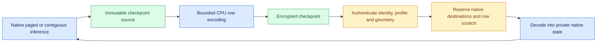
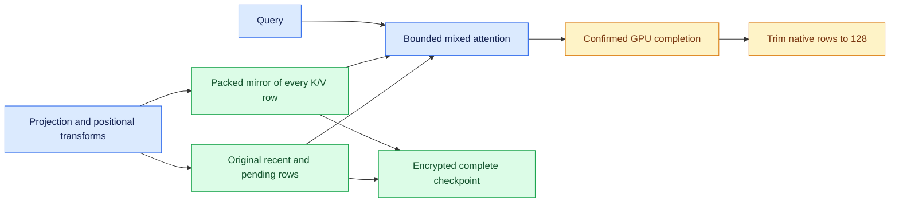

# KV execution and checkpoint quantization

> Last updated: 2026-10-24

The provider defaults to native attention execution and independently requests
`balanced` storage for eligible encrypted checkpoints. Explicit live packed
execution remains available. This page explains the numerical and ownership
contracts, not completed model qualification or a release. The
[CLI reference](../provider/cli-reference.md#providertoml-keys-read-by-the-cli)
owns the controls and their defaults.

## Context

Attention history consumes unified memory and encrypted SSD write capacity,
but reducing one does not establish a reduction in the other. Weight
quantization determines neither live KV nor checkpoint precision. The provider
resolves attention geometry and native FP16, BF16 or FP32 storage from the
loaded model, then selects live execution and checkpoint encoding separately.
MiMo's SDK-owned path remains native for both.

## Mechanism

### Native execution with quantized checkpoints

Checkpoint selection does not change `EngineV2KVBackendPolicy`'s native
`auto`, paged or contiguous execution choice, live row costs or decode-chaining
capability. The SDK's `EngineV2` accepts optional `checkpointQuantization`
beside `completePrefixCache`; `nil` preserves its existing checkpoint behavior.
`CBv2CompleteCheckpointStorageQuantization.resolve` determines eligibility from
actual layer geometry, native types, paged configuration and assistant state
before the provider constructs a storage identity.

Eligible native paged and contiguous checkpoints use bounded CPU row encoding
on export and decode directly into native destinations on import. They use the
affine/rotation profile described below, not live mixed-attention kernels.
Each encoded head stores older coded rows followed by its exact native recent
band; it does not store a redundant packed mirror of that band. Recurrent,
convolution and permitted auxiliary state remain native. The
[SSD reference](../reference/ssd-kv-cache.md#complete-checkpoint-payload)
defines the six separate lossy layout identities and conversion bounds.

Older reconstructed rows are approximate. Restoring FP16, BF16 or FP32 arrays
does not recover their original bits, guarantee the original continuation, or
make this a lossless cache. Re-exporting reconstructed native rows encodes them
again; no repeated-cycle equality or error-drift bound is claimed. Exact recent
rows are copied without numerical conversion.

The effective storage profile can be native even when the request is
`balanced`: unsupported dtype/geometry/profile, no eligible encoded owner,
persistent assistant state (except exact assistant history, below), Qwen4
selected-index/QSA state, MiMo and native-block diffusion retain native
encoding. Short windows and native-exempt owners stay native even when other
owners are encoded. A stateless assistant does not itself exclude storage
compression. Family and complete-cache eligibility checks still apply; fallback
does not enable a previously unsupported cache.

An assistant whose checkpoint is its own state, never re-derived from stored
target rows, declares `CBv2MTPExactHistoryPrefixCheckpointCoding`: the
Nemotron Super and GLM5-Next MTP owners. Beside a paged recurrent target its
tensors stay exact auxiliary state, as recurrent state does, in the distinct
`native-paged-affine-checkpoint-full-recurrent-mtp-v1` layout
(`CBv2CompleteCheckpointStorageQuantization.permitsLossyTarget`). Every other
persistent assistant (Qwen, Nemotron Lightning, MiMo) keeps native storage.
GLM5-Next keeps its own full-state layout: a profile codes only the older
latent rows, because its index/gate/validity row is not group-aligned and its
KDA and MTP state are auxiliary (`resolveGLM5Next`).
An explicitly live-packed pool retains its existing packed checkpoint format,
including when the separate checkpoint request is `native` or another profile.
Effective diagnostics describe that actual format, not the ignored request.

Generic contiguous historical targets can supply
`completeCheckpointKVDTypes: [DType]?` to `EngineV2`. The provider passes its
bounded loaded-model observation; the table cannot override a conflicting
model declaration or package-issued native binding. Explicit observed types
also enable the separate exact-native contiguous historical format. Omitting
both new SDK inputs leaves previously ineligible symmetric contiguous targets
ineligible (`EngineV2.swift`, `CompleteCheckpointCodec.swift`).

### Optional live packed execution

An explicit live `balanced`, `k8v4` or `k8v8` setting selects the existing
packed execution path. A persisted live setting is not reinterpreted as a
checkpoint setting.

`balanced` uses four-bit keys and values, affine groups of 64, and FP32 scale
and offset metadata. Keys receive a deterministic normalized signed Hadamard
rotation after projection and positional transforms. Its block width is the
smaller of 128 and the largest power-of-two divisor of the key width. Queries
use that basis when reading packed history; values keep their original basis.
The newest 128 confirmed tokens and all current prefill/speculative tokens
retain their original native values. Attention combines both representations
within bounded online-softmax tiles, without expanding full history.

Windows of at most 128 tokens stay native. Longer windows use packed backing;
an oversized prefill preserves the bounded pre-write window before ring writes.
Shared layers borrow the owner's storage and do not allocate another cache.
Qwen4 compact sparse attention decodes only selected historical rows, inversely
rotates keys and overlays original recent rows; it keeps the existing sparse
selection and bounds the decoded output to that selection.
Recurrent, convolution and assistant state stay native. When Gemma's assistant
is active, its last owning full and sliding target rows also stay native because
the assistant reads those arrays directly. Remaining eligible Gemma rows use
the selected profile.

DiffusionGemma reads packed committed history alongside its native ephemeral
canvas. A denoising pass does not append canvas state; encoder commits occur
only after their actual evaluation completes. Ordinary quantized decode does
not chain a successor while its predecessor's native generation retires.
Adaptive MTP uses the measured isolated ordinary-decode baseline when that
backend cannot chain. Native targets retain their measured chained-commit
baseline (`CBv2MTPRoundDriver.build`, `PagedKVBackend.supportsOrdinaryDecodeChaining`).
Vision-capable DiffusionGemma pools quote the existing whole-visual-block bound
before allocation; the text chunk and canvas bounds remain independently
enforced (`DiffusionGemmaPrefillGeometry.maximumVisualBlockTokens`,
`DiffusionGemmaProviderBridge.makePagedConfiguration`).

Before constructing a live-packed Diffusion engine, the provider runs the
existing child/parent kernel preflight for the SDK's Diffusion layer kinds and
selected precision. Its heartbeat includes the actual engine's maximum
native-recent feasibility bound in each active or prospective request quote.
This conservative reporting allowance adds no physical reservation;
request-sized admission and native allocation accounting remain authoritative
(`DiffusionGemmaProviderBridge.make`, `CBv2NativeBlockEngine.maximumNativeRecentFeasibilityBytes`).

## Invariants

1. **Native restore reserves native memory.** Compressed file bytes price IO,
   not the restored serving footprint. Import admits native pages or
   contiguous-capacity arrays, native auxiliary state and bounded conversion
   scratch before allocation. Immutable export sources and failed/cancelled
   destinations retain their owners until actual completion
   (`CompleteCheckpointImportPlan.swift`, `NativeQuantizedCheckpointRestore.swift`,
   `NativeQuantizedCheckpointTensorSource.swift`).
2. **Actual live storage owns admission.** For live-packed pools, physical rows
   include codes and metadata for every stored token, plus the original native
   recent/pending band.
   Segment padding, poison pages, native generations and bounded workspace
   are charged before allocation and retained through completion. Existing
   weight, OS, activation and minimum serviceability safeguards remain in
   force (`PagedKVQuantizationAdmission.swift`, `PagedKVNativeRecent.swift`,
    `PagedQuantizedAttentionWorkspace.swift`). `EngineV2` derives packed rates
    and an original-band feasibility policy at construction. `canEverFit`
    prices overlapping native generations for the actual request size rather
    than charging every request for the maximum configured prefill. The
    caller's independent allowance remains additive exactly once; this
    feasibility policy does not replace runtime reservations for owners or
    attention workspace.
3. **Live-packed history is not requantized on restore.** Both the packed mirror
   and the exact native recent band enter each complete checkpoint. Its two
   K/V byte streams contain all packed rows per head, then the native band.
   The mirror of that band is ready when its tokens age out; import invokes no
   second encoder (`QuantizedCheckpointLayout.swift`,
   `PagedCheckpointTensorSource.swift`, `PagedCheckpointStorage.swift`).
   Packed historical attention capture offers only a whole prefill step's
   frontier. Interior stride/hint cuts are omitted because cold inference
   still reads that step's original pending rows, whereas restored history
   retains the confirmed recent band
   ([`prepareHistorical`](../../libs/mlx-swift-lm/Libraries/MLXLMCommon/ContinuousBatchingV2/Prefix/EngineLoopV2+HistoricalCheckpoint.swift)).
4. **Private import inputs are not page credit.** Live-packed native-band DTOs
   stay charged as input scratch until the active row's separately charged copy
   completes.
   Only physical page destinations transfer into the pool floor
   (`CompleteCheckpointImportPlan.swift`, `PagedCheckpointFrame.swift`).
5. **Numerical identities describe resolved storage.** Original dtype, codec
   version, key/value bits, rotation, recent length and native-owner exemptions
   enter the checkpoint identity. Exact native, lossy-to-native and live-packed
   layouts occupy distinct namespaces (`CompleteCheckpointStorageIdentity.swift`,
   `PrefixCachePolicy+CheckpointIdentity.swift`).
6. **Live and checkpoint choices stay independent.** Native live precision
   retains existing backend selection. Only explicit live packed precision
   requires paged execution and refuses an unavailable or disabled backend.
   Checkpoint compression never forces paging. MiMo resolves both choices to
   native before parsing overrides (`EngineV2KVQuantizationPolicy.swift`).

The SDK symbols above live under
`libs/mlx-swift-lm/Libraries/MLXLMCommon/ContinuousBatchingV2/`; provider identity
and policy files live under `provider-swift/Sources/ProviderCore/Inference/`.

## Failure modes

Invalid selected provider values fail parsing, except MiMo's early exclusion.
Unsupported storage geometry falls back as above; it does not change live
inference. Incompatible profile, tenant, identity or truncated checkpoint input
is refused before adoption. A reservation refusal does not write uncharged
cache bytes. Evaluation failures retain submitted owners through a real stream
drain; cleanup never evaluates failed graphs to manufacture completion.

Untyped native tensor snapshots and the resident page index have no exact
native-band restoration contract, so live-packed slots bypass those paths.
Eligible AR models retain encrypted complete packed checkpoint reuse.
DiffusionGemma's legacy resident/durable native snapshot cache returns
`unsupported_layout` for packed precision until its separate native-block
checkpoint contract supports packed state. Native live settings retain those
existing cache paths. This scope prevents lossy decoded state from being
presented as original recent values.
The SDK rejects the same unsupported Diffusion native-prefix pairing during
construction and before direct restoration, rather than partially allocating
or accumulating original tails. `PagedKVBackend.prefixReuseBackend` also
disables the generic legacy tensor cache when any owner is actually packed;
native exemptions and typed complete-checkpoint consumers retain their own
capability contracts.

Legacy native performance/deadline profiles do not qualify live-packed execution.
The paged kill switch and a same-version crash-loop guard also refuse packed
construction; set live precision to `native` to use their existing contiguous
recovery path. Model startup probes selected native and packed kernel families
in a bounded child process before populating the parent's kernel cache and
publishing storage. This makes child compiler/driver failures catchable.

### Observation and qualification

`ProductionBuild`, `EngineV2Bridge` and `EngineV2BenchmarkSession` separate
`kvQuantization` from `kvCheckpointQuantization`; the session also exposes
the actual `checkpointBackendLayout`, or `nil` when no complete store exists.
The daemon's slot posture carries these as optional local diagnostics, not new
coordinator protocol fields. An absent old observation is not proof of native
precision.

`darkbloom benchmark --runtime-generation` exercises the production AR slot
and records resolved precisions, raw output, memory and timing, but keeps prefix
caches off and therefore does not qualify checkpoint compression. Ordinary scalar
AR benchmarks use a different cache path. Native-block Diffusion benchmarks
exercise their production engine directly. Host-observed cache samples do not
measure every transient; MLX peak measurements are reported separately.

Signed scheduler-prefill decision reports use schema `4` and bind
`resolvedKVQuantization` on every measured cell and in `reproducibility` to the
constructed engine's canonical `balanced`, `k8v4`, `k8v8` or `native` profile.
The runtime snapshot's global and per-model configuration reaches construction;
an explicit environment or CLI override takes precedence, and MiMo remains
native before override parsing. The existing decision matrix accepts only
`qwen3_5_moe`; this provenance does not extend its model-family qualification
scope. Simulation leaves precision absent. Missing, unknown, mixed or
backend-incompatible live precision yields insufficient evidence. Historical
reports remain readable but cannot clear the current signed decision gate,
which rechecks the measured cells and model/source/binary identity rather than
trusting an encoded success. Global release certification remains false
([`SchedulerPrefillDecisionReport`](../../provider-swift/Sources/ProviderBenchmark/SchedulerPrefillDecisionReport.swift),
[`SchedulerPrefillDecisionKVProvenance`](../../provider-swift/Sources/ProviderBenchmark/SchedulerPrefillDecisionKVProvenance.swift),
[`SchedulerPrefillDecisionExitStatus.value`](../../provider-swift/Sources/ProviderBenchmark/SchedulerPrefillDecisionEvaluator.swift)).
They also record effective `resolvedKVCheckpointQuantization`; a cache-disabled
build's value is not evidence of a write or restore.

Storage-only quality, TTFT, TPS, checkpoint bytes and native restore memory need
separate matched-artifact runs. The
[test guide](../developer/test.md#native-inference-checkpoint-storage-qualification)
keeps exact-native controls and lossy comparisons separate. Neither a codec
ratio, tiny-model regression nor the earlier live-packed report establishes a
whole-model quality or performance guarantee for this path.

## Code map

| Concern | Owner |
|---|---|
| Independent defaults and load-time overrides | `EngineV2KVQuantizationPolicy.swift` (`resolve`, `Purpose`) |
| Model/backend composition | `EngineV2Factory+BackendPreparation.swift` (`prepareProductionBackend`) |
| Effective checkpoint eligibility and identity | `CheckpointStorageQuantization.swift`, `EngineV2SlotFactory+CompletePrefixCache.swift`, `CompleteCheckpointStorageIdentity.swift` |
| Bounded native checkpoint conversion | `NativeCheckpointRowCodec.swift`, `NativeQuantizedCheckpointTensorSource.swift`, `NativeQuantizedCheckpointRestore.swift` |
| Token-local encoding | `PagedKVQuantization.swift`, `PagedQuantizedTransfers.swift` |
| Mixed inference and masks | `PagedQuantizedAttention.swift`, `PagedQuantizedLayerOperation.swift` |
| Compact Qwen4 selected rows | `PagedQuantizedSelectedGather.swift` |
| Bounded startup compilation | `PagedQuantizedKernelSmoke.swift`, `PagedKernelPreflight.swift` |
| Native-band lifecycle | `PagedKVNativeRecent.swift`, `PagedKVQuantizedStepRetirement.swift` |
| Exact checkpoint band capture | `QuantizedCheckpointRecent.swift` |
| Packed complete formats | `CompleteCheckpointContract.swift`, `QuantizedCheckpointLayout.swift` |
| Diffusion committed cache and canvas | `DiffusionGemmaRequestCache.swift`, `DiffusionGemmaBlocks.swift`, `NativeBlockPagedExecution.swift` |

## Related

- [Native-inference checkpoint qualification](../reports/2026-10-11-native-inference-checkpoint-storage.md)
- [Inference architecture](inference.md)
- [Prefix cache architecture](prefix-cache.md)
- [SSD format reference](../reference/ssd-kv-cache.md)
- [Native-inference checkpoint design, archived original](https://github.com/Layr-Labs/d-inference/blob/f35743857cb2fd9d408617e9f9da884ad166e8e2/docs/design/native-inference-quantized-checkpoints.md)
- [Initial live-packed numerical investigation](../design/runtime-kv-compression.md)
- [Historical live-packed model and encrypted-cache qualification](../reports/2026-10-09-runtime-kv-quantization.md)
