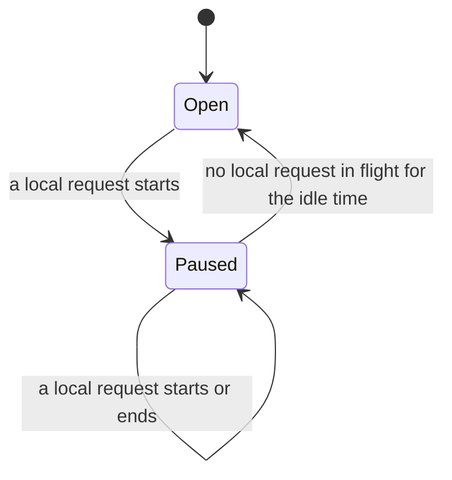

# Owner pause ("me first")

> Last updated: 2026-11-07

How a provider that serves Darkbloom and its owner from one Mac stops taking
Darkbloom work while the owner uses the Mac through its local API, and returns
once the owner is idle. This explanation is for provider developers; the wire
fields are in the [protocol reference](../reference/protocol-messages.md#add-on-hold-busy-fields).

## Context

A provider with a local endpoint beside Darkbloom shares one engine and one KV
budget between the owner's requests and Darkbloom's. The owner pause gives the
owner the Mac: Darkbloom work stops arriving while the owner uses it, nothing
already accepted is cut, and the Mac goes back to Darkbloom on its own.

It uses only signals coordinators already honour, so it needs no coordinator
change. A `draining` heartbeat takes the Mac out of routing and keeps its
uptime. The typed refusal `capacity / 503 / error_reason draining` fails a
racing request over without spending a retry or derating the Mac.

The pause is not an [add-on hold](addon-hold.md). It keeps every model loaded,
admits local requests, and never cancels work.

## Mechanism

`MeFirstPolicy` (`provider-swift/Sources/ProviderCore/Service/MeFirstPolicy.swift`)
is the pure state machine: a count of local requests in flight, when the pause
began and when the owner's last request started or ended, on a millisecond
clock the caller supplies. `ProviderLoop+MeFirst.swift` in
`provider-swift/Sources/ProviderCore/` owns one per serving process:

| API | Behaviour |
|---|---|
| `enableMeFirst(idle:)` | Turns the pause on with the owner's idle time (`[local] me_first_idle_minutes`, 2 minutes by default). The first call wins; a changed setting applies at the next start. The local endpoint calls it as it starts, where me first applies (below). |
| `noteLocalUse(.start)` | A local request acquired a model: `acquireModelForLocal` calls it right after taking the request's reservation. The first one pauses Darkbloom work. |
| `noteLocalUse(.end)` | It released the model: `releaseLocalReservation` calls it when it drops that reservation. The end of the last one starts the idle countdown. Every start is paired with one end; an unmatched end changes nothing. |
| `resumeIfOwnerIdle()` | Ends the pause once the idle time has passed. The resume timer calls it, and so does a fresh coordinator connection. |
| `meFirstSnapshot` | What `status` reads (`DaemonState.meFirst`). |

While paused:

| Concern | Behaviour |
|---|---|
| Heartbeat | `status: draining`, `busy_reason: owner`, `busy_since_ms` (`ProviderState.ownerPausesPublic`, `refusingDarkbloomWork`). An event heartbeat goes out when the pause begins |
| Coordinator inference | The typed `capacity / 503 / draining` refusal (`rejectIfDraining`), once per racing request |
| `load_model`, `prefetch_model` | The drain failures, which coordinators retry later. A coordinator preload never evicts the model the owner is using |
| Autopilot commands | Busy, with reason `draining` |
| Capacity quotes | Refused with `slot_state` |
| `desired_models` | Deferred; replayed when the pause ends |
| Darkbloom work accepted before the pause | Finishes normally; never cancelled |
| Local requests and models | Admitted and kept as usual |
| A fresh registration | `register` carries the owner's busy fields, and the connection's first event heartbeat repeats the draining status |

When the idle time has passed with no local request in flight, the provider
clears the flag, sends an `idle` or `serving` event heartbeat, and replays the
deferred `desired_models`.

### Where it applies

`startLocalEndpoint` (`provider-swift/Sources/ProviderCore/ProviderLoop+LocalEndpoint.swift`)
calls `enableMeFirstIfConfigured` before the endpoint can take a request. It
turns me first on with the idle time `ProviderLoopConfig.meFirstIdle` gives,
which reads `[local]` from the loaded config through
`LocalSettings.meFirstIdle(local:localEndpoint:)`
(`provider-swift/Sources/ProviderCore/Config/LocalSettings.swift`):

| Provider | Me first |
|---|---|
| `start --local-endpoint`: the local endpoint beside the coordinator | On, mode `both`, unless `[local] me_first = false`; idle `me_first_idle_minutes` (default `2`) |
| The same with `[local] me_first = false`, or a saved `mode` other than `both` | Off: local and Darkbloom requests share the Mac, and the heartbeat is unchanged |
| Plain `start`, and a cluster member | Off: no local endpoint |
| `start --local` (`StandaloneServer`) | None: no coordinator, so no `ProviderLoop` and nothing to pause |

### What counts as use

The owner's use is the local request's model reservation: from the moment
`acquireModelForLocal` takes it until `releaseLocalReservation` drops it. The
request's `OneShotRelease` drops it exactly once, whether the request
completes, fails, is cancelled or its client disconnects. Every route that
uses a model goes through that acquisition, so no route list is kept:

| Request | Counts |
|---|---|
| Chat completions (streamed or not), completions, responses and the batch route, including Nemotron Super's managed chat | Yes, while it holds the model; a stream holds it until its last token |
| A request refused after it took the model, such as an invalid `tool_choice` | Yes, briefly |
| A request refused before it holds a model: a model this Mac does not serve (404), a load refused (429), a drain or shutdown, or cancelled while its model loads | No |
| `/v1/models`, `/models`, `/health`, `/v1/health`, `/props`, `/metrics`, `/tokenize`, `/detokenize`, `/apply-template` | No: they hold no model |
| The startup self-test decode | No: it reserves the model directly, without the hooks |

## Cost

The pause is event-driven:

- A local request's start and end are O(1) updates of the policy: no I/O, no
  heartbeat, no task. They run in the same actor turn as the reservation and
  its release, once per request, never per token.
- Heartbeats go out only when the pause begins and ends, beside the usual
  baseline. The daemon state file is written on the same transitions.
- The one timer is armed when the owner's idle time starts counting. It sleeps
  until the deadline, wakes at most once per idle time while the owner keeps
  working, and is gone once the pause ends.
- The coordinator and quote paths read one more flag under the lock they
  already take. Nothing runs per token.
- With me first off, `noteLocalUse` returns at once, and no timer or task exists.

## Invariants

1. An add-on hold outranks the pause. While both apply, the busy fields
   describe the hold. Its release hands them back to the pause, which goes on
   (`publishBusy`, `ProviderBusy.publishing`).
2. Only the end of the last drain, hold or pause replays `desired_models`. An
   update, model switch or hold that ends during the pause leaves them
   deferred, and a pause that ends under a drain or hold leaves them to it
   (`replayDesiredModels`).
3. Local admission never reads the pause: `throwIfRefusingNewLocalWork` is
   unchanged, and `ProviderState.refusingNewWork` stays apart from
   `ownerPausesPublic`.
4. A clock that goes back restarts the countdown from the new time, so the
   pause outlasts the jump by one idle time at most.
5. The pause cancels nothing. It has no drain bound: Darkbloom work accepted
   before it runs to the end, unlike under an add-on hold.

## Known gaps

- **A model switch during the pause can report an unconfirmed result.** After
  a switch, the coordinator reopens routing only on an `idle` or `serving`
  heartbeat ([model replacement](../reference/protocol-messages.md#models_replace--models_replace_ack--models_replace_ready--models_replace_resumed)),
  and every heartbeat of the pause says `draining`. If the pause outlasts the
  provider's 30-second readiness wait (`resumeAfterModelSwitch`), `switch`
  reports "Model selection applied locally, but coordinator routing readiness
  is unconfirmed". The selection is applied, and the heartbeat that ends the
  pause reopens routing.
- **Model revision activations and MTP idle upgrades** don't wait for the
  pause. They wait for an idle model, so one can start in a gap between the
  owner's requests.
- **The owner's own coordinator requests** (`X-Darkbloom-Route: self` or
  `prefer`) look like public work to the provider. They don't pause the Mac,
  and while it is paused they don't reach it: `self` waits (on today's
  coordinator up to 120 seconds, then `429 machine_busy`), and `prefer` goes
  to other Macs.

## Tests

`MeFirstPolicyTests` pins the edges on a fake clock, including an idle time of
one minute at 59.9 s and 60 s and the two-minute default at 119.9 s and 120 s.
`OwnerPauseLoopTests` drives the loop without a serve loop, and
`OwnerPauseWireTests` checks the heartbeats on the wire against the loopback
mock coordinator. These loop tests skip the capacity rebuild
(`capacityRebuildForTesting`), which reads MLX's Metal allocator, so they run
without the GPU.

`MeFirstSettingsTests` pins where me first applies. `LocalUseOwnerPauseTests`
sends requests through the local endpoint's own HTTP application
(`makeLocalEndpointApplication`) to a slot whose engine the test scripts:
the pause and the resume, refused requests and the routes that are not use,
`me_first = false` with the heartbeat compared byte for byte, one start and
one end per request however it ends, and nothing per token.
