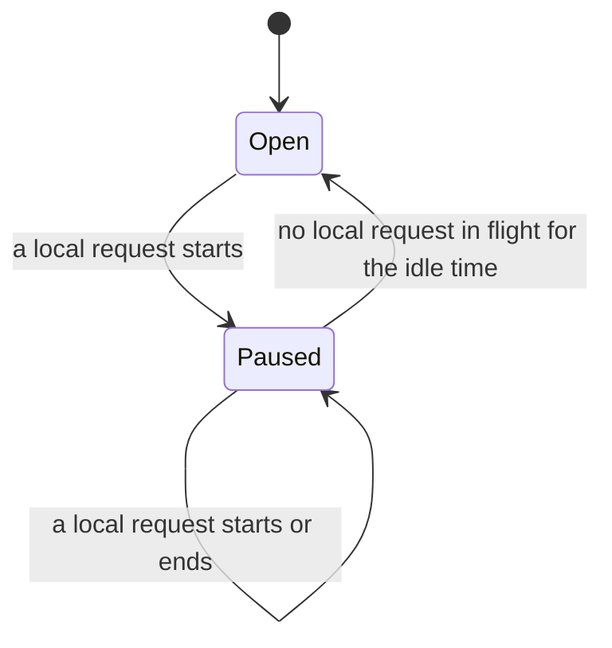

# Owner pause ("me first")

> Last updated: 2026-11-07

How a provider that serves Darkbloom and its owner from one Mac stops taking
Darkbloom work while the owner uses the Mac through its local API, and returns
once the owner is idle. This explanation is for provider developers; the wire
fields are in the [protocol reference](../reference/protocol-messages.md#add-on-hold-busy-fields).

## Context

A provider with a local endpoint beside Darkbloom shares one engine and one KV
budget between the owner's requests and Darkbloom's. The owner pause gives the
owner the Mac: Darkbloom work stops arriving while the owner uses it, nothing
already accepted is cut, and the Mac goes back to Darkbloom on its own.

It uses only signals coordinators already honour, so it needs no coordinator
change. A `draining` heartbeat takes the Mac out of routing and keeps its
uptime. The typed refusal `capacity / 503 / error_reason draining` fails a
racing request over without spending a retry or derating the Mac.

The pause is not an [add-on hold](addon-hold.md). It keeps every model loaded,
admits local requests, and never cancels work.

## Mechanism



`MeFirstPolicy` (`provider-swift/Sources/ProviderCore/Service/MeFirstPolicy.swift`)
is the pure state machine: a count of local requests in flight, when the pause
began and when the owner's last request started or ended, on a millisecond
clock the caller supplies. `ProviderLoop+MeFirst.swift` in
`provider-swift/Sources/ProviderCore/` owns one per serving process:

| API | Behaviour |
|---|---|
| `enableMeFirst(idle:)` | Turns the pause on with the owner's idle time (`[local] me_first_idle_minutes`, 2 minutes by default). The first call wins; a changed setting applies at the next start. A pair's leader enables it from `[local]` ([pairs](#pairs)); a single Mac's local endpoint hooks come separately. |
| `noteLocalUse(.start)` | A local request acquired a model. The first one pauses Darkbloom work. |
| `noteLocalUse(.end)` | It released the model. The end of the last one starts the idle countdown. Every start is paired with one end; an unmatched end changes nothing. |
| `resumeIfOwnerIdle()` | Ends the pause once the idle time has passed. The resume timer calls it. A fresh coordinator connection makes the same check before its first heartbeat (`reassertOwnerPauseAfterReconnect`). On a pair's leader the member beat calls it too. |
| `meFirstSnapshot` | What `status` reads (`DaemonState.meFirst`). |

While paused:

| Concern | Behaviour |
|---|---|
| Heartbeat | `status: draining`, `busy_reason: owner`, `busy_since_ms` (`ProviderState.ownerPausesPublic`, `refusingDarkbloomWork`). An event heartbeat goes out when the pause begins |
| Coordinator inference | The typed `capacity / 503 / draining` refusal (`rejectIfDraining`), once per racing request |
| `load_model`, `prefetch_model` | The drain failures, which coordinators retry later. A coordinator preload never evicts the model the owner is using |
| Autopilot commands | Busy, with reason `draining` |
| Capacity quotes | Refused with `slot_state` |
| `desired_models` | Deferred; replayed when the pause ends |
| Darkbloom work accepted before the pause | Finishes normally; never cancelled |
| Local requests and models | Admitted and kept as usual |
| A fresh registration | `register` carries the owner's busy fields, and the connection's first event heartbeat repeats the draining status. A pause whose idle time passed while the connection was down ends first, so that one heartbeat says `idle` or `serving` |

When the idle time has passed with no local request in flight, the provider
clears the flag, sends an `idle` or `serving` event heartbeat, and replays the
deferred `desired_models`.

## Pairs

A pair served through Darkbloom has one owner pause, on its leader: the member
that hosts the pair's slot and runs the pair's local API beside Darkbloom
([the pair's leader takes local requests](inference.md#the-pairs-leader-takes-local-requests-beside-darkbloom)).
The rule is "the process that owns the local API owns the pause"
(`provider-swift/Sources/ProviderCore/ProviderLoop+ClusterPairMeFirst.swift`).

```mermaid
sequenceDiagram
  participant Owner as Owner's tool
  participant Leader as Leader member (slot and local API)
  participant Coord as Coordinator
  participant Member as Every other member
  Owner->>Leader: local request starts waiting for a lane
  Leader->>Coord: event heartbeat: draining, busy_reason owner
  Note over Coord: the pair is not routable; its session stays
  Coord--xLeader: racing dispatch
  Leader->>Coord: capacity / 503 / draining
  Owner->>Leader: last local request ends
  Note over Leader: 2 idle minutes (resume timer, member beat)
  Leader->>Coord: event heartbeat: idle or serving, no busy fields
  Note over Member: control-only draining heartbeat, unchanged throughout
```

| Concern | Behaviour |
|---|---|
| Turning it on | `prepareClusterMemberControl` calls `enableClusterPairMeFirstIfConfigured` once `run()` admits the leader's local API, before the API can take a request. It is on unless `[local]` says `me_first = false`, with `[local]`'s idle time. Whatever single-Mac `mode` `[local]` saved, a leader's local API beside Darkbloom serves both |
| The owner's use | `noteClusterPairLocalUse` forwards to `noteLocalUse` once per local request: from when it starts waiting for one of the pair's lanes, or takes one at once, until it leaves without one or releases it. So the pause begins before the request can wait behind Darkbloom work, and a request refused while the pair isn't serving never counts |
| Heartbeat | The leader's: `draining` with `busy_reason: owner`, beside its unchanged `cluster_session` |
| Racing dispatches | The leader's client forwards them while the slot exists, and `rejectIfDraining` refuses them with `capacity / 503 / draining` before they reach the pair |
| The idle time | The resume timer, and the member beat (`clusterMemberHeartbeat`, every 5 s), because a member runs no idle monitor. A stopping leader cancels the timer |
| Every other member | Untouched. It runs no local API, so nothing calls the hook and me first stays off; its heartbeat stays control-only `draining` with no busy fields |
| Ranks | Nothing counts them: the leader is the slot's host, a role, not a rank |
| `darkbloom cluster local` | Unchanged: no member loop and no coordinator, so nothing to pause |

What the deployed coordinator does with a draining leader:

- It stops routing to the whole pair, the owner's own `self` and `prefer`
  requests included.
- It keeps the pair's session: membership is an identity and trust decision,
  not an admission one, and only a committed `provider_drain` barrier ends a
  pair.
- As for any pair drain today, the pair's reward uptime stops while the leader
  drains. A single Mac keeps its uptime while paused.

## Cost

The pause is event-driven:

- A local request's start and end are O(1) updates of the policy: no I/O, no
  heartbeat, no task.
- Heartbeats go out only when the pause begins and ends, beside the usual
  baseline.
- The end of the pause writes the daemon state file at once. Its start doesn't:
  the start lands on the owner's request, and the loop already rewrites the
  file every 2 s while serving, so `status` shows the pause within 2 s, as it
  shows the request counts.
- The one timer is armed when the owner's idle time starts counting. It sleeps
  until the deadline, wakes at most once per idle time while the owner keeps
  working, and is gone once the pause ends.
- The coordinator and quote paths read one more flag under the lock they
  already take. Nothing runs per token.
- With me first off, `noteLocalUse` returns at once, and no timer or task exists.
- On a pair's leader, the member beat that already runs every 5 seconds adds
  one O(1) check, and the hook adds one call to each local request.

## Invariants

1. An add-on hold outranks the pause. While both apply, the busy fields
   describe the hold. Its release hands them back to the pause, which goes on
   (`publishBusy`, `ProviderBusy.publishing`).
2. Only the end of the last drain, hold or pause replays `desired_models`. An
   update, model switch or hold that ends during the pause leaves them
   deferred, and a pause that ends under a drain or hold leaves them to it
   (`replayDesiredModels`).
3. Local admission never reads the pause: `throwIfRefusingNewLocalWork` is
   unchanged, and `ProviderState.refusingNewWork` stays apart from
   `ownerPausesPublic`.
4. A clock that goes back restarts the countdown from the new time, so the
   pause outlasts the jump by one idle time at most.
5. The pause cancels nothing. It has no drain bound: Darkbloom work accepted
   before it runs to the end, unlike under an add-on hold.
6. The pause belongs to the serving process and isn't saved, unlike an add-on
   hold. A restart or update during a pause comes back open, and the owner's
   next request pauses again.

## Known gaps

- **`darkbloom switch` during the pause can exit with an error, though the
  switch completes.** After a switch, the coordinator reopens routing only on
  an `idle` or `serving` heartbeat ([model replacement](../reference/protocol-messages.md#models_replace--models_replace_ack--models_replace_ready--models_replace_resumed)),
  and every heartbeat of the pause says `draining`. If the pause outlasts the
  provider's 30-second readiness wait (`resumeAfterModelSwitch`), `darkbloom
  switch` exits with the error "Model selection applied locally, but
  coordinator routing readiness is unconfirmed". The new selection is already
  serving locally, and the heartbeat that ends the pause reopens Darkbloom
  routing to it: nothing needs redoing.
- **Model revision activations and MTP idle upgrades** don't wait for the
  pause. They wait for an idle model, so one can start in a gap between the
  owner's requests.
- **The owner's own coordinator requests** (`X-Darkbloom-Route: self` or
  `prefer`) look like public work to the provider. They don't pause the Mac,
  and while it is paused they don't reach it: `self` waits (on today's
  coordinator up to 120 seconds, then `429 machine_busy`), and `prefer` goes
  to other Macs.

## Tests

`MeFirstPolicyTests` pins the edges on a fake clock, including an idle time of
one minute at 59.9 s and 60 s and the two-minute default at 119.9 s and 120 s.
`OwnerPauseLoopTests` drives the loop without a serve loop, and
`OwnerPauseWireTests` checks the heartbeats on the wire against the loopback
mock coordinator. `ClusterPairMeFirstTests` covers pairs with a scripted pair
owner: the leader's heartbeat, the racing refusal, work in flight, the member
beat's two minutes on a fake clock, a roster of three ranks, me first off and
the cost. These loop tests skip the capacity rebuild
(`capacityRebuildForTesting`), which reads MLX's Metal allocator, so they run
without the GPU.
