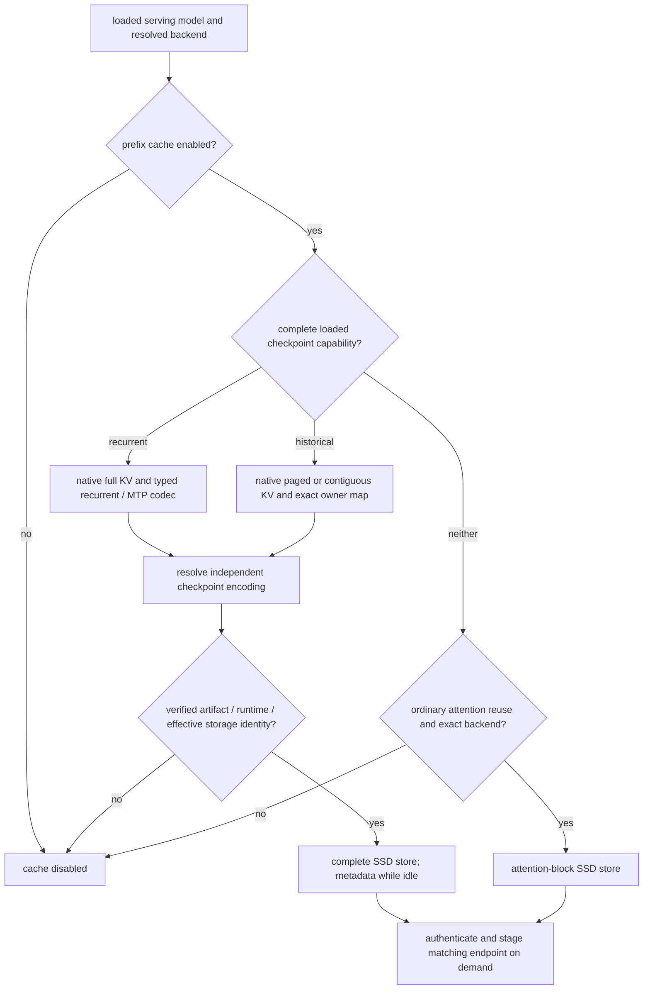

# KV cache layouts and prefix caching

> Last updated: 2026-10-28

How the provider lays out a request's KV cache, how it decides whether a
previously computed prefix can be reused, and where reusable state lives:
encrypted SSD checkpoints by default, with resident paged blocks and recurrent
checkpoint banks available through an explicit memory opt-in.
Read this to understand why a box
serves a repeated prompt cold or warm; for the file format and every SSD knob
see [`../reference/ssd-kv-cache.md`](../reference/ssd-kv-cache.md), and for the
coordinator's use of cache state in routing see
[cache-aware-routing.md](https://github.com/Layr-Labs/darkbloom-platform/blob/48a198c71a2d30feec5597bacf1101120f7f955d/docs/architecture/cache-aware-routing.md).

## Context

CBv2 owns one KV cache per running request. Two backends exist; the choice is
made per slot at load time and fixed for the slot's life. Prefix reuse seeds
a new request's KV from an earlier request with the same authenticated token
prefix and compatible model, layout and numerical identity. Native-exact
checkpoints preserve captured state; independently quantized checkpoints
reconstruct approximate older attention rows into native state. These are
distinct contracts, not interchangeable forms of exact replay; see
[execution and checkpoint precision](kv-cache-quantization.md).
Paged resident reuse shares physical pages within the existing pool when opted
in. Dense and MoE Qwen restore complete recurrent checkpoints streamed from
SSD. Loaded historical-attention capabilities allow full/window checkpoints
for GPT-OSS and Gemma on eligible native paged or contiguous storage. Optional
resident banks use the slot KV grant.
SSD snapshots survive beyond a request without retaining their KV in resident memory
(`provider-swift/Sources/ProviderCore/Inference/PrefixCache/PrefixCachePolicy.swift`,
`provider-swift/Sources/ProviderCore/Inference/PrefixCache/PrefixCachePolicy+Hybrid.swift`).

## Mechanism

### KV layouts

This table describes native live execution, now the default. Optional
[live-packed precision](kv-cache-quantization.md#optional-live-packed-execution)
still requires paged execution. The independent checkpoint request does not
change backend selection or native serving-memory charges.

| | Contiguous | Paged |
|---|---|---|
| Type | `CBv2ContiguousKVBackend`, `EngineV2KVBackendKind.contiguous` | `PagedKVBackend`, `EngineV2KVBackendKind.paged`; `PagedKVPool.pageSize = 16` tokens |
| Selected by | Explicit `"contiguous"`, `"auto"` outside the exact candidate allowlist, or fallback | Explicit `"paged"` (global or `engine_v2_kv_backend_by_model`), or candidate `"auto"` for the exact IDs below, subject to policy gates |
| Memory | Per-request grant reserved at admission in `GlobalKVCacheBudget` | Production starts with empty segmented storage under the admitted slot grant; native admission reserves growth before allocation and retains live owners across grant changes. Actual committed backing is reported separately. |
| On failure | — | Under `auto`: degrade to contiguous with a `fallback:<why>` reason; under explicit `paged`: refuse the load with `EngineV2ProductionError.pagedUnavailable` (503) |
| Prefix-reuse backend | `.contiguousUnquantized` | `.pagedFP16` |

The default setting remains `"auto"`. In the candidate, it prefers paged only
for these exact fleet/candidate identities, not family names, aliases or substrings:

- `Qwen3.5-9B` (the production catalog ID, matched case-sensitively; the
  lowercase `qwen3.5-9b` and the `Qwen/Qwen3.5-9B` repo path are not listed)
- `qwen3.5-35b-a3b`
- `qwen3.6-35b-a3b-vl-mtp-mxfp8`
- `EigenLabs/Qwen3.8-27B-4bit-mtp`
- `gpt-oss-20b`
- `gemma-4-26b-qat-4bit`
- `nvidia-nemotron-3.5-lightning`
- `EigenLabs/NVIDIA-Nemotron-3.5-Lightning-30B-A3B-MLX-4bit-mtp`
- `mlx-community/NVIDIA-Nemotron-3.5-Lightning-30B-A3B-4bit` (target-only artifact)
- `nvidia-nemotron-3.5-lightning-hybrid8` and `nvidia-nemotron-3.5-lightning-4bit-r1` (concrete builds behind the public Nemotron name during the mixed-precision rollout; same checkpoint contract)
- `ternary-bonsai-2-27b`
- `EigenLabs/Ternary-Bonsai-2-27B-MLX-2bit`
- `prism-ml/Ternary-Bonsai-2-27B-mlx-2bit`
- `prism-ml/Ternary-Bonsai-2-9B-mlx-2bit` (separate 9B policy)
- `EigenLabs/Ternary-Bonsai-2-9B-MLX-2bit` (same separate 9B policy)
- The [owned Flash-Next candidate](../reference/qwen4-next-support.md#identity-and-serving-policy)

Every other ID, including unlisted Qwen artifacts, Gemma 8-bit and unknown
models, resolves contiguous under `auto`. Per-model configuration still overrides
the global setting, and explicit `"contiguous"` keeps a cohort model contiguous
(`provider-swift/Sources/ProviderCore/Inference/Engine/EngineV2KVBackendPolicy.swift`,
`parseSelection`, `preferredBackend`; called by `prepareProductionBackend` in
`provider-swift/Sources/ProviderCore/Inference/Engine/Factory/EngineV2Factory+BackendPreparation.swift`).

Slot policy can force contiguous when a VLM cache lacks span-mask support
(`EngineV2KVBackendPolicy.applySlotVetoes`). The factory then applies model
capability (`supportsPagedKV == false`, reason `model_capability`), the
negative-only `DARKBLOOM_CBV2_PAGED_KV` kill switch, and the version-scoped
crash-loop guard in that order. The crash-loop guard applies only to `auto`,
returning eligible cohort models to contiguous while its version matches.
Clearing it restores automatic selection on the next model load, not guaranteed
paged service. Capability/span-mask vetoes and the kill switch can also override
an explicit `paged` selection; the crash-loop guard cannot. Automatic paged
construction failures fall back to contiguous with a reason; the same failures
refuse an explicit `paged` load. Paged construction runs
`PagedKernelPreflight` in a child process (`defaultChildTimeout = 120 s`,
`DARKBLOOM_NO_UPDATE_CHECK=1` injected), then constructs an empty segmented
backend with the already admitted slot grant. There is no separate eager-pool
budget. Segment, buffer and kernel address limits remain native checks
(`provider-swift/Sources/ProviderCore/Inference/Engine/Factory/EngineV2Factory+SegmentedBackend.swift`,
`makeSegmentedPagedBackend`; `PagedKernelPreflight.swift`). Grant derivation,
shrink/regrow and live-memory gates are explained in
[KV slot grants](hardware-support.md#kv-slot-grants).
Paged construction also probes the loaded target's actual K/V after two prefill
tokens and one decode token. Its per-layer native types govern storage and
admission; a nonempty `DARKBLOOM_CBV2_PAGED_KV_DTYPE` (`float16` or `float32`)
must match every observed layer. The probe rejects asymmetric or changing K/V
types. Dense and MoE Qwen targets require both this table and segmented storage
(`requiresNativePagedKV`); they no longer have an unconditional paged veto.
Complete Qwen checkpoints support native contiguous and segmented paged storage.
Historical attention checkpoints require an exact loaded layer/owner/type map;
contiguous construction additionally receives the observed
`completeCheckpointKVDTypes`. Ordinary attention snapshots remain a separate codec.

**Release acceptance remains incomplete.** The [final versioned build](https://github.com/Layr-Labs/d-inference/blob/4230fa03ddbc84e34e2de150c89431744d6f1c55/docs/reports/2026-09-07-release090-final-build.md),
[Qwen 3.5/3.6 concurrency checks](https://github.com/Layr-Labs/d-inference/blob/4230fa03ddbc84e34e2de150c89431744d6f1c55/docs/reports/2026-09-07-qwen-concurrency-final.md)
and [memory lifecycle checks](../reports/2026-09-06-coresidency-lifecycle.md)
record completed validation. Final sustained, connected-serving, quality and
production-key restart checks remain subject to the
[acceptance criteria](https://github.com/Layr-Labs/d-inference/blob/4230fa03ddbc84e34e2de150c89431744d6f1c55/docs/design/release-090-acceptance.md).
This selection change is not a release or deployment claim. SSD prefix reuse
defaults on for the exact Qwen, Nemotron Lightning and Bonsai 2 IDs above,
`gemma-4-26b-qat-4bit`, `gpt-oss-20b`, the exact MiMo identities below and the
managed `nvidia-nemotron-3.5-super` slot, whose complete checkpoints replace
its resident bank unless the operator selects the bank (see
[`inference.md`](inference.md#managed-nemotron-super-slot)).
GPT-OSS 20B and Gemma QAT normally use paged historical-attention checkpoints;
eligible native contiguous fallback uses a distinct complete layout rather than
reinterpreting the paged file. Gemma automatic MTP resolves its catalog
assistant through `SpecDecArtifactFunnel`. An explicit affirmative
`DARKBLOOM_PREFIX_CACHE` opts other models into their existing cache eligibility
checks; a non-affirmative nonempty value disables all tiers. Both SSD codecs,
local/connected load hashing and benchmark expectations use the model-scoped
`PrefixCachePolicy.isEnabled(modelId:environment:)` gate in
`provider-swift/Sources/ProviderCore/Inference/PrefixCache/PrefixCachePolicy+Activation.swift`.
Resident retention remains off unless explicitly enabled through the separate
memory flag (`PrefixCachePolicy.isMemoryEnabled`).

### Unregistered GLM sparse-state candidate

`GLM5NextPagedSparseState` owns aligned latent, index-key, pool-gate, validity
and position history in the native candidate. Its checkpoint includes partial
pages; opt-in `PagedImmutableSnapshot` ownership requires copy-on-write before
successor writes. The contiguous transaction owner is a separate baseline, not
proof of paged execution
(`libs/mlx-swift-lm/Libraries/MLXLMCommon/ContinuousBatchingV2/GLM5Next/GLM5NextPagedSparseState.swift`,
`libs/mlx-swift-lm/Libraries/MLXLMCommon/ContinuousBatchingV2/Paged/PagedImmutableSnapshot.swift`).

The full-state codec adds the distinct
`native-paged-glm5next-full-state-v2` layout, preserving the asymmetric payload
and exact convolution/recurrence state
(`libs/mlx-swift-lm/Libraries/MLXLMCommon/ContinuousBatchingV2/Prefix/GLM5Next/`).
Roles that only widen an activation dtype are stored at that dtype and widened
back exactly on restore; the
[SSD reference](../reference/ssd-kv-cache.md#complete-checkpoint-payload) lists
the roles, their wire dtypes and the retired v1 layout. Under the default
`balanced` checkpoint precision the protected tuple binds the distinct
`native-paged-glm5next-affine-checkpoint-full-state-v1` store instead: older
latent rows are coded and restore approximately, while the index/gate/validity
rows, KDA state and MTP history restore exactly
([checkpoint precision](kv-cache-quantization.md#native-execution-with-quantized-checkpoints)).
Its existence does not add a qualified provider cache capability. Complete reuse
still requires one accepted frontier across sparse pages, convolution/recurrence
and trained MTP, charged import/export ownership, the protected native binding,
and a verified encrypted restore path. For the locally selected
`EigenLabs/GLM-5.3-Flash-MLX-NVFP4-mtp`, SSD eligibility defaults on
(`PrefixCachePolicy.isGLM5NextDefaultModel`) and binds the protected tuple's
full-state store; `DARKBLOOM_PREFIX_CACHE=0` opts out. GLM remains outside the
registered coordinator serving models; see the
[integration gates](../design/glm53-flash-native.md). Existing families' opt-in
and recovery policies above are unchanged.

### MiMo complete state

SSD eligibility defaults on only for `mimo-v2.6-flash-mopd` and
`EigenLabs/MiMo-V2.6-Flash-MOPD-MLX-4bit-mtp`, matched exactly by
`PrefixCachePolicy.isMiMoDefaultModel` in
`provider-swift/Sources/ProviderCore/Inference/PrefixCache/PrefixCachePolicy+Activation.swift`.
The normal native MiMo path stays contiguous and uses encrypted text-only
COMPLETE checkpoints, including native assistant state when MTP is active.
The factory retains verified artifact/runtime identity, tenant, dtype, store,
loaded-owner and memory-budget checks. Missing reusable state serves cold.
The native connected loader and standalone load-hash policy use the same
MiMo-specific activation decision, so an opt-out does not request fresh hash
reads solely for cache construction. Independent attestation, artifact and
fingerprint-change verification still apply.

`DARKBLOOM_MIMO_COMPLETE_PREFIX=0` disables this path;
`DARKBLOOM_PREFIX_CACHE=0` disables all prefix caching. The MiMo switch's exact
parsing and launchd passthrough are in the
[configuration reference](../reference/configuration.md#native-mimo-v26-candidate).
Image, audio and video requests keep the joint contiguous media profile and
remain uncached. This default does not enable RAM retention, native paging or
rectangular verification. Enabling source policy is not evidence of cache hits
or full-artifact qualification; use the [release acceptance steps](../operations/provider-release.md).

### Bonsai complete state

The 9B identity independently defaults to paged attention and SSD prefix
caching; it does not join the 27B admission or MTP cohort. The qualification
configuration selects native live KV and native checkpoint precision. Runtime
capability, authenticated cache identity, key availability, operator opt-outs
and write-budget checks still apply. Ordinary 9B vision submissions remain
ineligible for prefix reuse; a warm model is not a cache hit.
The optional explicit local 9B MTP binding retains the native Qwen text model's
cache identity and complete assistant checkpoints; see
[inference policy](inference.md) and `PrismHadamardQwen35.cbv2MTPTargetIdentity` in
`libs/mlx-swift-lm/Libraries/MLXVLM/Models/PrismHadamardQwen35.swift`.
Plain, serial-MTP and rectangular-MTP restoration require separate actual-model
qualification; identity forwarding alone does not establish cache parity.

Bonsai uses the existing complete-checkpoint path to restore attention KV and
recurrent state together. `EngineV2SupportedModels.isBonsai2ListingModelID`
selects the three exact MLX identities above for default SSD eligibility; the
GGUF repository, marketplace slug and near-matching names remain outside this
default. `PrefixCachePolicy.requiresLoadHashBracket` requires fresh hashes around
standalone weight loading, while the connected provider preserves its hash
publication lifecycle. The loaded model, storage identity and verified hashes
still gate cache construction in `EngineV2SlotFactory`.

`BonsaiEncryptedCheckpointLiveTests` exercises an encrypted full checkpoint
with a fixture key and real weights; it does not establish signed Keychain
persistence or hosted routing readiness. Use the
[Bonsai rollout procedure](https://github.com/Layr-Labs/darkbloom-platform/blob/48a198c71a2d30feec5597bacf1101120f7f955d/docs/operations/cache-routing-rollout.md#add-bonsai-to-an-existing-routing-cohort)
to qualify the final signed artifact and add its exact coordinator tuple.

### Flash-Next complete state

Native Flash-Next uses the complete-checkpoint path, not an attention-only
prefix claim. The codec retains target KV, QSA index/positions, GDN/PLE state
and the embedded assistant's compatible history. The engine adopts
request-owned state and preserves capture/import reservations and rollback
frontiers (`libs/mlx-swift-lm/Libraries/MLXLMCommon/ContinuousBatchingV2/Prefix/CompleteCheckpointQwen4.swift`).
`EngineV2SlotFactory` and `PrefixCachePolicy+LoadHash.swift` require loaded
capabilities, the resolved storage identity and a verified load hash before
constructing reusable SSD state. Source default-on eligibility is not evidence
that a store became ready or a request restored it.

Learned PLE table mappings are immutable model weights and stay active when
request prefix caching is disabled. Complete SSD cache ON, actual file reads,
hot/suffix reuse, signed persistent restart, isolation and cancellation still
need evidence on the final candidate tuple. Paged resident ordinary-prefix
eligibility must not be inferred from the complete SSD codec. See the
[candidate state and validation reference](../reference/qwen4-next-support.md#state-and-resource-ownership).

The production paged factory binds its empty segmented pool to the shared
process memory owner before constructing the engine. Its native admission owns
full request promises and actual paged backing; the bridge does not duplicate
those promises as contiguous-style request reservations. Contiguous slots retain
their existing provider reservation path. See
[process ownership](hardware-support.md#process-ownership).

The [provider integration report](https://github.com/Layr-Labs/darkbloom-platform/blob/48a198c71a2d30feec5597bacf1101120f7f955d/docs/reports/2026-09-05-paged-complete-provider.md)
records factory and ownership tests, with exact-model and release gates still open.

### Block hashing

SSD snapshots and coordinator routing proofs are hashed in whole blocks of
`CBv2BlockHasher.defaultBlockSize = 256`
tokens (`libs/mlx-swift-lm/Libraries/MLXLMCommon/ContinuousBatchingV2/BlockHasher.swift`),
mirrored by `PrefixCachePolicy.blockSize`. Every multiple of 1,024 tokens is
therefore a block boundary, which is why historical checkpoints are captured
on that stride; `acceptsCheckpoint` still enforces the 1,024-token floor and
block alignment on the provider. The coordinator's promptsidecar computes the same chain
(`darkbloom-block-chain-v1`, `PromptContractIdentity.blockHashVersion`) so it
can predict which provider holds a prefix — see
[prompt-contract-sidecar.md](https://github.com/Layr-Labs/darkbloom-platform/blob/48a198c71a2d30feec5597bacf1101120f7f955d/docs/architecture/prompt-contract-sidecar.md).

Each ordinary COMPLETE donation hashes only through its validated checkpoint
position, bounded by the same backend lookup maximum. Earlier retained windows
therefore avoid hashing the donor's unused suffix while preserving the exact
chain endpoint and HMAC address (`SSDHybridCheckpointStore.donationHashes`).
Ordinary lookup still excludes an aligned final input token; diffusion text
keeps its existing endpoint rule, and native-media position hashing is separate.

Paged resident lookup hashes physical pages (`PagedKVPool.pageSize = 16`);
those hashes are not coordinator routing proofs. Recurrent lookup indexes
exact token sequences and restores only actual captured checkpoint endpoints:
any 256-token-aligned range end the donor's schedule produced. A radix branch
or a 256-token hash boundary alone does not establish reusable recurrent
state. The resident evidence adapter
converts actual reusable input checkpoints into the coordinator's 256-token
chain; it excludes the final input token so a hit still leaves work to produce
the next logits (`ResidentPrefixCacheEvidence.swift`,
`CBv2RecurrentCheckpointGeometry` in `HybridPrefixCacheContract.swift`).

### Prefix-reuse capability

`CBv2PrefixReuseCapability.derive(layerKinds:backend:modelSupportsPrefixReuse:)`
(`libs/mlx-swift-lm/Libraries/MLXLMCommon/ContinuousBatchingV2/PrefixReusePlan.swift`)
decides the ordinary attention-snapshot and resident-page reuse plan once per
slot. Complete recurrent and historical attention checkpoints use separate
loaded capabilities and direct restore; the replay table below does not govern
those complete checkpoints:

1. `modelSupportsPrefixReuse == false` → unsupported
   (`.modelRequestStateUnsupported`). `CBv2ModelCapabilities.supportsPrefixReuse`
   is `false` for the Qwen3.5 family (`.initialRecurrentTarget`, recurrent
   state) and for Qwen3-VL (`MLXVLM.Qwen3VL.cbv2Capabilities`); GPT-OSS and
   Gemma 4 are `.attentionOnly` (all capabilities on) —
   `libs/mlx-swift-lm/Libraries/MLXLMCommon/ContinuousBatchingV2/RecurrentStateV2.swift`,
   `EngineV2Factory+BackendPreparation.swift` (`prepareProductionBackend`).
2. Empty layout → `.emptyLayout`; a layer with non-positive
   `headDim`/`kvHeads`/`queryHeads`, an invalid `sharesKVWithLayer`, or a
   window ≤ 0 → `.invalidLayout`.
3. `maxWindow = max(window)`, `windowCount = #slidingWindow layers`,
   `replayBound = windowCount × maxWindow`; `hasOwningFullAfterWindow` when a
   storage-owning `.full` layer follows a windowed layer (interleaved hybrid).
4. Backend `.unknown` → unsupported.

| Layout | `.contiguousUnquantized` | `.pagedFP16` |
|---|---|---|
| All full-attention layers (`replayBound == 0`) | `.direct` | `.direct` |
| Sliding-window layers, no owning full layer after a windowed one | `.tailReplay` | `.tailReplay` |
| Interleaved hybrid (Gemma 4, GPT-OSS) | `.frozenFullReplay`, `conservativeReplayBoundTokens = replayBound` | `.frozenFullReplay`, same bound |
| `supportsPrefixReuse == false` (Qwen3.5 family, Qwen3-VL) | unsupported | unsupported |

On a hit with `matched` tokens the engine recomputes
`cbv2RequiredRecompute = min(windowCount × maxWindow, matched)` tokens (0 when
there are no sliding-window layers;
`libs/mlx-swift-lm/Libraries/MLXLMCommon/ContinuousBatchingV2/CBv2Contracts.swift`).
With `M` the matched boundary and `R` that recompute span, sliding rows are
rebuilt from `C = M − R`; under `.frozenFullReplay` the storage-owning full
rows keep their exact cached K/V immutable through `M` while replay runs, so
replay error cannot persist into full-attention state
(`libs/mlx-swift-lm/Libraries/MLXLMCommon/ContinuousBatchingV2/SequenceKV/FrozenReplayFullSequenceKV.swift`).

### Resident tiers

Both tiers require `DARKBLOOM_PREFIX_CACHE_MEMORY=1` and the global cache
switch to remain enabled (`PrefixCachePolicy.isMemoryEnabled`). They retain
no reusable payloads by default. GLM-5.3-Flash's protected engine hosts
neither tier: with the opt-in set, its slot logs that it ignores it and keeps
its complete SSD checkpoints instead of refusing the load
(`EngineV2SlotFactory.makeProductionBundle`). The measurements in this section describe the
previous resident implementation, not SSD performance.

| Tier | Lookup and ownership | Gate |
|---|---|---|
| Paged resident blocks | Tenant-scoped chained page hashes; generation-validated page handles; shared rows retain physical pages until release | Paged backend and `supportsPrefixReuse`; configured by `PrefixCachePolicy.residentConfig` |
| Recurrent checkpoint bank | Exact token radix index per `cacheSalt`; immutable recurrent checkpoints plus full-attention KV; each adopter receives independent mutable state | Eligible dense or MoE Qwen on native-precision contiguous KV, or either Nemotron Super owner on its segmented paged KV (`CBv2HybridPrefixCacheConfig.permitsPagedStorage`); `supportsRecurrentCheckpointReuse`, owning full-attention rows, and a valid slot cache budget |

The recurrent bank captures at every 256-token-aligned prompt range end,
whatever chunk produced it: dense Qwen's solo prefill stripe is normally 4,096
tokens, plain chunks under decode company 512. Packed prefill and preemption
disarm capture; a ragged range end is simply not a boundary. A model whose
prefill output depends on the chunk partition sets
`alignsRecurrentCheckpointsToPrefillChunks` instead: Nemotron Super's tiled
prefill is captured only at multiples of its fixed prefill chunk reached by
whole chunks, so a restored request runs the same chunk partition as a cold one
and continues it bit for bit (`NemotronSuperLocalPrefixCache`, see
[`inference.md`](inference.md)). A bank adopter
resumes at the restored boundary under ordinary chunking, out of packed
prefill, exactly as a complete-checkpoint adopter does
(`EngineV2.hybridPrefixLookup`). Completed `stop`/`length` donors publish after the
checkpoint and KV have materialized, before their terminal completion. The bank
inherits the earliest checkpoint and the endpoint actually adopted, then rolls
its newest checkpoint as the continuation advances. It never inherits a donor
endpoint beyond the adopted prefix. A completion with no new checkpoint refreshes
the donor's existing entry when that entry still owns the inherited roots;
otherwise it republishes them with the new request's backing. An arbitrary
shared token prefix is never treated as a recurrent checkpoint
(`libs/mlx-swift-lm/Libraries/MLXLMCommon/ContinuousBatchingV2/Prefix/EngineLoopV2+HybridPrefix.swift`,
`HybridPrefixCache.swift`).

Publication first reserves the donor's full-attention KV backing. If it does
not fit, the bank waits for checkpoint roots to materialize, then reserves and
copies KV only through the latest retained checkpoint that fits alongside its
checkpoint state. It drops later checkpoints if necessary; it never invents a
recurrent boundary or slices recurrent state. The destination is charged before
the copy, and the engine keeps the donor's source backing reserved until
publication completes. If no checkpoint fits, publication creates no entry
(`HybridPrefixCache.swift`, `publish` / `prepareCompactionLocked`;
`libs/mlx-swift-lm/Libraries/MLXLMCommon/ContinuousBatchingV2/Prefix/HybridPrefixPublication.swift`,
`compactedBytes` / `compactKV`).

The bank is bound to the loaded model instance, model ID, prompt contract and
build identity; authenticated `cacheSalt` separates tenants. Its reservation
comes from the existing slot KV grant and includes retained, staged and
publishing state. LRU eviction releases unpinned entries; adopted or pending
state remains charged across capacity shrink. After a downward slot re-slice,
backend/admission capacity can retain the conservative carve returned while
pins or publications were outstanding, even after their physical arrays retire.
It is restored only by a later external budget update, with no time bound; this
can reduce concurrency near the grant. An adopter's separate source-KV backing
reservation also stays conservative through request completion. This opt-in bank itself writes no recurrent
state to disk (`HybridPrefixCache.swift` / `resizeReservation`,
`HybridCheckpointOwnership.swift`, `EngineV2.swift` / `updateKVBytesCapacity`,
`Prefix/EngineV2+HybridPrefix.swift` / `hybridPrefixLookup`). Configurable limits are in
[`../reference/configuration.md#resident-recurrent-prefix-cache`](../reference/configuration.md#resident-recurrent-prefix-cache).
The bank budget is `DARKBLOOM_CBV2_HYBRID_PREFIX_BYTES` when set. Otherwise a
model policy may pass its own default (the pinned Nemotron Super owner sizes
its bank from the KV grant and the machine, see [inference.md](inference.md)),
and every other model gets the lesser of 1 GiB and an eighth of the grant
(`PrefixCachePolicy.hybridConfig`).

A persistent MTP assistant must implement `CBv2MTPPrefixCheckpointDrafter`.
`Qwen35InlineMTPAssistant` captures the complete normalized trusted prompt
transition backlog and final hidden frontier before draft-head KV exists;
restore creates fresh mutable assistant caches. This preserves prompt history
without sharing an active speculative round or changing verification policy
(`libs/mlx-swift-lm/Libraries/MLXLMCommon/ContinuousBatchingV2/MTP/MTPPrefixCheckpoint.swift`,
`libs/mlx-swift-lm/Libraries/MLXLLM/Models/Qwen35MTP+PrefixCheckpoint.swift`).
The preceding provider milestone passed 82 XCTest cases plus 2,468 Swift
Testing tests in 252 suites
([provider test log](../reports/evidence/2026-09-05-radix-prefix-cache/candidate-mtp-final-provider-tests.txt.gz)).
The normal-MTP model oracle passed all seven rows with identical generated token
IDs; five warm rows reused 4,096 tokens
([MTP oracle verdict](../reports/evidence/2026-09-05-radix-prefix-cache/candidate-mtp-verdict.json)).
This is focused compatibility evidence for the measured model and inputs, not a
broad MTP performance result or validation of the separately combined refactor.

The compact-publication build passed the three-row direct-engine normal-MTP
oracle for a 12,091-token donor and repeat, plus a 12,099-token continuation.
One 512 MiB KV copy retained the 4,096- and 8,192-token checkpoints in
970,637,304 bytes, with no capacity refusals. The repeat and continuation reused
8,192 tokens without another compaction. Repeat TTFT was 15.115 seconds on the
clean baseline and 5.086 seconds with reuse; the donor's final-token-to-DONE tail
was about 7.7 ms. All three generated-token comparisons passed
([long-prompt verdict](../reports/evidence/2026-09-05-radix-prefix-cache/candidate-compact-mtp-long-verdict.json),
[artifact and raw-evidence manifest](../reports/evidence/2026-09-05-radix-prefix-cache/candidate-compact-evidence-manifest.json)).
These are single ordered observations from immutable compact build 4, before
the auxiliary-admission follow-up; they do not validate the combined refactor
or live coordinator routing. This build uses a bank budget of up to 1 GiB inside the slot grant.
Compaction does not remove the conservative resize and adopted-source
reservations described above.

Only the recurrent bank currently publishes resident-ready routing evidence.
It requires verified weight and prompt-contract identities to advertise
`prefix_cache_memory_models`; local reuse can operate without the attested
weight hash because entries never cross loaded model instances. The managed
Nemotron Super owner supplies them from its own load
(`NemotronSuperLocalPrefixCache.RoutingIdentity`, see
[`inference.md`](inference.md)), and binds its default complete SSD
checkpoints to the same identity. Paged resident
hits report the memory tier locally but do not yet publish coordinator holder
anchors. Resident and durable SSD routing evidence remain separate; see
[cache-aware-routing.md](https://github.com/Layr-Labs/darkbloom-platform/blob/48a198c71a2d30feec5597bacf1101120f7f955d/docs/architecture/cache-aware-routing.md).

### SSD provider gates

Standalone loading retains the pre/post weight-load hash bracket for dense
Qwen complete-checkpoint eligibility. Only a known configuration lacking both
attention and complete-checkpoint reuse skips the SSD-only bracket. Unknown
configurations retain it; connected attestation retains its existing bracket.
The verified aggregate passes through slot construction without a new model
hash (`PrefixCachePolicy+LoadHash.swift`, `StandaloneServer.swift`).

`prepareCompletePrefixCache` reads the effective loaded serving model, including
its resolved text tower for a VLM. Qwen requires owning full-attention rows,
native KV types and a typed persistent MTP checkpoint codec when configured.
Historical attention requires a loaded capability marker, observed native
storage and the exact ordered layer/owner/window/type map. Gemma's stateless
per-round assistant remains configured normally; unsupported persistent
assistant state disables this path.

The engine repeats these checks against its actual backend. Missing verified
model, template, binary or loaded-metallib identity fails cold. Storage identity
includes resolved backend/layout, every layer's dtype, page and segment geometry,
maximum buffer size, and historical owner/window/attention fields. It enters
both the compatibility fingerprint and disk namespace. Model weights are not
rehashed per request (`EngineV2SlotFactory+CompletePrefixCache.swift`,
`CompleteCheckpointStorageIdentity.swift`, `PrefixCachePolicy+CheckpointIdentity.swift`).
The effective checkpoint profile is resolved before this identity is built.
Native exact, lossy-to-native and explicit live-packed files have distinct
layouts. Unsupported checkpoint compression can retain an eligible native
codec, not silently acquire new complete-cache eligibility.

Native-precision KV does not require unquantized model weights. Dense Qwen's
complete checkpoint capability derives activation dtype from a floating
embedding weight, or from an affine `QuantizedEmbedding` whose scales and
biases have the same supported floating dtype (`float16`, `bfloat16` or
`float32`). Packed integer embedding weights are storage, not the KV or
recurrent convolution-state dtype. The shared resolver supplies both the
complete KV capability and recurrent state specification; unsupported or
inconsistent embedding typing disables complete checkpoint reuse
(`libs/mlx-swift-lm/Libraries/MLXLLM/Models/Qwen35+CompleteCheckpoint.swift`,
`cbv2CheckpointActivationDType`, `cbv2CompleteCheckpointKVDTypes`;
`libs/mlx-swift-lm/Libraries/MLXLLM/Models/Qwen35.swift`, `cbv2RecurrentStateSpec`).

The attention-only `PrefixCachePolicy.adoptionIsExact` restriction remains:
resolved contiguous Gemma/GPT-OSS slots do not build an attention snapshot
cache because that path diverged from cold output in the earlier model gate.
Complete recurrent restoration is a separate codec, not an exception granting
attention-only reuse to Qwen (`EngineV2SlotFactory.swift`). Every SSD store
also requires a valid artifact prompt contract. The directory-based contract
requires a passing
render check; its versioned request-clock renderer supports the accepted
`strftime_now` format using a date owned by the request. Declaring a supported
model family does not bypass that gate
(`provider-swift/Sources/ProviderCoreFoundation/PromptContractIdentity.swift`,
`compute(modelDirectory:)`).

### Streamed complete checkpoints

Active-store capacity/TTL retirement removes only its selected owned files and
index entries through `SSDOwnedEntryRetirement`. `performOwnedRetirement` validates
the durable epoch/binding and serializes with generation replacement without
changing survivor identity or sequence. A new write therefore keeps its READY
eligibility when maintenance removes an older file. The same retirement helper
serves attention-only stores and active-owner whole-root maintenance.

If the durable record cannot be read at all (the open or read itself failed, so
the record was not read), the owned operation is refused and the store keeps its
epoch; the next owned operation rereads the record and proceeds once it matches.
A record that was read and is gone, unparseable, oversized, replaced by a
symlink, directory or other non-regular entry, or names another schema, epoch or
binding still disowns the store for good.

Removed-file routing hints are best-effort and bounded by miss invalidation/TTL;
they never authorize adoption without native file authentication and complete
state validation. Missing/replaced indexed files and corruption reconcile only their affected
entries, preserving the current per-file eviction policy. Binding drift and
whole-root rebuilds retain their epoch barriers; unloaded-root maintenance
validates the durable record without rotating it.
See [routing evidence lifecycle](https://github.com/Layr-Labs/darkbloom-platform/blob/48a198c71a2d30feec5597bacf1101120f7f955d/docs/architecture/cache-aware-routing.md) and
[eviction rules](../reference/ssd-kv-cache.md#size-and-eviction-rules).

Both active SSD stores use `SSDOwnedEntryRetirement.evictOldest` to try one
linear `SSDBlockIndex.oldest` probe before copying the index. If that file is
busy or cannot be unlinked, one `SSDBlockIndex.oldestFirstSnapshot` bounds the
remaining attempts. It yields the probe's order (last hit, then
lexicographic tag) from a binary heap: O(n) to copy and build, then O(log n)
per candidate tried, so the pass orders only as many entries as it walks. The
snapshot includes recency and membership changes during the first attempt;
later changes cannot extend or reorder the pass. The first tag is excluded,
even if it was touched or replaced. Stable inputs keep the same LRU order;
concurrent schedules can select different victims from a snapshot taken
before the first attempt. File leases, epoch validation and the store's
removal lock still govern retirement; external loss returns control to the
disk budget after reconciliation so it can recheck usage before deleting
another file. A closed store refuses every removal and is never reopened, so
eviction makes no attempt in a store that is closed when the pass starts and
ends the pass at the first attempt that frees nothing after the store closes.
Other refusals (an unsafe root, a lost or unreadable epoch record) can clear,
so the pass continues past them. Source:
`provider-swift/Sources/ProviderCore/KVCacheSSD/SSDOwnedEntryRetirement.swift`.

A natural `stop`/`length` donor exports its actual complete prompt checkpoints,
one per file. A remote donor writes them only on evidence of demand: the
coordinator's `cache_repeated_prefix_tokens` at or above the effective-token
floor, or a prior local sighting of the tag; fleet-novel checkpoints settle
`skipped_novel` without touching disk. Older coordinators and local serving
write unconditionally (`SSDCheckpointDemand.admitsWrite`; policy in the
[SSD reference](../reference/ssd-kv-cache.md#size-and-eviction-rules)). Qwen includes attention KV, recurrent state and normalized typed
MTP history. Historical capture includes owning full rows and the window
contents at the captured boundary, preserving borrower relationships. The
effective checkpoint encoder may compress older attention rows; native recent
and recurrent/auxiliary state remain exact. Native checkpoint storage preserves
all captured bytes. See the
[payload reference](../reference/ssd-kv-cache.md#complete-checkpoint-payload).
On the native recurrent layouts a request that consumed a restore stores
its later checkpoints as deltas of the restored file, and a restore reads that
chain forward together ([delta checkpoints](../reference/ssd-kv-cache.md#delta-complete-checkpoints)).
Checkpoint encoding does not change capture scheduling. Recurrent (Qwen,
Nemotron, Bonsai) checkpoints exist at every contiguous computed-range end inside the
prompt that is a multiple of 256 tokens
(`CBv2RecurrentCheckpointGeometry.recurrentCheckpointStrideTokens`, the
block-hash size) and query-block aligned, or, equivalently in production, the
end of a full chunk of its own cap (the clause that keeps files written under
the earlier uniform-chunk rule and the small-chunk engine fixtures valid), at
or above the store's 1,024-token floor, so a donor prefilled in 512-token
chunks retains 1,024 first. The durable path skips the prompt end itself
because export needs a token after the checkpoint; the resident
bank keeps that endpoint, since a longer next turn restores it. The rule rests on the
[native-checkpoint chunk-partition parity measurement](https://github.com/Layr-Labs/darkbloom-platform/blob/48a198c71a2d30feec5597bacf1101120f7f955d/docs/reports/2026-09-27-qwen-chunk-partition-parity.md):
on dense Qwen3.5-9B the recurrent state at a boundary is bit-identical under
every partition tried and a restore continues token-exactly under any
partition; on the MoE Qwen3.6-35B-A3B the state depends on the partition from
layer 1 on, but so does a cold run's output, so the earlier uniform-chunk rule
guarded a property serving never had there. Packed prefill cohorts and preemption
still disarm capture for the rest of the prompt (a packed disarm is counted once per
request in the heartbeat's `recurrent_capture_disarmed_packed_total`); a
ragged range end is not a boundary. The manifest records `chunkSize` as the
chunk that ended at the boundary, provenance only: the adopter resumes at `p`
under ordinary chunk sizing with `excludesPackedPrefill`;
`CBv2PrefixReusePlan.recurrentChunkSize` no longer has a producer.
The following measurements used native checkpoint storage; they do not qualify
the new lossy storage profile. Measured on Qwen3.5-9B with the MTP head and the
live fixture's solo stripe pinned at 2,048 (production dense Qwen stripes at 4,096, where the same
donor publishes 4,096 / 8,192 with the first boundary doubling as the
target), a 9,171-token solo donor with a 5,120 hint publishes 2,048 / 4,096 /
8,192 (135.4 / 219.3 / 387.1 MB); the
same prompt prefilled as six 512-token chunks and then 2,048-token chunks
publishes 1,024 / 5,120 / 7,168 (93.5 / 261.2 / 345.1 MB, `chunkSize` 512 /
2,048 / 2,048) and the next turn restores 7,168. With native live KV,
historical-attention checkpoints (GPT-OSS, Gemma 4) likewise depend on no chunk
geometry: a checkpoint at `p` is the owning full rows
`[0, p)` plus each sliding owner's `[p−W, p)`, so the engine can capture at any
multiple of 1,024 tokens
(`CBv2RecurrentCheckpointGeometry.historicalCheckpointStrideTokens`) that a
computed range covers, whatever chunk size produced the range and including
positions strictly inside it while the sliding ring still holds the window (the
ring keeps `max(W + 8, 2,048)` tokens behind the frontier; an evicted window is
refused, never copied stale). Packed prefill cohorts, preemption and media still
disarm capture for the rest of the prompt.

Every donor retains at most three boundaries
(`CBv2CheckpointRetention`,
`libs/mlx-swift-lm/Libraries/MLXLMCommon/ContinuousBatchingV2/Prefix/CheckpointRetention.swift`):
the **first**, the **fork target** named by `cache_repeated_prefix_tokens`
when the coordinator sent a hint above the first, and the **rolling latest**.
A historical donor's boundaries are every 1,024 multiple, so its target is
planned ahead of capture (`plannedTarget`, `floor_1024(hint)`) and only that
interior boundary is copied; a recurrent donor's boundaries are whatever
aligned range ends land, so the target role goes to the deepest committed
boundary at or below the hint, and a deeper one below the hint supersedes it.
The coordinator observes demand at every 1,024-token boundary and at the
prompt end, so a target can be any 1,024 multiple. A distinct demanded target
is kept even when it is only 1,024 tokens below the final latest: an adopter
whose suffix diverges after that target cannot authenticate the deeper
checkpoint. Equal roles are deduplicated, and the existing three-boundary
and byte-admission limits still apply. Without a hint (older coordinator, local serving) or with a
fleet-novel hint of 0 the donor retains first and latest only. Only boundaries that retention will keep are copied. An adopter that
restored at `M` captures only above `M`: no first, and a target only when the
hint names one above `M`. The hint reaches the engine as
`CBv2Request.prefixCheckpointTargetTokens`, set by the provider bridge from
`RemotePrefixCacheContext.repeatedPrefixTokens`.

Native MiMo historical checkpoints retain only actual uniform-chunk frontiers
whose target and optional assistant state completed their native observation
and promotion fences. Their fork target is the deepest successfully captured
frontier at or below the hint; the hint creates neither an interior checkpoint
nor older assistant state. Contiguous and native paged historical donors use
the same first/target/latest retention and resumed-donor rules. Their captured
backing remains charged under the existing slot and donor byte limits,
including during publication; contiguous staging counts its actual reservation
bytes before constructing a successor. Tracked retirement still joins
displaced native owners before reclaiming their resources
(`EngineLoopV2.prepareHistoricalCheckpoints`,
`CBv2CompleteCheckpointCapture.commitContiguousHistorical`,
`libs/mlx-swift-lm/Libraries/MLXLMCommon/ContinuousBatchingV2/Prefix/HistoricalCheckpointStaging.swift`).

For qualified dense Qwen and the current exact Nemotron Lightning and Bonsai
production paged SSD paths, a scoped cold text
request that participates in caching and is shorter than its armed solo stripe
can end one range at the deepest
256/query-aligned interior boundary covered by positive repeat demand, provided
that boundary meets the store's existing minimum. The remaining suffix uses
the ordinary geometry. This creates a capture opportunity without shrinking
all chunks. Novel prompts, requests with caching disabled or out-of-band media
or position state, imported prefixes, other model artifacts, native historical
and long-prompt paths retain their existing partition. The SDK switch defaults off;
`EngineV2Factory.demandedShortCheckpointMinimumTokens` enables it only for the
qualified provider/store combination. Nemotron additionally requires the exact
canonical `nvidia-nemotron-3.5-lightning` ID, the qualified model aggregate,
actual `NemotronH35Model` with nonempty recurrent state, and a store minimum of
at least 1,024 tokens. Aliases, replacement weights and other recurrent families
remain excluded; the historical evidence and three-pair limits are recorded in the
[all-model qualification report](https://github.com/Layr-Labs/d-inference/blob/4230fa03ddbc84e34e2de150c89431744d6f1c55/docs/reports/2026-10-03-all-model-prefix-qualification.md).
Those measurements remain bound to their recorded sources and runtime settings;
they do not qualify the [current combined dependency pins](https://github.com/Layr-Labs/darkbloom-platform/blob/48a198c71a2d30feec5597bacf1101120f7f955d/docs/developer/build.md#pinned-mlx-dependencies).
Bonsai additionally requires canonical `ternary-bonsai-2-27b`, aggregate
`ea1e901e4946c0ba9ad70c78517548808b353db6b3a13e87a8fa20468d81244c`,
the actual final `PrismHadamardQwen35` wrapper with nonempty recurrent state,
MTP capability false and the paged COMPLETE store minimum of at least 1,024.
The existing SSD-cache defaults for other Bonsai IDs do not grant this new
partition. Fresh production-path output/runtime verification remains a separate
qualification from host gate checks.
Scheduling and the pure first-content
projection share `demandedCheckpointRange` and observed capture eligibility;
`demandedShortCheckpointChunk` remains the count-only wrapper.
Preempted donors and donors whose capture geometry has disarmed retain their
ordinary remaining range. The step plan marks only ranges introduced by this
clamp; those rows stay outside that step's packed group so the new boundary can
produce a checkpoint. Ordinary ranges keep their existing packing policy.

An actually launched packed prefill group revokes short-boundary eligibility
before admission can inspect its in-flight work. Later geometry disarms mirror that
monotonic veto. Pure projection does not predict future ordinary packing and
can conservatively price a boundary that later becomes unavailable. These gates
live in `libs/mlx-swift-lm/Libraries/MLXLMCommon/ContinuousBatchingV2/Prefix/DemandedShortCheckpointRange.swift`
(`canScheduleDemandedShortCheckpoint`) and
`libs/mlx-swift-lm/Libraries/MLXLMCommon/ContinuousBatchingV2/EngineLoopV2.swift`
(`executeMixed`). Existing checkpoint count/byte and storage floors remain.

A dense Qwen donor's deepest boundary is otherwise the last full solo stripe
end, up to 4,095 tokens below the prompt end. The next turn of a growing
conversation re-prefills that gap. The engine with its paged complete store
therefore also sets
`CBv2SchedulerConfig.demandedLatestCheckpointMinimumTokens` to the store floor
(`EngineV2Factory.demandedLatestCheckpointMinimumTokens`). A request the store
would write then ends one range at the deepest aligned boundary at least
`demandedLatestPromptEndMarginTokens = 64` tokens below its prompt end. The
margin keeps the boundary inside the prefix the next turn shares even after
the template re-renders the generation prompt. The cut is made only when it
saves at least the floor over the start of the range it shortens. Beside
decoding requests (512-token chunks) no cut qualifies at the default floor, so
the ordinary geometry stays. The short-prompt fork target, the retained
first/target/latest roles and fleet-novel refusal are unchanged; the cut
boundary becomes the rolling latest. Dense Qwen restores token-exactly under
any partition, as the parity rule above records. The partition is
`demandedLatestCheckpointRange` in
`libs/mlx-swift-lm/Libraries/MLXLMCommon/ContinuousBatchingV2/Prefix/DemandedShortCheckpointRange.swift`;
scheduling and the first-token projection share it through
`demandedCheckpointRange`.

GLM-5.3-Flash captures its KDA state under the same range-end rule, but it has
no solo stripe and its prefill chunk shares one 2,048-token step budget with
the decode rows of other requests (`EngineV2Factory.glm5NextMaximumStepTokens`).
Beside a decoding request every range is 2,044–2,047 tokens and none ends on
the 256-token grid, so such a donor captured nothing, with no disarm or counter
(one of six donors in a concurrent burst). The protected GLM engine with its
GLM store therefore sets `CBv2SchedulerConfig.demandedCaptureBoundaryMinimumTokens`
to the store floor (`EngineV2Factory.demandedCaptureBoundaryMinimumTokens`). A
request the store would write (a hint at or above the floor, or no hint) ends a
range at its hinted fork target and at the deepest aligned boundary below its
prompt end, whatever chunk its company left it. A range that would stop less
than one 128-token query block short of such a boundary ends on the query grid
instead, so the range that reaches the boundary keeps the ordinary prefill
kernels. A hint below the floor marks a fleet-novel prompt and keeps the
ordinary geometry. The same cut lowers GLM's reuse granularity from 2,048 to
256 tokens (a 32,682-token prompt publishes 32,512 instead of 30,720). GLM
adopters resume under ordinary chunking: a forced donor-sized chunk waited
whenever decode rows shortened the budget and cold-restarted the hit after
three waits
(`libs/mlx-swift-lm/Libraries/MLXLMCommon/ContinuousBatchingV2/Prefix/EngineV2+CompleteCheckpoint.swift`,
`completeCheckpointLookup`). GLM's cold prefill depends
on its partition (the KDA four-token groups, the attention history/current
split and MoE routing), so as for the MoE Qwen a checkpoint is exactly the
state its own donor computed. On an M5 Ultra, solo donors of one prompt wrote
bit-identical checkpoints; a donor beside decoding requests differed from its
first partial KDA group on (relative L2 about 0.1 in the deepest layers), and
first-token logprobs of three partitions spread over 0.1 nat while each
partition repeated exactly. The partition is `demandedCaptureBoundaryRange` in
`libs/mlx-swift-lm/Libraries/MLXLMCommon/ContinuousBatchingV2/Prefix/DemandedShortCheckpointRange.swift`;
it shares `demandedCheckpointRange` with the first-token projection.

The benchmark SPI can explicitly select
`EngineV2BenchmarkCheckpointPartition.demandedRecurrentQualification` to measure
other actual recurrent paged complete-checkpoint models and longer demanded
prefixes. The longer-prompt scheduler flag defaults to false. Under uninterrupted eligible solo geometry, one proposed range can become
two: the demanded target and that range's original end. A bounded request-local
continuation remembers the actual original end and stripe; it never reconstructs
a global checkpoint grid. Scheduler and pure projection share the result.
Rollback restores the exact prior optional state, and known in-flight work is
charged once. A pause without progress preserves continuation; incompatible
actual progress, striped fallback, import, preemption or capture disarm drops
it. Only introduced target/residual ranges receive the existing packing
protection; ordinary packing remains authoritative.

For example, donor 16,513/hint 14,336 can use
`[4096,4096,4096,2048,2048,129]`, preserving actual 14,336 and 16,384 frontiers
with six ranges versus five ordinarily. The former experimental sequence
`[4096,4096,4096,2048,2177]` never captured 16,384. Existing first/target/latest
selection and maximum three retained states still apply; a target below the
first ordinary stripe may change the first role, and no promise retains every
old file or forces a refused checkpoint. This requires benchmark construction,
nonempty recurrent state, the existing paged layout and a store minimum of at
least 1,024 tokens. Serving keeps its qualified dense-Qwen and exact-artifact
Nemotron/Bonsai short gates;
native historical geometry is excluded. Native publication and same-original-donor adjacent-fork
proof remain separate from host geometry: the middle and adjacent forks must
restore real payloads with exact outputs, no intervening writes, actual MTP
state and completed writer/activity barriers. The failed/interrupted B1 long
cohort qualifies no policy gain or serving activation. Raw benchmark submissions register
the same nil/zero/positive donation-demand policy under each fresh receipt and
retire it with that receipt, preserving legacy admission and explicit novel
request controls (`EngineV2Factory.benchmarkRecurrentShortCheckpointMinimumTokens`,
`EngineV2BenchmarkSession.submit`, `EngineV2BenchmarkSession.complete`).

The write-priority classification is separate from the donation admission
floor. An offered checkpoint at or below the authenticated repeated-token
hint can use the repeated-write reserve on its first local appearance. A
deeper, unique extension is novel unless that checkpoint's own tag was seen
locally. Both classes debit the same total write budget
(`SSDCheckpointDemand`, `provider-swift/Sources/ProviderCore/KVCacheSSD/SSDCheckpointDemand.swift`).

Staged windows are transient reservations on the same admission ledger that
request chunks reserve against, so they are bounded twice, both read from the
slot's capacity at the moment of use because a slot can be re-sliced at
runtime. Across ALL donors of a slot they may hold at most 1/8 of capacity
(`CBv2HistoricalStagingCap`): a boundary that would exceed it is not captured.
A finished donor's checkpoints keep counting while its files are written, until
the publication batch closes, so donors finishing together cannot lift new
donors' staging above the cap. Within one donor the claim order is rolling
latest, then fork target, then first, and a donor gives up its own first, then
its target, for a higher claim; a donor at the cap can always roll its latest,
because the replacement does not raise the total. Donors do not displace each
other: the cap is first come, first kept. Per donor, over 1/16 of capacity the
same order applies: the first is given up, then the fork target, and the
rolling latest is always kept; without a target that leaves the first/latest
pair. A preempted donor's staged windows and retention state are dropped with
its KV. On these segmented paged slots a request prepays its whole sequence at
its first assignment, so staged pressure delays or refuses admission of the
next request rather than preempting a running one; the cap keeps the worst case
below the previous first-plus-latest rule from five concurrent donors up and on
every slot under about 10 GB.

These are native-checkpoint layout sizes, not compressed-file or process-RAM
measurements for the independent checkpoint profile:

| Model | Fixed state per checkpoint (window, or recurrent state) | Full rows per 1,024 tokens | File at 6,144 tokens |
|---|---:|---:|---:|
| gpt-oss-20b (bf16 K/V on all 24 layers) | 3.15 MB | 25.17 MB (24,576 B per token) | 154.1 MB |
| gemma-4-26b-qat-4bit | 209.7 MB | 20.97 MB | 335.5 MB |
| qwen3.5-9b (conv/SSM state plus MTP history) | 51.5 MB | 41.95 MB | 303.2 MB |

Four concurrent Gemma 4 donors stage at most 0.43 GB on a 4 GB slot, 0.87 GB
on 8 GB, 1.95 GB on 16 GB and 2.60 GB on 32 GB (retention binds first there),
with a transient of about one extra window while a donor rolls its latest.

Publication is deepest first, then target, then first, one file at a time.
Historical manifests record `chunkSize = 1024` as position alignment only; the
adopter resumes at `p` under ordinary chunk sizing (solo stripe, first-token
projection) but stays out of rectangular packed prefill
(`CBv2PrefixReusePlan.excludesPackedPrefill`). The recurrent capture path has no
slot-wide cap: each staged checkpoint is one transient reservation on the
admission ledger for its copied recurrent state, and three such copies of
about 51 MB (Qwen3.5-9B) against 210 MB per Gemma 4 window were judged small
enough, so N concurrent recurrent donors stage at most N × 3 copies, plus
one transient copy while a donor rolls its latest (the new copy is reserved
before the old latest retires). Revisit if state sizes grow. Window copies finish
before successor writes and remain owned until their captured stream drains.
The encrypted manifest binds exact input token IDs, scope, checkpoint position,
codec/layout and tensor descriptors. DBK3 writes bounded tensor segments into
one atomically published file; failed/cancelled exports grant no ready evidence.
After commit, the engine retires donor/export aliases before publishing the
actual ready anchor and DONE. The default path keeps only metadata between
requests and carves no permanent bank reservation from the slot
(`libs/mlx-swift-lm/Libraries/MLXLMCommon/ContinuousBatchingV2/Prefix/CompleteCheckpointCapture.swift`,
`CBv2CompleteCheckpointCapture.publish`; `SSDHybridCheckpointStore+Write.swift`).

On a request, the bridge probes input-chain metadata for an existing endpoint.
Complete checkpoints are probed deepest-first. `SSDBlockIndex.freshFileBytes`
reads each candidate's size and recency under one lock, so request lookup visits
only its prefix candidates and does not scan unrelated cached entries. A probe
does not extend TTL; authenticated use still controls recency updates and
validates replacements or evictions (`SSDHybridCheckpointStore+Read.swift`).
Restores of one checkpoint share its per-file lease and read it in parallel;
its writer and duplicate validation take the lease exclusively, in arrival
order, and maintenance takes it only when no request holds or awaits it. A
reader rewrites the file's mtime or removes a corrupt file only while it holds
the file alone
([same-file coordination](../reference/ssd-kv-cache.md#complete-checkpoint-payload)),
so that mtime can trail the last hit. Whole-root TTL expiry therefore checks a
loaded store's in-memory last hit before deleting its file and records a newer
hit as the mtime (`SSDOwnedEntryRetirement.swift`).
Before file I/O, the provider reserves bounded host read scratch. A shared
native process owner prices destinations, zero-fill scratch, metadata and full
request promises through Admission; it does not duplicate the provider's host
I/O charge. The contiguous compatibility path retains its existing provider and
native reservations. After manifest authentication, the engine validates the
import plan and reserves each native buffer's allocator bound before allocation.
A second bounded read authenticates the whole file while filling the native
destination. An authenticated pre-allocation capacity refusal may instead try
one existing strictly shorter checkpoint, after the failed attempt's aliases
and reservations have retired. Both attempts retain one logical request
registration and elapsed-time record; the optional retry shares the original
remaining raw-read/time allowance. Initial scratch refusal, generic allocation,
corruption and lifecycle invalidation do not authorize that retry. See the
[exact fallback bounds](../reference/ssd-kv-cache.md#bounded-shorter-complete-checkpoint-fallback).
Only a fully authenticated matched checkpoint is staged. The
single-use imported handle carries ownership until its array aliases retire;
paged adoption replaces the temporary stage with the full request promise,
settles measured backing and retains auxiliary state separately. Cancellation,
rejection and shutdown release staged state. Missing,
corrupt, changed-epoch or incompatible state falls back cold. Eviction, TTL
expiry and corrupt-file removal keep the model's cache epoch and its advertised
capability; only a whole-root rebuild at initialization mints a new epoch. Complete hits
save their actual checkpoint position with zero replay; an absent shorter
recurrent checkpoint is never inferred from a longer one
(`SSDHybridCheckpointStore+Read.swift`, `SSDHybridCheckpointStore+ReadAttempt.swift`, `SSDCheckpointStageReservation.swift`,
`libs/mlx-swift-lm/Libraries/MLXLMCommon/ContinuousBatchingV2/Prefix/EngineV2+CompleteCheckpoint.swift`,
`libs/mlx-swift-lm/Libraries/MLXLMCommon/ContinuousBatchingV2/Prefix/CompleteCheckpointTransfer.swift`). Format and exact bounds are in
[`../reference/ssd-kv-cache.md`](../reference/ssd-kv-cache.md).

Attention-only SSD staging streams its separate block codec into evaluated
native tensors, preserving raw dtype bits and head/token order. It retains no
whole-run decrypted buffer. If corruption shortens a useful prefix, it reserves
a compact-copy peak and releases each larger tensor before lowering the byte
charge; cancellation or refusal drops the private arrays before refunding the
reservation (`SSDNativePrefixBuilder.swift`, `SSDPrefixCache.swift`, `stage`).
With the memory opt-in, the bridge compares useful resident and SSD candidates;
capacity and exactness gates still decide whether adoption can proceed
(`EngineV2Bridge+SSDPrefixCache.swift`, `SSDPrefixCache+StagePlan.swift`).

Coordinator receipt negotiation and local Go tests are recorded in
[cache-aware-routing.md](https://github.com/Layr-Labs/darkbloom-platform/blob/48a198c71a2d30feec5597bacf1101120f7f955d/docs/architecture/cache-aware-routing.md). The initial complete SSD
implementation passed [121 native tests](../reports/evidence/ssd-prefix-2026-09-05/native-initial/manifest.json)
and [266 focused provider tests](../reports/evidence/ssd-prefix-2026-09-05/provider-initial/manifest.json).
The combined follow-up source snapshot, including bounded attention reads,
the engine read-scratch API and benchmark SPI/key controls, passed
[82 XCTest cases and 2,505 Swift Testing tests across 257 suites](../reports/evidence/ssd-prefix-2026-09-05/provider-followup/results.json)
with zero failures. Its exact source hashes are retained with that evidence.
The [five-test native checkpoint-engine suite](../reports/evidence/ssd-prefix-2026-09-05/native-read-lease/results.json)
also passed with zero failures or skips on its separately recorded source snapshot.
The later affine-embedding dtype correction passed
[36 native tests across configuration, checkpoint codec/engine and MTP trim suites](../reports/evidence/ssd-prefix-2026-09-05/native-quantized/results.json),
with zero failures or skips. These snapshots have separate source manifests.
The combined refactor passed
[82 XCTest cases and 2,506 Swift Testing tests across 257 suites](../reports/evidence/ssd-prefix-2026-09-05/integrated-final/results.json)
with zero failures, on integrated source `97a439359` with native library
`72902c4a9`. Model evidence and its measured artifact scope are recorded in the
[SSD model report](../reports/2026-09-05-ssd-prefix-cache-model-check.md). The Qwen probes use an
explicit ephemeral-key control; successful production-key process-restart reuse
and live multi-provider routing remain unmeasured. Earlier resident measurements
are separate from the SSD results.

### Device work during checkpoint transfer

SSD checkpoint donation, staging and hybrid import/export may evaluate device
arrays outside a scheduled inference row. These scopes hold a noncharging
`WholeMacUnboundedActivity` from the shared service budget, so deadline forecasts
cannot mistake that activity for an idle GPU. Existing memory reservations and
checkpoint ownership remain authoritative. Nested scopes release independently;
ending a transfer never makes a previously captured calibration guard valid
again (`SSDPrefixCache`, `SSDHybridCheckpointStore`,
`provider-swift/Sources/ProviderCore/Inference/Performance/Deadline/WholeMacUnboundedActivity.swift`).
A provider-staged complete-checkpoint import is the exception: it creates its
destinations already available from host bytes and evaluates or fences none of
them, so staging never waits for MLX-Swift's process-wide `evalLock`, which the
engine holds for another request's whole prefill chunk. The import plan charges
the largest host-zero source as staging scratch
([destination contract](../reference/ssd-kv-cache.md#complete-checkpoint-payload),
`libs/mlx-swift-lm/Libraries/MLXLMCommon/ContinuousBatchingV2/Prefix/CompleteCheckpointTransfer.swift`
(`CBv2CompleteCheckpointImport`)).
See [first-content routing](https://github.com/Layr-Labs/darkbloom-platform/blob/48a198c71a2d30feec5597bacf1101120f7f955d/docs/architecture/first-content-routing.md) for the calibrated-work
rules applied to these signals.

## Invariants

1. **Default caching retains no idle payload RAM.** Both resident tiers require
   `DARKBLOOM_PREFIX_CACHE_MEMORY=1`; the global disable wins. Dense and MoE Qwen may
   construct a complete SSD store on resolved contiguous or paged, while attention-only
   SSD remains restricted to exact resolved paged backends —
   `PrefixCachePolicy.swift`, `EngineV2SlotFactory+CompletePrefixCache.swift`.
2. Complete SSD identity binds verified model/template and loaded build/numerics;
   missing identity disables reuse — `PrefixCachePolicy+CheckpointIdentity.swift`.
3. Attention-only snapshots cannot restore recurrent state. Only an accepted
   typed complete codec can do so — `EngineV2.swift`,
   `libs/mlx-swift-lm/Libraries/MLXLMCommon/ContinuousBatchingV2/Prefix/CompleteCheckpointCodec.swift`.
4. Snapshot replay after a hit is exactly `min(windowCount × maxWindow, matched)`
   and owning full rows stay frozen through `M` — `CBv2Contracts.swift`
   (`cbv2RequiredRecompute`), `FrozenReplayFullSequenceKV.swift`.
5. Vision requests do not reuse resident checkpoints or stage SSD blocks — `EngineV2Bridge+Submission.swift`
   (`submitTokenized`, text-only guard).
6. `DARKBLOOM_CBV2_PAGED_KV` can only force contiguous; that switch cannot
   enable paging or bypass capability gates — `EngineV2KVBackendPolicy.swift`
   (`killSwitchEnvKey`).
7. Every `stage()` reservation is released on cancellation, preemption,
   refusal, shutdown or unload; a preempted request restarts cold —
   `EngineV2Bridge+SSDPrefixCache.swift`.
8. A recurrent hit restores only a stored checkpoint with compatible chunk
   geometry; a matching longer token branch cannot supply an absent shorter
   checkpoint — `HybridPrefixCache.swift` (`lookup`),
   `HybridPrefixCacheContract.swift` (`CBv2RecurrentCheckpointGeometry`).

## Failure modes

| Symptom | Cause | Where |
|---|---|---|
| `disabled` / `unsupported_backend` on an attention-only slot | Resolved contiguous; complete recurrent restore has a separate gate | `EngineV2SlotFactory.swift` |
| `disabled` / `unsupported_layout` | Neither an exact attention layout nor an eligible complete recurrent codec | `EngineV2SlotFactory.swift` |
| `disabled` / `weight_hash_unavailable` or `runtime_identity_unavailable` | No verified weight hash or no `PromptContractIdentity` for the model directory | `SSDPrefixCacheFactory.swift` |
| `pending` / `scan_pending`, `error` / `scan_failed` | Startup disk scan not finished or failed | `SSDPrefixCache.swift` |
| SSD repeat served cold | Prefix shorter than one block; staging reservation refused; donation below the effective-token floor; TTL expiry; box-wide LRU eviction | `SSDPrefixCache.swift` (`donate`), `SSDBlockIndex.swift` |
| Recurrent repeat served cold | No actual checkpoint, incompatible geometry/identity, scope mismatch, SSD stage refusal/eviction, or opt-in memory bank eviction | `HybridPrefixCache.swift`, `EngineLoopV2+HybridPrefix.swift`, `PrefixCachePolicy+Hybrid.swift` |
| Local memory hit gives no coordinator routing preference | Paged resident publication is not implemented; recurrent slot missing verified identity; or holder evidence expired/invalidated | `ResidentPrefixCacheEvidence.swift`, [coordinator/registry/cache_routing_hints.go](https://github.com/Layr-Labs/darkbloom-platform/blob/48a198c71a2d30feec5597bacf1101120f7f955d/coordinator/registry/cache_routing_hints.go) |
| Load refused with `pagedUnavailable` | Explicit `paged` and preflight/capacity/pool construction failed | `EngineV2Factory+BackendPreparation.swift` |
| Every slot contiguous despite `paged` config | `DARKBLOOM_CBV2_PAGED_KV` set to a negative value, or `supportsPagedKV == false` | `EngineV2KVBackendPolicy.swift`, `EngineV2Factory+BackendPreparation.swift` |

## Code map

| Concern | File / symbol |
|---|---|
| Backend selection, kill switch, vetoes | `provider-swift/Sources/ProviderCore/Inference/Engine/EngineV2KVBackendPolicy.swift` (`parseSelection`, `preferredBackend`, `applySlotVetoes`, `degradesPagedFailure`) |
| `auto` resolution, paged fallback | `provider-swift/Sources/ProviderCore/Inference/Engine/Factory/EngineV2Factory+BackendPreparation.swift` (`prepareProductionBackend`) |
| Prefix-cache gate, exactness, capability | `provider-swift/Sources/ProviderCore/Inference/PrefixCache/PrefixCachePolicy.swift` (`isEnabled`, `adoptionIsExact`, `prefixReuseCapability`, `ssdDiskBudgetBytes`) |
| Construction-skip logic | `provider-swift/Sources/ProviderCore/Inference/Engine/Factory/EngineV2SlotFactory.swift` (`PrefixCacheConstructionStatus`) |
| Reuse plan | `libs/mlx-swift-lm/Libraries/MLXLMCommon/ContinuousBatchingV2/PrefixReusePlan.swift` (`CBv2PrefixReuseCapability.derive`) |
| Frozen full replay | `libs/mlx-swift-lm/Libraries/MLXLMCommon/ContinuousBatchingV2/SequenceKV/FrozenReplayFullSequenceKV.swift`, `libs/mlx-swift-lm/Libraries/MLXLMCommon/ContinuousBatchingV2/SequenceKV/ContiguousKVBackend.swift` |
| Paged pool | `libs/mlx-swift-lm/Libraries/MLXLMCommon/ContinuousBatchingV2/Paged/PagedKVPool.swift`, `libs/mlx-swift-lm/Libraries/MLXLMCommon/ContinuousBatchingV2/Paged/PagedLayerCache.swift` |
| Paged resident index and adoption | `libs/mlx-swift-lm/Libraries/MLXLMCommon/ContinuousBatchingV2/Paged/PrefixBlocks/PagedPrefixBlockIndex.swift`, `libs/mlx-swift-lm/Libraries/MLXLMCommon/ContinuousBatchingV2/Paged/PrefixBlocks/PagedKVBackend+PrefixSharing.swift` |
| Recurrent radix bank and ownership | `libs/mlx-swift-lm/Libraries/MLXLMCommon/ContinuousBatchingV2/Prefix/HybridPrefixCache.swift`, `libs/mlx-swift-lm/Libraries/MLXLMCommon/ContinuousBatchingV2/Prefix/HybridCheckpointOwnership.swift`, `libs/mlx-swift-lm/Libraries/MLXLMCommon/ContinuousBatchingV2/Prefix/TokenRadixIndex.swift` |
| Bounded recurrent KV publication | `libs/mlx-swift-lm/Libraries/MLXLMCommon/ContinuousBatchingV2/Prefix/HybridPrefixPublication.swift` — `CBv2HybridPrefixPublication`, `compactedBytes`, `compactKV`; `HybridPrefixCache.swift` — `prepareCompactionLocked` |
| Recurrent checkpoint capture and adoption | `libs/mlx-swift-lm/Libraries/MLXLMCommon/ContinuousBatchingV2/Prefix/EngineLoopV2+HybridPrefix.swift`, `libs/mlx-swift-lm/Libraries/MLXLMCommon/ContinuousBatchingV2/Prefix/EngineV2+HybridPrefix.swift` |
| Resident budget policy and routing receipts | `provider-swift/Sources/ProviderCore/Inference/PrefixCache/PrefixCachePolicy+Hybrid.swift` (`hybridConfig`), `provider-swift/Sources/ProviderCore/Inference/PrefixCache/ResidentPrefixCacheEvidence.swift`, `provider-swift/Sources/ProviderCore/Inference/PrefixCache/PrefixCacheEvidenceSequencer.swift` |
| Complete SSD construction and identity | `provider-swift/Sources/ProviderCore/Inference/Engine/Factory/EngineV2SlotFactory+CompletePrefixCache.swift`, `provider-swift/Sources/ProviderCore/Inference/PrefixCache/PrefixCachePolicy+CheckpointIdentity.swift` |
| Complete SSD stream/import/ownership | `provider-swift/Sources/ProviderCore/KVCacheSSD/SSDHybridCheckpointStore+Read.swift`, `provider-swift/Sources/ProviderCore/KVCacheSSD/SSDHybridCheckpointStore+Write.swift`, `libs/mlx-swift-lm/Libraries/MLXLMCommon/ContinuousBatchingV2/Prefix/CompleteCheckpointTransfer.swift` |
| SSD tier | `provider-swift/Sources/ProviderCore/KVCacheSSD/` (`SSDPrefixCache`, `SSDPrefixCacheFactory`, `SSDPrefixCachePolicy`, `SSDBlockStore`) |
| Status and outcome vocabularies | `provider-swift/Sources/ProviderCore/Protocol/Messages.swift` (`PrefixCacheStatusReason`, `PrefixCacheDonationOutcome`) |

## Related

- [`../reference/ssd-kv-cache.md`](../reference/ssd-kv-cache.md) — DBK3 format, paths, env knobs, eviction, per-family table
- [cache-aware-routing.md](https://github.com/Layr-Labs/darkbloom-platform/blob/48a198c71a2d30feec5597bacf1101120f7f955d/docs/architecture/cache-aware-routing.md) — how the coordinator consumes cache state
- [`inference.md`](inference.md) — the request path this cache sits in
- [`hardware-support.md`](hardware-support.md) — the KV budget the grants come from
- [`../design/ssd-kv-cache.md`](../design/ssd-kv-cache.md), [`../design/kv-cache-lookup-shadowing.md`](../design/kv-cache-lookup-shadowing.md) — superseded design records

## GLM cluster image prefix isolation

The bounded GLM cluster still-image slice always offers a disabled prefix cache
on both ranks. It neither restores nor captures image prompt state. The full
encoded-media/config/span commitment participates in the bilateral generation
request identity, while authenticated cache scope remains caller-owned. This
keeps token-identical prompts with different pixels from sharing native state;
text prefix behavior is unchanged.

Sources: `libs/darkbloom-cluster/Sources/DarkbloomClusterRuntime/Models/GLM5Next/Prefix/GLM5NextStagePrefix.swift`
(`agreeGLM5NextStagePrefixPlan`) and
`provider-swift/Sources/ProviderCore/Inference/Engine/Bridge/EngineV2Bridge+Submission.swift`
(`submitTokenized`).

## Cluster prefix tenant partitions

A two-Mac pair's ranks keep prompt prefixes in their own resident caches and
SSD tiers, outside the leader's CBv2 engine, so the request's two cache fields
reach both ranks in its reservation: `ClusterWorkerReservation.prefixCache`
(`ClusterWorkerPrefixCache`), which the pair's owner derives from
`CBv2Request.prefixCacheEnabled` and `CBv2Request.cacheSalt`
(`DistributedPipeExecutionOwner.reserve`). The privacy statement is in
[encryption](security/encryption.md#two-mac-cluster-experimental).

| Request | Reservation field | Both ranks |
|---|---|---|
| Cache on, no salt: the local endpoint and the qualification tools | absent; the reservation's bytes are a worker's without it | the earlier scopes, which only such requests use |
| Cache on, a salt: a coordinator request with its authenticated cache scope | `{"enabled":true,"tenantSHA256":<digest>}` | every key and SSD record scope carries `\|tenant=<digest>`; only requests with the same salt find them |
| Cache off: a remote request without an authenticated scope, or one with GLM or Qwen media (`EngineV2Bridge.submitTokenized` turns the cache off for those) | `{"enabled":false}` | no offer, vote, restore, capture or SSD record |

- The digest is the SHA-256 of `darkbloom-cluster-prefix-tenant-v1|` and the
  salt (`ClusterWorkerPrefixCache.tenantDigest`); the salt never leaves the
  leader's provider process. Any salt partitions, as `CBv2Request.cacheSalt`
  does on one Mac.
- Every prefix path takes its scope from `ClusterWorkerPrefixCache.scope`: the
  stage families through `qwenStagePrefixScope` (resident cache, SSD tier,
  speculative history), GLM tensor parallel through
  `GLM5NextTensorParallelResidentRuntime.prefixScope` (vote, restore and kept
  boundary) and `prefixDiskScope` (its SSD records), and the Qwen
  tensor-parallel batch owner through
  `QwenTensorParallelResidentRuntime.batchPrefixScope` (both tiers and the
  assistant's donors).
- A request whose cache is off keeps the frame plan a cache-on request has (the
  stage final-token split, GLM's kept boundary) and only offers and keeps
  nothing, so it computes exactly what a cold request computes; the batch it
  runs in is unchanged.
- Both ranks bind the partition into the request fingerprint
  (`QwenLayerStageGenerationRequest.fingerprint`, field `prefix-cache=`), which
  they compare before any prefix exchange: ranks told different partitions fail
  the request. A reservation without one keeps the earlier fingerprint, so
  requests without a partition and their arithmetic are unchanged.
- A worker without the field refuses a reservation that carries it (the codec
  refuses unknown fields), so a mixed pair fails closed instead of sharing.

Code: `libs/darkbloom-cluster/Sources/DarkbloomClusterProtocol/ClusterWorkerPrefixCache.swift`
(`ClusterWorkerPrefixCache`) and its codec in `ClusterWorkerCodec.swift`;
`provider-swift/Sources/ProviderCore/Inference/Distributed/DistributedPipeExecutionOwner.swift`
(`reserve`). Tests: `PrefixTenantScopeTests`, `PrefixDiskTierTests`
(`aTenantsRecordsAreFoundOnlyUnderThatTenant`), `QwenTensorParallelBatchSessionTests`
(`partitionedPrefixesNeverCrossTenantsAndADisabledRequestKeepsNothing`),
`GLM5NextPipelineGenerationTests`, `GLM5NextTensorParallelPrefixCacheTests`,
`GLM5NextTensorParallelPrefixDiskTests` (`aRequestsRecordsAreItsOwnPartitions`)
and the provider's `DistributedPrefixPartitionTests`.

## Cluster sliding prefix adoption

`CBv2OwnedRequestState.adopt` allocates fresh request rows for an agreed
checkpoint. A sliding tail is positioned at `committed - retainedTokens` and
restored in chronological writes no larger than
`PagedKVBackend.pool.config.maxPrefillChunk` by `CBv2PagedPrefixRestore.write`
in `libs/darkbloom-cluster/Sources/DarkbloomClusterRuntime/State/CBv2PagedPrefixRestore.swift`.
This permits a retained window larger than a legal individual write without
changing its absolute position or dropping tail tokens. Adoption releases its
new rows when restoration throws. Contiguous rows keep their existing update
path. This is resident stage restoration; it adds no SSD format, persistent
cache identity or cross-host KV-transfer contract.

## Nemotron chunk-grid reuse

Registered Nemotron retains states only at existing global chunk boundaries
strictly before the prompt end. A repeated prompt recomputes its last complete
or partial chunk; it does not create a new singleton final-token frame. A
grid-aligned restore executes the same suffix chunk shapes as the cold request.
Both resident and SSD offers are filtered before selection, and the request
constructor refuses an off-grid restore. The batch lane path uses the same
request policy and filter.

`QwenStagePrefixChoice.choose` in
`libs/darkbloom-cluster/Sources/DarkbloomClusterRuntime/Models/Qwen/Prefix/QwenStagePrefixAgreement.swift`
still requires both ranks to confirm the same frontier, key and successful
restore. Failure falls back to cold original chunking. Capture remains subject
to the existing byte allowance, pressure withdrawal and clean-retirement gate.
The numerical-policy SHA changes the prefix namespace, excluding older
final-token-split entries. Other registered families retain their existing
final-token capture policy.

## Gemma chunk-grid reuse

All three registered Gemma 4 rows use the same
[existing-chunk frontier rule](#nemotron-chunk-grid-reuse): capture and restore
only original global chunk ends before the prompt end, and recompute the last
chunk on repeat. The serial resident/SSD and batch paths apply the shared
request policy, offer filtering and bilateral confirmation. Gemma's own
`gemma4-original-chunk-grid-v1` receipt field changes its cache namespace;
Qwen, Bonsai, MiMo and GLM retain their existing prefix framing.

### MiMo cluster paged mode boundary

Cluster MiMo text plain, compact, MTP and phase modes keep prefix reuse disabled
when using their independent page histories. The trained-head COMPLETE codec
accepts only its explicit contiguous storage policy; it cannot reinterpret
page metadata as an older prefix checkpoint. Standalone native contiguous
MiMo COMPLETE-prefix behavior is unchanged. See `MiMoBatchSettings` in
`libs/darkbloom-cluster/Sources/DarkbloomClusterRuntime/Models/MiMo/Batch/MiMoBatchSettings.swift`
and `MiMoV26MTPPrefixCheckpoint.swift` in
`libs/mlx-swift-lm/Libraries/MLXLLM/Models/MiMo/`.

Qwen27 TP media prefixes bind `QwenMediaRequestState.prefixIdentity`, including
authenticated source/processor/position metadata, in addition to the existing
text request identity. Request-owned positions and feature roots are not model
globals. Native retirement releases them only after preparation completion and
checked drain. This preserves identity separation; it is not a full-artifact
media-prefix performance qualification. The provider's media ingress sends
every such request with its prefix cache off, so both ranks neither restore nor
keep it ([tenant partitions](#cluster-prefix-tenant-partitions)). Source:
`libs/darkbloom-cluster/Sources/DarkbloomClusterRuntime/Models/Qwen/Media/QwenMediaRequestState.swift`.

The exact27 multi-lane TP owner retains one compact snapshot per completed
request at an original chunk boundary, at most 4,096 prompt tokens. The resident
LRU holds at most 32 entries and two maximum-sized snapshot banks. A sealed
vote selects the longest boundary both ranks hold; a one-sided miss computes
cold on both ranks. Restoration writes fresh request-owned attention storage
and adopts immutable confirmed conv/SSM state. It never splits the final chunk.

Keys bind the loaded agreement, backend, chunk size, prompt prefix and media
identity. The native owner completes media preparation before reuse, so cached
history cannot substitute another request's positions or features. Both ranks
must prove native and media retirement before a clean capture enters the cache;
cancelled or failed requests donate nothing. Reused/stored counts are published
through the existing prompt-cache report. Cache entries are separate from live
paged rows, swept on failure and shutdown, and explicitly charged beside them.
The existing prefix disable switch offers and captures nothing. Capacity one
is the same batch owner one lane wide, with both tiers; other models retain
their existing behavior. The SSD tier is described below.

Source: `libs/darkbloom-cluster/Sources/DarkbloomClusterRuntime/Models/Qwen/TensorParallel/QwenTensorParallelBatchPrefixCache.swift`
(`QwenTensorParallelBatchPrefixCache`) and
`libs/darkbloom-cluster/Sources/DarkbloomClusterRuntime/Models/Qwen/TensorParallel/QwenTensorParallelNativeBatchExecutor.swift`
(`open`, `confirmedRetirement`). Tiny fixtures do not qualify full-artifact
warm-prefix correctness, media parity, RDMA or useful speed.

### Qwen27 TP assistant prefix ownership

The TP assistant prefix donor binds a compact target attention/recurrent snapshot and the same assistant's trusted prompt history at one confirmed original prompt frontier. Restore creates request-owned mutable state and both ranks negotiate the common usable frontier. The bounded cache publishes donors only after checked retirement and a final cancellation/deadline vote; a failed decoder cannot donate. Captured speculative target windows, pending assistant drafts and queued accepted tokens are not prefix donors. Both resident donor banks and the temporary capture bank remain in the complete quote.

Code: `libs/darkbloom-cluster/Sources/DarkbloomClusterRuntime/Models/Qwen/TensorParallel/QwenTensorParallelMTPPrefix.swift` (`QwenTensorParallelMTPPrefixState`), `libs/darkbloom-cluster/Sources/DarkbloomClusterRuntime/Models/Qwen/TensorParallel/QwenTensorParallelMTPPrefixBudget.swift`, and `libs/mlx-swift-lm/Libraries/MLXLLM/Models/Qwen35MTP+PrefixCheckpoint.swift` (`Qwen35InlineMTPAssistant`). Full-artifact warm-prefix numerical and cancellation checks remain separate from tiny ownership fixtures.

### Qwen27 TP prefix SSD tier

Both ranks of every Qwen TP row's batch owner (9B, 27B, Qwen3.5/3.6 35B A3B) also keep their prefix snapshots in the
pipeline's encrypted SSD tier (`QwenStagePrefixDiskTier`), so a repeated long
prompt restores its prefix after both Macs restart. Each rank writes only its
own shard: its heads' attention rows and its recurrent state at the captured
boundary, and for a speculating owner the assistant's trusted history at that
boundary as the record's speculative history. Records are written behind
serving after bilateral clean retirement, and only for a capture the resident
tier accepted, so a restore fits that tier again. The record directory is
named by the plan and shares, the verified artifact, this rank's storage
commitment, both builds and the assistant policy, never by the membership
epoch. A restarted pair finds what the last one kept; a re-split, a reinstall
or another assistant starts a new directory.

The sealed vote counts a boundary held in memory or as a complete SSD record.
Each rank restores the agreed boundary from its own tiers, memory first. It
checks that an SSD shard adopts into its request geometry before any page is
written, and charges the shard to the resident tier at once. A second sealed
exchange confirms that both ranks restored. Otherwise both prefill from zero,
and a rank that did read its record keeps it resident, so the next offer finds
it in memory. An unreadable or unadoptable record is deleted. The load
agreement carries `qwen-tensor-parallel-prefix-v2`.

Attention rows are stored at the pair's checkpoint precision (`balanced` by
default): a shard restored from its record has older rows approximate and the
record's newest 128 rows exact, in the native shapes the adoption checks, and
the request then differs from a cold one. The load agreement then also carries
`cluster-prefix-ssd-records-v1`; see
[cluster SSD prefix record encoding](inference.md#cluster-ssd-prefix-record-encoding).

The tier logs `darkbloom-prefix-ssd-v1` lines (`open`, `persist`, `restore`,
`restore-confirmed`, `restore-declined`, `close`); the
`darkbloom-tp-batch-prefix-v1` events are unchanged. Shutdown closes the tier
(queued writes finish, bounded) before the model is released.

Code: `libs/darkbloom-cluster/Sources/DarkbloomClusterRuntime/Models/Qwen/TensorParallel/QwenTensorParallelPrefixDisk.swift`,
`QwenTensorParallelNativeBatchExecutor.swift` (`agreePrefix`, `confirmedRetirement`) and
`QwenTensorParallelResidentRuntime.swift` (load and shutdown) in the same directory.
Tests: `QwenTensorParallelBatchSessionTests` (`ssd…AfterTheTiersReopen`) and
`QwenTensorParallelMTPSessionTests` (the SSD round trip onto a newly loaded head).

### GLM TP prefix SSD tier

Both ranks of GLM-5.3-Flash tensor parallel keep their prompt prefixes in the
same encrypted SSD tier (`QwenStagePrefixDiskTier`) beside the memory tier
(`GLM5NextTensorParallelPrefixCache`), so a repeated long prompt restores its
prefix after both Macs restart. The memory tier keeps one boundary per
request, the last whole 4,096-token chunk before the final token; a rank's
record holds its state there: its heads' KDA convolution and recurrent state,
its copy of every DSA layer's latents, index keys and pool gates, and the
NextN history, which a restored request needs to propose as a prefilled one
does (`GLM5NextTensorParallelPrefixRecord`). The record shape is the GLM
pipeline's (`GLM5NextStagePrefixSnapshot`): DSA latents as attention `keys`
`[1, 1, T, kvLoraRank]`, index keys and pool gates side by side as `values`,
the NextN history the same way under the NextN layer's own index
(`hiddenLayers`), KDA state as the `recurrent` pair; validity is not stored.

| Step | What happens |
|---|---|
| Persist | After a request retired cleanly (a lane that left with a finish; a solo request that this rank did not stop), its boundary goes to the writer queue only if the memory tier still holds it. The job holds that entry's pages (`GLM5NextDSAHistoryRows`, shared as a copy holds them) and its KDA arrays; the writer reads each 4,096-row unit from the page slabs on the host. Nothing is gathered or copied on the serving thread, and the queue's bounds (`maximumQueuedJobs`, `maximumQueuedBytes`) count the held pages. |
| Scope | `GLM5NextTensorParallelPrefixDisk.planScope`: the plan name and shares, the partials transport, the verified artifact and inventory, both builds and the NextN depth; a request adds its prefill chunk and whether its histories are paged (`scope(chunk:)`), then its [tenant partition](#cluster-prefix-tenant-partitions) (`GLM5NextTensorParallelResidentRuntime.prefixDiskScope`). Never the membership epoch, and never the installed cut, which tensor parallel does not compute with. |
| Vote | Each rank offers 1 for a boundary in memory and 3 for one held only as a complete record (`QwenTensorParallelPrefixCache.offer`); one sealed sum chooses the deepest boundary both offer (2, 4 or 6). Without records the words and the decision are the memory-only vote's, and a memory agreement restores as before. |
| SSD restore | When either rank takes the agreed boundary from SSD, each rank takes it from memory when it holds it there, else reads its record and checks every layer's shape and element type before anything is written (`Restorable`). A second sealed exchange (`QwenTensorParallelPrefixCache.confirm`) shows both ranks have it; only then are the record's rows written into fresh pages of the request's page account and the NextN history into its MTP state, and the memory tier keeps the result. Otherwise both prefill from zero. An unreadable record is deleted by the tier, one that does not adopt by the rank, and a request that stops while its record is read declines without deleting it. |

A record stores every DSA layer's latents at the pair's checkpoint precision
(`balanced` by default; `GLM5NextTensorParallelPrefixDisk.encoding`): a
restored state holds the bits the memory entry held except the latents' older
rows, which are approximate (the record's newest 128 rows are exact), so a
request restored from SSD is close to, not identical with, the same request
prefilled from zero. Index keys, pool gates, the NextN history and the KDA
state are always exact, and with `native` records a restore produces the
tokens and logits of the request prefilled from zero
([record encoding](inference.md#cluster-ssd-prefix-record-encoding)). The load
agreement carries `glm5-next-tensor-parallel-prefix-v2` and, while the cache
is on, the record encoding. The
configuration, budgets, TTL, daily write cap, free-space floor and per-rank
owner-only directories are the Qwen TP tier's (`QwenStagePrefixDiskConfiguration`),
with the key the owner sends on the worker's input. Media requests neither
restore nor keep prefixes.

Logs: the tier's `darkbloom-prefix-ssd-v1` lines (`open`, `persist`,
`persist-dropped`, `restore`, `restore-failed`, `close`), the rank's
`restore-confirmed` (with `kept=`), `restore-declined` (`tier=`, `local=`) and
`restore-rejected`, and at load `darkbloom-prefix-v1 … family=glm mode=tensor_parallel … ssd=`.
Shutdown closes the tier (queued writes finish, bounded) before the model is
released.

Code: `libs/darkbloom-cluster/Sources/DarkbloomClusterRuntime/Models/GLM5Next/TensorParallel/GLM5NextTensorParallelPrefixDisk.swift`
(`GLM5NextTensorParallelPrefixDisk`, `GLM5NextTensorParallelPrefixRecord`,
`restoreAgreedFromEitherTier`, `persistPrefix`),
`GLM5NextTensorParallelResidentRuntime.swift` (`openRequest`, load and shutdown) in
the same directory, and `libs/mlx-swift-lm/Libraries/MLXLLM/Models/GLM5NextPagedDSA.swift`
(`GLM5NextDSAHistoryRows`). Tests: `GLM5NextTensorParallelPrefixDiskTests`
(records across a restart, scopes, budgets and expiry, the vote and its
confirmation across two ranks), `GLM5NextTensorParallelPrefixRestoreTests`
(paged and contiguous rank states restored and continued bit for bit from
native records; `GLM53_PREFIX_SSD=1` on the serving-width synthetic stage,
also through a balanced record) and
`GLM5NextTensorParallelPrefixRecordEncodingTests` (a balanced record encodes
only the DSA latents and adopts).
