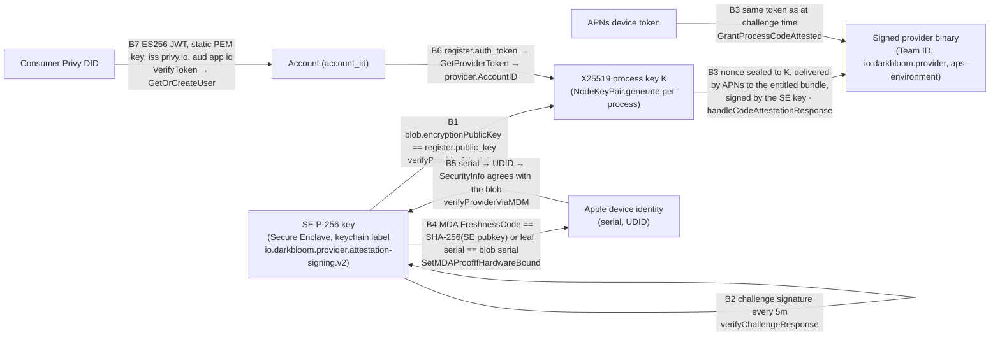
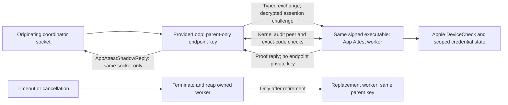

# Identity binding

> Last updated: 2026-10-19

How the coordinator binds a provider's process encryption key, account and
verification credentials. Legacy MDM/APNs evidence and App Attest credentials
have distinct bindings; [provider trust](provider-trust.md) describes how those
paths combine into a serving decision.

Current backend behavior belongs to the latest default branch of
`Layr-Labs/darkbloom-platform`; no backend implementation is retained here.
Immutable backend links below preserve reviewed evidence, not current source
or deployment state.

## Context

The X25519 process key `K` changes at provider startup; the legacy SE key,
APNs token, App Attest key and account have separate lifetimes. A signature binds
its transcript to a key holder. It does not independently establish that every
hardware or runtime value in that transcript is true. The checks below connect
identity evidence to the endpoint used by [encryption](encryption.md); the
[attestation mechanisms](attestation.md) describe the evidence behind each path.

## Mechanism

The legacy binding chain is shown below; the App Attest v3 chain follows it.

### The identities

| Identity | Produced by | Lifetime | Code |
|---|---|---|---|
| SE P-256 signing key | `PersistentEnclaveKey.loadOrCreateVerified`: keychain-backed Secure Enclave key, access group `SLDQ2GJ6TL.io.darkbloom.provider`, label `io.darkbloom.provider.attestation-signing.v2` (`kSecAttrAccessibleAfterFirstUnlockThisDeviceOnly`, so challenge signing works with the screen locked); a dev build uses the label `io.darkbloom.dev.provider.attestation-signing.v2` in the same access group, so it has its own SE identity; an item under the retired label `io.darkbloom.provider.attestation-signing.v1` is never read. Fallback: `SecureEnclaveIdentity.createEphemeral` (CryptoKit `SecureEnclave.P256.Signing.PrivateKey`, lost at exit); `darkbloom-enclave-cli` always uses the ephemeral form | Persistent per Mac and signing identity; per process on the fallback path | `provider-swift/Sources/ProviderCore/Security/PersistentEnclaveKey.swift`; `provider-swift/Sources/ProviderCore/Security/SecureEnclaveIdentity.swift`; `provider-swift/Sources/ProviderCore/ProviderLoop.swift` (`createAttestationSigner`); `provider-swift/Sources/darkbloom-enclave-cli/EnclaveCLI.swift` |
| X25519 process key `K` | `NodeKeyPair.generate()` in the `ProviderLoop` initialiser (libsodium CSPRNG); never written to or read from disk | One provider process | `provider-swift/Sources/ProviderCore/Crypto/NodeKeyPair.swift`; `provider-swift/Sources/ProviderCore/ProviderLoop.swift` |
| APNs device token | macOS, for the signed bundle with `aps-environment`; sent as `register.apns_device_token` with `register.apns_environment` | Until the OS rotates it | `provider-swift/Sources/ProviderCore/Apns/APNsBridge.swift`; [coordinator/protocol/messages.go](https://github.com/Layr-Labs/darkbloom-platform/blob/48a198c71a2d30feec5597bacf1101120f7f955d/coordinator/protocol/messages.go) (`RegisterMessage`) |
| Apple device identity | `serialNumber` inside the SE-signed blob (self-reported, SE-signed); serial and UDID inside the MDA leaf certificate (Apple-signed); UDID from the MicroMDM device record | Device lifetime | [coordinator/attestation/attestation.go](https://github.com/Layr-Labs/darkbloom-platform/blob/48a198c71a2d30feec5597bacf1101120f7f955d/coordinator/attestation/attestation.go) (`AttestationBlob`); [coordinator/attestation/mda.go](https://github.com/Layr-Labs/darkbloom-platform/blob/48a198c71a2d30feec5597bacf1101120f7f955d/coordinator/attestation/mda.go) (`OIDDeviceSerialNumber`, `OIDDeviceUDID`); [coordinator/mdm/mdm.go](https://github.com/Layr-Labs/darkbloom-platform/blob/48a198c71a2d30feec5597bacf1101120f7f955d/coordinator/mdm/mdm.go) (`LookupDevice`) |
| Account | `account_id` created by `GetOrCreateUser` for a Privy DID; attached to a provider through a device-linked provider token | Account lifetime | [coordinator/auth/privy.go](https://github.com/Layr-Labs/darkbloom-platform/blob/48a198c71a2d30feec5597bacf1101120f7f955d/coordinator/auth/privy.go); [coordinator/api/access/device/handlers.go](https://github.com/Layr-Labs/darkbloom-platform/blob/48a198c71a2d30feec5597bacf1101120f7f955d/coordinator/api/access/device/handlers.go) |
| Provider ID | `uuid.New()` per WebSocket connection — a session handle, never an identity | One connection | [coordinator/api/provider/provider.go](https://github.com/Layr-Labs/darkbloom-platform/blob/48a198c71a2d30feec5597bacf1101120f7f955d/coordinator/api/provider/provider.go) (`HandleProviderWS`) |

### Existing identity for private installed calibration

Private installed GLM-5.3-Flash calibration reuses the selected pair's signing
identity. `GLM5NextCalibrationInstalledPair.load` verifies the exact two-member
roster, its signatures and digest before loading the signer, then requires its
public key to match the recorded local identity. `requireUnchanged` rejects a
changed pairing; `linkSecret` checks it before and after reading the existing
edge credential. Code:
`provider-swift/Sources/ProviderCore/Inference/Distributed/Calibration/GLM5NextCalibrationInstalledPair.swift`.

This path calls `PersistentEnclaveKey.loadExisting`, which only looks up the
existing key. Lookup errors propagate without key creation, deletion, repair or
an ephemeral fallback. Normal provider startup retains its separate
`loadOrCreateVerified` behavior described above. Code:
`provider-swift/Sources/ProviderCore/Security/PersistentEnclaveKey.swift`.

In DEBUG builds, `DARKBLOOM_DEBUG_SE_KEY_FILE` instead selects
`SecureEnclaveIdentity.debugLoadExisting`: it reads an existing device-bound
opaque handle without creating or replacing it. `ClusterConfigurationFiles.read`
limits that read to 16 KiB and rejects a symlink, a non-regular file or group/other
permissions on the handle file. Release builds exclude this override. Code:
`provider-swift/Sources/ProviderCore/Security/SecureEnclaveIdentity.swift`;
`provider-swift/Sources/ProviderCore/Config/ClusterConfigurationFiles.swift`.
Reusing a paired identity does not itself grant serving authorization or
advertise a public model capability; see [provider trust](provider-trust.md).

### The bindings

| # | Binding | Proof | Enforced by |
|---|---|---|---|
| B1 | `K` ↔ SE key | The registration blob, signed by the SE key, carries `encryptionPublicKey`; it must equal `register.public_key`. A mismatch invalidates the attestation (and untrusts under a binary-hash policy) | [coordinator/api/provider/trust/attestation.go](https://github.com/Layr-Labs/darkbloom-platform/blob/48a198c71a2d30feec5597bacf1101120f7f955d/coordinator/api/provider/trust/attestation.go) (`VerifyProviderAttestation`) |
| B2 | SE key ↔ live process | Every `DefaultChallengeInterval` = 5m the process signs `nonce + timestamp` and the canonical status payload with the SE key; verified against the **registration** key, never one in the reply | [coordinator/internal/provider/challenge/challenge_verify.go](https://github.com/Layr-Labs/darkbloom-platform/blob/48a198c71a2d30feec5597bacf1101120f7f955d/coordinator/internal/provider/challenge/challenge_verify.go) (`verifyChallengeResponse`); [coordinator/attestation/attestation.go](https://github.com/Layr-Labs/darkbloom-platform/blob/48a198c71a2d30feec5597bacf1101120f7f955d/coordinator/attestation/attestation.go) (`VerifyChallengeSignature`, `VerifyStatusSignature`) |
| B3 | `K` ↔ SE key ↔ signed binary ↔ APNs token | The code-identity nonce is NaCl-Box-sealed to `K` (only the `K` holder opens it), delivered through APNs to the bundle with App ID `io.darkbloom.provider` and Team ID (only that binary receives it), and returned signed by the SE key. The grant is refused if `K` or the token changed since the challenge; persisted proofs record `(se_pubkey, apns_token, node_public_key, binary_hash)` and authorise only a resume challenge, never a grant; old same-process proofs additionally require code-verified continuity, not hardware-only liveness | [coordinator/internal/provider/codeidentity/provider_codeattest.go](https://github.com/Layr-Labs/darkbloom-platform/blob/48a198c71a2d30feec5597bacf1101120f7f955d/coordinator/internal/provider/codeidentity/provider_codeattest.go) (`HandleCodeAttestationResponse`); [coordinator/registry/provider_evidence.go](https://github.com/Layr-Labs/darkbloom-platform/blob/48a198c71a2d30feec5597bacf1101120f7f955d/coordinator/registry/provider_evidence.go) (`GrantProcessCodeAttested`); [coordinator/internal/provider/identity/code_attest_throttle.go](https://github.com/Layr-Labs/darkbloom-platform/blob/48a198c71a2d30feec5597bacf1101120f7f955d/coordinator/internal/provider/identity/code_attest_throttle.go) (`reuseAttestation`) |
| B4 | SE key ↔ Apple device | `DeviceAttestationNonce` = SHA-256 of the SE public key string; Apple echoes it as `FreshnessCode` in the leaf. A chain is attached only if the connection is `hardware` and (`FreshnessCode` matches this SE key **or** the leaf serial equals the blob `serialNumber`); a cached chain is reused only when the nonce binds this SE key | [coordinator/mdm/mdm.go](https://github.com/Layr-Labs/darkbloom-platform/blob/48a198c71a2d30feec5597bacf1101120f7f955d/coordinator/mdm/mdm.go) (`RequestDeviceAttestation`); [coordinator/attestation/mda.go](https://github.com/Layr-Labs/darkbloom-platform/blob/48a198c71a2d30feec5597bacf1101120f7f955d/coordinator/attestation/mda.go) (`VerifyMDADeviceAttestation`); [coordinator/registry/provider_evidence.go](https://github.com/Layr-Labs/darkbloom-platform/blob/48a198c71a2d30feec5597bacf1101120f7f955d/coordinator/registry/provider_evidence.go) (`SetMDAProofIfHardwareBound`); [coordinator/internal/provider/deviceverification/mda_verification.go](https://github.com/Layr-Labs/darkbloom-platform/blob/48a198c71a2d30feec5597bacf1101120f7f955d/coordinator/internal/provider/deviceverification/mda_verification.go) (`AttachCachedMDAProof`) |
| B5 | blob serial ↔ MDM device ↔ posture | The blob's `serialNumber` selects the MicroMDM device (`LookupDevice` → UDID); the device's own `SecurityInfo` must report SIP on and `SecureBootLevel == "full"`, and both must equal the blob's `sipEnabled` / `secureBootEnabled` | [coordinator/mdm/mdm.go](https://github.com/Layr-Labs/darkbloom-platform/blob/48a198c71a2d30feec5597bacf1101120f7f955d/coordinator/mdm/mdm.go) (`VerifyProviderWithUDIDObserver`); [coordinator/internal/provider/deviceverification/mdm_verification.go](https://github.com/Layr-Labs/darkbloom-platform/blob/48a198c71a2d30feec5597bacf1101120f7f955d/coordinator/internal/provider/deviceverification/mdm_verification.go) (`VerifyProviderViaMDM`) |
| B6 | provider ↔ account | `register.auth_token` is looked up by SHA-256 hash (`GetProviderToken`); on success `provider.AccountID = token.AccountID` and the stable fault key is rebound. An invalid token logs a warning and leaves the provider unlinked | [coordinator/api/provider/provider.go](https://github.com/Layr-Labs/darkbloom-platform/blob/48a198c71a2d30feec5597bacf1101120f7f955d/coordinator/api/provider/provider.go) (`HandleProviderWS`); [coordinator/store/postgres/](https://github.com/Layr-Labs/darkbloom-platform/tree/48a198c71a2d30feec5597bacf1101120f7f955d/coordinator/store/postgres) (`hashKey`); [coordinator/registry/provider_evidence.go](https://github.com/Layr-Labs/darkbloom-platform/blob/48a198c71a2d30feec5597bacf1101120f7f955d/coordinator/registry/provider_evidence.go) (`RebindStableFaultKey`) |
| B7 | consumer ↔ account | `Authorization: Bearer <Privy access token>` verified as below; the JWT subject (Privy DID) maps to an account via `GetOrCreateUser` | [coordinator/api/access/auth.go](https://github.com/Layr-Labs/darkbloom-platform/blob/48a198c71a2d30feec5597bacf1101120f7f955d/coordinator/api/access/auth.go) (`RequirePrivyAuth`, `ExtractBearerToken`); [coordinator/auth/privy.go](https://github.com/Layr-Labs/darkbloom-platform/blob/48a198c71a2d30feec5597bacf1101120f7f955d/coordinator/auth/privy.go) (`VerifyToken`, `GetOrCreateUser`) |
| B8 | durable evidence ↔ device | Trust-reuse rows are keyed by SE public key and carry `serial`, `mda_udid`, posture bits and generations; reuse refuses `serial_mismatch`, `missing_identity`, `no_device_evidence` | [coordinator/store/interface.go](https://github.com/Layr-Labs/darkbloom-platform/blob/48a198c71a2d30feec5597bacf1101120f7f955d/coordinator/store/interface.go) (`ProviderTrustReuse`); [coordinator/internal/provider/authority/trust_reuse_fast_skip.go](https://github.com/Layr-Labs/darkbloom-platform/blob/48a198c71a2d30feec5597bacf1101120f7f955d/coordinator/internal/provider/authority/trust_reuse_fast_skip.go) (`tryTrustReuseFastSkip`) |

### App Attest v3 endpoint binding

`ProviderLoop.handleAppAttestShadow` decrypts the coordinator's assertion
challenge with its own process `NodeKeyPair`; it never accepts another
process's public key as the endpoint to certify. The client then passes the
hash of a length-prefixed transcript to DeviceCheck. Code:
`provider-swift/Sources/ProviderCore/ProviderLoop+AppAttestShadow.swift`
(`handleAppAttestShadow`), `provider-swift/Sources/ProviderAppAttest/ShadowProtocol.swift`
(`AppAttestShadowPayload.clientHash`), and
`provider-swift/Sources/ProviderAppAttest/AppAttestShadowClient.swift` (`exchange`).

| Binding | Transcript or check | Code |
|---|---|---|
| Credential ↔ current endpoint | Domain/version, action, session, environment, key ID, challenge and process public key `K` enter `clientHash` | `provider-swift/Sources/ProviderAppAttest/ShadowProtocol.swift` (`clientHash`) |
| Credential ↔ account | Account scope enters the protocol-3 transcript and local key storage scope; a changed account during an exchange is rejected | `provider-swift/Sources/ProviderAppAttest/AppAttestShadowClient.swift` (`keyScope`, `exchange`) |
| Credential ↔ reported app/hardware/SE identity | Protocol 3 binds local OS/build, app version, chip, binary hash, machine model, memory, CPU/GPU counts and the legacy attestation public key. These are app-origin values, not independent Apple hardware measurements | `provider-swift/Sources/ProviderAppAttest/ShadowProtocol.swift` (`clientHash`); `provider-swift/Sources/ProviderCore/ProviderLoop+AppAttestShadow.swift` (`handleAppAttestShadow`) |
| Authorization ↔ live request destination | The coordinator rechecks connection, endpoint, account and canonical machine at the final inference write, together with current authorization and model gates | [coordinator/registry/inference_authorization.go](https://github.com/Layr-Labs/darkbloom-platform/blob/48a198c71a2d30feec5597bacf1101120f7f955d/coordinator/registry/inference_authorization.go) (`providerRequestAuthorizationBindingLocked`, `authorizeInferenceHandoff`) |

Only protocol 3 is negotiated for Apple proof exchanges. The coordinator refuses stored pre-v3 enrollment transcripts instead of adapting them to a current connection — [coordinator/appattest/service/session.go](https://github.com/Layr-Labs/darkbloom-platform/blob/48a198c71a2d30feec5597bacf1101120f7f955d/coordinator/appattest/service/session.go) (`startAppAttestShadow`) and [coordinator/internal/appattest/transcript/binding.go](https://github.com/Layr-Labs/darkbloom-platform/blob/48a198c71a2d30feec5597bacf1101120f7f955d/coordinator/internal/appattest/transcript/binding.go) (`Prepare`).

Local process/security diagnostics are outside `clientHash`. An App Attest
assertion binds the challenge to its credential and transcript; the serving
lease additionally needs the coordinator's [authorization policy](../../reference/provider-authorization.md).
The request's verification snapshot records that coordinator decision at dispatch;
it is not a new Apple signature over the inference input, output or computation.
See [coordinator/registry/inference_authorization.go](https://github.com/Layr-Labs/darkbloom-platform/blob/48a198c71a2d30feec5597bacf1101120f7f955d/coordinator/registry/inference_authorization.go) (`authorizeInferenceHandoff`).

### Supervised App Attest worker candidate

The Stage D provider candidate moves DeviceCheck calls into a child of the
**same exact Developer ID-signed executable**, not an independently trusted
helper or a signing service. It defaults off and is not ready for production;
see [selection](../../reference/configuration.md#app-attest-worker-qualification)
and the [reported native qualification gate](../../../scripts/nativequalification/README.md#qualification-status).
The in-process path above remains the default.
Native suspended-worker, real assertion-callback recovery with a loaded engine,
and the separate composed two-minute resumption test passed on their recorded
signed artifacts. These passes do not qualify a rebuilt artifact or the full
sleep, reboot, update, security-transition and fleet-rollout matrix.
The child entry is `--app-attest-worker-v1` (`AppAttestWorkerHost.argument`),
not a public CLI signing command.

The security boundary is enforced by these provider-owned components:

1. **Exact code and kernel peer.** `WorkerCodeIdentity` requires Developer ID
   team `SLDQ2GJ6TL`, identifier `io.darkbloom.provider`, hardened runtime and no
   ad-hoc/debug/library-validation/loader/JIT relaxations. Both sides compare
   CodeDirectory identity and full executable SHA-256 at authentication. The
   kernel `LOCAL_PEERTOKEN` audit token, including PID version, selects the
   running code; a peer-supplied PID/path or same team alone is insufficient.
   Subsequent exchanges recheck the captured audit/code identity
   (`provider-swift/Sources/ProviderAppAttest/Worker/WorkerPeerIdentity.swift`).
2. **Parent-only endpoint custody.** The bootstrap pipe carries a one-use
   secret, generation, parent audit token, scope and public endpoint, never the
   endpoint private key or account bearer token. The worker seals a fresh
   generation-bound custody challenge to that endpoint before any credential or
   Apple operation. Only the parent closure capturing `ProviderLoop.keyPair`
   decrypts it and later assertion challenges. Inference and the memory-only
   private key remain in the parent, not worker memory, disk or Keychain
   (`AppAttestWorkerHost.run` in `provider-swift/Sources/ProviderAppAttest/Worker/AppAttestWorkerHost.swift`;
   `handleAppAttestWorker` in `provider-swift/Sources/ProviderCore/ProviderLoop+AppAttestWorker.swift`).
3. **Typed RPC, not arbitrary signing.** `WorkerFrame.Body` permits the bootstrap
   handshake and typed protocol-3 `prepare`/`attest`/`assert` exchanges, never
   `sign(hash)`. Generation and increasing sequence bind replies; account and
   environment stay fixed, the endpoint is captured at bootstrap, and the
   binary hash must match the running signed code. The authenticated parent
   supplies locally derived status, not server-selected claims. The private Unix socket uses bounded framing and
   monotonic deadlines (`WorkerProtocol.swift`, `WorkerTransport.swift` in
   `provider-swift/Sources/ProviderAppAttest/Worker/`).
4. **Retire before replace.** `AppAttestWorkerClient.respond` has one fixed
   80-second exchange deadline. An outstanding Apple operation, timeout or
   cancellation retires the owned process; `WorkerProcess.terminateAndReap`
   gives SIGTERM two seconds, then SIGKILL two seconds and waits for exit.
   Signalling and `waitpid` share an ownership lock. Failure quarantines the
   slot, not a concurrent replacement. Epoch fences stop an old cancellation
   from killing its successor. The worker's scope-specific
   `WorkerCredentialLease` serializes its existing credential/budget writes and
   releases on death (`AppAttestWorkerClient.swift`, `WorkerProcess.swift`,
   `WorkerCredentialLease.swift` in the same directory).

Worker failure never enables a fallback Apple call in the parent, restarts the
inference process to recover verification, or manufactures serving permission.
`ProviderLoop` reports infrastructure failures as `busy`, not an Apple
invalid-key result that spends rotation budgets. Shutdown/re-exec waits for
retirement (`ProviderLoop.stopAppAttestWorkerAndWait` in
`provider-swift/Sources/ProviderCore/ProviderLoop+AppAttestShadow.swift`). Updates
use `stopAppAttestWorkerForUpdateAndWait` before commit and before restart,
including already-installed candidates, and recheck cancellation and drain
ownership at the side-effect boundaries. A failed update retains an uncertain
worker owner; only a fresh `prepare` while idle can retry its bounded cleanup.
Terminal shutdown cannot reopen that owner. See
[same-process endpoint resumption](#same-process-endpoint-resumption) for the
independent custody protocol.

### Same-process endpoint resumption

`ProviderLoop.run` in `provider-swift/Sources/ProviderCore/ProviderLoop+Serve.swift`
captures its existing `NodeKeyPair` in the coordinator client's synchronous
responder. The private key stays in process memory; it is not serialized into
configuration, persisted, regenerated on reconnect or given to an Apple worker.
The [protocol-1 transcript](../../reference/protocol-messages.md#app-attest-endpoint-resumption-candidate)
binds the encrypted challenge to that endpoint and a fresh nonce for the actual
socket. `CoordinatorClient.answerAppAttestResume` checks current connection
identity and registration, answers once, and writes directly to that socket
without suspending or using the reconnecting outbound router.

This is custody evidence only. A new process cannot answer for the old endpoint,
and a stale socket/nonce cannot answer on a replacement connection. No local
trust is created and no Apple proof lifetime is extended. Backend retained-proof,
account, revocation and current authorization checks remain platform-owned;
provider support does not imply that counterpart is deployed.

### Device-code account linking

RFC 8628-style flow implemented in [coordinator/api/access/device/handlers.go](https://github.com/Layr-Labs/darkbloom-platform/blob/48a198c71a2d30feec5597bacf1101120f7f955d/coordinator/api/access/device/handlers.go) and
`provider-swift/Sources/ProviderCore/Auth/DeviceAuth.swift` (`darkbloom login`).

| Step | Endpoint / value | Code |
|---|---|---|
| 1 | `POST /v1/device/code` (no auth, body capped at `maxControlPlaneBodyBytes`) → `{device_code, user_code, verification_uri, expires_in, interval}`. `device_code` = 32 random bytes hex; `user_code` = 8 chars from `ABCDEFGHJKMNPQRSTUVWXYZ23456789` formatted `XXXX-XXXX`; `expires_in` = `DeviceCodeExpiry` and `interval` = `DeviceCodePollInterval` ([api-contracts](https://github.com/Layr-Labs/darkbloom-platform/blob/48a198c71a2d30feec5597bacf1101120f7f955d/docs/reference/api-contracts.md#device-code-flow-3)); `verification_uri` = `EIGENINFERENCE_CONSOLE_URL` + `/link`, else `<scheme>://<host>/link` | `HandleDeviceCode`, `generateUserCode` |
| 2 | Operator signs in to the console and submits the code: `POST /v1/device/approve {user_code}` behind `RequirePrivyAuth` and `RateLimitFinancial`; code normalised to upper-case; errors `invalid_code`, `expired_code`, `already_used`; success → `ApproveDeviceCode(device_code, account_id)` | `HandleDeviceApprove` |
| 3 | CLI polls `POST /v1/device/token {device_code}` (no auth; the secret is the code): `200 {status: "authorization_pending"}` while pending; `invalid_grant` when unknown; `expired_token` after `DeviceCodeExpiry` or once consumed; on approval `200 {status: "authorized", token, account_id}` | `HandleDeviceToken` |
| 4 | Token = the provider token whose shape is under [api-contracts](https://github.com/Layr-Labs/darkbloom-platform/blob/48a198c71a2d30feec5597bacf1101120f7f955d/docs/reference/api-contracts.md#device-code-flow-3); the store keeps `ProviderToken{TokenHash, AccountID, Label: "device-" + user_code, Active}`; the CLI writes the token to `~/.darkbloom/auth_token` with mode `0600` | `HandleDeviceToken`; `AuthTokenStore` |
| 5 | The daemon sends it as `register.auth_token` (binding B6) | [coordinator/api/provider/](https://github.com/Layr-Labs/darkbloom-platform/tree/48a198c71a2d30feec5597bacf1101120f7f955d/coordinator/api/provider) |
| Logging | `device code created {user_code, expires_in}`, `provider token issued {account_id, user_code}`, `device approved {user_code, account_id}` at `Info` — never the `device_code` or the token | [coordinator/api/access/device/handlers.go](https://github.com/Layr-Labs/darkbloom-platform/blob/48a198c71a2d30feec5597bacf1101120f7f955d/coordinator/api/access/device/handlers.go) |

Provider logout closes the process side of B6 before deleting the saved token.
`Logout.run` holds the lifecycle/update lease and, after confirmed exit, the
single-instance lock through revocation and deletion. This still stops a running
provider when the token file is already missing. `ProviderLogout.perform` then
revokes only the current saved token; local deletion alone cannot invalidate a
copy held elsewhere. The [CLI contract](../../provider/cli-reference.md#darkbloom-login--darkbloom-logout)
defines the raw-bearer `POST /v1/device/revoke`, `204`-only confirmation and
offline warning. Sources: `provider-swift/Sources/darkbloom/LogoutCommand.swift`
and `provider-swift/Sources/ProviderCore/Auth/ProviderLogout.swift`. Backend token
revocation policy and persistence remain platform-owned.

## Invariants

1. The legacy registration attestation is valid only if its SE-signed blob names the registration X25519 key as `encryptionPublicKey` — [coordinator/api/provider/trust/attestation.go](https://github.com/Layr-Labs/darkbloom-platform/blob/48a198c71a2d30feec5597bacf1101120f7f955d/coordinator/api/provider/trust/attestation.go) (`VerifyProviderAttestation`).
2. All legacy challenge and APNs code-identity signatures are checked against the registration-time SE key — [coordinator/internal/provider/challenge/challenge_verify.go](https://github.com/Layr-Labs/darkbloom-platform/blob/48a198c71a2d30feec5597bacf1101120f7f955d/coordinator/internal/provider/challenge/challenge_verify.go) (`verifyChallengeResponse`), [coordinator/internal/provider/codeidentity/provider_codeattest.go](https://github.com/Layr-Labs/darkbloom-platform/blob/48a198c71a2d30feec5597bacf1101120f7f955d/coordinator/internal/provider/codeidentity/provider_codeattest.go) (`HandleCodeAttestationResponse`).
3. Legacy APNs code identity is granted only if `K` and the APNs token are unchanged since the challenge was issued — [coordinator/registry/provider_evidence.go](https://github.com/Layr-Labs/darkbloom-platform/blob/48a198c71a2d30feec5597bacf1101120f7f955d/coordinator/registry/provider_evidence.go) (`GrantProcessCodeAttested`).
4. An MDA chain is attached only when it binds this SE key or the blob's serial, and only on a `hardware` connection — [coordinator/registry/provider_evidence.go](https://github.com/Layr-Labs/darkbloom-platform/blob/48a198c71a2d30feec5597bacf1101120f7f955d/coordinator/registry/provider_evidence.go) (`SetMDAProofIfHardwareBound`).
5. Legacy MDM hardware posture is taken from the device selected by the blob's serial and must agree with the blob — [coordinator/internal/provider/deviceverification/mdm_verification.go](https://github.com/Layr-Labs/darkbloom-platform/blob/48a198c71a2d30feec5597bacf1101120f7f955d/coordinator/internal/provider/deviceverification/mdm_verification.go) (`VerifyProviderViaMDM`).
6. `AccountID` is set only from a valid device-linked token, never from anything in the attestation blob — [coordinator/api/provider/provider.go](https://github.com/Layr-Labs/darkbloom-platform/blob/48a198c71a2d30feec5597bacf1101120f7f955d/coordinator/api/provider/provider.go) (`HandleProviderWS`), [coordinator/registry/health_ejection.go](https://github.com/Layr-Labs/darkbloom-platform/blob/48a198c71a2d30feec5597bacf1101120f7f955d/coordinator/registry/health_ejection.go) (`stableProviderIdentityLocked`).
7. Provider tokens and API keys are stored and looked up by SHA-256 hash only — [coordinator/store/postgres/](https://github.com/Layr-Labs/darkbloom-platform/tree/48a198c71a2d30feec5597bacf1101120f7f955d/coordinator/store/postgres) (`hashKey`), [coordinator/api/access/device/handlers.go](https://github.com/Layr-Labs/darkbloom-platform/blob/48a198c71a2d30feec5597bacf1101120f7f955d/coordinator/api/access/device/handlers.go) (`HandleDeviceToken`).
8. Privy tokens are accepted only with `ES256`, issuer `privy.io`, and the configured audience, under the static configured key — [coordinator/auth/privy.go](https://github.com/Layr-Labs/darkbloom-platform/blob/48a198c71a2d30feec5597bacf1101120f7f955d/coordinator/auth/privy.go) (`VerifyToken`).
9. The provider UUID is never used as an identity for trust, reputation, or reuse — [coordinator/registry/health_ejection.go](https://github.com/Layr-Labs/darkbloom-platform/blob/48a198c71a2d30feec5597bacf1101120f7f955d/coordinator/registry/health_ejection.go) (`stableProviderIdentityLocked`).

## Failure modes

| Failure | Effect | Code |
|---|---|---|
| Provider restarts | New `K`; B1 re-established by the fresh blob; old-process continuity cannot transfer to the new key. Legacy resume requires a recent APNs proof and an approved application-evidence transition, otherwise a new push. App Attest needs a fresh assertion bound to the new endpoint | [coordinator/internal/provider/identity/code_attest_throttle.go](https://github.com/Layr-Labs/darkbloom-platform/blob/48a198c71a2d30feec5597bacf1101120f7f955d/coordinator/internal/provider/identity/code_attest_throttle.go) (`reuseAttestation`) |
| Persistent SE key unusable (keychain locked, poisoned) | `loadOrCreateVerified` repairs once, else ephemeral fallback: a new SE identity, so stored trust, code proofs, and MDA binding start over | `provider-swift/Sources/ProviderCore/Security/PersistentEnclaveKey.swift`; `provider-swift/Sources/ProviderCore/ProviderLoop.swift` |
| APNs token rotates | `CodeAttested` cleared; push budget re-keyed (at most once per `budgetClearCooldown` = 20m) | [coordinator/internal/provider/identity/code_attest_throttle.go](https://github.com/Layr-Labs/darkbloom-platform/blob/48a198c71a2d30feec5597bacf1101120f7f955d/coordinator/internal/provider/identity/code_attest_throttle.go) |
| Blob serial does not match any MicroMDM device | `device-not-found`; stays `self_signed`; retried | [coordinator/internal/provider/deviceverification/mdm_verification.go](https://github.com/Layr-Labs/darkbloom-platform/blob/48a198c71a2d30feec5597bacf1101120f7f955d/coordinator/internal/provider/deviceverification/mdm_verification.go) (`VerifyProviderViaMDM`) |
| MDA leaf serial ≠ blob serial and nonce does not bind the SE key | `mda_verified` stays false | [coordinator/registry/provider_evidence.go](https://github.com/Layr-Labs/darkbloom-platform/blob/48a198c71a2d30feec5597bacf1101120f7f955d/coordinator/registry/provider_evidence.go) (`SetMDAProofIfHardwareBound`) |
| Invalid or revoked provider token | Warning logged; provider connects unlinked (no account, no owner self-route, no payouts) | [coordinator/api/provider/](https://github.com/Layr-Labs/darkbloom-platform/tree/48a198c71a2d30feec5597bacf1101120f7f955d/coordinator/api/provider) |
| Privy key rotated upstream | Every consumer token fails `401` until the coordinator is restarted with the new PEM | [coordinator/auth/privy.go](https://github.com/Layr-Labs/darkbloom-platform/blob/48a198c71a2d30feec5597bacf1101120f7f955d/coordinator/auth/privy.go) |
| Device code expired or reused | `expired_token` / `already_used`; operator reruns `darkbloom login` | [coordinator/api/access/device/handlers.go](https://github.com/Layr-Labs/darkbloom-platform/blob/48a198c71a2d30feec5597bacf1101120f7f955d/coordinator/api/access/device/handlers.go) |

## Code map

| Concern | File (symbol) |
|---|---|
| App Attest transcript and endpoint binding | `provider-swift/Sources/ProviderAppAttest/ShadowProtocol.swift` (`clientHash`); `provider-swift/Sources/ProviderCore/ProviderLoop+AppAttestShadow.swift` (`handleAppAttestShadow`); [coordinator/registry/inference_authorization.go](https://github.com/Layr-Labs/darkbloom-platform/blob/48a198c71a2d30feec5597bacf1101120f7f955d/coordinator/registry/inference_authorization.go) (`authorizeInferenceHandoff`) |
| SE key lifecycle | `provider-swift/Sources/ProviderCore/Security/PersistentEnclaveKey.swift` (`loadOrCreateVerified`, `defaultLabel`, `defaultAccessGroup`); `provider-swift/Sources/ProviderCore/Security/SecureEnclaveIdentity.swift` (`createEphemeral`); `provider-swift/Sources/ProviderCore/ProviderLoop.swift` (`createAttestationSigner`) |
| `K` lifecycle | `provider-swift/Sources/ProviderCore/Crypto/NodeKeyPair.swift` (`generate`) |
| Blob ↔ `K` binding | [coordinator/api/provider/trust/attestation.go](https://github.com/Layr-Labs/darkbloom-platform/blob/48a198c71a2d30feec5597bacf1101120f7f955d/coordinator/api/provider/trust/attestation.go) (`VerifyProviderAttestation`); [coordinator/attestation/attestation.go](https://github.com/Layr-Labs/darkbloom-platform/blob/48a198c71a2d30feec5597bacf1101120f7f955d/coordinator/attestation/attestation.go) (`AttestationBlob`) |
| Code identity | [coordinator/internal/provider/codeidentity/provider_codeattest.go](https://github.com/Layr-Labs/darkbloom-platform/blob/48a198c71a2d30feec5597bacf1101120f7f955d/coordinator/internal/provider/codeidentity/provider_codeattest.go) (`HandleCodeAttestationResponse`); [coordinator/internal/provider/codeidentity/code_attest_persistence.go](https://github.com/Layr-Labs/darkbloom-platform/blob/48a198c71a2d30feec5597bacf1101120f7f955d/coordinator/internal/provider/codeidentity/code_attest_persistence.go), [coordinator/internal/provider/codeidentity/code_attest_persistence.go](https://github.com/Layr-Labs/darkbloom-platform/blob/48a198c71a2d30feec5597bacf1101120f7f955d/coordinator/internal/provider/codeidentity/code_attest_persistence.go), [coordinator/internal/provider/identity/code_attest_throttle.go](https://github.com/Layr-Labs/darkbloom-platform/blob/48a198c71a2d30feec5597bacf1101120f7f955d/coordinator/internal/provider/identity/code_attest_throttle.go) (`reuseAttestation`, `persistCodeAttestation`); [coordinator/registry/provider_evidence.go](https://github.com/Layr-Labs/darkbloom-platform/blob/48a198c71a2d30feec5597bacf1101120f7f955d/coordinator/registry/provider_evidence.go) (`GrantProcessCodeAttested`) |
| MDA binding | [coordinator/mdm/mdm.go](https://github.com/Layr-Labs/darkbloom-platform/blob/48a198c71a2d30feec5597bacf1101120f7f955d/coordinator/mdm/mdm.go) (`RequestDeviceAttestation`); [coordinator/attestation/mda.go](https://github.com/Layr-Labs/darkbloom-platform/blob/48a198c71a2d30feec5597bacf1101120f7f955d/coordinator/attestation/mda.go); [coordinator/registry/provider_evidence.go](https://github.com/Layr-Labs/darkbloom-platform/blob/48a198c71a2d30feec5597bacf1101120f7f955d/coordinator/registry/provider_evidence.go) (`SetMDAProofIfHardwareBound`); [coordinator/internal/provider/deviceverification/mda_verification.go](https://github.com/Layr-Labs/darkbloom-platform/blob/48a198c71a2d30feec5597bacf1101120f7f955d/coordinator/internal/provider/deviceverification/mda_verification.go) (`AttachCachedMDAProof`) |
| MDM posture binding | [coordinator/mdm/mdm.go](https://github.com/Layr-Labs/darkbloom-platform/blob/48a198c71a2d30feec5597bacf1101120f7f955d/coordinator/mdm/mdm.go) (`LookupDevice`, `VerifyProviderWithUDIDObserver`); [coordinator/internal/provider/deviceverification/mdm_verification.go](https://github.com/Layr-Labs/darkbloom-platform/blob/48a198c71a2d30feec5597bacf1101120f7f955d/coordinator/internal/provider/deviceverification/mdm_verification.go) (`VerifyProviderViaMDM`) |
| Stable identity | [coordinator/registry/health_ejection.go](https://github.com/Layr-Labs/darkbloom-platform/blob/48a198c71a2d30feec5597bacf1101120f7f955d/coordinator/registry/health_ejection.go) (`stableProviderIdentityLocked`); [coordinator/registry/provider_evidence.go](https://github.com/Layr-Labs/darkbloom-platform/blob/48a198c71a2d30feec5597bacf1101120f7f955d/coordinator/registry/provider_evidence.go) (`RebindStableFaultKey`); [coordinator/registry/persistence.go](https://github.com/Layr-Labs/darkbloom-platform/blob/48a198c71a2d30feec5597bacf1101120f7f955d/coordinator/registry/persistence.go) (`RestoreProviderState`) |
| Account linking | [coordinator/api/access/device/handlers.go](https://github.com/Layr-Labs/darkbloom-platform/blob/48a198c71a2d30feec5597bacf1101120f7f955d/coordinator/api/access/device/handlers.go) (`HandleDeviceCode`, `HandleDeviceToken`, `HandleDeviceApprove`, `DeviceCodeExpiry`, `DeviceCodePollInterval`); `provider-swift/Sources/ProviderCore/Auth/DeviceAuth.swift` (`AuthTokenStore`) |
| Consumer identity | [coordinator/auth/privy.go](https://github.com/Layr-Labs/darkbloom-platform/blob/48a198c71a2d30feec5597bacf1101120f7f955d/coordinator/auth/privy.go) (`NewPrivyAuth`, `VerifyToken`, `GetOrCreateUser`); [coordinator/auth/config.go](https://github.com/Layr-Labs/darkbloom-platform/blob/48a198c71a2d30feec5597bacf1101120f7f955d/coordinator/auth/config.go); [coordinator/api/access/auth.go](https://github.com/Layr-Labs/darkbloom-platform/blob/48a198c71a2d30feec5597bacf1101120f7f955d/coordinator/api/access/auth.go) (`RequirePrivyAuth`) |

## Related

- [Provider trust](provider-trust.md) — the shared hybrid authorization decision and its limits.
- [`attestation.md`](./attestation.md) — the trust levels and flags these bindings feed.
- [`encryption.md`](./encryption.md) — what is sealed to `K`.
- [`enrollment.md`](./enrollment.md) — how the device becomes addressable by serial in MicroMDM.
- [`../../provider/attestation.md`](../../provider/attestation.md) — `darkbloom login`, `darkbloom enroll`, and reading the resulting status.
