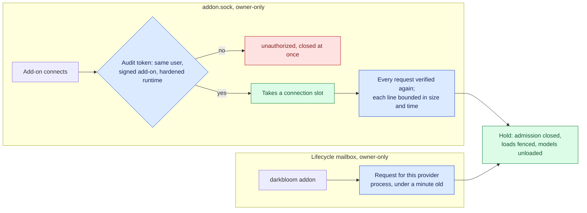

# Local control channels

> Last updated: 2026-10-27

Two local channels can take a provider out of serving without the coordinator:
the add-on hold socket and the lifecycle mailbox behind `darkbloom addon`. This
explanation is for security reviewers: who can drive each channel, what the
provider checks, and what neither protects against. Behavior is in
[add-on hold](../addon-hold.md); exact values are in the
[add-on hold IPC reference](../../reference/addon-hold-ipc.md).

## Context

A local add-on, such as the Darkbloom Sandbox, asks the provider to leave
inference while its VMs use the Mac, and the operator can do the same with
`darkbloom addon`. Either request closes admission, unloads every model and
changes the status the coordinator routes on, so it decides the provider's
serving availability (`A-018` in the [threat model](../../threat-model.yaml)).
The provider, the add-on and the CLI run as the same user. The channels keep
other programs of that user from holding the Mac; they are not a boundary
against the user, who already controls the provider (`TB-012`).

## Mechanism

1. The socket server verifies a connection as it accepts it, before the
   connection takes a slot, and again for every request. The kernel audit
   token, not a peer-supplied PID or path, selects the running code, which must
   satisfy the add-on's code requirement. An unverified connection is answered
   `unauthorized` and closed without reading from it.
2. A request line must finish within the size and time bounds of the
   [framing rules](../../reference/addon-hold-ipc.md#framing), however slowly
   its bytes arrive, and an idle connection is closed.
3. `darkbloom addon` writes a request file into the owner-only lifecycle
   mailbox. The provider claims it by rename and acts only on a request for its
   exact process identity created within the last minute.
4. Both channels reach the same hold transitions. While any hold is active no
   model load starts or publishes a slot, and the persisted hold record brings
   a restarted provider back held.

## Invariants

1. An unverified peer never occupies a connection slot —
   `provider-swift/Sources/ProviderCore/Addon/AddonIPCServer.swift`
   (`AddonIPCServer.acceptLoop`, `verifiedPeer`).
2. Every request is verified again, so code executed after connecting no
   longer matches — `AddonIPCServer.respond`,
   `provider-swift/Sources/ProviderCore/Addon/AddonPeerPolicy.swift`
   (`AddonPeerPolicy.authenticate`).
3. Only the verified signer's identifier can hold, and a peer sees only its own
   holds — `provider-swift/Sources/ProviderCore/Addon/ProviderLoop+AddonHold.swift`
   (`handleAddonIPC`).
4. A mailbox request acts only on the provider process it names, within a
   minute of its creation —
   `provider-swift/Sources/ProviderCore/Addon/AddonHoldControl.swift`
   (`AddonHoldControlRequest.isValid`).
5. The hold record and mailbox files are opened without following links or
   blocking, and read only as owner-only regular files within a size bound —
   `provider-swift/Sources/ProviderCore/Addon/AddonHoldStore.swift`
   (`AddonHoldStore.read`),
   `provider-swift/Sources/ProviderCore/Service/LifecycleMailbox.swift`
   (`LifecycleMailbox`).
6. Only DEBUG builds read `DARKBLOOM_ADDON_DEV_IDENTITY`. Every build honors
   `DARKBLOOM_ADDON_SOCKET`; the LaunchAgent does not pass it, so the installed
   provider serves the default socket — `AddonPeerPolicy.current`,
   `provider-swift/Sources/ProviderCore/Addon/AddonHoldPaths.swift`
   (`AddonHoldPaths.production`).

## Failure modes and limits

| Action | Result | Threat-model entry |
|---|---|---|
| An unsigned program of the same user connects and stays silent, or trickles a line | Refused when accepted, or closed at the request bound; the add-on keeps its slots | `T-060` |
| It floods connection attempts | Each is checked and closed at once; the add-on may wait or retry its connection, but no unsigned peer holds a slot | `T-060` |
| A FIFO or a link replaces the hold record or a mailbox file | Refused without blocking; an unreadable record fails open, so the provider starts unheld | `T-060`, `TB-012` |
| The add-on crashes while its VMs, or another program, keep `ownership.lock` | An expired lease is kept for as long as the lock is held; `darkbloom addon release --force` ends it | `T-059` |
| A program of the same user tampers with the add-on, the record or the lock | Outside the boundary: that user can equally stop the provider | `TB-012` |
| The coordinator reads the `busy_*` fields | They are the provider's own report, not verified evidence | `TB-012` |

## Code map

| Concern | File / symbol |
|---|---|
| Socket accept, framing and bounds | `provider-swift/Sources/ProviderCore/Addon/AddonIPCServer.swift` (`AddonIPCServer`) |
| Peer policy | `provider-swift/Sources/ProviderCore/Addon/AddonPeerPolicy.swift` (`AddonPeerPolicy`) |
| Operator requests | `provider-swift/Sources/ProviderCore/Addon/AddonHoldControl.swift` (`AddonHoldControlRequest`), `provider-swift/Sources/ProviderCore/Service/LifecycleMailbox.swift` (`LifecycleMailbox`) |
| Hold record | `provider-swift/Sources/ProviderCore/Addon/AddonHoldStore.swift` (`AddonHoldStore`) |
| Risk register | [Threat model](../../threat-model.yaml) `TB-012`, `T-059`, `T-060` |

## Related

- [Add-on hold](../addon-hold.md) — the hold's states, drain and unload.
- [Add-on hold IPC reference](../../reference/addon-hold-ipc.md) — socket contract, bounds and errors.
- [`darkbloom addon`](../../provider/cli-reference.md#darkbloom-addon) — operator commands.
- [Provider trust](provider-trust.md) — coordinator-side serving authorization.
