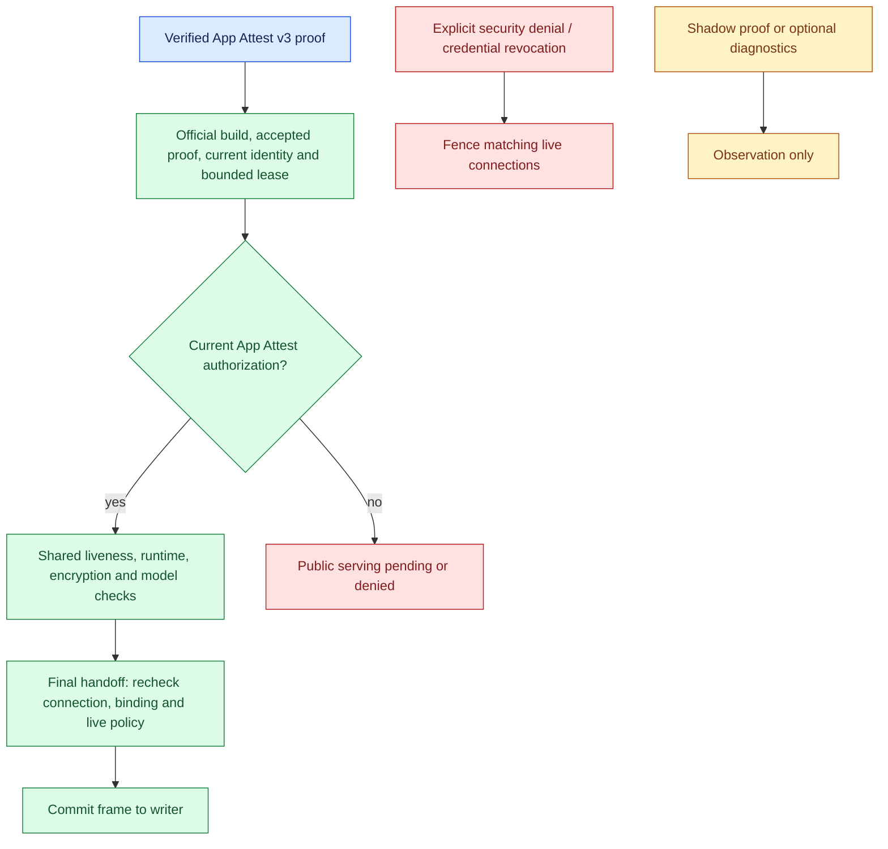

# Provider trust with App Attest

> Last updated: 2026-11-20

Qualified App Attest is the only provider authorization path. This explanation separates App Attest authorization from the shared dispatch checks, from the legacy evidence fields that remain, and from claims App Attest does not prove. The [authorization reference](../../reference/provider-authorization.md) owns configuration, deadlines and migration procedures.

## Context

Current backend behavior is owned by the latest default branch of
`Layr-Labs/darkbloom-platform`; no backend implementation is retained here.
Immutable links below are reviewed evidence, not current source or deployment
state. Defaults and version floors quoted from those pins describe those
revisions only. The [reviewed authorization contract](https://github.com/Layr-Labs/darkbloom-platform/blob/20b821646acfbf0968d1c30239cb583eeb0fa2bc/docs/reference/provider-authorization.md)
separates basic serving from stricter recurring receipt monitoring for rewards. Missing recurring receipt/risk evidence alone does not block
otherwise valid basic serving or extend any proof or policy deadline.

A legacy `trust_level` is not the serving decision. An App Attest connection can retain `self_signed` while being authorized. The coordinator evaluates App Attest serving in [coordinator/registry/app_attest_authorization.go](https://github.com/Layr-Labs/darkbloom-platform/blob/48a198c71a2d30feec5597bacf1101120f7f955d/coordinator/registry/app_attest_authorization.go) (`providerAppAttestServingAuthorizedLocked`) and [coordinator/registry/attestation_policy.go](https://github.com/Layr-Labs/darkbloom-platform/blob/48a198c71a2d30feec5597bacf1101120f7f955d/coordinator/registry/attestation_policy.go) (`providerSupportsPrivateTextAuthorizationAtLocked`).

App Attest protocol names still contain `shadow` because observation and enforcement share the exchange. Observation alone grants no serving permission. [coordinator/appattest/service/config.go](https://github.com/Layr-Labs/darkbloom-platform/blob/48a198c71a2d30feec5597bacf1101120f7f955d/coordinator/appattest/service/config.go) (`ConfigFromEnvironment`) defaults shadow and serving off, with rollout at zero, at that revision. [deploy/environments/prod.env](https://github.com/Layr-Labs/darkbloom-platform/blob/48a198c71a2d30feec5597bacf1101120f7f955d/deploy/environments/prod.env) is a sanitized reference, explicitly not the live configuration. [deploy/gcp/prod/refresh-env.sh](https://github.com/Layr-Labs/darkbloom-platform/blob/48a198c71a2d30feec5597bacf1101120f7f955d/deploy/gcp/prod/refresh-env.sh) preserves runtime settings. These files establish supported behavior and defaults, not current fleet activation. The sanitized fleet version floor is `0.9.5`; [coordinator/api/releases/owner.go](https://github.com/Layr-Labs/darkbloom-platform/blob/48a198c71a2d30feec5597bacf1101120f7f955d/coordinator/api/releases/owner.go) (`belowMinProviderVersion`) rejects a missing version whenever a floor is configured. This routing check is separate from App Attest protocol negotiation.

The coordinator serves only App Attest protocol 3 for Apple proof exchanges. Protocol 1/2 registrations receive no Apple-operation frames, and pre-v3 stored enrollments cannot resume. The former claimed-version gate is gone; the protocol capability selects the exchange, while verified code, qualification and shared routing policy still determine serving. Code: [coordinator/appattest/service/session.go](https://github.com/Layr-Labs/darkbloom-platform/blob/48a198c71a2d30feec5597bacf1101120f7f955d/coordinator/appattest/service/session.go) (`startAppAttestShadow`), [coordinator/internal/appattest/transcript/binding.go](https://github.com/Layr-Labs/darkbloom-platform/blob/48a198c71a2d30feec5597bacf1101120f7f955d/coordinator/internal/appattest/transcript/binding.go) (`Prepare`) and [coordinator/appattest/authorization.go](https://github.com/Layr-Labs/darkbloom-platform/blob/48a198c71a2d30feec5597bacf1101120f7f955d/coordinator/appattest/authorization.go) (`EvaluateAuthorization`).

The default-off [supervised worker](identity-binding.md#supervised-app-attest-worker-candidate)
changes where the provider performs Apple calls, not the authorization boundary.
[Endpoint resumption](identity-binding.md#same-process-endpoint-resumption) uses
a separate protocol-1 custody exchange; it creates no local trust and cannot
extend Apple proof lifetime.

## Mechanism

A Mac below macOS 27 cannot use App Attest and has no fallback.

Base rewards require current qualified App Attest authorization; existing
economics guards still apply. Inference/work earnings remain unchanged, and this
does not claw back historical rewards. See [billing](https://github.com/Layr-Labs/darkbloom-platform/blob/48a198c71a2d30feec5597bacf1101120f7f955d/docs/architecture/billing.md) for the settlement policy.

The diagram describes public serving. Authenticated owner routing may relax the public trust floor and admit a private-only machine; it retains the common runtime/privacy/freshness and hard-denial gates. [coordinator/registry/owner_authorization.go](https://github.com/Layr-Labs/darkbloom-platform/blob/48a198c71a2d30feec5597bacf1101120f7f955d/coordinator/registry/owner_authorization.go) (`ProviderOwnerServingAuthorized`) and [coordinator/registry/inference_authorization.go](https://github.com/Layr-Labs/darkbloom-platform/blob/48a198c71a2d30feec5597bacf1101120f7f955d/coordinator/registry/inference_authorization.go) (`InferenceHandoff.Authorize`) enforce that separate policy.

| Evidence | Establishes | Does not establish | Code |
|---|---|---|---|
| Legacy SE-signed registration/status | Signature validity and binding of reported fields to the registered key | A self-signature alone does not independently certify key provenance or each reported fact | [coordinator/attestation/attestation.go](https://github.com/Layr-Labs/darkbloom-platform/blob/48a198c71a2d30feec5597bacf1101120f7f955d/coordinator/attestation/attestation.go) (`Verify`, `VerifyStatusSignature`) |
| APNs code identity and legacy release evidence | Legacy application/endpoint evidence subject to configured enforcement policy | Continuous measurement of every instruction or model computation | [coordinator/registry/attestation_policy.go](https://github.com/Layr-Labs/darkbloom-platform/blob/48a198c71a2d30feec5597bacf1101120f7f955d/coordinator/registry/attestation_policy.go) (`codeAttestationEnforcedAtLocked`, `providerHoldsCurrentApplicationEvidenceLocked`) |
| App Attest enrollment/assertion | Verified credential, Mac access-policy and code evidence plus a signed current transcript | Authorization without official-build, accepted-proof and live connection checks; recurring receipt readiness for rewards | [coordinator/appattest/verify.go](https://github.com/Layr-Labs/darkbloom-platform/blob/48a198c71a2d30feec5597bacf1101120f7f955d/coordinator/appattest/verify.go) (`Verifier.Attestation`, `Verifier.Assertion`); [coordinator/appattest/authorization.go](https://github.com/Layr-Labs/darkbloom-platform/blob/48a198c71a2d30feec5597bacf1101120f7f955d/coordinator/appattest/authorization.go) (`EvaluateAuthorization`) |
| App Attest v3 hardware/status fields | App-origin claims bound to account, session, endpoint and verification key | Independent Apple certification of RAM, physical uniqueness or model execution | `provider-swift/Sources/ProviderAppAttest/ShadowProtocol.swift` (`clientHash`) |
| Public verification verdict | Coordinator observation of the applicable method at its source snapshot or final dispatch | A transferable grant or Apple-signed result receipt | [coordinator/registry/verification.go](https://github.com/Layr-Labs/darkbloom-platform/blob/48a198c71a2d30feec5597bacf1101120f7f955d/coordinator/registry/verification.go) (`ProviderVerificationAndAuthorization`); [coordinator/registry/inference_authorization.go](https://github.com/Layr-Labs/darkbloom-platform/blob/48a198c71a2d30feec5597bacf1101120f7f955d/coordinator/registry/inference_authorization.go) (`InferenceHandoff.Authorize`) |

## Invariants

1. **App Attest grants do not rewrite legacy evidence.** A current lease never sets `TrustHardware`, `MDAVerified` or `CodeAttested`. Common runtime/transport/privacy checks remain — [coordinator/registry/attestation_policy.go](https://github.com/Layr-Labs/darkbloom-platform/blob/48a198c71a2d30feec5597bacf1101120f7f955d/coordinator/registry/attestation_policy.go) (`providerSupportsPrivateTextAuthorizationAtLocked`).
2. **Selection is not final authorization.** Every inference handoff rechecks current connection, account/machine/endpoint binding and applicable policy after frame preparation and owner acknowledgment. Later invalidation fences subsequent handoffs but cannot recall committed frames — [coordinator/registry/inference_authorization.go](https://github.com/Layr-Labs/darkbloom-platform/blob/48a198c71a2d30feec5597bacf1101120f7f955d/coordinator/registry/inference_authorization.go) (`WriteInferenceTextDeferred`, `InferenceHandoff.Authorize`).
3. **Missing evidence and hard denial differ.** Expiry or a transient lookup/Apple failure cannot extend App Attest permission, and there is no other evidence to fall back to. Explicit credential revocation and security denial fence matching live connections — [coordinator/appattest/service/authorizer.go](https://github.com/Layr-Labs/darkbloom-platform/blob/48a198c71a2d30feec5597bacf1101120f7f955d/coordinator/appattest/service/authorizer.go) (`refresh`); [coordinator/registry/app_attest_authorization.go](https://github.com/Layr-Labs/darkbloom-platform/blob/48a198c71a2d30feec5597bacf1101120f7f955d/coordinator/registry/app_attest_authorization.go) (`RevokeAppAttestCredential`); [coordinator/registry/app_attest_denial.go](https://github.com/Layr-Labs/darkbloom-platform/blob/48a198c71a2d30feec5597bacf1101120f7f955d/coordinator/registry/app_attest_denial.go) (`denyAppAttestProviderLocked`).
4. **Official registration is not runtime authorization.** Trusted CI registers the complete official identity through the existing scoped release API. Serving still requires real, durably accepted Apple proof, matching official code/runtime hashes, and current revocation evidence. Recurring receipt readiness separately gates rewards. Apple's truncated measurement must uniquely bind the durable full hash. Earlier implementation evidence remains in [coordinator/appattest/service/build_qualifications.go](https://github.com/Layr-Labs/darkbloom-platform/blob/48a198c71a2d30feec5597bacf1101120f7f955d/coordinator/appattest/service/build_qualifications.go) (`applyBuildQualification`) and [coordinator/registry/app_attest_authorization.go](https://github.com/Layr-Labs/darkbloom-platform/blob/48a198c71a2d30feec5597bacf1101120f7f955d/coordinator/registry/app_attest_authorization.go) (`providerHasAppAttestAuthorizationLocked`); current policy is platform-owned.

CI and repository writers are trusted for official build identity, not proof
that runtime Apple APIs work. Per-release hardware qualification and manual
approval are not required; optional hardware smoke is separate. Deploy the
matching platform persistence change before using the provider workflow. See
[official-build registration](https://github.com/Layr-Labs/darkbloom-platform/blob/master/docs/reference/provider-authorization.md#durable-build-qualification).
For existing deployments only, `applyBuildQualification` can use configured exact build/code mappings for a full Apple measurement when no durable row exists and the qualification snapshot is fresh. Durable rows and revocation tombstones override this compatibility path; truncated measurements and new release publication require durable qualification.

5. **Legacy evidence cannot use the retired downgrade exceptions.** Every registration blob must meet `RegistrationAttestationMaxAge`, regardless of its claimed provider version. A challenge for an attested SE key requires a valid `status_signature`; missing SIP or Secure Boot status fails the challenge. These checks constrain signed claims and freshness, not independent physical measurement — [coordinator/api/provider/trust/attestation.go](https://github.com/Layr-Labs/darkbloom-platform/blob/48a198c71a2d30feec5597bacf1101120f7f955d/coordinator/api/provider/trust/attestation.go), [coordinator/api/provider/trust/attestation.go](https://github.com/Layr-Labs/darkbloom-platform/blob/48a198c71a2d30feec5597bacf1101120f7f955d/coordinator/api/provider/trust/attestation.go), [coordinator/internal/provider/challenge/challenge_verify.go](https://github.com/Layr-Labs/darkbloom-platform/blob/48a198c71a2d30feec5597bacf1101120f7f955d/coordinator/internal/provider/challenge/challenge_verify.go) (`VerifyProviderAttestation`, `verifyChallengeResponse`).
6. **Onboarding is not permission.** Setup installs no profile and waits for App Attest. An old Darkbloom enrollment profile does nothing; the provider only reads `profiles status -type enrollment` unprivileged, names the profile and opens System Settings, the operator removes it, no coordinator decision is involved, and an employer's profile is never offered (`parseMDMEnrollmentStatus`; `UnenrollKeepServingTests`, `MDMEnrollmentTests`; the unprivileged read is a regression check in `scripts/test-provider-profiles-unprivileged.py`) — `provider-swift/Sources/darkbloom/EnrollCommand.swift` (`Enroll.guidance`); `provider-swift/Sources/darkbloom/UnenrollCommand+KeepServing.swift` (`guideRetiredProfileRemoval`).

Autopilot reward qualification checks the App Attest lease at the original
server receive time, while retaining current binding, revocation and privacy
checks. Processing a queued frame after a new grant cannot backdate its
qualification. This historical financial check does not replace the current-time
serving handoff gates above; see the [billing mechanism](https://github.com/Layr-Labs/darkbloom-platform/blob/48a198c71a2d30feec5597bacf1101120f7f955d/docs/architecture/billing.md#autopilot-rewards)
and [coordinator/registry/autopilot_reward_snapshot.go](https://github.com/Layr-Labs/darkbloom-platform/blob/48a198c71a2d30feec5597bacf1101120f7f955d/coordinator/registry/autopilot_reward_snapshot.go) (`AutopilotRewardDeclarationAt`).

### Serving processes start from Darkbloom's service

A release build serves the network only from Darkbloom's background service:
the provider's launchd job, or a part that the service runs (the always-on
member under its supervisor, a pair's member under the cluster service). The
check reads facts from macOS, not from any service the starting program could
answer. Any other start says so, asks launchd to start the service and exits
(`provider-swift/Sources/ProviderCore/Service/ServiceLaunchCheck.swift`,
`Start.requireServiceLaunch`). The check is stronger on macOS 15.4 and later, where
macOS reports each process's original parent. A build switch
(`ServiceLaunchCheck.requiresOriginalParentInThisBuild`, off in current builds)
makes the check require that fact: before macOS 15.4, a network-serving start is
then refused and says to update macOS. Debug builds do not enforce it.

### Where serving processes run from

The registration reports where the provider's executable, and every other image
it loaded from outside the system's shared cache, sits
(`privacy_capabilities.serving_volume`): `internal` (an internal, fixed, local
APFS or HFS+ volume), `network`, `disk_image`, `removable`, `external` or
`unknown` (`provider-swift/Sources/ProviderCore/Service/ServingVolumeCheck.swift`).
The facts come from the file the kernel mapped for each image, not the path it was
loaded by, then the mounted file system (`getfsstat`) and Disk Arbitration. A
release build can also refuse to serve the network from anywhere but the internal
disk: such a start says so and exits 1, without asking launchd to start it again
(`Start.requireServiceLaunch`). Refusing is off unless
`DARKBLOOM_SERVING_VOLUME_CHECK=refuse`, and the report is the same either way.
Debug builds never refuse. The coordinator decides what the reported class means
for routing: `internal` grants nothing, and another class can only narrow where the
provider is eligible.

## Failure modes and limits

| Failure or adversarial action | Consequence / residual risk | Threat-model entries |
|---|---|---|
| Reuse shadow output, enrollment success or a stale badge as authorization | Must remain observation; public and owner policy must remain distinct | `T-052`, `T-058` |
| Expire/revoke/replace a provider between selection and write | Final handoff rejects stale authorization; committed frames remain in flight | `T-053` |
| Revoke a qualified build or collide a truncated measurement | Fresh durable policy must reject stale/ambiguous approval | `T-054` |
| Reinstall, rotate credentials or inflate hardware claims | Known associations deduplicate rewards; they do not prove unique physical hardware or certified capacity | `T-055` |
| Compromise the running provider or substitute computation | Process memory/GPU remain the inference endpoint; neither path supplies a computation proof | `T-056` |
| Lose Apple/receipt availability | App Attest may become pending; there is no fallback and no automatic relaxation of authorization | `T-023`, `T-057` |

Platform security, signed-artifact qualification and physical SIP/boot transitions need adversarial evidence on supported hardware. Synthetic tests establish code behavior, not resistance to every host compromise. The [encryption explanation](encryption.md) owns the plaintext and key-lifetime model; attestation does not alter it.

`verifyBundleSignature` (`SecurityHardening.swift`) waits for `codesign` with no time limit, so a stuck child holds up that check. The exit comes from `ProcessExitObserver`, which does not run the calling thread's run loop. `checkMDMEnrollment` reads `profiles status` through `SecurityCommandRunner.live`, also without a time limit.

A build made with SDK 27.2 must not compare Dates with `>=` or `<=`. SDK 27.2
back-deploys those two operators as weak imports, and pre-release macOS 27.2
builds (26B5091g) lack them. The App Attest key-generation budget, enrollment
resume, stall restart and key history checks then jump to address 0 and the
provider crashes in a loop. App Attest stays pending on that Mac; the crash
relaxes no authorization. These checks use `timeIntervalSince(_:)`, with the
same thresholds. The release build refuses a binary that imports either symbol
(`scripts/check-provider-weak-imports.py`, see the
[build guide](../../developer/build.md#sdk-27-release-builds-and-caches)).

## Code map

| Concern | Entry points |
|---|---|
| Shared authorization and owner exception | [coordinator/registry/attestation_policy.go](https://github.com/Layr-Labs/darkbloom-platform/blob/48a198c71a2d30feec5597bacf1101120f7f955d/coordinator/registry/attestation_policy.go), `routing_eligibility.go`, `owner_authorization.go` |
| Proof and bounded authorization | [coordinator/appattest/verify.go](https://github.com/Layr-Labs/darkbloom-platform/blob/48a198c71a2d30feec5597bacf1101120f7f955d/coordinator/appattest/verify.go), `authorization.go`, `service/authorization_identity.go`, `service/authorizer.go` |
| Binding and final socket handoff | [coordinator/registry/inference_authorization.go](https://github.com/Layr-Labs/darkbloom-platform/blob/48a198c71a2d30feec5597bacf1101120f7f955d/coordinator/registry/inference_authorization.go); [coordinator/internal/inference/providerwire/provider_frame_handoff.go](https://github.com/Layr-Labs/darkbloom-platform/blob/48a198c71a2d30feec5597bacf1101120f7f955d/coordinator/internal/inference/providerwire/provider_frame_handoff.go) (`WriteDeferred`) |
| Provider endpoint custody and transcript | `provider-swift/Sources/ProviderCore/ProviderLoop+AppAttestShadow.swift`; `provider-swift/Sources/ProviderAppAttest/ShadowProtocol.swift` |
| Canonical risk register | [Threat model](../../threat-model.yaml), especially `TB-002`, `TB-009`, `TB-011` and `T-052`–`T-058` |

## Related

- [Provider attestation](attestation.md) — legacy evidence fields, App Attest policy and routing details.
- [Old Darkbloom profile cleanup](enrollment.md) — the provider's unprivileged profile notice and removal guidance.
- [Identity binding](identity-binding.md) — key custody and transcript bindings.
- [Serving authorization reference](../../reference/provider-authorization.md) — exact controls, deadlines and qualification.
- [Hybrid trust review](../../reports/2026-09-27-hybrid-provider-trust-review.md) — scoped evidence and limits of this update.
