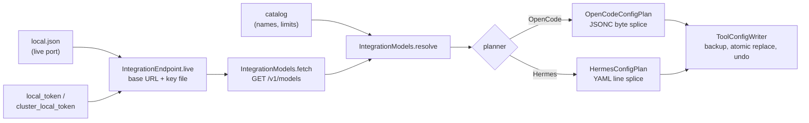

# OpenCode and Hermes config writers

> Last updated: 2026-11-08

How Darkbloom points OpenCode 2 and Hermes Agent at its local API (Only me or Both, me first) by editing their own config files: the
endpoint and key file, the models, the two planners and the safe-edit rules. This explanation is for provider
developers. `darkbloom --opencode` / `--hermes` (`start` with the flag) call them (`ToolIntegrationStep`,
`provider-swift/Sources/darkbloom/ToolIntegration/ToolIntegrationStep.swift`); for users, see
[Use it from OpenCode or Hermes](../provider/local-first.md#use-it-from-opencode-or-hermes).

## Context

OpenCode and Hermes read OpenAI-compatible providers from their own configs, and neither can discover a Darkbloom
endpoint by itself: OpenCode's built-in discovery knows Ollama, LM Studio and vLLM's native APIs and ports, and
Hermes needs a named provider with an endpoint and a key. Ollama's and oMLX's own tool integrations rewrite those
files; oMLX writes its key into them in plain text, and both YAML round trips drop the owner's comments. These
writers add one small `darkbloom` provider instead, keep everything they don't own byte for byte, and never write
the key.

## Mechanism

1. **Endpoint.** `IntegrationEndpoint.live` reads the live server's address from `local.json`, so the port is
   whatever that server bound, and takes the key file from `LocalEndpoint.keyFile(forPort:)`
   (`provider-swift/Sources/ProviderCore/Server/LocalEndpoint.swift`): the file that holds exactly the key the server
   on that port requires, `local_token` or a pair's `cluster_local_token`.
2. **Models.** `IntegrationModels.fetch` asks the endpoint's `GET /v1/models` with that key; `resolve` names each
   chat model from the catalog (`display_name`, with where it runs: this Mac, your Macs, the network), takes its
   context from the endpoint, else the catalog's maximum, its output cap as `min(max output, context / 4)` with
   `defaultOutputCap = 32_768`, and its capabilities from the catalog's names (tools on and text-only input when the
   catalog is unreachable). Image input for a model served here (this Mac, or the pair it leads or relays to) is its
   engine's: the `input_modalities` of its `this-mac` entry decide, catalog or not. So MiMo V2.6, whose catalog row
   is text only, gets image input, offline too, and a Gemma 4 pair, which serves text alone though the catalog lists
   vision, gets none (an image would be refused with 400). For a model served elsewhere (your Macs, the network), or
   one this Mac lists without `input_modalities` (a pair whose slot isn't up), the catalog's names decide, with the
   `image` the list adds (`EndpointModel.takesImages`). Reasoning follows the same rule from `supported_features`:
   for a model served here, its `this-mac` entry decides, catalog or not, and lists `reasoning` exactly when the
   model's type reasons (`LocalModelFeatures`, `provider-swift/Sources/ProviderCore/Server/LocalModelFeatures.swift`,
   which asks `ReasoningEffortPolicy.reasons`: the models that take every reasoning effort). So Qwen 3.8 27B, whose
   catalog row lacks `reasoning`, reasons in OpenCode, offline too, and a model whose effort would be ignored
   doesn't, whatever the catalog says. For a model served elsewhere, or one listed without `supported_features`, the
   catalog's names decide, with the `reasoning` the list adds (`EndpointModel.reasons`). A model the catalog doesn't
   describe (offline, or one it doesn't list) carries `IntegrationModel.fallback`, and each planner first reads its
   own entry for the model back from the file (`OpenCodeConfigPlan.modelEntries`, `HermesEdit.modelEntries`):
   `IntegrationModel.keeping` takes the entry's name, capabilities, vision and reasoning (each unless the endpoint
   settles it, `Fallback.endpointSettlesImageInput`, `Fallback.endpointSettlesReasoning`), its context when the
   endpoint gives none, and its output while the context is the one it was set for. A model with no entry keeps the
   fallbacks and is named in `ToolConfigSummary.undescribed`.
   For a model this Mac has loaded, the endpoint lists its whole context window as both the context and the max
   output (`LocalModelLimits(window:)`, `provider-swift/Sources/ProviderCore/Server/LocalRouterModels.swift`), so
   the writers give it its full context window and a quarter of it as output, not the catalog's smaller output cap
   (65,536 for a 262,144-token window whose catalog row says 32,768). A pair's leader lists the pair's own context and
   output instead (what its mode serves; it refuses a larger `max_tokens`), so a GLM pair's output stays 65,536.
   <!-- pending R-FULL: the writers give each model its full output length (the cap is a quarter of the context); only the Mac's memory bounds a request; OpenRouter is separate. -->
3. **OpenCode.** `OpenCodeConfigPlan.plan` reads the file into byte ranges with `JSONCDocument` and replaces only the
   `providers.<id>` value, or appends it in the file's indentation and trailing-comma style. The block has the base
   URL, `apiKey: "{file:<key file>}"` (under `~` in the home directory), `compatibility.maxTokensField: "max_tokens"`
   (OpenCode otherwise sends `max_completion_tokens`, which the engine ignores) and each model's name, `limit` and
   `capabilities`. The top-level `model` is set only when no global config file sets one
   (`OpenCodeConfigPlan.otherGlobalConfigSetsModel`): OpenCode loads `opencode.json`, then `opencode.jsonc`, and
   Darkbloom edits the last that exists, so a `model` added to `.jsonc` would override the owner's in `.json`.
   Project, system and managed configs load after the global ones and win over them, so a global `model` never
   replaces theirs.
4. **Hermes.** `HermesConfigPlan.plan` splices two top-level sections of `config.yaml` by lines: `providers.<id>`
   (`api`, `key_cmd: "/bin/cat <key file>"`, `transport`, `default_model`, `extra_body.max_tokens` and each model's
   `context_length` / `supports_vision`) and `model` (`provider: "custom:<id>"` and `default`; the previous endpoint's
   pins, `previousEndpointKeys`, go). Models under `minimumContext = 64_000`, Hermes' own floor, are left out;
   `extra_body.max_tokens` is the smallest output cap of the rest. Lists at their key's own indent, as PyYAML writes
   them (so oMLX's `omlx launch hermes`, and Hermes up to v0.17), are part of that key. The block says nothing of
   reasoning, which Hermes doesn't read there ([Hermes versions and limits](#hermes-versions-and-limits)).
5. **Write.** `ToolConfigWriter.apply` makes the planned edit (invariants below) and returns the file, the backup
   and the exact undo command.

## Invariants

1. No tool file holds the key: the planners take a key file's path, never a key; OpenCode's `{file:}` and Hermes'
   `key_cmd` read it at request time (`OpenCodeConfigPlan.keyReference`, `HermesConfigPlan.plan`).
2. Bytes outside the owned value or lines are unchanged: other providers, a V1 `provider` map, the owner's default
   model in OpenCode, every other Hermes section and the owner's comments. Comments inside a replaced value or on a
   replaced line are counted (`ToolConfigSummary.droppedComments`); the backup keeps them.
3. The `darkbloom` block is Darkbloom's whole: a run that changes it rewrites all of it, so a key the owner added
   inside it is replaced too (only comments are counted); the backup keeps it.
4. An edit is idempotent: the planners render deterministically, and equal bytes give `.unchanged`, with no backup and
   no write (`ToolConfigWriter.apply`). That holds without the catalog too: the file's own entries stand in for it, so
   a run offline never downgrades what a run online wrote.
5. A file a splice can't edit safely is refused before anything is written: malformed or ambiguous JSONC, a root or
   `providers` that isn't an object, and in YAML several documents, tab indentation, anchors, aliases or merge keys,
   block text, inline or multi-line values in `providers` or `model` (`JSONCDocument`, `HermesEdit.checkSection`).
6. Each identity writes its own provider (`IntegrationProvider.current`: `darkbloom`, `darkbloom-dev`), so a test
   build beside the production one adds a second block.
7. Before a change the exact bytes are copied to `<install dir>/integrations/backups/<tool>/<file>.<UTC time>`
   (folder 0700, file 0600); `keptBackups = 5` of each file name stay, so two Hermes homes share the five
   `config.yaml` slots. The new bytes replace the file in one rename
   through `AtomicFile.write` (`provider-swift/Sources/ProviderCore/Service/AtomicFile.swift`) with the file's own
   mode; a symlinked config is written through and stays a link.
8. One lock, `<install dir>/integrations/.lock`, serialises Darkbloom's own runs; the file is read again just before
   the rename, and a change by the tool's own writer re-plans the edit once and refuses the second time.

## Failure modes

| Case | Result |
|---|---|
| A backup, write or rename fails | The error is thrown; the file is as it was |
| The tool edits the file during the run | Re-planned once; then `.refused` with "it changed while Darkbloom was editing it" |
| No model has 64,000 tokens of context (Hermes) | `.refused` (kind `.models`); nothing is written |
| The endpoint lists no chat models | `.refused` (kind `.models`) for both tools |
| A dangling symlink, a folder or a file over 4 MiB (`maximumFileBytes = 4 << 20`) | `.refused` (kind `.file`) |
| Another Darkbloom run holds the lock for `lockTimeout = 10` s | `ToolConfigWriterError` |

## Hermes versions and limits

| Need | Why |
|---|---|
| Hermes v0.20.2 or later (release tag v2026.8.16) | `key_cmd` came in NousResearch/hermes-agent#86891. An older Hermes ignores it and sends its no-key placeholder, so Darkbloom answers every request with 401. `HermesVersion.keyCommandWarning` turns `hermes --version`'s first line into the one warning line `darkbloom --hermes` prints for an older Hermes |
| Config v12 (`providers:` as a mapping, with `transport` and `default_model`) | Hermes' current format; `hermes update` migrates an older `custom_providers:` list |
| `max_tokens` after a model switch | Open Hermes bug #124289 (fix #124290 not merged): a named provider's `extra_body` is dropped on `/model <model> --provider <bare name>` and on bare-named fallbacks, so those turns get the engine's 4,096-token default. New chats, and switches that name `custom:<id>`, keep it |
| The profile Hermes reads | After `hermes profile use <name>`, Hermes reads `~/.hermes/profiles/<name>/config.yaml`; the writer edits `$HERMES_HOME/config.yaml`, else `~/.hermes/config.yaml`, and the result names the file it edited |
| Reasoning per model | Hermes takes it from its catalog (models.dev) or its top-level `model_overrides` (`supports_reasoning`), not from a named provider's `models` entries, whose only capability it reads is `supports_vision`. A model neither knows keeps Hermes' reasoning-effort levels and gets `reasoning_effort` (`medium` when none is set). The writer edits only `providers` and `model`, so it writes no reasoning; every model that reasons here takes all seven efforts, and the others ignore them |

## Code map

| Concern | File, symbol |
|---|---|
| Entry point, endpoint, identity, paths | `provider-swift/Sources/darkbloom/ToolIntegration/ToolIntegration.swift` (`ToolIntegration.configure`, `IntegrationEndpoint.live`, `IntegrationProvider`) |
| Models | `provider-swift/Sources/darkbloom/ToolIntegration/IntegrationModels.swift` (`IntegrationModels.fetch`, `resolve`) |
| OpenCode | `provider-swift/Sources/darkbloom/ToolIntegration/OpenCodeConfigPlan.swift`, `provider-swift/Sources/darkbloom/ToolIntegration/JSONCDocument.swift` |
| Hermes | `provider-swift/Sources/darkbloom/ToolIntegration/HermesConfigPlan.swift` (`HermesConfigPlan.plan`, `previousEndpointKeys`), `provider-swift/Sources/darkbloom/ToolIntegration/HermesVersion.swift` (`HermesVersion.keyCommandWarning`) |
| Plans and refusals | `provider-swift/Sources/darkbloom/ToolIntegration/ToolConfigPlan.swift` |
| Safe edits | `provider-swift/Sources/darkbloom/ToolIntegration/ToolConfigWriter.swift` (`ToolConfigWriter.apply`) |
| Tests | `provider-swift/Tests/DarkbloomCLITests/ToolIntegration/`, `scripts/integrations/opencode-smoke.sh` |

## Related

- [The local API](../provider/direct-mode.md): its address, key and key files.
- [Testing the config writers](../developer/test.md#opencode-and-hermes-config-writers).
- [Configuration reference](../reference/configuration.md#non-darkbloom_-variables-the-provider-honours):
  `XDG_CONFIG_HOME` and `HERMES_HOME`.
