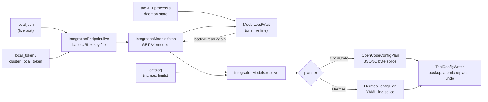

# OpenCode and Hermes config writers

> Last updated: 2026-11-08

How Darkbloom points OpenCode 2 and Hermes Agent at its local API (Only me or Both, me first) by editing their own config files: the
endpoint and key file, the models, the two planners and the safe-edit rules. This explanation is for provider
developers. `darkbloom --opencode` / `--hermes` (`start` with the flag) call them (`ToolIntegrationStep`,
`provider-swift/Sources/darkbloom/ToolIntegration/ToolIntegrationStep.swift`); for users, see
[Use it from OpenCode or Hermes](../provider/local-first.md#use-it-from-opencode-or-hermes).

## Context

OpenCode and Hermes read OpenAI-compatible providers from their own configs, and neither can discover a Darkbloom
endpoint by itself: OpenCode's built-in discovery knows Ollama, LM Studio and vLLM's native APIs and ports, and
Hermes needs a named provider with an endpoint and a key. Ollama's and oMLX's own tool integrations rewrite those
files; oMLX writes its key into them in plain text, and both YAML round trips drop the owner's comments. These
writers add one small `darkbloom` provider instead, keep everything they don't own byte for byte, and never write
the key.

## Mechanism

1. **Endpoint.** `IntegrationEndpoint.live` reads the live server's address from `local.json`, so the port is
   whatever that server bound, and takes the key file from `LocalEndpoint.keyFile(forPort:)`
   (`provider-swift/Sources/ProviderCore/Server/LocalEndpoint.swift`): the file that holds exactly the key the server
   on that port requires, `local_token` or a pair's `cluster_local_token`. The endpoint serves the pair
   (`servesThePair`) when `local.json`'s pid is this Mac's running part of a pair
   (`ClusterPairSummary.runningPartPID()`), as `status` decides whose API it is.
2. **Models.** `IntegrationModels.fetch` asks the endpoint's `GET /v1/models` with that key; `resolve` names each
   chat model from the catalog (`display_name`, with where it runs: this Mac, or your pair when the endpoint serves
   it, whatever its size; your Macs; the network), takes its
   context from the endpoint, else the catalog's maximum, its output cap as `min(max output, context / 4)` with
   `defaultOutputCap = 32_768`, and its capabilities from the catalog's names (tools on and text-only input when the
   catalog is unreachable). Image input for a model served here (this Mac, or the pair it leads or relays to) is its
   engine's: the `input_modalities` of its `this-mac` entry decide, catalog or not. So MiMo V2.6, whose catalog row
   is text only, gets image input, offline too, and a Gemma 4 pair, which serves text alone though the catalog lists
   vision, gets none (an image would be refused with 400). For a model served elsewhere (your Macs, the network), or
   one this Mac lists without `input_modalities` (a pair whose slot isn't up), the catalog's names decide, with the
   `image` the list adds (`EndpointModel.takesImages`). Reasoning follows the same rule from `supported_features`:
   for a model served here, its `this-mac` entry decides, catalog or not, and lists `reasoning` exactly when the
   model's type reasons (`LocalModelFeatures`, `provider-swift/Sources/ProviderCore/Server/LocalModelFeatures.swift`,
   which asks `ReasoningEffortPolicy.reasons`: the models that take every reasoning effort). So Qwen 3.8 27B, whose
   catalog row lacks `reasoning`, reasons in OpenCode, offline too, and a model whose effort would be ignored
   doesn't, whatever the catalog says. For a model served elsewhere, or one listed without `supported_features`, the
   catalog's names decide, with the `reasoning` the list adds (`EndpointModel.reasons`). A model the catalog doesn't
   describe (offline, or one it doesn't list) carries `IntegrationModel.fallback`, and each planner first reads its
   own entry for the model back from the file (`OpenCodeConfigPlan.modelEntries`, `HermesEdit.modelEntries`):
   `IntegrationModel.keeping` takes the entry's name, capabilities, vision and reasoning (each unless the endpoint
   settles it, `Fallback.endpointSettlesImageInput`, `Fallback.endpointSettlesReasoning`), its context when the
   endpoint gives none, and its output while the context is the one it was set for. A model with no entry keeps the
   fallbacks and is named in `ToolConfigSummary.undescribed`.
   For a model this Mac has loaded, the endpoint lists its whole context window as both the context and the max
   output (`LocalModelLimits(window:)`, `provider-swift/Sources/ProviderCore/Server/LocalRouterModels.swift`), so
   the writers give it its full context window and a quarter of it as output, not the catalog's smaller output cap
   (65,536 for a 262,144-token window whose catalog row says 32,768). A pair's leader lists the pair's own context and
   output instead (what its mode serves; it refuses a larger `max_tokens`), so a GLM pair's output stays 65,536.
   <!-- pending R-FULL: the writers give each model its full output length (the cap is a quarter of the context); only the Mac's memory bounds a request; OpenRouter is separate. -->
   Before the models are resolved, `ModelLoadWait.run` waits while the local API's own process still loads a model
   this Mac lists for its start: this Mac's `/v1/models` gives a model's own limits (its window, above) only once it
   is loaded, and the router may fill the catalog's in until then (on one Mac its `input_modalities` are listed loaded
   or not). `ModelLoads.reported` believes only the daemon state that process wrote (its pid is `local.json`'s):
   `startupPreloadPendingModels` and `warmModels`; the coordinator-less server (Only me) writes none of them and loads
   before it listens. Where that state can't tell (there is none, it is another process's or another schema's, or the
   API is a pair's, whose process preloads nothing or writes no state), nothing is waited for, as before the wait;
   only a state that keeps naming a model as pending holds the start, for at most the deadline. An answer naming
   nothing loaded and nothing to load is asked again `settleSeconds` (1 s) later, for a provider whose API answered
   before it said what it loads. Then the list is read again. The wait draws one `LiveLine` on a terminal (else a
   start and an end line), takes SIGINT only while it runs (`InterruptWatch`) and ends after `defaultTimeout`
   (600 s); a timeout, a model that didn't load, or Ctrl-C writes nothing (`ToolIntegrationStep.waitForModels`).
   Ctrl-C is asked for right after each look, before "nothing loading" can end the wait, and once more as the wait
   returns, before the list is read again. The wait's `.ready` carries what the process has loaded by its own word
   (`warmModels`; none from Only me's server or without a state of its own), and the "run again" line names this
   Mac's models it hasn't (`ToolIntegrationStep.notLoaded`); without that word, those `/v1/models` lists without a
   context. The word counts because a route that dials out lists the catalog's limits for a model that isn't loaded.
   The wait is single-Mac for now: a pair's API can't tell (above), and a pair start without a terminal waits for the
   pair to serve instead (`ClusterPairCommands`).
3. **OpenCode.** `OpenCodeConfigPlan.plan` reads the file into byte ranges with `JSONCDocument` and replaces only the
   `providers.<id>` value, or appends it in the file's indentation and trailing-comma style. The block has the base
   URL, `apiKey: "{file:<key file>}"` (under `~` in the home directory), `compatibility.maxTokensField: "max_tokens"`
   (OpenCode otherwise sends `max_completion_tokens`, which the engine ignores) and each model's name, `limit` and
   `capabilities`. The top-level `model` is set only when no global config file sets one, so Darkbloom never sets a
   default over the owner's: Darkbloom edits the global file OpenCode loads last, where a `model` would win over the
   other one's ([OpenCode's config order](#opencodes-config-order)). The edited file's own `model` wins over the other
   file's (`OpenCodeConfigPlan.otherGlobalDefault`, merged by `GlobalDefault.merged`): a name stays and is named
   (`ToolConfigSummary.keptDefault`); `""`, `null`, two `model` keys or a file that can't be read stays without a
   name.
4. **Hermes.** `HermesConfigPlan.plan` splices two top-level sections of `config.yaml` by lines: `providers.<id>`
   (`api`, `key_cmd: "/bin/cat <key file>"`, `transport`, `default_model`, `extra_body.max_tokens` and each model's
   `context_length` / `supports_vision`) and `model` (`provider: "custom:<id>"` and `default`; the previous endpoint's
   pins, `previousEndpointKeys`, go). Models under `minimumContext = 64_000`, Hermes' own floor, are left out;
   `extra_body.max_tokens` is the smallest output cap of the rest. Lists at their key's own indent, as PyYAML writes
   them (so oMLX's `omlx launch hermes`, and Hermes up to v0.17), are part of that key. The main model is the one
   already set when it is Darkbloom's and still usable, else the nearest usable one that isn't on the network (this
   Mac or its pair, then your Macs); the one it replaces is named with its provider
   (`ToolConfigSummary.replacedDefault`, `gpt-6-astra via opencodex`). The block says nothing of reasoning, which
   Hermes doesn't read there ([Hermes versions and limits](#hermes-versions-and-limits)).
5. **Write.** `ToolConfigWriter.apply` makes the planned edit (invariants below) and returns the file, the backup
   and the exact undo command. `ToolIntegrationStep.lines` says them, with the default model on a line of its own
   (`openCodeDefault`; Hermes' names the main model before).
6. **Follow the address.** A start without a tool flag that serves a local API reads each tool's provider block back
   (`OpenCodeConfigPlan.pointer`, `HermesConfigPlan.pointer`: the base URL, and the file `{file:}` or
   `key_cmd: /bin/cat <file>` reads) and compares it with that API: its base URL and `LocalEndpoint.tokenPath()`, or
   another file holding the same key. `ToolAddress.notice` says in one line which tools miss it and names
   `darkbloom --opencode` / `--hermes`; it never writes (`Start.noteToolsPointingElsewhere`). Addresses compare by
   `ToolAddress.sameAddress`: scheme, host and port in any case (the scheme's own port when none is given) and the
   path without one `/` at its end; `localhost`, `127.0.0.1` and `::1` are one host, and so is this Mac's Bonjour name
   (`Local.localHostName()`, with `.local`) for an API on every address (`ToolAddress.thisMacsNames`). Single-Mac
   only: a paired Mac's start starts the pair and doesn't compare.

### OpenCode's config order

What Darkbloom relies on about the order OpenCode 2 reads its configs in, from its source at release `v2.2.6`
([`dc2ffcf8bf`](https://github.com/anomalyco/opencode/tree/dc2ffcf8bf26f9e669b6aa22b95f50e12be15e06)). The code
keeps it in one place too: `OpenCodeConfigPlan.globalFileNames`.

| OpenCode 2 | Its source | Darkbloom |
|---|---|---|
| Loads `opencode.json`, then `opencode.jsonc`, from its global folder, and not OpenCode 1's `config.json` | [`discovery.ts`](https://github.com/anomalyco/opencode/blob/dc2ffcf8bf26f9e669b6aa22b95f50e12be15e06/packages/core/src/config/discovery.ts) (`names`), [`config.ts`](https://github.com/anomalyco/opencode/blob/dc2ffcf8bf26f9e669b6aa22b95f50e12be15e06/packages/core/src/config.ts) (`loadDirectory`); test "does not load legacy config.json files" in [`config.test.ts`](https://github.com/anomalyco/opencode/blob/dc2ffcf8bf26f9e669b6aa22b95f50e12be15e06/packages/core/test/config/config.test.ts) | `globalFileNames` |
| The default model is the `model` of the last config loaded that sets one | [`provider.ts`](https://github.com/anomalyco/opencode/blob/dc2ffcf8bf26f9e669b6aa22b95f50e12be15e06/packages/core/src/config/plugin/provider.ts) (`Config.latest(loaded.entries, "model")`) | `GlobalDefault.merged` |
| Saves to the last of the two files that exists, else to a new `opencode.jsonc` | [`config.ts`](https://github.com/anomalyco/opencode/blob/dc2ffcf8bf26f9e669b6aa22b95f50e12be15e06/packages/core/src/config.ts) (`update`) | `configFile` edits the same file: the global one loaded last |
| Loads remote (`.well-known/opencode`) and integration configs before the global files, and `OPENCODE_CONFIG`'s file, a project's `opencode.json`, `opencode.jsonc` and `.opencode` folder, `OPENCODE_CONFIG_CONTENT` and the managed files after them | [`config.ts`](https://github.com/anomalyco/opencode/blob/dc2ffcf8bf26f9e669b6aa22b95f50e12be15e06/packages/core/src/config.ts) (`load`) | Reads only the global files: a `model` loaded after them wins over Darkbloom's too, and Darkbloom's wins over a remote or integration one |
| With `OPENCODE_CONFIG_DIR` set, reads that folder as its global one | [`global.ts`](https://github.com/anomalyco/opencode/blob/dc2ffcf8bf26f9e669b6aa22b95f50e12be15e06/packages/util/src/global.ts) | Not followed: `configFile` reads `$XDG_CONFIG_HOME/opencode`, else `~/.config/opencode` |

## Invariants

1. No tool file holds the key: the planners take a key file's path, never a key; OpenCode's `{file:}` and Hermes'
   `key_cmd` read it at request time (`OpenCodeConfigPlan.keyReference`, `HermesConfigPlan.plan`).
2. Bytes outside the owned value or lines are unchanged: other providers, a V1 `provider` map, the owner's default
   model in OpenCode, every other Hermes section and the owner's comments. Comments inside a replaced value or on a
   replaced line are counted (`ToolConfigSummary.droppedComments`); the backup keeps them.
3. OpenCode's default is never set over one the owner set in a global file: `model` is written only when none sets
   one (`OpenCodeConfigPlan.plan`, `GlobalDefault.merged`), and the start names the one that stays. Hermes is the
   exception: its main model is always Darkbloom's, as `ollama launch` and `omlx launch` make theirs, and the start
   names the one it replaced (`ToolConfigSummary.replacedDefault`).
4. The `darkbloom` block is Darkbloom's whole: a run that changes it rewrites all of it, so a key the owner added
   inside it is replaced too (only comments are counted); the backup keeps it.
5. An edit is idempotent: the planners render deterministically, and equal bytes give `.unchanged`, with no backup and
   no write (`ToolConfigWriter.apply`). That holds without the catalog too: the file's own entries stand in for it, so
   a run offline never downgrades what a run online wrote. A model's name says where it runs, and is read back
   without it (`IntegrationModel.displayName(in:)`), so it stays the same while the model runs in the same place
   (`(your pair)` included). A default Darkbloom set is found again and left alone.
6. A file a splice can't edit safely is refused before anything is written: malformed or ambiguous JSONC, a root or
   `providers` that isn't an object, and in YAML several documents, tab indentation, anchors, aliases or merge keys,
   block text, inline or multi-line values in `providers` or `model` (`JSONCDocument`, `HermesEdit.checkSection`).
7. Each identity writes its own provider (`IntegrationProvider.current`: `darkbloom`, `darkbloom-dev`), so a test
   build beside the production one adds a second block.
8. Before a change the exact bytes are copied to `<install dir>/integrations/backups/<tool>/<file>.<UTC time>`
   (folder 0700, file 0600); `keptBackups = 5` of each file name stay, so two Hermes homes share the five
   `config.yaml` slots. The new bytes replace the file in one rename
   through `AtomicFile.write` (`provider-swift/Sources/ProviderCore/Service/AtomicFile.swift`) with the file's own
   mode; a symlinked config is written through and stays a link.
9. One lock, `<install dir>/integrations/.lock`, serialises Darkbloom's own runs; the file is read again just before
   the rename, and a change by the tool's own writer re-plans the edit once and refuses the second time.

## Failure modes

| Case | Result |
|---|---|
| A backup, write or rename fails | The error is thrown; the file is as it was |
| The tool edits the file during the run | Re-planned once; then `.refused` with "it changed while Darkbloom was editing it" |
| No model has 64,000 tokens of context (Hermes) | `.refused` (kind `.models`); nothing is written |
| The endpoint lists no chat models | `.refused` (kind `.models`) for both tools |
| A dangling symlink, a folder or a file over 4 MiB (`maximumFileBytes = 4 << 20`) | `.refused` (kind `.file`) |
| Another Darkbloom run holds the lock for `lockTimeout = 10` s | `ToolConfigWriterError` |
| A model is still loading after `ModelLoadWait.defaultTimeout`, didn't load, or Ctrl-C stops the wait | Nothing is written; one line names the next step |

## Hermes versions and limits

| Need | Why |
|---|---|
| Hermes v0.20.2 or later (release tag v2026.8.16) | `key_cmd` came in NousResearch/hermes-agent#86891. An older Hermes ignores it and sends its no-key placeholder, so Darkbloom answers every request with 401. `HermesVersion.keyCommandWarning` turns `hermes --version`'s first line into the one warning line `darkbloom --hermes` prints for an older Hermes |
| Config v12 (`providers:` as a mapping, with `transport` and `default_model`) | Hermes' current format; `hermes update` migrates an older `custom_providers:` list |
| `max_tokens` after a model switch | Open Hermes bug #124289 (fix #124290 not merged): a named provider's `extra_body` is dropped on `/model <model> --provider <bare name>` and on bare-named fallbacks, so those turns get the engine's 4,096-token default. New chats, and switches that name `custom:<id>`, keep it |
| The profile Hermes reads | After `hermes profile use <name>`, Hermes reads `~/.hermes/profiles/<name>/config.yaml`; the writer edits `$HERMES_HOME/config.yaml`, else `~/.hermes/config.yaml`, and the result names the file it edited |
| Reasoning per model | Hermes takes it from its catalog (models.dev) or its top-level `model_overrides` (`supports_reasoning`), not from a named provider's `models` entries, whose only capability it reads is `supports_vision`. A model neither knows keeps Hermes' reasoning-effort levels and gets `reasoning_effort` (`medium` when none is set). The writer edits only `providers` and `model`, so it writes no reasoning; every model that reasons here takes all seven efforts, and the others ignore them |

## Code map

| Concern | File, symbol |
|---|---|
| Entry point, endpoint, identity, paths | `provider-swift/Sources/darkbloom/ToolIntegration/ToolIntegration.swift` (`ToolIntegration.configure`, `IntegrationEndpoint.live`, `servesThePair`, `IntegrationProvider`) |
| Models | `provider-swift/Sources/darkbloom/ToolIntegration/IntegrationModels.swift` (`IntegrationModels.fetch`, `resolve`, `IntegrationModel.Location`) |
| OpenCode | `provider-swift/Sources/darkbloom/ToolIntegration/OpenCodeConfigPlan.swift` (`plan`, `globalFileNames`: OpenCode's config order; `GlobalDefault.merged`, `otherGlobalDefault`, `globalDefault(in:)`), `provider-swift/Sources/darkbloom/ToolIntegration/JSONCDocument.swift` |
| What a start says | `provider-swift/Sources/darkbloom/ToolIntegration/ToolIntegrationStep.swift` (`lines`, `changed`, `openCodeDefault`, `alreadyServes`) |
| Hermes | `provider-swift/Sources/darkbloom/ToolIntegration/HermesConfigPlan.swift` (`HermesConfigPlan.plan`, `previousEndpointKeys`), `provider-swift/Sources/darkbloom/ToolIntegration/HermesVersion.swift` (`HermesVersion.keyCommandWarning`) |
| Plans and refusals | `provider-swift/Sources/darkbloom/ToolIntegration/ToolConfigPlan.swift` |
| The wait for this Mac's models | `provider-swift/Sources/darkbloom/ToolIntegration/ModelLoadWait.swift` (`ModelLoadWait`, `ModelLoads`, `LiveLine`, `InterruptWatch`) |
| Where a tool points, after a start without a tool flag | `provider-swift/Sources/darkbloom/ToolIntegration/ToolAddress.swift` (`ToolAddress.notice`), `provider-swift/Sources/darkbloom/Start/StartCommand+Tools.swift` (`Start.noteToolsPointingElsewhere`) |
| Safe edits | `provider-swift/Sources/darkbloom/ToolIntegration/ToolConfigWriter.swift` (`ToolConfigWriter.apply`) |
| Tests | `provider-swift/Tests/DarkbloomCLITests/ToolIntegration/`, `scripts/integrations/opencode-smoke.sh` |

## Related

- [The local API](../provider/direct-mode.md): its address, key and key files.
- [Testing the config writers](../developer/test.md#opencode-and-hermes-config-writers).
- [Configuration reference](../reference/configuration.md#non-darkbloom_-variables-the-provider-honours):
  `XDG_CONFIG_HOME` and `HERMES_HOME`.
