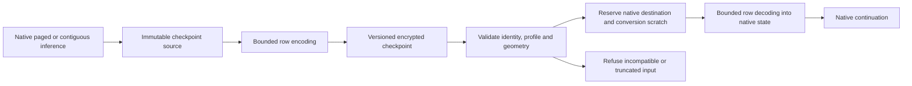

# Native inference and quantized checkpoints

> Last updated: 2026-10-09

Status: **In progress** - 2026-10-09 - independent checkpoint precision is being implemented in the provider and SDK; integration, qualification and review remain required.

Keep native attention execution as the provider default while compressing
eligible encrypted SSD checkpoints independently. Restore those checkpoints
into native serving state, not a live packed cache. This record defines the
implementation and acceptance plan; it does not claim measured performance,
quality acceptance, release or deployment.

## Decisions

| Surface | Planned contract |
|---|---|
| Live precision | `engine_v2_kv_quantization` and `engine_v2_kv_quantization_by_model`, `DARKBLOOM_CBV2_KV_QUANTIZATION`, and benchmark `--kv-quantization` select live execution; the provider default becomes `native` |
| Checkpoint precision | `engine_v2_kv_checkpoint_quantization` and `engine_v2_kv_checkpoint_quantization_by_model`, `DARKBLOOM_CBV2_CHECKPOINT_QUANTIZATION`, and benchmark `--kv-checkpoint-quantization` select storage; the provider default is `balanced` |
| Profiles | Both controls accept `balanced`, `k8v4`, `k8v8` and `native`; a persisted explicit live `balanced` setting still selects live packed execution |
| SDK boundary | `EngineV2(..., completePrefixCache: ..., checkpointQuantization: PagedKVQuantizationConfig? = nil, ...)` keeps checkpoint compression independent of the serving pool; an absent option preserves existing SDK checkpoint behavior |
| Eligibility | Eligible native paged and contiguous attention support checkpoint encoding without forcing a different serving backend; resolve the effective profile from the actual model, geometry and cache contract |
| Exclusions | MiMo remains native for both controls before parsing irrelevant overrides; persistent assistant state, native-block diffusion and unsupported geometry retain native storage until qualified |

The existing optional live packed path remains available with its own
inference kernels, identities and tests. The
[live-KV design](runtime-kv-compression.md) and its
[dated measurements](../reports/2026-10-09-runtime-kv-quantization.md) remain
historical evidence, not proof of storage-only quality or performance.
Existing disk retention, write caps, encryption, tenant isolation and cache
disable controls remain unchanged; their canonical contract is the
[SSD cache reference](../reference/ssd-kv-cache.md).

## Data and ownership

1. Encode older eligible attention rows using the selected quantization
   profile. Preserve exact recent rows and native recurrent/auxiliary state.
   A decoded old row is an approximation: restoring a native dtype does not
   recover its original bits or guarantee the original continuation.
2. Give storage-only native paged and contiguous layouts explicit versioned
   identities separate from existing native-exact and live-packed layouts.
   Confirm final layout names, metadata and effective-resolution interfaces
   against the implementation before documenting them as current behavior.
3. Validate model/build, tenant, source layout, profile, native dtype, geometry
   and byte lengths before adoption. Truncation or incompatible identity must
   fail without publishing partial state or borrowing another tenant's entry.
4. Retain immutable source ownership through actual encoding completion.
   Reserve native destination pages or arrays, native auxiliary state and
   bounded conversion scratch before restore allocation. Compressed disk
   bytes are never native page credit or a process-RAM estimate.
5. Keep conversion bounded rather than materializing a second full native
   history. Cancellation, refusal and errors retire source/destination owners
   only after submitted work completes; partial output is not reusable.
6. Record requested and effective precision separately where fallback matters.
   Do not label native fallback as compressed storage or admit native serving
   memory using compressed sizes. Preserve existing memory safeguards.

## Acceptance gates

- CPU regression tests cover independent defaults and overrides, config
  round trips, persisted explicit live settings, early MiMo exclusion,
  effective fallback, format identity, malformed/truncated input, tenant and
  profile refusal, reservations, cancellation and cleanup.
- Source-matched Metal and GPU tests cover eligible paged and contiguous
  round trips, native continuation, reference tolerances for lossy rows,
  exact recent/recurrent/auxiliary state, window/shared-owner boundaries and
  the unchanged explicit live packed path. Preserve exact-native controls
  rather than weakening them to accommodate lossy checkpoints.
- Real encrypted-cache qualification separates cold inference, warm reuse,
  restart/SSD restore, cross-tenant refusal, cancellation and recovery. Compare
  native-live/native-storage with native-live/quantized-storage using matched
  model identity, prompts, token counts and source-matched binaries. Record
  output/quality observations, TTFT, TPS, checkpoint bytes, native restore
  allocation and measured peak memory independently; no performance or memory
  guarantee follows from an encoding ratio.
- After the first working version passes focused checks, a dedicated refactor
  agent performs behavior-preserving cleanup, followed by independent review
  and repeated affected validation. These are separate from design review.
- Fold verified behavior into the canonical architecture and reference pages,
  update the topic changelog, and run `make docs-impact-check BASE=origin/master` plus
  `make docs-check`. Mark only this record's status line implemented after
  confirmation; leave its body frozen.
- Update existing provider PR #1418 and SDK PR #298 with signed, verified
  commits and before/after behavior-and-code diagrams. Release, deployment and
  production changes are outside this plan.

## Documentation ownership

The [KV architecture](../architecture/kv-cache-quantization.md) owns the
execution/storage distinction and numerical limitations. The
[SSD reference](../reference/ssd-kv-cache.md) owns formats and compatibility;
the [CLI reference](../provider/cli-reference.md) and
[configuration reference](../reference/configuration.md) own controls and
defaults. The [prefix-cache architecture](../architecture/prefix-cache.md),
[cache-routing architecture](../architecture/cache-aware-routing.md) and
[inference architecture](../architecture/inference.md) link those contracts
and describe their own lifecycle effects. New measurements belong in a
separate dated report, not in the earlier frozen report or this plan.
