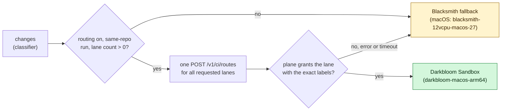
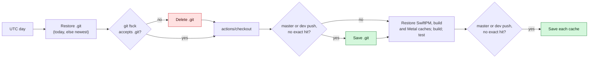

# Build The Provider And Landing

> Last updated: 2026-11-04

Build the provider, its source-matched native resources, and the independent
landing site from this repository. Backend, sidecar, console and admin builds
belong to the sibling platform repository.


For the Bonsai 9B request-generation regression, build the control-only
`darkbloom-cluster-pair-check` product in `libs/darkbloom-cluster-worker` and run
[the tokenizer metadata check](test.md) with the exact model metadata directory.
This executable links the prompt tokenizer and qualification driver, without
loading the native model runtime or requiring a Metal library.

The model-free local HTTP parity suite uses the normal ProviderCore test build:
`swift test --package-path provider-swift --filter ClusterAPIParityTests`.
It binds only loopback listeners and scripted engines, without model downloads
or GPU execution. See [test coverage and limits](test.md).

## Prerequisites

Use sibling `Darkbloom/d-inference` and `Darkbloom/darkbloom-platform` checkouts.
Verify your remote and branch first; do not upload backend code here.
Install the versions in `mise.toml` and initialize recursive submodules:

```bash
mise install
git submodule update --init --recursive
```

Native provider builds require Apple Silicon and the Xcode/Metal toolchain
selected by `scripts/prepare-provider-release-toolchain.sh`. Do not substitute
an arbitrary prebuilt metallib or infer GPU qualification from compilation.
Keep separate worktrees/output directories for independent native builds;
never share an active Swift scratch path or another suite's GPU reservation.

After changing provider authorization summaries, rebuild the provider test
product before running the [authorization guidance tests](test.md#provider-authorization-guidance).
They exercise shared production decisions without invoking status/doctor's
host probes or native Apple operations; signed-release qualification remains
separate.

## Cluster metadata check builds

The worker capability and worker startup-argument checks link the actual
`DarkbloomClusterRuntime` through `libs/darkbloom-cluster/Tests/Support/native-metadata.sh`.
GLM catalog metadata uses MLXLLM types, so these checks need the pinned native
dependencies and Xcode toolchain even though they execute only metadata and
argument admission. They do not construct a model, initialize a GPU group or
prove native inference.

Their default build directory is a canonical temporary directory outside the
checkout. To reuse this build between the two serial checks, set
`DARKBLOOM_CLUSTER_METADATA_BUILD_ROOT` to a dedicated scratch directory outside
file-sync folders. Never reuse an active provider or worker build directory.
See [Two-Mac Cluster Checks](test.md#two-mac-cluster-checks) for execution scope.

## Build

The Bonsai 9B cluster tests link the same pinned Runtime and MLX libraries as
the worker. Use an isolated scratch directory and source-matched MLX resources
even for CPU lazy-shell tests; compilation is not pair qualification. The
focused suites and their scope are listed in [the test guide](test.md#prerequisites).

```bash
make provider-build
make landing-install landing-build
```

`make provider-build` builds Swift products and stages the metallib through
`scripts/fetch-metallib.sh`. The kernel source is nested under
`libs/mlx-swift/Source/Cmlx/mlx`, matching the Cmlx target. Top-level `libs/mlx`
is a separate dependency pin. Native resources must match the compiled host
library; a warm cache cannot waive that requirement.

The pinned core orders fast Metal fence waits after earlier kernels in the
current concurrent pass as well as prior passes. Rebuild the Cmlx host object
when changing this pin. This fence change has no shader or C-header delta;
continue checking resource identity against the actual nested core.

The SDK has independent test products under `libs/mlx-swift-lm`; rebuild and
stage their resources as well as the provider test product when validating a
native runtime change. The SDK's `MiMoOpenRouter` media fixtures are test-only
resources, not provider product resources. MiMo provider fixture preparation
uses bounded synthetic weights; the genuine audio codec is a separately
hash-verified input. See [provider and SDK tests](test.md#provider-and-sdk).

Building the GLM5Next target, media, MTP and loader candidates does not
register the architecture with the model factories or provider. Follow the
[prerequisite test procedure](test.md#glm5next-prerequisite-tests); do not use a
successful SDK build as proof of the [complete integration](../design/glm53-flash-native.md).

The GLM official template uses numeric attribute access such as
`content.0.type`, which the pinned Swift-Jinja 2.3.6 does not parse. Builds use
the ordinary locked Swift-Jinja pin with no SwiftPM edit mode or dependency
patch. Our `EigenLabs/GLM-5.3-Flash-MLX-NVFP4-mtp` artifact instead ships a
separately identified template that writes those accesses as `[0]` subscripts.
Its derivation and equivalence evidence are in
`fixtures/prompt-contract/glm53-flash/`. Do not modify ignored build checkouts or
rewrite another artifact's template to hide the parser limitation.

The SSD test working-volume selector is runtime-only fixture configuration;
it does not change the provider cache or Swift/native build inputs. Rebuild
provider test products after fixture-source changes before using `--skip-build`,
then apply the optional directory override at execution time as documented in
[SSD test working volume](test.md#ssd-test-working-volume).

MiMo tool-schema regression checks require a rebuilt provider test product after
source changes. Reuse only an inactive, owned scratch directory with the selected
public gitlinks and locked package graph; record the resulting test executable
identity before any `--skip-build` selection. The [focused fixture recipe](mimo-prompt-fixtures.md#tool-schema-ingress-regressions)
uses metadata and scripted generation, not a substitute native runtime or a
binary copied from a different dependency composition.

Native checkpoint and live-attention precision changes require the matching
provider and SDK pins. Build both test products before the
[checkpoint-storage gates](test.md#native-inference-checkpoint-storage-qualification);
a new CLI alone does not update an old test binary or qualify a checkpoint format.

`landing/` has its own npm lockfile, configuration and API routes. It needs a
Next.js server runtime, not static file hosting. Follow its [README](../../landing/README.md)
for local development; keep production credentials out of builds and tests.

### Cluster Packages

`provider-swift/Package.swift` depends on the local package `libs/darkbloom-cluster`
(protocol, process, security, remote and placement products linked into
`ProviderCore`) and declares the test-only `cluster-member-fixture-child`
executable target. The cluster worker is its own package,
`libs/darkbloom-cluster-worker`, built natively for macOS 26.2 with the real
JACCL backend by `libs/darkbloom-cluster-worker/build-native-worker.sh`, or for
a release by `scripts/build-cluster-helpers.sh`
([cluster helpers](../operations/provider-release.md#cluster-helpers)). Build
the worker with the same source-matched metallib as the provider.

The Qwen3.5/3.6 MoE tensor-parallel path uses these same native targets and pinned
SDK; it introduces no alternate build flags. Run its
[focused metadata and tensor checks](test.md#focused-qwen35-moe-tensor-parallel-checks)
before installing a worker for paired hardware qualification.

## Electron Desktop App

`make desktop-install`, `make desktop-build`, and `make desktop-package` build
and package the app without publishing. The frontend uses the Swift CLI's local
API. See [desktop development](desktop-app.md) for the isolated preview,
component boundary, and signed release qualification.

For a Developer ID signed desktop DMG with a bundled review API, follow the
[signed local preview procedure](desktop-app.md#signed-local-preview).
`desktop-app/scripts/package-preview.mjs` keeps this build separate from the
regular release app and verifies the bundled API's signing team.

`make desktop-api-test` exercises the real Swift control API against isolated
local fixtures (`scripts/test-desktop-api.py`). The fixture never starts a
serving provider or changes its credentials.

## SDK 27 Release Builds And Caches

Release compilation and SDK qualification use separate
`blacksmith-12vcpu-macos-27` runners. Signed validation's older-OS smoke uses
`blacksmith-12vcpu-macos-26`: it runs the signed app and compiles nothing.
`scripts/prepare-provider-release-toolchain.sh` selects the toolchain after
checkout. It tries the image's Xcode first, then each installed
`/Applications/Xcode*.app`, newest first. It takes the first Xcode with SDK
27.2, else the first with another accepted SDK. An explicit `DEVELOPER_DIR` is
the only candidate. When it selects another Xcode than the image's, it exports
`DEVELOPER_DIR`, so Metal, `xcodebuild` and signing use the same Xcode.
`DARKBLOOM_PROVIDER_TOOLCHAIN` sets what it accepts:

| Mode | Used by | SDK | Apple Swift |
|---|---|---|---|
| `release` | `release-provider.yml`, `provider-signing-validation.yml`, master and dispatched SDK 27 release preparation | 27.2 (Xcode 27.2) | 6.4.2 |
| `qualification` (default) | Provider CI (`provider-tests.yml`, called by `ci-dev.yml` and `ci-master.yml`), pull-request SDK 27 release preparation, the Darkbloom Sandbox macOS CI base check | 27.2, or 27.0 (Xcode 27.1) | 6.4 or 6.4.x |

SDK 27.0 stays accepted in `qualification` only while the Darkbloom Sandbox
production macOS CI base is on Xcode 27.1. Remove it when that base is on
Xcode 27.2. Darkbloom Sandbox's `images/macos/pins.env` mirrors the
`qualification` values.

SDK 27.2 declares Foundation's `Date.>=` and `Date.<=` as back-deployed before
macOS 27.2. Swift 6.4.2 compiles each `Date >= Date` and `Date <= Date` into a
call through a weak import, behind an OS version check. Pre-release macOS 27.2
builds (for example 26B5091g) pass that check but do not export the symbols, so
the call jumps to address 0. Do not compare Dates with `>=` or `<=`. Write
`a.timeIntervalSince(b) >= 0` for `a >= b` and `a.timeIntervalSince(b) <= 0`
for `a <= b`; `<`, `>` and `==` are safe. Two checks keep the pattern out:

| Check | Where it runs | What it reads |
|---|---|---|
| `scripts/check-date-comparisons.py` | The `Provider Tests` gate of `provider-tests.yml` (every CI run, dev included) and Release Integrity (`ci-master.yml`) | Shipped Swift source. It finds Dates by syntax, by the declaration in scope and by declared names. It refuses `>=` or `<=` passed as a function. It has no types, so it can miss a comparison |
| `scripts/check-provider-weak-imports.py` | The release lane of `.github/actions/provider-release-build`, after the products and cluster helpers are built | The built binaries (`nm -m`). It fails on any import of the two symbols and names the calling functions (`otool -tV`) |

The `scripts/provider-release-swift.sh` wrapper keeps native SwiftPM
compilation and linking on the selected SDK. Ordinary development retains the
package's Swift 6.3 minimum; release evidence must use the selected release
toolchain.

Pinned Python 3.12.10 and checksum-verified CMake 3.31.12 provide missing build
tools. `scripts/install-release-cmake.sh` uses the CMake 3.31.12 that Darkbloom macOS
images unpack from the same checksum-verified archive into
`$RUNNER_TOOL_CACHE/cmake/3.31.12/universal`, when its `universal.complete`
marker exists and the binary reports that exact version; elsewhere it
downloads and verifies the 80 MB archive. `scripts/prepare-metal-toolchain.py` requires a working compiler probe,
not merely a completed component download. It clears stale discovery state,
waits boundedly for registration, and uses Apple's component export/import
fallback. The specific transient asset-catalog download error gets at most
three attempts within the setup deadline; other failures remain fatal. It
never silently switches to an older Xcode.

Both release lanes call `.github/actions/provider-release-build/action.yml`.
Only optimized compilation transfers an unsigned app, its inventory, SwiftPM
resource bundles and matching metallib to signing. Qualification runs the
provider tests and isolated native gates; restoring a cache never skips them.
Signing verifies the source, version, SDK, inventory and entitlements before
importing its certificate. See [release qualification](test.md#sdk-27-release-qualification).

## The `dev` branch

On the `dev` branch a plain `swift build` is a DevNet build:
`DARKBLOOM_RELEASE_ENVIRONMENT` defaults to `dev`, so the provider talks to
`https://api.dev.darkbloom.dev` and nothing else. On master the default is
`prod`. Set `DARKBLOOM_RELEASE_ENVIRONMENT=prod` to build a production binary
from the `dev` branch.

CI enforces the master default. CI (master)'s Release Integrity job runs
`scripts/provider-build-default.py`: a pull request into master, or a push to
master, fails unless the default is `prod`. Every release of master runs the
same check and stops before the build if the default is not `prod`. CI (dev)
has no Release Integrity, so no CI job checks `dev`'s default.

Use the `dev` branch to run a provider from source against the DevNet
coordinator. A push to `dev` that changes the provider publishes the DevNet
release through `.github/workflows/release-dev-branch.yml`
(see `docs/operations/provider-release.md`).

Rules for the branch:

- Changes reach `dev` through pull requests into `dev`, which land as merge
  commits, and through merges of master into `dev`.
- `dev`'s changes reach master through pull requests into master.
  [#1688](https://github.com/Layr-Labs/d-inference/pull/1688) merged a snapshot
  branch of `dev` with a merge commit, for which an admin briefly allowed merge
  commits on the squash-only master ruleset; 0.10.6's cluster changes reached
  master as a squash-merged pull request of `dev` with master merged in.
- Master keeps one commit of its own, `e9babca4`, which sets plain builds back
  to `prod`. A merge of master into `dev` reverts that commit on its sync
  branch, so `dev` keeps its DevNet default.
- Never tag a commit on `dev`. Tags publish production, from master.

`scripts/provider-release-cache.py` separates optimized and qualification Swift
caches by compiler/SDK, architecture, absolute checkout/toolchain paths,
dependency pins and build recipe. `DARKBLOOM_RELEASE_ENVIRONMENT` also separates
dev and prod products. A source commit identifies an immutable generation;
compatible restore prefixes never cross these boundaries. The Metal cache
includes nested MLX source, compiler binary SHA and CMake recipe identity.
The optimized cache also holds the scratch directory of the native cluster
worker build (`libs/darkbloom-cluster-worker/build-native-worker.sh`), so
unchanged MLX and cluster objects are not compiled again. Its Metal library is deleted on
restore, and the worker's JACCL and macOS 26.2 checks run on every build.

The cache's `snapshot-mtimes` and `restore-mtimes` commands restore timestamps
only for tracked files whose contents are unchanged. They do not restore source
contents or touch untracked files, links, Git metadata or paths outside the
checkout. Changed/new files rebuild. Runtime resources are restaged and verified
after restoration; archive caching is not permission to reuse stale resources.

`.github/workflows/provider-release-cache.yml` warms both lanes on relevant
`master` changes and release-plumbing PRs. PR caches do not seed `master`; tags
can restore default-branch caches but not another tag's cache. Successful
compilation can save objects even if later qualification fails, while publication
remains blocked. Runner quotas can serialize the two jobs; measure transfer,
build and whole-job time rather than promising a fixed release duration.

`scripts/stage-swiftpm-resource-bundles.sh` restores resource bundles alongside
the selected product without treating an old build-directory layout as a
resource authority. Keep its archive/path checks and source-matched staging;
see [resource and release tooling checks](test.md#focused-tooling-checks).

## CI Workflows

Two workflows run CI. Both run the same plan, `.github/workflows/provider-plan.yml`
(the component classifier, the tree lookup and the run's one route request),
then the same tests, `.github/workflows/provider-tests.yml` (the provider
shards, the cluster jobs and the `Provider Tests` gate). Pull requests and
pushes run the same jobs; only pushes save caches.

CI tests each change once (`scripts/ci-tested-tree.py`). The gate of a passing
run that tested something uploads an empty artifact named
`ci-tested-<tree>-<base>-<head>-p<0|1>c<0|1>m<0|1>`: the tree it tested, the
event's base and head commits (`push` and the pushed commit for a push), and
the components that ran (provider, cluster, MiMo audio). Before testing, a run
looks for a record of its own change that covers every component it selected:

- a pull request: its own tree, base and head;
- a push of commit S: S's tree with S's two parents as base and head (the pull
  request that S merges, tested against S's first parent), or an earlier run of
  the same push.

The record counts only when the run that uploaded it completed successfully,
ran the same workflow file of this repository (not a fork) for the matching
event, and tested the record's head commit. Then the run starts no test job
and the gate passes, citing that run. A pull request is tested on its test
merge commit, so the push of its merge commit, when the base branch did not
move meanwhile, has the same tree and is not tested again. A squash or rebase
merge has one parent and is tested again. Any doubt (no record, a failed or
foreign run, an API error) runs the tests. Such a push runs one build-only job
instead, Refresh build caches, for the components it changed, so the branch
caches stay fresh.

Pull requests and pushes into `dev` select the components their diff touches.
Pushes to `master` and pull requests into `master` select every component, so a
`master` record always covers the whole suite.

The gate also checks the CI plans on every run, skipped or not: the cluster
plan's audit (`scripts/cluster-test-plan.py audit`) and the self-tests of the
shard plans, the component classifier, the tested-change lookup, the route and
the workflow pins. `dev` has no Release Integrity, so these run there too.

| Workflow | Runs for | Jobs |
|---|---|---|
| `ci-dev.yml` (CI (dev)) | pull requests into any branch but `master` (`dev` and stacked branches), pushes to `dev` | the tests only |
| `ci-master.yml` (CI (master)) | pull requests into `master`, pushes to `master` | the tests, `Release Integrity` and `Docs Lint` |

Release Integrity and Docs Lint are CI (master)'s own jobs, so their checks keep
their plain names (`master`'s ruleset requires `Release Integrity`). The test
jobs' checks carry the caller's job name: `Tests / Provider Tests`. The
contribution gates in `docs-impact.yml` (Commit Signatures, Docs Impact) run
only for pull requests into `master`.

## CI Runner Routing

`.github/workflows/darkbloom-route.yml` chooses where read-only CI jobs run: a
Darkbloom Sandbox when its plane grants one, otherwise the job's Blacksmith
fallback. It runs on GitHub-hosted `ubuntu-24.04` with no token permissions or
checkout. Each routed job runs on `fromJSON(needs.route.outputs.routes)['<lane>']`,
where the lane is the job's name; each shard of a sharded job reads its own
lane, `format('<job>-{0}', matrix.shard)`.

| Workflow | Routed jobs | Fallback |
|---|---|---|
| `provider-tests.yml` (lanes requested by `provider-plan.yml`) | `test-provider` (lanes `test-provider-1` and `test-provider-2`, one per shard), `test-cluster` (lanes `test-cluster-1` and `test-cluster-2`), `test-cluster-gpu` (lanes `test-cluster-gpu-1` and `test-cluster-gpu-2`), `test-cluster-focused`, `refresh-caches` (pushes of a tested tree) | `blacksmith-12vcpu-macos-27` |
| `ci-master.yml` (lanes requested by `provider-plan.yml`) | `release-integrity`, `docs` | `blacksmith-4vcpu-ubuntu-2404` |
| `docs-impact.yml` | `commit-signatures`, `docs-impact` | `blacksmith-4vcpu-ubuntu-2404` |
| `landing.yml`, `desktop.yml`, `nightly-linear-package.yml` | `check`, `frontend`, `test` | `blacksmith-4vcpu-ubuntu-2404` |
| `provider-release-cache.yml` | `warm`, pull requests only | `blacksmith-12vcpu-macos-27` |

`.github/workflows/darkbloom-watchdog.yml` is darkbloom-sandbox's GitHub-side
watchdog (`public/darkbloom-actions/.github/workflows/watchdog.yml` at
31236c54), copied unchanged: update it by copying a newer one, never by
editing. Every 10 minutes it finds a run of this repository whose job with a
Darkbloom label has waited queued with no runner for
`DARKBLOOM_WATCHDOG_MINUTES` while no Darkbloom job of the run moved, marks
it with a `Darkbloom watchdog` check run, cancels it and re-runs its route job
(`Select Runners`, here `plan / route / Select Runners`) and the jobs that
need it; the new route keeps every fallback. A run is rescued once; stranded
again, it is only cancelled. Its token has `actions: write` and
`checks: write` on this repository and nothing else. Only CI and the other
routed workflows carry Darkbloom labels, so release and signing runs are never
touched. `DARKBLOOM_WATCHDOG=off` turns it off.

Routing is off unless the repository variable `DARKBLOOM_ROUTING` is exactly
`on`. The repository variable `DARKBLOOM_MACOS_LANES`, when set to a number
from 0 to 99, caps the macOS jobs one run asks for: the route keeps the lanes
in the caller's order while they fit, and the others keep their fallback
without asking (any other value asks for no macOS lane). `provider-tests.yml`
lists its lanes critical path first: `test-cluster-1` (the cluster `base`
selection), then the provider shards. While it is off, and for pull requests from forks, every job keeps its
fallback and the plane is not contacted. When it is on, the route job sends one
`POST /v1/ci/routes` to `DARKBLOOM_SANDBOX_URL` (default
`https://api-sandbox.darkbloom.dev`) for the jobs that will run, retrying at
most once after a transient failure. It uses a grant only when the grant
repeats the exact Darkbloom labels for the job's profile. Errors, timeouts and
malformed replies keep the fallback; the plane never fails the route job.
Every job of a lane shares one `runs-on` value, so the plane grants a lane
whole, for its requested job count, or not at all. Each shard is therefore a
lane of its own and runs on a Darkbloom Mac whenever one is free,
independently of the other shards. The plane grants only the lanes its
approval names; any other lane keeps its fallback.



A push run asks exactly as a same-repository pull request does; the request
names only the repository, run and lanes, and the plane's approval decides
which pushed branches it admits. Other branches get `branch_not_admitted` and
keep their fallback, so a push saves caches on Darkbloom only from an admitted
branch and only in routed lanes ([CI Caching](#ci-caching)).
Release, signing, publication, model registration, review automation and
`master` or dispatched cache warming keep literal Blacksmith labels. In CI,
every job that builds or tests reads its lane of the plan's one route request
(the plane routes a run attempt once); the plan's own bookkeeping (the tree
lookup, the component choice) and the `Provider Tests` gate run on
`ubuntu-24.04`. The machine shape of each profile comes from the repository's
approval, not from the request: one macOS shape and one Linux shape.

Jobs on Darkbloom Sandboxes use GitHub's Actions cache, not Blacksmith's
colocated cache, so their first runs start without cached build products.
Darkbloom Linux sandboxes are ARM64; the Blacksmith Linux fallback is x64. The
decision is fixed for the run: **Re-run failed jobs** reuses it, so turn routing
off and use **Re-run all jobs** to move a run back to Blacksmith. See the
[routing checks](test.md#focused-tooling-checks).

## CI Caching

`.github/workflows/provider-tests.yml`, `.github/workflows/ci-master.yml` and
`.github/actions/provider-ci-build/action.yml` restore caches in every run.
Only pushes to `master` and `dev` save them, when
the exact key missed: the workflow's `SAVE_CACHES` is
`github.event_name == 'push' && (github.ref == 'refs/heads/master' || github.ref == 'refs/heads/dev')`,
and `provider-tests.yml` passes it to the composite action as `save-caches`
(CI (master)'s own jobs save only on `master` pushes). An entry saved
by a pull request is scoped to its merge ref, so only that pull request could
restore it, and it evicted its base branch's entries from the repository's
10 GB quota. A pull request restores its base branch's newest compatible entry,
then `master`'s. Blacksmith runners keep their own colocated cache, so an entry
saved there never reaches a Darkbloom Sandbox, and the reverse: a push warms
the caches of the runners it ran on.

| Cache | Path | Key; restore prefixes | Saved by, on pushes to `master` and `dev` |
|---|---|---|---|
| Git objects | `.git` | `git-v1-<os>-<YYYY-MM-DD>`; `git-v1-<os>-<YYYY-MM>-`, then `git-v1-<os>-` | every job that checks out |
| Full-history Git objects | `.git` | the same under `git-full-v1-`, so shallow jobs never restore it | `docs` |
| SwiftPM repositories | `~/Library/Caches/org.swift.swiftpm/repositories` | `spm-repos-v1-<os>-<layout>-<lane>-<Package.resolved hash>`; `spm-repos-v1-<os>-<layout>-<lane>-` | each build lane |
| Swift test build | each lane's `.build` directory | `swift-key` (`swift-prefix` and the commit), or on a Darkbloom host `swift-prefix` and `day-<YYYY-MM-DD>`; `swift-prefix`, then `swift-loose-prefix`, then `swift-mlx-prefix`, from `scripts/provider-ci-cache.py` | each build lane |
| Metal library | `$RUNNER_TEMP/metallib-cache` | `metallib-key`, exact only | each build lane |
| MiMo metadata downloads | `$RUNNER_TEMP/mimo-metadata-cache`, one file per pinned SHA-256 | `mimo-metadata-v1-<hash of the pin scripts>`, exact only | each provider shard |
| MiMo audio codec | `$RUNNER_TEMP/mimo-audio-source` | `mimo-audio-source-v2-<sha256>`, exact only; fetched only when the audio gate runs ([test guide](test.md)) | the last provider shard |
| Cluster metadata build | `$RUNNER_TEMP/cluster-native-metadata` | toolchain, submodule pins, manifests and paths, then the commit | `test-cluster-focused` |

The Swift test build has three nested restore tiers. `swift-prefix` binds the
toolchain, the dependency manifests and pins, the checkout path and the CI
recipe (the workflows and scripts in `RECIPE_PATHS`). `swift-loose-prefix`
leaves out the recipe, which changes often and rarely changes an object, so an
edit to a workflow or a CI script no longer makes every build cold.
`swift-mlx-prefix` keeps only the toolchain, the checkout path and the MLX
gitlinks (`libs/mlx`, `libs/mlx-swift`, `libs/mlx-swift-lm`), so a change to
`Package.swift` or another pin still restores the compiled MLX. Source timestamps are
restored only for unchanged files, so SwiftPM rebuilds what changed. If a build
restored from the loose tier fails, `scripts/provider-ci-cold-retry.sh` deletes
the restored builds and the step builds once more from nothing; a failure over
an entry of the job's own recipe fails the step at once. CI (master) restores
only the first tier (`strict-cache`), so a build that may be released never
reuses objects of another recipe or dependency set. A Darkbloom host keeps
the entries it saved (10 GiB per repository), so there a push saves at most one
build per lane and UTC day; other runners key the build by commit.

Every checkout uses the same five steps. The job computes the UTC day
(`date -u +%F`) and restores `.git`. A step that cannot fail then deletes the
restored `.git` unless `git rev-parse --verify HEAD` and
`git fsck --connectivity-only` accept it. One ordinary `actions/checkout`
follows: it fetches only the objects `.git` lacks and reuses the submodule
repositories under `.git/modules`, and its failure fails the job. No step uses
`continue-on-error`. A `.git` that passes fsck but still breaks the checkout
fails the job; change the key version, such as `git-v1`, to start over. The
`.git` key names the day, not the commit, so a branch saves `.git` once a day:
later runs that day restore the exact key and save nothing. Checkouts set
`persist-credentials: false`, so the saved `.git/config` holds no job token.

Checkouts download only what their job reads. Every checkout but Docs Lint's
skips the `.gz` tarballs under `docs/reports/evidence` and `landing/public/media`
(`CHECKOUT_SPARSE`, 408 MB of evidence tarballs and landing videos): a sparse
checkout fetches commits and trees without file contents (`blob:none`), then
only the files it checks out. The reports and the rest of the evidence stay: a
provider test hashes `docs/reports/2026-10-31-public-cluster-models.md`, and
`scripts/provider-ci-cache.py` hashes every tracked `Package.swift`, including
one under `docs/reports/evidence`. Docs Lint
checks link targets on disk, so it checks out every file, but fetches history
with `filter: blob:none`; the provenance check then fetches the old document
versions it reads (about 29 MiB for its 12 checks). Docs Impact
(`.github/workflows/docs-impact.yml`) needs commits, trees and the docs, so it
uses both settings.



- Swift build prefixes contain no pull-request data; the commit is only the
  key's suffix. A pull request that changes a CI recipe file, a manifest, a
  lockfile or a submodule pin has a new `swift-prefix`; on `dev` it restores
  a looser tier and rebuilds what changed, on `master` it builds cold.
- `actions/cache` stores a path outside the workspace relative to the
  workspace, so the SwiftPM key includes `<layout>`, a hash of `$HOME` and the
  workspace path. The cluster key reads only each submodule's state, pin and
  path from `git submodule status`, because its `git describe` text depends on
  the refs a restored `.git` holds.
- `actions/cache` compresses with zstd when `zstd` is on `PATH` and with gzip
  otherwise, and the method is part of each entry's version: a runner without
  zstd never restores an entry saved with it. Each job logs
  `actions/cache compressor: zstd` or `gzip` before its first cache step.
- Concurrent jobs of one push save the same key; one wins, and the others log a
  `409 Conflict` warning.

## Dev Build Identity

A dev release build (`DARKBLOOM_RELEASE_ENVIRONMENT=dev`) has its own install
identity, so it runs beside a production provider on the same Mac. A `staging`
release build (`DARKBLOOM_RELEASE_ENVIRONMENT=staging`) is a third environment
with the same shape as dev: its own `darkbloom-staging` identity and the staging
coordinator, built from the same source. It is dispatch-only and does not
publish until its infra and `STAGING_RELEASE_KEY` exist (see
[provider-release.md](../operations/provider-release.md)). The only declaration
of the values is `provider-swift/identity/provider-identity.json`.
`scripts/generate-provider-identity.py` generates the Swift `BuildEnvironment`
properties (`provider-swift/Sources/ProviderBuildEnvironment/Identity.generated.swift`)
and the table below from it; run the script after you change the JSON.
`scripts/test-provider-identity.py` fails when they differ. Local builds and
tests use the production values.

<!-- BEGIN provider identity: generated from provider-swift/identity/provider-identity.json by scripts/generate-provider-identity.py; do not edit -->

| Field | Production | Dev | Staging |
|---|---|---|---|
| `coordinatorHTTPURL` | `https://api.darkbloom.dev` | `https://api.dev.darkbloom.dev` | `https://api.staging.darkbloom.dev` |
| `coordinatorWebSocketURL` | `wss://api.darkbloom.dev/ws/provider` | `wss://api.dev.darkbloom.dev/ws/provider` | `wss://api.staging.darkbloom.dev/ws/provider` |
| `modelCDNURL` | `https://models.darkbloom.ai` | `https://models.darkbloom.ai` | `https://models.darkbloom.ai` |
| `cliName` | `darkbloom` | `darkbloom-dev` | `darkbloom-staging` |
| `enclaveName` | `darkbloom-enclave` | `darkbloom-enclave-dev` | `darkbloom-enclave-staging` |
| `appBundleName` | `Darkbloom.app` | `Darkbloom Dev.app` | `Darkbloom Staging.app` |
| `appDisplayName` | `Darkbloom` | `Darkbloom Dev` | `Darkbloom Staging` |
| `installDirectoryName` | `.darkbloom` | `.darkbloom-dev` | `.darkbloom-staging` |
| `configDirectoryName` | `.config/darkbloom` | `.config/darkbloom-dev` | `.config/darkbloom-staging` |
| `legacyConfigDirectoryNames` | `.config/eigeninference` | none | none |
| `launchAgentLabel` | `io.darkbloom.provider` | `io.darkbloom.provider.dev` | `io.darkbloom.provider.staging` |
| `watchdogAgentLabel` | `io.darkbloom.watchdog` | `io.darkbloom.watchdog.dev` | `io.darkbloom.watchdog.staging` |
| `logSubsystem` | `com.darkbloom.provider` | `com.darkbloom.provider.dev` | `com.darkbloom.provider.staging` |
| `serviceLogSubsystem` | `dev.darkbloom.provider` | `dev.darkbloom.provider.dev` | `dev.darkbloom.provider.staging` |
| `defaultLocalPort` | `8000` | `8001` | `8002` |
| `keychainServicePrefix` | `io.darkbloom` | `io.darkbloom.dev` | `io.darkbloom.staging` |
| `encryptedCacheNamespace` | `darkbloom` | `darkbloom-dev` | `darkbloom-staging` |
| `modelRevisionRef` | `main` | `darkbloom-dev` | `darkbloom-staging` |
| `releaseVersionMarker` | versions without it | `-dev.` | `-staging.` |

<!-- END provider identity -->

The code-signing identifier `io.darkbloom.provider` and the keychain access
group `SLDQ2GJ6TL.io.darkbloom.provider` are the same for both builds. The
Developer ID signature and the provisioning profile bind them, and notarization
and App Attest check them. Do not make them depend on the environment. The full
list is in
[Dev build identity](../operations/provider-release.md#dev-build-identity).

## App Attest Release Qualification

Build the local dispatch, worker and endpoint-resumption test targets through
`make provider-test`. Their loopback/software callback tests are not evidence
of Apple's service or a signed release. The
[native serving qualification](test.md#native-serving-qualification) entry is
compiled into the normal CLI but refuses without explicit opt-in and a verified
release app.

For physical diagnostics, use the separate
[local signed-app procedure](../../scripts/nativequalification/README.md#build-and-sign).
Freeze source and take exclusive ownership of its `.build` directory before
building. Do not replace the installed app or reuse a debug binary. The
default-off [worker selection](../reference/configuration.md#app-attest-worker-qualification)
also reaches background serving through the saved LaunchAgent plist;
diagnostic/fault flags are not forwarded. The staging helper neither publishes
nor notarizes, alters the installer/profile contract, or approves a build.

Use SDK 27 for Apple code-measurement extensions and set `SDKROOT` for both
compilation and linking. Verify the final executable's `LC_BUILD_VERSION` with
`xcrun vtool -show-build`, not merely the compiler's SDK argument. SDK 26 shadow
proofs do not establish replacement readiness. See the
[SDK and measurement contract](../reference/app-attest-shadow.md#macos-sdk-and-signed-code-measurements).
New source or diagnostic changes require new signed-artifact identity and
physical evidence; previous component, loaded-engine or Stage C passes do not
qualify a rebuilt binary, OS transition, reboot, update or fleet rollout.

After packaging the optimized provider with its resources, run:

```bash
DARKBLOOM_NO_UPDATE_CHECK=1 DARKBLOOM_GEMMA4_PREFILL_CHUNK_EVAL=18 \
MLX_GEMMA4_FUSED_WEIGHTED_UNSORT=1 MLX_GATHER_QMM_EXPERT_SLICES=1 \
Darkbloom.app/Contents/MacOS/darkbloom runtime-smoke
```

A dev release packages `Darkbloom Dev.app/Contents/MacOS/darkbloom-dev`. Require
the environment line
`build-environment-runtime-smoke: <prod|dev> cli=<darkbloom|darkbloom-dev> coordinator=<url> cdn=<url>`
to match the release environment, plus all four markers:
`app-attest-callback-runtime-smoke: ok`,
`gemma-optimizations-runtime-smoke: ok`, `paged-kernel-runtime-smoke: ok`, and
`qwen4-metal-resources-runtime-smoke: ok`. The inherited MLX latches match
installer/updater launches. Callback completion and expiry use no Apple service
or Keychain item; this linked-binary smoke is not physical Apple qualification.

## Verify

For changes to the trusted PR reviewer, no provider build is required. Run the
offline Python suites in [threat-review verification](threat-model-review.md#verify)
and validate changed workflow YAML. The review workflow uploads content-free
failure diagnostics and last-request progress, including scanner and canonical
context revisions. After merge, new runs use current default-branch scanner code
and separately read the PR base threat model. Integration replays bounded exact
source from each model's own reviewed scope. Native Bedrock response-format
compatibility requires the bounded live smoke check in addition to offline tests.
The local lifecycle checks inject invalid analysis/acknowledgment, native usage
failures, concurrent state writes and failed final-result delivery. They verify
bounded recovery, retained findings and denial of incomplete/stale clearance;
a successful normal response alone does not test recovery.
CI admits source, selected depth and integration work from the actual batch plan,
with an emergency ceiling and a bounded deadline that leaves time for reporting.
Native workload defaults allow larger reviews and output; maintainers can lower
the dedicated call ceiling and output settings without a code change.
Normal depth routing sends critical batches directly to Sol and other risky or
uncertain batches to Opus. Full Sonnet coverage and integration remain; clean
support files avoid filename-only extra passes, and integration findings target
their cited batches. Global uncertainty retains the human-review handoff.
Paid manual dispatches and job reruns are disabled; incomplete final reviews
explicitly hand off to a human. See the verification guide for the exact limits.

Follow [test](test.md) for provider, SDK and public fixture checks. Build success
does not prove runtime parity, real Apple attestation, model quality or a release.
Provider signing/publication follows [the release runbook](../operations/provider-release.md).
That pipeline registers exact official build identity automatically; runtime
Apple verification remains separate, and release execution still needs explicit
human authorization. It uses trusted-source checks, not GitHub environment gates.

Changelog checks use Python's standard library. Run `make changelog-check` and
`make changelog-preview`; neither edits `CHANGELOG.md`. Only authorized release
preparation renders selected fragments into history. See
[contribution guidance](../../CONTRIBUTING.md#changelog-entries-with-less-merge-contention).

The public provider must build without backend source or a private checkout.
Private cross-implementation qualification remains a platform-owned gate, not
a hidden prerequisite fetched by the public build. See [ownership](navigation.md)
and the [immutable platform build reference](https://github.com/Layr-Labs/darkbloom-platform/blob/48a198c71a2d30feec5597bacf1101120f7f955d/docs/developer/build.md).
That pinned reference is historical context, not current backend source authority.

## Troubleshooting

Use source-matched submodules, the documented Xcode SDK and fresh resources when
diagnosing native failures. Preserve cache identity checks; do not bypass them
to reuse incompatible artifacts. Run `make clean` only when its provider/landing
artifact removal is intended. Never erase live provider state as build cleanup.

Do not repair an old backend trigger by reintroducing backend build targets here.
Backend build and deployment configuration belongs in the platform repository.

## Flint native dependency build

1. Use `libs/mlx-swift-lm` at `65eaceb8b90bc65d01c2d2fb4a8801584f4ead7a`
   ([SDK #322](https://github.com/Layr-Labs/mlx-swift-lm/pull/322)) and
   `libs/mlx-swift` at `67dc752856ca3904e5de85b28e2f46ee3b182f62`.
2. Run `make provider-build`. It builds the metallib from the nested MLX source
   actually compiled by Cmlx. Preserve binary and metallib hashes with physical
   evidence; rebuilding tests alone does not refresh a release benchmark binary.
3. For Flint serving, select native live KV and native checkpoint precision,
   including when general configuration supplies `balanced` checkpoint storage:

   ```bash
   export DARKBLOOM_CBV2_KV_QUANTIZATION=native
   export DARKBLOOM_CBV2_CHECKPOINT_QUANTIZATION=native
   ```

   See [native Flint](../architecture/inference.md#native-flint) for the enforced
   precision contract. The official artifact remains unchanged; the provider
   executes in Swift/MLX without a Python inference process.

Verify with [Flint tests](test.md#flint-native-validation); see the
[SDK notices](../../libs/mlx-swift-lm/ThirdPartyNotices/Flint.md) for provenance.

## Nemotron Super component qualification

The [portable fixture harnesses](../../scripts/nemotron-qualification/README.md)
reproduce isolated native SDK/provider checks from the pinned gitlinks on a new
Apple Silicon machine. They include the original 88-shard checksum verifier and
require separate full-checkpoint admission/reservation calibration. Tiny fixture
passes do not qualify the shipping provider, MTP speed or full image support.

## Related

- [Prepare a publisher-precision GPT-OSS checkpoint](gptoss-checkpoint.md): the
  converter uses Python's standard library and needs no native build; large
  checkpoint reads and writes still require a separate resource window.
- [Provider and SDK tests](test.md)
- [Native ownership](navigation.md)
- [Serving-performance qualification](serving-performance-qualification.md)
- [Landing](../../landing/README.md)

For background cluster qualification, stage the complete app and sign it with
an available Apple-issued development identity. An ad-hoc binary's Terminal or
SSH access does not establish background Local Network permission. Keep the
bundle identifier and signing team consistent; record post-signing hashes.
Development signing is separate from the Developer ID and notarization gates
in [provider releases](../operations/provider-release.md).

### Gemma batch arithmetic dependency

Build the cluster runtime together with the matching MLXLLM Gemma decode-scope
implementation; the stage calls `Gemma4BatchDecodeScope` directly. Both ranks
include its arithmetic marker in their batch load agreement. Build and test
against the pinned working SDK sources rather than an independently fetched
SDK revision. See [Gemma checks](test.md#gemma-per-request-decode-equality)
before running GPU and full-artifact qualification.

### Bundle Gemma catalog alias qualifications

Pass the original `darkbloom-cluster-pair-check record` JSONL files to
`scripts/cluster-bundle-pair-qualifications.sh`. The registered plain and 8-bit
Gemma 26B aliases may share their exact artifact digest; keep their separate
runtime IDs and original record lines. Do not relabel an 8-bit run as a plain
run. The script deduplicates identical lines and refuses unrelated identities
sharing one aggregate. See [inference](../architecture/inference.md#qualification-records-for-identical-catalog-files)
for the artifact and grant boundary.


The GPT-OSS independent-history batch primitive requires the matching
MLX-Swift-LM change that exports `GPTOSSPerRowAttentionCache`. Build both from a
reviewed source snapshot; the ordinary pinned SDK does not expose that API.
A concurrent GPT-OSS candidate must include the matching resident driver,
worker facade and installed lane policy as well as the SDK hook. The default
remains single-lane. Run the [native checks](test.md#gpt-oss-native-batch-prerequisite-checks)
and [owner checks](test.md#gpt-oss-batch-owner-checks) before preparing that candidate.

### Tensor-parallel qualification refusal regression

After changing installed generation-mode or qualification handling, run
`bash provider-swift/Tests/ClusterInstalledSessionChecks/run.sh` before building
a candidate. It includes actual negative no-cut TP metadata and both installed
rank checks, without loading weights or using a GPU. See [failed-shape tests](test.md#tensor-parallel-failed-shape-checks).


### Building the demand-driven local generation host

The optional `DistributedLocalBatchReplacement` factories live in ProviderCore and return fresh `DistributedInstalledSession` values; they must not start owners themselves. Rebuild both ProviderCore and the CLI wiring when integrating a planner/factory. Default construction supplies no replacement callback. Validate the host's lifecycle tests, then the separate planner/configuration/supervisor adoption path, before treating same-listener automatic mode switching as installed behavior. Keep previous-generation release proof and failed-candidate cleanup as hard barriers before every load.

### Automatic cluster placement checks

The automatic placement and setup transaction fixtures compile their actual
Swift source closure with `swiftc`; they do not require native model resources
or an installed provider. Run the [automatic batching CPU checks](test.md)
before the full provider/helper build. Provider and helper builds must still
use matching sources when verifying persisted lane activation on hardware.

### Native batch quote helper matching

Build the provider and placement helper from the same batch-quote sources.
The helper obtains the native allocator's scalar upper bound without allocating
model state or running a stream. Pure metadata checks inject an explicit bound
and keep MLX/device execution absent. MiMo page/history helpers and the native
owner must be integrated together; a zero or omitted page/workspace quote
cannot enable automatic widening. See [native quote checks](test.md#native-family-batch-quote-checks).

### Gemma request and paged restore checks

Rebuild `darkbloom-cluster-pair-check` after changing
`libs/darkbloom-cluster-worker/Sources/DarkbloomClusterPrompt/PromptTokenizer.swift`
before generating qualification requests. The
[Gemma prompt and prefix checks](test.md#gemma-paged-prefix-and-prompt-checks)
require the current control binary and source-matched native metallib. Keep
previous generated requests and their numerical evidence unchanged.

### MiMo paged mode dependency closure

Build the cluster runtime, worker and qualification tools against the same
SDK that supplies paged target rollback, phase restore and explicit trained-head
storage. Rebuild both MLXLLM and MLXVLM consumers after changing the assistant
initializer; a cached object compiled against the former initializer is not a
valid dependency. Run the [paged-mode checks](test.md#mimo-paged-speculative-and-phase-checks)
before installing a source-matched candidate. No capability or reference record
is generated by compilation alone.

The metadata-only placement check compiles `QwenVisionResidentBudget` alongside
the registered Qwen closure. This helper has no MLX dependency and performs no
tensor loading. Run `libs/darkbloom-cluster/Tests/PlacementChecks/run.sh` to verify
this source closure; native/media module and hardware checks remain separate.

The Qwen native media source closure needs the matching SDK `Qwen3VLMediaProcessor`,
`Qwen35VisionTower` and explicit-position Qwen language seams plus the
`ClusterQwenMedia` protocol carrier. Build these together with Runtime and Worker;
a worker gate without its protocol dependency does not compile. Preserve the
regular-file source manifest when preparing isolated validation mirrors.

Qwen27 TP batching needs the matching `MLXLLM` task-local row policy and projection
protocol, media `MLXVLM` seams, Protocol/Placement, Runtime and Worker modules.
Build that closure together; a worker lane setting alone does not install a
native batch owner. The standalone tiny probe also needs the source-matched
`mlx.metallib` and `pagedattention.metal` beside its binary. Preserve exact source
and resource hashes for both machines; see the [TP batch checks](test.md#qwen27-tensor-parallel-native-batch-checks).

The automatic Qwen27 TP-width change builds the Placement and Runtime targets
and the actual ProviderCore source closure. The installed-session contract
checks use a real sanitized child process without native weights or network;
see [the focused tests](test.md#automatic-qwen27-tp-width-checks).

Qwen27 TP batch prefix capture/restore changes the Runtime target only; it
reuses the pinned SDK owned-state APIs. Rebuild the worker and planner together
because the same complete LOAD budget prices the additional snapshot banks.
See [warm-prefix validation](test.md#qwen27-tp-warm-prefix-checks).
