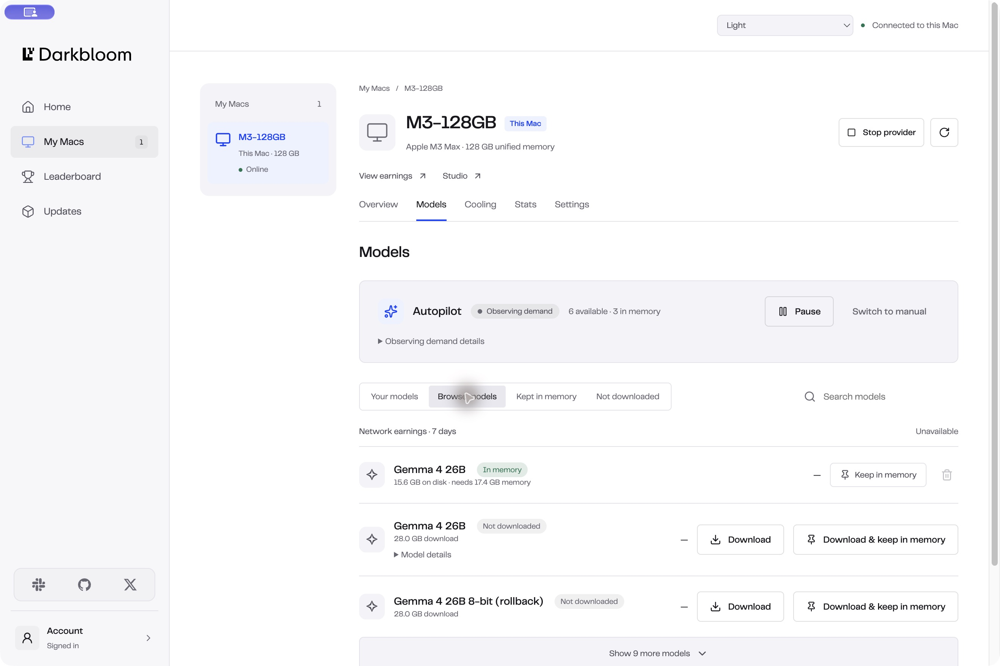

# Build and validate the macOS desktop app

> Last updated: 2026-10-26

Build the Electron frontend and its Swift CLI/backend API in this repository.
This guide covers development and review artifacts; production distribution also
requires the release qualifications below.

## Prerequisites

- Apple Silicon macOS, the repository toolchain, and initialized Swift submodules.
- Node.js 22.12 or later and npm for `desktop-app/`.
- The usual provider build prerequisites in [build](build.md).

## Steps

1. Install and build the frontend:

   ```bash
   make desktop-install
   make desktop-build
   ```

   Build scripts copy the landing page's fonts/logo and generate shared color
   tokens, the app icon and the menu bar template icon (a 16 pt mark rendered
   from the vector at 1x and 2x, `trayTemplate.png` and `trayTemplate@2x.png`).
   Generated copies are ignored by Git; edit the sources in `landing/`. PP
   Telegraf remains governed by its supplied license.

2. Preview UI development without touching a provider:

   ```bash
   cd desktop-app
   npm exec vite -- --host 127.0.0.1 --port 4318
   ```

   Open `http://127.0.0.1:4318/?preview`. The explicit development fixture is
   labeled and compiled out of the production renderer. To inspect the same
   fixture in an Electron window, build first and run:

   ```bash
   DARKBLOOM_DEV_URL='http://127.0.0.1:4318/?preview' npm exec electron .
   ```

   This preview does not start the native API or mutate configuration. Only the
   Leaderboard's network map and rankings read production: the public,
   unauthenticated `/v1/stats` and `/v1/leaderboard`, shaped like the native
   relay and read through the Vite dev server's proxy because rankings reject
   cross-origin reads. Offline or malformed reads keep the fixture; tests never
   make these reads.

3. Build the CLI/backend and test its real HTTP boundary:

   ```bash
   swift build --package-path provider-swift --product darkbloom
   make desktop-api-test
   ```

   The integration test starts a temporary API process and local fake catalog.
   Its `--hold` option keeps the isolated API available for an Electron integration
   check. Set `DARKBLOOM_DESKTOP_ATTACH_ONLY=1`, the printed `DARKBLOOM_DESKTOP_DIR`,
   and `DARKBLOOM_CLI_PATH` in development to attach without installing a service.
   It isolates config, model cache, credentials, discovery, endpoint, and daemon
   state; it does not start inference or contact production.

4. For deliberate native integration, use `npm run dev` in `desktop-app/`.
   Development may set `DARKBLOOM_CLI_PATH` to a built CLI. The normal app connects
   to the canonical installed runtime and manages its API LaunchAgent. This is
   an operator action, not an isolated test; use a dedicated test user/profile
   for lifecycle qualification.

5. Build a review application:

   ```bash
   make desktop-package
   ```

   The result is `desktop-app/release/mac-arm64/Darkbloom.app` with bundle ID
   `io.darkbloom.desktop`. The provider retains `io.darkbloom.provider` under
   its canonical user installation. The packaging command never publishes. Launching the packaged executable with
   `--ui-smoke-test` disables backend connection, login-item changes, and update
   checks for an isolated packaged-renderer check.
   If a valid Developer ID is available, electron-builder signs the GUI;
   notarization requires its configured credentials. Verify the actual result.
   Set `CSC_IDENTITY_AUTO_DISCOVERY=false` for an unsigned review build.

6. Choose the GUI update feed at build time. Packaging settings live in
   `desktop-app/electron-builder.ts` (`desktopBuildConfig`), not `package.json`;
   electron-builder discovers that file even without `--config`. The feed is
   opt-in:

   ```bash
   cd desktop-app
   DARKBLOOM_DESKTOP_UPDATE_URL=https://<desktop-update-host>/<path> npm run dist
   ```

   With the variable set (https only), electron-builder embeds a `generic` feed
   as `Darkbloom.app/Contents/Resources/app-update.yml` and writes the zip,
   blockmap and `latest-mac.yml` to `release/` for hosting at that URL. Without
   it the config sets `publish: null`. No `app-update.yml` is embedded, and
   electron-builder cannot infer a GitHub feed from `GH_TOKEN`/`GITHUB_TOKEN`.
   The app then never calls the updater, and Updates shows "Desktop app updates
   are not configured for this build." instead of failing every check.
   `--dir` builds (`make desktop-package`) never embed the file.

   The packaged app checks only when `app-update.yml` declares a `generic` https
   feed. It must never use electron-updater's `github` provider: this
   repository's latest release is the provider runtime, with no
   `latest-mac.yml`. Release builds (`DARKBLOOM_DESKTOP_RELEASE=1`) refuse to
   build without a feed. `release-desktop.yml` embeds the fixed `generic` feed
   `https://github.com/Layr-Labs/d-inference/releases/download/desktop-latest`
   and replaces that release's assets on every desktop release; see
   [the update feed](../operations/desktop-release.md#the-update-feed).

## Signed local preview

To review an unmerged desktop API with an existing vendor-signed provider
installation, build **Darkbloom Preview** with your own Developer ID. It has a
separate bundle ID and application-data directory. Opening it starts the
bundled API in native attach-only mode; provider operations continue to use the
verified installed runtime. Quitting stops the API while preserving sign-in and
dashboard state. If the app exits without quitting (a crash or force quit), the
next launch stops the API it left running, verified by its recorded pid and exact
bundled command, before starting a new one. A startup failure reports the API's
last stderr line. It does not install a login item or configure an update feed.
Because the installed runtime can be older than the bundled API, the API reports
the installed runtime's `--version` as the provider version (re-read whenever an
update replaces the executable). `DesktopRuntimeProfile` validates stdout alone
for this probe, ignoring stderr notices such as the macOS upgrade warning; failed,
invalid, or oversized output is not a version. Ordinary `DesktopWorker` commands
still capture stderr diagnostics. The API also probes `desktop --help`: actions that need
a `desktop` subcommand the runtime lacks (provider cooling, Studio's local-only
serving) are refused with an explanation, and cooling controls are reported as
unavailable.

Initialize the Swift submodules, install the frontend dependencies, then run:

```bash
cd desktop-app
CSC_NAME='<Developer ID certificate SHA-1>' \
DARKBLOOM_PREVIEW_TEAM_ID='<Apple team ID>' npm run preview:dist
```

`desktop-app/scripts/package-preview.mjs` builds the CLI, stages its resource bundles, signs
the API with the supplied identity and verifies its team before packaging. The
result is `release/mac-arm64/Darkbloom Preview.app` and a DMG/ZIP in `release/`.
Verify the app with `codesign --verify --deep --strict` before opening it. This
command signs the application; notarization still needs electron-builder's
configured Apple credentials. Check the packaging output for its actual status.
The preview signer resolves `CSC_NAME` by its certificate fingerprint with
identity validation enabled, so renewed certificates with identical display
names do not make `codesign` fail with an ambiguous-identity error.

Re-run the same command after edits. The preview's signer is compiled into the
main process, and the bundled executable must satisfy that team and the
`io.darkbloom.desktop.preview.runtime` identifier. Runtime environment variables
cannot opt a release app into this mode. Ordinary builds retain the vendor's
runtime-signature requirement. The native API's lock rejects another preview
using the same state directory; close the existing preview before relaunching.
The local build is for desktop review, not a qualified provider release.

## Verify

The primary sidebar contains Home, My Macs, Leaderboard, and Updates. The current
Mac's detail workspace uses Overview, Models, Cooling, Stats, and Settings
panels, with Studio and Earnings shortcuts;
Home retains the Earnings entry. These pages remain implemented, not deleted.
The machine rail changes into a horizontal selector on narrower windows. My Macs
opens on This Mac; there is no fleet overview page. Other machines are labeled
**View only**: a read-only dashboard of status (stale after 15 minutes of
silence), provider version with an update-required badge, last paid work, online
since, earnings (all time, 24 hours, 7 days), 24-hour requests and input, cached
input and output tokens, an hourly token chart and serving models. It has no
controls, cooling or memory internals. The optional `Machine` fields behind it
(`lifetime_micro_usd`, `day_micro_usd`, `requests_24h`, `tokens_24h`,
`hourly_tokens`, `online_since`, `last_paid_at`) are filled only by the preview
fixture today; production shows "—" or omits the chart until the account
projection supplies them. The
app stores the selected machine ID so new remote observations are shown instead
of retaining the originally clicked snapshot, and Models, Cooling, Stats,
Settings and Studio always apply to This Mac. Cancellable native operations
appear in the shared bottom popup; Settings retains Availability and Memory controls,
and model metadata uses expandable details.

This Mac's Overview starts with a health bar: memory from native state, fan
speed and mode from the cooling resource, and the native `readiness` text shown
verbatim. When This Mac is not serving, next steps with actions are derived
from reported facts (CLI connection, required update, provider state,
downloaded/selected/loaded models, crashed slots, running operations, macOS,
linking); the app does not reimplement admission policy. Below macOS 27 an
existing install gets an advisory **Update macOS** step with **Open Software
Update**, after any step that keeps it from serving; like linking it never
changes the tone, because the coordinator decides whether the Mac still serves.
Home shows the same prompt as a notice that can be dismissed until the app is
next opened. Cooling is read only while
Cooling or This Mac's Overview is visible, because each read runs
`darkbloom fan status`. A shared fan glyph spins whenever a fan reports RPM,
faster as RPM approaches its maximum, on the health bar and the Cooling tab; it
stays still when stopped, fanless, unavailable or unread, and under reduced
motion, with the state always also stated in text. Below it are This Mac's all-time and past-24-hour
earnings and an hourly token chart for the past 24 local hours built from
`activity.samples`. Hours with no sample interval (sleep, a stopped provider, or
before the session) stay blank rather than zero; a decreased counter counts as
a restart from zero. `CloudData.local_lifetime_micro_usd` and
`local_day_micro_usd` are not sent by the runtime yet, so production shows "—"
until it supplies them.
Leaderboard combines the reference's pixel world map and featured top three with
compact rows. It ranks actual 24-hour earnings from the native API and displays
annualized pace; expanding a provider shows the underlying earnings and tokens.
Missing location data never lights illustrative locations in production.
Regions sharing a map cell light it together in one of four shades scaled by Mac
count; hovering a cell or choosing a region shows its count.


The Home chip header links to Cooling through `FanStatus`. The enabled helper
stays blue regardless of its current SMC mode. With the option off, temperatures
above 60°C become progressively red up to 90°C; missing or stale observations
stay neutral. Home reads the existing cached cooling resource while visible
(`showsCooling`, `DesktopBackend.projectCooling`).

Overview readiness uses `assessReadiness` to show current state, including the
coordinator’s `provider_status`, rather than the raw `readiness` event message.
A ready Mac shows "Ready to serve" with its loaded-model count. Shared product
labels in `desktop-app/src/renderer/presentation/status.ts` (`machineStatus`,
`modelActivity`) distinguish online Macs and idle models from processing requests.
`operationLabel` names actions in progress and completed outcomes. Putting This
Mac to work is always *serving*: Home, This Mac, Overview next steps, Updates and
the menu bar say Start serving, Stop serving and Restart serving, and the matching
operations read Starting to serve, Stopping serving and Restarting serving.
"Provider" remains only the role noun (provider version, automatic provider
updates, the Leaderboard's Provider column); `desktop-app/tests/servingVocabulary.test.tsx`
rejects the retired Start providing / Stop provider wording in `desktop-app/src`. `App` mounts
one `OperationFeed` outside page content; its body portal stays at the bottom
on Home, My Macs (including remote Macs and all tabs), Leaderboard and Updates.
Successful operations disappear after ten seconds, using their native completion
time when available; navigation and state refresh do not reset the countdown.
Failures and immediate `backend.error` messages remain until Close. Dismissal
persists across remounts, and expanded details retain native diagnostic messages. Cooling labels use the
enabled fan policy independently of its current firmware mode (`coolingStatus`).

The account footer displays `state.account.email` with Signed in. Swift obtains
identity from the existing `/v1/provider/account-earnings` response's optional
`email`, persists it with the coordinator-scoped dashboard credential, and shares
the same cached ledger request with stats and earnings (`DesktopAccountIdentity`).
State polling hydrates older credentials even when the provider is stopped;
missing identity leaves Account as the label. Sign-out removes the identity,
and replies from another coordinator/session cannot update it. Coordinators must
include the authenticated owner's email in that response for the address to appear.

Account control replaces the machine-name card at the bottom of the sidebar.
Sign in immediately opens a modal (`AccountControl`, `useAccountSignIn`,
`components/account/AccountSignInProgress.tsx`) using `link.code` from the native
snapshot. Electron's Swift account action sets `automaticallyOpenBrowser=false`;
only Continue in browser calls the existing external-link bridge. The dialog leads
with a short code instruction and a full-width action; waiting status appears
after the browser opens. The CLI keeps automatic
browser opening. Copy, cancel, retry and approval states stay in the modal.
Closing it preserves pending approval; Continue sign-in reopens the same attempt
across pages. Account sign-in is excluded from the generic `OperationFeed`.

**Help**, above the community links at the bottom of the sidebar
(`components/Help.tsx`), opens a dialog linking the guide (`docs`), Slack
(`slack`) and GitHub Discussions (`community`) through the existing
external-link allowlist, and names the app version to mention. Failures offer
**Get help** (the guide, which covers troubleshooting) next to the error: failed
or interrupted operation notifications, the not-connected notice when the
runtime is unreachable (not while it connects or installs), failed sign-in
beside **Try again**, and a failed runtime install or repair.

Home scrolls. It opens with the network milestone strip: tokens processed, the
last 24 hours when the runtime relays `last_24h_tokens`, Macs connected, and a
segmented bar toward the next proposed milestone (1, 2.5 and 5 of each power of
ten, so 1T after 500B), marked live, last known or unavailable from the network
resource. That strip, session output tokens, requests and a fixed-height
activity hero fit above the fold at 1440×900; below them, the fleet summary shows
account earnings, the 7-day chart and every Mac, and a row opens that Mac in My
Macs. Its preview animates
simulated requests gathering around model cores and fanning into token streams; production uses current native activity and never
invents stage events. Stats replaces Analysis. Its Performance tab includes an
inspectable traffic chart (a Requests curve, and Tokens served as stacked input,
cached input and output bars; the optional `ActivitySample.input_tokens` and
`cached_input_tokens` counters are not sent by the runtime yet, so production
shows output-only bars with a note), model traffic, and settled-token milestones. Its
Activity tab lists every request This Mac served (time, model, input and output
tokens, duration, tokens per second, outcome, earnings) with model and outcome
filters and paging. It reads the `request-history` resource only when the tab
opens or on Refresh, never in the periodic refresh, and no prompt or response
content is stored or shown. The runtime does not serve `request-history` yet, so
production shows an unavailable state. The current design preview
supplies clearly labeled sample 24-hour model traffic, outcome rate and generation
speed. Production shows observed interval deltas and leaves unavailable metrics
unknown. Future runtime/coordinator work must supply real per-model traffic bins,
request outcomes, generation speeds and request-stage events before those preview
metrics can become live. The particle canvas caps drawing at roughly 30 frames
per second, limits pixel density, and pauses off-screen, when hidden, when the
provider is inactive, or when motion is paused/reduced. Counter resets and
reversed timestamps are excluded.
 **View earnings** opens the desktop Earnings screen, which supports
7/30-day periods, earnings/output-token/request metrics, model/Mac breakdowns,
and exact **Copy CSV**. Failed reads retain a labeled prior observation only
within the same account session. New milestone crossings are celebrated once
while mounted; old achievements do not replay on navigation. Appearance is a
frontend preference with Light, Dark, and System options. Reduced motion and
the activity panel's pause control stop animation without stopping the provider.

`desktop-app/tests/insights.test.tsx` covers live/stale/crashed activity, exact
large integers, milestone boundaries, account-switch races, earnings navigation,
period/metric/breakdown controls, and appearance. `overview.test.tsx`,
`readiness.test.ts` and `hourlyTokens.test.ts` cover the health bar, next steps
and hourly bucketing; `requestActivity.test.tsx` covers the Activity tab,
filters, paging and the unavailable state. `DesktopActivityTests` covers
the additive native state fields and opaque account revision. Coordinator tests
exercise token ownership/revocation and exact decimal-string responses; store
parity runs with `DATABASE_URL` set to a disposable local PostgreSQL database.

```bash
make desktop-test
make desktop-api-test
make docs-impact-check BASE=origin/master
make docs-check
```

`DesktopControlTests` covers the native auth and validation boundary.
Coordinator-side desktop account sessions and earnings reads are implemented and
tested in [darkbloom-platform#23](https://github.com/Layr-Labs/darkbloom-platform/pull/23);
the console `/link` page's desktop purpose is a separate console change. The
ordinary provider component suites remain required for changes to shared code.

`.github/workflows/desktop.yml` runs the frontend tests and build, including
for changes to `scripts/install.sh`, which the app bundles. Manual workflow
dispatch also produces unsigned macOS review artifacts. It does not publish a
release or establish attestation qualification.

## Hardware load

`useHardwareLoad()` (`desktop-app/src/renderer/hardware/useHardwareLoad.ts`)
returns `{ topology, sample, fresh, capabilities }` for the
[hardware contract](../reference/desktop-control.md#hardware-load) in
`desktop-app/src/shared/hardware.ts`. `sample` is the whole machine's load even
while the provider is stopped; Darkbloom's part is `sample.gpu.provider_share`
and `sample.provider.running` says whether it is serving. `fresh` is true while
`sampled_at` is under 3 s old and drops on its own when frames stop. Fields the
runtime cannot measure are `null`, which callers must render as unknown, not
zero. The hook reads `hardware` once and subscribes through `onHardware` only
while it is mounted and the document is visible:

```tsx
const { topology, sample, fresh } = useHardwareLoad();
const gpu = fresh ? sample?.gpu.utilization : null;
const darkbloom = gpu != null ? gpu * (sample?.gpu.provider_share ?? 0) : null;
```

The main process holds one runtime stream however many subscriptions the
renderer has (`HardwareWatch`), closes it after the last `hardware:unwatch`, and
drops subscriptions when the renderer navigates or crashes; the runtime then stops
sampling after its 10 s grace. The preview (`desktop-app/src/renderer/previewHardware.ts`,
whose topology also defines the preview snapshot's chip and memory) streams a 64 GB M4 Max
cycling idle (6 s), prefill (4 s: GPU ~99%, ~62 W, ~100 GB/s)
and decode (14 s: GPU ~99%, ~31 W, ~450 GB/s) with an idle ANE, and stays idle
while the preview provider is stopped. `hardwareWatch.test.ts`,
`hardwareIPC.test.ts` and `hardwareLoad.test.tsx` cover parsing, reference
counting, sender checks, freshness, unsubscribe and the preview stream;
`DarkbloomHardwareLoadTests` and `DesktopHardwareRouteTests` cover the Swift
sampler and routes (`swift test --filter 'DarkbloomHardwareLoadTests|DesktopHardwareRouteTests'`).

## Onboarding

The app is a front end to the Darkbloom CLI, which runs the background service
that serves models. First run has four steps, **Install the Darkbloom CLI**
(labelled **Install CLI** in the step indicator), **Check this Mac**, **Link
your account** and **Start**. The Mac is checked before an account is linked, so
an ineligible Mac is never asked to link. Install the Darkbloom CLI stands in for every later
step until the CLI is connected with a snapshot. When the status is `missing`,
`error` or `incompatible` it shows the reason with **Install CLI**, **Repair
CLI** or **Update CLI**; the install starts only when the user clicks one, never
by itself. While the CLI connects, or an install the user started runs, it shows
the main process's status message ("Connecting to the Darkbloom CLI…",
"Installing the Darkbloom CLI…") with a spinner and no button. Once the CLI is
ready, setup moves on to the check, with the install step done and focus on the
new heading. A CLI that is already installed opens on the welcome view at step 2
instead. A reconnect with a snapshot keeps the current
step; a CLI that goes missing, fails or is reinstalled mid-setup shows the install
step until it is back.

Start on the welcome view runs the eligibility scan. An eligible Mac moves on by
itself to **Link your account**, or straight to **Start** on a Mac that is
already linked, with the link step shown as done. An ineligible Mac stops at the
check with its reasons and a waitlist and never reaches linking; an unconfirmed
one can check again, or continue. "Explore the app first", beside the steps,
leaves for the app from any step once the CLI has delivered a snapshot, so never
from a first install, and cancels a link in progress.

- **macOS 27.** Darkbloom accepts new providers only on macOS 27 or later; the
  CLI installer refuses new installs below it. The main process reports
  `process.getSystemVersion()` through `system()` (`app:system`; empty off
  macOS), and `supportsNewProviders` in `desktop-app/src/shared/macos.ts`
  compares its major release, treating an unknown version as supported. When
  the CLI is `missing` below macOS 27, Install the Darkbloom CLI shows
  "Darkbloom needs macOS 27 or later" with **Open Software Update** in place of
  **Install CLI**. A Mac that already has the CLI (connected, broken or
  incompatible) is an existing provider and carries on. `openSoftwareUpdate()`
  (`app:software-update`) opens a fixed System Settings URL in the main process;
  the `openExternal` allowlist is unchanged. `systemIPC.test.ts`,
  `macosRequirement.test.tsx`, `onboardingInstall.test.tsx`,
  `onboardingScan.test.tsx` and `readiness.test.ts` cover it.
- **Eligibility.** The scan reads the optional `Snapshot.eligibility` block
  (`desktop-app/src/shared/eligibility.ts`: `apple_silicon`, `memory`, `macos`,
  `storage`, `security`; `ok: null` means not evaluated). Without it, the
  renderer derives Apple silicon and memory from the snapshot. Memory is only
  known for downloaded models, so a fresh install usually shows "couldn't confirm".
  When the report has no `macos` check and the main process knows the version,
  the renderer adds one, failed below macOS 27; an ineligible result with that
  reason offers **Open Software Update**.
- **Waitlist.** `{ action: 'waitlist', email, reasons }` takes the failed check
  IDs as reasons and counts only once its operation succeeds.
- **Autopilot.** "Start serving with Autopilot" sends
  `{ action: 'autopilot', models, pinned, downloads, endpoint: true }`
  (`desktop-app/src/shared/autopilot.ts`). It mirrors
  `darkbloom start --autopilot --model … --local-endpoint` followed by
  `darkbloom autopilot pin …`.
  - With network earnings available, choose from the top three compatible earners
    over seven days; all three are checked initially. `downloads` contains only
    chosen models missing from disk. Swift completes downloads before enrollment.
  - `models` is the startup selection: the pins or one chosen model. Other cached
    network models are verified and enrolled without pinning or loading all three
    together. Without ranking data, the existing single-model start remains available.
  - `pinned` is a subset of `models`, matching the CLI rule that pins must be
    selected models.
  - It is a separate action, not a `start` flag, because `DesktopAction`
    ignores unknown keys: a flag would start without Autopilot and still report
    success.
  - A runtime that supports the action reports `Snapshot.autopilot`
    (configured enrollment plus the live phase from `autopilot status --json`).
  - Pins use the existing CLI's unload protection while Autopilot holds ownership;
    pinning a cold model does not itself load it.
- **Account linking.** **Link account** runs the existing `link` action and
  shows its code. Only **Open link page** opens the browser. Once the account is
  linked, setup moves on to Start. A failed or cancelled link returns to
  **Link account**. A start on an unlinked Mac goes back to this step rather
  than linking inline, then returns to Start.
- **Fallback.** A runtime that rejects `autopilot` by name keeps the starting
  model selected and offers "Choose models manually". That path uses the
  existing `start` action with the chosen models.
- **Updates.** Onboarding never writes settings, so an automatic-update opt-out
  is preserved.

Preview links (`?preview` plus):

| Query | Shows |
|---|---|
| `&onboarding=eligible`, `ineligible`, `unknown` | That scan result |
| `&waitlist=fail` | Runtime rejecting the sign-up |
| `&macos=26.5` | That macOS version (default `27.0`), in `system()` and the scenarios' `macos` check |
| `&account=unlinked` | Linking, approved after a few seconds |
| `&autopilot=unsupported` | Runtime rejecting Autopilot, then the manual fallback |

## Models

This Mac > Models follows `Snapshot.autopilot`
(`desktop-app/src/renderer/features/models/`). The user decides which models
are downloaded; Autopilot decides which of them are loaded in memory.
Both model modes show the first three ranked matches, with a Show more models
bar to reveal the remainder. Changing the filter or search restores the compact
view; expansion preserves the existing earnings order.



The local review screenshot shows an older coordinator without network earnings;
recommendations remain unavailable until that response field is deployed.

- **Autopilot on** (`enabled: true`). Your models opens first and ranks downloads
  by personal earnings. Browse models ranks the catalog by seven-day network
  earnings from `network`. Recommendations select eligible positive earners,
  at most three (`recommendations.ts`, `recommendedModels`). The status bar shows
  the daemon's actual phase and resident count. Descriptions and phase explanations
  stay collapsed. There is no Apply selection.
  - Downloading alone never adds a model to the pool. Download sends `download`,
    then `autopilot_models` to re-inventory the pool.
  - Keep in memory is a direct row toggle. Catalog rows also offer Download & keep
    in memory. A cold pin says Kept · waiting to load; only observed residents
    say In memory · kept (`PoolRow`).
  - Pin capacity uses native `pin_budget_gb` (the shared startup load allowance)
    and `max_model_slots`. Swift rechecks downloaded estimates before pinning.
  - Remove is disabled for pinned, resident or advertised models. After removing
    a cached pool model, refresh available models.
  - Pause and Turn off ask for confirmation first. Models stay loaded as they
    are, and after Turn off, manual selection takes over.
- **First use** (`configured: false`). Show Autopilot setup with editable
  recommendations. Missing earnings stay unavailable; prices and demand counts
  are never substituted for settled payouts.
- **Autopilot explicitly off** (`enabled: false`, `configured: true`). The manual workflow (checkboxes, Apply
  selection) plus a card that sends `{ action: 'autopilot', models, pinned: [],
  endpoint }` with the models serving now.
- **No `Snapshot.autopilot`.** The manual workflow with a note that Autopilot
  needs a newer runtime. No Autopilot control is shown.

The policy actions (`AutopilotPolicyAction` in
`desktop-app/src/shared/autopilot.ts`) map to the CLI as follows. `download` and
`remove` are unchanged.

| Action | CLI |
|---|---|
| `{ action: 'autopilot_pin', models }` | `darkbloom autopilot pin <models>` |
| `{ action: 'autopilot_unpin', models }` | `darkbloom autopilot unpin <models>` |
| `{ action: 'autopilot_pause' }` | `darkbloom autopilot pause` |
| `{ action: 'autopilot_resume' }` | `darkbloom autopilot resume` |
| `{ action: 'autopilot_disable' }` | `darkbloom autopilot disable` |
| `{ action: 'autopilot_models' }` | Noninteractive `darkbloom start --autopilot --model <saved startup models>`; same verified inventory and safe restart as `autopilot models` |

A runtime that rejects one of these by name gets an error asking for a newer
runtime or manual selection. A download operation that reports `model` and
`progress` (0 to 1) gets a determinate progress bar. Without them the bar is
indeterminate.

Preview links (`?preview` plus):

| Query | Shows |
|---|---|
| none (`&autopilot=on`) | Autopilot on: two models loaded, one pinned, one in the pool and not loaded, and several not downloaded |
| `&autopilot=shadow` | Shadow mode: Autopilot is observing demand and changes nothing |
| `&autopilot=off` | Manual selection with the turn-on card |
| `&autopilot=unsupported` | Runtime without Autopilot: manual selection with the note |

## Updates presentation

Updates shows installed/latest runtime versions, a compact release timeline and
an automatic provider-update switch. Provider configuration defaults to enabled;
the UI preserves an existing opt-out. Disabling asks for confirmation in both
Updates and Settings. Updates saves through the revision-checked native settings
action, and offers **Restart serving** to apply the setting to a running provider.
It never restarts automatically from a toggle.

A mandatory update is shown only when the installed version is below the
coordinator's published minimum. An available release alone is not mandatory.
Unknown policy remains unavailable; missing release notes are not invented.
The release-history resource requires the new coordinator endpoint to be deployed;
the existing latest-release display works independently. The browser development
preview contains explicitly illustrative release notes and version cutoffs.

## Release qualification

Signed, notarized releases are built and published by
`.github/workflows/release-desktop.yml` (tag `desktop-vX.Y.Z`); see
[Release the macOS desktop app](../operations/desktop-release.md).
Before public distribution, verify all of the following against the final
signed frontend and signed provider artifact:

- Fresh install, existing CLI install, and repair use verified compatible payloads.
  The first runtime release must include the new `desktop` command; an older
  published CLI cannot provide this API.
- Deploy the platform coordinator's desktop account APIs and the console `/link`
  desktop purpose before advertising account features. A missing endpoint
  appears as unavailable data, never sample account results.
- Verify the GUI update separately from the native update: an installed release
  finds the next release on the `desktop-latest` feed, downloads it, installs it
  on quit and relaunches as the new version (step 6).
- Verify notarization, Gatekeeper, the provisioned provider bundle, App Attest,
  source-matched metallib/resources, and the existing fan helper on real hardware.
- Exercise a real eligible model through download, start, inference, local/network
  mode changes, graceful stop, restart, sleep/wake and reboot. Preserve provider
  identity/configuration and verify both app and CLI agree afterward.
- Exercise API interruption during a long operation. The operation journal marks
  an interrupted operation for reconciliation; automatic exactly-once replay is
  not implemented. Do not retry until native state is known.
- Log out and back in after the first packaged launch: the menu bar item appears
  and no window opens (`wasOpenedAtLogin`). Reopening the app shows the window.
- Confirm desktop redistribution rights for the supplied fonts.

See [provider releases](../operations/provider-release.md) and
[coordinator deployment](https://github.com/Layr-Labs/darkbloom-platform/blob/d7c836b71c77b09dc3fcfa9590c9307a4f2c3a55/docs/operations/coordinator-deploy.md) for the independently
authorized release/deploy procedures.

## CLI installation

The app is a front end to the Darkbloom CLI (`~/.darkbloom/bin/darkbloom`), which runs
the background service that serves models. Users drag the app to Applications and open
it; when the CLI is missing, onboarding shows **Install the Darkbloom CLI** with an
**Install CLI** button. The install starts only when the user clicks it: the
watch loop (`Backend.watch` in `desktop-app/src/main/backend.ts`) only reports
`missing` and never starts an installer, in any build. The click calls
`DesktopAPI.install()` (`backend:install`), which runs the bundled installer
(`Contents/Resources/bootstrap/install-runtime.sh`, a copy of `scripts/install.sh`)
with `COORD_URL=https://api.darkbloom.dev` and no terminal, so it never prompts. An
existing CLI is updated or repaired with `darkbloom update` instead.

- **Buttons.** `RuntimeSetup` offers **Install CLI** (`missing`), **Repair CLI**
  (`error`) or **Update CLI** (`incompatible`), and **Retry** after a failure. The
  signed preview refuses installs and `--ui-smoke-test` disables them.
- **One installer.** Every button shares one in-flight install; a second click joins it.
  While it runs, the watch loop does not reconnect over its progress.
- **Progress.** `desktop-app/src/main/installProgress.ts` maps the installer's step
  headers (`→ [1/5]` … `→ [5/5]` and the hash/signature lines) to plain
  `{ state: 'installing', message }` statuses: "Installing the Darkbloom CLI…",
  "Downloading the CLI… 42%", "Verifying the CLI's signature…", "Setting up this Mac's
  identity…", "Setting up device verification…" and "CLI installed. Starting it…".
  `RuntimeSetup` shows them with **Cancel**, never a second Install button. Only the
  current output line is buffered (8 KB).
- **Failure.** The status sets `installFailed: true` and its message keeps the step and
  the installer's last `✗ …` or `Error: …` line ("Couldn't install the CLI while
  downloading it: …"), with URL queries, credential-looking values and long tokens
  removed. A fresh install that fails stays `missing`; a failed update of an existing
  CLI is `error`. The reason stays on screen, through reconnect attempts, until the user
  clicks **Retry**.
- **Cancel.** `DesktopAPI.cancelInstall()` (`backend:cancelInstall`) stops the
  installer's process group (including `curl`) and reports "CLI install cancelled.".
  Quitting the app does the same. The installer stages and verifies the new app before
  its atomic swap, so cancelling normally leaves an existing CLI in place.

## Launch at login

The first packaged launch registers the app as a macOS login item (the default
`mainAppService`) once; later changes in System Settings are kept. Login-item
`args` are Windows-only in Electron, so a login launch is detected through
`app.getLoginItemSettings().wasOpenedAtLogin` (`launchedHidden` in
`desktop-app/src/main/loginLaunch.ts`) and starts without a window. The
menu bar item stays available. Passing `--hidden` also starts hidden.

## Main-process layout

`desktop-app/src/main/index.ts` only wires the modules below together;
`desktop-app/scripts/build.mjs` bundles them into `dist/main.cjs`.

| Module | Responsibility |
|--------|----------------|
| `desktop-app/src/main/security.ts` | IPC sender/frame/origin checks, navigation and link allowlists, renderer path guard, CSP, clipboard bounds (electron-free, unit tested) |
| `desktop-app/src/main/protocol.ts` | privileged `darkbloom://` scheme and renderer file serving |
| `desktop-app/src/main/window.ts` | the sandboxed main window; close hides |
| `desktop-app/src/main/ipc.ts` | renderer-callable channels, each gated by `isTrustedSender`, including the macOS version and the fixed Software Update link |
| `desktop-app/src/main/tray.ts`, `desktop-app/src/main/trayMenu.ts` | menu bar item (status, Start/Stop/Restart serving); the native menu rebuilds only when its state model changes |
| `desktop-app/src/main/appMenu.ts`, `desktop-app/src/main/notifications.ts`, `desktop-app/src/main/lifecycle.ts` | application menu, failed-operation notification, quit state |
| `desktop-app/src/main/loginLaunch.ts` | login-item registration and hidden login launch |
| `desktop-app/src/main/updates.ts`, `desktop-app/src/main/updateFeed.ts` | GUI self-update and the build-time feed contract |
| `desktop-app/src/main/backend.ts` | runtime discovery, signature checks and the native API client |
| `desktop-app/src/main/installProgress.ts` | installer output: bounded line reader, plain-language steps, sanitized failure reason |
| `desktop-app/src/main/hardware.ts` | `HardwareWatch`: the reference-counted hardware SSE client, hardware event parser and size guard |
| `desktop-app/src/main/sse.ts` | server-sent event framing (`splitFrames`, `frameData`) shared by the state and hardware streams |

`Backend.verifyRuntime` checks the runtime's code signature in packaged builds before
running `desktop ensure` or `update`.
